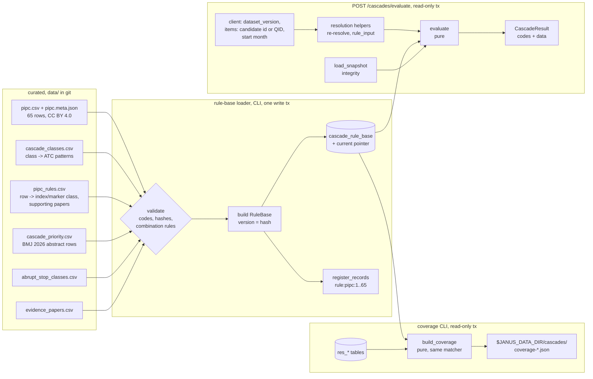

# Design: Cascade Engine ("Ghost Diseases"), Phase 1

> Scope: `apps/api/janus/cascades/`, migration `0005_cascade_rule_base`, the curated class
> mapping and its companion files under `data/`, the rule-base loader, `POST /cascades/evaluate`,
> and the PIPC coverage report. Two small read-only helpers in `janus/resolution/` (§6.2) and
> two `cited_only` registry entries in `pipelines/sources.toml` (§3.5). Criteria tagged
> **[Later phase: OnSIDES]**, **[Phase 2: collective-memory]** and **[Client: …]** are not
> designed here; the result model leaves room for them (§3.6).
> The curated mapping is drafted by the pharmacologist agent and reviewed by the owner before
> any engine code that depends on it is written (tasks.md, task 5).

## 1. Overview

The engine has one pure function, `evaluate`, and everything around it only prepares its
arguments or delivers its result:



Facts checked on 2026-11-07 that shaped this design:

| Source / topic | Observed | Design consequence |
|---|---|---|
| `data/pipc.csv` | 65 rows (52 `drug_class`, 13 `individual_drug`) in 7 systems; 41 distinct Drug A texts and 37 distinct Drug B texts, 70 distinct across both roles. Drug B texts repeat: "Antiemetic" 5 rows, "Antihypertensive" 5, "Diuretic" 4, "Overactive bladder medication" 4, "Laxative" 3, "Sleep agent" 3. Row 49 Drug B reads "Vitamin or Mineral Deficiency" (same as its adverse event). `pipc.meta.json` holds the content hash of the pipeline run `20261107T162311Z-a3ac15ad-9532` | One class definition per PIPC class, reused across rows (DP2); row 49 interpreted in the mapping note, text kept as published (Req 5.6); the loader verifies the hash (task 1 confirms the recomputation) |
| BMJ 2026 abstract (Europe PMC record of PMID 42727946, `isOpenAccess` N) | 65 PIPC cascades tested in 2,297,942 Ontario adults; 24 met all three criteria. Named with numbers: highest incidence iron supplement → laxative 11.9 % (11.7–12.1), statin → pain reliever 10.9 % (10.7–11), cholinesterase inhibitor → sleep agent 10.3 % (9.9–10.7); highest adjusted sequence ratio corticosteroid → antipsychotic 2.55 (2.47–2.64), laxative → antidiarrheal 2.53 (2.43–2.65), cholinesterase inhibitor → antiemetic 2.24 (1.90–2.65). SSRI/SNRI → overactive bladder drug is named only for a sex difference. The abstract does not list the 24 | Six PIPC rows carry BMJ data: 65, 9, 25, 60, 47, 26. Row 32 does not. Janus says "named in the BMJ 2026 abstract", never "one of the 24" (DP6) |
| ThinkCascades (Europe PMC, PMID 36107399) | McCarthy LM et al., Drugs Aging 2022;39(10):829–840, doi:10.1007/s40266-022-00964-9, PMC9477172; 9 cascades. From the research notes (AGS 2022 poster), 6 match PIPC rows 5, 8, 18, 23, 53, 56; 3 are not in PIPC (benzodiazepine → agitation → antipsychotic; SSRI/SNRI → insomnia → sleep agent; urinary anticholinergic → cognitive impairment → cholinesterase inhibitor). Licence: restricted PMC terms | Supporting evidence id on the overlapping rows only (Req 6.2); the overlap is confirmed against the paper in task 4; the 3 others are an owner decision (DP18) |
| Exposure window literature: Hendrix MRS et al., BMC Med Res Methodol 2024;24:8, doi:10.1186/s12874-023-02108-y (CC BY 4.0, Crossref checked today) | A step-by-step guide to prescription sequence symmetry analysis for prescribing cascades: a 12-month exposure window is the one generally used; a 12-month window gave the best balance of sensitivity (61 %) and specificity (93 %) over 165 index–marker pairs in the validation study it cites; first prescriptions of index and marker on the same date cannot be ordered and are excluded. BMJ 2026 used the same analysis family | Default window 12 months (inclusive), same month → order unknown → `possible` (DP4); the paper is registered and gates the `probable` label (DP16) |
| Ophthalmic beta-blockers: Vander Zanden JA et al., Ann Pharmacother 2001;35(12):1633–1637, doi:10.1345/aph.18464 (review); timolol ophthalmic labels (DailyMed, Istalol) | The review finds bronchospasm and cardiovascular effects (bradycardia) best supported; depression and other CNS effects are reported less often. The label says that, because timolol is absorbed systemically, the adverse reactions of systemic beta-blockers may occur | Ophthalmic beta-blockers (`S01ED`) can start a cascade through systemic absorption (DP8) |
| PIPC rows with a beta-blocker as Drug A | Rows 3 (depression → antidepressant) and 4 (erectile dysfunction → PDE-5 inhibitor, alprostadil). No PIPC row has bronchospasm or bradycardia as the adverse event. Row 2's Drug A is "Antihypertensive" (a class by indication); row 17 has a beta-blocker as Drug B | The owner's timolol example (bronchospasm, bradycardia) has no PIPC rule; the extension matters for row 3 and, with a source, row 4 (DP8) |
| TİTCK list (titck-2 run `20261107T180936Z-0738c719-f9ff`) | Products whose published code is `S01ED…`: 41; `C07AA…` (non-selective systemic beta-blockers, incl. propranolol): 8; `C07AB…`: 122 | Eye-drop beta-blockers outnumber oral propranolol products in Türkiye, so the extension decision is not marginal |
| `drug-resolution` code | `rule_input(ingredient)` returns sorted unique codes for `mapped` only. `ProductCandidate.candidate_id` is `TR:titck:<n>` / `US:openfda_ndc:<n>`, stable within one dataset version only (product ids follow the canonical sort of the rows). `IngredientCandidate` (name search) has no candidate id; it carries `ingredient_key.qid` and `atc_selection = all_codes`. `resolve_products` reports unknown ids with the notice `unknown_candidate_ids`. Combination codes are stored per dataset in `res_combination_atc` | Items are sent as candidate id or QID with the dataset version; the server re-resolves and answers 409 on a version change (DP9); the input guard uses the dataset's combination codes (Req 1.3) |
| Route map `data/route_atc_groups.csv` | `OPHTHALMIC` allows `S01;S03` only; `TRANSDERMAL`, `NASAL`, `RECTAL`, `RESPIRATORY (INHALATION)` already allow the systemic groups of drugs given that way (clonidine and opioid patches, triptan sprays, …) | Transdermal and other systemic non-oral products already carry their systemic codes; only route-specific groups (S, D, R03B, M02, …) need a decision (DP8). The route map is unchanged (Req 7.5) |
| `evidence-integrity` code | `rule_gate(sources, snapshot, verdicts=None)`, `cite(snapshot, ids) -> Cited(kept, removed)`, `keep_output`, `register_records(conn, records, today)`, `load_snapshot(conn)` (≤ 5,000 records), `build_item(...)` codes. `dataset:pipc` is `corrected` (notice `10.1007/s41999-025-01378-7`, 2025-12-18). `data/evidence_papers.csv` has a header only. `pipelines/sources.toml` already has `thinkcascades` and `bmj_2026` as `cited_only` (no cadence needed) | Reuse as is. Two new `cited_only` entries for the window and extension papers (§3.5) |
| `experience` Req 1.1 | "since when?" is asked as month/year or "don't know" | Start months, not dates (DP4) |
| `medical-safety.md` rule 4 | Abrupt-stop examples: beta-blockers, antiepileptics, corticosteroids, benzodiazepines, antidepressants, clonidine ("e.g.") | The curated list must cover these six; the pharmacologist may propose more, each reviewed (DP13) |
| API infrastructure | Latest migration `0004_evidence_integrity`; `LogEvent` has `resolution_load`, `integrity_load`; `write_tx` boundary test lists `contributions/repository.py`, `resolution/load.py`, `integrity/load.py`; `janus/cascades/` holds only `__init__.py` | New migration `0005`; `LogEvent.cascade_load`; boundary test extended (DP19) |

## 2. Code layout

```
apps/api/
  janus/cascades/
    model.py        Month, Pattern, AtcClass, Rule, Priority, RuleBase, EngineIngredient,
                    EngineItem, Exposure, Timing, Finding, Chain, result parts        (pure)
    patterns.py     is_prefix_pattern(), class_match() — the only class matcher     (pure)
    rulebase.py     parse_pipc(), parse_classes(), parse_rules(), parse_priority(),
                    parse_abrupt_stop(), validate(), build_rule_base(), version()   (pure)
    timing.py       parse_month(), format_month(), classify()                       (pure)
    exposure.py     exposures()                                                     (pure)
    chains.py       chains()                                                        (pure)
    engine.py       evaluate(items, rule_base, snapshot, as_of, combination_codes)  (pure)
    coverage.py     trigram_similarity(), build_coverage()                          (pure)
    load.py         read and validate data/ files, write rule base, register rule
                    evidence; CLI `python -m janus.cascades.load`                   (I/O)
    report.py       coverage CLI `python -m janus.cascades.report`                  (I/O)
    repository.py   current_rule_base(), rows for the coverage report               (I/O)
    service.py      evaluate_request(): one read-only tx, resolution, snapshot     (I/O)
    schemas.py      request and response models (Pydantic v2)
    router.py       POST /cascades/evaluate
  janus/resolution/
    service.py      + engine_items(conn, cur, product_ids, qids) (read-only helper)
    repository.py   + ingredients_by_qid(), combination_codes()
  migrations/versions/0005_cascade_rule_base.py
data/
  cascade_classes.csv       curated: class -> ATC patterns (DP2, DP3, DP8)
  pipc_rules.csv            curated: PIPC row -> index/marker class, supporting papers
  cascade_priority.csv      curated: BMJ 2026 abstract data for 6 rows (DP6)
  abrupt_stop_classes.csv   curated: abrupt-stop list (DP13)
  evidence_papers.csv       + 4 papers (BMJ 2026, ThinkCascades, Hendrix 2024, Vander Zanden 2001)
pipelines/sources.toml      + hendrix_2024, vander_zanden_2001 (cited_only)
tests/
  cascades_strategies.py    rule bases, classes, codes that hit or miss, items, months, snapshots
  test_cascades_patterns_properties.py   test_cascades_rulebase_properties.py
  test_cascades_timing_properties.py     test_cascades_engine_properties.py
  test_cascades_chains_properties.py     test_cascades_evidence_properties.py
  test_cascades_rules_properties.py      (the real curated files, all 65 rules)
  test_cascades_load_properties.py       test_cascades_api_properties.py
  test_cascades_coverage_properties.py   test_cascades_real_artifacts.py (local only)
.kiro/specs/cascade-engine/mapping-review.md   review sheet for the owner (task 4)
```

`structure.md` already names `janus/cascades/` ("cascade engine (pure functions)"). Everything
marked pure has no I/O; the clock enters as an `as_of` month. No new dependency.

## 3. Data contracts

### 3.1 Class definitions `data/cascade_classes.csv` (Req 1.2, 5, 7.4)
Columns `class_id,pattern,match,scope,basis,evidence_id,note`; one row per pattern.

| Column | Values |
|---|---|
| `class_id` | `^[a-z0-9_]{2,40}$`, e.g. `ccb`, `beta_blocker_index`, `beta_blocker_marker`, `laxative` |
| `pattern` | ATC prefix of level 1–5: `^[A-Z]$`, `^[A-Z]\d{2}$`, `^[A-Z]\d{2}[A-Z]$`, `^[A-Z]\d{2}[A-Z]{2}$`, `^[A-Z]\d{2}[A-Z]{2}\d{2}$` |
| `match` | `include` or `exclude` |
| `scope` | `pipc` (the class as PIPC names it) or `form_extension` (DP8) |
| `basis` | `whocc_lookup` (checked by hand on the WHOCC index page; URL and date in `note`), `titck_observed`, `wikidata`, `pharmacology` (Janus judgement, explained in `note`) |
| `evidence_id` | required iff `scope = form_extension`: a `paper:<source>:<key>` id present in `data/evidence_papers.csv`; empty otherwise |
| `note` | Janus's words: the clinical judgement, e.g. "systemic forms only; topical M02AA excluded" |

No WHO index text is copied (memory rule of the owner: manual lookups only, URL and lookup date
in the note).

### 3.2 Rules `data/pipc_rules.csv` and priority `data/cascade_priority.csv` (Req 5.2, 6)
`pipc_rules.csv`: `position,index_class,marker_class,unmatchable_role,unmatchable_reason,supporting,note`.
Exactly one row per position 1–65. `index_class`/`marker_class` name a class in §3.1, or one of
them is empty with `unmatchable_role` (`index` | `marker`) and `unmatchable_reason`
(`no_atc_code`, `not_a_drug_class`, `ambiguous_text`). `supporting` is a `;`-separated list of
`paper:` ids (ThinkCascades on rows 5, 8, 18, 23, 53, 56 after task 4 confirms them).

`cascade_priority.csv`: `position,evidence_id,measure,value,ci_low,ci_high,unit,locator,note`;
`measure` ∈ `incidence`, `adjusted_sequence_ratio`; `unit` ∈ `percent`, `ratio`;
`ci_low ≤ value ≤ ci_high`; `locator = "Abstract, Results"`. Rows 9, 25, 26, 47, 60, 65 with the
numbers of §1.

### 3.3 Abrupt-stop list `data/abrupt_stop_classes.csv` (Req 4.1)
`pattern,match,group,note`. `group` ∈ a closed set that must include the six groups of
`medical-safety.md` rule 4: `beta_blocker`, `antiepileptic`, `corticosteroid`, `benzodiazepine`,
`antidepressant`, `clonidine`; further groups (for example gabapentinoids, baclofen,
antiparkinsonian drugs, opioids) only as proposed by the pharmacologist and confirmed by the
owner. Patterns cover systemic forms (e.g. `C07`, `H02`, `C02AC01`); matching follows §4.1.

### 3.4 Rule base model (pure, frozen)
```python
Month = int                                   # year * 12 + (month - 1)
Pattern(prefix: str, match: Literal["include", "exclude"], scope: Literal["pipc", "form_extension"],
        evidence_id: str | None)
AtcClass(class_id: str, patterns: tuple[Pattern, ...])          # sorted by prefix
Priority(evidence_id, measure, value, ci_low, ci_high, unit, locator)
Rule(position, rule_id="pipc:<n>", evidence_id="rule:pipc:<n>", system, kind, drug_a,
     adverse_event, drug_b, locator, index_class: str | None, marker_class: str | None,
     unmatchable: tuple[role, reason] | None, supporting: tuple[str, ...], priority: Priority | None)
RuleBase(version, window_months, rules: tuple[Rule, ...] (65, by position),
         classes: Mapping[str, AtcClass], abrupt_stop: AtcClass,
         source_paper_id="dataset:pipc", window_evidence_id: str, engine_version: str)
```
`version()` = SHA-256 of the canonical JSON lines (the `resolution/canonical.py` form) of the
whole content plus `ENGINE_RULES_VERSION` (a constant bumped when matching, timing or merging
rules change). File hashes are kept in `inputs` for audit but are not needed for the version:
the content is.

### 3.5 Evidence (Req 1.1, 2.2, 6, 7.4)
- **Rule records**, created by the loader with `register_records`: `rule:pipc:<n>`, kind
  `rule`, source `pipc`, `source_url = https://doi.org/10.1007/s41999-025-01215-x`, licence
  `CC BY 4.0`, `snapshot_date = 2025-07-31` (the paper's date, as `dataset:pipc`), locator
  `Table 1, row n`, title `PIPC list, Table 1, row n`, **basis `[dataset:pipc]` only** (DP5).
- **Papers** in `data/evidence_papers.csv`, registered by the integrity loader and checked by the
  `retractions` pipeline:

| key | doi | source_id | used for |
|---|---|---|---|
| `e100499` | `10.1136/bmj-2026-100499` | `bmj_2026` (exists) | priority data (Req 6.1) |
| `drugs_aging_2022` | `10.1007/s40266-022-00964-9` | `thinkcascades` (exists) | supporting id (Req 6.2) |
| `s12874_023_02108_y` | `10.1186/s12874-023-02108-y` | `hendrix_2024` (new, `cited_only`, CC BY 4.0) | window, gates `probable` (DP16) |
| `aph_18464` | `10.1345/aph.18464` | `vander_zanden_2001` (new, `cited_only`, "Subscription; cited only") | `S01ED` extension (DP8) |

  A row-4 extension needs another source found in task 4; none is assumed.
- New registry entries change the `cited` section of `NOTICE`; it is regenerated with
  `janus-pipelines notice` and checked in CI as today.

### 3.6 API models (Pydantic v2, `extra="forbid"`, strict)
Request `POST /cascades/evaluate`:
```
{ dataset_version: ^[0-9a-f]{64}$,
  items: 1–50 × { product?: ^(TR|US):[a-z_]+:[0-9]{1,9}$,
                  ingredient?: ^Q[1-9][0-9]{0,9}$,          # exactly one of product / ingredient
                  choices?: 1–10 × {position: int 1–50, ingredient: ^Q[1-9][0-9]{0,9}$},  # product only
                  started?: ^\d{4}-(0[1-9]|1[0-2])$ | null } }
```
Response `CascadeResult` (codes and data; the only sentences are the PIPC text, the fixed
statements and the disclaimer):
```
rule_base_version, dataset_version, integrity_version, as_of_month: "YYYY-MM", window_months
findings: [Finding]                 # sorted, Req 2.10
chains: [Chain]
same_product: [{rule_id, index_key, marker_key, items: [int]}]
item_warnings: [{item, ingredient_key, code: "do_not_stop_suddenly", text}]
not_checked: [{item, position, reason: ambiguous | no_ingredient_key | possible_unsplit_combination
                                        | no_ingredient_atc | no_ingredient_atc_for_route}]
rules: {total: 65, checked: int,
        disabled: [{rule_id, reason, removed: [{id, reason, notices: [Notice]}]}],
        not_matchable: [{rule_id, role, reason}]}
statement: {code: "no_pattern_found" | "rule_base_unavailable", text} | null
notices: ["chains_truncated"]
disclaimer: "Janus provides information, not medical advice. Research prototype - not a medical device."

Finding:
  finding_id: "pipc:<n>:<index qid>:<marker qid>", rule_id, rule_evidence_id
  rule_text: {system, kind, drug_a, adverse_event, drug_b, locator}      # as published
  index:  {ingredient_key, label_en, items: [int], matched_codes: [str], form_confirmed,
           via_form_extension, start: "YYYY-MM" | null}
  marker: {ingredient_key, label_en, items, matched_codes, form_confirmed, start}
  status: probable | possible
  timing: within_window | date_unknown | same_month | after_window
  months_between: int | null, low_priority: bool
  form_confirmed: bool               # index and marker both form-confirmed
  via_form_extension: bool
  priority: {source: "bmj_2026_abstract", measure, value, ci_low, ci_high, unit, locator,
             evidence_id} | null
  abrupt_stop: [index | marker]      # roles whose ingredient is on the list
  evidence_ids: [str], excluded_evidence: [{id, reason}]
  integrity_codes: [ItemCode]        # union over evidence ids (evidence-integrity §4.6)
  codes: ["matches_published_pattern"]
Chain: {chain_id, ingredient_keys: [qid], links: [{index_key, marker_key, finding_ids}], status}
```
Errors: 422 `{"error": "invalid_request", "fields": [[loc…]]}` (field names and item indexes
only), 409 `{"error": "dataset_version_mismatch"}`, 503 `{"error": "cascades_unavailable"}`.
**[Later phase: OnSIDES]** exploratory findings will be a separate top-level list; there is no
field for them until then (DP21). **[Phase 2: collective-memory]** `dataset:faers` joins
`evidence_ids` through the same `cite` call, with `faers_locator` (DP22).

### 3.7 Database (migration `0005_cascade_rule_base`, forward-only, with downgrade)
```sql
CREATE TABLE cascade_rule_base (
  version     text PRIMARY KEY CHECK (version ~ '^[0-9a-f]{64}$'),
  content     jsonb NOT NULL,          -- the RuleBase, canonical JSON
  inputs      jsonb NOT NULL,          -- file names and sha256, window, engine version
  created_at  timestamptz NOT NULL DEFAULT now()
);
CREATE TABLE cascade_rule_base_current (
  one     boolean PRIMARY KEY CHECK (one),
  version text NOT NULL REFERENCES cascade_rule_base
);
```
No user data. Versions are never deleted (65 rules, a few kB each). `downgrade()` drops both.

## 4. Pure core

### 4.1 Class matching (`patterns.py`, Req 1.2, 7.4)
`class_match(code, cls, active) -> Literal["pipc", "form_extension"] | None`:
1. candidates = patterns of `cls` whose prefix is a prefix of `code`, leaving out
   `form_extension` patterns whose `evidence_id` is not in `active`;
2. none → `None`; else take the longest (prefixes in one class are unique, so it is unique);
3. `exclude` → `None`; `include` → its scope.

`code` may be any string (the coverage report passes published codes of any length, §7); the
engine passes only 7-character ingredient codes (§4.6). This is the only matcher; the coverage
report and the abrupt-stop flags call it too (Req 8.3).

### 4.2 Months and timing (`timing.py`, Req 2.2–2.5)
`parse_month("YYYY-MM") = year*12 + month − 1`. `classify(a, b, window)` with `d = b − a`:

| a, b | d | result |
|---|---|---|
| either unknown | – | `possible`, `date_unknown` |
| known | d < 0 | no finding |
| known | d = 0 | `possible`, `same_month` |
| known | 1 ≤ d ≤ window | `probable`, `within_window` |
| known | d > window | `possible`, `after_window`, `low_priority` |

Whole months: a start in March and one in the following March are 12 months apart and within
the default window.

### 4.3 Exposures (`exposure.py`, Req 2.1, 7.1–7.3)
Input: `EngineItem(index, start: Month | None, ingredients: tuple[EngineIngredient])`,
`EngineIngredient(key, codes: frozenset[str], form_confirmed: bool)`.

`exposures(items, cls, active) -> {key: Exposure}`: for each ingredient key, the *matching
copies* are the (item, ingredient) pairs whose codes include one that `class_match`es `cls`.
`Exposure(key, items = their item indexes, start = min(starts) if every matching copy's start is
known else None, form_confirmed = any matching copy is confirmed, via_extension = no matching
copy matches with scope pipc, matched_codes = sorted union)`.

A key with matching copies of unknown start is unknown even when another copy is known (DP10).

### 4.4 Findings (`engine.py`, Req 1.5, 2, 6, 7)
```
validate inputs: every code ingredient-level and not in combination_codes      Req 1.3 (raise)
verdicts = verdict_map(snapshot)
active   = {extension evidence ids that keep_output in snapshot}
window_ok = keep_output(snapshot, [rb.window_evidence_id])
for rule in rb.rules:
    if rule.unmatchable: report; continue
    gate = rule_gate([rule.evidence_id], snapshot, verdicts)
    if not gate.enabled: report disabled (reason, removed); continue
    I = exposures(items, classes[rule.index_class], active)
    M = exposures(items, classes[rule.marker_class], frozenset())   # no extensions in markers
    for a in I.values(), b in M.values():
        if a.key == b.key: continue                                  # no self-cascade
        if a.items == b.items: same_product.append(...); continue    # DP11
        t = classify(a.start, b.start, rb.window_months)
        if t is None: continue                                        # B before A
        ids = [rule.evidence_id, rb.source_paper_id]
              + ([rb.window_evidence_id] if t.timing == within_window else [])
              + ([rule.priority.evidence_id] if rule.priority else [])
              + list(rule.supporting)
              + (extension ids of a's extension matches if a.via_extension else [])
        cited = cite(snapshot, ids)
        status = probable if t.timing == within_window and window_ok else possible
        priority = rule.priority if rule.priority and priority id in cited.kept else None
        finding(...)
```
`cite` never removes the rule id here (the gate is enabled); `keep_output` holds by
construction, and P7 checks it. `integrity_codes` come from `build_item` for each kept id. Labels
(`label_en`) are passed in with the items. Sorting follows Req 2.10.

### 4.5 Chains (`chains.py`, Req 2.6)
Link graph: node = ingredient key, edge A→B when a finding has index A and marker B (all such
findings on the edge, sorted). Chains = simple paths with ≥ 2 edges that are not a contiguous
sub-path of another such path. Enumeration is a depth-first search from each node in key order;
it stops after `MAX_PATHS = 10_000` paths and keeps at most `MAX_CHAINS = 100` chains, adding the
notice `chains_truncated` when either bound is hit (a 50-item list of realistic medicines stays
far below). A link is `probable` if any of its findings is; a chain is `probable` iff all links
are. `chain_id` = the joined keys. Chains depend only on the findings (P12).

### 4.6 Input guard, warnings, statements (`engine.py`, Req 1.3, 4)
- Guard: a code failing `^[A-Z][0-9]{2}[A-Z]{2}[0-9]{2}$` or present in the dataset's
  combination codes raises `EngineInputError` (a programming error upstream; the route answers
  500 through the existing error handler, which logs no values).
- Abrupt stop: an ingredient key is on the list when any of its copies has a code that
  `class_match`es `rb.abrupt_stop`. Every item carrying such a key gets an `item_warnings`
  entry; a finding lists the roles whose key is on the list. Text: "Do not stop this medicine
  suddenly."
- Statement: if no rule is enabled → `rule_base_unavailable` (and no `no_pattern_found`); else if
  no finding → `no_pattern_found` with the sentence of `medical-safety.md` rule 3; else `null`.
  `rules.checked` = enabled and matchable rules.

## 5. Rule-base loader (`load.py`, Req 1.1, 1.4, 5.5, 10.1–10.3)

### 5.1 Validation codes (pure, `rulebase.validate`)
`pipc_row_count`, `pipc_position`, `pipc_hash_mismatch`, `unknown_position`, `missing_position`,
`duplicate_position`, `unknown_class`, `unused_class`, `bad_pattern`, `duplicate_pattern`,
`combination_pattern` (pattern equals or lies inside a combination group or code of
`atc_combination_rules.csv`), `no_include_pattern`, `extension_without_evidence`,
`extension_evidence_unknown` (not in `evidence_papers.csv`), `extension_in_marker`,
`unmatchable_without_reason`, `bad_supporting_id`, `priority_unknown_position`,
`priority_bad_ci`, `priority_evidence_unknown`, `abrupt_stop_missing_group` (one of the six),
`window_out_of_range` (1–60). Each error names the file, row and column, never more.

### 5.2 Steps
```
read data/pipc.csv, pipc.meta.json, cascade_classes.csv, pipc_rules.csv, cascade_priority.csv,
     abrupt_stop_classes.csv, atc_combination_rules.csv, evidence_papers.csv
rb = build_rule_base(...)            # validate first; any error -> exit non-zero, nothing written
one write transaction:
    insert cascade_rule_base (version, content, inputs) ON CONFLICT DO NOTHING
    register_records(conn, 65 rule records, today)   # evidence-integrity §5.2
    upsert cascade_rule_base_current -> version
commit
log_event(cascade_load, count=65)    # counts only
```
`register_records` requires `dataset:pipc` and the paper records to exist, so the integrity
loader runs first (after the `retractions` pipeline has seen the new DOIs). CLI:
`python -m janus.cascades.load [--window-months 12]`; needs `DATABASE_URL`. A rerun on unchanged
inputs writes nothing new (P19).

## 6. Request path

### 6.1 Service (`service.py`, Req 9)
```
body = validate(raw JSON)                          # 422 invalid_request, field names only
with db.read_only_tx() as conn:                    # REPEATABLE READ, READ ONLY
    rb   = rule_base_cache.get(repository.current_rule_base_version(conn))  -> None: 503
    cur  = resolution current dataset              -> None: 503
    if body.dataset_version != cur.id: 409 dataset_version_mismatch
    snap = load_snapshot(conn)                     -> no records: 503
    items, not_checked, labels = resolution.engine_items(conn, cur, body.items)   # unknown -> 422
    combination = resolution.combination_codes(conn, cur)
result = evaluate(items, rb, snap, as_of=month(today_utc()), combination)
```
The rule base is parsed once per version and kept in a small in-process cache keyed by version
(content is immutable per version). The route comes from `medical_router()` with a full path
and no prefix; the body policy, `no-store` and the access-log rules apply unchanged.

### 6.2 Resolution helpers (`janus/resolution/`, read-only)
`engine_items(conn, cur, items)` turns each request item into an `EngineItem`:
- product → the `ResolvedIngredient`s of that candidate (the same builder as
  `resolve_products`); each `mapped` ingredient gives `EngineIngredient(qid, rule_input(ing),
  form_confirmed = atc_selection != "all_codes")`; each other ingredient is `not_checked` with
  its reason; a `choices` entry for an `ambiguous` position whose QID is one of its
  `key_candidates` gives that key with all its ingredient-level codes, `form_confirmed = False`.
- ingredient → the key's ingredient-level codes (`res_ingredient`), `form_confirmed = False`.
- unknown candidate id or QID, a choice for a non-ambiguous position or a QID outside
  `key_candidates` → 422 with the item's field path.

`combination_codes(conn, cur)` reads `res_combination_atc` of the dataset. Both helpers are
added to `drug-resolution` (design §3.2 updated in task 14); `rule_input` stays the only reader
of codes.

### 6.3 Privacy
No logging in `cascades/` except `log_event` with allowlisted fields (`cascade_load` with
counts). Candidate ids, QIDs, start months, codes and rule ids appear only in the body and the
response. Nothing is written on the request path.

## 7. Coverage report (`coverage.py`, `report.py`, Req 8)

`python -m janus.cascades.report [--data-dir PATH] [--similarity 0.6]` reads, in one read-only
transaction, the current rule base and, of the current resolution dataset: products (region,
product type, published code), product ingredients (status, QID, codes, published name, key
candidates) and ingredients (QID, codes, labels and aliases from `res_name`). The pure
`build_coverage(rule_base, rows, threshold)` returns, per rule and role:

- `members`: QIDs whose ingredient codes `class_match` the class (extension matches flagged);
- `products`: TİTCK products and US products by product type with ≥ 1 `mapped` ingredient whose
  rule-input codes match; `otc_share` = US OTC products / US products in the class;
- `members_without_products` per region;
- `hints`, ranked by product count (then name), at most 50 per rule and role, each with
  counts per region:
  - `titck_product_code`: an `unmapped` or `ambiguous` ingredient on a TİTCK product whose
    *published* code `class_match`es the class (any length; combination codes included because
    they hint at their own group — used for the report only, never for findings);
  - `ambiguous_member`: an `ambiguous` ingredient with a class member among its key candidates;
  - `similar_name`: an `unmapped` name whose `trigram_similarity` with a label or alias of a
    class member is ≥ the threshold (pg_trgm's algorithm on folded, salt-stripped names: words
    padded with two spaces in front and one behind, Jaccard of trigram sets). Hints are grouped
    by the folded, salt-stripped name, so the salt forms of one name count together. The default
    threshold is 0.6: on the real dataset 0.5 gave 1,026 hints led by unrelated salts (potassium
    vs calcium carbonate), 0.6 gave 493 and 0.7 gave 361 while dropping true variants (task 12).
  - `member_name_part` (added with `drug-resolution` task 26, Req 8.8): an `unmapped` name whose
    folded, salt-stripped words contain the words of a class member's label or alias as a
    contiguous run, for member names of at least five characters that belong to that member only
    (the longest match wins, the smallest key breaks ties). It finds names such as
    `diclofenaco dietilamina` (member `diclofenac`) that the trigram threshold misses, needs no
    threshold. It also fires for noise: a class whose members include an anion item hints every
    name that carries that anion's label (`glicopirronio bromuro` through the item `bromide`,
    Spanish label `bromuro`, a member of the sleep-agent class; `carbonate de sevelamer` through
    the item `magnesium carbonate`). It stays a curation aid; the pharmacologist ignores these.
- The `EU` bucket (Req 8.7): French and Spanish products are counted in `products.EU`, in
  `members_without_products.EU` and in `summary.cannot_fire_in_eu`; EU is judged only when the
  dataset holds EU products. A BDPM presentation with a homeopathic substance name is homeopathic
  here too (`report.read_rows`).
- Rules that cannot fire in a region (index or marker with no product there), not-matchable
  rules, and marker classes with `otc_share ≥ 0.5` listed first in the summary (Req 8.4: the OTC
  marking comes from the openFDA product type, not from a curated flag, DP17).

Output: `$JANUS_DATA_DIR/cascades/coverage-<rule base 8>-<dataset 8>.json`; the command refuses
any output path that resolves inside the repository unless git-ignored, prints a counts-only
table, and logs counts only. Synonym proposals from the hints are written by the pharmacologist
to a review list; `data/ingredient_synonyms.csv` changes only after owner review.

## 8. Testing strategy

- **Property tests (Hypothesis)**, §9, one test per property, tagged `Feature: cascade-engine,
  Property Pn` with its requirement. Profiles `dev` (100) / `ci` (300, `derandomize=True`);
  database-backed properties 50 / 100 (as in the earlier specs).
- **Strategies** (`cascades_strategies.py`): synthetic classes (prefixes at every level,
  include/exclude, extensions with evidence ids), rule bases built from them, codes generated to
  hit a chosen pattern or to miss every pattern, items with several ingredients and duplicates,
  start months (including unknown and same month), and integrity snapshots reusing
  `integrity_strategies.py` (statuses for the PIPC dataset, BMJ, window and extension papers).
- **The real curated files** are read by `test_cascades_rules_properties.py` (they are in git),
  so P18 runs over all 65 rules in CI.
- **Reference implementations** in the tests: class matching by brute force over all patterns;
  timing by a direct table; chains by enumerating all simple paths and filtering sub-paths.
- **Example tests:** the PIPC correction gives `corrected_notice` on every finding; BMJ data on
  rows 9, 25, 26, 47, 60, 65 only; a timolol eye drop (`S01ED01`) with an antidepressant started
  6 months later gives row 3 with `via_form_extension` and the Vander Zanden id, and never row 17
  as a marker; prednisolone eye drops (`S01BA04`) never trigger rows 59–61; an
  amlodipine + hydrochlorothiazide combination product alone gives `same_product` for row 5, not
  a finding; migration upgrade → downgrade → upgrade; `classify(app)` accepts the route; the
  medical-language and log guards pass on the new files; a 15-item list evaluates in < 1 s.
- **Database tests** (`db` marker) against PostgreSQL 16, unskippable in CI; synthetic resolution
  datasets through `resolution_db.py`, evidence through `integrity_db.py`.
- **Gate 1 (Req 9.8):** synthetic Istanbul patient in the DB tests (a TİTCK-shaped AMLIPIN row
  with `C09BB03`, amlodipine → `C08CA01`, plus a diuretic started later → row 5 `probable`);
  the same patient against the real local dataset in `test_cascades_real_artifacts.py` (skipped in
  CI and without local artifacts).
- **Privacy harness:** `assert_stateless()` and the sentinel log capture from `tests/harness.py`.

## 9. Correctness properties

P1–P7 are the seven original properties; P8–P22 were added in the refinement; P23 follows the owner's decision of 2026-11-07.

| # | Property (for all …) | Validates | Hypothesis approach |
|---|---|---|---|
| P1 | **Order independence.** For any items and any permutation, `evaluate` gives the same findings, chains, `same_product`, warnings and statement after renumbering items through the permutation. Original. | Req 2.1, 9.6 | `st.permutations` of generated items; compare normalised results. |
| P2 | **Monotonicity.** Adding an item whose ingredients match no class (and are not on the abrupt-stop list) leaves findings and chains identical; adding an item with an ingredient key not yet in the list leaves every existing finding unchanged (new findings may appear). Original (extended). | Req 2.1 | Codes generated to miss all patterns; new keys with hitting codes. |
| P3 | **Temporal soundness.** No finding has both starts known with the marker before the index. Original. | Req 2.4 | Any items and months. |
| P4 | **Date refinement.** Replacing one item's unknown start with any known month gives findings whose keys are a subset of before; each kept finding is unchanged or goes from `possible` to `probable` or stays `possible` with a new timing; no `probable` becomes `possible`. Original. | Req 2.2–2.5 | Pick an item with unknown start; draw a month. |
| P5 | **Duplicate invariance.** Duplicating an item, or adding a second item (e.g. from another region) with the same ingredient keys, codes and start, gives the same set of finding ids; only the item lists grow. Original. | Req 2.1 | Copy items with new indexes; also split a product's ingredients across two items with equal start. |
| P6 | **Region invariance.** For synthetic TR, US and EU-shaped `ResolvedIngredient`s with the same keys, rule-input codes, form confirmation and starts, `engine_items` + `evaluate` give identical results. Original. | Req 7.1 | Build the three shapes from one ingredient list; pure part plus a DB-backed part through the resolution helper. |
| P7 | **Evidence completeness.** Every finding's evidence ids are citable in the snapshot, registered with an `https://` source URL, and include `rule:pipc:<n>` and `dataset:pipc`; no excluded id is in `evidence_ids`. Original. | Req 1.5, 2.7 | Snapshots with random statuses for all papers; check against `verdict_map`. |
| P8 | **Class matching.** For any class and any code, `class_match` equals the brute-force longest-prefix reference, is independent of pattern order, and an inactive extension behaves exactly as if its pattern were absent. | Req 1.2, 7.4 | Classes with nested prefixes and mixed include/exclude. |
| P9 | **Input guard.** For any item set containing a malformed code or a code in the combination set, `evaluate` raises `EngineInputError` and returns nothing. | Req 1.3 | Inject one bad code into valid items. |
| P10 | **Pair rules.** No finding has index key = marker key; no finding has equal index and marker item sets (those pairs appear in `same_product`); every finding's matched codes match its rule's classes. | Req 2.1 | Ingredients in both classes; combination-like items carrying both. |
| P11 | **Timing table.** For any months (or unknown) and window 1–60, `classify` equals the table of §4.2, including `d = 0`, `d = window` and `d = window + 1`. | Req 2.2–2.5 | Integers around the boundaries. |
| P12 | **Chains.** Every chain is a simple path over existing links with ≥ 2 links, is not a sub-path of another chain, has `probable` iff all links do, and the chain set depends only on the findings (equal under item permutation); with bounds not reached it equals the reference. | Req 2.6 | Random link graphs incl. cycles (unknown dates both ways). |
| P13 | **Gates only remove.** A rule whose gate is disabled yields no finding and is listed with its reason and removed sources; for any snapshot and any record set to `retracted`, the finding ids after are a subset of before, and priority, `via_form_extension` and `probable` can be lost but never gained; restoring the status restores the findings. | Req 1.5, 2.2, 6.1, 7.4 | Snapshot pairs differing in one status. |
| P14 | **Abrupt stop.** A finding lists a role iff that ingredient key has a code on the abrupt-stop list; every item carrying such a key, in a finding or not, has exactly one `item_warnings` entry per such key; independent of order. | Req 4.1 | Classes for the list generated alongside rule classes. |
| P15 | **Statements and wording.** `no_pattern_found` iff no finding and ≥ 1 enabled matchable rule; `rule_base_unavailable` iff no rule enabled; every result has the disclaimer and every finding `matches_published_pattern`; the serialised result contains none of the forbidden phrases of `medical-safety.md` (five languages) and none of "safe", "no problems", "all clear". | Req 4.2, 4.3 | Any results; the phrase list shared with the medical-language guard. |
| P16 | **Not checked and form labels.** Every non-`mapped` ingredient of a product item appears in `not_checked` with its reason, and removing it changes no finding; `form_confirmed` of a finding is false iff the index or marker exposure has no confirmed matching copy; form-unconfirmed findings sort after confirmed ones of the same status and timing. | Req 7.2, 7.3, 2.10 | Resolved ingredients of all statuses and selections. |
| P17 | **Rule-base validation and version.** Valid file sets are accepted; each single defect of §5.1 gives its code; the version is the same for any row order of the curated files and differs after any content change (pattern, class, priority, supporting id, abrupt-stop row, window, PIPC text). | Req 1.1, 1.4, 5.2, 5.5 | Generated file sets rendered as CSV; one mutation per example. |
| P18 | **Every rule fires and only in its classes.** For any rule of the real curated files that is matchable, an index code and a marker code generated inside its include patterns (not excluded) with `d` in the window give that rule's finding, `probable`; moving the marker code outside the marker class, or starting the marker first, gives no finding of that rule. Not-matchable rules never fire and are listed. | Req 10.4, 5.2 | `st.sampled_from` over the 65 rules; code generation from the patterns. |
| P19 | **Atomic, idempotent load.** For any sequence of loads (valid inputs, invalid inputs, failure injected before each statement), the stored rule bases, current pointer and rule evidence records equal those after the last successful load; reloading unchanged inputs adds nothing; each load registers exactly the 65 `rule:pipc:<n>` records with basis `dataset:pipc`. | Req 1.1, 10.1–10.3 | `RuleBasedStateMachine` with a fault hook, as in the earlier specs. |
| P20 | **Stateless, silent route.** For any request (valid, 422, 409, 503), the database snapshot and temp directory are unchanged, the response has `no-store`, no candidate id, QID, start month, code or rule id appears in any log output, and 422 bodies hold field paths only; nothing loaded → 503 and no statement; dataset mismatch → 409. | Req 9.1–9.5 | `assert_stateless()` and sentinel capture; empty, partial and full loads. |
| P21 | **Deterministic route.** For any loaded state and request, repeated calls give byte-identical responses, and permuting `items` gives the same findings after renumbering. | Req 9.6 | DB-backed; permutations of request items. |
| P22 | **Honest coverage.** For any synthetic dataset and rule base, member, product and OTC counts equal an independent recount using `class_match`; hints never contain a `mapped` name; hints are ranked by product count; `trigram_similarity` is symmetric, in [0, 1] and 1 for equal non-empty folded names. | Req 8.1–8.4 | Synthetic res rows with mapped, unmapped and ambiguous ingredients. |
| P23 | **Homeopathic products never contribute (owner decision 2026-11-07).** For any rule base and list, a homeopathic product appears in no finding, chain or abrupt-stop warning, each of its ingredients is `not_checked` with `homeopathic_product`, and the findings equal those of the list without it; the coverage report never counts or hints it (P22). | Req 7.2 | Product specs with random homeopathic flags through `product_item`. |

## 10. Decisions

| # | Decision | Alternatives considered | Why |
|---|---|---|---|
| DP1 | New package `janus/cascades/` with pure modules and separate I/O modules; no new dependency. | Put the engine in `resolution/`. | `structure.md` names `janus/cascades/`; the engine only imports pure parts of resolution and integrity. |
| DP2 | The mapping is split into class definitions (`cascade_classes.csv`), the row → class table (`pipc_rules.csv`) and the BMJ data (`cascade_priority.csv`). Together they are the curated mapping of `data-pipelines` DP8. | One file keyed by (row, role) with all patterns repeated. | PIPC uses 70 distinct class texts across 130 role slots, and the frequent ones ("Antiemetic", "Antihypertensive", "Diuretic") recur up to 5 times. One definition per class is reviewed once and cannot drift between rows. |
| DP3 | A code matches a class when the longest matching pattern is an include. | Include unless any exclude matches. | Lets a class say "M01A without M01AX, but with nabumetone M01AX01" in three rows; deterministic and easy to review. |
| DP4 | Start months, whole-month difference, window 12 months inclusive; same month is `possible`/`same_month`. | Day precision; same month as `probable`; a blackout period. | The client asks month/year (`experience` 1.1). A 12-month exposure window is the usual choice in prescription sequence symmetry analysis and performed best in validation (Hendrix 2024). Starts in the same month cannot be ordered. Per-rule windows can come later as a column; one window keeps Phase 1 reviewable. |
| DP5 | The rule record rests on `dataset:pipc` only. The BMJ paper gates the priority data, form-extension papers gate their extension, and the window paper gates the `probable` label. | BMJ as a second basis of the rule (wording of the evidence-integrity open item). | With two bases a rule would stay enabled on the BMJ paper alone if PIPC were retracted, but the cascade comes from PIPC. Each paper now controls exactly what it supports. |
| DP6 | BMJ 2026 data only for the six rows the abstract names with a number (9, 25, 26, 47, 60, 65); described as "named in the BMJ 2026 abstract" with the measure and CI; it changes sort order, not status. Row 32 (named only for a sex difference) gets none. | Mark them "high priority (BMJ top 24)". | The abstract does not list the 24 and does not say whether every named cascade is among them (cholinesterase-inhibitor use may be below the 5 % prevalence criterion), so "top 24" could be false. |
| DP7 | Form-unconfirmed codes (`all_codes`, name search, a user's choice for an ambiguous ingredient) produce findings labelled `form_confirmed = false`, with the matched codes, same status, sorted after confirmed findings. | Drop them; downgrade them to `possible`. | Dropping would miss real cascades when the user typed a name; downgrading would mix the time axis with the form axis. The label lets the client ask which product it is. |
| DP8 | **Non-oral forms that act systemically** enter index classes only as form extensions with their own registered source. Phase 1: ophthalmic beta-blockers `S01ED` are added to the index class of row 3 (beta-blocker → depression), cited to Vander Zanden 2001; row 4 (erectile dysfunction) gets no extension (owner decision 2026-11-07: the only source found is a letter, not a reviewed article). Not extended, with reasons in the notes: inhaled, nasal, skin and eye corticosteroids for rows 59–61 (insomnia, psychosis and hypertension are effects of systemic exposure; usual doses of these forms give little); topical and ophthalmic NSAIDs for rows 51–54; topical and ophthalmic erythromycin for row 63; `S01ED` for row 2 ("Antihypertensive" is a class by indication). Marker classes get no extensions. | Add `S01ED` wherever `C07` appears; no extensions at all. | Clinical justification: eye drops drain through the nasolacrimal duct and are absorbed by the nasal mucosa, bypassing first-pass metabolism, so timolol drops can produce systemic beta-blockade; the label says the adverse reactions of systemic beta-blockers may occur, and the review finds bronchospasm and bradycardia best supported and depression reported less often. The owner's examples (bronchospasm, bradycardia) are not PIPC rows. Adding `S01ED` everywhere would put eye drops into the marker role of row 17 (akathisia treated with propranolol), which is wrong. Transdermal, nasal and rectal systemic products already carry systemic codes through the route map, which stays unchanged. |
| DP9 | The client sends candidate ids (products) or QIDs (ingredients) with the dataset version; the server re-resolves and reads codes through `rule_input`; a version change gives 409. | The client sends ATC codes; candidate ids without a version. | Codes from the client would bypass `rule_input` and the combination guard. Candidate ids are stable only within a dataset version, so an old id could point at another product; 409 makes the client re-resolve from what it kept (code or name, `experience`). |
| DP10 | Copies of one ingredient key are merged per class; the start is the earliest start of the matching copies if all are known, else unknown. | Earliest known start; latest start. | Never claim `probable` when a copy with unknown start could have begun before the other drug. P4 and P5 hold with this rule. |
| DP11 | A pair whose two ingredients occur only in the same items (a fixed-dose combination) gives no finding and is listed as `same_product`. | Report it as `possible`/`same_month`. | The two were started together by design, which is not a cascade. If the user also has a separate product with one of them, the pair is evaluated. |
| DP12 | Chains are maximal simple paths over the ingredient link graph, weakest-link status, at most 100 chains and 10,000 explored paths with a notice. | Only chains of length 2; no bound. | Covers A→B→C and longer without exponential blow-up; the bound is visible, not silent. |
| DP13 | The abrupt-stop list is a curated file covering the six groups of `medical-safety.md` on systemic forms; the warning goes on findings and on every list item in those groups. Over-inclusion is preferred; any group beyond the six is proposed by the pharmacologist and confirmed by the owner at the review stop. | Only on findings; hard-coded list. | Rule 4 says "always show"; the doctor note shows warnings per medicine (`doctor-loop` 1.1). |
| DP14 | Results carry codes and data; the only sentences are the published PIPC text, the two fixed statements, the abrupt-stop sentence and the disclaimer, all in English as canonical text. | Server-side sentences in five languages. | Same split as `evidence-integrity` DP10: wording is reviewed per language in the client and the note. |
| DP15 | Each rule base is one validated JSON document per version in PostgreSQL with a current pointer; versions are kept; the API caches the parsed rule base by version. | Normalised tables; files baked into the image. | 65 rules fit in one document; a version a note was made with stays available for `doctor-loop` outcomes; the request reads the pointer inside the same transaction as the dataset and the evidence. |
| DP16 | The window source (Hendrix 2024) is registered and gates the `probable` label. | Record the justification in the design only. | `probable` is a claim about timing; "no evidence, no sentence" applies to it too. |
| DP17 | The coverage report derives the OTC marking from the openFDA product type, uses two hint kinds (TİTCK published code, trigram similarity to class members) plus ambiguous members, writes to the data directory, and never changes the synonym file itself. | A curated OTC flag; fuzzy matching inside resolution. | Data-derived marking needs no upkeep; hints are review aids, so look-alike names cannot become findings (`drug-resolution` DP5). |
| DP18 | ThinkCascades is a supporting id on the PIPC rows that describe the same cascade. Its three cascades outside PIPC are not added as rules. **Owner decision (2026-11-07): no** — restricted licence, and PIPC already covers most of ThinkCascades. | Add them now or later as a second rule source. | The task defines the rule base as PIPC's 65; ThinkCascades is cite-only, so its text cannot be stored, only the cascade structure. |
| DP19 | `write_tx` may be used by `cascades/load.py`; `LogEvent.cascade_load` (counts only). | Write from the service. | Writes stay in reviewable places (privacy DP5, resolution DP16, integrity DP20). |
| DP20 | A rule role that cannot be mapped is marked not matchable with a reason and reported in every result and in the coverage report. | Leave it out of the rule base. | The statement "found no pattern from its rule list" must not cover rules that were never checked. |
| DP21 | Exploratory mode is not built in Phase 1; the API has no option and the result no field for it. | A stub that returns an empty list. | YAGNI; Req 3 stays as the contract for when `onsides` exists. |
| DP22 | **Owner decision 2026-11-08 (collective-memory DP12).** A finding cites FAERS through the existing dataset record `dataset:faers` plus a deterministic locator `faers:ingredient=<index key>;event=<janus event key>;region=ALL;scope=suspect`; there are no `faers_stat:` ids. Minimal change: optional `RuleBase.faers_event_keys` (PIPC position → Janus event key, empty until the owner has reviewed the event vocabulary), `Finding.faers_locator` / `FindingOut.faers_locator`, and `dataset:faers` added to the ids that already pass through `_cite`. | Per-cell `faers_stat:` evidence ids registered by a loader. | The API is stateless; per-cell records would add thousands of rows per build. The dataset record already has source, licence, snapshot date and freshness. When `dataset:faers` is not registered, `_cite` drops it and the locator is `None`. |

| DP23 | **Owner decision 2026-11-08 (`drug-resolution` DP43): a narrow component-code exception for imipenem.** WHOCC lists no code for imipenem alone, only `J01DH51` "imipenem and cilastatin" ("Refers to imipenem"). The one reviewed pair (`J2` imipenem, `J01DH51`) in `data/component_codes.csv` may reach `rule_input` for that key, with `atc_selection = component_code`. The engine's input guard (Req 1.3) keeps refusing `J01DH51` and every other combination code of the dataset for every other ingredient; it accepts a combination code only as a listed (key, code) pair. The carbapenem class (`J01DH`) is unchanged; no pattern changes. | (a) leave imipenem "cannot be checked"; (c) a key pattern in the class mapping (a second matcher beside `class_match`). | PIPC row 58 names imipenem first; the exception is one auditable row, tested so that no other combination code gets it (`drug-resolution` P48). Built in `drug-resolution` task 27; the row-58 note in `cascade_classes.csv` and `mapping-review.md` is updated then. |

## 11. Open items
- Owner decisions on the design (2026-11-07): DP18 decided (the three ThinkCascades-only
  cascades are not added); the abrupt-stop list and the row 49 reading are decided at the
  review stop; the two new sources (Hendrix 2024, Vander Zanden 2001) are cited only after their
  DOIs are verified in Crossref (exact title, authors, journal, year shown to the owner in the
  task-5 report); a source that cannot be verified is removed.
- Task 2 (2026-11-07): all four DOIs verified in Crossref (title, authors, journal, year as in
  `data/evidence_papers.csv`). `retractions` run `20261107T205549Z-02170212-526d` (5 DOIs) was
  `needs_review` only because its row count grew from 1 to 5 with the new papers; promoted with
  that reason. Integrity load: 9 records, 5 with a DOI: `dataset:pipc` `corrected`, the four
  papers `ok`. Observation for the owner: Crossref lists a CC BY-NC 4.0 licence on the BMJ 2026
  record while Europe PMC marks it not open access; the registry keeps "Paywalled" until checked.
- Task 4 (2026-11-07): the pharmacologist agent drafted the four curated files and
  `mapping-review.md`. Validator: rule base version `cd71f267…ccbd`, 66 classes, 204 pattern
  rows, 63 matchable rules; rows 27 (bismuth subsalicylate) and 57 (saliva substitute) not
  matchable in the marker role (`no_atc_code`). BMJ data on rows 9, 25, 26, 47, 60, 65;
  ThinkCascades supporting id on rows 5, 8, 18, 23, 53, 56 (all six confirmed against the
  paper). `S01ED` extension on row 3 only. Row-4 source proposed, not added: Fraunfelder FT
  (Europe PMC: Fraunfelder FT, Meyer SM), "Sexual Dysfunction Secondary to Topical Ophthalmic
  Timolol", JAMA 1985;253(21):3092, doi:10.1001/jama.1985.03350450064016, verified in Crossref
  (Europe PMC types it as a letter). The abrupt-stop file covers the six groups of rule 4 and
  proposes ten more groups. Checks: no TİTCK product name or ingredient string in any new file,
  no forbidden phrase in the curated files. Found in the review: imipenem's only code is the
  combination code `J01DH51`, so imipenem cannot match row 58 until resolution gives the
  ingredient its own code; TİTCK still publishes the old gabapentin and pregabalin codes
  `N03AX12`/`N03AX16` (44 and 162 rows), handled by excludes in the anticonvulsant class.
- **Owner review of the mapping (task 5, 2026-11-07)**, applied to the files and recorded in
  `mapping-review.md` §6: row 49 narrowed to vitamin B12 (`B03BA`), magnesium (`A12CC`) and oral
  iron (`B03AA`, `B03AB`); all ten proposed abrupt-stop groups confirmed, `A07EA` not added; no
  eye-drop extension for row 4 (the only source is a letter) and the letter is not cited; the six
  ThinkCascades rows agreed; rows 27 and 57 stay not matchable with no proxy ("cannot be
  checked"); every broad marker choice confirmed, including low-dose aspirin outside the NSAID
  class; the 39 `wikidata`-basis rows (28 codes) checked on 17 WHOCC group pages, all confirmed,
  basis now `whocc_lookup`. Rule base version after the review: `590f454d…d075` (66 classes,
  202 patterns). The mapping still needs a review by a pharmacist or physician before any public
  claim. Follow-up for `drug-resolution`: the imipenem ingredient needs an ingredient-level
  carbapenem code (today only the combination code `J01DH51`).
- **Review stop (task 5), as planned:** the owner reviews the curated files and `mapping-review.md`: every
  class, the row 49 reading, the `S01ED` extension (row 3, and row 4 if a source is found), the
  not-extended forms of DP8, the abrupt-stop list and any group beyond the six, and the
  ThinkCascades overlap rows. Decisions are recorded back here and in `requirements.md`.
- Confirmed in task 1 (2026-11-07): `content_hash(rows, "pipc-1")` over the rows of
  `data/pipc.csv` (`position` as an integer, the other six columns as text) gives
  `1e2b78a2…7958`, the `content_sha256` of `pipc.meta.json`; the schema version `pipc-1` is not
  in the meta file, so the loader uses the constant (it equals the pipeline manifest's
  `schema_version`). Signatures: `rule_gate(sources, snapshot, verdicts=None) -> RuleGate(enabled,
  reason, usable, removed[Removed(id, reason, notices)])`; `cite(snapshot, ids) -> Cited(kept,
  removed)`; `keep_output(snapshot, ids)`; `verdict_map(snapshot)`; `register_records(conn,
  records, today, *, hook=None)` (validates against stored records and sources, needs the
  integrity loader to have run once); `load_snapshot(conn)`; `build_item(...)` in
  `integrity/view.py`. `resolve_products` uses `service._Builder.products(refs, matched_by)`
  (product rows → `ResolvedIngredient`s) and `_Builder.ingredient_candidates(qids, scores)`
  (QID → all ingredient codes); `engine_items` reuses both with `repository.current(conn)`.
- **Contracts for other specs** (recorded in task 14): `experience` keeps each item's product code
  or name so it can re-resolve after a 409, asks for the product when a finding is
  form-unconfirmed, and words the codes in five languages; `doctor-loop` decides whether
  form-unconfirmed findings belong in the note's main section and shows `item_warnings` next to
  each medicine; `collective-memory` adds `dataset:faers` and `faers_locator` (DP22).
- **Follow-up from drug-resolution (owner decision 9, 2026-11-08): doxepin.** The Spanish label
  `Doxepina` sits on two Wikidata items (the (E/Z) item with topical `D04AX01` and the cidoxepin
  item with `N06AA12`), so FAERS `DOXEPIN` is now ambiguous at name level. Planned, not done: a
  curated Janus key for doxepin whose codes make it a member of the tricyclic group `N06AA`
  (row 33-35 index). No change now.
- **Task 26 of `drug-resolution` (2026-11-08): measured.** Dataset `904d9771…` (TR, US, FR, ES),
  rule base `472f35a9…`. Hints in total: 343 on the previous dataset (TR and US, Phase 1 name
  rules); 340 on the same TR and US rows with the Phase 2 name rules; 611 with the 50,000 EU
  presentations added (EU names that do not map); **905** with the new kind `member_name_part`
  (+294). Of the 905, the listed hints (top 50 per class) show 458 entries with the new kind and
  255 with only that kind. Rules that cannot fire: 5 in TR, 4 in US, 2 in EU. Summary printed by
  `python -m janus.cascades.report`: `cannot fire in TR 5; in US 4; in EU 2`.
- Coverage numbers and synonym proposals are recorded here after task 12.
- **[Later phase: OnSIDES]** Requirement 3 (exploratory mode).

## 12. Result of the build (2026-11-07)
- Built as designed, with these differences: 422 bodies name failing fields as dotted paths
  (`items.3.product`), as the integrity routes do; `choices` positions start at 0 because
  resolution numbers ingredient positions from 0 (an example test found the mismatch, the schema
  was fixed); the abrupt-stop list has 16 groups after the owner's review; coverage hints use
  folded, salt-stripped names and a similarity threshold of 0.6 (§7).
- Tests: 346 API tests green with `HYPOTHESIS_PROFILE=ci` and PostgreSQL 16 (all 22 properties
  P1-P22, a 63-rule example table, real-file examples), 92 pipelines tests; the local real-data
  test (`test_cascades_real_artifacts.py`) passes against the dev database.
- Property-test findings: no engine defect was found. P17 first failed on a generator mistake
  (an added class copied an exclude row, so the loader rightly reported `no_include_pattern`
  instead of `unused_class`); the generator was fixed. P20 failed once with "a medical request
  changed the database" in a development run; it did not reproduce in seven later runs (dev and
  ci profiles) and the route uses a read-only transaction, so the cause is outside the request
  (recorded, not explained).
- Gate 1 on real data (dev database, TİTCK list of 2026-11-06): AMLIPIN (`C09BB03`) and eight
  more medicines scanned through `/resolve/scan` and evaluated through the Docker API give
  rows 5 (CCB → diuretic, from the amlodipine inside AMLIPIN, `probable`, 5 months, with the
  PIPC `corrected_notice`), 6 (CCB → laxative), 9 (statin → pain reliever, BMJ 2026 data) and
  12 (statin → sleep agent, `possible`, date unknown), plus 2 abrupt-stop item warnings; API and
  Postgres logs hold no candidate id, QID, code, rule id or start month.
- PIPC coverage report (current dataset `e6798def…`, rule base `590f454d…`; counts only, the
  file with names stays in `$JANUS_DATA_DIR/cascades/`): 63 of 65 rules matchable; rules that
  cannot fire in TİTCK: 11 (quinine), 14 (midodrine), 44 (rosiglitazone) plus 27 and 57; in the
  US: 36 (flunarizine), 44 plus 27 and 57. Marker classes with an OTC share ≥ 0.5 (US OTC
  products): pain_reliever 4,813, antihistamine 3,130, cough_remedy 2,980, nsaid_marker 2,134,
  gastroprotective 1,658, sleep_agent 1,478, laxative 1,223, mineral_supplement 1,034,
  antifungal_genital 509, antidiarrheal 262, quinine 49. 493 hints over all classes.
- Synonym proposals (task 12, pharmacologist agent): 102 rows (30 US for 20 items, 72 TİTCK for
  41 items), in `mapping-review.md` §7 with counts and QIDs and in the data directory with names;
  `data/ingredient_synonyms.csv` is unchanged until the owner reviews them. No cannot-fire rule
  is fixable by a synonym: rows 11 and 14 have no TİTCK product, rows 36 and 44 only bulk
  listings in openFDA (44 none in TİTCK either), rows 27 and 57 are not matchable by decision.
- **Owner review of the synonym proposals (2026-11-07), applied:** all 102 rows added to
  `data/ingredient_synonyms.csv` (the four US sodium phosphate dibasic rows only together with
  the homeopathic exclusion); homeopathic products excluded from matching and coverage
  (drug-resolution Req 11.1, DP24; P23 here); codeine `R05DA04` added to the opioid abrupt-stop
  group; dimenhydrinate given the Janus key J1 with `R06AA11` (drug-resolution Req 11.2, DP25);
  `B03AB02` excluded from `ppi_deficiency_supplement` as in `iron_oral`. Left unmapped and
  listed: colchiceine (probably a data error), the prodrugs fosaprepitant, gabapentin enacarbil
  and aripiprazole lauroxil, and the elemental names iron, zinc and selenium.
- **Follow-up (coverage report):** add a hint kind "a member's name is a whole-word part of the
  unmapped name"; the trigram rule missed lithium carbonate and the atorvastatin solvate.
  *(Planned 2026-11-08: Requirement 8.8, `drug-resolution` design §16.4, task 26 and property P49,
  together with the `EU` bucket of Requirement 8.7.)*
- **Follow-up (imipenem), update 2026-11-08:** WHOCC lists no code for imipenem alone, only
  J01DH51 "imipenem and cilastatin" ("Refers to imipenem"), so row 58 cannot get an ingredient-level
  code. `drug-resolution` Requirement 14 and design §19 O1 give the owner three options; the
  carbapenem class note ("matches only once resolution gives imipenem an ingredient-level code")
  stays true until the owner chooses. If option (b) is chosen, the engine's input guard
  (`cascades/inputs.py`) accepts exactly the listed (key, code) pairs and cascade-engine P7/P-guard
  properties are extended in `drug-resolution` task 27.
- **Follow-up (privacy spec):** donations accept QIDs only; allow Janus keys `J<n>` there too.
- **Re-run after the synonym review (2026-11-07):** dataset `0a2da39a…` (108 synonym rows, J1
  dimenhydrinate, homeopathic products excluded), rule base `472f35a9…` (codeine on the
  abrupt-stop list, `B03AB02` out of `ppi_deficiency_supplement`). The same rules cannot fire as
  before (TİTCK: 11, 14, 44, 27, 57; US: 36, 44, 27, 57); hints fell from 493 to 343. Changes in
  PIPC-relevant classes (products TR / US Rx / US OTC): lithium US Rx 0 → 78 and OTC 14 → 0;
  statin US Rx 1,190 → 1,257; bisphosphonate US Rx 29 → 73; corticosteroid_systemic TR 85 → 89,
  US Rx 890 → 982, OTC 71 → 1; laxative TR 120 → 149, US Rx 397 → 412, OTC 1,223 → 1,163;
  gastroprotective TR 484 → 501, OTC 1,658 → 1,474; ppi_deficiency_supplement TR 207 → 220,
  OTC 312 → 140; cough_remedy OTC 2,980 → 2,646; mineral_supplement OTC 1,034 → 822;
  iron_oral OTC 56 → 2; antidepressant OTC 198 → 1; anticonvulsant OTC 28 → 0; quinine OTC
  49 → 0 (all homeopathic); vestibular_suppressant and anticholinergic_antiemetic US OTC
  91 → 123 (dimenhydrinate). OTC losses are homeopathic products leaving the counts.
- **Found in the re-run:** four TİTCK products publish `R06AA11` with an ingredient text that
  is an ATC-text fragment ("other antiemetics"). The TİTCK bridge now finds two keys for that
  code (J1 and trimethobenzamide, whose Wikidata item carries no `R06AA11`), so those rows are
  `ambiguous` instead of being mapped wrongly to trimethobenzamide as before. The three real
  dimenhydrinate products map to J1. Gate 1 is unchanged: rows 5, 6, 9 and 12.
