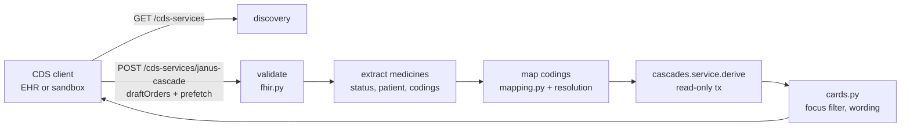

# Design: CDS Hooks service

> Scope: `apps/api/janus/cds/` (`fhir.py`, `mapping.py`, `cards.py`, `service.py`, `router.py`, `cors.py`), two
> read-only queries in `janus/resolution/repository.py`, migration `0013` (GIN index on product RxCUIs), the body
> limit table in `janus/http_policy/body_limits.py`, `JANUS_CDS_CORS_ORIGINS` in `janus/settings.py`,
> `docs/cds-hooks.md`. Decisions DP1–DP14, properties P1–P8.

## 0. Specification
- **CDS Hooks 2.0.1 (STU 2 Release 2)**, the current published version: https://cds-hooks.hl7.org/ (discovery,
  service request, prefetch with `null` = no data and absent = not provided, 412 when required data cannot be
  obtained, card attributes: `summary` "<140-character", `indicator` `info | warning | critical`, `source.label`
  required, `suggestions` optional, security section "Trusting CDS Clients" with JWT, CORS section).
- **Hooks** (CDS Hooks Library, checked 2026-11-09): `order-select` — https://cds-hooks.org/hooks/order-select/
  (hookVersion 1.0, maturity 4 Documented; context `userId`, `patientId`, `encounterId`, `selections`,
  `draftOrders`); `order-sign` — https://build.fhir.org/ig/HL7/cds-hooks-library/order-sign.html (hookVersion 1.0,
  maturity 5 Mature; context `userId`, `patientId`, `encounterId`, `draftOrders`). Both state that they replace
  (deprecate) `medication-prescribe`; `order-sign` also replaces `order-review`. Janus therefore implements
  `order-select` and `order-sign` and not `medication-prescribe`.

## 1. Overview

## 2. Discovery (Req 1)
Two entries with the same id `janus-cascade` (allowed by the spec: one service per hook, so a later `order-sign`
replaces the cards of `order-select`, "update stale guidance"). Prefetch:
`medicationRequests` = `MedicationRequest?patient={{context.patientId}}&status=active,on-hold`,
`medicationStatements` = `MedicationStatement?patient={{context.patientId}}&status=active,on-hold`.

## 3. Request validation (Req 2) — `fhir.py`
- Top level: Pydantic model with `extra="forbid"`: `hook` (`order-select | order-sign`), `hookInstance` (1–128
  chars), `fhirServer` (string, never used), `fhirAuthorization` (object, never read), `context`, `prefetch`,
  `extension` (object, ignored).
- Context: `extra="forbid"`; `userId`, `patientId` (1–128 chars), `encounterId` optional, `selections` (≤ 200
  strings, required for `order-select`), `draftOrders` (a Bundle).
- Prefetch: only the two keys; each value is a Bundle, an `OperationOutcome` (treated as "not provided"), a single
  resource, or `null`.
- FHIR resources inside bundles are read leniently (FHIR resources have many fields; unknown FHIR fields are normal
  and ignored); only the fields Janus reads are type-checked. Bundles: at most 200 entries; codings: at most 20 per
  concept. A 422 names field paths only (`context.draftOrders.entry`), never a value.
- 412 `prefetch_missing` when neither prefetch key is present (DP6).

## 4. Extraction (Req 3.1, 3.5, 3.6)
A **medicine** is `(origin, codings)`:
- Origin `selected` (an `order-select` draft whose `MedicationRequest/<id>` is in `selections`), `draft` (any other
  draft MedicationRequest), `active` (prefetched MedicationRequest), `statement` (prefetched MedicationStatement).
- Codings from `medicationCodeableConcept.coding`, else from `medicationReference.reference`: `#id` → a contained
  `Medication`; `Medication/<id>` → a `Medication` entry of the same Bundle; its `code.coding`.
- A resource whose `subject.reference` (or STU3-style `patient.reference`) is present and is not
  `Patient/<patientId>` is ignored (DP9).
- Statuses: drafts `draft | active | on-hold | unknown`; prefetched `active | on-hold`. Other statuses are ignored.
- Start dates (`authoredOn`, `effective[x]`) are **not read** (DP4).

## 5. Mapping (Req 3.2–3.4, 3.7) — `mapping.py` (pure) and `service.py` (reads)
Systems: NDC `http://hl7.org/fhir/sid/ndc`, RxNorm `http://www.nlm.nih.gov/research/umls/rxnorm`, ATC
`http://www.whocc.no/atc` (the URIs HL7 registers; the same ones the FHIR export writes). A code must match its
system's shape (NDC digits and hyphens ≤ 13 characters, RxCUI 1–10 digits, ATC levels 1–5) or it is dropped.
Per medicine, codings are tried in the order NDC, RxNorm, ATC (most to least specific; DP3):
1. **NDC** → `resolution.service.resolve_ndc` → openFDA products. One product → a product item. Several → the
   product item of the lowest candidate id **if** every product has the same *signature* (per ingredient position:
   status, ingredient key, rule-input codes; and the homeopathic flag); otherwise `ambiguous_code`. Products with
   no published ingredient (kits, bulk entries) carry nothing for the engine and are left out of the comparison
   (live check 2026-11-09: 2 of the 92 openFDA products of the RxCUI for furosemide 20 mg tablets had none and made
   the code ambiguous).
2. **RxNorm** → `repository.refs_by_product_rxcui` (US products whose `product_rxcuis` contain the code; GIN index,
   migration 0013) → same signature rule; more than 500 products → `ambiguous_code` without a partial comparison
   (review P3). The signature is a sorted multiset of (status, key, rule codes, `atc_selection`) per ingredient, so
   the order in which a register lists the ingredients does not matter (review P4). No product → `repository.qids_by_rxcui` (ingredient keys whose Wikidata
   RxCUIs contain the code): exactly one key → an ingredient item; several → `ambiguous_code`.
3. **ATC** → a code that is not ingredient-level or is a combination code of the dataset → `combination_code`.
   Otherwise `repository.qids_by_atc` (ingredient keys whose ingredient-level codes contain it): exactly one →
   an ingredient item, **unless** that key's codes span more than one anatomical group (the engine reads every code
   of the key, so S01ED01 timolol eye drops would also carry C07AA06 oral timolol): then `form_mismatch`
   (pharmacologist review P1); several → `ambiguous_code`.
No coding of a known system → `no_supported_coding`; known systems but nothing found → `unmapped_code`.

Items are de-duplicated by product candidate id or ingredient key (a renewed order and its active request are one
medicine); an item keeps every origin it came from. More than 50 items → 422 `too_many_medications` (the engine's
limit, cascade-engine `MAX_ITEMS`).

## 6. Evaluation and cards (Req 4) — `cards.py` (pure)
`EvaluateIn(dataset_version=<current>, items=[...])` without `started`; `cascades.service.derive` in the same
read-only transaction as the mapping, with the PIPC event keys of the vocabulary, exactly as `/cascades/evaluate`.

A finding becomes a card when its index or marker side includes a focus item. One card per finding id, in the
engine's order.
- `indicator`: always `info` (DP7, safety review S3): without start dates the engine returns `possible`
  (`date_unknown`), and a `warning` would contradict the timing line.
- `summary`: `Possible prescribing cascade (PIPC row N): A and B`, where A and B are the English labels of the index
  and marker ingredient keys (a missing label → the PIPC drug text). Labels are shortened with "…" so that the summary
  is at most 139 characters (P3).
- `detail` (GitHub-flavoured Markdown), in this order: the framing line ("a pattern in the published PIPC list of
  potentially inappropriate prescribing cascades, not a clinical assessment"); the PIPC row (locator, system, drug A →
  adverse event → drug B as published); which medicines matched and their origin (selected order, draft order, current
  medication request (active or on hold), medication statement); the timing line ("the pattern applies only if B was started after A"); "Dose form not
  confirmed" when a side was matched by ingredient only; the BMJ 2026 priority figure with its 95% CI when
  present; one "<medicine>: Do not stop this medicine suddenly." per abrupt-stop side; "This may be worth
  considering in a medication review."; the not-checked count when any medicine could not be mapped or checked;
  the prefetch keys the EHR did not provide (safety review S2); the FAERS caveat when `dataset:faers` is among the
  evidence ids (S4); the citation
  (Rochon PA et al., Eur Geriatr Med 2025, doi, CC BY 4.0) and the evidence ids; the disclaimer and "Not for
  clinical use."
- `source`: `{"label": "Janus (research prototype, not a medical device)", "url": <docs/cds-hooks.md>}`.
- `links`: one `absolute` link to `https://doi.org/10.1007/s41999-025-01215-x`.
- No `suggestions`, no `selectionBehavior`, no `overrideReasons`, no `systemActions`, no `uuid` (DP8).

## 7. Body limit, CORS, logging (Req 2.4, 5)
- `BodyPolicyMiddleware` gets a per-path limit table: `/cds-services/janus-cascade` → 256 KiB; every other path
  keeps 64 KiB (DP5). The content type must still be `application/json`.
- `JANUS_CDS_CORS_ORIGINS` (comma-separated `https://` origins, or `http://localhost[:port]`); empty = no CORS.
  `CdsCorsMiddleware` applies Starlette's `CORSMiddleware` (methods GET, POST; headers `authorization`,
  `content-type`; no credentials) only to paths under `/cds-services` (DP10).
- Routes come from `medical_router()`: `no-store`, access line only; the router logs nothing; errors are codes.

## 8. Properties and tests
| # | Property | Req | Test |
|---|---|---|---|
| P1 | The discovery document has exactly the two hooks with id `janus-cascade`, the required fields, the prefetch templates and the "not for clinical use" text | 1.1 | contract test |
| P2 | Every card validates against the CDS Hooks 2.0 card schema (required fields, `indicator` `info`, no suggestions or actions, links absolute) | 4.3, 4.5, 4.6 | contract test + Hypothesis over engine results |
| P3 | For any labels and row numbers, `summary` has fewer than 140 characters and starts with "Possible prescribing cascade (PIPC row N)" | 4.3 | Hypothesis |
| P4 | Every card's detail names "PIPC", the finding's table locator and its rule evidence id; it holds the disclaimer and no forbidden phrase | 4.3, 4.4 | Hypothesis |
| P5 | A list whose findings do not touch a focus item gives no card; an engine result without findings gives `{"cards": []}` | 4.2 | Hypothesis (pure) + PostgreSQL |
| P6 | Mapping: NDC before RxNorm before ATC; a combination or non-ingredient ATC code is never mapped; a code with two different signatures or two keys is not guessed; reordering codings of other systems does not change the result | 3.2–3.4 | Hypothesis (pure) |
| P7 | A resource for another patient, or with an excluded status, never contributes a medicine | 3.5, 3.6 | Hypothesis (pure) |
| P8 | With sentinel codes and ids in the request, nothing reaches logs, error bodies or the database (`assert_stateless`) | 5.1 | PostgreSQL + log capture |
Plus examples on the synthetic dataset of the cascade API tests: amlodipine (active) + furosemide (selected) gives
one card for PIPC row 5; the same list with furosemide only as an active medicine and an unrelated selection gives no
card; 412, 413, 422 cases; CORS on and off.

## 9. Decisions
| # | Decision | Alternatives | Why |
|---|---|---|---|
| DP1 | Hooks `order-select` and `order-sign` with one id | `medication-prescribe`; `patient-view` | The library marks `medication-prescribe` as replaced by these two; `patient-view` would show cascades with no prescribing decision at hand |
| DP2 | Service inside the API, a client of `resolution` and `cascades.service.derive` | A separate service calling `/cascades/evaluate` | Same engine and transaction; no second HTTP hop; the API's body policy and access log apply |
| DP3 | Coding order NDC → RxNorm → ATC; first that maps wins | Union of all codings | A product code carries the dose form (eye drops vs tablets) that the engine's form logic needs; mixing systems could combine two different concepts |
| DP4 | Start dates are not read; every finding is `date_unknown` | Use `authoredOn` / `effectivePeriod.start` | `authoredOn` is when this request was written (often a renewal), not when the medicine was started; a wrong order would make the engine drop a real pattern (marker before index) |
| DP5 | 256 KiB body limit for the CDS route only | Keep 64 KiB; no limit | Prefetch bundles with narrative text exceed 64 KiB; an upper bound is still needed (privacy design §4.3) |
| DP6 | 412 when neither prefetch key is present; `null` accepted | Evaluate draft orders alone | Without the active medicines most cascades cannot be seen; the spec defines 412 for this case; Janus never calls the client's FHIR server |
| DP7 | `info` only (safety review S3) | `warning` for `probable`; `critical` for some rows | A literature pattern is not an urgent safety alert; `critical` interrupts the clinician; without start dates `probable` cannot occur and a `warning` would contradict the timing line |
| DP8 | No suggestions, actions or systemActions | A "consider review" suggestion without actions | A suggestion needs `selectionBehavior` and renders as a button; the review wording in the detail says the same without inviting a one-click action |
| DP9 | Ignore resources for another patient | Reject the request | A client bug must not mix two patients' medicines into one card; rejecting would hide the draft-order check entirely |
| DP10 | CORS opt-in per origin, CDS paths only | Global CORS | The sandbox runs in the browser and needs CORS; the rest of the API is same-origin |
| DP11 | No JWT verification yet (open item) | Verify JWTs now | A real JWT check needs a client allow-list (`iss`, `jku`) and key fetching; until then the route must not be exposed to real EHRs (checklist) |
| DP12 | 422 `too_many_medications` above 50 | Truncate the list | A silently truncated list would hide patterns; 50 is the engine's limit |
| DP13 | English card texts | Negotiate a language | CDS Hooks has no language field; the engine's reviewed labels are English INNs |
| DP14 | Not in the public read-only OpenAPI document (POST); discovery is | Document both | The public document lists GET routes without personal data only (open-data DP) |

## 10. Open items
- JWT authentication of CDS clients (ES384/RS384, `iss`/`jku` allow-list, `aud` = service URL, `jti` replay cache).
- `fhirAuthorization` and calling the client's FHIR server (not planned: Janus makes no external calls on a request).
- Feedback endpoint (`/cds-services/janus-cascade/feedback`) — not implemented.
- Start dates from `MedicationStatement.effectivePeriod` or dispense history, after a pharmacist review of DP4.
- Regulatory: CDS for clinicians is regulated decision support (FDA CDS guidance, MDR Rule 11) — see the pre-launch
  checklist before any clinical use.
