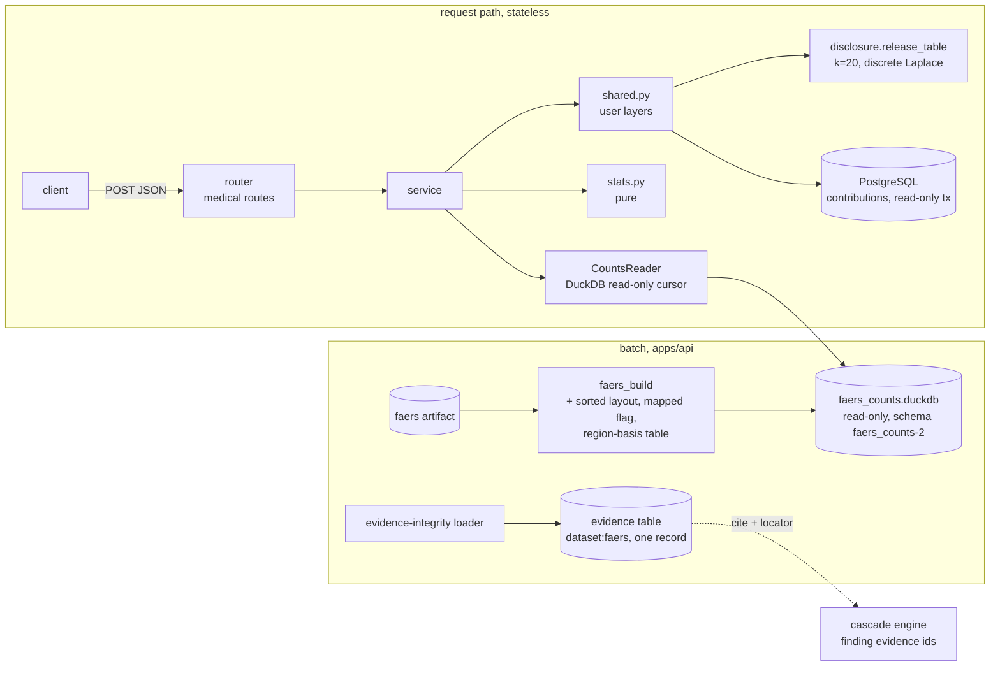

# Design: Collective Memory, Phase 2

> Scope: the FAERS layer read side (pair, combination, regional breakdown, snapshot), the
> contributions layer aggregate with the interface for outcomes, the Janus event vocabulary, the
> the dataset-level FAERS citation (DP12), the message catalogue, and three small changes to the count file.
> Reuses `data-pipelines` (counts file, DP15, DP16, DP20, DP21, DP31–DP33), `privacy`
> (`memory/disclosure.py`, `noise.py`, route kinds, body policy, `read_only_tx`) and
> `evidence-integrity` (`cite`, `register_records`, `freshness`). Property numbers P1–P31 and
> decision numbers DP1–DP22 are this spec's own; upstream decisions are written "data-pipelines DPn".
> Statistics parameters come from the statistician agent's review (`statistics-review.md`, §8 here).

## 1. Overview



Three layers stay separate end to end: the FAERS layer reads only the DuckDB file, the user layers
read only PostgreSQL, and no function takes both. The statistics are pure functions of four
integers; the reader only fetches integers.

Facts checked on 2026-11-08 (real counts file `20261108T005927Z-7445632a-f55a79cf-61fc`; scratch
scripts in `/tmp/janus-cm-bench`, not committed):

| What | Observed | Design consequence |
|---|---|---|
| Machine | AMD Ryzen 5 1500X (4 cores, 8 threads), 15 GiB RAM, SSD | Latency targets in Req 9 are for this machine |
| File | 121 MB; `faers_pair_counts` 6,195,095 rows; `faers_ingredient_counts` 17,106; `faers_event_counts` 58,233; `faers_report_ingredient` 3,810,867; `faers_report_event` 4,786,269; `faers_report` 1,510,804. N: mapped 1,252,900, all 1,510,804 | Point lookups on small tables; report-level tables only for unions and combinations |
| Open and first lookup | 26 ms to open read-only; first lookup 15 ms | Open once at startup; per-request cursors |
| Pair lookup as built (4 point queries: totals, ingredient, event, pair; 400 random pairs) | p50 11 ms, p95 14 ms, max 20 ms. Per query: pair 10 ms, event 2 ms, ingredient 0.7 ms, totals 0.6 ms. Regional (6 rows): p50 15 ms | Fits the target, but the pair table is read by scan |
| Same, tables physically sorted by lookup key | p50 4.2 ms, p95 5.0 ms, max 5.8 ms; regional p50 1.6 ms. Sorting 1.8 s | Sort at build (Req 11.1) |
| Same, sorted plus ART indexes | p50 4.1 ms, file 319 MB (2.6 times larger) | No index (DP13) |
| Combination (report-level) | Count by region 12–17 ms and top 50 events 17–27 ms for the 2, 3, 5 and 10 largest ingredients; pairwise co-report counts 14 ms (2), 19 (3), 32 (5), 40 (10), 54 (12), 70 (20 ingredients) | One statement per part; targets in Req 9.4 |
| Janus key = union of PTs (largest ingredient, commonest PTs) | 1 PT 27 ms, 3 PTs 43 ms, 6 PTs 60 ms (max 74 ms) | Fine for 6 PTs; `mapped` flag added to `faers_report` so the union needs no EXISTS |
| DuckDB settings | `max_temp_directory_size='0GB'`, `memory_limit='1GB'`, `threads=2`, `enable_external_access=false` all accepted on a read-only connection; a 24-million-row join still runs under them | Stateless read path: no spill, no external access (DP14) |
| Pairs in ALL / scope suspect | 829,531; 372,863 with a ≥ 3; 456,668 with a < 3; 1,690 ingredients and 9,046 events with a ≥ 3. No negative cell with either N | 55% of stored pairs are "insufficient data" |
| Evans criteria (PRR ≥ 2, χ² ≥ 4, a ≥ 3) | 250,026 pairs (67% of those with a ≥ 3) with Pearson χ²; 242,100 with Yates. ROR lower bound > 1: 258,000 (a ≥ 5: 201,730) | The criteria hardly discriminate: wording and ordering by reports, not by signal (Req 1.8, DP3) |
| Denominator sensitivity (N = all reports) | Evans verdict lost for 1,056 pairs, gained for 4,890 (1.6% of 372,863). PRR(all)/PRR(mapped): median 1.07, p95 1.19, max 1.23 | DP32 choice has a small effect on classification; the sensitivity table is returned (Req 1.7) |
| Zero cells (mapped N, a ≥ 3) | b = 0 in 378 pairs, c = 0 in 938 (0.35%). Region TR: 10,808 pairs, 1,345 with a ≥ 3, 147 with a zero cell (11%) | Haldane matters mainly in small regions and for a < 3 |
| Regions (mapped / all) | US 819,155 / 1,024,607; EU 148,219 / 161,648; OTHER 279,765 / 318,314; TR 3,720 / 4,027; UNKNOWN 2,041 / 2,208 | UNKNOWN share 0.15%; TR is small |
| Keys | Ingredient keys are `Q…` or the one Janus key `J1`; PT strings have no case-only duplicates and no stray spaces; longest PT 97 characters | Request pattern accepts both key forms; PT limit 200 |
| Donations | `contributions.ingredients` accepts only `Q…` keys (`QID_PATTERN`); `res_ingredient` accepts `J<n>` since migration 0006 | A donor cannot report dimenhydrinate (DP17) |
| PIPC adverse events | 65 rows, 41 phrasings (e.g. "Cognitive Impairment" / "Cognitive impairment", "Orthostatic hypotension, dizziness" / "…/dizziness") | About 35 Janus event keys after merging (§4.6) |

## 2. Code layout

```
apps/api/janus/memory/
  disclosure.py noise.py     (exist; unchanged)
  faers_build.py             (exists; Req 11: sorted layout, `mapped`, `faers_region_basis`, schema faers_counts-2)
  stats.py                   Table, Cells, Stats, evaluate(), assess(), PARAMS            pure
  model.py                   Region, Scope, Layer, Level, Assessment, NoticeCode enums    pure
  vocabulary.py              load_events(), EventVocabulary, validate_events()            pure (+ file read in the loader)
  ladder.py                  combination ladder decision, subsets, ordering               pure
  messages.py                closed set of codes, English canonical sentences             pure
  evidence.py                faers_locator(), parse_locator(), FAERS_EVIDENCE_ID           pure
  reader.py                  CountsReader (DuckDB read-only), SnapshotMeta, statement counter   I/O
  service.py                 pair(), regions(), combination(), snapshot()                 orchestration
  shared.py                  UserLayerSource protocol, ContributionsSource, OutcomesUnavailable,
                             shared_request()                                             I/O + pure
  schemas.py                 request and response models
  router.py                  /memory/* routes
  bench.py                   `python -m janus.memory.bench` local latency script
data/memory_events.csv       Janus event vocabulary (curated)
data/memory_events_review.md proposals and open choices for the owner (like the synonym proposals)
apps/api/migrations/versions/0007_contribution_janus_keys.py     (DP17)
apps/web/messages/{en,tr,de,fr,es}.json      namespace `Memory`
apps/web/src/i18n/memory-words.ts            people / causal / reassurance word lists + test
apps/api/tests/test_memory_*_properties.py   property tests beside the module they test
```
No new `write_tx` user: the FAERS citation needs no registration.
No new runtime dependency: DuckDB, Pydantic, psycopg are already in `apps/api`.

## 3. Statistics (`stats.py`)

### 3.1 Definitions
Raw table `Table(a, b, c, d)` of non-negative ints; `n = a+b+c+d`. `validate` raises
`StatsError` for a negative cell (Req 1.1); the reader checks `a ≤ min(ingredient, event)`.

```
corrected = any cell == 0
cells'    = cells + 0.5 each if corrected else cells        # Haldane (Req 1.2)
PRR       = (a'/(a'+b')) / (c'/(c'+d'))
ROR       = (a'·d') / (b'·c')
se        = sqrt(1/a' + 1/b' + 1/c' + 1/d')
CI        = exp(ln ROR ± 1.96·se)                           # computed as ln a' + ln d' − ln b' − ln c'
chi2      = n·max(0, |a·d − b·c| − n/2)² / ((a+b)(c+d)(a+c)(b+d))   # Yates, raw table; 0.0 when a margin is 0
```
`a = 0` returns `Stats(estimates=None, assessment=no_reports)` and no PRR, ROR or interval.
The field for the cell correction is `haldane_applied`; the χ² form is `chi2_form = "yates"`.
**Decisions are made with integers** (Python `int`, exact; intermediate products reach about 10³¹):
raw `PRR ≥ 2` ⇔ `a(c+d) ≥ 2c(a+b)`; with Haldane (double every cell, add 1) `(2a+1)(c+d+1) ≥ 2(2c+1)(a+b+1)`;
`χ²_yates ≥ 4` ⇔ `2|ad − bc| ≥ n and n(2|ad − bc| − n)² ≥ 16(a+b)(c+d)(a+c)(b+d)`. The statistician
checked all 372,863 real tables: float and integer decisions agree. The ROR bound uses logs and a square
root in floats (ratio `ad/bc` formed first; counts up to 3·10⁶ are exact in a double) and is tested against
a 50-digit `decimal` reference away from the boundary (P4). In SQL the cells are derived in `HUGEINT` or
`DOUBLE`, never in `INT64` products.

### 3.2 Parameters (one place, `PARAMS`; adopted from the statistics review, §8)
| Name | Value | Used by |
|---|---|---|
| `MIN_REPORTS` | 3 | Req 1.3, 2.2 display threshold, evidence registration (Req 10.3) |
| `WEAK_BELOW` | 5 | `disproportionate` needs a ≥ 5 |
| `PRR_MIN` | 2.0 | Evans criteria |
| `CHI2_MIN` | 4.0 | Evans criteria (Yates-corrected χ², 1 df) |
| `CHI2_FORM` | `"yates"` | Req 1.6 |
| `CI_LEVEL`, `Z_95` | 0.95, 1.96 | interval; `INTERVAL_METHOD = "woolf_log"` |
| `HALDANE` | 0.5 on all four cells when any raw cell is 0 | Req 1.2 |
| `K`, ε | 20, 1 (scale 1) | user layers |

### 3.3 Assessment (Req 1.6; the statistician's rule)
```
def assess(a, b, c, d):                       # raw counts; correction applied inside
    if a == 0:            return "no_reports"
    if a < MIN_REPORTS:   return "insufficient_data"
    evans = prr >= PRR_MIN and chi2_yates >= CHI2_MIN
    ror   = ror_lower > 1.0
    if evans and ror and a >= WEAK_BELOW: return "disproportionate"
    if evans or ror:                      return "weak"
    return "not_disproportionate"
```
`evans_met` and `ror_signal` are returned as separate booleans (false when a < 3). Measured on the real
file (Yates, a ≥ 3): `disproportionate` 190,565 (51.1%), `weak` 67,435 (18.1%: 51,535 meet both
criteria with a < 5, 15,900 only the ROR bound, none only the Evans criteria), `not_disproportionate`
114,863 (30.8%); 456,668 pairs with a of 1 or 2 are `insufficient_data`. P6 evaluates the rule against an
independent reference; P29 checks monotonicity in a.

### 3.4 Sensitivity (Req 1.7)
`sensitivity(...)` builds the second table with `b' = b`, `c' = event_all − a`,
`d' = n_all − ingredient − event_all + a`, validates it like the primary one, and runs the same
`evaluate`. `denominator_sensitive = assess(primary) != assess(sensitivity)`, comparing the five classes.
Measured: this differs for 9,278 of 372,863 pairs (2.5%); an Evans-only comparison would see 5,946.

## 4. Reading the counts

### 4.1 `CountsReader`
- Opens `$JANUS_DATA_DIR/memory/faers_counts/current/faers_counts.duckdb` with
  `duckdb.connect(path, read_only=True)` and sets `memory_limit='1GB'`, `threads=2`,
  `max_temp_directory_size='0GB'`, `enable_external_access=false` (DP14). One connection at
  startup; each request uses `con.cursor()` inside `run_in_threadpool`.
- Reads `faers_meta` once into `SnapshotMeta` (build id, snapshot date, window, FAERS run id,
  resolution dataset version, rules version, schema version, notices) and **refuses** a file whose
  schema version is not `faers_counts-2` or whose metadata or tables are missing: `CountsError`
  → 503 `memory_unavailable`.
- Before each request it compares `os.readlink(current)` with the open build id (microseconds).
  If a new build was promoted it opens the new file and swaps the reader; in-flight requests finish
  on the old connection (DP15). This is a file handle, not a cache of results.
- Counts every statement it runs (`reader.statements`), for the budget property P24.
- All SQL is parameterised (`?` placeholders with Python values; lists as `VARCHAR[]` parameters).

### 4.2 Pair (precomputed path, Req 1.1)
One statement fetches the cells for a list of regions (one region, or the six for the breakdown):
```sql
WITH r AS (SELECT unnest(?::VARCHAR[]) AS region)
SELECT r.region, t.reports_mapped, t.reports_all,
       i.reports, e.reports_mapped, e.reports_all, p.reports
FROM r JOIN faers_totals t USING (region)
LEFT JOIN faers_ingredient_counts i ON i.ingredient_key = ? AND i.region = r.region AND i.scope = ?
LEFT JOIN faers_event_counts      e ON e.pt = ? AND e.region = r.region
LEFT JOIN faers_pair_counts       p ON p.ingredient_key = ? AND p.pt = ? AND p.region = r.region AND p.scope = ?
```
Missing rows are zeros. Cells: `a = p`, `b = ing − a`, `c = ev_mapped − a`, `d = N − ing − ev_mapped + a`
(Req 1.1); sensitivity uses `ev_all` and `N_all`.

### 4.3 Event given as a Janus key (report-level path, Req 6.4)
```sql
WITH ev AS (SELECT DISTINCT report_id FROM faers_report_event WHERE pt IN (SELECT unnest(?::VARCHAR[]))),
evr AS (SELECT r.region, r.mapped FROM ev JOIN faers_report r USING (report_id)),
a   AS (SELECT r.region, count(*) AS a FROM faers_report_ingredient i JOIN ev USING (report_id)
        JOIN faers_report r USING (report_id) WHERE i.ingredient_key = ? AND (NOT ? OR i.suspect) GROUP BY r.region)
SELECT … -- event counts per region over mapped and all reports from evr, a per region
```
The ingredient count and totals come from the precomputed tables. Differential property P14 shows
a one-PT key gives the same cells as the precomputed path.

### 4.4 Combination (Req 2)
- **Set.** `ids = SELECT report_id FROM faers_report_ingredient WHERE ingredient_key IN (…) [AND suspect] GROUP BY report_id HAVING count(*) = n`.
  Region by join to `faers_report`; counts by region in one statement.
- **Top events.** `ids JOIN faers_report_event` grouped by PT, ordered by `count DESC, pt ASC`,
  `LIMIT ?`; for each PT the event total comes from `faers_event_counts` for the region (one
  statement with `WHERE pt IN (…)`). Cells: `a` = count in the set with the PT, `ingredient count`
  = set size, `c = ev_mapped − a`, `d = N − set − ev_mapped + a`.
- **Pairwise** (only when the set has 3 or more ingredients and the combination is below the threshold):
  one statement, self-join of `faers_report_ingredient` on `report_id` with `x.key < y.key`, restricted
  to the request's keys, grouped by `(x.key, y.key)`; pairs reaching `MIN_REPORTS` keep their top events
  by a window function (`row_number() OVER (PARTITION BY k1, k2 ORDER BY a DESC, pt)`), at most 10 each.
  If this exceeds the Req 9.4 target on the 20 largest ingredients, events are returned only for the
  10 pairs with the most reports (decided at the checkpoint, noted in the results).
- **Single** (final level): per ingredient, top 10 events from `faers_pair_counts` with a window
  function over the request's keys (sorted table: zone-map pruned), cells as in §4.2.
- **Ladder** (`ladder.py`, pure): `choose_level(n, combo_count, pair_counts, threshold)` returns the
  highest level whose count reaches the threshold and the skipped levels with reason
  `below_display_threshold`. For `n == 2` the pairwise level does not exist (it is the combination).
- The response always lists the ingredients with their own report counts (precomputed tables) and
  `no_reports` for an ingredient with none.
- **Members alone** (statistics review Q8): for each top event the report count of each member ingredient
  with that event, same scope and region, from `faers_pair_counts` in one statement over the (members × top
  PTs) keys. For the combination level, the combination count of an event never exceeds any member's count
  (P31). The response states `exposure`/`comparison` and carries the caveat code `combination_caveat`
  and `set_counts_are_lower_bounds` (a report counts only if every ingredient was recognised: about 71% of
  the reports for two ingredients at 84% coverage each).

### 4.5 Regions (Req 3)
`regions()` calls §4.2 (or §4.3/§4.4) with the six region values and builds one `Stats` per region
with its own N. `unknown` = `{reports, share}` from `faers_totals`; `basis` from
`faers_region_basis` (occurrence vs reporter country, per region). Regional counts must add up to
`ALL` for N, the ingredient count and a; the service asserts it and fails loudly otherwise (P13).

### 4.6 Janus event vocabulary (`data/memory_events.csv`, Req 6)
```
key,direction,label_en,label_tr,label_de,label_fr,label_es,pts,pipc_positions,status,note
cough,adverse,Cough,Öksürük,Husten,Toux,Tos,Cough,1,active,"…"
improvement_pain,benefit,Less pain,…,,,active,"…"
```
`pts` is `|`-separated, empty for `benefit`; `pipc_positions` lists the PIPC rows whose adverse event
the key stands for (`;`-separated), so a finding can find its key; `status` is `active` or
`deprecated`. The loader validates (P15): unique keys, key regex, five labels, direction, non-empty
`pts` for `adverse`, every `pipc_positions` entry in 1–65 and every PIPC row covered by exactly one
key, NFC strings, no `|` inside a PT. The placeholder keys (`peripheral_oedema`, `cough`,
`dizziness`, `constipation`, `urinary_incontinence`, `insomnia`, `improvement_pain`,
`improvement_sleep`) stay. The PT lists are proposed from the FAERS PT list of the current counts
file, written to `data/memory_events_review.md` with the count of reports per PT, and applied only
after the owner's review (§10, same procedure as the cascade synonym proposals). The build report
lists any PT that is not in the counts file (Req 6.5).

## 5. API contracts

All routes are in `memory/router.py`. Lookups are `POST` with a JSON body (medicines and events never
appear in a URL, a query string or the access log). Bodies are validated like `cascades/router.py`:
parse JSON, `model_validate`, a 422 names failing fields only (`{"error": "invalid_request", "fields": […]}`)
and never echoes a value. Models use `extra="forbid"`. Responses use `Cache-Control: no-store` (route class).

### 5.1 Requests
```
EventRef:  {"pt": str(1..200)}  or  {"key": janus event key}        # exactly one
PairIn:    {ingredient: Key, event: EventRef, region: "ALL"|"TR"|"EU"|"US"|"OTHER"|"UNKNOWN" = "ALL",
            scope: "suspect"|"any" = "suspect"}
CombinationIn: {ingredients: [Key] (2..20, distinct), region = "ALL", scope = "any", top_events: int 1..50 = 20}
RegionsIn: {ingredients: [Key] (1..20, distinct), event: EventRef | null, scope = "suspect" if 1 ingredient else "any"}
SharedIn:  {layer: "contributions"|"outcomes", ingredients: [Key] (1..20, distinct), event: janus event key,
            direction: "adverse"|"benefit"}
Key:       ^(Q[1-9][0-9]{0,9}|J[1-9][0-9]{0,5})$
```
The ingredient list is sorted and de-duplicated before use, so request order never changes the response (P8, P21).

### 5.2 Responses (FAERS routes)
```
Common {
  layer: "faers",
  snapshot: {build_id, snapshot_date, window: ["2025Q4",…], faers_run_id,
             resolution_dataset_version, served_resolution_dataset_version | null,
             counts_match_served | null, stale: bool, age_days: int},
  notices: [NoticeCode],               # closed set, §7
  disclaimer: "Janus provides information, not medical advice. Research prototype — not a medical device.",
  attribution: "Source: FDA AEMS (formerly FAERS), snapshot <date>. Not an FDA endorsement.",
  meddra_notice: "MedDRA® is a registered trademark of ICH" | absent
}
Cells  {a, b, c, d, n: int}                         # raw table
Estimates {prr, ror: float, ror_ci: {low, high, level: 0.95, method: "woolf_log"},
           chi2: float, chi2_form: "yates"}                                  # estimates null when a == 0
Stats {
  region, scope, cells: Cells, haldane_applied: bool, estimates: Estimates | null,
  evans_met: bool, ror_signal: bool,                                          # false when a < 3
  assessment: "no_reports"|"insufficient_data"|"not_disproportionate"|"weak"|"disproportionate",
  sensitivity: {cells: Cells, haldane_applied: bool, estimates: Estimates | null, assessment: …, differs: bool},
  denominator_sensitive: bool, codes: [ResultCode]
}
PairOut { …Common, ingredient: Key, event: {pt|key, pts: [str], reported_in_window: bool}, stats: Stats,
          citation: {evidence_id: "dataset:faers", locator: str} }
CombinationOut { …Common, region, scope, level: "combination"|"pairwise"|"single",
  exposure: "all_of_set", comparison: "all_other_mapped_reports",
  skipped: [{level, reason: "below_display_threshold"}],
  ingredients: [{key, reports: int, assessment: "no_reports"|"ok"}],     # single-ingredient counts in scope and region
  combination: {reports: int, n: int},
  events:  [{pt, reports: int, stats: Stats,
             members_alone: [{key, reports: int}]}] | [],                # level combination; member-alone counts (statistics review Q8)
  pairs:   [{keys: [Key, Key], reports: int, events: [{pt, reports, stats}]}] | [],
  singles: [{key, reports: int, events: [{pt, reports, stats}]}] | [] }
RegionsOut { …Common, scope, rows: [{region, n_primary: int, n_all: int, reports: int, stats: Stats | null}] (6 rows, ALL last),
  unknown: {reports: int, share: float}, basis: [{region, occurrence: int, reporter_fallback: int}],
  adrreports_url: str }        # fixed public address of adrreports.eu (form verified in task 13); no user value
```
Floats are IEEE doubles, not rounded. `stats.estimates` is `null` exactly when `a = 0`. `citation` is built by `evidence.py` (§6).

### 5.3 User layers and snapshot
```
SharedOut { layer, status: "ok"|"layer_unavailable"|"not_available",
  cells: [{region: "TR"|"EU"|"US", status: "released"|"hidden", value?: int}],     # value only when released
  total_of_released: int | null,
  disclosure: {k: 20, epsilon: "1", wording: "hidden_under_20_noise_added"},
  disclaimer, notices }                                  # no FAERS figure, no snapshot of the counts file
SnapshotOut (GET /memory/snapshot, operational) { build_id, snapshot_date, window, faers_run_id,
  resolution_dataset_version, stale: bool, age_days: int, totals: [{region, reports_mapped, reports_all}],
  unknown_share: float, layers: {faers: "ok"|"unavailable", contributions: "ok"|"unavailable", outcomes: "not_available"},
  notices, meddra_notice, attribution }
```
**Sibling rule (Req 5.8).** `ContributionsSource` runs, per request, one grouped statement that returns
for the requested set S the true n and, per other ingredient X, the number m_X of donations of the cell
that also name X (`unnest(ingredients)` grouped, parameterised). A cell is eligible only if `n ≥ k` and
every `n − m_X` is 0 or ≥ k; an ineligible cell is passed to `release_table` with count 0, so its answer
is the same `hidden` as any cell under k (P30). The budget for `shared` is 3 statements (version/count,
sibling counts, the read-only transaction setup).
`hidden` carries no value, bound or hint (Req 5.4). `layer_unavailable` = no noise key or no database
(Req 5.5). `not_available` = outcomes before `doctor-loop`, and `benefit` keys on the FAERS layer.

### 5.4 Errors
`422 {"error":"invalid_request","fields":[…]}`; `503 {"error":"memory_unavailable"}` for the FAERS routes
when the file is missing, unreadable, wrong schema version, or fails its metadata check; `500` with the
request id only (privacy handler). No 404 for an unknown ingredient or PT: absence of reports is an answer
(`no_reports`, `reported_in_window: false`), worded without reassurance (Req 8.7).

## 6. Evidence and citation (`evidence.py`, Req 10; owner decision 2026-11-08, DP12)

### 6.1 One dataset record, a locator per statistic
`dataset:faers` is written by the evidence-integrity loader from the `faers` artifact's
`evidence_source.json` (source URL, licence CC0 1.0, snapshot date, region US). Nothing new is registered:
the kind `faers_stat` stays valid and unused. A statistic cites the record with a locator:
```
faers:ingredient=<Q… or J…>;event=<janus key | pt:<percent-encoded PT>>;region=<ALL|TR|EU|US|OTHER|UNKNOWN>;scope=<suspect|any>
```
`faers_locator(...)` and `parse_locator(...)` are pure and round-trip (P27); the locator holds no run id,
build id or date, so an issued note's citation stays valid after a rebuild (the note also prints its
numbers). The snapshot date comes from the `dataset:faers` record (`evidence-integrity` shows it and its
freshness), the build id from the response.

### 6.2 Use in responses
`citation: {evidence_id: "dataset:faers", locator}` accompanies every statistic in `PairOut`,
`CombinationOut` items and `RegionsOut` rows. A sentence that states a number is produced only for a
cell with `a ≥ MIN_REPORTS`; other cells are coverage sentences (`insufficient_data`, `no_reports`,
nothing found) that cite `dataset:faers` without a number (P26).

### 6.3 Use in findings (minimal cascade-engine change)
`RuleBase` gets an optional mapping `faers_event_keys: Mapping[int, str]` (PIPC position → Janus event key),
empty by default. When a rule has a key, the engine adds `FAERS_EVIDENCE_ID` (`dataset:faers`) to the ids it
passes through the existing `_cite`, and, if the id is kept, sets `Finding.faers_locator` to
`faers_locator(index.key, event_key, "ALL", "suspect")`; otherwise it is `None`. `FindingOut` carries
`faers_locator` and the id appears in `evidence_ids`. The mapping is filled from the **reviewed** vocabulary
(`status = active` only) by the service; with no active keys nothing changes. The numbers shown with the
finding come from `POST /memory/pair` (the client calls it with the finding's ingredient and Janus key); the
note stores the numbers it printed. No change to evidence-integrity code.

## 7. Language, wording and the message catalogue (Req 8)

### 7.1 Closed set of codes (`messages.py`)
Notices: `spontaneous_reporting`, `not_incidence`, `deduplicated_by_case_version_only`,
`screening_statistic`, `many_pairs_examined`, `window_includes_follow_ups`, `denominator_mapped_reports`,
`region_is_report_origin`, `eu_member_states_not_separable`, `regions_not_comparable`,
`absence_is_not_reassurance`, `counts_built_against_other_dataset`, `source_may_be_outdated`,
`reported_together_only`. Result codes: `no_reports`, `insufficient_data`, `not_disproportionate`, `weak`,
`disproportionate`, `corrected_estimate`, `denominator_sensitive`, `below_display_threshold`,
`estimate_uses_continuity_correction`, `interval_approximate`, `weak_pattern`, `combination_caveat`,
`set_counts_are_lower_bounds`, `pairwise_shown`, `single_shown`, `event_not_reported_in_window`, `benefit_not_in_faers`,
`hidden`, `hidden_under_20_noise_added`, `layer_unavailable`, `not_available`, `memory_unavailable`.
Each has an English canonical sentence in `messages.py` (scanned by the existing source-scan guard) and a
key in the `Memory` namespace of the five message files. The wording of the statistical sentences is
fixed by the statistician review (§8, Q6, Q11) and by `medical-safety.md` rules 1, 3, 5, 6, 9.

### 7.2 Word lists (for `memory-words.ts`, applied to the `Memory` namespace and to `messages.py`)
- **People nouns, forbidden** (Req 8.3): EN `people, person, persons, patient(s), individual(s), humans, someone, anyone, like you`;
  TR `kişi, kişiler, hasta, hastalar, insan, insanlar, sizin gibi`; DE `Menschen, Mensch, Personen, Person, Patienten, Patient, Leute, wie Sie`;
  FR `personne(s), patient(s), gens, comme vous`; ES `persona(s), paciente(s), gente, como usted, como tú`.
- **Causation, probability, risk, safety, normality, interaction, forbidden** (Req 8.4): EN `cause(s|d), causing, because of, due to, risk(s), chance, probability, likely, unlikely, safe, unsafe, dangerous, harmless, normal, unusual, interact(s|ion), side effect(s), reaction(s)`;
  TR `neden olur, nedeniyle, risk, olasılık, güvenli, tehlikeli, normal, olağandışı, etkileşim, yan etki, reaksiyon`;
  DE `verursacht, Ursache, Risiko, Wahrscheinlichkeit, sicher, gefährlich, normal, ungewöhnlich, Wechselwirkung, Nebenwirkung, Reaktion`;
  FR `cause, provoque, risque, probabilité, sûr, dangereux, normal, inhabituel, interaction, effet secondaire, réaction`;
  ES `causa, provoca, riesgo, probabilidad, seguro, peligroso, normal, inusual, interacción, efecto secundario, reacción`.
  "Incidence" is not on the list because the required limits sentence says "not incidence".
- These lists are proposals; the `localization-reviewer` and `safety-auditor` agents review them and the
  translations (task 12), and matching follows `findForbiddenPhrases` (whole words, case-insensitive).

## 8. Statistics review (statistician agent, 2026-11-08)

**Verdict: approved with changes** (`statistics-review.md`, 12 questions: 2 ACCEPT, 10 CHANGE; every change is applied). The review recomputed my counts from the file and found the same numbers.

| Q | Result | Applied in |
|---|---|---|
| 1 Denominator | N = mapped reports and the cells accepted (N = all changes the five-class assessment of 2.5% of pairs; excluding D-concomitant-only reports from the comparison changes 0.17%). Flag rule changed to the five-class comparison; full sensitivity table returned. Mapping gaps leak D's reports into the unexposed cells: median 8.6%, p90 33.9%, max 52.2% of an ingredient's reports for 34 suffix-name ingredients; the leak only moves results toward `disproportionate`, so `not_disproportionate` is the least reliable answer | §3.4, Req 1.7, sentence (d) |
| 2 Haldane | Accepted, with a zero-margin guard (χ² = 0.0), field names `haldane_applied` / `chi2_form`, notice `estimate_uses_continuity_correction` | §3.1, Req 1.2 |
| 3 Evans | **Yates** χ², minimum a 3. Pearson would add 7,926 pairs (2.1%); with Yates no pair meets the Evans criteria and fails the ROR bound (698 do without). Called "Evans-type" until the owner checks the paper | §3.2, Req 1.6 |
| 4 ROR interval | Accepted: Woolf at 95%, somewhat narrow for small a (rejection of 2.7–5.3% under the null for λ 2–50); unreliable for a < 5, any raw cell < 5 or a corrected table | Req 1.6 `interval_approximate` |
| 5 Assessment | The rule of §3.3, `WEAK_BELOW = 5` | §3.3, P6, P29 |
| 6 Multiple comparisons | No formal correction (65% of pairs reject the null, so it is not calibrated), no 99% level; order by reports; no badge for `disproportionate` in lists; screening sentence | Req 1.8, DP3 |
| 7 Regions | Per-cell rule accepted; add the "label may reflect report numbers", "compared only within the region" and TR statements | Req 3.4 |
| 8 Combination | Sound as a count; add member-alone counts, `exposure`/`comparison`, caveat, lower-bound note | §4.4, Req 2.3 |
| 9 User layers | Differencing is real (difference of two cells has sd 1.92; ±4 with 97% probability); **sibling rule** adopted; residual limits stated | §5.3, Req 5.8–5.10, P30, DP9 |
| 10 Evidence | Accepted. The proposed new kind `faers_snapshot` is replaced by the existing `dataset:faers` record (coverage sentences cite it) | Req 10.3, DP12 |
| 11 Wording | Four sentences replaced | §8.1 |
| 12 Properties | Integer arithmetic for decisions; transposition, scaling, monotonicity, exactness, round trip, sibling, member-alone properties added | §10 P2–P4, P29–P31 |

### 8.1 Canonical English sentences (from the review; the translations are task 12)
- Pattern (Q11a): "The event appears in a larger share of the reports that name this medicine than in the other reports that name a recognised medicine." Not disproportionate: "The event does not appear in a clearly larger share of the reports that name this medicine. This does not mean there is no association."
- Weak: "Few reports; treat as a weak pattern."
- Screening (Q6): "This is a screening statistic. Many medicine–event pairs are examined at once and most of them meet these criteria, so meeting them is common and shows only a pattern in the reports, not what lies behind it." (No causal word, so the word list of §7.2 needs no exception.)
- Limits (Q11b): "Reports are sent voluntarily and are not checked. The counts do not show how often an event happens. Only repeated versions of the same case are merged, so one event can still appear in more than one case."
- Region (Q11c): "A report's region is the country where the event is said to have happened or, when that is missing, where the reporter is. It does not tell where the patient lives or where the medicine was bought."
- Denominator (Q11d): "Counts use only reports that name at least one medicine Janus recognises (<share> of the reports in this window). Some spellings are not recognised, so a pattern can be missed. Figures for all reports are shown beside these." (The share comes from the snapshot, not from copy.)
- Interval (Q4): "The range is approximate and is less reliable when few reports are involved."
- Continuity correction (Q2): "The size of this ratio depends on a small adjustment made because a count is zero."
- Combination (Q8): "These counts are for reports that name all of these medicines. The comparison group is every other report, including reports that name only some of them, so a pattern here may come from just one of the medicines. It does not show an effect of taking them together."
- Regions (Q7): "A different label in two regions can come from different numbers of reports, not from a different pattern." and "Each region is compared only with the other reports from the same region."

The client shows a ratio above 1,000 as "over 1,000" (the API returns the number).

### 8.2 Left open by the review
The Evans paper's own χ² form and DOI (owner checks in Crossref); optional table `faers_mapping_gap` (builder lists ingredients whose reports leak through candidate name rules, so a response can say `mapping_gap_possible`; not blocking, needs a `data-pipelines` decision); the review did not tabulate EU, OTHER and US by class; rate limiting (Phase 5) decides how serious the padding limit of Q9 is.

## 9. Testing strategy

- **Property tests (Hypothesis)** for P1–P31, tagged `Feature: collective-memory, Property Pn`. Pure
  statistics need no I/O. Count-file tests build a DuckDB file from generated `ReportFact`s with the
  builder's own `write_counts` (reusing the generators of `test_faers_build_properties.py`), so the
  reader is tested against the real table layout and against `aggregate` as the reference.
- **Example tests** for fixed facts: a worked 2×2 (a=20, b=180, c=100, d=9,700: PRR 9.8, ROR 10.78),
  the Haldane case with c = 0, the `J1` key, the PIPC phrasing "Orthostatic hypotension, dizziness".
- **Database tests** (real PostgreSQL 16) for the user layers, deletion, data version and citation tests.
- **Route tests** with the app factory: stateless harness (`assert_stateless`), sentinel logging
  (`capture_logs`), 422/503 paths, byte-identical repeats.
- **Local real-data tests** (skipped when `JANUS_DATA_DIR` has no counts file; never in CI): the reader's
  result for 200 random pairs equals a direct recount in SQL on the same file; vocabulary PTs exist; the
  benchmark (`bench.py`) prints percentiles for Req 9, recorded at the checkpoint.
- **Messages**: vitest for the five files (keys, no empty strings, forbidden phrases, word lists); pytest scan
  of `messages.py`.
- **CI**: the existing `api` and `web` jobs; the count-file tests need DuckDB only. Latency is not asserted in
  CI (shared runners); the statement budget is.

## 10. Correctness properties

| # | Property (for all …) | Validates | Hypothesis approach |
|---|---|---|---|
| P1 | **Estimates are well formed.** For any raw table with n ≥ 1 and a ≥ 1, after Haldane when a cell is zero: PRR > 0 and ROR > 0 and both finite; `ror_ci.low ≤ ROR ≤ ror_ci.high`; `low > 0`. | Req 1.2, 1.6 | Cells 0–2,000,000 with the marginal constraints; floats compared with `math.isfinite`. |
| P2 | **Swap and transposition.** For any table without a zero cell, the row swap (a↔c, b↔d) gives `ROR' = 1/ROR` and the interval `(1/high, 1/low)`, χ² unchanged; the transposition (b↔c) leaves ROR, its interval and χ² unchanged. | Req 1.6 | Cells ≥ 1; relative tolerance 1e-12. |
| P3 | **Scaling.** Scaling all four non-zero cells by an integer k > 1 leaves PRR and ROR unchanged (relative 1e-12), narrows the ROR interval, multiplies Pearson χ² by exactly k and raises Yates χ² by at least k. | Req 1.6 | Cells ≥ 1, k 2–50; Pearson computed in the test for the exact factor. |
| P4 | **Exactness.** The decisions PRR ≥ 2 and χ²(Yates) ≥ 4 equal the integer inequalities of §3.1 for counts up to 1.6 million (N up to 2³¹ in the generator); PRR and ROR equal a `Fraction`/50-digit `decimal` reference to relative 1e-12; no NaN or infinity for any valid table, including zero cells and a zero margin (χ² = 0.0); no overflow. | Req 1.1, 1.2, 1.9 | Reference written independently; boundary values of PRR (2), χ² (4). |
| P5 | **Flags are exact.** `haldane_applied` is true exactly when a raw cell is zero; χ² is the same for a table and its raw copy (the correction never feeds χ²); `no_reports` exactly when a = 0 and then `estimates is None`; `insufficient_data` exactly when 0 < a < 3; the booleans re-evaluated from the serialised numbers equal the returned booleans. | Req 1.2, 1.3, 1.6 | Tables with zeros forced; JSON round trip. |
| P6 | **Assessment equals the rule.** The assessment equals the statistician's pseudocode evaluated on the cells; `disproportionate` or `weak` never occurs with a < 3; `criteria` booleans equal their definitions. | Req 1.6 | Reference function; boundary values of PRR (2), χ² (4), a (3, 5), ROR low (1). |
| P7 | **Cells are consistent.** For any generated reports, the cells the reader builds equal a direct recount from the report facts (differential test against `aggregate`), `a ≤ min(ingredient, event)`, b, c, d ≥ 0 and `a+b+c+d = N` for every pair, region, scope; a corrupted count (negative cell) raises `StatsError` and returns nothing. | Req 1.1 | `write_counts` on generated facts; compare with `aggregate`; mutate a count table to force negatives. |
| P8 | **Order independence.** The response for (D, E) is the same for any order of the reports loaded into the file, and for any order of the ingredients in a request. | Req 1 (seed), 7.4 | Permute reports before building; permute request lists. |
| P9 | **Sensitivity.** The sensitivity table follows `c = event_all − a`, `d = n_all − ingredient − event_all + a`; with `reports_all = reports_mapped` it equals the primary; `denominator_sensitive` is true exactly when the two assessments differ. | Req 1.7 | Facts with and without reports that have no mapped ingredient. |
| P10 | **Lists are ordered by reports.** Event lists are ordered by reports descending then PT ascending, whatever the assessments; a change of thresholds does not reorder or remove an event. | Req 1.8, 2.1 | Generated lists; vary `PARAMS`. |
| P11 | **Combination count.** The combination count equals the number of reports naming all ingredients in the scope; it never rises when an ingredient is added; duplicate drug lines and request order change nothing; a one-ingredient set equals the precomputed pair (cells and statistics identical). | Req 2.1 | Differential SQL vs precomputed vs `aggregate`. |
| P12 | **Ladder.** `level` is `combination` iff the combination count ≥ 3, else `pairwise` iff n ≥ 3 and some pair reaches 3, else `single`; every item shown at a level reaches the threshold (pairs) ; skipped levels carry `below_display_threshold`; for n = 2 there is no pairwise level; an ingredient without reports is listed as `no_reports`. | Req 2.2, 2.4 | Generated sets and counts; pure `choose_level` plus the DB path. |
| P13 | **Regions.** For the breakdown, N, ingredient count, event count and a of TR+EU+US+OTHER+UNKNOWN equal ALL; a region filter uses only that region's counts (same as the breakdown row); the UNKNOWN share plus the other shares is 1; `reporter_fallback` of a region never exceeds its reports. | Req 3.1, 3.3, 3.5 | Facts over all five regions and both basis values. |
| P14 | **Janus key union.** The count of a Janus key equals the number of reports having any of its PTs, once per report; a key with one PT gives the same cells and statistics as the PT path; an unknown PT gives a = 0 with `reported_in_window: false`. | Req 6.4 | Keys over generated PT sets; compare paths. |
| P15 | **Vocabulary loader.** A valid file is accepted; each defect (duplicate key, bad key, missing or empty label, unknown direction, empty PT list for `adverse`, PT list for `benefit`, `|` inside a PT, PIPC row uncovered or covered twice, position outside 1–65) is rejected with a code; the missing-PT report lists exactly the PTs absent from the counts file. | Req 6.2, 6.5, 6.6 | One defect injected per example into a valid file. |
| P16 | **User-layer release.** For any set of donations: a cell with true count < 20 is `hidden` identically for every count 0–19 (same response bytes except nothing); changing a hidden cell never changes a released value or the total; released values are integers ≥ 0; the same cell and the same contributors give the same value; deleting a donation of the cell changes the cell's data version and the deleted donation is not counted. | Req 4.5, 4.6, 5.1, 5.2, 5.4 | PostgreSQL with generated donations; `release_table` as reference; versions from contributor ids. |
| P17 | **No cross-layer number.** No field of any response is computed from more than one layer: the contributions response has no FAERS figure and the FAERS responses no user figure; the set of numeric fields of a response is exactly the schema's. | Req 4.3, 4.4 | Walk response JSON; compare with the schema field list. |
| P18 | **No key, no count.** Without a noise key or without a database, `shared` answers `layer_unavailable` with no value for any input. | Req 5.5 | Settings without key; app without database. |
| P19 | **Outcomes interface.** The `outcomes` layer answers `not_available` (never a zero) until a source is registered; with a stub source it follows the same release rules as contributions. | Req 4.7 | Stub source implementing the protocol. |
| P20 | **Validation at the boundary.** Every invalid request (unknown field, bad key, duplicate, 0 or more than 20 ingredients, bad region/scope/layer/direction, `pt` and `key` both or neither, oversize PT) gets 422 naming fields only, with no database statement run and no value echoed. | Req 7.3 | Mutations of a valid body; statement counter and response scan. |
| P21 | **Deterministic, stateless, silent.** The same request against the same file gives byte-identical bodies; no file or database is changed (`assert_stateless`); `Cache-Control: no-store`; no sentinel ingredient, PT or region reaches any log record. | Req 7.2, 7.4, 7.10, 5.7 | Sentinel values; `capture_logs`; directory and database snapshots. |
| P22 | **Fail closed.** A missing file, a file with another schema version, missing metadata or a missing table gives 503 `memory_unavailable` and no number; a promoted new build is picked up and an interrupted build is never read. | Req 7.6, 11.4 | Corrupt copies of a generated file; swap `current`. |
| P23 | **Freshness and version notices.** `stale` is true exactly when age in whole days > 182 (2 × 91); `counts_match_served` is false (notice `counts_built_against_other_dataset`) exactly when the versions differ and null when no dataset is served. | Req 7.7, 7.8 | Dates around the limit; version strings. |
| P24 | **Statement budget.** A pair request runs at most 6 statements (the design uses 2), a regions request at most 8, a combination at most 12; the count does not depend on the number of ingredients or events. | Req 9.6 | Reader statement counter over sets of 2–20. |
| P25 | **Messages.** Every code of the closed set has a non-empty message in en, tr, de, fr, es; no message or canonical sentence contains a forbidden phrase (rule 2), a people noun or a causation/risk/reassurance word (§7.2); the five files have the same keys. | Req 8.1–8.4 | vitest `describe.each(locales)`; pytest scan of `messages.py`. |
| P26 | **No evidence, no sentence.** Every rendered statistic sentence carries `dataset:faers` and a locator; a cell with a < 3 produces no sentence with a number (only coverage sentences, which cite `dataset:faers` without a number); `cite` removes the sentence when `dataset:faers` is not registered. | Req 8.8, 10.3 | Sentence builder over generated stats; `cite` with the record registered and absent. |
| P27 | **Locator.** `parse_locator(faers_locator(x)) == x` for any ingredient key, event (Janus key or PT with `;`, `=`, `%`, spaces, accents), region and scope; the locator contains no run id, build id or date; the same inputs give the same string; a malformed locator is rejected. The cascade hook adds `dataset:faers` and the locator to a finding exactly when the rule has a Janus key and the id passes `cite`. | Req 10.3, 10.4 | Text strategies for PTs; engine example with and without the record. |
| P28 | **Count-file layout.** The sorted layout gives the same table hashes as the unsorted one; `faers_report.mapped` equals "has a mapped ingredient"; `faers_region_basis` sums to the region totals; the schema version is `faers_counts-2`. | Req 11.1–11.4 | Builder property tests extended with the new tables. |
| P29 | **Monotone in a.** With b, c, d ≥ 1 fixed, PRR, ROR and the ROR lower bound do not decrease as a grows, and the assessment class order `not_disproportionate < weak < disproportionate` does not decrease (the review found 0 violations in 1.18 million tables). | Req 1.6 | a 3–2,000; if Hypothesis finds a counterexample for the class, keep only the monotonicity of the ROR lower bound. |
| P30 | **Sibling rule.** For any donations and any two released cells S ⊂ T with the same event, direction and region, `n_S − n_T` is 0 or ≥ 20; an ineligible cell is byte-identical to a hidden cell; the rule never releases a cell that `release_table` alone would hide. | Req 5.8 | PostgreSQL with generated donations; pairs of sets; reference by brute force. |
| P31 | **Members alone.** For every top event of a combination, each member's alone count (same scope and region) is ≥ the combination count; the `exposure` and `comparison` fields are present; set counts never exceed the smallest member count. | Req 2.1, 2.3 | Differential against `aggregate`. |

P1–P3 and the regional, layer and "people" properties repeat the first seed's list; P4–P31 were added in the refinement (P29–P31 after the statistics review).

## 11. Decisions

| # | Decision | Alternatives considered | Why |
|---|---|---|---|
| DP1 | Statistics are pure functions of four integers; the reader fetches integers; the service joins them. Arithmetic for χ² and ratios is exact (ints/`Fraction`) before one conversion to float. | Compute in SQL; floats throughout. | One place for the definitions, property-tested against an independent reference (P4); counts to 1.5 million overflow naïve 64-bit products (found when measuring: `INT64` overflow in DuckDB). |
| DP2 | Primary N = reports with a mapped ingredient (data-pipelines DP32), and **every result also carries the all-reports sensitivity table** and a flag. | Primary N = all reports; sensitivity only in a report. | The owner chose DP32; the measured effect is small (the five-class assessment changes for 2.5% of pairs) but not zero, and the reader should see it. The statistician accepted the choice and changed the flag rule to the five-class comparison (§8, Q1). |
| DP3 | Lists of events are ordered by reports, never by PRR/ROR/assessment; no multiple-comparison correction is applied; the statement of Req 1.8 is shown. | Rank by lower bound of ROR; Bonferroni or FDR across pairs; 99% level. | 65% of 372,863 pairs meet the Evans-type criteria (Yates), so a corrected threshold would only look rigorous and ranking by PRR puts small one-sided tables first (top 1,000 by PRR: median a = 8, 23% with c = 0). The statistician confirmed (§8, Q6). |
| DP4 | Default scope `suspect` for pairs and `any` for combinations. | `any` everywhere; `suspect` everywhere. | `suspect` is the usual basis for disproportionality; a combination often contains a concomitant medicine (`data-pipelines` DP21). |
| DP5 | Lookups are `POST` with JSON bodies; only `/memory/snapshot` is `GET` and operational (added to the allowlist with a test). | `GET` with query parameters. | A medicine list in a URL ends up in proxy logs and browser history (`privacy.md`); `cascades/evaluate` already does this. |
| DP6 | The PT path uses the precomputed tables; the Janus-key and combination paths use the report-level tables; differential properties P11 and P14 tie them together. | Precompute every key and combination; only report-level queries. | Keys and combinations are not known at build time; report-level queries are fast enough (Req 9) and the differential tests catch drift. |
| DP7 | Counts built against another resolution dataset: serve with the notice, no 409. | 409 like `cascades/evaluate`. | Ingredient keys are Wikidata items or Janus keys; they do not change with a dataset. A 409 would switch the feature off after every unrelated resolution reload. |
| DP8 | Ladder: combination → pairwise subsets reaching the threshold → single ingredients; the response names the level. | Pairwise only; jump straight to singles. | "Pairwise" for n ≥ 3 is the closest honest answer; for n = 2 the pair is the combination, so the next level is single. |
| DP9 | User layers: counts only; cell = (ingredient set, event key, direction, region); the cell's data version is a hash of the ids of its contributors, so noise is redrawn only when the cell itself changes; differencing across overlapping sets is blocked by the sibling rule of Req 5.8 (statistician, Q9); two-step differencing and padding remain as stated limits. | One global data version; ratios against FAERS. | A global version lets anyone redraw the noise of a target cell by donating elsewhere; per-cell versions remove that path (donating into the cell remains possible until rate limiting in Phase 5, `privacy` Req 3.7). |
| DP10 | Outcomes: an interface and `not_available`. | Wait for `doctor-loop`; stub with zeros. | The interface is stable now; a zero would be false reassurance (Req 4.7). |
| DP11 | Janus event vocabulary: curated CSV derived from PIPC phrasings; adverse keys name PT lists, benefit keys none; keys never change meaning; union semantics. | Use FAERS PTs for donations; free text; MedDRA hierarchy. | `privacy` requires a Janus vocabulary without MedDRA; donations must be comparable with FAERS where possible; the PT lists are clinical judgement, so they go through owner review. |
| DP12 | **Owner decision 2026-11-08.** One dataset-level evidence record per FAERS snapshot (`dataset:faers`, written by the existing integrity loader); a statistic cites it with a deterministic locator (ingredient, event, region, scope). No per-pair records and no loader that writes records. Cascade-engine and evidence-integrity changes stay minimal and are recorded as a DP in each spec (cascade-engine DP22, evidence-integrity DP22). | Per-cell `faers_stat` records written by a loader (first design); a virtual `cite` rule for well-formed `faers_stat` ids. | The API is stateless and cannot register at request time; thousands of records per build add load and stale records; the dataset record already carries source, licence, snapshot date and freshness, and the locator makes the citation specific. |
| DP13 | Count file: physically sorted tables, `faers_report.mapped`, `faers_region_basis`, schema `faers_counts-2`; no ART index. | ART indexes; no change. | Sorted: pair lookup p95 14 → 5 ms at the same file size; indexes gave no further gain and made the file 2.6 times larger (§1). |
| DP14 | DuckDB opened read-only with `memory_limit=1GB`, `threads=2`, `max_temp_directory_size=0`, `enable_external_access=false`. | Defaults. | The route must not write (spill files) or read other files (`privacy` Req 2.1). A query that would need more memory fails (503) instead of writing. |
| DP15 | The reader follows `current` and swaps to a newly promoted build; in-flight requests finish on the old handle. | Restart the API after each build. | Builds are atomic link swaps (`data-pipelines` Req 15.8); no restart needed; a file handle is not a result cache. |
| DP16 | Messages: the API returns codes, numbers and English canonical sentences; translations live in `apps/web/messages` (`Memory`); both are scanned by the same word lists. | Server-side translation. | Same split as `cascade-engine`; the client formats numbers by locale (`experience` Req 2.3). |
| DP17 | Donations accept Janus keys `J<n>` (migration `0007`, model pattern). | Leave as is; map `J1` to a Q key. | Otherwise a donor cannot report a substance the resolver already knows (`J1` dimenhydrinate); mapping to a parent substance is the guess the owner ruled out. |
| DP18 | Latency targets are measured on the dev machine with a local benchmark; CI asserts statement counts, not time. | Time assertions in CI. | Shared runners are noisy; the statement budget catches the real regressions (loops of queries). |
| DP19 | Floats are returned unrounded. | Round to 3 digits on the server. | Formatting is locale-specific and belongs to the client; rounding twice is a bug source. |
| DP20 | An event is matched as an exact NFC string; an unknown PT is `a = 0`, `reported_in_window: false`, not a 404. | Case-insensitive match; 404. | PT strings have no case-only duplicates; absence of reports is a valid answer and a 404 would invite guessing which terms exist. |
| DP21 | No PT search or autocomplete endpoint in this spec. | `GET /memory/events?q=`. | The experience gets events from the Janus vocabulary; researchers' PT search belongs to `light-face`, which can read the same `CountsReader`. |
| DP22 | Sibling rule before `release_table` for user-layer cells (Req 5.8); coverage sentences cite `dataset:faers` instead of a new evidence kind; `denominator_sensitive` compares the five classes; χ² is Yates. **All from the statistics review.** | Exact-set matching; a cell limit per request; a noisy threshold; Pearson χ²; a `faers_snapshot` kind. | Measured: nested cells differ by ±4 with 97% probability, exact-set matching removes the meaning of "donations naming A", per-request limits do not stop repeated requests; Yates is the conservative form (7,926 fewer Evans verdicts, no contradiction with the ROR bound); `dataset:faers` already carries source, licence and snapshot. |

## 12. Open items
Owner decisions of 2026-11-08 are applied: DP12 (dataset-level citation), the PT lists (proposed, pharmacologist-reviewed, then the owner's review stop before any use, §4.6), migration `0007` (DP17), and the Evans paper (verified in Crossref; added to `data/evidence_papers.csv` and `sources.toml` as `evans_2001`; criteria named "Evans criteria (Yates-corrected χ²)", the Yates form cited from secondary use because the full text is paywalled).

Open:
1. **Owner review of the PT lists** (`event-mapping-review.md`). Until then no vocabulary key is `active`; the key path and the finding hook stay dormant, and donations keep the placeholder vocabulary.
2. Optional `faers_mapping_gap` table (§8.2); needs a `data-pipelines` decision.
3. Verify the adrreports.eu address form before the link is used (Req 3.2); the privacy page text must state the residual limits of Req 5.9 (`experience`); `docs/pre-launch-checklist.md` already carries the MedDRA item.
