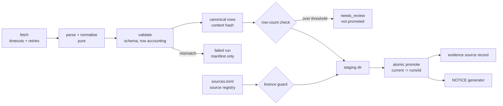

# Design: Data Pipelines (ETL), Phase 1

> Scope: the shared pipeline core (Requirements 1–4) and the `pipc`, `titck`,
> `wikidata_ingredients`, `us_ndc` and `retractions` pipelines (Requirements 5–9).
> The other pipelines (Requirement 10) reuse the core in later phases.

## 1. Overview

Each pipeline is a small job with three parts: **fetch** (I/O, the only place that touches the
network), **parse and normalise** (pure functions), and **publish** (validation, hashing,
manifest, atomic promotion). The core owns publish, so every pipeline gets provenance,
validation, licensing checks and safe promotion the same way.



Facts checked on 2026-11-07 that shaped this design:

| Source | Observed | Design consequence |
|---|---|---|
| Europe PMC `PMC12712104/fullTextXML` | Table 1 (`id="Tab1"`), 85 `<tr>`: 1 header, 18 section rows (system, "Drug Class", "Individual Drug"), 64 complete rows, and the statin cascade split over two `<tr>` (Drug A + adverse event, then Drug B). License element: CC BY 4.0. DOI 10.1007/s41999-025-01215-x | Parser is a small state machine over rows; split rows are merged; exact count 65 enforced |
| TİTCK list 06.11.2026 (local research copy, not committed) | Title row, then header row; 23,137 data rows; 75 duplicate barcodes; 118 rows without ATC; ingredient separators `,` (2,489 rows), `/` (847), ` ve ` (790), `+` (445), `;` (11); AMLIPIN: `amlodipin besilat/lisinopril dihidrat`, ATC `C09BB03` | Header row found by name; duplicates kept; split on all five separators |
| openFDA `download.json` | NDC export 2026-11-06, one partition, 26.39 MB zip, 138,262 records | Record count in the index is the validation target |
| Crossref `/works/{doi}` | `updated-by[]` with `type` (`retraction`, `correction`, …), `source` (`retraction-watch` or publisher), `updated` date | Status derived from `updated-by`; most severe wins |
| Wikidata Query Service | 3,766 items with P267; 2,462 distinct P3345 values | One query for codes; labels fetched per language to stay under the time limit |

## 2. Code layout

A separate uv project, so ETL dependencies (Polars, openpyxl) stay out of the API image.

```
pipelines/
  pyproject.toml            janus-pipelines, Python 3.12, same ruff/pyright/pytest settings as apps/api
  sources.toml              source registry (all sources in NOTICE, ingested or cited only)
  janus_pipelines/
    cli.py                  `janus-pipelines run <name> [--input PATH]`, `promote <name> <run_id>`, `notice [--check]`
    core/
      registry.py           load + validate sources.toml (pure)
      canonical.py          canonical row serialisation + content hash (pure)
      validation.py         expected schema check, row accounting, review flag (pure)
      licensing.py          path guard for storage rules
      store.py              staging, runs, atomic `current` pointer
      manifest.py           manifest model (Pydantic v2)
      http.py               client factory: timeouts, retry policy, rate limit, User-Agent
      retry.py              retry decision (pure)
      notice.py             NOTICE rendering (pure)
      runner.py             fetch → parse → validate → hash → promote
    jobs/
      pipc.py  titck.py  wikidata_ingredients.py  us_ndc.py  retractions.py
  tests/                    pytest + Hypothesis; property tests named test_<module>_properties.py
```

Each job module exposes `fetch(ctx) -> RawInput` (I/O) and `parse(raw) -> ParseResult` (pure:
rows, excluded rows with reasons, job-specific metrics). The runner never calls the network
itself, so tests drive `parse` and the runner with in-memory inputs.

Dependencies: Polars (Parquet write/read), openpyxl (read the TİTCK `.xlsx`; also builds
synthetic workbooks in tests), defusedxml (Europe PMC XML; ruff `S` flags stdlib XML parsing),
and the HTTP client already used in `apps/api` (`httpx2`; its mock transport is used in tests,
API to confirm in task 1). No new database: artifacts are Parquet files; loading them into
PostgreSQL belongs to `drug-resolution` and `evidence-integrity`.

## 3. Data contracts

### 3.1 Data directory and artifact layout
`JANUS_DATA_DIR` (default `<repo>/.data`, added to `.gitignore`):

```
$JANUS_DATA_DIR/
  staging/<pipeline>/<run_id>/        written during a run
  artifacts/<pipeline>/runs/<run_id>/ rows.parquet + manifest.json (failed runs: manifest only)
  artifacts/<pipeline>/current        symlink -> runs/<run_id> of the promoted run
  raw/<pipeline>/<run_id>/            downloaded bytes (cache-rule sources only; never for titck)
```

`run_id = <UTC yyyymmddThhmmssZ>-<first 8 hex of source hash>-<4 random hex>` (the suffix keeps two runs in the same second apart).

### 3.2 Manifest (Req 1.1, 1.2, 2.1–2.3, 9.6)
Pydantic model, written as JSON with sorted keys:
`run_id, pipeline, source_id, source_urls[], license, region (TR|EU|US|null), snapshot_date,
snapshot_date_is_retrieval_time, retrieved_at, source_sha256, content_sha256, schema_version,
code_version, outcome (succeeded|needs_review|failed), counts {input, output, excluded{reason: n}},
extra_columns[], metrics {…job-specific}, errors[], previous_run_id, promoted_by, promoted_at,
changes[] (retractions only), review_reasons[], query_sha256{}`. A manual promotion writes
`promotion.json` (`promoted_by`, `promoted_at`, `previous_run_id`) next to the manifest instead of
editing it, so a finished run's files never change (Req 1.2).

No manifest field holds user data. Source data (product codes, ingredient names) is not user
health data; it lives in the artifact, not in logs. Logs carry run id, pipeline, step, outcome and
counts only (consistent with `privacy.md` and the `log-guard` hook).

### 3.3 Canonical serialisation and content hash (Req 1.3)
1. Each row becomes a JSON object with a fixed key set; strings NFC-normalised; lists keep their
   order (ingredient order is meaningful); `None` for missing.
2. `json.dumps(row, sort_keys=True, ensure_ascii=False, separators=(",", ":"))`.
3. Lines are sorted by their UTF-8 bytes.
4. `content_sha256 = sha256(schema_version + "\n" + "\n".join(lines))`.

The hash excludes run id, timestamps, code version and file format, so the same rows always give
the same hash, and input row order never matters. Parquet bytes are not hashed (writer metadata
varies by library version).

### 3.4 Source registry `sources.toml` (Req 3.1, 3.2)
One table per source: `id, name, publisher, license, terms, storage (runtime_only|cache|commit|
separate_package|cited_only), cadence_days, region, urls, attribution, notice_section, notice_order`.
It holds every source now listed in `NOTICE`, including cited-only sources. The registry loader
rejects unknown storage values, duplicate ids and a missing `license`.

### 3.5 Evidence source record (Req 1.4)
Every run that does not fail writes `evidence_source.json` next to its manifest (consumers read
only the current run's copy):
`{kind: "dataset", source_id, source_url, license, region, snapshot_date, run_id, doi?}`.
`pipc` adds the paper's DOI. The `evidence` table loader (`evidence-integrity` spec) reads these
files; `retractions` reads their DOIs in Phase 1 (Req 9.1).

## 4. Core behaviour

### 4.1 Runner (Req 2, 4.2)
```
check registry (unknown source -> refuse)          Req 3.1
raw   = job.fetch(ctx)                             I/O, retried per 4.3
res   = job.parse(raw)                             pure
schema check on raw header/fields                  Req 2.1 -> failed, current untouched
row accounting: input == output + excluded         Req 1.5 -> failed if violated
hash  = content_hash(res.rows)
flag  = review_flag(prev_count, len(rows), threshold)   Req 2.2
licence guard on every output path                 Req 3.1
write staging -> fsync -> rename to runs/<id>
if outcome == succeeded: promote (atomic)          Req 4.2
write manifest (all outcomes)
```
Any exception after fetch ends the run as `failed`, writes a manifest with the error class and
message (no row content), exits non-zero, and leaves `current` as it was.

### 4.2 Atomic promotion (Req 4.2)
Create `current.tmp-<run_id>` as a symlink to `runs/<run_id>`, then `os.replace` it onto
`current`. On POSIX this is atomic: readers see the old or the new target, never a missing or
partial one. Staging and runs are on the same filesystem, so the staging → runs rename is atomic
too. `promote <name> <run_id>` (manual, for `needs_review` runs) uses the same function and
records `promoted_by` (from `--by`) and `promoted_at` in `promotion.json`.

### 4.3 HTTP and retries (Req 4.1)
- Timeouts: connect 10 s, read 60 s (bulk downloads: read 300 s), set on the client.
- `should_retry(method, outcome, attempt) -> bool | delay` is pure: retry only for `GET`/`HEAD`;
  only on connection error, timeout, 429 or 5xx; at most 3 retries; delay = `Retry-After` when
  present (capped at 120 s), else exponential backoff with jitter (1, 2, 4 s base).
- Rate limit: minimum interval per host (openFDA 4 req/s ≈ 240/min; Crossref and Wikidata
  2 req/s, sequential). Crossref's public pool allows 5 single-record requests/s and 1
  concurrent request; the polite pool 10/s and 3 (Crossref docs, checked 2026-11-07).
- Contact (DP13): `JANUS_CONTACT` holds an http(s) URL or an email address. User-Agent, in the
  Wikimedia format: `janus-pipelines-bot/<version> (<JANUS_CONTACT>; research prototype)
  httpx2/<version>`. The Wikimedia User-Agent policy accepts an email address, a website or a
  wiki user page as contact information, so a URL is enough for Wikidata, and
  `wikidata_ingredients` refuses to start without `JANUS_CONTACT`. Crossref needs no
  identification: `mailto` is added only when `JANUS_CONTACT` is an email; otherwise requests go
  to the public pool. Nothing is derived from git or the system when the variable is unset.

### 4.4 Licence guard (Req 3.1)
`check_output_path(path, storage, repo_root)` resolves the path (`Path.resolve()`, which follows
`..` and symlinks). For `runtime_only`: refuse if it is inside `<repo>/data/`, or inside the
repository and not ignored by git (`git check-ignore`). The pure part (path containment after
resolution) is property-tested; the git check is an example test.

### 4.5 NOTICE generation (Req 3.2)
`render_notice(registry, manifests) -> str` is pure. It raises if a manifest names a source
missing from the registry. Output = fixed header (copyright, Apache-2.0, research-prototype
line) + sections and sources in file order; each entry is the name, `Publisher:`, `License:`
and note lines, wrapped at 80 columns. NOTICE carries licence and
terms only, plus the snapshot date of committed artifacts (`data/pipc.meta.json`). Runtime-only
snapshot dates are shown in the product's evidence view instead, so the CI check
(`janus-pipelines notice --check`) is reproducible without local artifacts. The first generated
NOTICE must keep every entry of the current hand-written file.

## 5. Pipelines

### 5.1 `pipc` (Req 5)
- Fetch `https://www.ebi.ac.uk/europepmc/webservices/rest/PMC12712104/fullTextXML`; storage
  `commit`.
- Parse with defusedxml; find `table-wrap[@id="Tab1"]`; walk `<tr>` in order with state
  `(system, kind)`:
  - first row with cells `Drug A | Adverse event | Drug B` = header;
  - a row whose only non-empty cell is first: `Drug Class` / `Individual Drug` set `kind`,
    any other text sets `system`;
  - a row with three non-empty cells = one cascade;
  - a row with fewer non-empty cells that is not a section row starts a pending cascade; the
    following row(s) fill the remaining columns left to right until three are filled.
  A section row while a cascade is pending fails the run.
- Row: `position (1..65), system, kind, drug_a, adverse_event, drug_b, locator ("Table 1, row n")`.
  Whitespace collapsed; text otherwise as published.
- Count ≠ 65 → failed. On promotion also write `data/pipc.csv` (rows ordered by position, UTF-8,
  `\n`) and `data/pipc.meta.json` (source URL, DOI, PMCID, CC BY 4.0, attribution, retrieved
  date, content hash).

### 5.2 `titck` (Req 2.3, 6)
- Fetch: read the list page (`https://www.titck.gov.tr/dinamikmodul/85`), pick the `.xlsx` link
  with the newest date, download it into the staging dir only (`runtime_only`, no `raw/` copy).
  `--input PATH` reads a local file instead (development, offline). The publication date comes
  from the link date or the file name (`ddmmyyyy`); if neither parses, the run fails.
- Parse with openpyxl (read-only): sheet `RUHSATLI ÜRÜNLER LİSTESİ`; header = first row among
  the first 10 that contains the four required names (matched after trimming whitespace);
  missing sheet or column → schema failure (Req 2.1).
- Row: `barcode, product_name, ingredient_text, ingredients[], atc_code (null if empty),
  suspension_status (int|null)`. Columns used only to locate data (SIRA NO) and those not needed
  (licence holder, licence number, change notes) are not kept.
- Barcode: integer or text → 13 digits, EAN-13 check digit; else excluded `invalid_barcode`.
  Empty rows after the table → excluded `blank_row`.
- Ingredient split: `split_ingredients(text)` splits on `,`, `;`, `/`, `+` and the word ` ve `
  (surrounded by whitespace), trims, drops empty parts. Whitespace and the separators are the
  only characters removed. Salt normalisation and ATC mapping stay in `drug-resolution`.
- Metrics: `atc_share` (rows with ATC / output rows), `multi_ingredient_products` (rows with
  ≥ 2 ingredients), `duplicate_barcodes` (barcodes on > 1 row), `invalid_barcode` count.

### 5.3 `wikidata_ingredients` (Req 7)
- Query 1: `?item wdt:P267 ?atc . OPTIONAL { ?item wdt:P3345 ?rxcui }` → codes.
- Queries 2–6: labels and aliases (`rdfs:label`, `skos:altLabel`) for items with P267, one
  query per language (en, tr, de, fr, es). If a query times out, it is split by the first ATC
  letter (A–V) and the parts merged.
- Merge is a pure function over result rows: group by QID; ATC codes and RxCUIs as sorted
  unique lists; labels per language; aliases sorted unique. Items without P267 never appear.
- Snapshot date = retrieval time; `snapshot_date_is_retrieval_time = true`; manifest records
  the SHA-256 of each query text. Storage `cache`.

### 5.4 `us_ndc` (Req 8)
- Read `https://api.fda.gov/download.json`; take `results.drug.ndc`: `export_date` (snapshot),
  partitions (file URL, `records`). Download each zip into `raw/` (storage `cache`), stream
  the JSON `results` array.
- Row: `product_ndc, package_ndcs[], product_type, brand_name, generic_name,
  active_ingredients[{name, strength}], rxcuis[], marketing_end_date` — values as published.
- Parsed record count ≠ sum of partition `records` → failed (Req 8.2). Bulk download needs no
  API key.

### 5.5 `retractions` (Req 9)
- Input DOIs: the `doi` field of every current `evidence_source.json` (Phase 1: the PIPC
  paper), normalised by `normalise_doi`: trim, strip `https://doi.org/`, `http://dx.doi.org/`,
  `doi:` (case-insensitive), lower case.
- Per DOI: `GET https://api.crossref.org/works/{doi}`. `status_from_notices(updated_by)` maps
  `retraction`/`withdrawal` → `retracted`, `expression_of_concern` → `expression_of_concern`,
  `correction`/`erratum` → `corrected`, none → `ok`; most severe wins. Unknown notice types are
  recorded and treated as `corrected` (shown, not ignored), pending review in
  `evidence-integrity`.
- 404 or failed check → check status `unknown`. Effective status =
  `effective(last_completed, this_check)`: if this check is `unknown` and the last completed
  check was `retracted`, the effective status stays `retracted`; otherwise it is this check's
  status.
- Row: `doi, check_status, effective_status, notices[{type, source, notice_doi, date}],
  checked_at`. Raw responses stored in `raw/` (storage `cache`). `changes[]` in the manifest;
  a change away from `retracted` sets `needs_review` (Req 9.6).
- Requests send `mailto` only when `JANUS_CONTACT` is an email (DP13); otherwise the public
  pool is used, within its 5 requests/s and 1 concurrent request.
- `status_from_notices`, `effective` and `normalise_doi` are pure. They live here for Phase 1;
  `evidence-integrity` may move them into `apps/api/janus/integrity/` and reuse them.

## 6. Testing strategy

- **Property tests (Hypothesis)** for every item under "Properties to test", listed in §7 with
  their requirement. Pure functions are tested directly; the runner and store are tested with
  in-memory jobs and a temporary data directory. Profiles: `dev` (100 examples) and `ci`
  (300 examples, `derandomize=True`) selected by `HYPOTHESIS_PROFILE`.
- **Example tests** (pytest) for fixed facts: AMLIPIN row splits into two ingredients; the statin
  PIPC row merges; Crossref `updated-by` sample for a known retracted DOI; download-index count
  mismatch fails.
- **No network in tests.** HTTP goes through the client's mock transport.
- **No TİTCK data in the repository.** TİTCK-shaped workbooks are built in memory by a
  Hypothesis strategy (openpyxl); no fixture file is committed. An optional integration test runs
  against a local list when `JANUS_TITCK_LIST` points to one, and is skipped otherwise (and in CI).
- **CI:** new `pipelines` job (uv sync, ruff, ruff format, pyright, pytest with `ci` profile,
  `janus-pipelines notice --check`).

## 7. Correctness properties

Each property is one Hypothesis test, tagged in its docstring with
`Feature: data-pipelines, Property Pn` and the requirement it validates.

| # | Property (for all …) | Validates | Hypothesis approach |
|---|---|---|---|
| P1 | **Determinism.** Running a pipeline twice on the same input gives the same content hash and the same rows. | Req 1.1, 1.3 | Generated rows for a stub job and generated TİTCK/PIPC inputs; run twice into two fresh data dirs; compare hash and rows (run id and timestamps differ). |
| P2 | **Order independence.** Any permutation of input rows gives the same content hash. | Req 1.3 | `st.permutations` of generated rows → `content_hash`. |
| P3 | **Schema mismatch is safe.** For any valid current artifact and any input with a required column removed, renamed or retyped, the run fails, names the column, and `current` and its files are byte-identical before and after. | Req 2.1 | Generate a valid artifact, then a mutation (drop / rename / retype one of the required columns); snapshot the files; run; compare. |
| P4 | **Row accounting.** For any input, `input == output + Σ excluded`, and every excluded row has a reason. | Req 1.5 | TİTCK workbooks with a mix of valid, invalid-barcode and blank rows; check counts and reasons. |
| P5 | **Review flag.** For any previous count `p ≥ 1`, current count `c ≥ 0` and threshold `t ∈ (0, 1]`, the run is flagged iff `abs(c − p) > t·p`; with no previous artifact it is never flagged. | Req 2.2 | Integers and fractions; exact rational arithmetic (`fractions.Fraction`) to avoid float edge cases. |
| P6 | **TİTCK metrics.** For any generated list, `atc_share`, `multi_ingredient_products`, `duplicate_barcodes` and `invalid_barcode` equal a direct recount of the generated data. | Req 2.3, 6.4, 6.5 | Generate rows with controlled duplicates, empty ATC and multi-ingredient text; recount independently. |
| P7 | **Runtime-only never lands in `data/`.** For any path string built from segments (`.`, `..`, names, `data`, absolute prefixes, symlinks inside a temp repo), if the resolved path is inside `<repo>/data/` the guard refuses for `runtime_only`, and nothing is written. | Req 3.1 | Build a temp repo with `data/` and symlinks into it; generate relative paths; compare the guard's decision with a reference `resolve()` containment check; assert the directory stays empty. |
| P8 | **NOTICE completeness.** For any registry and any set of manifests whose sources are in the registry, the generated NOTICE contains an entry (name and licence) for every manifest source; a manifest with an unknown source makes generation fail. | Req 3.2 | Generated registries (unique ids) and manifest subsets; plus one manifest with an id outside the registry. |
| P9 | **Retry policy.** For any method, outcome (status code or error) and attempt number, a retry is allowed only for GET/HEAD, only for connection error / timeout / 429 / 5xx, never after 3 retries; any delay is ≥ 0 and ≤ the cap. | Req 4.1 | `st.sampled_from` methods, `st.integers(100, 599)` statuses, error kinds, attempts 0–10, optional `Retry-After`. |
| P10 | **Always a usable artifact.** For any sequence of runs (success, schema failure, crash at staging write, crash before promote, crash during promote, needs_review), after each step `current` is either absent (no success yet) or points to a complete run whose rows hash to its manifest's content hash, and that run is the last promoted one. | Req 4.2 | `RuleBasedStateMachine` with fault injection in `store`; invariant checked after every rule. |
| P11 | **PIPC parse.** For any generated Table-1-like XML (systems, "Drug Class"/"Individual Drug" rows, N cascades, some split over two `<tr>`), the parser returns exactly the N cascades in order with the right system and kind; the real-count check fails for N ≠ 65. | Req 5.2–5.4 | Strategy builds the cascade list first, then renders XML from it, with random split points. |
| P12 | **Ingredient split keeps characters.** For any list of 1–5 ingredient names (without separators) joined by any mix of separators and spacing, `split_ingredients` returns that list; and for any text, the multiset of non-separator, non-whitespace characters is the same before and after splitting. | Req 6.6 | Turkish letters (ç ğ ı İ ö ş ü), digits, `%`, `-`, `(`, `)` in names; separators from the five observed. |
| P13 | **Wikidata merge.** For any set of result rows, merging is independent of row order and of how rows are split across queries; each QID appears once with ≥ 1 ATC code. | Req 7.3, 7.4 | Generate (QID, ATC, RxCUI, lang, label) tuples; shuffle and partition; compare merges. |
| P14 | **Most severe notice wins.** For any list of notices, the status equals the maximum severity of their types, whatever their order; adding a retraction notice always gives `retracted`. | Req 9.2, 9.3 | Lists of notice types incl. unknown types; `st.permutations`. |
| P15 | **Failed check never un-retracts.** For any history of checks, if the last completed check was `retracted` and the new check is `unknown`, the effective status is `retracted`; `unknown` never becomes `ok`. | Req 9.4, 9.5 | Generated check histories (sequences of statuses and failures). |
| P16 | **DOI normalisation.** For any DOI, `normalise_doi` is idempotent, and any case change or allowed prefix gives the same result. | Req 9.1 | DOIs `10.<4–9 digits>/<suffix>` with mixed case; random prefix from the allowed set. |

P1–P3 are the three original properties; P4–P16 were added in the requirements refinement.

## 8. Decisions

| # | Decision | Alternatives considered | Why |
|---|---|---|---|
| DP1 | Separate uv project `pipelines/` (`janus-pipelines`). | Package inside `apps/api`. | Keeps Polars/openpyxl out of the API image; contract between them is files (Parquet + manifest). |
| DP2 | Artifacts are Parquet + JSON manifest in `JANUS_DATA_DIR`; promotion by atomic symlink swap. | DuckDB file per source; load straight into PostgreSQL. | Simple, atomic, format-neutral; loading into PostgreSQL (`pg_trgm` name search) stays in `drug-resolution`. |
| DP3 | Content hash over sorted canonical JSON lines, not over file bytes. | Hash of the Parquet file. | Writer metadata varies by version; sorting gives order independence (P2). |
| DP4 | A `needs_review` run is **not** promoted until a maintainer runs `promote`. (Original text said only "flag".) | Promote and flag. | A large drop in TİTCK rows is more likely a parser or source change than real; keeping the last good list is the safer default for medical data. **Please confirm.** |
| DP5 | `runtime_only` output must be outside the repository or in a git-ignored path, not only outside `data/`. | Check `data/` only (original wording). | Stops a TİTCK copy landing in e.g. `pipelines/` and being committed. |
| DP6 | Duplicate TİTCK barcodes (75 on 06.11.2026) are kept, all of them; `drug-resolution` shows every candidate. | Keep first / latest. | Choosing would be a guess; the spec forbids guessing a product. |
| DP7 | The pipelines split ingredient text but do not normalise salts, map ATC, detect combination codes or normalise NDCs. | Do it in the pipeline. | Those rules belong to `drug-resolution` and are property-tested there; one place per rule. |
| DP8 | PIPC Drug A/B → ATC mapping is a curated file in `cascade-engine`, not produced by the pipeline. | Automatic mapping from class names. | Class names ("Antihypertensive", "Cough remedy") need clinical judgement. |
| DP9 | A failed retraction check keeps a `retracted` status; unknown notice types count as `corrected`. | Mark `unknown` in all cases (evidence-integrity 1.5 read literally). | A network error must not re-enable a rule backed by a retracted paper. `unknown` is still recorded as the check status. |
| DP10 | NOTICE holds licences and terms (plus committed-artifact dates), not runtime snapshot dates. | Write all snapshot dates into NOTICE. | Keeps NOTICE reproducible in CI; runtime dates are shown with the evidence in the product. |
| DP11 | Phase 1 runs pipelines from the CLI only. Scheduling (GitHub Actions cron or the Night Watch Crew app) comes with deployment in Phase 5. | Cron now. | Nothing is deployed before Phase 5, and a cron in CI could not keep a TİTCK artifact anyway. |
| DP13 | Contact is `JANUS_CONTACT` (URL or email). Owner's choice: a public URL, no email anywhere; Crossref `mailto` only for an email contact, else the public pool. | Require an email for Crossref and Wikidata. | Wikimedia's policy accepts a website as contact; Crossref allows anonymous public-pool access. Keeps personal addresses out of requests. |
| DP12 | TİTCK test data is generated in memory; no fixture file. | Small committed sample. | Redistribution terms are unclear; the licence guard and CI policy also forbid it. |

## 9. Open items
- DP4 needs the owner's confirmation.
- TİTCK list page: link format and date parsing to confirm against the live page in task 10; `--input` covers offline work.
- Crossref rate limits and update types confirmed 2026-11-07 (public pool 5/s, 1 concurrent; 12 Crossmark update types).
- `httpx2` mock-transport API to confirm in task 1.
