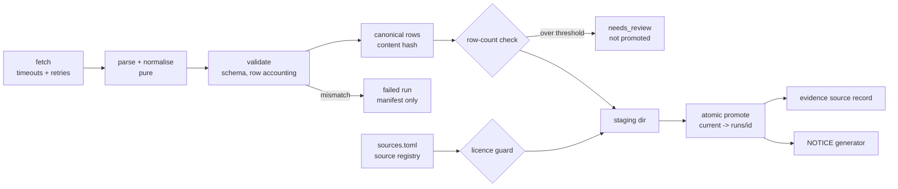
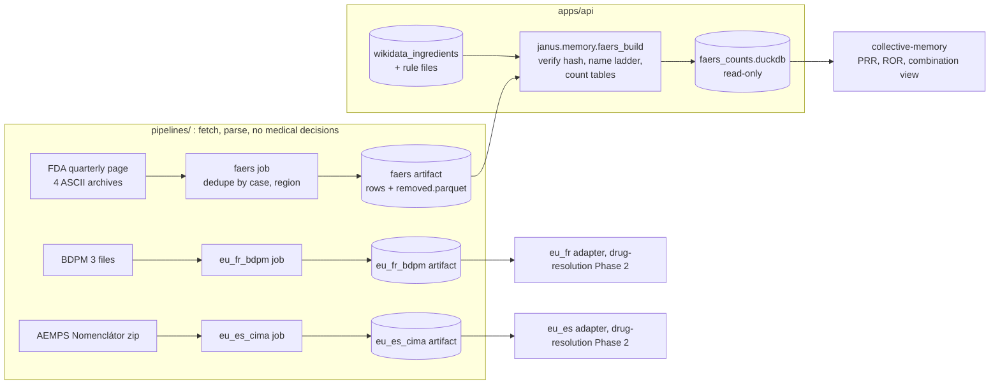

# Design: Data Pipelines (ETL), Phase 1 and Phase 2

> Scope of §1–§9 (Phase 1): the shared pipeline core (Requirements 1–4) and the `pipc`, `titck`,
> `wikidata_ingredients`, `us_ndc` and `retractions` pipelines (Requirements 5–9).
> **Scope of §10–§18 (Phase 2, 2026-11-08):** the `eu_fr_bdpm`, `eu_es_cima` and `faers`
> pipelines (Requirements 11–13), the core changes they need (Requirement 14) and the FAERS
> count builder (Requirement 15). Phase 2 reuses the Phase 1 core, conventions and decisions
> (DP1–DP13); property numbers continue at P17, decision numbers at DP14. `onsides` and `canon`
> reuse the core in later phases.

## 1. Overview

Each pipeline is a small job with three parts: **fetch** (I/O, the only place that touches the
network), **parse and normalise** (pure functions), and **publish** (validation, hashing,
manifest, atomic promotion). The core owns publish, so every pipeline gets provenance,
validation, licensing checks and safe promotion the same way.



Facts checked on 2026-11-07 that shaped this design:

| Source | Observed | Design consequence |
|---|---|---|
| Europe PMC `PMC12712104/fullTextXML` | Table 1 (`id="Tab1"`), 85 `<tr>`: 1 header, 18 section rows (system, "Drug Class", "Individual Drug"), 64 complete rows, and the statin cascade split over two `<tr>` (Drug A + adverse event, then Drug B). License element: CC BY 4.0. DOI 10.1007/s41999-025-01215-x | Parser is a small state machine over rows; split rows are merged; exact count 65 enforced |
| TİTCK list 06.11.2026 (local research copy, not committed) | Title row, then header row; 23,137 data rows; 75 duplicate barcodes; 118 rows without ATC; ingredient separators `,` (2,489 rows), `/` (847), ` ve ` (790), `+` (445), `;` (11); AMLIPIN: `amlodipin besilat/lisinopril dihidrat`, ATC `C09BB03` | Header row found by name; duplicates kept; split on all five separators |
| openFDA `download.json` | NDC export 2026-11-06, one partition, 26.39 MB zip, 138,262 records | Record count in the index is the validation target |
| Crossref `/works/{doi}` | `updated-by[]` with `type` (`retraction`, `correction`, …), `source` (`retraction-watch` or publisher), `updated` date | Status derived from `updated-by`; most severe wins |
| Wikidata Query Service | 3,766 items with P267; 2,462 distinct P3345 values | One query for codes; labels fetched per language to stay under the time limit |

## 2. Code layout

A separate uv project, so ETL dependencies (Polars, openpyxl) stay out of the API image.

```
pipelines/
  pyproject.toml            janus-pipelines, Python 3.12, same ruff/pyright/pytest settings as apps/api
  sources.toml              source registry (all sources in NOTICE, ingested or cited only)
  janus_pipelines/
    cli.py                  `janus-pipelines run <name> [--input PATH]`, `promote <name> <run_id>`, `notice [--check]`
    core/
      registry.py           load + validate sources.toml (pure)
      canonical.py          canonical row serialisation + content hash (pure)
      validation.py         expected schema check, row accounting, review flag (pure)
      licensing.py          path guard for storage rules
      store.py              staging, runs, atomic `current` pointer
      manifest.py           manifest model (Pydantic v2)
      http.py               client factory: timeouts, retry policy, rate limit, User-Agent
      retry.py              retry decision (pure)
      notice.py             NOTICE rendering (pure)
      runner.py             fetch → parse → validate → hash → promote
    jobs/
      pipc.py  titck.py  wikidata_ingredients.py  us_ndc.py  retractions.py
  tests/                    pytest + Hypothesis; property tests named test_<module>_properties.py
```

Each job module exposes `fetch(ctx) -> RawInput` (I/O) and `parse(raw) -> ParseResult` (pure:
rows, excluded rows with reasons, job-specific metrics). The runner never calls the network
itself, so tests drive `parse` and the runner with in-memory inputs.

Dependencies: Polars (Parquet write/read), openpyxl (read the TİTCK `.xlsx`; also builds
synthetic workbooks in tests), defusedxml (Europe PMC XML; ruff `S` flags stdlib XML parsing),
and the HTTP client already used in `apps/api` (`httpx2`; its mock transport is used in tests,
API to confirm in task 1). No new database: artifacts are Parquet files; loading them into
PostgreSQL belongs to `drug-resolution` and `evidence-integrity`.

## 3. Data contracts

### 3.1 Data directory and artifact layout
`JANUS_DATA_DIR` (default `<repo>/.data`, added to `.gitignore`):

```
$JANUS_DATA_DIR/
  staging/<pipeline>/<run_id>/        written during a run
  artifacts/<pipeline>/runs/<run_id>/ rows.parquet + manifest.json (failed runs: manifest only)
  artifacts/<pipeline>/current        symlink -> runs/<run_id> of the promoted run
  raw/<pipeline>/<run_id>/            downloaded bytes (cache-rule sources only; never for titck)
```

`run_id = <UTC yyyymmddThhmmssZ>-<first 8 hex of source hash>-<4 random hex>` (the suffix keeps two runs in the same second apart).

### 3.2 Manifest (Req 1.1, 1.2, 2.1–2.3, 9.6)
Pydantic model, written as JSON with sorted keys:
`run_id, pipeline, source_id, source_urls[], license, region (TR|EU|US|null), snapshot_date,
snapshot_date_is_retrieval_time, retrieved_at, source_sha256, content_sha256, schema_version,
code_version, outcome (succeeded|needs_review|failed), counts {input, output, excluded{reason: n}},
extra_columns[], metrics {…job-specific}, errors[], previous_run_id, promoted_by, promoted_at,
changes[] (retractions only), review_reasons[], query_sha256{}`. A manual promotion writes
`promotion.json` (`promoted_by`, `promoted_at`, `previous_run_id`) next to the manifest instead of
editing it, so a finished run's files never change (Req 1.2).

No manifest field holds user data. Source data (product codes, ingredient names) is not user
health data; it lives in the artifact, not in logs. Logs carry run id, pipeline, step, outcome and
counts only (consistent with `privacy.md` and the `log-guard` hook).

### 3.3 Canonical serialisation and content hash (Req 1.3)
1. Each row becomes a JSON object with a fixed key set; strings NFC-normalised; lists keep their
   order (ingredient order is meaningful); `None` for missing.
2. `json.dumps(row, sort_keys=True, ensure_ascii=False, separators=(",", ":"))`.
3. Lines are sorted by their UTF-8 bytes.
4. `content_sha256 = sha256(schema_version + "\n" + "\n".join(lines))`.

The hash excludes run id, timestamps, code version and file format, so the same rows always give
the same hash, and input row order never matters. Parquet bytes are not hashed (writer metadata
varies by library version).

### 3.4 Source registry `sources.toml` (Req 3.1, 3.2)
One table per source: `id, name, publisher, license, terms, storage (runtime_only|cache|commit|
separate_package|cited_only), cadence_days, region, urls, attribution, notice_section, notice_order`.
It holds every source now listed in `NOTICE`, including cited-only sources. The registry loader
rejects unknown storage values, duplicate ids and a missing `license`.

### 3.5 Evidence source record (Req 1.4)
Every run that does not fail writes `evidence_source.json` next to its manifest (consumers read
only the current run's copy):
`{kind: "dataset", source_id, source_url, license, region, snapshot_date, run_id, doi?}`.
`pipc` adds the paper's DOI. The `evidence` table loader (`evidence-integrity` spec) reads these
files; `retractions` reads their DOIs in Phase 1 (Req 9.1).

## 4. Core behaviour

### 4.1 Runner (Req 2, 4.2)
```
check registry (unknown source -> refuse)          Req 3.1
raw   = job.fetch(ctx)                             I/O, retried per 4.3
res   = job.parse(raw)                             pure
schema check on raw header/fields                  Req 2.1 -> failed, current untouched
row accounting: input == output + excluded         Req 1.5 -> failed if violated
hash  = content_hash(res.rows)
flag  = review_flag(prev_count, len(rows), threshold)   Req 2.2
licence guard on every output path                 Req 3.1
write staging -> fsync -> rename to runs/<id>
if outcome == succeeded: promote (atomic)          Req 4.2
write manifest (all outcomes)
```
Any exception after fetch ends the run as `failed`, writes a manifest with the error class and
message (no row content), exits non-zero, and leaves `current` as it was.

### 4.2 Atomic promotion (Req 4.2)
Create `current.tmp-<run_id>` as a symlink to `runs/<run_id>`, then `os.replace` it onto
`current`. On POSIX this is atomic: readers see the old or the new target, never a missing or
partial one. Staging and runs are on the same filesystem, so the staging → runs rename is atomic
too. `promote <name> <run_id>` (manual, for `needs_review` runs) uses the same function and
records `promoted_by` (from `--by`) and `promoted_at` in `promotion.json`.

### 4.3 HTTP and retries (Req 4.1)
- Timeouts: connect 10 s, read 60 s (bulk downloads: read 300 s), set on the client.
- `should_retry(method, outcome, attempt) -> bool | delay` is pure: retry only for `GET`/`HEAD`;
  only on connection error, timeout, 429 or 5xx; at most 3 retries; delay = `Retry-After` when
  present (capped at 120 s), else exponential backoff with jitter (1, 2, 4 s base).
- Rate limit: minimum interval per host (openFDA 4 req/s ≈ 240/min; Crossref and Wikidata
  2 req/s, sequential). Crossref's public pool allows 5 single-record requests/s and 1
  concurrent request; the polite pool 10/s and 3 (Crossref docs, checked 2026-11-07).
- Contact (DP13): `JANUS_CONTACT` holds an http(s) URL or an email address. User-Agent, in the
  Wikimedia format: `janus-pipelines-bot/<version> (<JANUS_CONTACT>; research prototype)
  httpx2/<version>`. The Wikimedia User-Agent policy accepts an email address, a website or a
  wiki user page as contact information, so a URL is enough for Wikidata, and
  `wikidata_ingredients` refuses to start without `JANUS_CONTACT`. Crossref needs no
  identification: `mailto` is added only when `JANUS_CONTACT` is an email; otherwise requests go
  to the public pool. Nothing is derived from git or the system when the variable is unset.

### 4.4 Licence guard (Req 3.1)
`check_output_path(path, storage, repo_root)` resolves the path (`Path.resolve()`, which follows
`..` and symlinks). For `runtime_only`: refuse if it is inside `<repo>/data/`, or inside the
repository and not ignored by git (`git check-ignore`). The pure part (path containment after
resolution) is property-tested; the git check is an example test.

### 4.5 NOTICE generation (Req 3.2)
`render_notice(registry, manifests) -> str` is pure. It raises if a manifest names a source
missing from the registry. Output = fixed header (copyright, Apache-2.0, research-prototype
line) + sections and sources in file order; each entry is the name, `Publisher:`, `License:`
and note lines, wrapped at 80 columns. NOTICE carries licence and
terms only, plus the snapshot date of committed artifacts (`data/pipc.meta.json`). Runtime-only
snapshot dates are shown in the product's evidence view instead, so the CI check
(`janus-pipelines notice --check`) is reproducible without local artifacts. The first generated
NOTICE must keep every entry of the current hand-written file.

## 5. Pipelines

### 5.1 `pipc` (Req 5)
- Fetch `https://www.ebi.ac.uk/europepmc/webservices/rest/PMC12712104/fullTextXML`; storage
  `commit`.
- Parse with defusedxml; find `table-wrap[@id="Tab1"]`; walk `<tr>` in order with state
  `(system, kind)`:
  - first row with cells `Drug A | Adverse event | Drug B` = header;
  - a row whose only non-empty cell is first: `Drug Class` / `Individual Drug` set `kind`,
    any other text sets `system`;
  - a row with three non-empty cells = one cascade;
  - a row with fewer non-empty cells that is not a section row starts a pending cascade; the
    following row(s) fill the remaining columns left to right until three are filled.
  A section row while a cascade is pending fails the run.
- Row: `position (1..65), system, kind, drug_a, adverse_event, drug_b, locator ("Table 1, row n")`.
  Whitespace collapsed; text otherwise as published.
- Count ≠ 65 → failed. On promotion also write `data/pipc.csv` (rows ordered by position, UTF-8,
  `\n`) and `data/pipc.meta.json` (source URL, DOI, PMCID, CC BY 4.0, attribution, retrieved
  date, content hash).

### 5.2 `titck` (Req 2.3, 6)
- Fetch: read the list page (`https://www.titck.gov.tr/dinamikmodul/85`), pick the `.xlsx` link
  with the newest date, download it into the staging dir only (`runtime_only`, no `raw/` copy).
  `--input PATH` reads a local file instead (development, offline). The publication date comes
  from the link date or the file name (`ddmmyyyy`); if neither parses, the run fails.
- Parse with openpyxl (read-only): sheet `RUHSATLI ÜRÜNLER LİSTESİ`; header = first row among
  the first 10 that contains the four required names (matched after trimming whitespace);
  missing sheet or column → schema failure (Req 2.1).
- Row: `barcode (null for name-only rows), name_only, product_name, ingredient_text, ingredients[], atc_code (null if empty),
  suspension_status (int|null)`. Columns used only to locate data (SIRA NO) and those not needed
  (licence holder, licence number, change notes) are not kept.
- Barcode: integer or text → 13 digits, EAN-13 check digit; else (schema `titck-2`, owner
  decision in `drug-resolution` DP9) the row is output as a name-only row: `barcode = null`,
  `name_only = true`; the invalid value is not kept. Every row has `name_only`.
  Empty rows after the table → excluded `blank_row`.
- Ingredient split: `split_ingredients(text)` splits on `,`, `;`, `/`, `+` and the word ` ve `
  (surrounded by whitespace), trims, drops empty parts. Whitespace and the separators are the
  only characters removed. Salt normalisation and ATC mapping stay in `drug-resolution`.
- Metrics: `atc_share` (rows with ATC / output rows), `multi_ingredient_products` (rows with
  ≥ 2 ingredients), `duplicate_barcodes` (barcodes on > 1 row, name-only rows not counted),
  `name_only_rows` (was the `invalid_barcode` exclusion count in `titck-1`).
- `titck-2` split (DP10 in `drug-resolution`): a separator match starting inside parentheses
  (depth > 0, depth never below zero) does not split. The list of 2026-11-06 gives 23,137
  output rows (155 name-only), 4,362 multi-ingredient rows.

### 5.3 `wikidata_ingredients` (Req 7)
- Query 1: `?item wdt:P267 ?atc . OPTIONAL { ?item wdt:P3345 ?rxcui }` → codes.
- Queries 2–8: labels and aliases (`rdfs:label`, `skos:altLabel`) for items with P267, one
  query per language (en, tr, de, fr, es, pt; plus `pt-br`, merged into pt). If a query times out, it is split by the first ATC
  letter (A–V) and the parts merged.
- Merge is a pure function over result rows: group by QID; ATC codes and RxCUIs as sorted
  unique lists; labels per language; aliases sorted unique. Items without P267 never appear.
- Snapshot date = retrieval time; `snapshot_date_is_retrieval_time = true`; manifest records
  the SHA-256 of each query text. Storage `cache`.

### 5.4 `us_ndc` (Req 8)
- Read `https://api.fda.gov/download.json`; take `results.drug.ndc`: `export_date` (snapshot),
  partitions (file URL, `records`). Download each zip into `raw/` (storage `cache`), stream
  the JSON `results` array.
- Row: `product_ndc, package_ndcs[], product_type, brand_name, generic_name,
  active_ingredients[{name, strength}], rxcuis[], marketing_end_date, route[], dosage_form` —
  values as published (`route` and `dosage_form` added in schema `us_ndc-2`, `drug-resolution`
  DP20; a record without a route gets an empty list).
- Parsed record count ≠ sum of partition `records` → failed (Req 8.2). Bulk download needs no
  API key.

### 5.5 `retractions` (Req 9)
- Input DOIs: the `doi` field of every current `evidence_source.json` (Phase 1: the PIPC
  paper) and the `doi` column of `data/evidence_papers.csv` (curated papers cited by rules;
  `evidence-integrity` DP13; a missing file is an empty list, a row that is not a DOI fails the
  run), one entry per normalised DOI, normalised by `normalise_doi`: trim, strip `https://doi.org/`, `http://dx.doi.org/`,
  `doi:` (case-insensitive), lower case.
- Per DOI: `GET https://api.crossref.org/works/{doi}`. `status_from_notices(updated_by)` maps
  `retraction`/`withdrawal` → `retracted`, `expression_of_concern` → `expression_of_concern`,
  `correction`/`erratum` → `corrected`, none → `ok`; most severe wins. Unknown notice types are
  recorded and treated as `corrected` (shown, not ignored), pending review in
  `evidence-integrity`.
- 404 or failed check → check status `unknown`. Effective status =
  `effective(last_completed, this_check)`: if this check is `unknown` and the last completed
  check was `retracted`, the effective status stays `retracted`; otherwise it is this check's
  status.
- Row: `doi, check_status, effective_status, notices[{type, source, notice_doi, date}],
  checked_at`. Raw responses stored in `raw/` (storage `cache`). `changes[]` in the manifest;
  a change away from `retracted` sets `needs_review` (Req 9.6).
- Requests send `mailto` only when `JANUS_CONTACT` is an email (DP13); otherwise the public
  pool is used, within its 5 requests/s and 1 concurrent request.
- `status_from_notices`, `effective` and `normalise_doi` are pure. They live here for Phase 1;
  `evidence-integrity` may move them into `apps/api/janus/integrity/` and reuse them.

## 6. Testing strategy

- **Property tests (Hypothesis)** for every item under "Properties to test", listed in §7 with
  their requirement. Pure functions are tested directly; the runner and store are tested with
  in-memory jobs and a temporary data directory. Profiles: `dev` (100 examples) and `ci`
  (300 examples, `derandomize=True`) selected by `HYPOTHESIS_PROFILE`.
- **Example tests** (pytest) for fixed facts: AMLIPIN row splits into two ingredients; the statin
  PIPC row merges; Crossref `updated-by` sample for a known retracted DOI; download-index count
  mismatch fails.
- **No network in tests.** HTTP goes through the client's mock transport.
- **No TİTCK data in the repository.** TİTCK-shaped workbooks are built in memory by a
  Hypothesis strategy (openpyxl); no fixture file is committed. An optional integration test runs
  against a local list when `JANUS_TITCK_LIST` points to one, and is skipped otherwise (and in CI).
- **CI:** new `pipelines` job (uv sync, ruff, ruff format, pyright, pytest with `ci` profile,
  `janus-pipelines notice --check`).

## 7. Correctness properties

Each property is one Hypothesis test, tagged in its docstring with
`Feature: data-pipelines, Property Pn` and the requirement it validates.

| # | Property (for all …) | Validates | Hypothesis approach |
|---|---|---|---|
| P1 | **Determinism.** Running a pipeline twice on the same input gives the same content hash and the same rows. | Req 1.1, 1.3 | Generated rows for a stub job and generated TİTCK/PIPC inputs; run twice into two fresh data dirs; compare hash and rows (run id and timestamps differ). |
| P2 | **Order independence.** Any permutation of input rows gives the same content hash. | Req 1.3 | `st.permutations` of generated rows → `content_hash`. |
| P3 | **Schema mismatch is safe.** For any valid current artifact and any input with a required column removed, renamed or retyped, the run fails, names the column, and `current` and its files are byte-identical before and after. | Req 2.1 | Generate a valid artifact, then a mutation (drop / rename / retype one of the required columns); snapshot the files; run; compare. |
| P4 | **Row accounting.** For any input, `input == output + Σ excluded`, and every excluded row has a reason; invalid-barcode rows come out as name-only rows (`titck-2`). | Req 1.5, 6.4 | TİTCK workbooks with a mix of valid, invalid-barcode and blank rows; check counts, reasons and name-only rows. |
| P5 | **Review flag.** For any previous count `p ≥ 1`, current count `c ≥ 0` and threshold `t ∈ (0, 1]`, the run is flagged iff `abs(c − p) > t·p`; with no previous artifact it is never flagged. | Req 2.2 | Integers and fractions; exact rational arithmetic (`fractions.Fraction`) to avoid float edge cases. |
| P6 | **TİTCK metrics.** For any generated list, `atc_share`, `multi_ingredient_products`, `duplicate_barcodes` and `name_only_rows` equal a direct recount of the generated data. | Req 2.3, 6.4, 6.5 | Generate rows with controlled duplicates, empty ATC and multi-ingredient text; recount independently. |
| P7 | **Runtime-only never lands in `data/`.** For any path string built from segments (`.`, `..`, names, `data`, absolute prefixes, symlinks inside a temp repo), if the resolved path is inside `<repo>/data/` the guard refuses for `runtime_only`, and nothing is written. | Req 3.1 | Build a temp repo with `data/` and symlinks into it; generate relative paths; compare the guard's decision with a reference `resolve()` containment check; assert the directory stays empty. |
| P8 | **NOTICE completeness.** For any registry and any set of manifests whose sources are in the registry, the generated NOTICE contains an entry (name and licence) for every manifest source; a manifest with an unknown source makes generation fail. | Req 3.2 | Generated registries (unique ids) and manifest subsets; plus one manifest with an id outside the registry. |
| P9 | **Retry policy.** For any method, outcome (status code or error) and attempt number, a retry is allowed only for GET/HEAD, only for connection error / timeout / 429 / 5xx, never after 3 retries; any delay is ≥ 0 and ≤ the cap. | Req 4.1 | `st.sampled_from` methods, `st.integers(100, 599)` statuses, error kinds, attempts 0–10, optional `Retry-After`. |
| P10 | **Always a usable artifact.** For any sequence of runs (success, schema failure, crash at staging write, crash before promote, crash during promote, needs_review), after each step `current` is either absent (no success yet) or points to a complete run whose rows hash to its manifest's content hash, and that run is the last promoted one. | Req 4.2 | `RuleBasedStateMachine` with fault injection in `store`; invariant checked after every rule. |
| P11 | **PIPC parse.** For any generated Table-1-like XML (systems, "Drug Class"/"Individual Drug" rows, N cascades, some split over two `<tr>`), the parser returns exactly the N cascades in order with the right system and kind; the real-count check fails for N ≠ 65. | Req 5.2–5.4 | Strategy builds the cascade list first, then renders XML from it, with random split points. |
| P12 | **Ingredient split keeps characters.** For any list of 1–5 ingredient names (without top-level separators; parenthesised parts may contain separators) joined by any mix of separators and spacing, `split_ingredients` returns that list; and for any text, the multiset of non-separator, non-whitespace characters is the same before and after splitting, separators inside parentheses included. | Req 6.6 | Turkish letters (ç ğ ı İ ö ş ü), digits, `%`, `-`, `(`, `)` in names; separators from the five observed. |
| P13 | **Wikidata merge.** For any set of result rows, merging is independent of row order and of how rows are split across queries; each QID appears once with ≥ 1 ATC code. | Req 7.3, 7.4 | Generate (QID, ATC, RxCUI, lang, label) tuples; shuffle and partition; compare merges. |
| P14 | **Most severe notice wins.** For any list of notices, the status equals the maximum severity of their types, whatever their order; adding a retraction notice always gives `retracted`. | Req 9.2, 9.3 | Lists of notice types incl. unknown types; `st.permutations`. |
| P15 | **Failed check never un-retracts.** For any history of checks, if the last completed check was `retracted` and the new check is `unknown`, the effective status is `retracted`; `unknown` never becomes `ok`. | Req 9.4, 9.5 | Generated check histories (sequences of statuses and failures). |
| P16 | **DOI normalisation.** For any DOI, `normalise_doi` is idempotent, and any case change or allowed prefix gives the same result. | Req 9.1 | DOIs `10.<4–9 digits>/<suffix>` with mixed case; random prefix from the allowed set. |

P1–P3 are the three original properties; P4–P16 were added in the requirements refinement.

## 8. Decisions

| # | Decision | Alternatives considered | Why |
|---|---|---|---|
| DP1 | Separate uv project `pipelines/` (`janus-pipelines`). | Package inside `apps/api`. | Keeps Polars/openpyxl out of the API image; contract between them is files (Parquet + manifest). |
| DP2 | Artifacts are Parquet + JSON manifest in `JANUS_DATA_DIR`; promotion by atomic symlink swap. | DuckDB file per source; load straight into PostgreSQL. | Simple, atomic, format-neutral; loading into PostgreSQL (`pg_trgm` name search) stays in `drug-resolution`. |
| DP3 | Content hash over sorted canonical JSON lines, not over file bytes. | Hash of the Parquet file. | Writer metadata varies by version; sorting gives order independence (P2). |
| DP4 | A `needs_review` run is **not** promoted until a maintainer runs `promote`. (Original text said only "flag".) | Promote and flag. | A large drop in TİTCK rows is more likely a parser or source change than real; keeping the last good list is the safer default for medical data. **Please confirm.** |
| DP5 | `runtime_only` output must be outside the repository or in a git-ignored path, not only outside `data/`. | Check `data/` only (original wording). | Stops a TİTCK copy landing in e.g. `pipelines/` and being committed. |
| DP6 | Duplicate TİTCK barcodes (75 on 06.11.2026) are kept, all of them; `drug-resolution` shows every candidate. | Keep first / latest. | Choosing would be a guess; the spec forbids guessing a product. |
| DP7 | The pipelines split ingredient text but do not normalise salts, map ATC, detect combination codes or normalise NDCs. | Do it in the pipeline. | Those rules belong to `drug-resolution` and are property-tested there; one place per rule. |
| DP8 | PIPC Drug A/B → ATC mapping is a curated file in `cascade-engine`, not produced by the pipeline. | Automatic mapping from class names. | Class names ("Antihypertensive", "Cough remedy") need clinical judgement. |
| DP9 | A failed retraction check keeps a `retracted` status; unknown notice types count as `corrected`. | Mark `unknown` in all cases (evidence-integrity 1.5 read literally). | A network error must not re-enable a rule backed by a retracted paper. `unknown` is still recorded as the check status. |
| DP10 | NOTICE holds licences and terms (plus committed-artifact dates), not runtime snapshot dates. | Write all snapshot dates into NOTICE. | Keeps NOTICE reproducible in CI; runtime dates are shown with the evidence in the product. |
| DP11 | Phase 1 runs pipelines from the CLI only. Scheduling (GitHub Actions cron or the Night Watch Crew app) comes with deployment in Phase 5. | Cron now. | Nothing is deployed before Phase 5, and a cron in CI could not keep a TİTCK artifact anyway. |
| DP13 | Contact is `JANUS_CONTACT` (URL or email). Owner's choice: a public URL, no email anywhere; Crossref `mailto` only for an email contact, else the public pool. | Require an email for Crossref and Wikidata. | Wikimedia's policy accepts a website as contact; Crossref allows anonymous public-pool access. Keeps personal addresses out of requests. |
| DP12 | TİTCK test data is generated in memory; no fixture file. | Small committed sample. | Redistribution terms are unclear; the licence guard and CI policy also forbid it. |

## 9. Open items
- DP4 needs the owner's confirmation.
- TİTCK list page: link format and date parsing to confirm against the live page in task 10; `--input` covers offline work.
- Crossref rate limits and update types confirmed 2026-11-07 (public pool 5/s, 1 concurrent; 12 Crossmark update types).
- `httpx2` mock-transport API to confirm in task 1.

---

# Phase 2 (refined 2026-11-08)

## 10. Overview and facts checked

Three more pipelines use the Phase 1 core unchanged in shape (fetch → parse → validate → hash →
stage → promote). FAERS is about ten times larger than anything in Phase 1, so the core gets a
bounded-memory path (§12). The FAERS artifact keeps ingredient names as published (DP7); a
separate builder in `apps/api` maps them through the `drug-resolution` name ladder and writes the
DuckDB count tables (§14).



Facts checked on 2026-11-08 (live sources; downloads kept outside the repository). The GS1
encoding facts for the two EU adapters are in `.kiro/specs/drug-resolution/eu-code-encodings.md`.

| Source | Observed | Design consequence |
|---|---|---|
| FDA quarterly page `fis.fda.gov/extensions/FPD-QDE-FAERS/FPD-QDE-FAERS.html` | FDA now calls the system "AEMS (formerly FAERS)". Lists ASCII and XML archives per quarter with posting dates; newest is July–September 2026, posted 28-Oct-2026. Link names differ in case: `faers_ascii_2025Q4.zip`, `faers_ascii_2026q3.zip`. Archives are 60–67 MB. | Quarter labels matched case-insensitively (P30); snapshot date from the posting date; registry entry renamed "AEMS (formerly FAERS)" |
| Archive layout (2026 Q3) | `ASCII/{DEMO,DRUG,REAC,OUTC,RPSR,THER,INDI}26Q3.txt` plus PDFs, and `Deleted/DELETE26Q3.txt` (one case id per line, a leading blank line, 4,215 ids). Header line in lower case, `$` separator, no quoting. All seven 2026 Q3 files are strict UTF-8; `DRUG` has CRLF line ends, the rest LF; all 1,582,986 `DRUG` lines have 20 fields. `DEMO` and `DRUG` of the other three quarters load as UTF-8 without error. | Strict UTF-8, line-based split at `$` (§13.3); CRLF and LF accepted (P31); `DELETE` file is part of the input (Req 13.3) |
| Window 2025 Q4 – 2026 Q3 | `DEMO` rows 385,288 / 397,224 / 422,459 / 421,404 = 1,626,375 reports; 1,514,612 distinct case ids. `primaryid` always equals `caseid` followed by `caseversion`; no two rows share a case id and version. `DELETE` ids: 4,497 + 6,135 + 4,217 + 4,215 (19,064 distinct), of which 3,808 cases occur in the window (3,967 report rows). After removing them: 111,604 superseded versions, **1,510,804 reports kept**. 433,173 kept reports (28.7 %) are follow-up versions. | Dedupe rule of Req 13.3 needs no real tie-break today, but keeps one (P27). A quarter file holds follow-ups of cases first received years earlier, so the window is "reports updated in these quarters", not "events in these quarters" |
| Countries (kept reports) | `occr_country`: US 897,113; EU 155,803; empty 152,493 (10.1 %); CA 69,597; GB 57,041; JP 51,181; CN 35,345. No EU member-state code (DE, FR, ES, IT, …) occurs in `occr_country` or `reporter_country`: FAERS stores them as the pseudo-code `EU`. `reporter_country` is never empty but holds `COUNTRY NOT SPECIFIED` for 22,895 kept reports. TR: 3,595 by occurrence, 3,984 by reporter. 1,294 reports have both fields set and different (neither being `EU`). Of the 152,493 empty occurrence values, 150,285 have a reporter country (125,442 US). | Region rule of Req 13.6 (DP16). Germany, France and Spain cannot be told apart in FAERS. Result under "occurrence, else reporter": US 1,022,555, OTHER 320,366, EU 161,648, TR 4,027, UNKNOWN 2,208. Reporter only would give UNKNOWN 22,895; occurrence only 152,493 |
| `DRUG` lines (2026 Q3 and the window) | Roles in Q3: C 626,139, PS 525,592, SS 421,915, I 8,937, **DN 403** (not in the README's role table). `prod_ai` is filled on 97.5 % of lines; in the window 5,880,174 lines of kept reports, 127,674 with empty `prod_ai`. Several ingredients are joined with a backslash: `SULFAMETHOXAZOLE\TRIMETHOPRIM`, `CARBIDOPA\LEVODOPA` (87,059 lines in Q3). | Split `prod_ai` at `\` (Req 13.4); DN and unknown roles excluded and counted (Req 15.3); drug names (`drugname`) are not kept |
| Name mapping preview (throw-away prototype, not committed): `drug-resolution` ladder in non-Turkish mode, Wikidata artifact of 2026-11-07, rule and synonym files as committed | 6,708 distinct ingredient names, 6,201,428 occurrences in the window. Mapped **84.0 %** of occurrences (80.5 % for suspect roles): `any_label` 4,151,760, `salt_normalised` 999,368, `curated_synonym` 34,616, `spelling_key` 17,668, `spelling_key_salt` 4,596. Not mapped 15.9 % (3,342 distinct names); ambiguous 0.1 % (19); unsplit 0.1 % (26). Largest unmapped: biologics with FDA's four-letter suffix (`INFLIXIMAB-DYYB` 42,351, `RISANKIZUMAB-RZAA` 31,193, `BIMEKIZUMAB-BKZX`), recent substances with no ATC code on Wikidata (`UPADACITINIB`, `ABALOPARATIDE`), non-specific words (`VITAMINS`, `CALCIUM`, `HERBALS`, `DIETARY SUPPLEMENT`), `MYCOPHENOLATE MOFETIL` 21,351, `CARBIDOPA` 16,682 and the second parts of combination strings (`VILANTEROL TRIFENATATE`, `FOSCARBIDOPA`, `PANCRELIPASE LIPASE`). | The builder reuses the ladder unchanged and reports coverage (Req 15.2). A name rule for the biologic suffix and the salt forms is a `drug-resolution` change (open item 3) |
| `REAC` (2026 Q3) | 12,593 distinct MedDRA Preferred Term strings. | Event = PT string as published; term-version drift between quarters is not corrected (DP20) |
| BDPM download page (2026-11-08) | Banner "Dernière mise à jour le 03/11/2026". Per-file dates: spécialités 03/11/2026, présentations 07/11/2026, compositions 03/11/2026. Monthly refresh. Licence text: reproduce, redistribute and exploit freely, on condition of not altering the data or distorting its meaning, naming the source and the update date, and not suggesting official status or endorsement; the reuser must check for updates between BDPM refreshes. | Snapshot = oldest file date (Req 11.1); no trimming or correction (Req 11.4) |
| BDPM files | `CIS_bdpm.txt` 15,845 lines × 12 columns, CRLF, **Windows-1252** (byte 0x92 occurs, so not ISO-8859-1); `CIS_CIP_bdpm.txt` 20,918 × 13, LF, **UTF-8**; `CIS_COMPO_bdpm.txt` 32,297 × 8, CRLF, Windows-1252. No header lines. All 20,918 CIP13 have 13 digits, start with `3400` (5th digit 9), pass the EAN-13 check and are distinct; the same strings with a leading `0` pass the GTIN-14 check. 4 presentations have a CIS missing from `CIS_bdpm`; 2 CIS have no composition. Holder column starts with a space. Composition: 26,782 `SA` and 5,515 `FT` lines; `FT` occurs on 5,053 of 15,843 CIS. Example: metformin/vildagliptin tablet has `FT METFORMINE` (link 1), `SA CHLORHYDRATE DE METFORMINE` (link 1) and `SA VILDAGLIPTINE` (link 2). | Per-file strict encodings (P20); name-only convention for bad CIP13 (P21); orphan and empty-composition handling (P22); SA/FT left to `drug-resolution` (DP23) |
| AEMPS Nomenclátor de prescripción (`listadomedicamentos.aemps.gob.es/prescripcion.zip`, header date 2026-11-07) | 16 MB archive: 13 dictionary files and `Prescripcion.xml` (194 MB, UTF-8, namespace `http://schemas.aemps.es/prescripcion/aemps_prescripcion`), **30,900 presentations**, `cod_nacion` always 6 digits and unique. `cod_principio_activo` (30,388 presentations) equals `nroprincipioactivo` of `DICCIONARIO_PRINCIPIOS_ACTIVOS.xml` (3,389 names, Spanish, salt forms and word-order inversions such as `CLAVULANICO ACIDO`); ATC in `atc/cod_atc`. **NTIN** on 17,855 presentations (14 digits, `0847000` + CN + check; all check digits valid; 5 embed a CN different from `cod_nacion`; 2 NTINs shared by two presentations; 1 NTIN of 13 digits and 1 of 14 digits without the prefix). **GTIN** on 4,773 values (4,686 of 14 digits, 80 of 13, 7 of 12; all check digits valid; none shared; 174 presentations with several). 8,703 presentations have neither; 210 have both. Advice elements are present: `duplicidades` 11,780, `interacciones_atc` 9,307, `recomendacion_geriatria` 9,627, `teratogenia` 5,646. The host answered 403 to the default `curl` User-Agent and 200 to the pipelines' User-Agent. | Bulk file, not a REST crawl (DP24); GTIN and NTIN lists kept as published, shared codes allowed (Req 12.3, P24); advice elements not ingested (DP25); 403 handling (Req 12.7) |
| CIMA REST API v1.19 (AEMPS PDF) | Base `https://cima.aemps.es/cima/rest/`, JSON in UTF-8, dates as Unix epoch; `medicamento?cn=` and `presentacion/:cn` return active ingredients and ATC; list endpoints take `pagina`. No rate limit is documented. | Not used by the pipeline (Req 12.6); the adapter's request path may use it under the HTTP policy |
| Licences | BDPM: Licence Ouverte (terms above). AEMPS legal notice: reproduction allowed when the origin is cited, and the date of the last update must be stated (applies to subdomains). FAERS: FDA publishes the quarterly files as public data; the registry records CC0 as in Phase 1. | NOTICE and manifests carry source, date and no-endorsement wording (registry task 16) |

### 10.1 First live runs (2026-11-08, task 21)

| Pipeline | Result | Compared with §10 |
|---|---|---|
| `eu_fr_bdpm` (run `20261108T001742Z-d5847f6f-82e5`) | succeeded; snapshot 2026-11-03 (oldest of the three file dates: specialties 03/11, compositions 03/11, presentations 08/11). 20,914 presentations, 0 name-only, 0 duplicate CIP13, 4 with `specialty_missing`, 2 CIS without composition, 5,515 `FT` lines, 99.56 % active presentations, no malformed lines. | The presentations file had been refreshed that day: 20,914 lines instead of 20,918; every other figure as in §10. |
| `eu_es_cima` (run `20261108T001801Z-f037cd98-51fd`) | succeeded; snapshot 2026-11-07. 30,900 presentations, 0 name-only, 512 without ingredient, NTIN on 17,855, GTIN on 4,552, both on 210, neither on 8,703, 0 invalid GS1 values, 2 shared codes, 2 non-standard NTINs, 3 NTINs whose embedded code differs from `cod_nacion` (the 5 of §10 included the 2 non-standard ones), dictionary of 3,389 names. | Same as §10. |
| `faers` (run `20261108T004801Z-b4dfb36a-b253`) | succeeded; window 2025Q4–2026Q3, snapshot 2026-10-28 (posting date of 2026Q3; the 2025Q4 posting date on the page, "27-Jan-2025", is impossible for that quarter and was dropped). 1,626,375 reports read, 111,604 `superseded_version`, 3,967 `deleted_case`, **1,510,804 kept** (28.67 % follow-ups). Regions with the owner's rule: US 1,024,607 (territories included), OTHER 318,314, EU 161,648, TR 4,027, UNKNOWN 2,208 (0.15 %). Line accounting: DRUG 6,728,770 lines (5,880,174 kept, 848,593 of removed reports, 3 orphans), REAC 5,436,734 (4,849,622 kept, 2 orphans); 127,674 blank `prod_ai`; every kept report has a drug and an event. Wall time 392 s including the four downloads; **peak memory 2.5 GiB** (target 4 GiB); artifact 50 MB, raw archives 246 MB, side table `removed` 115,571 rows. | Same as §10. |
| `faers_build` (build `20261108T005927Z-7445632a-f55a79cf-61fc`) | built from the artifact above after the streamed hash check; 417 s, peak memory 2.9 GiB. **1,252,900 of 1,510,804 reports have a mapped ingredient** (82.9 %; `reports_mapped` is the primary N, DP32). Name coverage: 84.0 % of 6,201,428 ingredient occurrences map (80.5 % in suspect roles); steps `any_label` 4,153,139, `salt_normalised` 999,368, `curated_synonym` 34,616, `spelling_key` 17,668, `spelling_key_salt` 4,596; not mapped 983,753, ambiguous 3,148, unsplit 5,140. Roles excluded from counts: DN 1,113 occurrences. Rows: `faers_report` 1,510,804, `faers_report_ingredient` 3,810,867, `faers_report_event` 4,786,269, `faers_pair_counts` 6,195,095, `faers_ingredient_counts` 17,106, `faers_event_counts` 58,233, `faers_unmapped` 3,392; file 121 MB. Candidate name rules would touch (coverage report, not applied): biologic suffix 258,823 occurrences, `MYCOPHENOLATE…` 22,821, unmapped single parts of combination strings 207,811. | Coverage as in §10; the pair table is small enough that no minimum pair count is needed (open item 7 closed). |

## 11. Code layout (additions)

```
pipelines/
  janus_pipelines/
    core/
      canonical.py     + content_hash_stream(), sorted_line_stream()      (pure + temp files)
      runner.py        + file-backed output (ParseResult.rows_file), side tables
      store.py         + stage_file(), side tables, manifest.side_tables
      manifest.py      + SideTable model (optional field)
    jobs/
      eu_fr_bdpm.py    fetch, decode_file(), parse_*()                     (parse pure)
      eu_es_cima.py    fetch, parse_prescription_stream(), gs1 validity     (parse pure)
      faers.py         fetch, select_quarters(), choose_kept(), derive_region(), split_ai(), parse
  tests/
    test_canonical_stream_properties.py  test_eu_fr_bdpm.py  test_eu_es_cima.py  test_faers.py
    strategies.py      + BDPM file triples, Nomenclátor XML, FAERS archives built in memory
  sources.toml         faers renamed, urls and attribution for faers, bdpm, cima
apps/api/
  janus/memory/
    faers_build.py     map_names(), aggregate() (pure); write_counts() (DuckDB); CLI
  janus/resolution/
    prepare.py         + build_name_index() extracted from prepare_dataset (no behaviour change)
    canonical.py       + content_hash_stream() with the same golden vector
  tests/
    test_faers_build_properties.py
```

No new runtime dependency: `pipelines/` already has Polars, defusedxml and httpx2, and
`apps/api` already has DuckDB. Reading the archives uses `zipfile` and Polars (§13.3).

## 12. Core changes (Req 14)

### 12.1 Streamed content hash
`content_hash_stream(rows: Iterable[Row], schema_version, chunk=100_000, tmp=Path)`:
1. canonical line per row (`canonical_line`, Phase 1);
2. fill chunks of `chunk` lines, sort each by UTF-8 bytes, write each to a temp file (lines never
   contain a raw newline: `json.dumps` escapes it);
3. `heapq.merge` over the chunk files; feed the digest with `schema_version + "\n"`, then the
   lines separated by `"\n"` (no trailing newline), exactly as the in-memory function does;
4. delete the temp files in `finally`.
Same bytes into the digest, so the hash equals the in-memory `content_hash` for the same rows
(P17); empty input gives the hash of `schema_version + "\n"` as before. Peak memory is one chunk.
`apps/api/janus/resolution/canonical.py` gets the same function; the golden vector test of
`drug-resolution` DP15 is extended with a streamed case.

### 12.2 File-backed output
A job that cannot hold its rows returns `ParseResult(rows=[], rows_file=Path, output_rows=n, ...)`.
`rows_file` is a Parquet file the job wrote in the staging scratch directory with the job's
Polars schema. The runner then:
- hashes by reading the file in batches (`to_dicts()` per batch) into `content_hash_stream`;
- moves the file to `staging/<run>/rows.parquet` instead of building a DataFrame;
- uses `output_rows` for accounting and the review flag.
Rows read back from Parquet must equal the rows the job meant to write; P17 checks the whole
path (rows → Parquet → batches → hash) against the in-memory hash. In-memory jobs (Phase 1) are
unchanged.

### 12.3 Side tables
`ParseResult.side_tables: dict[str, Path]` (name → Parquet file). The runner moves them into the
staging directory as `<name>.parquet`, computes the SHA-256 of each file's bytes and records
`{name, rows, sha256}` in the manifest field `side_tables` (optional, default empty, so manifests
of Phase 1 runs still validate). Side tables are not in the content hash (their content is derived
from the same input, and the manifest hash of the file protects them). They are written before the
run is finished and never again (Req 1.2).

### 12.4 Memory
The FAERS job works quarter by quarter and column-wise (§13.3); the peak is measured at the task
22 checkpoint (target 4 GiB, Req 14.4). If the target is missed the first lever is a smaller
`chunk` and per-quarter spill files, not a change of the hash.

## 13. Pipelines

### 13.1 `eu_fr_bdpm` (Req 11)
- **Fetch.** `GET https://base-donnees-publique.medicaments.gouv.fr/telechargement`; for each of
  "Fichier des spécialités", "Fichier des présentations", "Fichier des compositions" read
  `Date de mise à jour : dd/mm/yyyy` that follows the label; a missing label or date fails the
  run. Download `…/download/file/CIS_bdpm.txt`, `CIS_CIP_bdpm.txt`, `CIS_COMPO_bdpm.txt` (URL
  pattern worked on 2026-11-08; the page's own links are confirmed in task 18). `--input DIR`
  reads local copies and dates from `dates.txt` or flags. Host rate 1 request/s; no contact
  required. `source_sha256` = SHA-256 of the three file hashes in a fixed order. Raw files go to
  `raw/` (storage `cache`).
- **Decode.** `DECODINGS = {"CIS_bdpm": "cp1252", "CIS_CIP_bdpm": "utf-8", "CIS_COMPO_bdpm":
  "cp1252"}`. `bytes.decode(encoding)` is strict; `UnicodeDecodeError` becomes a schema failure
  naming the file. Python's `cp1252` rejects the five undefined bytes, which is the behaviour we
  want. Lines split at `\n`, one trailing `\r` removed; tabs split fields; no stripping.
- **Rows** (schema `eu_fr_bdpm-1`): `cip13 (null if name_only), name_only, cip7, cis, presentation_label,
  presentation_status, presentation_commercialisation, presentation_declaration_date,
  specialty_missing, denomination, pharmaceutical_form, routes, authorisation_status, procedure,
  commercialisation_status, authorisation_date, holder, composition[{form, substance_code,
  substance_name, dosage, reference, nature, link}]`. `routes` is the published `;`-separated text
  kept as one string (splitting is a normalisation, DP7). Dates stay as published (`dd/mm/yyyy`).
- **Join.** Group `CIS_COMPO` lines by CIS preserving file order; left-join specialties by CIS.
  Input rows = presentation lines; output = same minus `malformed_row` exclusions.
- **Metrics.** As Req 11.9, plus `file_dates`, `lines_per_file`, `malformed_lines_per_file`.

### 13.2 `eu_es_cima` (Req 12)
- **Fetch.** `GET https://listadomedicamentos.aemps.gob.es/prescripcion.zip` with the pipelines'
  User-Agent (the default `curl` agent got 403); bulk read timeout; the archive goes to `raw/`.
  `source_sha256` = SHA-256 of the archive bytes. `--input FILE` reads a local archive.
- **Parse.** `defusedxml.ElementTree.iterparse` over `Prescripcion.xml` from `zipfile.open`, on
  `end` of `prescription` build the row and `clear()` the element. The ingredient dictionary
  (3,389 entries) is read first into a dict keyed by `nroprincipioactivo`. `listprescriptiondate`
  is read from the header element.
- **Rows** (schema `eu_es_cima-1`): `cn (null if name_only), name_only, registration_number, name,
  presentation_name, atc_code, ingredients[{code, name, dose, dose_unit, order}], ntins[], gtins[],
  route_codes[], commercialised, registration_status, registration_status_date,
  presentation_status, serialised`. NTIN and GTIN are taken from `<ntin><codigo>` and
  `<gtin><codigo>`; the elements may repeat.
- **GS1 validity.** `is_valid_gs1(digits)`: length in {8, 12, 13, 14}, digits only, check digit by
  the GS1 mod-10 rule. Pure; shared by P24.
- **Not ingested:** `duplicidades`, `interacciones_atc`, `recomendacion_geriatria`,
  `alerta_geriatria`, `teratogenia`, `notaseguridad`, `excipientes`, `imagenes`, `biomarcadores`,
  `problemassuministro`, `notas`, `secciones_ft`. The parser reads only the listed elements, so a
  new element in the file is never copied by accident (an extra element is not a schema failure,
  Req 2.1; the top-level element names are listed in the manifest as `extra_columns`).
- **Metrics.** As Req 12.9.

### 13.3 `faers` (Req 13)
**Fetch.** Read the page; for each `<li>` with a quarter label, take the label, the ASCII link and
the "posted on" date (absent for 2012–2018). `select_quarters(listing, n=4)` (pure): parse labels
`(?i)(\d{4})\s*q([1-4])` from the link name, keep those with an ASCII link, sort by (year,
quarter), take the last `n`, and fail if they are not consecutive. Download the archives to
`raw/` (read timeout 300 s, host rate 1 request/s). `source_sha256` = SHA-256 over the four
archive hashes in quarter order. Snapshot date = posting date of the newest quarter.

**Parse, column-wise, per quarter.** A file is read as lines (one string column), split at `$`
in Polars; a line whose field count differs from the header's is a `malformed_row` exclusion; the
split never interprets quotes. Strict UTF-8; `\r` before `\n` is dropped.
1. `DEMO` of all four quarters, only the columns `primaryid, caseid, caseversion, fda_dt,
   occr_country, reporter_country` → one frame (about 1.6 million rows, ~150 MB).
2. `DELETE` files → a set of case ids (blank lines ignored, non-digit lines fail the run).
3. `choose_kept(demo, deleted)` (pure, Polars or plain Python in tests): drop deleted cases
   (reason `deleted_case`); order by `caseid`, `caseversion` desc (integer compare), `fda_dt`
   desc, `primaryid` desc (integer compare); the first row per case is kept; the others are
   `superseded_version`. Returns the kept ids and the removed frame (`primaryid, caseid,
   caseversion, quarter, reason, kept_primaryid`).
4. Region: `derive_region(occr, reporter) -> (region, basis)` on the distinct pairs (about 400),
   joined back.
5. `DRUG` and `REAC` of each quarter, restricted to kept `primaryid` (a line whose `primaryid` is
   not in that quarter's `DEMO` is `orphan_line`) and grouped per `primaryid` into lists:
   `drugs[{drug_seq, role, ingredients[]}]` with `split_ai(prod_ai)` (split at `\`, no other
   change; empty text gives `[]`) and `events[]` (PT as published, file order).
6. Rows of each quarter are appended to the spill file (`rows_file`), one Parquet part per
   quarter concatenated at the end by a streaming scan; the removed frame becomes the side table
   `removed`.

Row schema `faers-1`: `primaryid, caseid, caseversion (int), quarter, fda_dt, occr_country,
reporter_country, region, region_basis, drugs[{drug_seq, role, ingredients[]}], events[]`.
`caseversion` is stored as an integer; every other value is the published text (`drug_seq`
as text). Not read at all: `OUTC, RPSR, THER, INDI` and the unused `DEMO`/`DRUG` columns (Req 13.4).

**Region rule.**
```
present(c) = c not in {None, "", "COUNTRY NOT SPECIFIED"}      # after trimming
basis, code = ("occr_country", occr) if present(occr)
              else ("reporter_country", reporter) if present(reporter)
              else ("none", None)
region = UNKNOWN if code is None else TR if code == "TR"
         else US if code == "US" or code in US_TERRITORIES
         else EU if code == "EU" or code in EU27 else OTHER
```
`EU27` is the ISO list (AT BE BG HR CY CZ DK EE FI FR DE GR HU IE IT LV LT LU MT NL PL PT RO SK SI
ES SE); no member-state code occurs in the data today, the list is a guard against a future FDA
change. `US_TERRITORIES` = PR GU VI AS MP UM (FDA treats them as US). GB, CH, NO, IS and LI give
`OTHER`; EU means EU-27 only (owner decision 2026-11-08). The manifest records the rule as
`metrics.region_rule`. Raw country codes stay in the rows, so a change of this rule needs a
rebuild but no new download.

**Manifest metrics.** `quarters[{label, posted, demo_rows, kept_rows}]`, `reports_by_region`,
`removed_by_reason`, `unknown_region_share`, `reports_without_drugs`, `reports_without_events`,
`follow_up_share`, `blank_prod_ai_lines`, `not_deduplicated_across_cases: true`.

## 14. FAERS count builder (Req 15)

### 14.1 Placement
`apps/api/janus/memory/faers_build.py`; run as `python -m janus.memory.faers_build [--data-dir
PATH]`. It sits in the API project because it needs the `drug-resolution` ladder and rule files;
it is a batch job, not a request path. Pure parts (`map_names`, `aggregate`) have no I/O; DuckDB
reads the artifact and writes the output file.

### 14.2 Steps
```
art   = read current faers artifact; outcome ok; stream rows -> content_hash_stream == manifest   Req 15.1
inputs= resolution.load.gather(data_dir)      # wikidata artifact, rule files, synonyms, curated
index = prepare.build_name_index(...)         # same index the resolution loader builds
names = SELECT DISTINCT unnest(ingredients) FROM drugs                                           (DuckDB)
mapped= {n: matching.map_name(n, index, turkish=False) for n in names}                           Req 15.2
facts = DuckDB: unnest drugs/events, join the name->key table, apply scopes, distinct per report  Req 15.3-15.4
tables= region x scope aggregation, ALL = sum of the five regions                                Req 15.5
write staging/<build>/faers_counts.duckdb + meta.json; fsync; rename to runs/<build>; swap current  Req 15.8
```
The name→key table is registered in DuckDB (about 6,700 rows), so the heavy work (1.5 million
reports, about 6 million drug lines) stays in SQL; Python only maps distinct names.

### 14.3 Tables (DuckDB)
```
faers_meta(key, value)                                         build id, faers run id, snapshot date, quarters,
                                                               resolution dataset version, rules version,
                                                               code version, per-table rows and sha256
faers_report(report_id, primaryid, caseid, quarter, region, region_basis)
faers_report_ingredient(report_id, ingredient_key, suspect)    one row per (report, key); suspect = some PS/SS/I line
faers_report_event(report_id, pt)                              distinct per report
faers_totals(region, reports_mapped, reports_all)               regions TR EU US OTHER UNKNOWN ALL; reports_mapped is the primary N
faers_ingredient_counts(ingredient_key, region, scope, reports)  scope in suspect, any
faers_event_counts(pt, region, reports_mapped, reports_all)   primary c uses reports_mapped; reports_all is the sensitivity figure
faers_pair_counts(ingredient_key, pt, region, scope, reports)    reports >= 1
faers_unmapped(name, status, reports, suspect_reports)         ambiguous, unsplit, none
```
`report_id` is the rank of `primaryid` (as a number), so it does not depend on row order.
`scope = any` counts a key once if the report has the key in any of PS, SS, I, C; `suspect`
counts it if some PS/SS/I line has it, so suspect ⊆ any. 2×2: see Req 15.5. The size of
`faers_pair_counts` has 6.2 million rows on the first real build (file 121 MB), so every pair with
at least one report is stored. Table hashes are the SHA-256 of each table exported in sorted
CSV form (DuckDB `ORDER BY ALL`), which does not depend on row order.

### 14.4 Differential test
`aggregate(facts)` is a plain-Python reference over small generated reports. The SQL path is
tested against it on the same facts (P33–P36), so the SQL cannot drift from the definitions.

### 14.5 Read side
The API opens the file with `duckdb.connect(path, read_only=True)` through the `current` link
(`$JANUS_DATA_DIR/memory/faers_counts/current`). `collective-memory` owns the queries and the
statistics (PRR, ROR, Haldane, thresholds). `faers_meta.resolution_dataset_version` lets it say
when the counts were built against a different resolution dataset than the one now served.

## 15. Testing strategy (additions)

- **Property tests (Hypothesis)** for P17–P40 below, tagged `Feature: data-pipelines, Property Pn`.
  Pure functions are tested directly; archives are built in memory (`zipfile`, `io.BytesIO`), so
  no network and no committed source data. Stream tests use chunk sizes 1–10 so merges happen.
- **Strategies.** BDPM: three files rendered from generated rows with chosen encodings, leading
  spaces, accents, tabs excluded. Nomenclátor: XML rendered from generated presentations with
  random extra elements. FAERS: reports with versions across quarters, deletions, CRLF or LF,
  quote characters inside values, malformed lines.
- **Example tests:** the metformin/vildagliptin composition (FT + SA link numbers); a BDPM orphan
  presentation; a Nomenclátor presentation with NTIN and GTIN; a FAERS combination string with
  `\`; role `DN`; a country `COUNTRY NOT SPECIFIED`.
- **Local integration (not in CI).** With archives or files on disk, run each job once, compare
  the manifest figures with §10, and measure FAERS peak memory. Skipped when no data is given.
- **CI.** The `pipelines` job already runs ruff, pyright, pytest and `notice --check`; the `api`
  job runs the builder tests with DuckDB (no PostgreSQL needed).

## 16. Correctness properties (Phase 2)

| # | Property (for all …) | Validates | Hypothesis approach |
|---|---|---|---|
| P17 | **Streamed hash equals in-memory hash.** For any rows and any chunk size ≥ 1, `content_hash_stream` over the rows, and over the rows after a Parquet round trip in batches, equals `content_hash`. | Req 14.1, 14.2, 1.3 | Rows from the existing canonical strategies (nested lists, `None`, Unicode); chunk sizes 1–10; temp dirs. |
| P18 | **Side tables.** Adding, removing or changing side tables never changes the content hash; the manifest lists each side table with the SHA-256 of its file; a staged run's files are unchanged after the run finishes. | Req 14.3, 1.2 | Rows plus generated side frames; hash before and after; re-read files and recompute SHA-256. |
| P19 | **BDPM cells are not altered.** For any generated triple of BDPM files (cells with leading and trailing spaces, accents, quotes, apostrophes, no tab or newline inside a cell), rendering the parsed output back to the three file layouts reproduces every cell. | Req 11.4 | Render files first, parse, compare cell by cell, including the holder with a leading space. |
| P20 | **Strict per-file decoding.** For any text over the French character set, encoding it with a file's declared encoding and parsing returns it; bytes that are not valid in the declared encoding fail the run naming the file and never produce replacement characters. | Req 11.2 | Text strategy over ASCII + `éèêëàâùûôîï眒°²µ`; invalid byte injection (0x81, 0x8D, 0x8F, 0x90, 0x9D in cp1252; 0xFF in UTF-8). |
| P21 | **CIP13 validation.** A string is accepted as a CIP13 exactly when it has 13 digits, starts with `3400` and its check digit is correct; every other value (wrong length, other prefix, one changed digit, letters, empty) gives a name-only row with `cip13 = null` and the bad value nowhere in the output. | Req 11.5 | Valid CIP13 built from 9 free digits + check; single-digit mutations, truncations, other prefixes. |
| P22 | **BDPM join and accounting.** For any generated CIS, CIP and composition lines (orphans, missing composition, duplicate CIP13, malformed lines), the output has one row per well-formed presentation line, each composition list equals the CIS's lines in file order, orphans have `specialty_missing`, and input = output + excluded with reasons. | Req 11.3, 11.6, 1.5 | Generate the three files from a model; shuffle lines within a file for the composition-order check only where order is defined by the file. |
| P23 | **BDPM update dates.** For any download page text with the three labels in any order and any surrounding text, the dates are read per file and the snapshot is the oldest; a missing label or an impossible date fails. | Req 11.1 | Page template with random filler and dates. |
| P24 | **GS1 values in the Nomenclátor.** `is_valid_gs1` accepts exactly the digit strings of length 8, 12, 13 or 14 with a correct check digit; an NTIN built from any 6-digit national code is `0847000` + code + check, valid, and embeds that code; any single-digit change makes it invalid. | Req 12.3 | Digit strings with computed and mutated check digits; NTIN construction. |
| P25 | **Nomenclátor parse.** For any generated Nomenclátor XML (presentations with and without NTIN, GTIN, ingredients, repeated elements, unknown extra elements, advice elements, ingredient codes missing from the dictionary), the parsed rows equal the generated presentations in any element order; ingredients are in `orden_colacion` order; advice elements never reach the output; a missing header date fails. | Req 12.1, 12.2, 12.5 | Build the presentation list first, render XML, parse, compare; shuffle presentations and ingredient elements. |
| P26 | **National code and name-only.** For any `cod_nacion` text, a 6-digit value is kept as published and anything else gives a name-only row; shared NTIN/GTIN values are kept on every presentation that publishes them. | Req 12.3, 12.4 | Digit strings of length 0–9, letters; duplicated codes across presentations. |
| P27 | **Case deduplication.** For any set of reports over any quarters (shared case ids, versions in any order and quarter, equal versions, deletions listed in any quarter), the kept set has exactly one report per non-deleted case with the highest version (ties: latest `fda_dt`, then highest `primaryid`); no deleted case is kept; `removed` explains every other input report with the right reason and `kept_primaryid`; the result is the same for any order of reports and quarters. | Req 13.3, 1.5 | Generate cases with 1–5 versions spread over quarters, delete some, permute. Reference implementation: plain Python `max` per case. |
| P28 | **FAERS row accounting.** For any archive with malformed lines (too few or too many `$`), orphan `DRUG`/`REAC` lines and blank lines, every input line is in the output or excluded with a reason, and counts add up (`input = output + Σ excluded`) for `DEMO`, `DRUG` and `REAC` lines separately. | Req 13.2, 13.5, 1.5 | Mutate generated files; recount. |
| P29 | **Region.** For any pair of country texts (upper and lower case, spaces, `EU`, EU-27 codes, `COUNTRY NOT SPECIFIED`, empty, two-letter codes, junk), `derive_region` returns exactly one of the five regions; the occurrence country wins when present; `EU` and every EU-27 code give EU; `TR` and `US` map to themselves, the territories PR GU VI AS MP UM give US, and GB CH NO IS LI give OTHER; missing both gives UNKNOWN with basis `none`; basis agrees with the field used. | Req 13.6 | Pairs from a mixed sampled/random strategy; compare with a small reference table. |
| P30 | **Quarter window.** For any listing of quarter links (any order, mixed letter case, with and without ASCII links, years 2012–2030), `select_quarters(n=4)` returns the four latest consecutive quarters oldest first; a gap in the four newest, or fewer than four, raises. | Req 13.1 | Generated listings; compare with a sorted reference. |
| P31 | **Line ends and quotes.** The same generated archive with LF, CRLF or mixed line ends gives identical rows; values containing `"` and `'` are kept character for character. | Req 13.2 | Render the same model with different line ends and quote-heavy values. |
| P32 | **Data minimisation.** For any archive carrying all `DEMO` and `DRUG` columns with arbitrary values, every output row has exactly the keys of schema `faers-1` and no value from an unused column appears. | Req 13.4 | Sentinel strings in unused columns; key and value search in the output. |
| P33 | **2×2 consistency.** For any generated reports, ingredient assignments, events and regions, the SQL count tables equal the plain-Python reference; for every stored pair and region, a ≤ min(drug, event) and b, c, d ≥ 0 with a + b + c + d = total. | Req 15.5 | Differential test SQL vs `aggregate`; small ranges to force overlaps and zeros. |
| P34 | **Regions add up; scopes nest.** For every count table, the five regional counts sum to the `ALL` count; for every key and region the `suspect` count is ≤ the `any` count; a key present only on concomitant lines is counted in `any` only; roles `DN` and unknown codes are counted nowhere. | Req 15.3, 15.5 | Same generator, roles drawn from PS SS I C DN and junk. |
| P35 | **Counted once per report.** Duplicating any drug line, repeating a PT, or naming the same ingredient in a combination string and on another line of the same report changes no count. | Req 15.4 | Take generated facts, add duplicates, compare tables. |
| P36 | **Mapping boundary.** Only names with status `mapped` appear in the count tables; ambiguous, unsplit and unmapped names appear only in `faers_unmapped`; mapped + listed occurrences equal all ingredient occurrences; the key used is the ladder's key for that name. | Req 15.2 | Stub index with names designed to hit each status; sums over occurrences. |
| P37 | **Order independence and determinism.** Shuffling the artifact's reports gives the same tables and the same per-table hashes; building twice from the same inputs gives the same hashes. | Req 15.7 | Permute rows; compare `faers_meta` hashes. |
| P38 | **Tampering is refused.** Changing, adding or removing any row of the artifact, or altering the manifest's content hash, makes the build refuse and leaves `current` unchanged. | Req 15.1 | Mutate a generated artifact; run the build. |
| P39 | **Atomic switch.** For any sequence of builds with faults injected at write, rename and link steps, `current` is absent or points to a complete file whose table hashes match its metadata. | Req 15.8, 4.2 | `RuleBasedStateMachine`, same pattern as P10. |
| P40 | **Log hygiene.** Running the build with sentinel medicine and event names in the artifact writes none of them to any log record. | Req 15.9 | Sentinel names; capture log records. |

P17–P40 are new in the Phase 2 refinement. P23 is example-driven where Hypothesis adds little.

## 17. Decisions (Phase 2)

| # | Decision | Alternatives considered | Why |
|---|---|---|---|
| DP14 | FAERS window = the four most recent quarters on the FDA page, chosen by `select_quarters`; `--quarters` overrides it. **Owner request.** | openFDA API (counts only, 240 requests/minute); all quarters since 2012 (about 20 times larger). | Row-level data is needed for ingredient-level 2×2 tables; four quarters is about 1.5 million reports and recent drug names. |
| DP15 | Deduplicate by case: latest `caseversion`, tie by `fda_dt` then `primaryid`; honour `DELETE` files; no merging across different case ids; removed reports go to a side table. | FDA's cross-case matching by hand-built rules; keep all versions. | Standard practice (**owner request**); different case ids for one event cannot be matched safely, so the "not deduplicated" statement stays on every FAERS result (`medical-safety` rule 6). |
| DP16 | Region = occurrence country, else reporter country; `EU` pseudo-code and EU-27 → EU; PR, GU, VI, AS, MP, UM → US; GB, CH, NO, IS, LI → OTHER; raw codes kept. **Confirmed by the owner 2026-11-08** (also written into the `collective-memory` glossary). | Reporter country only (`collective-memory` glossary); occurrence only. | Occurrence leaves 152,493 reports (10.1 %) without a region, reporter alone leaves 22,895 `COUNTRY NOT SPECIFIED`; the fallback leaves 2,208. See §10 for the counts.  |
| DP17 | The FAERS artifact is one row per kept report with nested drugs and events, plus a `removed` side table. | Three relational tables (needs a multi-table core); exploded one row per drug–event pair (tens of millions of rows). | Fits the one-`rows.parquet` contract and keeps the Phase 1 hash rule; the exploding happens in DuckDB at build time. |
| DP18 | Keep the hash rule; add a bounded-memory implementation of the same rule (external merge sort) and file-backed output. | In-memory (estimated 4–5 GiB peak, fails on small machines); per-row digests combined (changes every existing hash and the golden vector shared with `apps/api`); skip the hash for FAERS (breaks Req 1.3). | Same hash for the same rows is the strongest guarantee already tested (P1, P2); P17 proves the new path equals the old. |
| DP19 | Ingredient mapping stays out of the pipeline: the `faers` artifact keeps names as published; the builder in `apps/api` maps them with the `drug-resolution` ladder. | Ladder inside `pipelines/` (duplicates code, breaks DP1 and DP7); load FAERS into PostgreSQL (the stack keeps FAERS in DuckDB). | One place per rule (DP7); the same index as the resolution loader, so a name means the same ingredient everywhere. |
| DP20 | The event is the MedDRA Preferred Term string as published; no correction of term-version drift between quarters. | Map to a fixed MedDRA version (needs the licensed dictionary). | Not available to Janus; drift is small within a year; the string is what FDA publishes. Attribution and term licence: open item 4. |
| DP21 | Two exposure scopes, `suspect` (PS, SS, I) and `any` (also C); role `DN` and unknown roles excluded and counted. | Suspect only; all roles including DN. | Concomitant drugs matter for the combination view; suspect roles are the usual basis for disproportionality. |
| DP32 | **Owner decision 2026-11-08, for review by the statistician agent in the `collective-memory` spec.** Primary N of the 2×2 table = deduplicated reports with at least one mapped ingredient; ingredient, event and pair counts are over those reports; the all-reports total and event counts over all reports (`reports_all`) are stored as a sensitivity figure. | N = all deduplicated reports. | Reports whose drugs did not map could contain the drug of interest and would be counted in the "other drugs" cells (misclassification); restricting to mapped reports avoids that. The cost is that N depends on the mapping coverage (84.0 % of occurrences), which the coverage report states. |
| DP33 | **Owner decision 2026-11-08.** Event terms are shown only as the Preferred Term strings published in FAERS; no MedDRA hierarchy (SOC, HLT, LLT) is stored or shipped; "MedDRA® the Medical Dictionary for Regulatory Activities terminology is the international medical terminology developed under the auspices of ICH. MedDRA® trademark is registered by IFPMA on behalf of ICH." (owner wording 2026-11-08) is carried in the counts metadata and must appear wherever PTs are shown. A Phase 5 pre-launch item checks the MSSO terms for public display (`docs/pre-launch-checklist.md`). | Ship a MedDRA hierarchy. | Not licensed to Janus; the PT string is what FDA publishes. |
| DP22 | BDPM: per-file strict encodings (Windows-1252, UTF-8, Windows-1252); no trimming or case change; a bad CIP13 gives a name-only row. | Detect the encoding; trim text; drop bad rows. | Two of three files are not UTF-8 and one is; guessing risks mojibake in a medical name. The licence forbids altering data. Same convention as `titck` (DP9 of `drug-resolution`). |
| DP23 | BDPM: one row per CIP13 with the composition list as published, `SA` and `FT` both kept. `FT` is the therapeutic moiety linked by number to its `SA` salt form, so `drug-resolution` should take the `FT` name where a link has one and the `SA` name otherwise. | Choose in the pipeline. | The choice is an ingredient decision (DP7); recorded here so the later adapter design starts from the observed structure. |
| DP24 | CIMA: use the Nomenclátor bulk file, not the REST API. | Crawl `medicamentos?pagina=N` and `medicamento?nregistro=` (more than 20,000 requests, no documented limit). | One 16 MB download holds national code, ingredients, ATC, NTIN and GTIN; daily refresh; far fewer requests. REST stays an option for the adapter's request path. |
| DP25 | CIMA: do not ingest the Nomenclátor's duplicate-therapy, interaction and geriatric advice elements. | Ingest as extra evidence. | Imperative advice text that has not been reviewed against Janus's safety wording, and a second rule base next to the PIPC one. A later spec can take it up. |
| DP26 | Name-only rows (null key, `name_only` true) are the convention for an invalid CIP13 or national code, as for `titck`. | Exclude the row. | The row stays reachable by name; the invalid value is never repaired or kept. |
| DP27 | Cadence: `faers` quarterly (the page changes about 4 weeks after a quarter), `eu_fr_bdpm` monthly, `eu_es_cima` weekly (the source refreshes daily). CLI only until deployment (DP11). | Daily CIMA. | Matches the registry (`cadence_days` 91, 30, 7) and the freshness rule of `evidence-integrity`. |
| DP28 | Review thresholds: `faers` 15 %, others the default 10 %. | 10 % for all. | A new FAERS window replaces one quarter in four, so ±10 % can be normal. |
| DP29 | The pipelines send their own User-Agent (with `JANUS_CONTACT` when set) to FDA, BDPM and AEMPS; none of them requires the contact. | Browser-like User-Agent. | AEMPS rejected the generic command-line agent and accepted ours on 2026-11-08; a browser disguise would hide who we are. If a host blocks ours, the run fails with a clear message (Req 12.7). |
| DP30 | Raw downloads stay under `raw/<pipeline>/<run_id>/` (FAERS about 250 MB per run); pruning old runs is a maintainer action. | Delete after parse. | Provenance and re-parsing; disk is the maintainer's to manage. |
| DP31 | The count file lives in `$JANUS_DATA_DIR/memory/faers_counts/` with the `runs/` + `current` layout and atomic link swap of Phase 1. | Under `artifacts/` (first build); a table in PostgreSQL. | `tech.md` keeps FAERS-derived tables in read-only DuckDB files. `artifacts/` holds pipeline output only: the integrity loader and the resolution loader read every directory in it and failed on the first build (found by the real-artifacts test), so the counts moved to `memory/`, next to the coverage reports. |

### 17.1 Decision added 2026-11-08

| # | Decision | Alternatives considered | Why |
|---|---|---|---|
| DP34 | **`faers_mapping_gap` is not built** (and `collective-memory` gets no `mapping_gap_possible`). Reopened only if the owner rejects the biologic-suffix or acid-form rules at the `drug-resolution` review stop. If reopened: table `faers_mapping_gap(ingredient_key, region, scope, reports)` written by the builder from `faers_unmapped` (reports whose unmapped spelling contains the mapped ingredient's name as whole words), counts schema `faers_counts-3`. | Build it now; build it after the rules. | Once the rules exist the leak the table was meant to flag is measured on the finished build at 163 ingredient keys and 18,650 occurrences (0.30 % of 6.2 million), mostly mixtures, devices, brand strings and salts the owner left unmapped, which are not leaks; with the Phase 1 ladder the same scan finds 212 keys and 153,874 occurrences (2.48 %). The earlier estimate (0.13 %) used a narrower scan. Names with no key at all cannot carry a per-ingredient flag, and the denominator sentence already states the limit. Numbers: `drug-resolution` design §11 and §16.3. |

## 18. Open items (Phase 2)

Owner decisions of 2026-11-08 are applied: region basis and territories (DP16), the denominator
(DP32), name rules as a `drug-resolution` follow-up (item 3), MedDRA handling (DP33), and approval
of the bounded-memory core change (DP18).

1. ~~Region basis~~ Decided (DP16).
2. ~~Denominator~~ Decided (DP32); the statistician agent reviews it in the `collective-memory` spec.
3. ~~FAERS name rules in `drug-resolution`~~ **Taken up 2026-11-08** with the EU work
   (`drug-resolution` Req 12, design §15, tasks 18–25). Measured there: the biologic suffix rule maps
   114,106 of the 258,823 occurrences it touches (the rest have bases with no ingredient-level
   code), `MYCOPHENOLATE …` is a reviewed anion-acid row, and parts of combination strings get no
   automatic rule (97 % name substances without a code of their own). The builder calls the ladder
   in `en` mode after the review stop (task 20 there) and the counts file is rebuilt (task 25
   there). `faers_mapping_gap` is not built (DP34 below).
4. ~~MedDRA~~ Decided (DP33); the Phase 5 check is in `docs/pre-launch-checklist.md`.
5. **Facts only partly verified (see `eu-code-encodings.md`).** Unchanged.
6. **Registry and NOTICE.** Task 17.
7. ~~Size of `faers_pair_counts`~~ Measured: 6.2 million rows, 121 MB file; no minimum count.
8. ~~Peak memory target (4 GiB)~~ Measured: 2.5 GiB for the `faers` run, 2.9 GiB for the builder.
9. **Known limit of case-version deduplication (2026-11-08, found by the pharmacologist review of the event
   vocabulary).** About 1,000 reports of "Duodenal ulcer perforation" share one drug list of five ingredients
   (each in 936 to 1,041 of them), spread evenly over the four quarters, and 578 of them also carry "Peripheral
   swelling". They may be duplicates across different case ids, which DP15 does not merge. **Owner decision: no
   new duplicate detection now**; it stays a known limit, stated on every FAERS result ("only repeated versions of
   the same case are merged, so one event can still appear in more than one case") and noted for the statistics.
