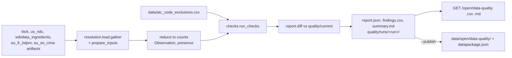

# Design: Weekly data-quality report

> Scope: `apps/api/janus/quality/` (`checks.py` pure checks and classification, `report.py` pure diff and outputs,
> `build.py` offline build, `router.py` read-only routes), `data/open/data-quality/`, registry entry `data_quality`
> in `pipelines/sources.toml`, `docs/open-data.md`, `docs/open-api.md`, `docs/openapi-public.json`. Decisions DQ1-DQ9,
> properties P1-P8. Private upstream drafts in `docs/internal/upstream-reports/` (gitignored, never committed).

## 1. Overview


## 2. Where the job runs (DQ1)
The comparison needs the resolution ladder (name → key, salts, synonyms, combination rules, exclusions) that lives in
`apps/api/janus/resolution`. The pipelines package never imports the API, so the job is an offline build in
`apps/api` (`python -m janus.quality.build`), like the FAERS count build and the time-machine build. It reads only
pipeline artifacts and `data/`, runs after the weekly `titck` pipeline, and its cadence is declared in the source
registry (`data_quality`, `cadence_days = 7`). Re-using `gather` + `prepare_inputs` means the report checks exactly
the prepared dataset the API serves (same dataset version, printed in the report).

## 3. Reduction to counts (Req 4.2, P8)
`build.views` turns each `PreparedProduct` into a `ProductView(source, published_atc, keys)`; names, barcodes,
national codes and published spellings are dropped here. `checks.reduce_products` counts single-ingredient products
with one mapped key and an ingredient-level code as `Observation(source, key, code, products)` and the products of
every key per source (`presence`). Nothing downstream can see a product string.

## 4. Checks (Req 1)
| Check | Definition | Sources |
|---|---|---|
| `exclusion_status` | each exclusion row; `persisting` if the source still gives the code (Wikidata item codes, or a TİTCK observation), else `resolved_upstream` | Wikidata, TİTCK |
| `item_group` | regulator observation whose code shares no level-4 group with any item code; excluded triples skipped | TİTCK, CIMA vs Wikidata / curated keys |
| `regulator_group` | key with observations in both regulators, no TİTCK code sharing a level-4 group with a CIMA code | TİTCK vs CIMA |
| `substance_code_keys` | BDPM composition / CIMA ingredient substance code whose names map to ≥ 2 keys | BDPM, CIMA |
openFDA NDC has no ATC field and only product-level RxCUIs: it contributes presence counts only (DQ4).

## 5. Classification (Req 2)
Reasons are computed for every `item_group` finding: `code_of_other_substance` (another key carries the code in its
item codes or in a regulator observation, exclusions removed), `combination_code_on_single_ingredient_product`
(`CombinationCheck` rule groups, codes and numbering series), `both_regulators_publish_it`, `same_level2_group`
(hint only), `group_differs`. **Benign** only when both regulators publish it, no other key carries it and it is not
a combination code; everything else **needs pharmacist** (DQ3). Confirmed errors are the exclusion rows only.

## 6. Diff and version (Req 3, 5.2)
Finding id `check:source:key:code` (stable across runs). `new` / `persisting` / `resolved` against the previous
`quality/current/report.json`; `class_changed_from` on a class change. Version `data-quality-1+` + 12 hex of SHA-256
over the sorted finding records (status excluded), so equal findings give an equal version (P6).

## 7. Outputs (Req 4, 5)
`report.json` (dataset, version, run ids, licence CC BY 4.0 with attribution, sources with run/snapshot/licence,
resolution dataset and code version, rules, metrics, summary, findings incl. resolved), `findings.csv` (columns in
§9.2), `summary.md` (counts, sources, confirmed errors, new, resolved, persisting needs-pharmacist and benign lists).
`--publish` writes the same three files and a Frictionless `datapackage.json` (hash per file) to
`data/open/data-quality/`. File names never contain a source's name that the licence guard blocks.

## 8. First real run (2026-11-09, dataset `7db3a513…`)
TİTCK run `20261107T180936Z-0738c719-f9ff` (list 2026-11-06), CIMA 2026-11-07, BDPM 2026-11-03, openFDA 2026-11-06,
Wikidata 2026-11-07. 17,424 TİTCK and 22,701 CIMA single-ingredient products (1,399 and 1,243 key-code pairs).

| Check | confirmed_error | needs_pharmacist | benign_difference |
|---|---|---|---|
| exclusion_status | 12 (all still published upstream) | 0 | 0 |
| item_group | 0 | 81 | 106 |
| regulator_group | 0 | 21 | 0 |
| substance_code_keys | 0 | 0 | 0 |

TİTCK `item_group` gives 89 pairs (96 level-4 disagreements before the 7 confirmed TİTCK rows are removed; the
earlier review counted 93 on an older list), CIMA 98. Notable needs-pharmacist findings that no earlier review had:
a sunitinib product with vandetanib's code (L01EX04), a cetirizine product with an olmesartan combination code
(C09DA08), single-ingredient ramipril and formoterol products with combination codes (incomplete ingredient lists or
wrong codes), dimenhydrinate products in CIMA with diphenhydramine's code, and 21 keys whose TİTCK and CIMA codes
disagree (mostly the 2022-2024 WHO re-codings of L01/L04 that one regulator has not taken over). The substance-code
check found no split: every BDPM and CIMA substance code maps to one key.

## 9. API contract **[Client: experience]**
Medical routes: `Cache-Control: no-store`, nothing logged but the access line. 503 `{"error":
"data_quality_unavailable"}` when no valid report is installed.

### 9.1 `GET /open/data-quality` → `DataQualityOut`
```
dataset "janus-data-quality", version, run_id, run_date (YYYY-MM-DD), previous_run_id|null, previous_version|null,
license "CC BY 4.0", license_url, attribution, dictionary_url, review_status, notices[code],
resolution_dataset, code_version, sources{source_id: {pipeline, run_id, snapshot_date, license}}, rules{name: text},
metrics{...}, summary{findings, by_class{confirmed_error, needs_pharmacist, benign_difference},
  by_check{4 checks}, by_check_class{check: {class: n}}, by_status{new, persisting, resolved},
  confirmed_errors_still_published, confirmed_errors_resolved_upstream},
findings[{id, status new|persisting|resolved, class, class_changed_from|null, check, source, key, label_en|null,
  wikidata_url|null, code, compared_codes[], products, reasons[code], other_keys[], upstream persisting|resolved_upstream|null,
  whocc_group_urls[], how_to_find}]
```
Notice codes: `no_titck_rows_or_product_names`, `codes_only_no_whocc_text`,
`needs_pharmacist_before_any_upstream_report`, `not_medical_advice`. Reason codes as in §5; the web app translates
codes, the API sends no user-facing sentence except `how_to_find` and `rules` (English, researcher-facing).
`source` of a `regulator_group` finding is `titck+eu_es_cima` and its `code` joins the TİTCK codes with `|`.

### 9.2 `GET /open/data-quality.csv`, `GET /open/data-quality.md`
CSV columns `dataset_version,run_date,finding_id,status,class,check,source,key,label_en,code,compared_codes,products,
reasons,other_keys,upstream,whocc_group_urls,how_to_find` (lists joined with `|`), header `x-janus-dataset-version`,
attachment name `janus-data-quality-<run_date>.csv`. Markdown: the summary file, same version header.

## 10. Properties
| # | Property | Req | Test (`tests/test_quality_properties.py`) |
|---|---|---|---|
| P1 | confirmed_error ⇔ exclusion row | 2.1 | Hypothesis over synthetic inputs |
| P2 | item_group findings = reference level-4 disagreement set | 1.2 | Hypothesis |
| P3 | benign ⇔ both regulators ∧ no other key ∧ not combination | 2.2 | Hypothesis |
| P4 | input order does not change findings | 1.6 | Hypothesis, shuffled |
| P5 | diff partitions current/previous; first run all new; self-diff all persisting | 3 | Hypothesis |
| P6 | version equal ⇔ findings equal | 5.2 | Hypothesis |
| P7 | CSV one row per finding, version in every row; summary sums | 5.4 | Hypothesis |
| P8 | no product name, barcode or spelling reaches JSON, CSV or Markdown | 4.2 | Hypothesis with sentinel strings through `views` |
Plus examples (upstream status, substance codes, reduction) and route tests (JSON/CSV/MD, 503, malformed file,
medical GET-only).

## 11. Decisions
| # | Decision | Alternatives | Why |
|---|---|---|---|
| DQ1 | Offline build in `apps/api`, cadence in the registry | A `janus_pipelines` Job | The ladder lives in the API; pipelines must not import it (§2) |
| DQ2 | Level-4 group (5 characters) as the disagreement unit | 7-character equality; level 2 | Same unit as the earlier review (93 pairs); 7 characters flags every route variant |
| DQ3 | Benign only by a deterministic, conservative rule | Re-coding heuristic (same level 2 = benign) | Levocetirizine (R06AB04 vs R06AE09) and sunitinib (L01EX04, vandetanib's code) share level 2 and are errors |
| DQ4 | openFDA presence only | RxCUI comparison | openFDA RxCUIs are product-level (SCD/SBD); a comparison needs RxNav, out of scope |
| DQ5 | Counts and "how to find" for TİTCK, never rows | Hash product ids | Terms unclear; a count and a search hint are enough to reproduce |
| DQ6 | CC BY 4.0 for the report | CC0; Apache-2.0 | Attribution keeps the caveats and the CIMA/BDPM attributions with the numbers (as open-data DP5) |
| DQ7 | One finding per (source, key, code) | Merge TİTCK and CIMA findings | Each regulator's publication is a separate fact to report upstream |
| DQ8 | Stable ids; resolved findings listed with their old record | Only current findings | A weekly diff is the research value: what got fixed and where |
| DQ9 | Upstream drafts private, written once from the confirmed rows | Generated every week; committed | Barcodes and product names may appear in a letter to TİTCK but must never be committed; nothing is sent |

## 12. Review
Safety-auditor agent (read-only): see `review-safety-auditor.md`.

## 13. Open items
- Pharmacist review of every `needs_pharmacist` finding; confirmed ones go to `data/atc_code_exclusions.csv`
  (a new exclusion becomes a `confirmed_error` in the next run).
- A reviewed-benign file for differences a pharmacist accepts (today only the deterministic rule).
- openFDA RxCUI check through RxNav (ingredient RxCUI of each product vs the key's Wikidata RxCUI).
- Schedule: the weekly run is manual (`python -m janus.quality.build --publish` after `titck`), no scheduler yet.
- Web screen (experience step) from §9.
