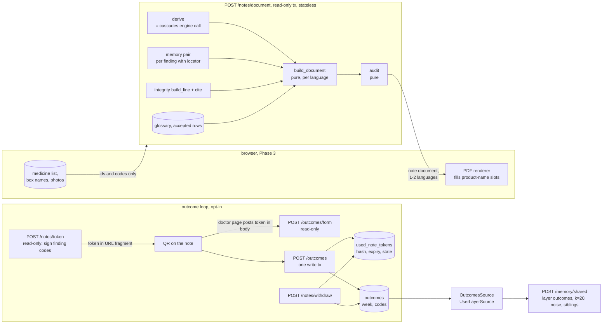

# Design: Doctor Note and Outcome Loop, Phase 2 (server side)

> Scope: `apps/api/janus/notes/` (note document, templates, auditor, glossary, token, outcome store, outcomes layer),
> migration `0011_note_tokens_outcomes`, the glossary files and their review, and three small changes elsewhere: a
> shared derivation step split out of `cascades/service.py` (no behaviour change, DP25), one English disclaimer constant
> for the API (DP18), and `OutcomesSource` registered as the `outcomes` user layer (`collective-memory` DP10 closed).
> Not here: the PDF, the patient screens, the doctor page and the side-by-side view (**[Client: experience spec]**,
> Phase 3); the narrator (**[Later phase: narrator]**, DP4); rate limiting at the proxy (**[Phase 5]**, §7.6).
> Property numbers P1–P31 and decision numbers DP1–DP27 are this spec's own; upstream ones are written
> "cascade-engine DPn" and so on.
> **Owner decisions 2026-11-08 (second round), applied below:** DP1 accepted; DP2 replaced by a token that carries the
> finding codes (§6, DP2, DP28–DP31) with the pending record recorded as rejected; DP16, DP11, DP13 and DP18 accepted.

## 1. Overview



The note is computed, never stored: the server re-runs the engine and the pair lookups on the ids and codes the browser
sends, fills reviewed templates, audits the result and returns it. In the outcome loop the token itself carries the
finding codes, signed; the server stores only the hashes of used note ids until expiry and the doctor's outcomes (DP2).

Facts checked on 2026-11-08 that shaped this design (current dev dataset `e9e55772…`, rule base `8d4881fc…`; scratch
script `/tmp/janus-dl/scope.py`, not committed):

| What | Observed | Design consequence |
|---|---|---|
| `cascades/schemas.py` `CascadeResult` | Findings carry `finding_id`, `rule_text` (PIPC English text), index/marker `ingredient_key`, `label_en`, `items`, `matched_codes`, `form_confirmed`, `start`; `status`, `timing`, `months_between`, `priority`, `abrupt_stop`, `evidence_ids`, `integrity_codes`, `faers_locator`. `item_warnings` are per (item, ingredient key). `not_checked` reasons include `homeopathic_product`. The result has **no per-item ATC codes**: those exist only inside `evaluate_request` (`found`) | Split a `derive()` step out of `evaluate_request` that returns the result and the engine items; the cascades route output stays byte-identical (DP25, P31) |
| `evaluate_request(conn, body, today, faers_event_keys)` | Reads rule base, dataset id and integrity snapshot in the caller's transaction; 409 on a dataset change; `as_of_month` from `today` | The note route calls the same step in its own read-only transaction; the note prints the month, not a date |
| Disclaimer constants | `memory/messages.py`: rule-9 sentence with an em dash. `cascades/schemas.py` and `integrity/schemas.py`: the same sentence with an ASCII hyphen. `apps/web/messages/*.json` `Disclaimer.text` in five languages since the Phase 0 skeleton (`a95d675`), not covered by a review sheet | One English constant for all API responses (DP18); the note uses the five `Disclaimer.text` values with a parity test; the four translations go into the glossary review |
| Forbidden phrases | `apps/web/src/i18n/forbidden-phrases.ts` (five lists, whole-word, case-insensitive); Python tests parse that file (`tests/cascades_strategies.forbidden_phrases`) | The auditor needs the lists at runtime: `notes/phrases.py` mirrors them, with a parity test against the TS file (P23) |
| Abrupt-stop line drafts | Spanish "No deje de tomar este medicamento de golpe" contains the forbidden phrase "deje de tomar"; French "N'arrêtez pas de prendre…" does not contain "arrêtez de prendre" as a run but is close; German "Setzen Sie … nicht plötzlich ab" avoids "absetzen Sie" | The glossary loader checks every cell against its language list; the drafts use "No suspenda este medicamento de forma brusca." and "N'arrêtez pas ce médicament brutalement." (review decides) |
| `Memory` messages (five languages) | Fixed reviewed texts contain digits: "more than 5 minutes", "27 member states", "fewer than 3", "Hidden under 20", the 911/112/988 tables | The no-digit rule applies to claim templates only; fixed texts are compared with their reviewed source instead (§5.5) |
| Glossary scope (ingredient keys) | 3,273 ingredients in the dataset; 1,123 are members of the 66 cascade classes (form extensions included), 342 of the abrupt-stop list (6 only there); **union 1,129**, including `J1`, `J2`. Labels in the name index for these 1,129: en 1,129, **tr 447**, de 770, fr 840, es 710 (whole dataset: tr 1,128, de 2,122, fr 2,467, es 2,005) | Glossary rows for the 1,129 keys (DP8); 60 % of Turkish cells have no source label, so the fallback rule matters (DP16, open) |
| `memory/shared.py` | `UserLayerSource.cells(conn, ingredients, event, direction) -> list[ContributorCell(region, n, version, siblings)]`; `shared()` returns `not_available` when the layer has no source; the release `Cell` key starts with the layer name, so noise draws differ per layer; `app.state.user_layer_sources = {"contributions": …}` | `OutcomesSource` implements the same protocol with the same SQL shape on `outcomes` (§8); registering it is the only change to `memory/` |
| `contributions/` | Deletion token: 256 random bits, SHA-256 stored; `report_week(now)` = Monday of the UTC ISO week; retention 24 months (`retention_cutoff`); purge CLI; storage-region guard `region_allows_donations` → 503 | Same patterns for the outcome store (DP17, DP19) |
| Route kinds and writes | `medical`, `donation`, `operational`; `write_tx` allowed only in four modules (`tests/test_stateless_properties.py`) | `notes/repository.py` becomes the fifth `write_tx` user; the three writing routes are `donation` kind (DP19) |
| Settings | Secrets parsed once (`JANUS_NOISE_KEY`: base64url, ≥ 32 bytes); errors name the variable only | `JANUS_NOTE_KEYS`, `JANUS_NOTE_SIGNING_KEY_ID`, `JANUS_OUTCOME_CONSENT_VERSIONS` follow the same rules (§3) |
| Note benchmark (task 7, `python -m janus.notes.bench`, dev database, real counts file, placeholder glossary) | 16 medicines, 9 findings, 12 statistic rows, two languages, 30 runs: p50 306 ms, p95 345 ms, max 762 ms (first run) | Inside the 1.5 s target of Req 15.1; the pair lookups for the Janus keys dominate |
| Event vocabulary | `memory_events.csv`: every PIPC row covered by exactly one key (`pipc_positions`), five reviewed labels, `safety_line` on six keys; 34 adverse keys, the longest 27 characters | The rule's Janus key is always known; event names and safety lines are reused, not copied (DP7); the token lists each distinct event key once (§6.1) |
| ATC code → ingredient key | 3,898 ingredient-level codes in the dataset; **60 map to more than one key** (for example `N02BE01` to two paracetamol items, `B03BB01` to two folic acid items) | The token carries the ingredient keys as well as the ATC codes the owner listed; the codes alone cannot identify the ingredient (DP28) |
| QR capacity (level M, byte mode; `segno` 1.6.6 in a scratch venv, binary search per version) | 14, 26, 42 … 666 (v20), 711, 779, 857, 911, **997 (v25)** … 2,331 (v40) bytes; equals ISO/IEC 18004 data codewords minus the mode and count bits | `notes/qr.py` holds the table and computes the version exactly (P33) |
| Findings of heavy lists (real engine, dev dataset, ingredient items with staggered starts, 38 common geriatric medicines) | 10 items → 2 findings; 15 → 7; **20 → 18 (8 distinct events)**; 25 → 24; 30 → 37; 50 → 81. Matched ATC codes per side: at most 2 | 20 items is taken as the largest realistic note (§6.6); larger lists keep a prefix (DP30) |

## 2. Code layout

```
apps/api/janus/notes/
  model.py         NoteDocument, Section, Sentence, MedicineRow, StatRow, Removal (frozen)        pure
  phrases.py       FORBIDDEN[lang], REASSURANCE[lang], find_phrases()                               pure
  render.py        format_int/ratio/percent/month per language, fill(template, params, lang)      pure
  glossary.py      parse_*(), validate(), Glossary, available_languages(), version()               pure (+ file read at startup)
  glossary/        ingredients.csv, cascades.csv, sentences.csv, README.md (status line, sources)
  build.py         build_document(derived, stats, line, glossary, vocab, lang, region) -> NoteDocument   pure
  audit.py         audit(documents, verdicts) -> (documents, removals)                            pure
  token.py         Keyring, Payload, encode(), sign(), verify(), expiry_for(), TokenError         pure
  qr.py            capacity table (level M), qr_version(), outcome_url(), fit_findings()          pure
  outcomes.py      validate_answers(), outcome_rows(), deletion_hashes()                            pure
  repository.py    used_note_tokens and outcomes SQL (write_tx, read-only reads, purge)           I/O
  source.py        OutcomesSource (UserLayerSource)                                                I/O
  service.py       document(), issue_token(), outcome_form(), submit(), withdraw()                 orchestration
  schemas.py       request and response models (Pydantic v2)
  router.py        /notes/document, /notes/token, /notes/withdraw, /outcomes/form, /outcomes
  purge.py         `python -m janus.notes.purge`                                                   I/O
  glossary_draft.py `python -m janus.notes.glossary_draft` (proposal rows from the dataset)          I/O
apps/api/janus/cascades/service.py   + derive() (split from evaluate_request; DP25)
apps/api/janus/cascades/schemas.py, integrity/schemas.py   DISCLAIMER imported from memory/messages.py (DP18)
apps/api/janus/main.py               + notes router, user_layer_sources["outcomes"] when keys and DB exist
apps/api/janus/settings.py           + note keys, signing key id, outcome consent versions
apps/api/migrations/versions/0011_note_tokens_outcomes.py
apps/api/tests/notes_strategies.py and test_notes_*_properties.py
.kiro/specs/doctor-loop/glossary-*.md   review sheets (task 14)
```
`structure.md` already places "note content model + signed QR tokens + outcomes" in `janus/notes/` and the narrator in
`janus/agents/` (left empty, DP4). No new dependency: `hmac`, `hashlib`, `secrets`, `base64` are in the standard library.

## 3. Configuration

| Variable | Form | Rule |
|---|---|---|
| `JANUS_NOTE_KEYS` | `kid:base64url,kid:base64url,…` | kid `^[a-z0-9]{1,8}$`, unique; each key decodes to ≥ 32 bytes; no key equal to `JANUS_NOISE_KEY`; empty = outcome loop off |
| `JANUS_NOTE_SIGNING_KEY_ID` | kid | must name a key of `JANUS_NOTE_KEYS`; required when keys are set |
| `JANUS_OUTCOME_CONSENT_VERSIONS` | ids as `JANUS_CONSENT_VERSIONS` | separate from the donation consent (DP22); empty = token issuance answers 503 |
| `JANUS_PUBLIC_BASE_URL` | `https://host[/path]` (or `http://localhost[:port]`) | no query, no fragment, no trailing slash, at most 40 bytes; unset = the response has no `qr_url` and the client builds it |

`SettingsError` messages name the variable, never a value. Keys live in `Settings` only as bytes; `repr` of the
keyring shows kids only. Rotation procedure (recorded in `docs/` at task 16): add the new key, switch the signing id,
keep the old key for at least 35 days (the longest validity), then remove it.

## 4. Note document

### 4.1 Request (`NoteIn`, strict, `extra="forbid"`)
```
NoteIn {
  evaluation: EvaluateIn                         # exactly the body of POST /cascades/evaluate
  pins: { rule_base_version?: ^[0-9a-f]{64}$, integrity_version?: ^[0-9a-f]{64}$,
          counts_build_id?: <build id pattern of memory> } = {}
  languages: 1–2 distinct of "en" | "tr" | "de" | "fr" | "es"     # [note language, patient language]
  region: "US" | "TR" | "EU" | "OTHER" | "UNKNOWN"                # the user's setting: emergency and crisis numbers
  statistics_region?: "TR" | "EU" | "US"
}
```
Every string field is a pattern or a literal (P21 walks the schema). There is no product name, no free text and no
`demo` field.

### 4.2 Derivation (DP1, DP25)
```
with db.read_only_tx() as conn:
    derived = cascades.service.derive(conn, body.evaluation, today, faers_event_keys)   # result + engine items
    check pins against derived.rule_base_version, derived.integrity_version          -> 409 version_mismatch
    snapshot = derived.snapshot                                                       # the one the engine used
session = counts.session()  (None when the file is missing)
    check pins.counts_build_id against session.meta.build_id                         -> 409 version_mismatch
stats = { (index key, event key, region): memory.service.pair(session, PairIn(...), ctx)
          for each finding with faers_locator, region in [ALL] + [statistics_region] }   # deduplicated
line  = integrity.line.build_line(snapshot, note evidence ids, today)
docs  = [build_document(derived, stats, line, glossary, vocab, lang, body.region) for lang in languages]
docs, removals = audit(docs, verdict_map(snapshot))
```
`derive` raises the engine's own errors (422 item fields, 409 dataset version, 503). The engine result is the same
object `POST /cascades/evaluate` serialises, so the note's findings equal what the patient saw for the same input and
versions (P22).

### 4.3 Document model
```
NoteOut {
  note_format: "janus-note-1",
  versions: {rule_base_version, dataset_version, integrity_version, counts_build_id | null, glossary_version},
  as_of_month: "YYYY-MM",
  removals: [{sentence_id, reason: no_evidence | evidence_not_citable | forbidden_phrase | reassurance_word | foreign_number}],
  documents: [NoteDocument]                         # one per requested language, same order
}
NoteDocument { language, sections: [Section] }
Section      { id, heading: Text | null, blocks: [Block] }
Block        = Sentence | MedicineRow | StatRow
Sentence     { id, template, kind: claim | fixed, text, evidence_ids: [str], numbers: [str] }
Text         { template, text }                       # heading, label or term; fixed, no evidence
MedicineRow  { item: int, product_name_slot: true,
               ingredients: [{key, name: Text, name_basis: glossary | english_fallback | code_only, atc: [str]}],
               not_checked: [{position, reason, text: Text}],
               started: Text,                         # "since 03/2026" or "start not known"
               abrupt_stop: Sentence | null }         # fixed text
StatRow      { finding_id, region, ingredient_key, event_key, reports: int, assessment,
               estimates: {ror, low, high} | null, citation: {evidence_id: "dataset:faers", locator},
               sentences: [Sentence] }
```
`Sentence.id` is language-independent (for example `finding:pipc:5:Q…:Q…:timing`), so the narrator (later) and the
auditor work on ids. `numbers` lists the formatted numbers of the sentence's params, in order, for the auditor and P13.

### 4.4 Sections, in order
| id | Content | Kinds |
|---|---|---|
| `header` | title, "prepared {month}", the disclaimer | fixed |
| `safety` | for each distinct event of the findings whose key has a `safety_line`: the emergency line, then the line, with `Memory.emergency/crisis.<region>`; omitted when none (rule 10: before the findings) | fixed |
| `medicines` | one `MedicineRow` per item, in item order | text, fixed |
| `findings` | form-confirmed findings, engine order: cascade line, timing, priority, supporting source, form extension, integrity notices, "may be worth reviewing" | claim, fixed |
| `findings_form_unconfirmed` | heading and explanation (the product form was not confirmed; the pattern depends on the form), then the same blocks for `form_confirmed = false` findings (DP12) | claim, fixed |
| `chains` | each chain as ingredient names joined by arrows, citing the evidence of its findings | claim |
| `statistics` | per finding with a locator: `StatRow`s; then limits, screening, denominator, window and attribution sentences, the long MedDRA notice when a PT is printed; or `statistics_unavailable` | claim, fixed |
| `scope` | "{checked} of {total} published patterns checked" (cites `dataset:pipc`), the rules that cannot be checked, and, when there is no finding, the rule-3 statement | claim, fixed |
| `integrity` | the integrity line as sentences (cites the used roots) | claim |
| `outcome_loop` | only in notes returned by `POST /notes/token`: how the doctor reports an outcome, and which findings the QR code covers ("findings 1 to {k} of {n}") | fixed |
| `about` | versions (short), PIPC attribution, FAERS attribution, glossary status line | fixed |

Every finding appears exactly once, in `findings` or `findings_form_unconfirmed` (P16). `same_product` pairs are not
shown (Req 1.8).

## 5. Templates, glossary, formatting and the auditor

### 5.1 Glossary files (`apps/api/janus/notes/glossary/`, DP7)
`ingredients.csv`: `key,en,tr,de,fr,es,en_alt,status,edited,source,note`
- `key` `^(Q[1-9][0-9]{0,9}|J[1-9][0-9]{0,5})$`; names NFC, 1–120 characters, no digit-only cell; an empty cell means
  "no accepted name in this language".
- `en_alt`: optional second English name the pharmacologist proposes where the US adopted name differs from the INN
  (printed "paracetamol (acetaminophen)" in English only).
- `status` `proposed | accepted | rejected` per row; `edited` lists the languages changed at review; `source` the
  Wikidata extract run id the labels came from (or `janus_curated` for `J` keys). No TİTCK string (Req 7.2).

`cascades.csv`: `position,en_sha256,drug_a_tr,adverse_event_tr,drug_b_tr,…(de, fr, es),status,note` — 65 rows. The
English text is the rule base's PIPC text (as published); `en_sha256` is the SHA-256 of its three English fields, checked
against the served rule base (mismatch → 503 `notes_unavailable` and a test against `data/pipc.csv`).

`sentences.csv`: `id,kind,evidence,params,en,tr,de,fr,es,status,shared,note`
- `kind`: `claim`, `fixed`, `heading`, `label`, `option`.
- `evidence` (claims only): `;`-separated roles the builder resolves to ids: `rule`, `pipc`, `window`, `priority`,
  `supporting`, `extension`, `faers`, `integrity_root`, `finding` (all ids of the findings a chain is built from).
- `params`: `name:type` with types `int`, `ratio`, `percent`, `month`, `term`, `code`, `version`, `date`, `quarter`.
- `shared`: a key in `apps/web/messages/<lang>.json` (`Disclaimer.text`, `Memory.codes.<code>`, `Memory.screening`,
  `Memory.attribution`, `Memory.emergency`, `Memory.crisis`); the five cells must equal those values (P23), so a shared
  text has one source and keeps the review it already had.

`version()` = SHA-256 of the canonical rows of the three files plus the five label columns and `safety_line` of the
event vocabulary. Template drafts are listed in `glossary-review.md` (task 13), not here.

### 5.2 Template catalogue (ids; wording drafted in task 13)
| Section | Template ids | Evidence roles |
|---|---|---|
| finding | `finding.cascade` ("{drug_a} → {event} → {drug_b}: {index} and then {marker} match this published pattern (PIPC, row {row})") | rule, pipc |
| | `finding.timing.within_window`, `.after_window`, `.same_month`, `.date_unknown` | rule (+ window for within) |
| | `finding.priority.incidence`, `.adjusted_sequence_ratio` | priority |
| | `finding.supporting`, `finding.form_extension` | supporting / extension |
| | `finding.notice.corrected`, `.expression_of_concern` | integrity_root |
| | `finding.review` ("This pattern may be worth reviewing with the patient.") | fixed |
| chains | `chain.sequence` | finding |
| statistics | `stat.reports_ratio`, `stat.reports_ratio_over`, `stat.ratio_below`, `stat.coverage.no_reports`, `stat.coverage.insufficient`, `stat.weak` | faers |
| | shared `Memory.codes.*` limits sentences, `Memory.screening`, `Memory.attribution`, `stat.window`, `stat.denominator`, `stat.meddra_long`, `statistics_unavailable` | fixed |
| scope | `scope.checked`, `scope.not_checked_rule`, `scope.no_pattern` (rule 3) | pipc |
| integrity | `integrity.sources`, `.by_status`, `.checks_between`, `.stale_source`, `.no_retracted` | integrity_root |
| fixed | `header.*`, `disclaimer` (shared), `abrupt_stop`, `safety.emergency_first`, safety lines (shared), `medicine.*` labels, `not_checked.<reason>`, `name.not_translated`, `name.not_reviewed`, `about.*` | – |
| outcome page | `outcome.intro`, `outcome.stored_fields`, `outcome.question.assessment`, `outcome.option.<code>`, `outcome.question.action`, `outcome.action_on.<role>`, `outcome.limits` | – |

Claim templates are written for a doctor: they describe the published pattern and the order of starts, never a verdict,
never "the patient has", and never advice (`medical-safety.md` rules 1, 5).

### 5.3 Formatting (`render.py`, DP26)
Fixed per-language rules, no locale library:

| | en | tr | de | fr | es |
|---|---|---|---|---|---|
| decimal | `.` | `,` | `,` | `,` | `,` |
| grouping | `,` | `.` | `.` | U+202F | `.` from 5 digits (CLDR minimum grouping 2) |
| month | `03/2026` | `03.2026` | `03.2026` | `03/2026` | `03/2026` |
| percent | `11.9%` | `%11,9` | `11,9 %` (NBSP) | `11,9 %` (U+202F) | `11,9 %` (NBSP) |
| date | `2026-11-08` | `08.11.2026` | `08.11.2026` | `08/11/2026` | `08/11/2026` |

Ratios (built in task 4): 2 decimals below 10, 1 below 100, else 0, judged on the rounded value (half-even); from 1,000
`>1,000`; a value that would print as 0.00 `<0.01`. Published priority values keep their published decimals; only the
separator changes. English dates are ISO 8601 because day and month order differ between English-speaking countries;
months print as `MM/YYYY` (or `MM.YYYY`), which no reader misreads. `numbers` of a sentence holds the rendered
parameters that contain digits; the auditor removes each once from the text and refuses any digit left (§5.5). These
rules are reviewed by the localization reviewer with the templates.

### 5.4 Word lists (`phrases.py`)
- `FORBIDDEN[lang]`: exactly the lists of `forbidden-phrases.ts` (parity test).
- `REASSURANCE[lang]` (rule 3): en `safe`, `no problems`, `all clear`, `harmless`, `nothing to worry`; tr `güvenli`,
  `sorun yok`, `zararsız`; de `sicher`, `unbedenklich`, `harmlos`, `keine Probleme`; fr `sûr`, `sans danger`,
  `aucun problème`, `inoffensif`; es `seguro`, `sin peligro`, `sin problemas`, `inofensivo`. Proposals, reviewed in task 14.
- The people-noun and causation lists of `collective-memory` §7.2 apply to the statistics section only (a doctor note
  says "the patient"; counts never do), with the screening-sentence exception by exact string.
Matching is `findForbiddenPhrases` semantics: whole words, case-insensitive, Unicode letters as word characters.

### 5.5 Auditor (`audit.py`, Req 5.3–5.5, DP5, DP6)
```
for each sentence id s present in the documents:
    claim:  remove s everywhere if any language's copy has
              no evidence id                                   -> no_evidence
              an id that verdicts do not mark citable          -> evidence_not_citable
              a FORBIDDEN or REASSURANCE phrase of its language -> forbidden_phrase / reassurance_word
              a numeral (regex over digits with the language's separators) that is not in s.numbers
                                                               -> foreign_number
    fixed:  any failure -> AuditError (500; the glossary loader should have refused it; P14 shows it cannot happen
            with an accepted glossary)
removals sorted by sentence id; a statistic row goes with its main sentence; a section left empty keeps its
  heading (the findings section of a note without findings carries the fixed text `section.empty`)
```
Claim templates contain no digit (loader check), so their numbers come only from params; the builder fills
`numbers` from the same formatting call that wrote the text. Fixed texts may contain the digits of their reviewed
wording (Memory texts, emergency tables) and are checked by equality with their source instead. The auditor is
idempotent and only removes (P14). With the narrator off it should remove nothing on real inputs except sentences whose
evidence the snapshot no longer supports; any other removal is a defect found by tests.

### 5.6 Language availability (`glossary.available_languages`)
A language is available iff every `sentences.csv` row is `accepted` with a non-empty cell in it and every `cascades.csv`
row is `accepted`. English needs the same. Ingredient rows never block a language; they fall back (§5.7). Before the
owner accepts the glossary, no language is available and `POST /notes/document` answers 422
`note_language_unavailable` (tests use synthetic accepted glossaries).

### 5.7 Ingredient names (DP16, accepted)
`name(key, lang)`: the accepted cell of `lang` → `name_basis = glossary`; else the accepted English cell plus the fixed
tag `name.not_translated` → `english_fallback`; else the code(s) plus `name.not_reviewed` → `code_only`. Keys outside the
glossary (ingredients that are in no class and on no list, about 2,144 today) follow the same fallback using their
English name-index label marked `name.not_reviewed`, because they appear only in the medicines section. The ATC codes are
printed in every case.

## 6. Note token (`token.py`, `qr.py`, Req 2; owner decision 2026-11-08)

### 6.1 Payload (binary, big-endian, version 1)
```
version      1 byte   = 1
kid          1 byte length k (1–8), k bytes [a-z0-9]
note id      16 bytes (secrets.token_bytes)
issue week   2 bytes  weeks since Monday 1970-01-05 (the Monday of the UTC ISO week of issue)
expiry week  2 bytes  issue week + 5 (DP11); the token expires at 00:00 UTC of that Monday
lang_region  1 byte   language index (en tr de fr es = 0–4) × 3 + region index (TR EU US = 0–2)
consent      1 byte length c (1–32), c bytes [a-z0-9.-]
events       1 byte count e, then e × (1 byte length, key bytes)   # the distinct keys used, sorted, each used
findings     1 byte count n (1–255), then n ×
               row        1 byte  PIPC position 1–65
               flags      1 byte  bit 7 form_confirmed, bit 6 direction (0 adverse, 1 benefit),
                                  bits 3–5 index code count (1–2), bits 0–2 marker code count (1–2), other bits 0
               event      1 byte  index into events
               index key  varint (number × 2 + 1 for J keys, number × 2 for Q keys), minimal
               marker key varint, same
               codes      4 bytes per ATC code, index codes then marker codes, each sorted:
                          letter (5 bits) · 2 digits (7 bits) · letter (5) · letter (5) · 2 digits (7) + 3 zero bits
mac          16 bytes HMAC-SHA256(key[kid], b"janus-note-token\x00" + all bytes above), first 128 bits
```
Text form: `base64url(all bytes)` without padding. Findings are those of the note in document order (main section, then
form-unconfirmed); `ref` = position in the payload. At most the first two matched codes of a side are carried (sorted);
they are for display only, identity is the key.

### 6.2 Verify
1. Decode strictly: base64url alphabet, no padding, canonical (re-encoding gives the same string); length within bounds.
2. Read version and kid; the kid must be in the keyring → else `invalid_token`.
3. `hmac.compare_digest(mac, HMAC(key[kid], …)[:16])` → else `invalid_token`.
4. Parse the rest strictly: every count and length in range, minimal varints, valid ATC code letters and digits, event
   indexes in range, findings sorted as issued, no trailing byte, expiry week = issue week + 5 → else `invalid_token`.
5. `today_utc < monday(expiry week)` → else `token_expired`.
6. Database (submission and form): `used_note_tokens` by `sha256(note id)`: `used` → `token_used`; `withdrawn` →
   `token_not_usable`.
Steps 1–5 are pure and run before any database statement; the comparison happens exactly once per token with a known
kid (P6). The encoding is injective (fixed fields, minimal varints, canonical base64), so exactly one string verifies for
a payload (P5).

### 6.3 Keys and rotation
`Keyring(keys: Mapping[kid, bytes], signing: kid)`. Signing uses `keys[signing]`; verification uses `keys[token.kid]`. A
token of a removed key fails at step 2; a token whose kid is changed to another configured kid fails at step 3 (P3).

### 6.4 Transport: fragment only
`outcome_url(base, token) = base + "/o#" + token`. The fragment is not sent in HTTP requests, so the token reaches neither
the proxy log nor the access log; the doctor page's script posts it in a JSON body (**[Client: experience spec]**). No
route of the API declares a path or query parameter, so a token placed there is never read (P32).

### 6.5 Expiry (DP11, accepted)
The token expires at 00:00 UTC on the Monday five weeks after the issue week's Monday: valid for 28 to 35 days. The token
holds the issue week and the expiry week only; the used-token store holds the expiry date only.

### 6.6 Size and the QR code (DP30)
- **Target:** QR version ≤ 25 at level M in byte mode (117 modules plus a 4-module quiet zone = 125); printed at 50 mm or
  more the module is 0.4 mm or more, which phone cameras read on office prints. **[Client: experience spec]** prints the
  QR code at that size and a print-and-scan check is on the pre-launch list.
- **Rule:** `fit_findings` keeps the longest prefix of the note's findings whose `outcome_url` (with a base of at most 40
  bytes) fits version 25; the response says how many it covers; the note's `outcome_loop` section names them. With every
  field at its maximum (kid 8, consent 32, two codes per side, 10-digit keys, a distinct 27-character event per finding),
  11 findings always fit (P33).
- **Measured worst case of the largest realistic note** (task 1, final encoder; 20 common geriatric medicines with
  staggered starts, real engine, dev dataset `e9e55772…`, 2026-11-08): 18 findings, 8 distinct events, token 493 bytes =
  658 characters; with a 30-byte base the QR code is **version 21** (101 modules), inside the target. Other lists:
  15 medicines, 7 findings, 302 characters, version 14; 25 medicines, 24 findings, 846 characters, version 24; 30
  medicines, 37 findings, 1,162 characters: does not fit, the token keeps the first 28 findings. Worst case with every
  field at its maximum: 11 findings fit (989 bytes of the 997 of version 25).

## 7. Outcome loop

### 7.1 Tables (migration `0011_note_tokens_outcomes`, forward-only, with downgrade)
```sql
CREATE TABLE used_note_tokens (
  note_hash  bytea PRIMARY KEY CHECK (octet_length(note_hash) = 32),       -- sha256(note id)
  expires_on date NOT NULL CHECK (extract(isodow FROM expires_on) = 1),
  state      text NOT NULL CHECK (state IN ('used', 'withdrawn'))
);
CREATE INDEX used_note_tokens_expires_on_idx ON used_note_tokens (expires_on);

CREATE TABLE outcomes (
  id              uuid PRIMARY KEY DEFAULT gen_random_uuid(),
  report_week     date NOT NULL CHECK (extract(isodow FROM report_week) = 1),
  region          text NOT NULL CHECK (region IN ('TR', 'EU', 'US')),
  rule_id         text NOT NULL CHECK (rule_id ~ '^pipc:([1-9]|[1-5][0-9]|6[0-5])$'),
  index_key       text NOT NULL CHECK (index_key  ~ '^(Q[1-9][0-9]{0,9}|J[1-9][0-9]{0,5})$'),
  marker_key      text NOT NULL CHECK (marker_key ~ '^(Q[1-9][0-9]{0,9}|J[1-9][0-9]{0,5})$'),
  ingredients     text[] NOT NULL,       -- CHECK: the two keys, sorted, distinct
  event           text NOT NULL CHECK (event ~ '^[a-z0-9][a-z0-9_.-]{0,39}$'),
  direction       text NOT NULL CHECK (direction IN ('adverse', 'benefit')),
  assessment      text NOT NULL CHECK (assessment IN ('confirmed', 'not_a_cascade')),
  action          text NULL CHECK (action IN ('dose_changed', 'medicine_changed', 'stopped', 'no_change')),
  action_on       text NULL CHECK (action_on IN ('index', 'marker')),
  CHECK (coalesce(action IN ('dose_changed', 'medicine_changed', 'stopped'), false) = (action_on IS NOT NULL)),
  form_confirmed  boolean NOT NULL,
  consent_version text NOT NULL CHECK (consent_version ~ '^[a-z0-9][a-z0-9.-]{0,31}$'),
  deletion_hash   bytea NOT NULL UNIQUE CHECK (octet_length(deletion_hash) = 32)
);
CREATE INDEX outcomes_report_week_idx ON outcomes (report_week);
```
No timestamp column, no clock default, no finding before a submission, no ATC code (display only).

### 7.2 Issue (`POST /notes/token`, medical kind, read-only)
`TokenIn {note: NoteIn (languages: exactly 1), consent_version, outcome_region: "TR" | "EU" | "US"}`. Checks: keys
configured (else 503 `notes_unavailable`), consent version configured (else 422 `consent_version`), at least one finding
(else 422 `no_findings`). The note is derived as in §4.2; the token is signed from the derived findings and the document
is built from the same derivation with its `outcome_loop` section (how the doctor reports, which findings the QR code
covers). Response: `{token, qr_url | null, expires_on, findings_covered, findings_total, note: NoteOut}`. Nothing is
written (P25).

### 7.3 Form (`POST /outcomes/form`, medical kind, read-only)
`{token}` → steps of §6.2 → `{language, expires_on, findings: [{ref, rule_id, cascade: {drug_a, adverse_event, drug_b},
index: {key, name, atc}, marker: {key, name, atc}, form_confirmed}], options: {assessment, action, action_on: [{code,
text}]}, texts: {intro, stored_fields, limits, disclaimer}}`, all in the token's language from the current glossary.

### 7.4 Submit (`POST /outcomes`, donation kind)
`OutcomeIn {token, answers: 1–255 × {ref: int, assessment, action?: …, action_on?: …}}`, distinct refs, action rule of
Req 3.1, every ref below the token's finding count (422 names fields only; checked before any write). Then:
```
verify token (pure steps 1–5)                                     -> 400 invalid_token / 410 token_expired
storage-region guard                                               -> 503
with db.write_tx() as conn:
    INSERT INTO used_note_tokens (note_hash, expires_on, state) VALUES (%s, %s, 'used')
        ON CONFLICT (note_hash) DO NOTHING RETURNING 1
    no row -> SELECT state: used -> 409 token_used; withdrawn -> 410 token_not_usable   (nothing written)
    INSERT INTO outcomes … one row per answer (report_week(now), token region, finding codes, answer,
           token consent version, deletion_hash(note id, ref))
-> 200 {stored: n}
```
The primary key serialises concurrent submissions: the second insert waits for the first transaction and then does
nothing (P7, P8). Any exception rolls back both the used mark and the outcomes.

### 7.5 Withdraw (`POST /notes/withdraw`, donation kind, DP17)
`{token}`: steps 1–4 of §6.2 (expiry and use do not matter); one write transaction deletes the outcomes whose
`deletion_hash` is in `{deletion_hash(nid, r) : r < n}` and, if the token has not expired, upserts the note hash with
state `withdrawn`; the answer is `{status: "withdrawn"}` whether or not anything existed.
`deletion_hash(nid, r) = sha256(b"janus-outcome\x00" + nid + r.to_bytes(1, "big"))`: the outcomes of one note cannot be
linked to each other in the database without the note id.

### 7.6 Rate limiting (design now, built in Phase 5; DP21)
- Phase 5: request limits per route at the Caddy proxy without storing or logging IP addresses (as `privacy` DP13):
  `/notes/token` and `/notes/withdraw` low, `/outcomes` and `/outcomes/form` moderate; numbers set with the deployment.
- Built now (no infrastructure): one submission per token; at most as many answers as the token has findings; a token
  needs a real derivation (a valid dataset version and resolvable products, so each fake token costs an engine run);
  tokens expire in at most 35 days.
- Known limit (stated on the privacy page, **[Client: experience spec]**): until Phase 5 one source can create many
  tokens and report many outcomes, padding a cell and redrawing its noise, the same limit as donations
  (`collective-memory` Req 5.9).

### 7.7 Purge and retention
`python -m janus.notes.purge` deletes `used_note_tokens` with `expires_on <= today` and `outcomes` with `report_week <=
retention_cutoff(today)` (24 months), logging counts only (`LogEvent.note_purge`). Scheduling joins the donation purge in
Phase 5.

## 8. Outcomes layer (`source.py`, Req 11)
```sql
SELECT region, count(*), encode(sha256(convert_to(string_agg(id::text, ',' ORDER BY id), 'UTF8')), 'hex')
FROM outcomes WHERE assessment = 'confirmed' AND ingredients @> %s::text[] AND event = %s AND direction = %s
GROUP BY region
-- siblings: the same filter with CROSS JOIN LATERAL unnest(ingredients), excluding the requested keys
```
`OutcomesSource` is registered in `app.state.user_layer_sources["outcomes"]` when a database is configured; the rest of
`memory/shared.py` is unchanged, so k = 20, the discrete Laplace noise, the sibling rule and the "hidden" answer are the
contributions code path (P29). `GET /memory/snapshot` reports `outcomes: ok | unavailable`. A set larger than the pair
has no matching outcome, so it is hidden like any cell under 20.

## 9. API contracts (summary)
| Route | Kind | Body | Success | Errors |
|---|---|---|---|---|
| `POST /notes/document` | medical | `NoteIn` | `NoteOut` | 422 fields / `note_language_unavailable`; 409 `dataset_version_mismatch`, `version_mismatch` (fields); 503 `notes_unavailable` |
| `POST /notes/token` | medical | `TokenIn` | `{token, qr_url, expires_on, findings_covered, findings_total, note}` | as above, plus 422 `consent_version`, `no_findings`; 503 when keys or the consent list are missing |
| `POST /outcomes/form` | medical | `{token}` | form (§7.3) | 400 `invalid_token`; 410 `token_expired`, `token_not_usable`; 409 `token_used`; 503 |
| `POST /outcomes` | donation | `OutcomeIn` | `{stored: n}` | as the form, plus 422 fields |
| `POST /notes/withdraw` | donation | `{token}` | `{status: "withdrawn"}` | 400 `invalid_token`; 503 (keys or EU storage missing) |
All bodies JSON, ≤ 64 KiB, `extra="forbid"`, strict; `Cache-Control: no-store`; no value echoed; token errors carry the
code only. The token pattern is checked by Pydantic before any verification step.

## 10. Narrator (DP4) **[Later phase: narrator]**
Not built. Reasons: the only safe narrator operations are reordering and dropping sentence ids, which the deterministic
order already does; free-text shortening would bring back unreviewed wording in five languages, which the glossary rule
forbids for clinical terms; and the note is short. Contract for later: the narrator receives one `NoteDocument` (English)
and returns a list of sentence ids per section (a reordering of a subset of that section's claim ids, fixed texts
untouched); the same order is applied to every language; the auditor runs afterwards; the key comes from
`ANTHROPIC_API_KEY` only and is never logged; tests use a fake that returns permutations.

## 11. Glossary drafting and review (tasks 13–15)
1. `glossary_draft` (read-only on the dev database) writes `ingredients.csv` for the 1,129 in-scope keys from the name-index
   labels (Wikidata, CC0), all `proposed`, keeping any existing reviewed row unchanged; prints counts per language only.
2. The assistant drafts the `cascades.csv` translations and `sentences.csv` (en and four languages); shared rows are copied
   from the message files. The loader checks run on the draft (phrases, placeholders, digits, NFC, hashes).
3. Reviews: `agent://pharmacologist` (INN correctness, salts versus base substances, `en_alt` proposals, cascade names as
   clinical terms, template meaning) → `glossary-pharmacologist-review.md`; the localization reviewer (run through
   `agent://wf-coder` "act as localization-reviewer", read-only, report path) → `glossary-localization-review.md` (forbidden
   and near-forbidden forms per language, register for doctors, meaning parity, the disclaimer translations, the formatting
   table, the reassurance lists). The assistant writes `glossary-review.md`: counts, flagged rows, decisions needed.
4. **Stop for the owner.** Nothing is `accepted` before the owner's answer; then statuses change in one commit (task 15).

## 12. Testing strategy
- **Property tests** (Hypothesis) P1–P31, tagged `Feature: doctor-loop, Property Pn`; profiles `dev` 100 / `ci` 300
  derandomized; database properties 50 / 100 (`DB_EXAMPLES`).
- **Strategies** (`notes_strategies.py`): synthetic engine results (findings of every status, timing, form flag, priority,
  extension, integrity code), stats of every assessment, snapshots reusing `integrity_strategies.py`, synthetic accepted
  glossaries in five languages (with names that contain separators, accents, long German compounds), keyrings, token
  strings and mutations.
- **Differential tests:** note findings vs `POST /cascades/evaluate`; note stat rows vs `POST /memory/pair`; outcomes layer
  vs a brute-force count; formatting vs a table of hand-checked examples per language.
- **Database tests** (PostgreSQL 16, unskippable in CI): migration up/down/up; the submit state machine with a fault hook
  before each statement; concurrent submissions on two connections; withdrawal; purge; schema column lists.
- **Route tests:** `assert_stateless()` for the medical routes, sentinel log capture for all five, 422 bodies, byte-identical
  repeats, `classify(app)`.
- **Static tests:** the AST check that `token.py` compares MACs only with `hmac.compare_digest`; the `write_tx` allowlist
  gains `notes/repository.py`; phrase-list and disclaimer parity with the web files.
- **Baseline:** the cascades and integrity routes give the same bodies before and after DP25/DP18 except the disclaimer
  character (P31).
- **Local benchmark** (`python -m janus.notes.bench`, real dataset and counts file) for Req 15; not in CI.
- **Real glossary:** after acceptance, a test loads the committed files and checks languages available, all 65 rows, and
  every in-scope key of a synthetic rule base covered.

## 13. Correctness properties

The seed's five properties are P2, P7, P10, P11 and P12; the others were added in the refinement.

| # | Property (for all …) | Validates | Hypothesis approach |
|---|---|---|---|
| P1 | **Token round trip.** For any keyring, kid, note id and Monday expiry, `verify(sign(x))` returns x (before expiry); the token has exactly five fields of the fixed lengths. | Req 2.1 | Random keyrings (1–4 keys), 16-byte ids, dates. |
| P2 | **Tamper.** Any change to a token (one character substituted, inserted or deleted; a field replaced; kid switched to another configured kid; MAC from another key or message) gives `invalid_token`. Seed property 1. | Req 2.1, 2.2, 2.4 | Mutations of valid tokens; filter mutations that reproduce the original string. |
| P3 | **Key rotation.** A token verifies iff its kid is in the keyring; changing the signing key or adding keys never affects tokens of kept keys; removing its key rejects it; signing uses only the signing key. | Req 2.4 | Sequences of keyring operations as a state machine. |
| P4 | **Expiry.** `expires_on` is a Monday and `expires_on − issue instant` is in [28 days, 35 days]; verification rejects with `token_expired` iff `today ≥ expires_on`, including the boundary day. | Req 2.6 | Instants across weeks and year ends (ISO week 53). |
| P5 | **Canonical encoding.** Non-canonical base64 (non-zero trailing bits, padding), wrong lengths, other prefixes, extra separators, invalid or non-Monday dates are `invalid_token`; exactly one string verifies for a payload. | Req 2.2 | Generated near-miss strings. |
| P6 | **Constant-time compare.** For any well-formed token with a known kid, `hmac.compare_digest` is called exactly once, with equal-length arguments; `token.py` contains no `==`/`!=` on MAC bytes (AST). | Req 2.5 | Spy on `compare_digest`; AST scan. |
| P7 | **Single use and atomic submit.** For any sequence of issue, form, submit, replay, withdraw, purge and clock moves over several tokens, with a failure injected before any statement, the used-token store and the outcomes equal a model in which each token yields at most one accepted submission; a replay answers `token_used` and writes nothing; a withdrawn token answers `token_not_usable`; a failed submission leaves the token usable. Seed property 2. | Req 2.7, 3.2, 12.2 | `RuleBasedStateMachine` with a fault hook (as earlier specs). |
| P8 | **Concurrent submissions.** For N = 2–8 concurrent submissions of one token, exactly one returns 200 and the outcomes appear once. | Req 2.7 | Threads with separate connections; DB property, reduced examples. |
| P9 | **Settings.** Valid key settings parse; each defect (short key, bad base64, bad or duplicate kid, missing signing id, signing id not in the keys, a key equal to the noise key, bad consent id) raises `SettingsError` naming the variable and containing no key material; without keys the four loop routes answer 503 and `/notes/document` works. | Req 2.3 | Generated environments; message scan for key bytes. |
| P10 | **No evidence, no claim.** For any engine result and snapshot (random statuses for every record), every claim sentence of every document has ≥ 1 evidence id and all its ids are citable; marking any record retracted gives a subset of the sentence ids, never a new one. Seed property 3. | Req 1.3, 5.1, 5.3, 10.1 | Snapshot pairs differing in one status. |
| P11 | **Disclaimer and phrases per language.** Every document in every available language contains its language's disclaimer exactly once in `header`, no phrase of `FORBIDDEN[lang]` and no word of `REASSURANCE[lang]`; the outcome form likewise. Seed property 4. | Req 1.4, 1.10, 14.1, 14.2 | All languages × generated results; the real phrase lists. |
| P12 | **Language invariance.** For any request and any two available languages, the documents have the same section ids, block kinds and ids, sentence ids, evidence ids, `numbers` (as values), finding ids and the same removals. Seed property 5. | Req 1.5, 1.6, 4.5 | Build both; compare a language-free projection. |
| P13 | **Numbers come from inputs.** Every numeral in a sentence's text equals one entry of its `numbers`, each entry is `render.format(param, lang)` of one of its params, and no claim template contains a digit; fixed texts equal their reviewed source after placeholder filling. | Req 5.2, 5.3 | Generated params including boundaries (0.005, 9.995, 99.95, 1,000, 12,345). |
| P14 | **Auditor.** For any document and any injected defect in claim sentences (no id, uncitable id, a forbidden or reassurance phrase through a term param, a foreign number), the auditor removes exactly those sentence ids in all languages with the matching reason and keeps everything else; `audit(audit(d)) = audit(d)`; a defect in a fixed text raises `AuditError`; with an accepted glossary and a fully citable snapshot nothing is removed. | Req 5.3–5.5 | Inject defects into built documents. |
| P15 | **Medicine rows.** Every item has exactly one row in item order; every item with an `item_warnings` entry has exactly one abrupt-stop line and every other item none; every `not_checked` entry appears with its reason; every row has `product_name_slot` and no product text. | Req 1.1, 8.1, 8.3 | Generated results with warnings on 0–n items, several keys per item. |
| P16 | **Form sections.** Every finding appears exactly once, in `findings` iff `form_confirmed`; `findings_form_unconfirmed` exists iff such a finding exists and starts with its explanation. | Req 8.2 | Mixed flags. |
| P17 | **Statistics.** For any finding with a locator, its stat rows equal `POST /memory/pair` for (index key, event key, region, `suspect`) on the same counts file (cells, estimates, assessment, citation); rows with a < 3 contain no number; the long MedDRA notice appears iff a PT is printed; no user-layer number appears; without a counts file the section holds `statistics_unavailable` only. | Req 9.1–9.4, 9.7, 4.6 | Generated count files (`memory_counts.py`) and findings. |
| P18 | **Safety lines first.** The `safety` section exists iff a finding's event key has a `safety_line`, comes before `findings`, holds each distinct line once with the user's region numbers, and starts with the emergency line. | Req 9.5 | Vocabulary keys with and without lines; all five regions. |
| P19 | **Accepted glossary only.** No cell of a `proposed` or `rejected` row appears in any document or form; names follow the fallback of §5.7 exactly; a language is available iff §5.6 holds; with every row `proposed` no language is available. | Req 1.5, 7.3, 7.4 | Glossaries with random statuses. |
| P20 | **Glossary loader.** Valid files load; each single defect (duplicate key, bad key, non-NFC, placeholder mismatch between languages, digit in a claim template, forbidden or reassurance phrase in a cell of its language, a shared cell different from the message file, missing PIPC row, wrong `en_sha256`, unknown status, unknown evidence role or param type) is refused naming file, row and column. | Req 7.5 | One mutation per example of a valid generated glossary. |
| P21 | **Stateless, silent, closed schema.** For any request to `/notes/document` and `/outcomes/form` (valid, 422, 409, 503), the database and temp directory are unchanged and the response has `no-store`; for every route, no token, note id, kid, key, language, region, ingredient, event, rule id or answer appears in any log record; 422 bodies list field paths only; every string field of every request model has a pattern or literal (schema walk). | Req 1.2, 4.1, 4.7, 13 | `assert_stateless()`, sentinel values, `capture_logs`. |
| P22 | **Re-derivation.** For any loaded state and evaluation input, the document's findings, chains, warnings and not-checked entries equal those of `POST /cascades/evaluate` for the same input; a pin that differs gives 409 naming exactly the differing pins; identical requests give byte-identical responses; permuting items gives the same findings after renumbering. | Req 4.3, 4.5 | DB-backed, synthetic datasets through `resolution_db.py`. |
| P23 | **One source for shared texts.** `FORBIDDEN` equals the TS lists; every shared row equals the message-file value in each language; the five disclaimers equal `Disclaimer.text`; the English one equals `memory.messages.DISCLAIMER` and rule 9. | Req 14.1, 14.2 | Parse the web files in the test. |
| P24 | **Statement budget.** A note request runs a number of database and counts-file statements that does not depend on the number of languages and grows at most linearly with distinct (ingredient, event, region) stat keys. | Req 15.2 | Statement counters; 1 vs 2 languages. |
| P25 | **Issued token matches its note.** For any valid issue request, the token's decoded findings equal the first `findings_covered` findings of the returned note (row, keys, matched codes, event key, direction, form flag, in document order) and its language, region and consent equal the request; the payload has no field outside §6.1; issuing writes nothing (`assert_stateless`); a consent version outside the list, no findings or no keys give their errors. | Req 2.1, 12.1, 12.2 | DB-backed issue with generated results; decode and compare. |
| P26 | **Outcome rows.** For any accepted submission, each answer gives one row with exactly the allowed columns, `report_week` = the Monday of the UTC submission week, fields equal the finding and the answer; an unknown ref, a repeated ref or a broken action rule gives 422 and no change. | Req 3.1, 3.2, 3.4 | Generated answers including invalid ones. |
| P27 | **Withdrawal.** For any set of tokens with or without outcomes, withdrawing token X (before use, after use, after expiry) deletes exactly X's outcomes and nothing else, and an unexpired X can no longer be used; a token with a bad signature changes nothing; the response is the same whether or not anything was stored. | Req 12.4 | Part of the P7 state machine plus examples. |
| P28 | **Purge.** For any used-token rows and outcomes and any date, the purge deletes exactly the rows with `expires_on <= today` and the outcomes with `report_week <= retention_cutoff(today)`. | Req 3.5, 12.2 | Generated weeks around the cutoffs. |
| P29 | **Outcomes layer.** `OutcomesSource.cells` equals a brute-force count over the rows (confirmed only, pair contains the set, event, direction, region) with versions and siblings; `shared` for `outcomes` satisfies the contributions properties (hidden for 0–19 alike, sibling rule, same value for the same version); a withdrawal changes the version of every cell it touched; no response holds a number from two layers. | Req 11 | Reuse the `collective-memory` P16/P30 strategies with outcome rows. |
| P30 | **Outcome form.** For a usable token the form lists exactly the token's findings in its language with accepted glossary names and the carried codes; the route writes nothing; used, expired, withdrawn and forged tokens give their error codes. | Req 3.1, 2.2 | DB-backed. |
| P32 | **Fragment-only transport (owner decision).** For any base URL accepted by the settings and any token, `outcome_url` has the base's scheme, host and path plus `/o`, an empty query and the token as its fragment, and the token occurs nowhere before `#`; no route of the app declares a path or query parameter; a request that carries a token only in the query string or in an unknown path gets 422 or 404, reads nothing, and the token appears in no log record. | Req 2.1, 13.2 | `urllib.parse.urlsplit`; FastAPI route introspection; sentinel tokens with `capture_logs`. |
| P33 | **QR size (owner decision).** For any payload within the field bounds of §6.1 and any base of at most 40 bytes, `fit_findings` returns the longest prefix whose `outcome_url` fits version 25 at level M (`qr_version` ≤ 25, and one more finding would not fit), keeps at least 11 findings when the note has 11 or more, and the version computed by `qr_version` equals the ISO/IEC 18004 bit count against the capacity table; the measured realistic worst case (§6.6) is a recorded example test. | Req 2.1 | Worst-case and random field sizes; the capacity table checked against `segno` once (values recorded, no dependency). |
| P34 | **Payload codec.** For any payload within bounds, `decode(encode(p)) = p`; the byte length equals the formula of §6.1; every out-of-range count, non-minimal varint, bad ATC packing, trailing byte or bad expiry offset is refused with `invalid_token` after a valid MAC. | Req 2.1, 2.2 | Generated payloads and byte mutations re-signed with the test key. |
| P31 | **No change elsewhere.** For any request, `POST /cascades/evaluate` and `POST /evidence/resolve` bodies before and after DP25 and DP18 differ only in the disclaimer's dash; `memory/shared` for `contributions` is unchanged. | Req 14.3 | Baseline captured from the pre-change code in the same test run. |

## 14. Decisions

| # | Decision | Alternatives considered | Why |
|---|---|---|---|
| DP1 | **Re-derive (accepted by the owner 2026-11-08).** The note request carries the evaluation input and version pins; the server re-runs the engine and the pair lookups and accepts no findings, ids or numbers from the client. | Accept the client's findings, warnings and pair results (owner position 1) and validate their shape. | A client-made finding would become a cited sentence and, in the outcome loop, a stored finding that feeds Collective Memory. Re-running costs one engine call (< 1 s for 15 items) and a few pair lookups; the engine and pair routes are deterministic, so the note equals what the patient saw; pins turn a version change into 409 instead of a silent difference. The server still receives only ids and codes. |
| DP2 | **Owner decision 2026-11-08: the token carries the finding codes.** A compact signed payload of codes only (§6.1) in the URL fragment; the server stores only used note-id hashes until expiry and the outcomes. **Rejected:** the pending server record of the first design (findings as codes stored per token between issue and use, with a separate consent), because it would persist health data from the patient's list on the server, which `privacy.md` allows only for explicit donations. | (a) Pending record (rejected, above). (b) No findings at all: the doctor page could not list them. | The doctor page and the outcome need the findings; signing them into the token keeps the server stateless until the doctor reports, and the paper note already holds the same information in plain text. |
| DP3 | The server renders the text of every sentence in the note language with fixed formatting rules; the browser fills only the product-name slots and lays out the page. | Placeholders filled in the browser with `Intl`. | The auditor must see exactly what is printed; the side-by-side view needs the same text; product names never reach the server either way. |
| DP4 | **No narrator in Phase 2** (owner leaning confirmed); contract recorded (§10); `janus/agents/` stays empty. | Build it off by default with a fake. | The only safe operations (reorder, drop) add nothing over the deterministic order, and free-text shortening would need per-language review. Building an unused path adds an API key and a dependency to secure. |
| DP5 | Sentences are `claim` or `fixed`; a claim carries exactly the ids its template's roles resolve to, and every one must be citable. | "At least one non-retracted id" (seed wording). | A priority sentence citing the rule and the BMJ record would otherwise survive a BMJ retraction on the rule id alone. |
| DP6 | A sentence removed in one language is removed in all, with one reason. | Per-language removal. | Language invariance (P12) and the side-by-side view need the same content. |
| DP7 | Glossary files in the package (`apps/api/janus/notes/glossary/`), CSV with a status per row; event labels and safety lines reused from `memory_events.csv`; shared texts point at message-file keys with a parity test. | `data/`; a JSON catalogue in `apps/web`; copies of the Memory texts. | The API image is built from `apps/api` only (`collective-memory` DP23); CSV diffs are reviewable; one source per text. |
| DP8 | Glossary ingredient scope = members of the cascade classes and the abrupt-stop list (1,129 keys), refreshed by the draft command when the rule base or dataset changes. | All 3,273 ingredients; only ingredients in findings so far. | These are the names that appear in findings and warnings, where a wrong translation matters most; the rest appear only in the medicine list with the code. |
| DP9 | Binary payload (§6.1) in canonical base64url; HMAC-SHA256 over a domain-separated encoding, **truncated to 128 bits**; 128-bit random note id; the database keeps only SHA-256 of the note id. | JWT or CBOR/COSE; the full 256-bit MAC; a text format. | No dependency and no algorithm field to confuse; 128-bit HMAC tags are an accepted truncation (NIST SP 800-107) and save 22 characters in the QR code; a fixed binary layout is about half the size of JSON; one string per payload. |
| DP10 | The token travels in the URL fragment. | Path or query parameter. | Fragments are not sent to servers, so no proxy or access log can record it. |
| DP11 | **Expiry: the Monday five weeks after the issue week's Monday (28–35 days); accepted.** | Exactly 30 days (owner suggestion). | A fixed number of days would encode the issue day in the token and the record; week granularity keeps the same privacy level as donations and still gives at least four weeks, which also matches the four-week reminder. |
| DP12 | Form-unconfirmed findings go into a separate, labelled section (owner suggestion adopted). | Main section with a flag; leave them out. | The doctor sees which findings depend on the product form; leaving them out would hide real patterns typed by name (cascade-engine DP7). |
| DP13 | The outcome options are two questions: assessment (`confirmed`, `not_a_cascade`) and an optional action (`dose_changed`, `medicine_changed`, `stopped`, `no_change`) with the medicine it concerns. | One choice among six. | "Confirmed" and "dose changed" are not exclusive; an action without the medicine it concerns says little for research. |
| DP14 | An outcome stores the cascade pair (`ingredients` = sorted index and marker keys) and the rule's event key; the outcomes layer counts `confirmed` only. | Index ingredient only; count every answer. | The pair is what the doctor confirmed; with the pair, a cell for one ingredient still counts it and the sibling rule protects the pair cell. Counting `not_a_cascade` as a cell would need its own wording; it is stored for later validation of the rule base. |
| DP15 | No user-layer counts in the note in Phase 2. | Print released outcome counts. | Most cells are hidden under k = 20 at launch, and a count on paper cannot be withdrawn when a donor deletes. |
| DP16 | **Missing names (accepted by the owner 2026-11-08; no AI translation of clinical terms):** fall back to the accepted English INN with "name not translated", or to the code with "name not reviewed". | The pharmacologist agent drafts the missing national INN forms (about 1,750 cells) for owner review. | No source label exists for 682 Turkish, 359 German, 289 French and 419 Spanish cells; drafting them is AI translation of clinical terms, which the owner reviews or forbids. The fallback is honest and the ATC code removes doubt. |
| DP17 | Withdrawal uses the note token itself; outcome rows carry `sha256("janus-outcome" ‖ note id ‖ ref)` and no note reference; an unexpired withdrawn token is blocked in the used-token store. | A separate deletion token; a note id column on outcomes. | The patient already holds the QR; rows of one note cannot be linked without the note id; deletion is complete (`privacy.md`). |
| DP18 | One English disclaimer constant (`memory/messages.py`, em dash) for every API response. | Leave the hyphen in cascades and integrity. | Rule 9 gives the exact sentence; P23 ties it to the message files. |
| DP19 | `notes/repository.py` is the only new `write_tx` user; `/outcomes` and `/notes/withdraw` are donation-kind routes; `/notes/document`, `/notes/token` and `/outcomes/form` are medical (read-only). | Writes in the service; a new route kind. | Writes stay in one reviewable module (privacy DP5); the donation kind already means "writes, JSON only, no logging"; issuing a token writes nothing. |
| DP20 | Token errors are distinguished: `invalid_token` 400, `token_expired` and `token_not_usable` 410, `token_used` 409. | One generic error. | The doctor needs to know whether the report was already sent; only a token holder learns it. |
| DP21 | Rate limiting: designed now (§7.6), built at the proxy in Phase 5 without IP storage; structural limits now. | An in-process limiter keyed by IP. | Storing or hashing IPs conflicts with `privacy.md`; the proxy decision exists for donations. |
| DP22 | Separate consent list `JANUS_OUTCOME_CONSENT_VERSIONS`; the accepted version travels in the token and is stored with each outcome. | Reuse `JANUS_CONSENT_VERSIONS`; leave the version out of the token. | Different purpose, different text; a donation consent must not unlock the outcome loop. `privacy.md` stores the accepted consent version with contributed data; with no server record the token is the only place to carry it (one of the two fields added to the owner's list, DP28). |
| DP23 | `languages` holds one or two languages; the token route takes one. | Any number. | The side-by-side view needs two; the outcome page needs the note's language only. |
| DP24 | Statistics: region `ALL` always, plus one optional region. | All regions. | One page; the regional row is for the user's region, cited with `region=` in the locator. |
| DP25 | Split `derive()` out of `evaluate_request`; the cascades route serialises the same result. | Duplicate the resolution steps in `notes/`. | One path for the engine input; P22 and P31 hold by construction. |
| DP26 | Fixed formatting table per language in `render.py`, reviewed with the templates. | Babel or ICU. | Five languages, a few formats; no new dependency; the auditor needs exactly the same function. |
| DP28 | The payload carries the ingredient keys next to the ATC codes the owner listed, and the consent version (DP22). | ATC codes only. | 60 ingredient-level codes of the dataset map to more than one key (`N02BE01`: two paracetamol items), so codes cannot name the ingredient on the doctor page or count it in the outcomes layer, which is keyed by ingredient keys. Codes stay for display. |
| DP29 | Event keys are listed once per token and referenced by index; at most two matched codes per side. | One key string per finding; all matched codes. | Measured: a realistic 18-finding note has 8 distinct events, so the list saves about 100 bytes; no real class matched more than two codes on one side. |
| DP30 | QR target version ≤ 25 at level M, byte mode, printed at ≥ 50 mm; the token keeps the longest fitting prefix of the findings (at least 11) and the note says which findings the QR code covers. | Refuse a token when the findings do not fit; a larger version; alphanumeric (base32) segments. | The measured largest realistic note (18 findings) needs version 21; a prefix keeps the loop working for longer lists without an unreadable code; byte mode works with every QR library (base32 in an alphanumeric segment would save two versions but needs mixed segments). |
| DP31 | `JANUS_PUBLIC_BASE_URL` (optional) lets the server return the QR address; the size check assumes a base of at most 40 bytes. | The client always builds the address. | The size rule (P33) needs the full address; the fragment rule (P32) is tested where the address is built. |
| DP27 | Glossary review: pharmacologist and localization reviewer (through `wf-coder`, so the full report lands in a file), one summary sheet, hard stop; statuses change only after the owner's answer. | Owner review only. | Same procedure as the cascade mapping and the event labels. |

## 15. Open items
Owner decisions of 2026-11-08 are applied: DP1, DP2 (token with finding codes; the pending record rejected), DP11, DP13,
DP16, DP18.

Open:
1. `privacy.md` says "QR tokens contain no personal data: note id + HMAC signature + expiry only". The owner decided that
   `privacy.md` stays as it is; the token now also carries finding codes, the key id, the week, language, region and
   consent version (no personal data). The line is left unchanged and flagged to the owner at the next stop.

Pre-launch (added to `docs/pre-launch-checklist.md` in task 16): native-speaker clinical review of the glossary and
templates; proxy rate limits for the loop routes; key rotation runbook; a print-and-scan test of a version-25 QR code at
50 mm with several phones; re-check of the FTC Health Breach Notification Rule for the outcome loop.
