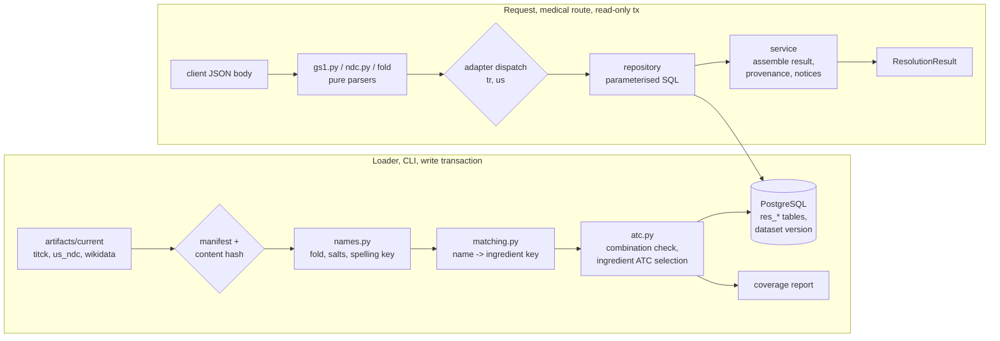

# Design: Drug Resolution, Phase 1 (Türkiye and United States)

> Scope: `apps/api` resolution core, the `tr` and `us` region adapters, the loader that brings the
> `titck`, `us_ndc` and `wikidata_ingredients` artifacts into PostgreSQL, and the resolution
> routes. Two small `pipelines/` changes (§5.1) are needed for the owner's invalid-barcode
> decision. Criteria tagged **[Phase 2: …]** (EU adapters) and **[Client: experience spec]** are not
> designed here; the interfaces they plug into are (§4.1, Req 4.5, 10).
> Owner decisions of 2026-11-07 applied (§9): DP3–DP6, DP9–DP11, DP14, DP15, DP18, DP22
> confirmed; DP19 changed (client sends only AI 01 and 17; the API still drops serial and lot);
> DP20 chosen (route and dosage form in `us_ndc-2`, reviewed route map, §5.5).

## 1. Overview

Resolution is a lookup over reference data that was prepared ahead of time. All medical decisions
about identity (which ingredient, which ATC code, is this a combination code) are made by pure
functions **at load time**, over the whole source, and stored with the dataset version. The
request path only parses the input, looks up rows in a read-only transaction and assembles the
result. This makes every mapping measurable (coverage report), reviewable and identical for every
request against the same dataset version.



Facts checked on 2026-11-07 against the current pipeline artifacts (`.data/artifacts/*/current`)
and public documentation. Coverage figures come from a throw-away prototype of §5.2–§5.5 (not
committed); the loader's coverage report replaces them in task 9.

| Source / topic | Observed | Design consequence |
|---|---|---|
| TİTCK run `20261107T162442Z-0738c719-ab2f` (list of 2026-11-06) | 23,137 input rows → 22,982 output, 155 excluded `invalid_barcode`; 4,355 rows with ≥ 2 ingredients; 52 barcodes on 104 rows; 22,866 rows with an ATC code (116 without) | Every duplicate row is a candidate (§4.3); invalid-barcode rows must be kept by the pipeline as name-only rows (DP9) |
| TİTCK duplicate barcodes | Of 52, 24 differ in ingredient text, 14 in ATC code, 45 in product name; e.g. `8680030190203` is both a ceftriaxone product and "Centella asiatica ekstresi" | Never pick one; show all with their own ingredients |
| TİTCK ATC codes | 21,832 rows have a 7-character code; 1,044 rows carry a malformed or higher-level code (`B05D` 179, `R05X` 140, `A12AX` 63, `S03CA0l` with a letter l, …) | Only `^[A-Z][0-9]{2}[A-Z]{2}[0-9]{2}$` codes can become ingredient codes (§5.4) |
| TİTCK combination products | AMLIPIN `8680199094206`: `amlodipin besilat`, `lisinopril dihidrat`, ATC `C09BB03`. 140 seven-character codes occur on both single- and multi-ingredient rows | Product codes of multi-ingredient products are never ingredient codes (DP2) |
| TİTCK single-ingredient rows that are really combinations | `metformin pioglitazon` (A10BD05), `sitagliptin fosfat monohidrat metformin hidroklorür` (A10BD07), `sodyum aljinatpotasyum bikarbonat` | A single-ingredient row's code is used only if not a combination code; unsplit names are flagged (DP11) |
| TİTCK ingredient strings | 4,550 distinct (3,887 after case folding), 31,826 occurrences; ATC-name fragments as ingredients (`combinations`, `plain`, `various`); commas inside parentheses split one ingredient into three (`inaktif çocuk felci (tip 1`, `2`, `3)`) | These end as `unmapped` with a reason; parenthesis-aware split proposed in the pipeline (DP10) |
| TİTCK barcode prefixes | 869: 17,423; 868: 5,557; 340 (France): 1; 871 (Netherlands): 1 | GS1 prefix is a hint, not a filter: the TR adapter is asked for every 13-digit GTIN (§4.2) |
| Wikidata run `20261107T163917Z-6bb8fcbc-6855` | 3,766 items; labels en 3,757, tr 1,269, de 2,284, fr 2,813, es 2,284; 2,422 items with RxCUI; 4,374 distinct ATC codes, 8.6 % not at 5th level (class items such as "ATC code V09", "antacid"); 440 items with > 1 code; single-substance items also carry combination codes (iron(II) sulfate: `B03AA07`, `B03AD03`) | Class items are not ingredient keys; combination codes are removed from every item (§5.4) |
| Turkish name matching (prototype, §5.3) | Of 4,550 distinct TİTCK strings: Turkish label/alias exact 16.0 % (33.1 % of occurrences); any-language exact +13.3 % (+10.0 %); salt-normalised +16.8 % (+19.5 %); spelling key +7.4 % (+5.5 %); spelling key after salts +4.8 % (+4.5 %). Total 58.3 % of strings, **72.6 % of occurrences**; 76.4 % of products (17,553) fully mapped, 50.7 % of multi-ingredient products (2,208); 44 strings ambiguous | Wikidata Turkish labels alone would map a third of occurrences; the ladder of §5.3 is needed. Tuning targets in DP22 |
| Precision proxy | For 15,117 single-ingredient products with a 7-character code and an unambiguous match, the matched item's codes share the 5-character group with the TİTCK code in 94.3 %. Sampled disagreements are mostly outdated Wikidata codes after WHO changes (axitinib `L01XE17` vs `L01EK01`, pregabalin `N02BF02` vs `N03AX16`, bevacizumab `L01XC07` vs `L01FG01`) | TİTCK's code for a single-ingredient product is preferred over Wikidata's (§5.5) |
| **Measured coverage, task 9** (`prepare_dataset` on the artifacts of 2026-11-07: titck-2 run `20261107T180936Z-0738c719-f9ff`, us_ndc-2 run `20261107T180945Z-941214ac-7657`, reviewed rule files) | TİTCK: 4,502 distinct names, 72.2 % mapped; **83.9 % of 31,885 ingredient occurrences** (DP22 target 85 %: not met); 87.9 % of 23,093 products and 63.8 % of 4,362 multi-ingredient products fully mapped; steps by occurrences: tr_label 10,523, salt 7,789, any_label 3,169, spelling 1,792, spelling+salt 1,656, bridge 1,752, curated 69; not mapped: 4,960 no key (mostly parenteral-nutrition amino acids and electrolytes, vaccine strain fragments, ATC-text fragments such as "combinations"; none has a single-substance item with a code), 133 ambiguous, 42 unsplit. openFDA Rx: **92.6 % of 55,840 products fully mapped** (target 92 %: met), 91.0 % of occurrences, selection 58,646 route_group / 658 all_codes, 256 no code for the route; Rx+OTC 69.7 % (sunscreens, homeopathics). Agreement of Wikidata codes with TİTCK single-ingredient codes: **93.9 %** of 17,426 at the 5-character group; of the 1,062 disagreements, 739 share the 3-character group (typical WHO re-codings such as `L01XE`→`L01EK`), giving 98.2 % if those are counted as re-codings; they are not individually documented, so the DP22 target (≥ 97 % after documented re-codings) is reported as not verified. 383 codes classified as combination codes | Reported, not blocking (DP22). The single-product code wins over Wikidata (DP2), so the 1,062 disagreements do not reach the cascade engine for single-ingredient TİTCK products |
| TİTCK ATC bridge (§5.3 step 5) | Single-ingredient product code → exactly one Wikidata item would map 555 more strings (2,709 occurrences); where both methods map a string they agree on 2,004 of 2,042 (98.1 %) | Offered as a labelled last step (DP5) |
| openFDA run `20261107T162503Z-941214ac-c741` (export 2026-11-06) | 138,262 products; package NDC layouts 5-3-2: 146,115, 5-4-1: 91,786, 4-4-2: 18,355, one malformed (`02` for product `53209-2000`); 256,256 packages → 256,252 distinct 11-digit NDCs (4 collisions); no 10-digit string matches two layouts in this export | 10-digit input still tries all layouts and returns every hit (§4.4) |
| openFDA product types | Rx 57,102; OTC 56,920; bulk ingredient 15,743; drug for further processing 5,691; others < 2,200 | Name search covers finished products only; NDC lookup returns every type, labelled (DP23) |
| openFDA RxCUIs | Product-level (clinical/branded drug) CUIs; 60,504 products have none | Ingredient RxCUIs come from Wikidata P3345 (DP7) |
| US name matching (prototype) | Rx: 2,579 distinct ingredient names, 60.1 % mapped (87.7 % of occurrences), **86.8 % of Rx products fully mapped**; Rx+OTC 70.2 % (sunscreen and homeopathic names). Top unmapped Rx names show salt-list gaps: `OLMESARTAN MEDOXOMIL`, `TRIAMCINOLONE ACETONIDE`, `HYDROCODONE BITARTRATE`, `ESCITALOPRAM OXALATE` | Salt list extended in task 6; coverage reported per product type |
| NDC GTIN | GS1 US: the GTIN-14 in the DSCSA DataMatrix is `003` + 10-digit NDC + check digit; UPC-A is `3` + NDC + check digit ([GS1 US DSCSA guideline R1.3](https://documents.gs1us.org/adobe/assets/deliver/urn:aaid:aem:98200fef-69f9-4b9a-a7e3-8062f55f3dd7/Applying-GS1-System-of-Standards-for-DSCSA-and-Serialized-Interoperable-Traceability-R1-3.pdf)); higher packaging levels use indicator digits 1–8 | `^[0-8]03\d{10}\d$` → NDC10 (§4.4); indicator-digit handling confirmed in task 1 |
| WHO ATC conventions | Combinations within one 4th-level group use 5th-level 20 or 30; combinations outside it use the 50-series; some whole 3rd/4th-level groups are combination groups; different salts usually share one code ([WHOCC ATCvet classification principles](https://www.fhi.no/en/fi/who-collaborating-centre-for-drug-statistics-methodology/atcddd-handbook/atcvet/classification/)) | The numeric rule alone misfires (e.g. single substances numbered above 50 in "other" groups), so the classifier uses a reviewed rule file with exceptions (§5.4) |

## 2. Code layout

```
apps/api/
  janus/
    resolution/
      gs1.py          parse_element_string(), gtin_check_digit(), parse_expiry()      (pure)
      ndc.py          parse_ndc_input(), layouts_of_ndc10(), ndc_from_gtin(), canonical forms (pure)
      names.py        fold(), strip_salts(), spelling_key(), SALT_WORDS, SPELLING_RULES  (pure)
      atc.py          is_ingredient_level(), CombinationRules, is_combination(),
                      ingredient_codes(), select_codes()                                (pure)
      matching.py     NameIndex.build(), map_name(), detect_unsplit()                   (pure)
      canonical.py    content_hash() — same algorithm as pipelines/core/canonical.py   (pure)
      prepare.py      prepare_dataset(sources, rules) -> PreparedDataset, CoverageReport (pure)
      load.py         read artifacts (DuckDB), verify, write one transaction; CLI       (I/O)
      repository.py   read-only parameterised queries                                    (I/O)
      service.py      resolve_scan(), resolve_ndc(), search(), resolve_products()       (core, I/O via repository)
      model.py        Pydantic v2 response and request models
      router.py       POST /resolve/scan, /resolve/ndc, /resolve/search, /resolve/products
    regions/
      base.py         RegionAdapter protocol, ProductKey, AdapterAnswer
      tr/adapter.py   TitckAdapter
      us/adapter.py   OpenFdaNdcAdapter
  migrations/versions/0002_resolution.py
data/
  atc_combination_rules.csv     curated: combination groups, codes, exceptions (DP3)
  route_atc_groups.csv          curated: openFDA route → allowed ATC groups (DP20)
  ingredient_synonyms.csv       curated: published name → QID for names the ladder cannot map (DP5)
tests/
  resolution_strategies.py      GTINs, element strings, NDCs, synthetic sources
  test_gs1_properties.py  test_ndc_properties.py  test_names_properties.py
  test_atc_properties.py  test_matching_properties.py  test_prepare_properties.py
  test_resolution_db_properties.py  test_loader_properties.py  test_resolution_api_properties.py
```

`structure.md` already places adapters in `janus/regions/` and the mapping in
`janus/resolution/`. Medical logic (gs1, ndc, names, atc, matching, prepare) has no I/O, as
`structure.md` requires. New dependency: `duckdb` (already in the stack for FAERS) to read Parquet
in the loader (DP15). No other new runtime dependency.

## 3. Data contracts

### 3.1 Request models (all `extra="forbid"`, strict strings)
| Route | Body |
|---|---|
| `POST /resolve/scan` | `{content: str (1–512 chars), region?: "TR" \| "US"}` |
| `POST /resolve/ndc` | `{ndc: str (1–32 chars)}` |
| `POST /resolve/search` | `{query: str (2–100 chars after trimming), region?: "TR" \| "US", limit?: int 1–20 (default 10)}` |
| `POST /resolve/products` | `{candidate_ids: list[str], 1–50 items, each ^(TR\|US):[a-z_]+:[0-9]{1,9}$}` (re-resolve items the client keeps) |

All four are medical routes (`medical_router()`), so the privacy body policy, `no-store` and the
access-log rules apply unchanged. Codes and names travel only in the body (DP13).

### 3.2 Result model (`ResolutionResult`)
```
dataset_version: str                      # sha256 hex, §6.3
regions_searched: ["TR", "US"]            # adapters actually asked
sources: [SourceRef]                      # source versions searched
scan?: {gtin, expiry: date | null, expiry_status: absent | valid | invalid,
        serial_present: bool, lot_present: bool,
        structural_hint: TR | US | FR | ES | DE | other | none}
notices: [Notice]                         # fixed codes, e.g. source_may_be_outdated,
                                          # region_adapter_not_available, unmapped_ingredients
candidates: [ProductCandidate]            # empty = not found (Req 6.2)

ProductCandidate:
  candidate_id: "TR:titck:<n>" | "US:openfda_ndc:<n>"   # stable within a dataset version
  region, matched_by: barcode | ndc_gtin | ndc | name | candidate_id, score?: float
  product_name, brand_name?, generic_name?, ingredient_text (as published)
  published_atc: str | null               # exactly as published, display only
  product_type?, routes?: [str], dosage_form?, marketing_end_date?, suspension_status?, name_only: bool
  packages?: [{ndc_published, ndc11}]      # US
  ingredients: [ResolvedIngredient]       # published order
  source: SourceRef

ResolvedIngredient:
  position, published_name, strength?
  status: mapped | ambiguous | unmapped
  reason?: no_ingredient_key | possible_unsplit_combination | no_ingredient_atc
           | no_ingredient_atc_for_route
  ingredient_key: {qid, label_en, labels{tr,de,fr,es}} | null
  key_candidates: [qid]                   # ambiguous: all keys of the matching step
  match_step: tr_label | any_label | salt_normalised | spelling_key
              | spelling_key_salt | titck_atc_bridge | curated_synonym | null
  atc_codes: [{code, source: SourceRef, product?: candidate_id}]   # ingredient-level only
  atc_selection: single_ingredient_product | therapeutic_group | anatomical_group | route_group
                 | all_codes | null           # all_codes = not confirmed by product code or route
  rxcuis: [str], rxcui_status: from_wikidata | not_in_wikidata
  source: SourceRef                       # TİTCK/openFDA row the name came from

SourceRef: {source_id, run_id, region | null, snapshot_date}
```
`janus.resolution.model.rule_input(ingredient) -> tuple[str, ...]` returns `atc_codes` codes
only for `status == mapped`, else `()`. This is the only function the cascade engine uses to read
codes (Req 5.4, cascade-engine Req 1.3).

### 3.3 Database (migration `0002_resolution`, forward-only, with downgrade)
All tables carry `dataset_id text` and are written only by the loader (Req 9.5).

| Table | Key columns |
|---|---|
| `res_dataset` | `id` (dataset version), `status` (`ready`, `retired`), `inputs jsonb` (source versions, rule hashes, code version), `created_at` |
| `res_current` | singleton row (`one boolean PRIMARY KEY CHECK (one)`), `dataset_id` FK |
| `res_source_version` | `source_id, run_id, region, snapshot_date, snapshot_is_retrieval_time, content_sha256, schema_version, license, source_url` |
| `res_product` | `product_id int`, `region`, `source_id`, names, `ingredient_text`, `published_atc`, `product_type`, `marketing_end_date`, `suspension_status`, `name_only` |
| `res_product_code` | `kind` (`tr_barcode`, `ndc_product9`, `ndc_package11`), `code`, `code_published`, `product_id`; index `(dataset_id, kind, code)` |
| `res_product_ingredient` | `product_id, position, published_name, strength, status, reason, qid, key_candidates text[], match_step, atc jsonb, atc_selection, rxcuis text[], rxcui_status` |
| `res_ingredient` | `qid`, `labels jsonb`, `ingredient_atc jsonb` (code + source), `rxcuis text[]` |
| `res_name` | `name_key`, `display`, `kind` (`product`, `ingredient`), `region`, `ref`; GIN `gin_trgm_ops` index on `name_key` |
| `res_combination_atc` | `code`, `reason` (audit of §5.4 decisions) |
| `res_coverage` | `source_id`, `report jsonb` |

`CREATE EXTENSION IF NOT EXISTS pg_trgm` in the migration (contrib is in the `postgres:16`
image; confirmed in task 1). `unaccent` is not needed: folding happens in Python so the loader and
the request path use the same function (DP8).

## 4. Request path

### 4.1 Region adapters (Req 10)
```python
class RegionAdapter(Protocol):
    region: Region                    # "TR" | "US"  (Phase 2: "EU")
    source_ids: tuple[str, ...]
    def accepts_gtin(self, gtin14: str) -> bool: ...                    # pure
    def keys_from_gtin(self, gtin14: str) -> list[ProductKey]: ...     # pure
    def structural_hint(self, gtin14: str) -> bool: ...                 # pure
    def lookup(self, repo: Repository, keys: list[ProductKey]) -> list[ProductRow]: ...
```
`ProductKey = (kind, code)`. Both adapters return `ProductRow`s with the same ingredient shape;
the service turns rows into `ProductCandidate`s. A Phase 2 adapter adds a class and a
registration line; the service, model and `rule_input` stay unchanged (Req 4.5).

### 4.2 Scan (Req 1)
1. `parse_element_string(content)` (§4.5) → `Gs1Data(gtin14, expiry, expiry_status,
   serial_present, lot_present)`. Errors → 422 with a fixed code (`gs1_unknown_ai`,
   `gs1_duplicate_ai`, `gtin_missing`, `gtin_check_digit`, …). The client sends only (01) and
   (17) (owner decision DP19, `experience`); if serial or lot still arrive, the parser drops
   their values while scanning; `Gs1Data` has no field for them (Req 1.4).
2. Adapters: override given → only that adapter; else every enabled adapter with
   `accepts_gtin` true. TR accepts any GTIN-14 starting with `0` (key = last 13 digits); US
   accepts NDC GTINs (`^[0-8]03\d{10}\d$`) and GTIN-12 UPC-A starting with `3` (padded). Order:
   adapters whose `structural_hint` is true first, then by region code.
3. `structural_hint` for regions without an adapter (GS1 prefixes 300–379 FR, 840–849 ES,
   400–440 DE) adds notice `region_adapter_not_available` with that region; nothing is guessed.
4. Each adapter's lookup returns every matching row (TR: `res_product_code` kind `tr_barcode`,
   which never contains name-only rows).

### 4.3 Duplicates and stable order (Req 2.1, owner decision)
Candidates are sorted by `(adapter order, product_id)`. `product_id` is assigned by the loader
from the row's canonical JSON sort order, so it is stable for a dataset version and independent
of file row order. Nothing is deduplicated: two rows with the same barcode are two candidates.

### 4.4 NDC (Req 3.1, 3.2)
- `parse_ndc_input(s)`: strip spaces, an optional prefix (`NDC`, `NDC:`, `N`, case-insensitive),
  then accept exactly one of: hyphenated 10-digit `4-4-2 | 5-3-2 | 5-4-1`; hyphenated 11-digit
  `5-4-2`; plain 11 digits; plain 10 digits; hyphenated product NDC `4-4 | 5-3 | 5-4`. Anything
  else → 422 `ndc_malformed`.
- Output: a set of lookup keys. Hyphenated 10-digit → one `ndc_package11`; plain 10 digits →
  up to three `ndc_package11` (one per layout); 11 digits → one; product NDC → one
  `ndc_product9` (5-4 padded).
- Canonical package form: pad the 4-digit labeler, 3-digit product or 1-digit package segment
  with one leading zero → 5-4-2 → 11 digits.
- `ndc_from_gtin(gtin14)` → the 10 digits at positions 4–13 → plain 10-digit path.
- The loader indexes every package NDC by its canonical 11 digits (the malformed one is skipped
  and counted) and every product NDC by its 9 digits.

### 4.5 GS1 parsing details (Req 1.1–1.3)
- Input normalisation: remove a leading `]d2` (or `]C1`, `]Q3`); FNC1 and GS (`\x1d`) are
  separators. Parenthesised form: `(AI)value` repeated; it is recognised by a leading `(`.
- AI table (supported): `01` (14, fixed), `17` (6), `11` (6), `15` (6), `16` (6), `10` (≤ 20,
  variable), `21` (≤ 20), `30` (≤ 8), `240` (≤ 30), `241` (≤ 30), `710`–`716` (national
  healthcare reimbursement numbers, ≤ 20). Fixed lengths follow the GS1 predefined-length table;
  in the FNC1 form a variable field ends at GS or end of string. AI list to be confirmed against
  the GS1 General Specifications in task 1.
- `gtin_check_digit(digits13)`: GS1 mod-10 (weights 3,1 from the right). 8-, 12- and 13-digit
  GTINs are left-padded to 14 before the check.
- `parse_expiry(yymmdd, today)`: century by the GS1 rule (difference of YY to today's YY ≥ 51 →
  previous century, ≤ −50 → next century, else current); `DD = 00` → last day of the month;
  invalid month or day → `expiry_status = invalid`, the GTIN is still resolved.

### 4.6 Name search (Req 2.4, 3.3)
1. `key = fold(query)` (§5.2); fewer than 2 characters after folding → 422.
2. SQL (read-only): candidates from `res_name` where `name_key = key` or `name_key LIKE key||'%'`
   or `name_key % key` (pg_trgm), filtered by region when given, `LIMIT 200`, returning
   `similarity(name_key, key)`.
3. `rank(key, rows)` (pure): sort by (exact, prefix, word-prefix, similarity desc, kind
   `product` before `ingredient`, region, ref); keep the first `limit` distinct refs. Ingredient
   hits are returned as candidates of kind ingredient (no product), with all ingredient-level
   codes and `atc_selection = all_codes`.
4. Indexed names: TİTCK product names (including name-only rows), TİTCK ingredient names,
   openFDA brand and generic names of finished products (DP23), Wikidata labels and aliases in
   en and tr (de, fr, es added in Phase 2 with `eu_name`).

### 4.7 Not found, unavailable, staleness (Req 2.2, 6.2, 7.1)
- No `res_current` row, or a needed source missing from the current dataset → 503
  `{"error": "resolution_unavailable"}`. Only with the sources loaded can the result be an empty
  candidate list (HTTP 200, "not found", with `regions_searched` and `sources`).
- `source_may_be_outdated` notice for `titck` or `openfda_ndc` when `today − snapshot_date >
  2 × cadence_days` (the shared freshness rule, `integrity.freshness`; 14 days for the weekly
  sources). The loader stores the cadence from `pipelines/sources.toml` with each source version
  (`res_source_version.cadence_days`, migration `0003`); a missing cadence gives the notice (DP18). The request path makes no external calls (DP6).

### 4.8 Privacy on the request path (Req 8)
- Routes come from `medical_router()`; the database is used through `read_only_tx()`, extended
  to `SET TRANSACTION ISOLATION LEVEL REPEATABLE READ, READ ONLY` so one request sees one
  dataset version even if the loader switches meanwhile.
- No logging in `resolution/` or `regions/` except through `log_event` with allowlisted fields
  (the `log-guard` hook checks on save).
- Validation errors: the resolution routes read the raw JSON body and validate it themselves
  (as the donation routes do), returning `422 {"error": "invalid_request", "fields": [loc…]}`
  without FastAPI's `input` and `ctx` (DP14), so a 422 never echoes a serial or lot back.
  Domain errors use fixed codes (`gtin_check_digit`, `ndc_malformed`, …) and never interpolate
  input. Every result also carries the research-prototype disclaimer (medical-safety rule 9).

## 5. Load-time preparation (pure, `prepare.py`)

### 5.1 Inputs and pipeline changes
Inputs: the current `titck`, `us_ndc`, `wikidata_ingredients` rows and manifests, plus
`data/atc_combination_rules.csv` and `data/ingredient_synonyms.csv`.

Two `pipelines/` changes, both bumping the schema version (they change `data-pipelines`
Req 6.4 and 6.6; that spec is updated in the same task):
- **titck-2, name-only rows (DP9):** a row whose barcode fails the 13-digit/EAN-13 check is
  output with `barcode = null`, `name_only = true` instead of being excluded; metric
  `name_only_rows`. The invalid value is not kept. This is how the owner's decision ("not
  repaired, reachable by name") is implemented: the pipeline currently drops those rows.
- **titck-2, parenthesis-aware split (DP10):** `split_ingredients` ignores separators inside
  `(…)`. The data-pipelines property P12 (all non-separator characters kept) still holds.
- **us_ndc-2, route and dosage form (DP20):** each product also carries `route` (list of
  openFDA route strings, as published, e.g. `["TOPICAL"]`) and `dosage_form` (string, as
  published). They change `data-pipelines` Req 8.3; the pipeline still does not interpret them.

### 5.2 Names (`names.py`, Req 5.3, 5.7)
- `fold(s)`: Unicode NFKC; Turkish-aware lower case (`İ` → `i`, `I` → `i`, `ı` → `i`); NFKD and
  drop combining marks (`ç ğ ö ş ü é` → `c g o s u e`); characters other than `[a-z0-9%+]` →
  space; collapse spaces. All four i's fold to `i`, so `İBUPROFEN`, `ibuprofen` and `Ibuprofen`
  give one key.
- `strip_salts(folded)`: hydrate words and notation (`dihidrat`, `monohydrate`, `.2h2o`) are
  always removed. Other whole tokens in `SALT_WORDS` (Turkish and English salt, ester and
  counter-ion words: `hidroklorur, hcl, besilat, besylate, sodyum, sodium, maleat, tartarat,
  bitartrate, medoxomil, cilexetil, mofetil, …`) are removed unless that would leave nothing or
  only words in `NOT_ALONE` (inorganic anions such as carbonate, oxide, fluoride, edetate; bare
  metals such as zinc, iron, silver, lithium; alkyl words); then the hydrate-free name is kept.
  This keeps sodium vs potassium bicarbonate, zinc acetate vs zinc gluconate and sodium calcium
  edetate vs edetate disodium apart (pharmacologist review, 2026-11-07). Never salt words:
  furoate, butylbromide, mono-/di-/trinitrate, disoproxil, alafenamide (they distinguish
  substances).
- `spelling_key(folded)`: whole-token rewrites first (`ii→2`, `iii→3`, `iv→4`, `asit→acid`, so
  iron(II) and iron(III) stay apart and Turkish "asit" meets "acid"); remove spaces; rewrite
  `ph→f, th→t, ch→k, x→ks, qu→k, c(before e,i,y)→s, c→k, y→i, z→s, w→v, ae→e, oe→e`; collapse
  repeated letters; drop a final `e`; final `d→t` (Turkish devoicing); repeat until nothing
  changes. Examples: `siprofloksasin`/`ciprofloxacin`, `dekzametazon`/`dexamethasone`,
  `klorpromazin`/`chlorpromazine`, `ketiapin`/`quetiapine`,
  `hidroklorotiyazit`/`hydrochlorothiazide`.
- All three are idempotent (P6). `RULES_VERSION` = hash of the word lists and rewrite rules; it is
  part of the dataset version (Req 5.7).

### 5.3 Name → ingredient key ladder (`matching.py`, Req 2.5, 5.3)
`NameIndex.build(wikidata_rows, synonyms)` keeps only items with at least one ingredient-level,
non-combination code (class items drop out). Keys per item: folded label and aliases, by language.
`map_name(published_name, index, titck_bridge)` stops at the **first** step with a hit. Within a
step, keys hit through an item's label win over keys hit only through aliases (Wikidata aliases
are loose: esomeprazole lists "omeprazole", L-thyroxine lists "levothyroxine sodium"):

| Step | Lookup | Label |
|---|---|---|
| 0 | curated synonym (exact folded name) | `curated_synonym` |
| 1 | folded name = a Turkish label/alias | `tr_label` |
| 2 | folded name = a label/alias in any language | `any_label` |
| 3 | `strip_salts(name)` = a folded (salt-stripped) label/alias | `salt_normalised` |
| 4 | `spelling_key(name)` = spelling key of a label/alias | `spelling_key` |
| 5 | `spelling_key(strip_salts(name))` | `spelling_key_salt` |
| 6 | TİTCK ATC bridge: the salt-normalised name occurs on single-ingredient rows whose valid, non-combination code belongs to exactly one item (DP5) | `titck_atc_bridge` |

One key at the first hit → `mapped` (subject to §5.5); several keys → `ambiguous` with all
`key_candidates`. With no hit in steps 0–5, `detect_unsplit` (below) runs **before** step 6, so a
name naming two substances is never mapped through a product code; else step 6; else
`unmapped/no_ingredient_key`. The result depends only on the set of index entries, not their
order (P16). The bridge is keyed by the salt-normalised name, so a salt form on a single product
and the plain name in a combination meet (P5 counterexample, task 8).

`detect_unsplit(name)`: if the folded tokens can be split into two or more consecutive spans that
each map (steps 1–3) to different keys, the ingredient is `unmapped/possible_unsplit_combination`
and the span keys are reported for review; it is not split automatically (DP11).

US names (`AMLODIPINE BESYLATE`) use the same ladder; step 1 and step 6 do not apply.

### 5.4 ATC codes and combination check (`atc.py`, Req 5.1, 5.2)
- `is_ingredient_level(code)`: `^[A-Z][0-9]{2}[A-Z]{2}[0-9]{2}$`.
- `CombinationRules` from `data/atc_combination_rules.csv` (`pattern, kind, note`), `kind` ∈
  `combination_group` (an ATC prefix of 3–5 characters, e.g. `C09B`, `C09D`, `C10B`, `A10BD`,
  `R03AK`, `R03AL`, `B03AD`, `J01CR`, `J05AR`), `combination_code` (one 7-character code),
  `exception` (a 5-character group or a code where the numbering rule does not mean
  "combination", e.g. single substances numbered above 50 in an "other agents" group). The file
  holds codes and Janus notes only (no WHO text); first version drafted by the pharmacologist
  agent and confirmed by the owner (DP3).
- `is_combination(code, rules, observed)`, in this order: exception → `False`; combination group
  or code → `True`; 5th-level number 20, 30 or 50–79 → `True`; code observed as the product code
  of a TİTCK product whose ingredients map to ≥ 2 distinct keys **and** not a code of any
  Wikidata item → `True`; else `False`. Every `True` is written to `res_combination_atc` with its
  reason; numbering-rule hits on items whose only code it is are listed in the coverage report
  for review.
- `ingredient_codes(qid)` = { Wikidata codes of the item that are ingredient-level and not
  combination } ∪ { codes observed on TİTCK single-ingredient rows mapped unambiguously to the
  item, ingredient-level, not combination, row not flagged unsplit }, each with its source.

### 5.5 Selecting codes for an ingredient in a product (`select_codes`, Req 5.1)
Let `S = ingredient_codes(qid)` and `p` the product's published code.

| Case | Selected | `atc_selection` |
|---|---|---|
| product has one ingredient, `p` ingredient-level and not combination | `[p]` (TİTCK's code wins over outdated Wikidata codes) | `single_ingredient_product` |
| otherwise, codes in `S` with the same first 3 characters as `p` | those | `therapeutic_group` |
| otherwise, codes in `S` with the same first character as `p` | those | `anatomical_group` |
| US product with ≥ 1 route in the route map (DP20) | codes in `S` allowed for any of its routes | `route_group` |
| US product, routes mapped, no code in `S` allowed | none → `unmapped/no_ingredient_atc_for_route` | `null` |
| otherwise (no `p` and no mapped route) | all of `S` | `all_codes` |
| `S` empty | none → `unmapped/no_ingredient_atc` | `null` |

The first four rows apply to products with a published code `p` (TİTCK); the route rows apply to
products without one (openFDA). A route string not in the map counts as unmapped; a product
with several routes allows the union of their groups.

**Route map (`data/route_atc_groups.csv`, DP20).** Columns `route, allow, note`: `route` is an
openFDA route string as published; `allow` is a `;`-separated list of ATC prefixes (1–5
characters) that a product given by that route may carry. Examples of the intent: `TOPICAL` →
dermatological `D` plus topical groups in other chapters (e.g. `M02`, `C05`); `OPHTHALMIC` →
`S01`; `ORAL` → systemic chapters, not `D` or `S`. `allowed(code, routes, map)` is pure: true
iff some prefix of a mapped route is a prefix of the code. Drafted by the pharmacologist agent
from the route values in the openFDA export, reviewed by the owner; part of the dataset version.

AMLIPIN (`C09BB03`): amlodipine `S = {C08CA01}` → no `C09` code → anatomical `C` → `C08CA01`;
lisinopril `S = {C09AA03}` → therapeutic `C09` → `C09AA03`. A final guard in `prepare` raises
`CombinationCodeLeakError` if any selected code is a combination code (Req 5.2, fail loudly).

### 5.6 Coverage report (Req 5.6)
Per source (`titck`, `openfda_ndc` by product type): distinct names and occurrences mapped (total
and per ladder step), ambiguous and unsplit counts, products fully mapped (all and
multi-ingredient), `atc_selection` distribution, unmapped top 50 names with counts, agreement of
`ingredient_codes` with TİTCK single-ingredient codes (5-character group), combination
classifier decisions by reason. Stored in `res_coverage` and written to
`$JANUS_DATA_DIR/resolution/coverage-<dataset>.json` (never into the repository; it contains
TİTCK names).

## 6. Loader (`load.py`, Req 9)

### 6.1 Steps
```
for each source: read current/manifest.json + evidence_source.json; outcome must be succeeded
                 (or promoted needs_review); rows.parquet via DuckDB
                 content_hash(rows) == manifest.content_sha256, else refuse      Req 9.1
dataset_version = sha256(sorted source content hashes, RULES_VERSION,
                         sha256 of the two data/ files, prepare code version)    Req 9.4
if dataset_version == current: exit 0 (nothing to do)
prepared = prepare_dataset(...)                                                  pure, §5
one write transaction:
  insert res_dataset, res_source_version, all res_* rows (COPY)
  update res_current -> new dataset
commit                                                                           Req 9.2
second transaction: retire and delete datasets older than the previous one
```
A crash or error before commit leaves `res_current` and its rows untouched (PostgreSQL
atomicity). All artifacts are verified before anything else, even when the dataset version is
already current. Implementation notes (task 10): every `res_*` table cascades from
`res_dataset`, so retiring a dataset is one DELETE; the real load of 2026-11-07 (161,399
products, 417,499 codes, 252,123 ingredient rows, 234,383 names) takes about 75 s; an unchanged
reload only re-verifies hashes. Each ingredient's codes are cited once per code, a code observed
on a TİTCK product before the same code from Wikidata. The previous dataset is kept so a bad load can be undone with
`python -m janus.resolution.load --activate <dataset>`. CLI: `python -m janus.resolution.load
[--data-dir PATH]`; needs `DATABASE_URL`. Logs: `LogEvent.resolution_load` with counts and the
dataset version only.

### 6.2 Content hash
`canonical.py` re-implements the 20-line canonical serialisation of `pipelines/core/canonical.py`
(the API image does not include the pipelines project). A golden test vector (fixed rows → fixed
hash) is asserted in both test suites so the two cannot drift (DP15).

### 6.3 Who may write
The loader uses `write_tx()`. The import-boundary test from the privacy spec is extended to allow
exactly `contributions/repository.py` and `resolution/load.py` (DP16).

## 7. Testing strategy

- **Property tests (Hypothesis)**, §8, one test per property tagged `Feature: drug-resolution,
  Property Pn` with its requirement. Profiles `dev` (100) / `ci` (300, `derandomize=True`);
  database-backed properties 50 / 100, as in the privacy spec.
- **Synthetic sources.** `resolution_strategies.py` builds TİTCK-like rows (duplicate barcodes,
  name-only rows, combination products with combination codes, malformed codes, salts, unsplit
  names), openFDA-like products (all three NDC layouts, multi-ingredient), and Wikidata-like items
  (labels in several languages, class items, combination codes). No TİTCK data is committed.
- **Fixtures.** A small CC0 sample of openFDA and Wikidata rows may be committed under
  `tests/fixtures/` with source and date (DP21). The AMLIPIN example uses a synthetic TİTCK row
  with AMLIPIN's published fields plus the real Wikidata items for amlodipine and lisinopril.
- **Real artifacts (local only).** `test_real_artifacts.py` runs when `JANUS_DATA_DIR` has
  current artifacts and is skipped in CI: AMLIPIN resolves as in Req 5.2; the 52 duplicate
  barcodes return 104 candidates; the name-only rows are found by name; coverage numbers are
  printed.
- **Database.** `db` tests against PostgreSQL 16 (`JANUS_TEST_DATABASE_URL`), unskippable in CI
  (privacy DP19). Each example loads a small synthetic dataset through the real loader.
- **Privacy harness.** `assert_stateless()` and the sentinel log capture from
  `tests/harness.py` are reused for the four routes.
- **CI.** The existing `api` job runs the new tests; the `pipelines` job runs the titck-2 tests.

## 8. Correctness properties

| # | Property (for all …) | Validates | Hypothesis approach |
|---|---|---|---|
| P1 | **Separator invariance.** For any set of supported AIs and values, the FNC1 form (with or without `]d2`, any AI order) and the parenthesised form parse to the same `Gs1Data`. | Req 1.1 | Build the field set first, render both forms. Original property. |
| P2 | **Check digit.** For any valid GTIN-14 and any change of one digit or swap of two adjacent different digits, parsing is rejected with `gtin_check_digit`; valid GTIN-8/12/13 padded to 14 are accepted. | Req 1.2 | `st.integers` digit strings + computed check; single-digit mutations. Original property. |
| P3 | **Round trip.** For any (GTIN, expiry, lot, serial), building an element string and parsing it gives the same GTIN and expiry, and `serial_present`/`lot_present` true. | Req 1.1, 1.3 | Lot/serial over the GS1 character set 82, incl. `(` and `)` in the FNC1 form. Original property. |
| P4 | **NDC canonical form.** For any 10-digit NDC in any layout, its hyphenated form, its 11-digit form (with and without hyphens) and its label-prefixed forms all give the same canonical 11-digit key. | Req 3.2 | Layout + digits → render variants. Original property. |
| P5 | **Decomposition invariance.** For any synthetic source with a combination product P = A + B (any combination code) and single-ingredient products A and B, P's ingredients have the same ingredient keys as A and B; each ingredient's codes in P are a subset of its `ingredient_codes`; when an ingredient has exactly one code, P and the single product give that same code. | Req 5.1 | Generated items, products and codes; combination code from the rule file or the numbering rule. Original property. |
| P6 | **Idempotent normalisation.** For any text, `fold`, `strip_salts∘fold` and `spelling_key∘fold` are idempotent, and `strip_salts` never returns an empty string for non-empty input. | Req 5.3 | Text over Turkish, Latin-1 and Greek letters, digits, `%`, `+`, salt words. Original property (extended). |
| P7 | **No combination code leaks.** For any synthetic source, no `atc_codes` entry of any ingredient (and nothing returned by `rule_input`) is a combination code; possible unsplit names never carry their product's code; `prepare` raises if a leak is forced by a test double. | Req 5.2 | Products with combination codes on single-ingredient rows, items carrying combination codes, unsplit names. Original property. |
| P8 | **Determinism.** For any input to any route, resolving twice against the same dataset version gives byte-identical JSON; loading the same artifacts twice gives the same dataset version and product ids. | Req 7.3, 9.4 | DB-backed; two loads into fresh databases. Original property. |
| P9 | **Expiry.** For any YYMMDD, `DD = 00` gives the month's last day, valid dates round-trip, impossible ones give `invalid` while the GTIN still resolves, and the century follows the GS1 rule for any `today`. | Req 1.3 | `st.dates()` for today; compare with a reference using `calendar.monthrange`. |
| P10 | **Serial and lot never leave the parser.** For any element string carrying sentinel serial and lot values, sent to `/resolve/scan` valid or invalid, neither value appears in the response body or headers, in any log output, or in the database. | Req 1.4, 8.3, 8.4 | Sentinels from `tests/sentinels.py`; also invalid strings that trigger 422. |
| P11 | **NDC GTIN round trip.** For any 10-digit NDC and indicator digit 0–8, building the NDC GTIN and extracting gives the same 10 digits, and the lookup keys contain the original's canonical form. | Req 3.1 | Layout + digits + indicator; check digit computed. |
| P12 | **NDC input domain.** For any string, `parse_ndc_input` accepts it iff it is one of the listed forms after prefix and space removal; accepted plain 10 digits give 1–3 keys; everything else → `ndc_malformed`. | Req 3.2 | Valid forms plus near misses (wrong segment lengths, letters, 9/12 digits). |
| P13 | **All candidates.** For any source where a product key occurs on n ≥ 1 rows, the lookup returns exactly those n rows, in `product_id` order, for every input form that maps to that key. | Req 2.1, 3.1, 6.2 | DB-backed synthetic loads with duplicate barcodes and colliding NDCs. |
| P14 | **Name-only rows.** For any source with name-only rows, no scan or barcode lookup returns them, and a search for the exact product name returns them. | Req 2.3 | DB-backed; name-only rows whose names equal, prefix or differ from normal rows. |
| P15 | **Search invariance.** For any query, case changes, Turkish `İ/I/ı/i`, and diacritic variants give the same result; `rank` is independent of the input order of candidate rows; results never exceed `limit`. | Req 2.4, 3.3 | Pure `rank` with permuted rows; DB-backed search with shuffled insert order. |
| P16 | **Matching ladder.** For any index and name, `map_name` returns the first step with a hit (label hits before alias hits within a step); several keys at that step → `ambiguous` with exactly those keys; the result is independent of index entry order; a name formed by two known names with no separator is `possible_unsplit_combination`. | Req 5.3 | Generated items and names built to hit a chosen step. |
| P17 | **Ingredient codes are well formed and belong to the ingredient.** For any synthetic source, every emitted code matches the 7-character pattern and is in `ingredient_codes(qid)` of its own ingredient; malformed published codes (`B05D`, `S03CA0l`) never appear in `atc_codes`. | Req 5.1 | Published codes from a strategy mixing valid, short and malformed codes. |
| P18 | **Unmapped stay visible.** For any product, the ingredient list has one entry per published ingredient, in published order; every non-`mapped` entry has a reason or key candidates and contributes nothing to `rule_input`. | Req 5.4 | Names designed to fail at each stage. |
| P19 | **Not found only when loaded.** For any input, with no current dataset (or a needed source missing) the route answers 503 `resolution_unavailable`; with sources loaded and no match it answers 200 with no candidates and the searched sources. | Req 6.2, 7.1 | DB-backed; empty, partial and full loads. |
| P20 | **Provenance.** For any result, every `SourceRef` (result, candidate, ingredient, ATC code) is one of the current dataset's source versions, and the result's `dataset_version` is current. | Req 7.2 | DB-backed over generated loads and queries. |
| P21 | **Adapter dispatch.** For any GTIN and override, with an override only that adapter is asked; without one, exactly the enabled adapters whose `accepts_gtin` is true are asked, hinted ones first. | Req 1.5 | Stub adapters recording calls; GTINs from TR, US, FR, ES, DE prefixes. |
| P22 | **Stateless routes.** For any request to the four routes, the database snapshot and temp directory are unchanged, the response has `no-store`, and no input value appears in any log output. | Req 8.1–8.3 | `assert_stateless()` and sentinel capture from the privacy harness. |
| P23 | **Atomic load.** For any sequence of loads (success, hash mismatch, failure injected at any table, crash before commit) the API serves either the previous or the new dataset completely, never a mix; a refused artifact changes nothing. | Req 9.1, 9.2 | `RuleBasedStateMachine`; invariant: all `res_*` rows reachable from `res_current` belong to one dataset with all its sources. |

| P24 | **Route-based selection (DP20).** For any synthetic US product, item codes and route map: if some route is mapped, every selected code is allowed for one of the product's routes and an ingredient with no allowed code is `unmapped/no_ingredient_atc_for_route` (never falls back); if no route is mapped, all `ingredient_codes` are selected with `all_codes`; the result does not depend on the order of routes or map rows. | Req 5.1, 5.4 | Routes drawn from the map and from unmapped strings; codes inside and outside the allowed prefixes. |

P1–P8 are the eight original properties; P9–P23 were added in the refinement; P24 follows the
owner's DP20 decision.

## 9. Decisions

| # | Decision | Alternatives considered | Why |
|---|---|---|---|
| DP1 | Phase 1 builds `tr` and `us`; EU criteria are tagged and their interfaces kept (Req 4.5, 10). | All regions now. | PLAN.md Phase 1 scope. |
| DP2 | Ingredient ATC codes come from the ingredient key (Wikidata) and from TİTCK single-ingredient products of that key; a multi-ingredient product's code is never an ingredient code; a single-ingredient product's own code is preferred when valid and not a combination code. | Use TİTCK product codes directly; Wikidata only. | TİTCK combination products have one combination code; Wikidata codes are partly outdated (94.3 % group agreement, disagreements mostly WHO re-codings). |
| DP3 | Combination codes are decided by one function: reviewed rule file (groups, codes, exceptions) + WHO numbering rule + observation on TİTCK multi-ingredient products; the first rule file is drafted by the pharmacologist agent. **Confirmed by the owner.** | Numbering rule only; list of all combination codes from the WHO index. | The numbering rule misfires in "other agents" groups; the WHO index is licence-restricted; a short file of codes is reviewable. |
| DP4 | Selecting among an ingredient's codes inside a product: own code (single-ingredient) → same 3-character group as the product code → same anatomical group → all codes (§5.5). **Confirmed by the owner.** | Always all codes; always the first code. | Keeps route-specific codes (e.g. topical vs systemic corticosteroid) apart where the product code tells us; never invents a code. |
| DP5 | Name ladder of §5.3 with two optional steps: the TİTCK ATC bridge (step 6, +555 strings, 98.1 % agreement where both apply) and a curated synonym file (step 0) for frequent names the ladder misses. Both labelled in `match_step`. **Confirmed by the owner.** | Ladder without them; fuzzy (trigram) matching at load time. | Fuzzy matching would map look-alike names wrongly (e.g. different -olol drugs); the bridge and the curated file are exact and reviewable. |
| DP6 | No external calls on the request path in Phase 1: openFDA NDC and Wikidata come from pipeline artifacts in PostgreSQL; RxNav `approximateTerm` is not called. **Confirmed by the owner.** | Live RxNav/openFDA search. | A live call would send the user's typed medicine name from our server to NLM/FDA and adds an outage path; local data is versioned and testable. |
| DP7 | RxCUIs from Wikidata P3345 only in Phase 1; `rxcui_status = not_in_wikidata` otherwise. RxClass enrichment, if wanted, becomes a pipeline later. | RxClass at request time. | Same as DP6; 2,422 of 3,766 items already have an RxCUI. |
| DP8 | Folding (Turkish i's, diacritics) in Python; trigram index on the folded key; `unaccent` not used. | PostgreSQL `lower()` + `unaccent`. | One implementation for loader and queries, property-tested; PostgreSQL's `lower()` depends on the collation for `İ/I`. |
| DP9 | `titck-2`: invalid-barcode rows are output as name-only rows (`barcode = null`) instead of excluded; `data-pipelines` Req 6.4 changes accordingly. **Confirmed by the owner.** (this implements your decision). | Separate side file of excluded rows. | The current pipeline drops those 155 rows, so they cannot be found by name otherwise; one artifact keeps row accounting simple. |
| DP10 | `titck-2`: ingredient split ignores separators inside parentheses. **Confirmed by the owner.** | Keep splitting; repair in resolution. | `inaktif çocuk felci (tip 1, 2, 3)` currently becomes three ingredients; one rule in one place (data-pipelines DP7). |
| DP11 | Names that look like two ingredients without a separator (`metformin pioglitazon`) are `unmapped/possible_unsplit_combination` and shown, not split automatically. **Confirmed by the owner.** | Split automatically into the found keys. | Splitting is a guess about a regulator's text; the user sees the notice and the doctor note can still list the product. |
| DP12 | Ambiguous names return all keys and are excluded from rule matching until the user picks one (client, `experience`). | Pick the most frequent key. | "Never guess." 44 TİTCK strings in the prototype. |
| DP13 | All resolution routes are `POST` with JSON bodies; codes and names never in URLs. | `GET /resolve/{code}`. | URLs end up in proxy logs (Caddy, Phase 5) and browser history. |
| DP14 | 422 responses of medical routes drop FastAPI's `input`/`ctx` fields (privacy design §4.4 kept them). **Confirmed by the owner.** | Keep the default body. | A rejected scan would echo the serial number back; the client does not need it. |
| DP15 | Loader in `apps/api` (`python -m janus.resolution.load`), reading Parquet with DuckDB; canonical hash re-implemented with a shared golden vector. **Confirmed by the owner.** | Loader in `pipelines/` with psycopg; `pyarrow`. | DuckDB is already in the stack (FAERS); the loader needs the API's models and migrations. |
| DP16 | One write transaction per load plus a `res_current` pointer; previous dataset kept for `--activate`; request reads in `REPEATABLE READ, READ ONLY`; `write_tx` allowed in `resolution/load.py`. | Table swap by rename; materialised views. | PostgreSQL atomicity gives P23 without custom code; ~1 M rows is a small transaction. |
| DP17 | Dataset version = hash of source content hashes, rule version, curated-file hashes and prepare code version. | Timestamp. | Same inputs → same version (P8); any rule change is visible. |
| DP18 | Staleness notice when TİTCK or openFDA data is older than twice its cadence (14 days for the weekly sources). **Confirmed by the owner.** *(2026-11-07, owner decision `evidence-integrity` DP17: the rule is the shared freshness rule and the cadence comes from `pipelines/sources.toml`; no constant in `resolution/`.)* | No notice; 7 days. | The weekly schedule only starts in Phase 5; users should see the list date. |
| DP19 | **Owner decision:** the serial identifies a single box and must not leave the device. The client sends only AI (01) and (17) (`experience`); the API parser still drops serial and lot if they arrive (defence in depth) and never logs or returns them. | API-only stripping (proposed). | Data minimisation at the source; the server-side drop keeps old or third-party clients safe. |
| DP20 | **Owner decision:** add `route` and `dosage_form` to `us_ndc` (`us_ndc-2`) and a small reviewed route → ATC-group map (§5.5); selection `route_group`; no allowed code → `unmapped/no_ingredient_atc_for_route`, never a fallback to another route's codes; route missing or unknown → `all_codes`. | No route context in Phase 1 (proposed default). | A US betamethasone cream must not carry the systemic `H02AB01` into the cascade engine. |
| DP21 | TİTCK test data is synthetic; small CC0 openFDA/Wikidata fixtures may be committed; real-artifact tests are local only. | Commit a TİTCK sample. | Licence (data-pipelines DP12). |
| DP22 | Coverage targets, reported and not test-blocking: TİTCK ≥ 85 % of ingredient occurrences mapped, US Rx ≥ 92 % of products fully mapped, ≥ 97 % group agreement after excluding documented WHO re-codings. **Confirmed by the owner.** | Hard CI gates. | The numbers depend on source data that changes weekly; the report makes regressions visible. |
| DP23 | Name search covers finished products (Rx, OTC, vaccines, plasma derivatives, cellular therapy, allergenics); NDC lookup returns every product type, labelled. | Index everything. | Bulk ingredients (15,743) and "for further processing" (5,691) are not in patients' homes and would crowd results. |

## 10. Open items
- Owner decisions of 2026-11-07: DP3 (approach), DP4, DP5 (both optional steps), DP6, DP9,
  DP10, DP11, DP14, DP15, DP18, DP22 confirmed; DP19 and DP20 decided as recorded in §9.
- Still to review: the first `data/atc_combination_rules.csv` (DP3, shown to the owner after
  task 7) and `data/route_atc_groups.csv` (DP20).
- Task 1 checks (2026-11-07): `pg_trgm` 1.6 is available in `postgres:16` (16.15); `duckdb`
  2.0.0 ships cp312 abi3 wheels for manylinux x86_64 and aarch64; AI 715 (NHRN, US FDA NDC) was
  added by GS1 change notice GSCN 21-289 (Dec 2021), AIs 710–716 are taken as variable length
  ≤ 20; NDC GTINs are matched as `^[0-8]03\d{10}\d$`, which covers UPC-A padded to 14 digits.
- Later, not in Phase 1: the FDA final rule of 2026-03-05 (Federal Register 2026-04368) moves
  all NDCs to a 12-digit 6-4-2 format from 2033-03-07; existing NDCs get leading zeros, so the
  12-digit form of an existing NDC is `0` + its canonical 11 digits. Accepting it is a small
  addition to `parse_ndc_input` when labels start to change.
- `cascade-engine` must read codes only through `rule_input`, and treat `atc_selection =
  all_codes` as less specific (recorded there when that spec is refined).
- `data-pipelines` Req 6.4, 6.6 and 8.3 change with DP9, DP10 and DP20 (updated in task 5).
- Phase 2: `eu_fr`, `eu_es`, `eu_name` adapters; de/fr/es labels in the name index; CIMA calls
  under the HTTP policy.
