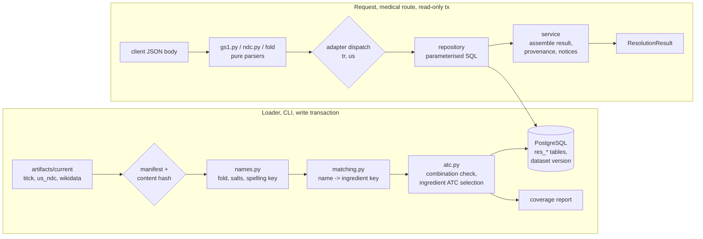
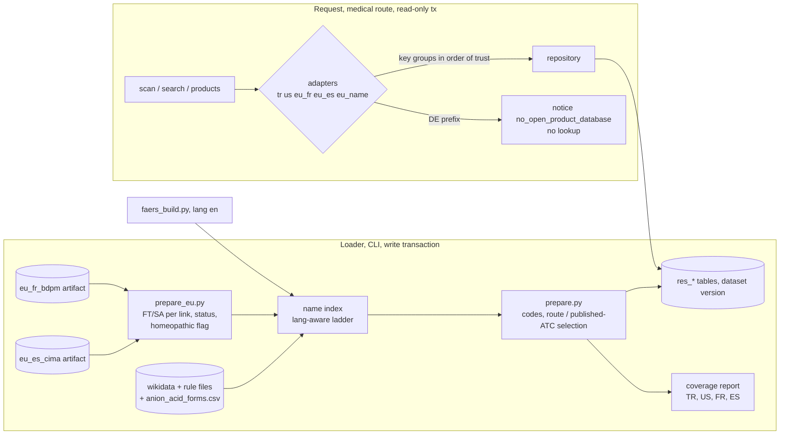

# Design: Drug Resolution, Phase 1 (Türkiye and United States)

> Scope: `apps/api` resolution core, the `tr` and `us` region adapters, the loader that brings the
> `titck`, `us_ndc` and `wikidata_ingredients` artifacts into PostgreSQL, and the resolution
> routes. Two small `pipelines/` changes (§5.1) are needed for the owner's invalid-barcode
> decision. Criteria tagged **[Phase 2: …]** (EU adapters) and **[Client: experience spec]** are not
> designed here; the interfaces they plug into are (§4.1, Req 4.5, 10).
> Owner decisions of 2026-11-07 applied (§9): DP3–DP6, DP9–DP11, DP14, DP15, DP18, DP22
> confirmed; DP19 changed (client sends only AI 01 and 17; the API still drops serial and lot);
> DP20 chosen (route and dosage form in `us_ndc-2`, reviewed route map, §5.5).
>
> **Phase 2 (refined 2026-11-08): §11–§19 below** design the EU adapters (`eu_fr`, `eu_es`,
> `eu_name`), the name rules for French, Spanish and English sources, the coverage comparison, the
> `faers_mapping_gap` decision and the imipenem follow-up. §1–§10 describe Phase 1 and are changed
> only where §11–§19 say so (the Phase 1 sections keep their text; the changes are listed in §12.1).

## 1. Overview


Resolution is a lookup over reference data that was prepared ahead of time. All medical decisions
about identity (which ingredient, which ATC code, is this a combination code) are made by pure
functions **at load time**, over the whole source, and stored with the dataset version. The
request path only parses the input, looks up rows in a read-only transaction and assembles the
result. This makes every mapping measurable (coverage report), reviewable and identical for every
request against the same dataset version.

*Phase 2 (2026-11-08) adds the French and Spanish sources, the name rules and the imipenem pair on the same footing; its design is §11–§19 and its final measurements are in §19.*




Facts checked on 2026-11-07 against the current pipeline artifacts (`.data/artifacts/*/current`)
and public documentation. Coverage figures come from a throw-away prototype of §5.2–§5.5 (not
committed); the loader's coverage report replaces them in task 9.

| Source / topic | Observed | Design consequence |
|---|---|---|
| TİTCK run `20261107T162442Z-0738c719-ab2f` (list of 2026-11-06) | 23,137 input rows → 22,982 output, 155 excluded `invalid_barcode`; 4,355 rows with ≥ 2 ingredients; 52 barcodes on 104 rows; 22,866 rows with an ATC code (116 without) | Every duplicate row is a candidate (§4.3); invalid-barcode rows must be kept by the pipeline as name-only rows (DP9) |
| TİTCK duplicate barcodes | Of 52, 24 differ in ingredient text, 14 in ATC code, 45 in product name; e.g. `8680030190203` is both a ceftriaxone product and "Centella asiatica ekstresi" | Never pick one; show all with their own ingredients |
| TİTCK ATC codes | 21,832 rows have a 7-character code; 1,044 rows carry a malformed or higher-level code (`B05D` 179, `R05X` 140, `A12AX` 63, `S03CA0l` with a letter l, …) | Only `^[A-Z][0-9]{2}[A-Z]{2}[0-9]{2}$` codes can become ingredient codes (§5.4) |
| TİTCK combination products | AMLIPIN `8680199094206`: `amlodipin besilat`, `lisinopril dihidrat`, ATC `C09BB03`. 140 seven-character codes occur on both single- and multi-ingredient rows | Product codes of multi-ingredient products are never ingredient codes (DP2) |
| TİTCK single-ingredient rows that are really combinations | `metformin pioglitazon` (A10BD05), `sitagliptin fosfat monohidrat metformin hidroklorür` (A10BD07), `sodyum aljinatpotasyum bikarbonat` | A single-ingredient row's code is used only if not a combination code; unsplit names are flagged (DP11) |
| TİTCK ingredient strings | 4,550 distinct (3,887 after case folding), 31,826 occurrences; ATC-name fragments as ingredients (`combinations`, `plain`, `various`); commas inside parentheses split one ingredient into three (`inaktif çocuk felci (tip 1`, `2`, `3)`) | These end as `unmapped` with a reason; parenthesis-aware split proposed in the pipeline (DP10) |
| TİTCK barcode prefixes | 869: 17,423; 868: 5,557; 340 (France): 1; 871 (Netherlands): 1 | GS1 prefix is a hint, not a filter: the TR adapter is asked for every 13-digit GTIN (§4.2) |
| Wikidata run `20261107T163917Z-6bb8fcbc-6855` | 3,766 items; labels en 3,757, tr 1,269, de 2,284, fr 2,813, es 2,284; 2,422 items with RxCUI; 4,374 distinct ATC codes, 8.6 % not at 5th level (class items such as "ATC code V09", "antacid"); 440 items with > 1 code; single-substance items also carry combination codes (iron(II) sulfate: `B03AA07`, `B03AD03`) | Class items are not ingredient keys; combination codes are removed from every item (§5.4) |
| Turkish name matching (prototype, §5.3) | Of 4,550 distinct TİTCK strings: Turkish label/alias exact 16.0 % (33.1 % of occurrences); any-language exact +13.3 % (+10.0 %); salt-normalised +16.8 % (+19.5 %); spelling key +7.4 % (+5.5 %); spelling key after salts +4.8 % (+4.5 %). Total 58.3 % of strings, **72.6 % of occurrences**; 76.4 % of products (17,553) fully mapped, 50.7 % of multi-ingredient products (2,208); 44 strings ambiguous | Wikidata Turkish labels alone would map a third of occurrences; the ladder of §5.3 is needed. Tuning targets in DP22 |
| Precision proxy | For 15,117 single-ingredient products with a 7-character code and an unambiguous match, the matched item's codes share the 5-character group with the TİTCK code in 94.3 %. Sampled disagreements are mostly outdated Wikidata codes after WHO changes (axitinib `L01XE17` vs `L01EK01`, pregabalin `N02BF02` vs `N03AX16`, bevacizumab `L01XC07` vs `L01FG01`) | TİTCK's code for a single-ingredient product is preferred over Wikidata's (§5.5) |
| **Measured coverage, task 9** (`prepare_dataset` on the artifacts of 2026-11-07: titck-2 run `20261107T180936Z-0738c719-f9ff`, us_ndc-2 run `20261107T180945Z-941214ac-7657`, reviewed rule files) | TİTCK: 4,502 distinct names, 72.2 % mapped; **83.9 % of 31,885 ingredient occurrences** (DP22 target 85 %: not met); 87.9 % of 23,093 products and 63.8 % of 4,362 multi-ingredient products fully mapped; steps by occurrences: tr_label 10,523, salt 7,789, any_label 3,169, spelling 1,792, spelling+salt 1,656, bridge 1,752, curated 69; not mapped: 4,960 no key (mostly parenteral-nutrition amino acids and electrolytes, vaccine strain fragments, ATC-text fragments such as "combinations"; none has a single-substance item with a code), 133 ambiguous, 42 unsplit. openFDA Rx: **92.6 % of 55,840 products fully mapped** (target 92 %: met), 91.0 % of occurrences, selection 58,646 route_group / 658 all_codes, 256 no code for the route; Rx+OTC 69.7 % (sunscreens, homeopathics). Agreement of Wikidata codes with TİTCK single-ingredient codes: **93.9 %** of 17,426 at the 5-character group; of the 1,062 disagreements, 739 share the 3-character group (typical WHO re-codings such as `L01XE`→`L01EK`), giving 98.2 % if those are counted as re-codings; they are not individually documented, so the DP22 target (≥ 97 % after documented re-codings) is reported as not verified. 383 codes classified as combination codes | Reported, not blocking (DP22). The single-product code wins over Wikidata (DP2), so the 1,062 disagreements do not reach the cascade engine for single-ingredient TİTCK products |
| TİTCK ATC bridge (§5.3 step 5) | Single-ingredient product code → exactly one Wikidata item would map 555 more strings (2,709 occurrences); where both methods map a string they agree on 2,004 of 2,042 (98.1 %) | Offered as a labelled last step (DP5) |
| openFDA run `20261107T162503Z-941214ac-c741` (export 2026-11-06) | 138,262 products; package NDC layouts 5-3-2: 146,115, 5-4-1: 91,786, 4-4-2: 18,355, one malformed (`02` for product `53209-2000`); 256,256 packages → 256,252 distinct 11-digit NDCs (4 collisions); no 10-digit string matches two layouts in this export | 10-digit input still tries all layouts and returns every hit (§4.4) |
| openFDA product types | Rx 57,102; OTC 56,920; bulk ingredient 15,743; drug for further processing 5,691; others < 2,200 | Name search covers finished products only; NDC lookup returns every type, labelled (DP23) |
| openFDA RxCUIs | Product-level (clinical/branded drug) CUIs; 60,504 products have none | Ingredient RxCUIs come from Wikidata P3345 (DP7) |
| US name matching (prototype) | Rx: 2,579 distinct ingredient names, 60.1 % mapped (87.7 % of occurrences), **86.8 % of Rx products fully mapped**; Rx+OTC 70.2 % (sunscreen and homeopathic names). Top unmapped Rx names show salt-list gaps: `OLMESARTAN MEDOXOMIL`, `TRIAMCINOLONE ACETONIDE`, `HYDROCODONE BITARTRATE`, `ESCITALOPRAM OXALATE` | Salt list extended in task 6; coverage reported per product type |
| NDC GTIN | GS1 US: the GTIN-14 in the DSCSA DataMatrix is `003` + 10-digit NDC + check digit; UPC-A is `3` + NDC + check digit ([GS1 US DSCSA guideline R1.3](https://documents.gs1us.org/adobe/assets/deliver/urn:aaid:aem:98200fef-69f9-4b9a-a7e3-8062f55f3dd7/Applying-GS1-System-of-Standards-for-DSCSA-and-Serialized-Interoperable-Traceability-R1-3.pdf)); higher packaging levels use indicator digits 1–8 | `^[0-8]03\d{10}\d$` → NDC10 (§4.4); indicator-digit handling confirmed in task 1 |
| WHO ATC conventions | Combinations within one 4th-level group use 5th-level 20 or 30; combinations outside it use the 50-series; some whole 3rd/4th-level groups are combination groups; different salts usually share one code ([WHOCC ATCvet classification principles](https://www.fhi.no/en/fi/who-collaborating-centre-for-drug-statistics-methodology/atcddd-handbook/atcvet/classification/)) | The numeric rule alone misfires (e.g. single substances numbered above 50 in "other" groups), so the classifier uses a reviewed rule file with exceptions (§5.4) |

## 2. Code layout

```
apps/api/
  janus/
    resolution/
      gs1.py          parse_element_string(), gtin_check_digit(), parse_expiry()      (pure)
      ndc.py          parse_ndc_input(), layouts_of_ndc10(), ndc_from_gtin(), canonical forms (pure)
      names.py        fold(), strip_salts(), spelling_key(), SALT_WORDS, SPELLING_RULES  (pure)
      atc.py          is_ingredient_level(), CombinationRules, is_combination(),
                      ingredient_codes(), select_codes()                                (pure)
      matching.py     NameIndex.build(), map_name(), detect_unsplit()                   (pure)
      canonical.py    content_hash() — same algorithm as pipelines/core/canonical.py   (pure)
      prepare.py      prepare_dataset(sources, rules) -> PreparedDataset, CoverageReport (pure)
      load.py         read artifacts (DuckDB), verify, write one transaction; CLI       (I/O)
      repository.py   read-only parameterised queries                                    (I/O)
      service.py      resolve_scan(), resolve_ndc(), search(), resolve_products()       (core, I/O via repository)
      model.py        Pydantic v2 response and request models
      router.py       POST /resolve/scan, /resolve/ndc, /resolve/search, /resolve/products
    regions/
      base.py         RegionAdapter protocol, ProductKey, AdapterAnswer
      tr/adapter.py   TitckAdapter
      us/adapter.py   OpenFdaNdcAdapter
  migrations/versions/0002_resolution.py
data/
  atc_combination_rules.csv     curated: combination groups, codes, exceptions (DP3)
  route_atc_groups.csv          curated: openFDA route → allowed ATC groups (DP20)
  ingredient_synonyms.csv       curated: published name → QID for names the ladder cannot map (DP5)
tests/
  resolution_strategies.py      GTINs, element strings, NDCs, synthetic sources
  test_gs1_properties.py  test_ndc_properties.py  test_names_properties.py
  test_atc_properties.py  test_matching_properties.py  test_prepare_properties.py
  test_resolution_db_properties.py  test_loader_properties.py  test_resolution_api_properties.py
```

`structure.md` already places adapters in `janus/regions/` and the mapping in
`janus/resolution/`. Medical logic (gs1, ndc, names, atc, matching, prepare) has no I/O, as
`structure.md` requires. New dependency: `duckdb` (already in the stack for FAERS) to read Parquet
in the loader (DP15). No other new runtime dependency.

## 3. Data contracts

### 3.1 Request models (all `extra="forbid"`, strict strings)
| Route | Body |
|---|---|
| `POST /resolve/scan` | `{content: str (1–512 chars), region?: "TR" \| "US"}` |
| `POST /resolve/ndc` | `{ndc: str (1–32 chars)}` |
| `POST /resolve/search` | `{query: str (2–100 chars after trimming), region?: "TR" \| "US", limit?: int 1–20 (default 10)}` |
| `POST /resolve/products` | `{candidate_ids: list[str], 1–50 items, each ^(TR\|US):[a-z_]+:[0-9]{1,9}$}` (re-resolve items the client keeps) |

All four are medical routes (`medical_router()`), so the privacy body policy, `no-store` and the
access-log rules apply unchanged. Codes and names travel only in the body (DP13).

### 3.2 Result model (`ResolutionResult`)
```
dataset_version: str                      # sha256 hex, §6.3
regions_searched: ["TR", "US"]            # adapters actually asked
sources: [SourceRef]                      # source versions searched
scan?: {gtin, expiry: date | null, expiry_status: absent | valid | invalid,
        serial_present: bool, lot_present: bool,
        structural_hint: TR | US | FR | ES | DE | other | none}
notices: [Notice]                         # fixed codes, e.g. source_may_be_outdated,
                                          # region_adapter_not_available, unmapped_ingredients
candidates: [ProductCandidate]            # empty = not found (Req 6.2)

ProductCandidate:
  candidate_id: "TR:titck:<n>" | "US:openfda_ndc:<n>"   # stable within a dataset version
  region, matched_by: barcode | ndc_gtin | ndc | name | candidate_id, score?: float
  product_name, brand_name?, generic_name?, ingredient_text (as published)
  published_atc: str | null               # exactly as published, display only
  product_type?, routes?: [str], dosage_form?, marketing_end_date?, suspension_status?, name_only: bool
  packages?: [{ndc_published, ndc11}]      # US
  ingredients: [ResolvedIngredient]       # published order
  source: SourceRef

ResolvedIngredient:
  position, published_name, strength?
  status: mapped | ambiguous | unmapped
  reason?: no_ingredient_key | possible_unsplit_combination | no_ingredient_atc
           | no_ingredient_atc_for_route
  ingredient_key: {qid, label_en, labels{tr,de,fr,es}} | null
  key_candidates: [qid]                   # ambiguous: all keys of the matching step
  match_step: tr_label | any_label | salt_normalised | spelling_key
              | spelling_key_salt | titck_atc_bridge | curated_synonym | null
  atc_codes: [{code, source: SourceRef, product?: candidate_id}]   # ingredient-level only
  atc_selection: single_ingredient_product | therapeutic_group | anatomical_group | route_group
                 | all_codes | null           # all_codes = not confirmed by product code or route
  rxcuis: [str], rxcui_status: from_wikidata | not_in_wikidata
  source: SourceRef                       # TİTCK/openFDA row the name came from

SourceRef: {source_id, run_id, region | null, snapshot_date}
```
`janus.resolution.model.rule_input(ingredient) -> tuple[str, ...]` returns `atc_codes` codes
only for `status == mapped`, else `()`. This is the only function the cascade engine uses to read
codes (Req 5.4, cascade-engine Req 1.3). Added by `cascade-engine` (2026-11-07), read-only:
`service.rule_inputs(conn, candidate_ids, qids)` re-resolves list items in the request's
transaction (products through the same builder as `resolve_products`, ingredients by QID with all
their codes), `service.current_dataset_id(conn)`, and `repository.combination_codes(conn,
dataset_id)` (the dataset's `res_combination_atc` codes, for the engine's input guard).

### 3.3 Database (migration `0002_resolution`, forward-only, with downgrade)
All tables carry `dataset_id text` and are written only by the loader (Req 9.5).

| Table | Key columns |
|---|---|
| `res_dataset` | `id` (dataset version), `status` (`ready`, `retired`), `inputs jsonb` (source versions, rule hashes, code version), `created_at` |
| `res_current` | singleton row (`one boolean PRIMARY KEY CHECK (one)`), `dataset_id` FK |
| `res_source_version` | `source_id, run_id, region, snapshot_date, snapshot_is_retrieval_time, content_sha256, schema_version, license, source_url` |
| `res_product` | `product_id int`, `region`, `source_id`, names, `ingredient_text`, `published_atc`, `product_type`, `marketing_end_date`, `suspension_status`, `name_only` |
| `res_product_code` | `kind` (`tr_barcode`, `ndc_product9`, `ndc_package11`), `code`, `code_published`, `product_id`; index `(dataset_id, kind, code)` |
| `res_product_ingredient` | `product_id, position, published_name, strength, status, reason, qid, key_candidates text[], match_step, atc jsonb, atc_selection, rxcuis text[], rxcui_status` |
| `res_ingredient` | `qid`, `labels jsonb`, `ingredient_atc jsonb` (code + source), `rxcuis text[]` |
| `res_name` | `name_key`, `display`, `kind` (`product`, `ingredient`), `region`, `ref`; GIN `gin_trgm_ops` index on `name_key` |
| `res_combination_atc` | `code`, `reason` (audit of §5.4 decisions) |
| `res_coverage` | `source_id`, `report jsonb` |

`CREATE EXTENSION IF NOT EXISTS pg_trgm` in the migration (contrib is in the `postgres:16`
image; confirmed in task 1). `unaccent` is not needed: folding happens in Python so the loader and
the request path use the same function (DP8).

## 4. Request path

### 4.1 Region adapters (Req 10)
```python
class RegionAdapter(Protocol):
    region: Region                    # "TR" | "US"  (Phase 2: "EU")
    source_ids: tuple[str, ...]
    def accepts_gtin(self, gtin14: str) -> bool: ...                    # pure
    def keys_from_gtin(self, gtin14: str) -> list[ProductKey]: ...     # pure
    def structural_hint(self, gtin14: str) -> bool: ...                 # pure
    def lookup(self, repo: Repository, keys: list[ProductKey]) -> list[ProductRow]: ...
```
`ProductKey = (kind, code)`. Both adapters return `ProductRow`s with the same ingredient shape;
the service turns rows into `ProductCandidate`s. A Phase 2 adapter adds a class and a
registration line; the service, model and `rule_input` stay unchanged (Req 4.5).

### 4.2 Scan (Req 1)
1. `parse_element_string(content)` (§4.5) → `Gs1Data(gtin14, expiry, expiry_status,
   serial_present, lot_present)`. Errors → 422 with a fixed code (`gs1_unknown_ai`,
   `gs1_duplicate_ai`, `gtin_missing`, `gtin_check_digit`, …). The client sends only (01) and
   (17) (owner decision DP19, `experience`); if serial or lot still arrive, the parser drops
   their values while scanning; `Gs1Data` has no field for them (Req 1.4).
2. Adapters: override given → only that adapter; else every enabled adapter with
   `accepts_gtin` true. TR accepts any GTIN-14 starting with `0` (key = last 13 digits); US
   accepts NDC GTINs (`^[0-8]03\d{10}\d$`) and GTIN-12 UPC-A starting with `3` (padded). Order:
   adapters whose `structural_hint` is true first, then by region code.
3. `structural_hint` for regions without an adapter (GS1 prefixes 300–379 FR, 840–849 ES,
   400–440 DE) adds notice `region_adapter_not_available` with that region; nothing is guessed.
4. Each adapter's lookup returns every matching row (TR: `res_product_code` kind `tr_barcode`,
   which never contains name-only rows).

### 4.3 Duplicates and stable order (Req 2.1, owner decision)
Candidates are sorted by `(adapter order, product_id)`. `product_id` is assigned by the loader
from the row's canonical JSON sort order, so it is stable for a dataset version and independent
of file row order. Nothing is deduplicated: two rows with the same barcode are two candidates.

### 4.4 NDC (Req 3.1, 3.2)
- `parse_ndc_input(s)`: strip spaces, an optional prefix (`NDC`, `NDC:`, `N`, case-insensitive),
  then accept exactly one of: hyphenated 10-digit `4-4-2 | 5-3-2 | 5-4-1`; hyphenated 11-digit
  `5-4-2`; plain 11 digits; plain 10 digits; hyphenated product NDC `4-4 | 5-3 | 5-4`. Anything
  else → 422 `ndc_malformed`.
- Output: a set of lookup keys. Hyphenated 10-digit → one `ndc_package11`; plain 10 digits →
  up to three `ndc_package11` (one per layout); 11 digits → one; product NDC → one
  `ndc_product9` (5-4 padded).
- Canonical package form: pad the 4-digit labeler, 3-digit product or 1-digit package segment
  with one leading zero → 5-4-2 → 11 digits.
- `ndc_from_gtin(gtin14)` → the 10 digits at positions 4–13 → plain 10-digit path.
- The loader indexes every package NDC by its canonical 11 digits (the malformed one is skipped
  and counted) and every product NDC by its 9 digits.

### 4.5 GS1 parsing details (Req 1.1–1.3)
- Input normalisation: remove a leading `]d2` (or `]C1`, `]Q3`); FNC1 and GS (`\x1d`) are
  separators. Parenthesised form: `(AI)value` repeated; it is recognised by a leading `(`.
- AI table (supported): `01` (14, fixed), `17` (6), `11` (6), `15` (6), `16` (6), `10` (≤ 20,
  variable), `21` (≤ 20), `30` (≤ 8), `240` (≤ 30), `241` (≤ 30), `710`–`716` (national
  healthcare reimbursement numbers, ≤ 20). Fixed lengths follow the GS1 predefined-length table;
  in the FNC1 form a variable field ends at GS or end of string. AI list to be confirmed against
  the GS1 General Specifications in task 1.
- `gtin_check_digit(digits13)`: GS1 mod-10 (weights 3,1 from the right). 8-, 12- and 13-digit
  GTINs are left-padded to 14 before the check.
- `parse_expiry(yymmdd, today)`: century by the GS1 rule (difference of YY to today's YY ≥ 51 →
  previous century, ≤ −50 → next century, else current); `DD = 00` → last day of the month;
  invalid month or day → `expiry_status = invalid`, the GTIN is still resolved.

### 4.6 Name search (Req 2.4, 3.3)
1. `key = fold(query)` (§5.2); fewer than 2 characters after folding → 422.
2. SQL (read-only): candidates from `res_name` where `name_key = key` or `name_key LIKE key||'%'`
   or `name_key % key` (pg_trgm), filtered by region when given, `LIMIT 200`, returning
   `similarity(name_key, key)`.
3. `rank(key, rows)` (pure): sort by (exact, prefix, word-prefix, similarity desc, kind
   `product` before `ingredient`, region, ref); keep the first `limit` distinct refs. Ingredient
   hits are returned as candidates of kind ingredient (no product), with all ingredient-level
   codes and `atc_selection = all_codes`.
4. Indexed names: TİTCK product names (including name-only rows), TİTCK ingredient names,
   openFDA brand and generic names of finished products (DP23), Wikidata labels and aliases in
   en and tr (de, fr, es added in Phase 2 with `eu_name`).

### 4.7 Not found, unavailable, staleness (Req 2.2, 6.2, 7.1)
- No `res_current` row, or a needed source missing from the current dataset → 503
  `{"error": "resolution_unavailable"}`. Only with the sources loaded can the result be an empty
  candidate list (HTTP 200, "not found", with `regions_searched` and `sources`).
- `source_may_be_outdated` notice for `titck` or `openfda_ndc` when `today − snapshot_date >
  2 × cadence_days` (the shared freshness rule, `integrity.freshness`; 14 days for the weekly
  sources). The loader stores the cadence from `pipelines/sources.toml` with each source version
  (`res_source_version.cadence_days`, migration `0003`); a missing cadence gives the notice (DP18). The request path makes no external calls (DP6).

### 4.8 Privacy on the request path (Req 8)
- Routes come from `medical_router()`; the database is used through `read_only_tx()`, extended
  to `SET TRANSACTION ISOLATION LEVEL REPEATABLE READ, READ ONLY` so one request sees one
  dataset version even if the loader switches meanwhile.
- No logging in `resolution/` or `regions/` except through `log_event` with allowlisted fields
  (the `log-guard` hook checks on save).
- Validation errors: the resolution routes read the raw JSON body and validate it themselves
  (as the donation routes do), returning `422 {"error": "invalid_request", "fields": [loc…]}`
  without FastAPI's `input` and `ctx` (DP14), so a 422 never echoes a serial or lot back.
  Domain errors use fixed codes (`gtin_check_digit`, `ndc_malformed`, …) and never interpolate
  input. Every result also carries the research-prototype disclaimer (medical-safety rule 9).

## 5. Load-time preparation (pure, `prepare.py`)

### 5.1 Inputs and pipeline changes
Inputs: the current `titck`, `us_ndc`, `wikidata_ingredients` rows and manifests, plus
`data/atc_combination_rules.csv` and `data/ingredient_synonyms.csv`.

Two `pipelines/` changes, both bumping the schema version (they change `data-pipelines`
Req 6.4 and 6.6; that spec is updated in the same task):
- **titck-2, name-only rows (DP9):** a row whose barcode fails the 13-digit/EAN-13 check is
  output with `barcode = null`, `name_only = true` instead of being excluded; metric
  `name_only_rows`. The invalid value is not kept. This is how the owner's decision ("not
  repaired, reachable by name") is implemented: the pipeline currently drops those rows.
- **titck-2, parenthesis-aware split (DP10):** `split_ingredients` ignores separators inside
  `(…)`. The data-pipelines property P12 (all non-separator characters kept) still holds.
- **us_ndc-2, route and dosage form (DP20):** each product also carries `route` (list of
  openFDA route strings, as published, e.g. `["TOPICAL"]`) and `dosage_form` (string, as
  published). They change `data-pipelines` Req 8.3; the pipeline still does not interpret them.

### 5.2 Names (`names.py`, Req 5.3, 5.7)
- `fold(s)`: Unicode NFKC; Turkish-aware lower case (`İ` → `i`, `I` → `i`, `ı` → `i`); NFKD and
  drop combining marks (`ç ğ ö ş ü é` → `c g o s u e`); characters other than `[a-z0-9%+]` →
  space; collapse spaces. All four i's fold to `i`, so `İBUPROFEN`, `ibuprofen` and `Ibuprofen`
  give one key.
- `strip_salts(folded)`: hydrate words and notation (`dihidrat`, `monohydrate`, `.2h2o`) are
  always removed. Other whole tokens in `SALT_WORDS` (Turkish and English salt, ester and
  counter-ion words: `hidroklorur, hcl, besilat, besylate, sodyum, sodium, maleat, tartarat,
  bitartrate, medoxomil, cilexetil, mofetil, …`) are removed unless that would leave nothing or
  only words in `NOT_ALONE` (inorganic anions such as carbonate, oxide, fluoride, edetate; bare
  metals such as zinc, iron, silver, lithium; alkyl words); then the hydrate-free name is kept.
  This keeps sodium vs potassium bicarbonate, zinc acetate vs zinc gluconate and sodium calcium
  edetate vs edetate disodium apart (pharmacologist review, 2026-11-07). Never salt words:
  furoate, butylbromide, mono-/di-/trinitrate, disoproxil, alafenamide (they distinguish
  substances).
- `spelling_key(folded)`: whole-token rewrites first (`ii→2`, `iii→3`, `iv→4`, `asit→acid`, so
  iron(II) and iron(III) stay apart and Turkish "asit" meets "acid"); remove spaces; rewrite
  `ph→f, th→t, ch→k, x→ks, qu→k, c(before e,i,y)→s, c→k, y→i, z→s, w→v, ae→e, oe→e`; collapse
  repeated letters; drop a final `e`; final `d→t` (Turkish devoicing); repeat until nothing
  changes. Examples: `siprofloksasin`/`ciprofloxacin`, `dekzametazon`/`dexamethasone`,
  `klorpromazin`/`chlorpromazine`, `ketiapin`/`quetiapine`,
  `hidroklorotiyazit`/`hydrochlorothiazide`.
- All three are idempotent (P6). `RULES_VERSION` = hash of the word lists and rewrite rules; it is
  part of the dataset version (Req 5.7).

### 5.3 Name → ingredient key ladder (`matching.py`, Req 2.5, 5.3)
`NameIndex.build(wikidata_rows, synonyms)` keeps only items with at least one ingredient-level,
non-combination code (class items drop out). Keys per item: folded label and aliases, by language.
`map_name(published_name, index, titck_bridge)` stops at the **first** step with a hit. Within a
step, keys hit through an item's label win over keys hit only through aliases (Wikidata aliases
are loose: esomeprazole lists "omeprazole", L-thyroxine lists "levothyroxine sodium"):

| Step | Lookup | Label |
|---|---|---|
| 0 | curated synonym (exact folded name) | `curated_synonym` |
| 1 | folded name = a Turkish label/alias | `tr_label` |
| 2 | folded name = a label/alias in any language | `any_label` |
| 3 | `strip_salts(name)` = a folded (salt-stripped) label/alias | `salt_normalised` |
| 4 | `spelling_key(name)` = spelling key of a label/alias | `spelling_key` |
| 5 | `spelling_key(strip_salts(name))` | `spelling_key_salt` |
| 6 | TİTCK ATC bridge: the salt-normalised name occurs on single-ingredient rows whose valid, non-combination code belongs to exactly one item (DP5) | `titck_atc_bridge` |

One key at the first hit → `mapped` (subject to §5.5); several keys → `ambiguous` with all
`key_candidates`. With no hit in steps 0–5, `detect_unsplit` (below) runs **before** step 6, so a
name naming two substances is never mapped through a product code; else step 6; else
`unmapped/no_ingredient_key`. The result depends only on the set of index entries, not their
order (P16). The bridge is keyed by the salt-normalised name, so a salt form on a single product
and the plain name in a combination meet (P5 counterexample, task 8).

`detect_unsplit(name)`: if the folded tokens can be split into two or more consecutive spans that
each map (steps 1–3) to different keys, the ingredient is `unmapped/possible_unsplit_combination`
and the span keys are reported for review; it is not split automatically (DP11).

US names (`AMLODIPINE BESYLATE`) use the same ladder; step 1 and step 6 do not apply.

### 5.4 ATC codes and combination check (`atc.py`, Req 5.1, 5.2)
- `is_ingredient_level(code)`: `^[A-Z][0-9]{2}[A-Z]{2}[0-9]{2}$`.
- `CombinationRules` from `data/atc_combination_rules.csv` (`pattern, kind, note`), `kind` ∈
  `combination_group` (an ATC prefix of 3–5 characters, e.g. `C09B`, `C09D`, `C10B`, `A10BD`,
  `R03AK`, `R03AL`, `B03AD`, `J01CR`, `J05AR`), `combination_code` (one 7-character code),
  `exception` (a 5-character group or a code where the numbering rule does not mean
  "combination", e.g. single substances numbered above 50 in an "other agents" group). The file
  holds codes and Janus notes only (no WHO text); first version drafted by the pharmacologist
  agent and confirmed by the owner (DP3).
- `is_combination(code, rules, observed)`, in this order: exception → `False`; combination group
  or code → `True`; 5th-level number 20, 30 or 50–79 → `True`; code observed as the product code
  of a TİTCK product whose ingredients map to ≥ 2 distinct keys **and** not a code of any
  Wikidata item → `True`; else `False`. Every `True` is written to `res_combination_atc` with its
  reason; numbering-rule hits on items whose only code it is are listed in the coverage report
  for review.
- `ingredient_codes(qid)` = { Wikidata codes of the item that are ingredient-level and not
  combination } ∪ { codes observed on TİTCK single-ingredient rows mapped unambiguously to the
  item, ingredient-level, not combination, row not flagged unsplit }, each with its source.

### 5.5 Selecting codes for an ingredient in a product (`select_codes`, Req 5.1)
Let `S = ingredient_codes(qid)` and `p` the product's published code.

| Case | Selected | `atc_selection` |
|---|---|---|
| product has one ingredient, `p` ingredient-level and not combination | `[p]` (TİTCK's code wins over outdated Wikidata codes) | `single_ingredient_product` |
| otherwise, codes in `S` with the same first 3 characters as `p` | those | `therapeutic_group` |
| otherwise, codes in `S` with the same first character as `p` | those | `anatomical_group` |
| US product with ≥ 1 route in the route map (DP20) | codes in `S` allowed for any of its routes | `route_group` |
| US product, routes mapped, no code in `S` allowed | none → `unmapped/no_ingredient_atc_for_route` | `null` |
| otherwise (no `p` and no mapped route) | all of `S` | `all_codes` |
| `S` empty | none → `unmapped/no_ingredient_atc` | `null` |

The first four rows apply to products with a published code `p` (TİTCK); the route rows apply to
products without one (openFDA). A route string not in the map counts as unmapped; a product
with several routes allows the union of their groups.

**Route map (`data/route_atc_groups.csv`, DP20).** Columns `route, allow, note`: `route` is an
openFDA route string as published; `allow` is a `;`-separated list of ATC prefixes (1–5
characters) that a product given by that route may carry. Examples of the intent: `TOPICAL` →
dermatological `D` plus topical groups in other chapters (e.g. `M02`, `C05`); `OPHTHALMIC` →
`S01`; `ORAL` → systemic chapters, not `D` or `S`. `allowed(code, routes, map)` is pure: true
iff some prefix of a mapped route is a prefix of the code. Drafted by the pharmacologist agent
from the route values in the openFDA export, reviewed by the owner; part of the dataset version.

AMLIPIN (`C09BB03`): amlodipine `S = {C08CA01}` → no `C09` code → anatomical `C` → `C08CA01`;
lisinopril `S = {C09AA03}` → therapeutic `C09` → `C09AA03`. A final guard in `prepare` raises
`CombinationCodeLeakError` if any selected code is a combination code (Req 5.2, fail loudly).

### 5.6 Coverage report (Req 5.6)
Per source (`titck`, `openfda_ndc` by product type): distinct names and occurrences mapped (total
and per ladder step), ambiguous and unsplit counts, products fully mapped (all and
multi-ingredient), `atc_selection` distribution, unmapped top 50 names with counts, agreement of
`ingredient_codes` with TİTCK single-ingredient codes (5-character group), combination
classifier decisions by reason. Stored in `res_coverage` and written to
`$JANUS_DATA_DIR/resolution/coverage-<dataset>.json` (never into the repository; it contains
TİTCK names).

## 6. Loader (`load.py`, Req 9)

### 6.1 Steps
```
for each source: read current/manifest.json + evidence_source.json; outcome must be succeeded
                 (or promoted needs_review); rows.parquet via DuckDB
                 content_hash(rows) == manifest.content_sha256, else refuse      Req 9.1
dataset_version = sha256(sorted source content hashes, RULES_VERSION,
                         sha256 of the two data/ files, prepare code version)    Req 9.4
if dataset_version == current: exit 0 (nothing to do)
prepared = prepare_dataset(...)                                                  pure, §5
one write transaction:
  insert res_dataset, res_source_version, all res_* rows (COPY)
  update res_current -> new dataset
commit                                                                           Req 9.2
second transaction: retire and delete datasets older than the previous one
```
A crash or error before commit leaves `res_current` and its rows untouched (PostgreSQL
atomicity). All artifacts are verified before anything else, even when the dataset version is
already current. Implementation notes (task 10): every `res_*` table cascades from
`res_dataset`, so retiring a dataset is one DELETE; the real load of 2026-11-07 (161,399
products, 417,499 codes, 252,123 ingredient rows, 234,383 names) takes about 75 s; an unchanged
reload only re-verifies hashes. Each ingredient's codes are cited once per code, a code observed
on a TİTCK product before the same code from Wikidata. The previous dataset is kept so a bad load can be undone with
`python -m janus.resolution.load --activate <dataset>`. CLI: `python -m janus.resolution.load
[--data-dir PATH]`; needs `DATABASE_URL`. Logs: `LogEvent.resolution_load` with counts and the
dataset version only.

### 6.2 Content hash
`canonical.py` re-implements the 20-line canonical serialisation of `pipelines/core/canonical.py`
(the API image does not include the pipelines project). A golden test vector (fixed rows → fixed
hash) is asserted in both test suites so the two cannot drift (DP15).

### 6.3 Who may write
The loader uses `write_tx()`. The import-boundary test from the privacy spec is extended to allow
exactly `contributions/repository.py` and `resolution/load.py` (DP16).

## 7. Testing strategy

- **Property tests (Hypothesis)**, §8, one test per property tagged `Feature: drug-resolution,
  Property Pn` with its requirement. Profiles `dev` (100) / `ci` (300, `derandomize=True`);
  database-backed properties 50 / 100, as in the privacy spec.
- **Synthetic sources.** `resolution_strategies.py` builds TİTCK-like rows (duplicate barcodes,
  name-only rows, combination products with combination codes, malformed codes, salts, unsplit
  names), openFDA-like products (all three NDC layouts, multi-ingredient), and Wikidata-like items
  (labels in several languages, class items, combination codes). No TİTCK data is committed.
- **Fixtures.** A small CC0 sample of openFDA and Wikidata rows may be committed under
  `tests/fixtures/` with source and date (DP21). The AMLIPIN example uses a synthetic TİTCK row
  with AMLIPIN's published fields plus the real Wikidata items for amlodipine and lisinopril.
- **Real artifacts (local only).** `test_real_artifacts.py` runs when `JANUS_DATA_DIR` has
  current artifacts and is skipped in CI: AMLIPIN resolves as in Req 5.2; the 52 duplicate
  barcodes return 104 candidates; the name-only rows are found by name; coverage numbers are
  printed.
- **Database.** `db` tests against PostgreSQL 16 (`JANUS_TEST_DATABASE_URL`), unskippable in CI
  (privacy DP19). Each example loads a small synthetic dataset through the real loader.
- **Privacy harness.** `assert_stateless()` and the sentinel log capture from
  `tests/harness.py` are reused for the four routes.
- **CI.** The existing `api` job runs the new tests; the `pipelines` job runs the titck-2 tests.

## 8. Correctness properties

| # | Property (for all …) | Validates | Hypothesis approach |
|---|---|---|---|
| P1 | **Separator invariance.** For any set of supported AIs and values, the FNC1 form (with or without `]d2`, any AI order) and the parenthesised form parse to the same `Gs1Data`. | Req 1.1 | Build the field set first, render both forms. Original property. |
| P2 | **Check digit.** For any valid GTIN-14 and any change of one digit or swap of two adjacent different digits, parsing is rejected with `gtin_check_digit`; valid GTIN-8/12/13 padded to 14 are accepted. | Req 1.2 | `st.integers` digit strings + computed check; single-digit mutations. Original property. |
| P3 | **Round trip.** For any (GTIN, expiry, lot, serial), building an element string and parsing it gives the same GTIN and expiry, and `serial_present`/`lot_present` true. | Req 1.1, 1.3 | Lot/serial over the GS1 character set 82, incl. `(` and `)` in the FNC1 form. Original property. |
| P4 | **NDC canonical form.** For any 10-digit NDC in any layout, its hyphenated form, its 11-digit form (with and without hyphens) and its label-prefixed forms all give the same canonical 11-digit key. | Req 3.2 | Layout + digits → render variants. Original property. |
| P5 | **Decomposition invariance.** For any synthetic source with a combination product P = A + B (any combination code) and single-ingredient products A and B, P's ingredients have the same ingredient keys as A and B; each ingredient's codes in P are a subset of its `ingredient_codes`; when an ingredient has exactly one code, P and the single product give that same code. | Req 5.1 | Generated items, products and codes; combination code from the rule file or the numbering rule. Original property. |
| P6 | **Idempotent normalisation.** For any text, `fold`, `strip_salts∘fold` and `spelling_key∘fold` are idempotent, and `strip_salts` never returns an empty string for non-empty input. | Req 5.3 | Text over Turkish, Latin-1 and Greek letters, digits, `%`, `+`, salt words. Original property (extended). |
| P7 | **No combination code leaks.** For any synthetic source, no `atc_codes` entry of any ingredient (and nothing returned by `rule_input`) is a combination code; possible unsplit names never carry their product's code; `prepare` raises if a leak is forced by a test double. | Req 5.2 | Products with combination codes on single-ingredient rows, items carrying combination codes, unsplit names. Original property. |
| P8 | **Determinism.** For any input to any route, resolving twice against the same dataset version gives byte-identical JSON; loading the same artifacts twice gives the same dataset version and product ids. | Req 7.3, 9.4 | DB-backed; two loads into fresh databases. Original property. |
| P9 | **Expiry.** For any YYMMDD, `DD = 00` gives the month's last day, valid dates round-trip, impossible ones give `invalid` while the GTIN still resolves, and the century follows the GS1 rule for any `today`. | Req 1.3 | `st.dates()` for today; compare with a reference using `calendar.monthrange`. |
| P10 | **Serial and lot never leave the parser.** For any element string carrying sentinel serial and lot values, sent to `/resolve/scan` valid or invalid, neither value appears in the response body or headers, in any log output, or in the database. | Req 1.4, 8.3, 8.4 | Sentinels from `tests/sentinels.py`; also invalid strings that trigger 422. |
| P11 | **NDC GTIN round trip.** For any 10-digit NDC and indicator digit 0–8, building the NDC GTIN and extracting gives the same 10 digits, and the lookup keys contain the original's canonical form. | Req 3.1 | Layout + digits + indicator; check digit computed. |
| P12 | **NDC input domain.** For any string, `parse_ndc_input` accepts it iff it is one of the listed forms after prefix and space removal; accepted plain 10 digits give 1–3 keys; everything else → `ndc_malformed`. | Req 3.2 | Valid forms plus near misses (wrong segment lengths, letters, 9/12 digits). |
| P13 | **All candidates.** For any source where a product key occurs on n ≥ 1 rows, the lookup returns exactly those n rows, in `product_id` order, for every input form that maps to that key. | Req 2.1, 3.1, 6.2 | DB-backed synthetic loads with duplicate barcodes and colliding NDCs. |
| P14 | **Name-only rows.** For any source with name-only rows, no scan or barcode lookup returns them, and a search for the exact product name returns them. | Req 2.3 | DB-backed; name-only rows whose names equal, prefix or differ from normal rows. |
| P15 | **Search invariance.** For any query, case changes, Turkish `İ/I/ı/i`, and diacritic variants give the same result; `rank` is independent of the input order of candidate rows; results never exceed `limit`. | Req 2.4, 3.3 | Pure `rank` with permuted rows; DB-backed search with shuffled insert order. |
| P16 | **Matching ladder.** For any index and name, `map_name` returns the first step with a hit (label hits before alias hits within a step); several keys at that step → `ambiguous` with exactly those keys; the result is independent of index entry order; a name formed by two known names with no separator is `possible_unsplit_combination`. | Req 5.3 | Generated items and names built to hit a chosen step. |
| P17 | **Ingredient codes are well formed and belong to the ingredient.** For any synthetic source, every emitted code matches the 7-character pattern and is in `ingredient_codes(qid)` of its own ingredient; malformed published codes (`B05D`, `S03CA0l`) never appear in `atc_codes`. | Req 5.1 | Published codes from a strategy mixing valid, short and malformed codes. |
| P18 | **Unmapped stay visible.** For any product, the ingredient list has one entry per published ingredient, in published order; every non-`mapped` entry has a reason or key candidates and contributes nothing to `rule_input`. | Req 5.4 | Names designed to fail at each stage. |
| P19 | **Not found only when loaded.** For any input, with no current dataset (or a needed source missing) the route answers 503 `resolution_unavailable`; with sources loaded and no match it answers 200 with no candidates and the searched sources. | Req 6.2, 7.1 | DB-backed; empty, partial and full loads. |
| P20 | **Provenance.** For any result, every `SourceRef` (result, candidate, ingredient, ATC code) is one of the current dataset's source versions, and the result's `dataset_version` is current. | Req 7.2 | DB-backed over generated loads and queries. |
| P21 | **Adapter dispatch.** For any GTIN and override, with an override only that adapter is asked; without one, exactly the enabled adapters whose `accepts_gtin` is true are asked, hinted ones first. | Req 1.5 | Stub adapters recording calls; GTINs from TR, US, FR, ES, DE prefixes. |
| P22 | **Stateless routes.** For any request to the four routes, the database snapshot and temp directory are unchanged, the response has `no-store`, and no input value appears in any log output. | Req 8.1–8.3 | `assert_stateless()` and sentinel capture from the privacy harness. |
| P23 | **Atomic load.** For any sequence of loads (success, hash mismatch, failure injected at any table, crash before commit) the API serves either the previous or the new dataset completely, never a mix; a refused artifact changes nothing. | Req 9.1, 9.2 | `RuleBasedStateMachine`; invariant: all `res_*` rows reachable from `res_current` belong to one dataset with all its sources. |

| P24 | **Route-based selection (DP20).** For any synthetic US product, item codes and route map: if some route is mapped, every selected code is allowed for one of the product's routes and an ingredient with no allowed code is `unmapped/no_ingredient_atc_for_route` (never falls back); if no route is mapped, all `ingredient_codes` are selected with `all_codes`; the result does not depend on the order of routes or map rows. | Req 5.1, 5.4 | Routes drawn from the map and from unmapped strings; codes inside and outside the allowed prefixes. |
| P25 | **Homeopathic products (owner decision 2026-11-07).** For any strength, `is_homeopathic_strength` is true exactly for homeopathic units (`[hp_X]`, `[hp_C]`, `[hp_M]`, `[hp_Q]`, `[kp_C]`, any case); ordinary units and missing strengths are not; a product is homeopathic iff any ingredient strength is. | Req 11.1 | Numbers, units and per-units; lists of strengths. Cascade-engine P23 checks that such products never contribute to a finding. |
| P26 | **Curated Janus keys (owner decision 2026-11-07).** The committed file parses; malformed keys, codes, labels, dates and repeated keys are refused naming the row only; a key's names map to it (not to the parent substance's item) with its own code, cited to the TİTCK product when one publishes it and otherwise to `janus_curated`; through the database the key is stored, searchable and cites the curated source version; migration 0006 is reversible. | Req 11.2, 11.3 | Example-based and Hypothesis tests in `test_resolution_curated_properties.py`. |

P1–P8 are the eight original properties; P9–P23 were added in the refinement; P24 follows the
owner's DP20 decision.

## 9. Decisions

| # | Decision | Alternatives considered | Why |
|---|---|---|---|
| DP1 | Phase 1 builds `tr` and `us`; EU criteria are tagged and their interfaces kept (Req 4.5, 10). | All regions now. | PLAN.md Phase 1 scope. |
| DP2 | Ingredient ATC codes come from the ingredient key (Wikidata) and from TİTCK single-ingredient products of that key; a multi-ingredient product's code is never an ingredient code; a single-ingredient product's own code is preferred when valid and not a combination code. | Use TİTCK product codes directly; Wikidata only. | TİTCK combination products have one combination code; Wikidata codes are partly outdated (94.3 % group agreement, disagreements mostly WHO re-codings). |
| DP3 | Combination codes are decided by one function: reviewed rule file (groups, codes, exceptions) + WHO numbering rule + observation on TİTCK multi-ingredient products; the first rule file is drafted by the pharmacologist agent. **Confirmed by the owner.** | Numbering rule only; list of all combination codes from the WHO index. | The numbering rule misfires in "other agents" groups; the WHO index is licence-restricted; a short file of codes is reviewable. |
| DP4 | Selecting among an ingredient's codes inside a product: own code (single-ingredient) → same 3-character group as the product code → same anatomical group → all codes (§5.5). **Confirmed by the owner.** | Always all codes; always the first code. | Keeps route-specific codes (e.g. topical vs systemic corticosteroid) apart where the product code tells us; never invents a code. |
| DP5 | Name ladder of §5.3 with two optional steps: the TİTCK ATC bridge (step 6, +555 strings, 98.1 % agreement where both apply) and a curated synonym file (step 0) for frequent names the ladder misses. Both labelled in `match_step`. **Confirmed by the owner.** | Ladder without them; fuzzy (trigram) matching at load time. | Fuzzy matching would map look-alike names wrongly (e.g. different -olol drugs); the bridge and the curated file are exact and reviewable. |
| DP6 | No external calls on the request path in Phase 1: openFDA NDC and Wikidata come from pipeline artifacts in PostgreSQL; RxNav `approximateTerm` is not called. **Confirmed by the owner.** | Live RxNav/openFDA search. | A live call would send the user's typed medicine name from our server to NLM/FDA and adds an outage path; local data is versioned and testable. |
| DP7 | RxCUIs from Wikidata P3345 only in Phase 1; `rxcui_status = not_in_wikidata` otherwise. RxClass enrichment, if wanted, becomes a pipeline later. | RxClass at request time. | Same as DP6; 2,422 of 3,766 items already have an RxCUI. |
| DP8 | Folding (Turkish i's, diacritics) in Python; trigram index on the folded key; `unaccent` not used. | PostgreSQL `lower()` + `unaccent`. | One implementation for loader and queries, property-tested; PostgreSQL's `lower()` depends on the collation for `İ/I`. |
| DP9 | `titck-2`: invalid-barcode rows are output as name-only rows (`barcode = null`) instead of excluded; `data-pipelines` Req 6.4 changes accordingly. **Confirmed by the owner.** (this implements your decision). | Separate side file of excluded rows. | The current pipeline drops those 155 rows, so they cannot be found by name otherwise; one artifact keeps row accounting simple. |
| DP10 | `titck-2`: ingredient split ignores separators inside parentheses. **Confirmed by the owner.** | Keep splitting; repair in resolution. | `inaktif çocuk felci (tip 1, 2, 3)` currently becomes three ingredients; one rule in one place (data-pipelines DP7). |
| DP11 | Names that look like two ingredients without a separator (`metformin pioglitazon`) are `unmapped/possible_unsplit_combination` and shown, not split automatically. **Confirmed by the owner.** | Split automatically into the found keys. | Splitting is a guess about a regulator's text; the user sees the notice and the doctor note can still list the product. |
| DP12 | Ambiguous names return all keys and are excluded from rule matching until the user picks one (client, `experience`). | Pick the most frequent key. | "Never guess." 44 TİTCK strings in the prototype. |
| DP13 | All resolution routes are `POST` with JSON bodies; codes and names never in URLs. | `GET /resolve/{code}`. | URLs end up in proxy logs (Caddy, Phase 5) and browser history. |
| DP14 | 422 responses of medical routes drop FastAPI's `input`/`ctx` fields (privacy design §4.4 kept them). **Confirmed by the owner.** | Keep the default body. | A rejected scan would echo the serial number back; the client does not need it. |
| DP15 | Loader in `apps/api` (`python -m janus.resolution.load`), reading Parquet with DuckDB; canonical hash re-implemented with a shared golden vector. **Confirmed by the owner.** | Loader in `pipelines/` with psycopg; `pyarrow`. | DuckDB is already in the stack (FAERS); the loader needs the API's models and migrations. |
| DP16 | One write transaction per load plus a `res_current` pointer; previous dataset kept for `--activate`; request reads in `REPEATABLE READ, READ ONLY`; `write_tx` allowed in `resolution/load.py`. | Table swap by rename; materialised views. | PostgreSQL atomicity gives P23 without custom code; ~1 M rows is a small transaction. |
| DP17 | Dataset version = hash of source content hashes, rule version, curated-file hashes and prepare code version. | Timestamp. | Same inputs → same version (P8); any rule change is visible. |
| DP18 | Staleness notice when TİTCK or openFDA data is older than twice its cadence (14 days for the weekly sources). **Confirmed by the owner.** *(2026-11-07, owner decision `evidence-integrity` DP17: the rule is the shared freshness rule and the cadence comes from `pipelines/sources.toml`; no constant in `resolution/`.)* | No notice; 7 days. | The weekly schedule only starts in Phase 5; users should see the list date. |
| DP19 | **Owner decision:** the serial identifies a single box and must not leave the device. The client sends only AI (01) and (17) (`experience`); the API parser still drops serial and lot if they arrive (defence in depth) and never logs or returns them. **Updated 2026-11-08 (owner):** the client may also send AI (712), a national product reimbursement number (not a serial, not a person identifier), so the allowed set is exactly (01), (17), (712); and the API **rejects** an element string that carries AI (21) with 422 `gs1_serial_not_accepted` instead of dropping it (lot (10) is still read only to find the field end and dropped). | API-only stripping (proposed). | Data minimisation at the source; rejection tells a defective client early and keeps the serial out of every code path. |
| DP20 | **Owner decision:** add `route` and `dosage_form` to `us_ndc` (`us_ndc-2`) and a small reviewed route → ATC-group map (§5.5); selection `route_group`; no allowed code → `unmapped/no_ingredient_atc_for_route`, never a fallback to another route's codes; route missing or unknown → `all_codes`. | No route context in Phase 1 (proposed default). | A US betamethasone cream must not carry the systemic `H02AB01` into the cascade engine. |
| DP21 | TİTCK test data is synthetic; small CC0 openFDA/Wikidata fixtures may be committed; real-artifact tests are local only. | Commit a TİTCK sample. | Licence (data-pipelines DP12). |
| DP22 | Coverage targets, reported and not test-blocking: TİTCK ≥ 85 % of ingredient occurrences mapped, US Rx ≥ 92 % of products fully mapped, ≥ 97 % group agreement after excluding documented WHO re-codings. **Confirmed by the owner.** | Hard CI gates. | The numbers depend on source data that changes weekly; the report makes regressions visible. |
| DP23 | Name search covers finished products (Rx, OTC, vaccines, plasma derivatives, cellular therapy, allergenics); NDC lookup returns every product type, labelled. | Index everything. | Bulk ingredients (15,743) and "for further processing" (5,691) are not in patients' homes and would crowd results. |
| DP24 | **Owner decision 2026-11-07:** a product with any ingredient strength in homeopathic units is `homeopathic`, computed on the request path from the stored strengths (no new column); the cascade engine and the coverage report leave it out. | Per-ingredient exclusion; a stored column. | Homeopathic dilutions are not the substance; of 135,688 openFDA products 13,481 are homeopathic and only 44 mix units, so a product-level flag loses nothing real. |
| DP25 | **Owner decision 2026-11-07:** curated Janus ingredient keys `J<n>` (`data/janus_ingredients.csv`) for substances that no Wikidata item covers with a code; migration `0006` widens the key check; `janus_curated` is a source version of the dataset. First key: dimenhydrinate (`R06AA11`). | Map to the parent substance (diphenhydramine); invent a Wikidata-looking id. | Keeps the substance's own code and classes; a separate prefix can never collide with a real Wikidata item. Donations still accept QIDs only (privacy spec); a donation naming a J key is refused loudly (follow-up). |

## 10. Open items
- Owner decisions of 2026-11-07: DP3 (approach), DP4, DP5 (both optional steps), DP6, DP9,
  DP10, DP11, DP14, DP15, DP18, DP22 confirmed; DP19 and DP20 decided as recorded in §9.
- Still to review: the first `data/atc_combination_rules.csv` (DP3, shown to the owner after
  task 7) and `data/route_atc_groups.csv` (DP20).
- Task 1 checks (2026-11-07): `pg_trgm` 1.6 is available in `postgres:16` (16.15); `duckdb`
  2.0.0 ships cp312 abi3 wheels for manylinux x86_64 and aarch64; AI 715 (NHRN, US FDA NDC) was
  added by GS1 change notice GSCN 21-289 (Dec 2021), AIs 710–716 are taken as variable length
  ≤ 20; NDC GTINs are matched as `^[0-8]03\d{10}\d$`, which covers UPC-A padded to 14 digits.
- Later, not in Phase 1: the FDA final rule of 2026-03-05 (Federal Register 2026-04368) moves
  all NDCs to a 12-digit 6-4-2 format from 2033-03-07; existing NDCs get leading zeros, so the
  12-digit form of an existing NDC is `0` + its canonical 11 digits. Accepting it is a small
  addition to `parse_ndc_input` when labels start to change.
- `cascade-engine` must read codes only through `rule_input`, and treat `atc_selection =
  all_codes` as less specific (recorded there when that spec is refined).
- `data-pipelines` Req 6.4, 6.6 and 8.3 change with DP9, DP10 and DP20 (updated in task 5).
- Phase 2: `eu_fr`, `eu_es`, `eu_name` adapters; de/fr/es labels in the name index. *(Changed
  2026-11-08: "CIMA calls under the HTTP policy" is dropped; Spanish data come from the
  Nomenclátor artifact, DP27.)* Designed in §11–§19.
- **Phase 2 inputs recorded 2026-11-08 (from `data-pipelines` Phase 2).**
  `eu-code-encodings.md` in this folder records how the DataMatrix carries the CIP13 (GTIN-14 =
  `0` + CIP13) and the Spanish national code (NTIN `0847000` + CN + check digit, or GTIN + AI
  712), with sources and what is not verified. The pipelines `eu_fr_bdpm` and `eu_es_cima` will
  supply `cip13`, and `cn`, `ntins`, `gtins` as published (Req 11, 12 there).
  BDPM compositions have `FT` (therapeutic fraction) and `SA` (salt form) lines linked by number;
  take the `FT` name where a link has one. French and Spanish substance names are in the
  languages' own salt and word-order forms (`CHLORHYDRATE DE METFORMINE`, `CLAVULANICO ACIDO`),
  so Phase 2 salt rules are needed for them.
- **FAERS name coverage (2026-11-08).** The US ladder maps 84.0 % of FAERS ingredient occurrences
  (80.5 % in suspect roles). The count builder of `data-pipelines` reuses the ladder through a
  `build_name_index()` extracted from `prepare_dataset` (that spec's task 24, no behaviour
  change). **Follow-up item (owner decision 2026-11-08: not now; taken up later on
  2026-11-08 together with the EU work: Req 12, §15).** Candidate rules for pharmacologist review,
  whose coverage impact the FAERS coverage report logs: FDA's four-letter biologic suffix
  (`INFLIXIMAB-DYYB`), `MYCOPHENOLATE MOFETIL`, single parts of combination strings (`CARBIDOPA`).
- **Follow-up from `cascade-engine` (owner decision 2026-11-07):** imipenem is marketed only with
  cilastatin, and its only code is the combination code `J01DH51`, so the imipenem ingredient has
  no ingredient-level code and cannot match the carbapenem rule (PIPC row 58). Give the imipenem
  ingredient an ingredient-level carbapenem code (reviewed, e.g. through the curated files) in a
  later drug-resolution task. *(Update 2026-11-08: WHOCC lists no code for imipenem alone, so the
  premise fails; Req 14 and §19 O1 give the options. Waits for the owner.)*

### Follow-up recorded 2026-11-08: `faers_mapping_gap` (from `collective-memory`)
**Decided 2026-11-08 (DP36): the table is not built.** Measured numbers in §11 and §16.3; the
original text follows for the record.

The owner deferred the optional table `faers_mapping_gap(ingredient_key, reports_in_candidate_spellings)` to the EU and name-rules work of this area. It would list, per ingredient, reports that leak through candidate name rules the FAERS builder already counts (biologic suffix, salt forms, parts of combination strings), so that a Collective Memory response can say `mapping_gap_possible`. Take it up together with the FAERS name rules (`data-pipelines` design, open item 3), because both change which spellings map to an ingredient key; decide the table in `data-pipelines` and the response field in `collective-memory` then (design §8.2 there). Nothing in Phase 2 depends on it.

---

# Phase 2 (refined 2026-11-08): EU adapters and name rules

## 11. Overview and facts checked

Phase 2 adds three things to a request path and a loader that already work: **EU product lookup**
from two open-data artifacts that sit in PostgreSQL like TİTCK and openFDA; **name rules** so that
the French, Spanish and English spellings of one substance reach one ingredient key; and the
**measurements** that show what the rules do. Medical decisions stay at load time in pure
functions; the request path stays a read-only lookup with no external call (DP6, DP27).



Facts checked on 2026-11-08 against the current artifacts (BDPM snapshot 2026-11-03, Nomenclátor
2026-11-07, FAERS snapshot 2026-10-28, Wikidata run `20261107T163917Z-6bb8fcbc-6855`) with the committed
rule files, by throw-away scripts that are not committed (scratch copies in `/tmp/janus_probe`).
Rule candidates are measured with prototypes of §15; the final figures come from the code in
task 24, and Req 13 compares them with these baselines.

| Topic | Observed | Design consequence |
|---|---|---|
| Phase 1 baselines (design §1, task 9) | TİTCK 83.9 % of 31,885 ingredient occurrences, 87.9 % of 23,093 products fully mapped; openFDA Rx 92.6 % of 55,840 products fully mapped, 91.0 % of occurrences | Req 13.4 floors for TR and US |
| **Baseline snapshot 2026-11-08** (`coverage_snapshot snapshot --label baseline`, task 15; the Phase 1 code on the current artifacts and the 102 reviewed synonyms; it also equals the same run with all Phase 2 rule data off, task 18.8) | TİTCK: 4,502 names, 31,885 occurrences, **84.6 %** mapped, **88.5 %** of 23,093 products fully mapped (4,362 multi-ingredient: 2,895 fully mapped). openFDA: Rx 65,160 occurrences **91.7 %** mapped, **93.3 %** of 57,102 products fully mapped; Rx+OTC 52.7 % / 70.2 %; all types 53.8 % / 70.0 %. BDPM (without 274 homeopathic): 27,477 occurrences **67.6 %**, 71.4 % of 20,634 presentations. Nomenclátor: 35,875 occurrences **48.1 %**, 45.5 % of 30,388. FAERS: 6,201,428 occurrences **84.0 %** | The baseline is higher than the Phase 1 task 9 figures because of the later synonym review; Req 13.4 floors for TR and US are these numbers (84.6 %, 93.3 %) |
| BDPM composition lines | 20,914 presentations; 29,065 `SA` and 8,269 `FT` lines; every line has a link number. Per link: 20,722 only `SA`; 8,195 one `FT` + one `SA`; 30 one `FT` + two `SA`; 30 two `SA`; 22 two `FT` + one `SA`; 2 three `SA`. Example from the file: `SA RANITIDINE (CHLORHYDRATE DE)` and `FT RANITIDINE BASE` share link 1 | Ingredient per link, `FT` before `SA` (§14.2, DP28); the unusual shapes are covered by one rule and a property (P29) |
| BDPM name mapping with the Phase 1 ladder (`FT` else `SA` per link, non-Turkish mode) | 3,183 distinct names, 29,057 occurrences: **63.9 %** mapped; **70.5 %** of 20,908 presentations fully mapped; `SA` names only: 45.6 % / 47.2 %; `FT` lines alone: 81.7 % of 8,269. Statuses by occurrence: 9,742 no key, 442 ambiguous, 292 unsplit. Most frequent unmapped tokens: `de` 3,954, `pour` 1,680, `préparations` 1,639, `homéopathiques` 1,573, `chlorhydrate` 1,170, `anhydre` 786, `d` 710, `acide` 475, `sodique` 412, `chlorure` 408 | French salt words, connectors and the homeopathic marker are the gap (§15.2); `FT` first is worth 18 points |
| BDPM homeopathic products | 274 presentations have a substance named `… POUR PRÉPARATIONS HOMÉOPATHIQUES`; the procedure "Enreg homéo (Proc. Nat.)" marks 99 of them (a subset) | Flag by the name marker (DP37); without them: 27,477 occurrences, **67.6 %** mapped, 71.4 % of 20,634 presentations fully mapped |
| BDPM false `unsplit` | `MALÉATE D'ÉNALAPRIL` (49 occurrences), `NITRATE D'ÉCONAZOLE` (43) and `NADROPARINE CALCIQUE` (18) are reported as possible unsplit combinations: a salt word counts as an ingredient span (`TRYPTOPHANE L`, 74, is the same symptom with a stereo marker and is not addressed here) | Unsplit check ignores salt and connector spans (Req 12.12, P39) |
| BDPM routes and status | `routes` is text split at `;`; 68 distinct route strings; the 30 most frequent contain every route of 99.2 % of presentations (the top 25: 98.8 %) (`orale` 13,440, `intraveineuse` 3,419, `sous-cutanée` 1,433, …); 4 presentations without route. No ATC code in the BDPM. Authorisation status: 19,624 active, 983 repealed, 289 archived; commercialisation: 17,242 declared, 3,505 stopped | French route rows in `route_atc_groups.csv` (DP33); no published ATC, so no `p` for FR; status fields kept as published (DP41) |
| Nomenclátor | 30,900 presentations; **every one has an ATC code** (30,249 of 7 characters); 25,952 with one ingredient, 4,436 with several, 512 with none; 60 distinct numeric route codes (not used) | Published ATC acts as `p` (Req 5.10, DP34); empty ingredient list stays empty |
| Nomenclátor name mapping with the Phase 1 ladder (Spanish names, non-Turkish mode) | 2,583 distinct names, 35,875 occurrences: **48.1 %** mapped; 45.5 % of 30,388 presentations with ingredients fully mapped. Most frequent unmapped tokens: `hidrocloruro` 4,311, `sodio` 909, `trihidrato` 795, `monohidrato` 703, `calcica` 697, `sodica` 647, `sodico` 633, `acido` 509, `fumarato` 509, `besilato` 500; Spanish INN forms (`duloxetina`, `sildenafilo`) | Spanish salt words, hydrates, acid word order and final-vowel INN forms are the gap |
| Prototype of the Phase 2 word lists and connectors (one union list for French and Spanish, no acid or vowel rules; throw-away) | BDPM (without homeopathic): **80.0 %** of occurrences, 86.1 % of presentations fully mapped; Nomenclátor: **81.3 %**, 80.6 % of presentations. Residual: `ACIDE …` and `… ACIDO` names, Spanish `-a`/`-o` stems (`DULOXETINA HIDROCLORURO`), counter-ion names that stay ambiguous (`CHLORURE DE CALCIUM`), amino acids, oils, vaccine strains, biologics without a code | Targets of Req 13.4 (≥ 80 %) are reachable; acid and vowel handling is the next step (§15.6) |
| FAERS baseline | 6,716 distinct names, 6,201,428 occurrences, **84.0 %** mapped (5,209,387) | Req 13.4: ≥ 86 % |
| FAERS: biologic suffix | 213 names with a hyphen and four letters, 258,823 occurrences. After removing the suffix the base maps by a label for names covering **114,106** occurrences (44 %); for the other 144,717 the base itself has no ingredient-level code in the extract (`RISANKIZUMAB`, `BIMEKIZUMAB`, `NEMOLIZUMAB`: new substances). Nine of the names that map carry bases outside an antibody-type stem list (insulin glargine, lispro, aspart, immunoglobulin G, ropeginterferon alfa-2b: 3,388 occurrences) | One rule, no stem list (DP31); no rule can add the 144,717 |
| FAERS: salts and acid forms | `MYCOPHENOLATE MOFETIL` 21,351, `MYCOPHENOLATE SODIUM` 1,420 (the base `MYCOPHENOLIC ACID` maps, 3,538). A generic "-ate → -ic acid" rewrite would map 18 names / 23,750 occurrences, among them magnesium, calcium and diethylamine salicylate (34 occurrences) to salicylic acid, a different substance. English ester/salt words found by single-word removal: `pivalate` 2,768, `ditosylate` 1,771, `terephthalate` 1,624, `cypionate` 944, `probutate` 416, `enanthate` 412, `glycinate`, `arginine`, `lysine`, `hippurate`; `lauroxil` (384) is a prodrug with its own INN and stays out (owner rule) | Reviewed anion-acid table instead of a generic rewrite (DP30); ester words one by one, with ATC agreement (Req 12.2) |
| FAERS: parts of combination strings | 938 unmapped names occur in multi-ingredient drug lines (205,167 occurrences, 3.3 % of all). Against all 3,766 Wikidata items (also those that only have combination codes) only 5,874 occurrences name any item (5,578 of them `VITAMINS`, a class item). The rest are components with no ingredient-level code of their own: `CARBIDOPA` 16,311, `VILANTEROL TRIFENATATE` 13,859, `FOSLEVODOPA`/`FOSCARBIDOPA` 10,325 each, `PANCRELIPASE` AMYLASE/LIPASE/PROTEASE 8,228 each, `SACUBITRIL` 5,802 | No automatic rule (DP32); pancrelipase parts can be curated synonyms; the rest stays unmapped and listed |
| FAERS: upper bound of every one-word rule | Removing any single word (or the suffix) from an unmapped name makes **193,658** of its 992,041 unmapped occurrences map; the rules of this phase can add at most this much on top of 84.0 % (+3.1 points). It is an upper bound that also counts false matches (removing `vitamin` from `VITAMIN D` leaves `d`), so the reviewed rules will add less | Expect FAERS ≈ 86–87 % |
| FAERS: what would still leak | After that upper bound, names that contain a mapped ingredient's name as whole words (the "whole-word part" scan): 45 ingredients, 8,302 occurrences (0.13 % of occurrences); examples are mixtures and devices (`HAND SANITIZER (ISOPROPYL ALCOHOL)`, `DONOR HUMAN STOOL SPORES (ETHANOL TREATED)`), so most of them are not leaks at all. Before the rules the same scan found 221 ingredients and 150,082 occurrences | `faers_mapping_gap` is not needed once the rules exist (DP36, §16.3) |
| Wikidata extract | 3,766 items, 3,272 eligible (ingredient-level, non-combination code); labels de 2,284, fr 2,813, es 2,284, tr 1,269 | de/fr/es labels join the name index with region `EU` (DP39) |
| Imipenem | Wikidata has `imipenem/cilastatin` (J01DH51) and `imipenem/cilastatin/relebactam` (J01DH56), no item for imipenem alone. Products naming imipenem: TİTCK 7, openFDA 13, BDPM 12, Nomenclátor 8. **WHOCC page `J01DH` (fetched 2026-11-08, index last updated 2026-01-20)** lists J01DH51 "imipenem and cilastatin" with the note "Refers to imipenem" and J01DH56; there is no code for imipenem alone | The follow-up's premise fails; options in §19 O1 |
| Existing structure that Phase 2 builds on | `Region = Literal["TR", "US"]` in `regions/base.py` and `resolution/model.py`; `REGION_SOURCES` maps one source per region (`service.py`); `res_product.region` and `res_source_version.region` already allow `EU` (migration 0002); `res_product_code.kind` allows only `tr_barcode`, `ndc_product9`, `ndc_package11`; `rule_inputs` needs both TR and US sources; `cascades/schemas.py` and `resolution/model.py` hold the candidate-id pattern `^(TR\|US):…`; `cascades/coverage.py` buckets every non-TR product as US; the regions folders `eu_fr`, `eu_es`, `eu_name` exist with an empty `__init__.py` | The change list of §12.1 |

**Final numbers after Phase 2** (tasks 21–27, 2026-11-08) are in §19: the accepted rule data
(BDPM 82.2 % of occurrences at key level, Nomenclátor 86.1 %, FAERS 86.6 %, TİTCK 84.6 %, openFDA
Rx 92.4 %), the before/after table of the task 24 checkpoint (all Req 13.4 targets met), the
FAERS count rebuilds, the residual scan and the imipenem pair.

## 12. Code layout (additions and changes)

### 12.1 Changes to existing files (all verified against the repository on 2026-11-08)
| File | Change |
|---|---|
| `regions/base.py` | `Region` adds `"EU"`; `Country = Literal["FR","ES"]`; `ProductKey.kind` adds `fr_cip13`, `es_ntin`, `es_gtin`, `es_cn`; `KeyGroup(matched_by, keys)`; `RegionAdapter` gains `country` and `key_groups(data: Gs1Data)`; the GS1 prefix table (FR 300–379, ES 840–849, DE 400–440) moves into one reviewed table with source and date per row, `gs1_prefix_region` reads it |
| `resolution/gs1.py` | `Gs1Data.national_code` (AI 712 value or `None`); no other AI value is kept; AI (21) raises `Gs1Error(SERIAL_NOT_ACCEPTED)` (422 `gs1_serial_not_accepted`, DP19); lot is read only to find the field end; `serial_present` stays on `Gs1Data` and `ScanInfo`, always `False` |
| `resolution/names.py` | `lang` parameter; word lists move to `name_lists.py`; `RULES_VERSION` hashes all lists and rules |
| `resolution/matching.py` | `lang` replaces the boolean `turkish`; steps `anion_acid` and `biologic_suffix`; `detect_unsplit` ignores salt and connector spans |
| `resolution/prepare.py` | `prepare_dataset` takes optional `fr_rows`, `es_rows`; `_Raw.turkish` becomes `_Raw.lang`; `PreparedProduct.region` and `.status_published`; EU name entries; coverage sections |
| `resolution/atc.py` | no change to `select_codes`; `ProductContext` carries the Nomenclátor code as `published_atc` and the French routes as `routes` |
| `resolution/load.py` | `PIPELINES` and `SCHEMAS` add `eu_fr_bdpm` and `eu_es_cima` (optional); `Inputs.describe` hashes the new files; `write_dataset` writes the new code kinds and `status_published` |
| `resolution/repository.py` | `products()` reads `status_published`; `search_names` takes region `EU` |
| `resolution/service.py` | `REGION_SOURCES` becomes region → tuple of sources; `ADAPTERS` adds the three EU adapters; ordered key groups; `rule_inputs` needs only the sources of the regions present in its candidate ids; notices |
| `resolution/model.py` | `Region` adds `"EU"`; `CANDIDATE_ID` pattern adds `EU`; `ProductCandidate.country`, `.status_published`; `matched_by` and `Notice.code` additions; `Notice.country`; homeopathic name marker |
| `cascades/schemas.py` | `CANDIDATE` pattern adds `EU` |
| `cascades/coverage.py` | bucket `EU`; hint kind `member_name_part` (§16.4) |
| `memory/faers_build.py` | `map_names` passes `lang="en"`; `_candidate_impact` keeps only the parts-of-combination count |
| `migrations/versions/0008_eu_resolution.py` | widens `res_product_code_kind`; adds `res_product.status_published text[] NOT NULL DEFAULT '{}'`; downgrade deletes datasets that hold EU rows or kinds, then restores the check |

### 12.2 New files
```
apps/api/janus/
  regions/eu_fr/adapter.py        FrCip13Adapter          (pure)
  regions/eu_es/adapter.py        EsNomenclatorAdapter    (pure)
  regions/eu_name/adapter.py      EuNameAdapter           (pure: country table, notice only)
  resolution/name_lists.py        language word lists, connectors, rewrite rules (data)
  resolution/anion_acid.py        AnionAcidTable (like RouteMap): CSV text -> table, step lookup
  resolution/prepare_eu.py        bdpm_products(), cima_products(), is_homeopathic_name()  (pure)
  resolution/name_rules_report.py  review tool: impact and ATC agreement per candidate rule  (data dir only)
  resolution/coverage_snapshot.py  baseline / after snapshots, `compare`, and `--rules FILE` what-if runs
                                   (a JSON of candidate lists, switches, anion-acid rows and synonyms is
                                   applied for one run only; nothing is enabled or committed)
data/
  anion_acid_forms.csv            lang, anion, acid, note            (curated, reviewed)
  route_atc_groups.csv            + French route rows                (reviewed)
  ingredient_synonyms.csv         + reviewed rows only
apps/api/tests/
  frozen_names.py                 Phase 1 fold/strip_salts/spelling_key/map_name, copied verbatim
  test_names_lang_properties.py   test_anion_acid_properties.py   test_eu_prepare_properties.py
  test_eu_adapters_properties.py  test_eu_db_properties.py        test_eu_real_artifacts.py (local only)
  resolution_strategies.py        + BDPM-like and Nomenclátor-like sources, language word strategies
.kiro/specs/drug-resolution/name-rules-review.md   review sheet (task 20)
```
The three adapters are pure like the Phase 1 ones: they turn a parsed scan into key groups; the
lookup is the shared repository. The `eu_name` adapter has no source: it answers with a notice.
No new runtime dependency.

## 13. Request path (EU)

### 13.1 Adapters and key groups
```python
@dataclass(frozen=True)
class KeyGroup:
    matched_by: str                 # cip13 | ntin | gtin | ai_712 | ntin_digits | barcode | ndc_gtin
    keys: tuple[ProductKey, ...]

class RegionAdapter(Protocol):
    region: Region                  # "TR" | "US" | "EU"
    country: Country | None         # "FR" | "ES" for EU adapters
    source_id: str | None           # None for eu_name
    def accepts_gtin(self, gtin14: str) -> bool: ...
    def structural_hint(self, gtin14: str) -> bool: ...
    def key_groups(self, data: Gs1Data) -> list[KeyGroup]: ...   # ordered by trust
```
`key_groups` replaces `keys_from_gtin` and the class attribute `matched_by`; the TR and US
adapters return one group. The service looks the groups of an adapter up in order and keeps the
rows of the **first group that finds any** (P30); it never merges groups.

| Adapter | `accepts_gtin` | Key groups |
|---|---|---|
| `TitckAdapter`, `OpenFdaNdcAdapter` | unchanged | one group (`barcode`, `ndc_gtin`) |
| `FrCip13Adapter` (`FR`, `eu_fr_bdpm`) | `^0(3400[0-9]{9})$` | `cip13`: `fr_cip13` = last 13 digits |
| `EsNomenclatorAdapter` (`ES`, `eu_es_cima`) | 8, 12, 13 or 14 digits with a valid check digit, or `national_code` present | 1. `ntin`: `es_ntin` = the GTIN-14. 2. `gtin`: `es_gtin` = the GTIN-14. 3. `ai_712`: `es_cn` = first six digits of `national_code`. 4. `ntin_digits`: only if `^0847000[0-9]{7}$`: `es_cn` = digits 8–13 |
| `EuNameAdapter` (no source) | GS1 prefix in the country table (today 400–440 → DE) | none; the service adds the notice |

`accepts_gtin` is intentionally broad for Spain (any valid GTIN may be a company GTIN listed in the
Nomenclátor); a miss costs one indexed query. Dispatch order (Req 1.5): hinted adapters first, then
by `(region, country)`. `TitckAdapter` still accepts every GTIN-14 that starts with `0`, so a
French `0` + CIP13 also asks the TİTCK list (1 TİTCK barcode with prefix 340 exists); the result
holds the hits of every adapter, labelled by region (Req 1.5).

### 13.2 Service
- `REGION_SOURCES = {"TR": ("titck",), "US": ("openfda_ndc",), "EU": ("eu_fr_bdpm", "eu_es_cima")}`.
  `_current(conn, needed)` raises `ResolutionUnavailableError` (503) if any needed source is missing;
  a search or scan with region `EU` needs both EU sources (Req 6.2).
- **Which sources a scan needs.** With an override, the sources of that region's adapters. With no
  override, the sources of every accepting adapter that is *hinted* (its GS1 prefix matches) or is
  a TR or US adapter; an accepting EU adapter that is not hinted (the Spanish adapter accepts any
  valid GTIN, the Turkish one any GTIN starting with `0`) is asked only if its source is loaded and
  is skipped silently otherwise. So a Turkish scan works on a dataset without EU data, while a
  French-prefix scan on such a dataset answers 503 instead of a false "not found" (Req 6.2).
  `regions_searched` lists only regions with a searched source.
- DE: when `EuNameAdapter` accepts and no override other than `EU` is given, add
  `Notice(code="no_open_product_database", region="EU", country="DE")`; no German lookup exists.
  The Spanish adapter is still asked (it accepts any valid GTIN) and returns a candidate only for
  an exact table hit; `regions_searched` names `EU` only if a French or Spanish source was
  searched, and the notice is what the client shows for Germany.
- `NOT_YET` shrinks to the structural hints without an adapter (today none of FR, ES, DE; the
  notice code `region_adapter_not_available` stays in the model for future regions).
- `ProductCandidate`: `region = "EU"`, `country`, `matched_by` from the group, `status_published`
  (list of strings, display only), `published_atc` (ES only), `routes` (FR only), `dosage_form`
  (FR: pharmaceutical form).
- Staleness: `STALENESS_SOURCES` adds `eu_fr_bdpm` (cadence 30 days) and `eu_es_cima` (7 days)
  from `res_source_version.cadence_days`, with the shared rule (twice the cadence).
- `rule_inputs(conn, candidate_ids, qids)` needs the sources of the regions that occur in
  `candidate_ids` (plus Wikidata) instead of every source: with optional EU sources, a TR-only list
  must not fail because the EU data is not loaded. (Strictly more permissive than Phase 1, which
  needed TR and US even for a TR-only list; 503 still means "a needed source is missing".)

### 13.3 Name search
`search()` default regions become `["TR", "US", "EU"]` and `repository.search_names` already
filters `region = '' OR region = ANY(...)`. Entries (§14.4): English and Turkish ingredient labels
keep region `""`; de/fr/es labels and published EU ingredient names get region `EU`; product names
of BDPM and Nomenclátor get region `EU`. Ranking, folding and the `limit` rule are unchanged.
`SearchIn.region` and `ScanIn.region` accept `EU`. `POST /resolve/ndc` is unchanged (US only).

### 13.4 Privacy
Nothing changes: the routes are the same medical routes (Req 8), the AI (712) value is a product
number that is used for one query and never logged or returned (`ScanInfo` reports no value), and
the parser still drops serial and lot (Req 1.4).

## 14. Load-time preparation (EU)

### 14.1 Inputs
`gather()` also reads `eu_fr_bdpm` and `eu_es_cima` if their `current` artifact exists (manifest,
hash and schema check as for the other sources; an invalid present artifact refuses the load).
`Inputs.describe()` records which sources are included, the new rule files' hashes, the country
table's hash and the name rules' version. The resolution tables name the sources `eu_fr_bdpm` and
`eu_es_cima` (the pipeline names); the pipelines' manifests and `pipelines/sources.toml` call them
`bdpm` and `cima`, so the loader maps one to the other (`REGISTRY_ID`) when it checks the manifest and
reads the cadence. `python -m janus.resolution.load` prints which sources the dataset holds and the
ones it is loaded without (`LogEvent.resolution_sources` logs their number). `res_source_version` gets one row per source, with licence text and cadence from
`pipelines/sources.toml`.

### 14.2 BDPM (`prepare_eu.bdpm_products`)
- One product per presentation row, in canonical order (as Phase 1). `product_name` = denomination,
  `dosage_form` = pharmaceutical form, `routes` = the `;`-split route text (empty list if none),
  `published_atc` = `None`, `ingredient_text` = `None`, codes = `("fr_cip13", cip13, cip13)` unless
  name-only.
- **Ingredient names** (Req 5.8): group `composition` by `link` in order of first occurrence;
  per link `names = FT names if any else SA names`, each with the dosage of its own line. All `FT`
  lines of a link are ingredients (2 `FT` + 1 `SA`: 22 links); extra `SA` lines of a link with an
  `FT` are superseded (30 links). Every line is accounted for in a per-product record that
  `prepare` counts (`superseded_sa_lines`, `multi_ft_links`) for the coverage report.
- `status_published` = authorisation status, procedure, and the presentation's commercialisation
  status with its declaration date (strings exactly as published). `marketing_end_date` = the
  declaration date converted to ISO when the presentation status is a stop ("Déclaration d'arrêt de
  commercialisation" or "Arrêt de commercialisation …"), else `None`.
- Homeopathic: a product is homeopathic when any substance name carries the marker (Req 12.10).
  `is_homeopathic_name(folded)` is `pour preparations homeopathiques` ∈ folded name; computed on the
  request path from the stored published names like DP24 (no column).
- Language `fr` for the ladder; `select_codes` gets `ProductContext(None, n_ingredients, routes)`.

### 14.3 Nomenclátor (`prepare_eu.cima_products`)
- One product per presentation row. `product_name` = presentation name (else the medicine name),
  `brand_name` = medicine name, `published_atc` = `atc_code`, `routes` = `()`, codes =
  `("es_cn", cn, cn)`, one `("es_ntin", ntin14, ntin)` per NTIN and one `("es_gtin", gtin14,
  gtin)` per GTIN (GTIN padded to 14 digits; the published form is kept in `code_published`).
- Ingredients in `orden_colacion` order (a missing order sorts last, in file order); strength =
  dose + unit as published. An ingredient whose dictionary name is null is listed
  `unmapped / no_ingredient_key` with the published name `(unnamed ingredient)`, so the user still
  sees that an ingredient exists; none occurs today (`data-pipelines` §10.1: 0 in the live run).
- `status_published` = commercialisation flag, registration status (code and date), presentation
  status (code and date), serialisation flag, as published.
- Language `es`; `select_codes` gets `ProductContext(atc_code, n_ingredients, ())`.

### 14.4 Codes, evidence and names
- **Evidence for codes (DP34).** Nomenclátor products with ≥ 2 distinct mapped keys and a valid
  seven-character code feed the `observed` set of the combination check (more combination codes are
  recognised; strictly safer). They do **not** feed `single` evidence (an ingredient's codes) or the
  ATC bridge: TİTCK stays the only regulator list that adds codes to an ingredient in Phase 2. The
  combination check, `select_codes` and the final leak guard are unchanged.
- **Name entries.** Wikidata labels and aliases in `de`, `fr`, `es` become `ingredient` entries with
  region `EU` (`SEARCH_LANGS` splits into `""`-scoped `en`, `tr` and `EU`-scoped `de`, `fr`, `es`);
  BDPM denominations and Nomenclátor medicine/presentation names become `product` entries
  (region `EU`); mapped EU published ingredient names become `ingredient` entries (region `EU`),
  as TİTCK's do. Homeopathic BDPM products are indexed as products (findable by name) and flagged.
- **Coverage.** `_coverage` adds `eu_fr_bdpm` and `eu_es_cima` sections built by `_source_coverage`
  on products that are not homeopathic.

### 14.5 Migration `0008_eu_resolution` (forward-only with downgrade)
```
ALTER TABLE res_product_code DROP CONSTRAINT res_product_code_kind;
ALTER TABLE res_product_code ADD CONSTRAINT res_product_code_kind CHECK (kind IN (
  'tr_barcode','ndc_product9','ndc_package11','fr_cip13','es_cn','es_ntin','es_gtin'));
ALTER TABLE res_product ADD COLUMN status_published text[] NOT NULL DEFAULT '{}';
```
Downgrade deletes the datasets that contain EU kinds or `EU` products (reference data, reloadable
as in migration 0006), drops the column and restores the check. The index
`res_product_code_lookup (dataset_id, kind, code)` already serves the new kinds.

### 14.6 Migration `0009_res_product_code_product_index` (task 23)
`CREATE INDEX res_product_code_product ON res_product_code (dataset_id, source_id, product_id)`.
Found when the loader retired old datasets on the development database: deleting a `res_product` row
checks its `res_product_code` rows through the foreign key, and without this index each deleted
product scanned the whole table (a retirement of one dataset of 160,000 products ran for more than
50 minutes). The migration for imipenem (task 27) is `0010`.

## 15. Name rules

### 15.1 One language parameter
`strip_salts(folded, lang)`, `spelling_key(folded, lang)`, `ladder(name, index, *, lang)`,
`map_name(name, index, *, lang)`, `detect_unsplit(name, index, lang)`. Call sites: `prepare` uses the
raw product's language (`tr` TİTCK, `en` openFDA, `fr` BDPM, `es` Nomenclátor), `faers_build.map_names`
uses `en`. Index entries are built with the function of the label's own language (Wikidata labels in
`de` use the neutral function). `lang="tr"` keeps the Turkish label step; every other language skips
it, as `turkish=False` did. The Phase 1 behaviour for `tr` and `en` is the base of every list.

**Index keys of French and Spanish labels (found at task 19 on the real data).** A French or
Spanish label is indexed under the keys of its own language **and** under the neutral (English)
keys. The first version indexed it under its own language only; turning on the Spanish vowel rule
then replaced the keys of Spanish labels and five TİTCK names that had matched through such a
label became unmapped. With both keys a Phase 2 rule can only add keys, so a Turkish or English
name that mapped still maps (it can become ambiguous when a new key collides). Property P34
(monotonic part) checks this; the rule-impact report lists the remaining mapped-to-ambiguous
cases for the review.

### 15.2 Word lists (`name_lists.py`)
```
SALT_WORDS = {"base": Phase 1 set, "tr": +reviewed, "en": +reviewed, "fr": reviewed, "es": reviewed}
NOT_ALONE  = {"base": Phase 1 set, "fr": +reviewed, "es": +reviewed, ...}
CONNECTORS = {"fr": {"de","d","du","des"}, "es": {"de","del"}}
```
Effective set for a language = `base` ∪ the language's own. Initial content in task 18 equals
Phase 1 (nothing enabled); the candidates below are proposals for the review sheet (task 20), each
entered with counts and evidence. Measured demand (distinct names touched / occurrences):

| Language | Candidate words (measured) |
|---|---|
| fr | `chlorhydrate` 1,170, `dichlorhydrate` 113, `anhydre` 786, `sodique` 412, `potassique` 85, `calcique`, `magnesique`, `fumarate` 218, `hemifumarate` 70, `acetate` 188, `maleate` 115, `tartrate`, `propionate` 76, `digluconate` 85, `chlorure`/`bromure` (also `NOT_ALONE`), the hydrate words already in the list |
| es | `hidrocloruro` 4,311, `dihidrocloruro` 247, `hidrobromuro` 273, `besilato` 500, `medoxomilo` 411, `cilexetilo` 192, `axetilo`, `etexilato`, `trihidrato` 795, `monohidrato` 703, `dihidrato`, `hemihidrato`, `calcica`/`calcico`, `sodica`/`sodico`, `potasico`, `magnesico`, `fumarato` 509, `maleato`, `citrato`, `oxalato` 258, `mesilato` 191, `succinato`, `tartrato` 209, `hidrogeno…`, `sodio`/`potasio`/`calcio` as counter-ions |
| en | `cypionate`, `enanthate`, `pivalate`, `ditosylate`, `terephthalate`, `probutate`, `glycinate`, `hippurate`, `mandelate`, `arginine`/`lysine` as counter-ions (`NOT_ALONE` guards the amino acid itself); **not** `lauroxil`, `enacarbil` (prodrugs with own INN) |

The review decides, per word, with: names touched, an example, and the **ATC agreement**: for
single-ingredient products that publish a code (TİTCK, Nomenclátor), the share whose mapped
ingredient has a code with the same five-character group as the published one, with and without the
word. A word whose agreement drops, or that makes a substance with a code of its own collapse into
its parent, is rejected (`furoate`, the 2026-11-07 precedent).

### 15.3 Connectors
After `strip_salts` removes salt words, tokens in `CONNECTORS[lang]` at the start or end of what
remains are removed (while at least one token stays). `CHLORHYDRATE DE TRAMADOL` → `tramadol`.
For the "nothing left" and `NOT_ALONE` tests, connectors count like salt words: `SODIUM (CHLORURE
DE)` folds to `sodium chlorure de`, whose remainder after the salt words is only a connector, so
the name is returned unchanged (hydrate words removed), exactly as `calcium chloride` is today; it
stays `ambiguous` or `unmapped` and is never reduced to `de`.

### 15.4 Anion-acid table (`anion_acid.py`, `data/anion_acid_forms.csv`)
Columns `lang, anion, acid, note` (`lang` ∈ `tr, en, fr, es, any`; `anion` and `acid` folded
single-word and multi-word forms; `note` holds the evidence and the WHOCC lookup if a code is
discussed). Loader checks (Req 12.7): no repeated `(lang, anion)`, non-empty note, every `acid`
resolves through the label steps to exactly one eligible key at load. Step `anion_acid`: take
`strip_salts(f, lang)`; if what remains is one token (or exactly the table's `anion`) with a row for
`lang` or `any`, run the label steps (`any_label`, `salt_normalised`) for the row's `acid`; a hit is
`Match(step="anion_acid")`. First candidate rows (task 20 proposes, the review decides):
`mycophenolate → mycophenolic acid` (en/any), `folate → folic acid`, `valproate → valproic acid`,
`alendronate → alendronic acid`, `zoledronate → zoledronic acid`, `aminosalicylate → aminosalicylic
acid`, and the French and Spanish forms (`mycophénolate → acide mycophénolique`,
`micofenolato → acido micofenolico`). Salicylate salts are **not** rows.

### 15.5 Biologic suffix
`re.fullmatch(r"(.+)-([A-Za-z]{4})", name)`; `base` is looked up with the label steps only
(`curated_synonym`, `any_label`, `salt_normalised`); exactly one key → `Match("mapped",
"biologic_suffix", (key,))`. Applies to `en` (openFDA names carry no suffix today; FAERS names
do). Order: after steps 0–5, before the unsplit check and the bridge. The step is gated by
`BIOLOGIC_SUFFIX_ENABLED` in `name_lists.py` (off until the review, part of `RULES_VERSION`), as
all Phase 2 rule data is (Req 12.11). DP31 records why no stem list.

### 15.6 Spelling keys by language
- `es`: for each token of 5 or more letters ending in `a` or `o`, drop that letter before the
  common rules (`duloxetina`/`duloxetine` → `duloxetin`, `sildenafilo`/`sildenafil`). A collision
  between two substances gives `ambiguous`, never a choice.
- `fr`, `es`: the acid word order: a token `acide`, `acido` or `acid` is moved to the end and an
  adjective ending `ique`, `ico`, `ica` on the token before it becomes `ic` (`ACIDE ASCORBIQUE`,
  `ASCORBICO ACIDO` → `ascorbic acid`), then the common rules. `tr` keeps `asit → acid`.
- All of it is a pure function with a fixed point (the Phase 1 loop) and a property (P34).

### 15.7 Unsplit guard and parts of combination strings
`detect_unsplit` ignores spans whose tokens are all salt or connector words of the language, for
`fr` and `es` only (`name_lists.UNSPLIT_GUARD_LANGS`; Turkish and English keep the Phase 1
behaviour, Req 12.1); the longest-span search then cannot cut `maleate | d | enalapril` into three
spans. With the connectors in place the French and Spanish forms are mapped by the salt step
before this check is reached. For FAERS parts no
mapping rule is added (DP32): `curated_synonym` (step 0, exact folded name → key) is the only way,
by owner review; the pancrelipase parts are the one measured case (3 × 8,228 occurrences) and go
to the synonym proposals of the review sheet if the extract holds a pancrelipase item.

### 15.8 Review gate and tooling
`name_rules_report.py` (dev tool, writes to `$JANUS_DATA_DIR/resolution/name-rules-<ruleset>.json`,
prints counts only) computes for every candidate word, table row and rule: distinct names and
occurrences touched per source, example names (data directory only), mapped ingredient, and the
ATC agreement of §15.2. The pharmacologist agent reads that file and writes
`name-rules-review.md` (counts and decisions, no source names beyond public INNs, like
`mapping-review.md`): one section per list, a table of accepted/rejected words with the reason,
the anion-acid rows with their WHOCC checks (URL and date), the French route rows, the synonym
proposals and a list of doubtful names left unmapped. **Task 20 stops there for the owner.** The
rule data in the repository stays at the Phase 1 content until the owner accepts the sheet.

## 16. Coverage, FAERS builder and `faers_mapping_gap`

### 16.1 Baseline and comparison (Req 13)
Task 15 runs the Phase 1 code on the current artifacts and writes
`$JANUS_DATA_DIR/resolution/coverage-baseline-<dataset 8>.json` with, for TR, US, FR, ES and FAERS:
distinct names, occurrences and products as in `_source_coverage`, plus the per-name table (name →
status, key, step) in a local sidecar (names stay out of the repository). For FR and ES the baseline
uses the same `bdpm_products` / `cima_products` builders with the Phase 1 ladder (`lang` ignored),
so before and after use one code path. Task 24 writes the "after" file and a comparison file:
counts by change kind (Req 13.3). A mapped name that changes key, or becomes ambiguous or unmapped,
fails the comparison until reviewed (P45 for synthetic data; the real run lists them).

### 16.2 FAERS builder
`map_names(candidates, index, lang="en")`. `_candidate_impact` keeps `single_part_of_combination`
(it measures what the rules cannot reach). The counts schema `faers_counts-2` is unchanged; the
metadata `rules_version` and `resolution_dataset_version` change, so a rebuilt counts file carries
the new ladder (task 25 rebuilds it and records the new coverage; the memory service already
answers with `counts_built_against_other_dataset` between a resolution reload and the rebuild).

### 16.3 Is `faers_mapping_gap` still needed? No (DP36)
The table was meant to say, per ingredient, that some of its reports sit in spellings the ladder
cannot map, so a response could carry `mapping_gap_possible`. The measurements of §11 show:
(a) the three rules that created the known leaks (biologic suffix, salt and acid forms) are now
ladder steps, so those reports are counted under the right key; (b) what the rules cannot reach
falls into two groups: names whose substance has **no key at all** (new biologics, components
with no solo code; 144,717 and ~205,000 occurrences), which cannot be tied to an ingredient and so
belong to no per-ingredient flag, and mixtures, devices and brand strings, where a "whole-word
part" scan finds 163 ingredients and 18,650 occurrences (0.30 % on the finished build; 2.48 % with
the Phase 1 ladder), many of them false matches (`TYLENOL (ACETAMINOPHEN)` 1,890, the antibody-drug
conjugate `TRASTUZUMAB DERUXTECAN` 5,586 with its suffixed spelling, salts the owner left unmapped
such as `MAGNESIUM GLYCINATE`, and `ARIPIPRAZOLE LAUROXIL`);
(c) the existing sentence of Collective Memory (`denominator_mapped_reports`: "some spellings are
not recognized, so a pattern can be missed") and the unmapped list (`faers_unmapped`, coverage
report) already carry the limit honestly. A flag built from (b) would be noisy and would suggest a
precision the scan does not have. **If the owner rejects the biologic-suffix or acid-form rules at
the review stop, this decision is reopened:** the table would then hold `ingredient_key, region,
scope, reports` of reports whose unmapped spelling contains the mapped ingredient's name as whole
words (212 ingredients, 153,874 occurrences before the rules, measured with the scan of §19), written by the builder from
`faers_unmapped`, and `collective-memory` would add `mapping_gap_possible` to the pair response.
`data-pipelines` design (open item 3, DP34) and `collective-memory` design §8.2 record the
decision; no table, builder code or response field is added.

### 16.4 Coverage report hint: "a member's name is a whole-word part" (cascade-engine follow-up)
`cascades/coverage.py::_class_report` gains a hint kind `member_name_part`: an `unmapped` name
(not `ambiguous`, not homeopathic) whose folded, salt-stripped token sequence contains the folded
label or alias of a class member as a contiguous whole-word sequence (member names of at least five
characters, unique to that member) is hinted with that member. It finds `lithium carbonate` →
`lithium` and the atorvastatin solvate that the trigram rule (threshold 0.6) misses; it needs no new
threshold. Hints stay a curation aid and never make findings (cascade-engine Req 8.3). The EU
bucket (`EU`) is added to `bucket()` and to the `present` and `cannot_fire_in` loops. P49.

## 17. Correctness properties (Phase 2)

Tagged `Feature: drug-resolution, Property Pn` in each test's docstring, profiles as in §7.
Properties of Phase 1 not listed here keep their numbers; P5, P7, P17, P18, P19, P20, P21 and P22
are re-run with French-like and Spanish-like sources in the strategies (P44).

| # | Property (for all …) | Validates | Hypothesis approach |
|---|---|---|---|
| P27 | **French key.** A GTIN-14 is accepted by `FrCip13Adapter` exactly when it matches `^0(3400[0-9]{9})$` with a valid check digit, and its key is the last 13 digits; every CIP13 of a generated source round-trips through `"0" + cip13` and its check digit. | Req 4.1 | Free 9-digit tails + computed check digit; mutations of prefix, length and check digit. |
| P28 | **French lookups are complete.** For any generated BDPM source with duplicate and name-only presentations, a CIP13 lookup returns exactly the rows with that code in `product_id` order; name-only rows are never returned for a code and are found by their exact denomination. | Req 4.1, 2.3 | DB-backed synthetic loads; as P13 and P14. |
| P29 | **BDPM ingredient derivation.** For any generated composition (links with 0–3 `FT` and 0–3 `SA` lines), the ingredient names are, per link in first-occurrence order, the `FT` names if the link has one, else the `SA` names; no line is dropped without being counted; links are never merged. | Req 5.8 | Compositions built from a link model; render, derive, compare with a reference. |
| P30 | **Spanish order of trust.** For any generated Nomenclátor and scan (NTIN, GTIN, AI 712, NTIN digits, mixtures), the candidates are exactly the presentations of the first applicable step, `matched_by` names that step, and later steps are not consulted; a value shared by several presentations returns all of them; an NTIN whose embedded CN belongs to another presentation resolves through the table. | Req 4.2 | Generated presentations with NTIN/GTIN lists and shared/mismatched values; reference implementation of the order. |
| P31 | **No external call.** With sockets blocked, every resolution route (scan with each adapter, ndc, search, products) answers from the database; the modules under `janus/resolution` and `janus/regions` import no HTTP client (`httpx`, `requests`, `urllib.request`, `http.client`, `aiohttp`). | Req 4.2, 7.1 | Monkeypatch `socket.socket` to raise; import-graph test over the package. |
| P32 | **No open database.** For any GTIN with a prefix in the country table and a request with no override or override `EU` (EU sources loaded), the result has the `no_open_product_database` notice naming the country and never a German candidate; every candidate is an exact code hit of an enabled French or Spanish source; the country is not added to the searched regions and the result has no "not found" statement for it; with no override and the EU sources unloaded the notice is still given and no 503 is raised (the notice adapter has no source); with override `EU` and a missing EU source the answer is 503. | Req 4.3, 6.2 | GTINs from DE, FR, ES, TR, US, other prefixes; with and without EU sources loaded. |
| P33 | **EU name search.** For any ingredient item with labels in de, fr, es, searching a label (case, diacritic, Turkish-i variants) with region `EU` or none returns the item; with `TR` or `US` it does not return it by that label; English and INN labels return it from every region; `rank` stays order independent. | Req 4.4 | DB-backed; labels with accents and different cases. |
| P34 | **Language name functions.** For every language, `fold`, `strip_salts(·, lang)` and `spelling_key(·, lang)` are idempotent and never empty; for `tr` and `en` and any name with no token from the Phase 2 additions they equal `tests/frozen_names.py` (the Phase 1 functions); `RULES_VERSION` changes when any list changes. | Req 12.1, 12.2, 5.7 | Text over Latin, Turkish, French, Spanish letters and the word lists; frozen copy for the equality. |
| P35 | **Salt, hydrate and connector invariance.** For any base name B with no salt word and any sequence of salt, hydrate and connector words of language L placed around it in L's word order, `strip_salts(·, L)` returns B; a name made only of such words is returned unchanged and non-empty; the ladder result equals that of B. | Req 12.2, 12.3 | Bases from generated items; word sequences from the lists; positions before and after. |
| P36 | **Counter-ion substances stay apart.** For any two names that differ only in a `NOT_ALONE` word (zinc acetate / zinc gluconate, sodium / potassium bicarbonate, and their French and Spanish forms), they do not map to the same key by salt stripping, and a prodrug ester word that is not in the lists (e.g. `lauroxil`) is never removed. | Req 12.4 | Pairs from the lists; generated bases. |
| P37 | **Anion-acid step.** The step can only return a key that the label steps return for the row's acid; it never changes a name that steps 0–5 map; the table loader refuses a repeated `(lang, anion)`, an empty note and an acid with no unique eligible key; a name whose remainder is not in the table is unaffected. | Req 12.6, 12.7 | Generated tables and indexes; names built to hit each step. |
| P38 | **Biologic suffix.** For any base that maps to exactly one key by a label step and any four ASCII letters (any case), `base-XXXX` maps to that key with step `biologic_suffix`; a suffix of 3 or 5 letters, a missing hyphen, digits in the suffix, an unmapped or ambiguous base, or an earlier step hit leave the result as without the rule. | Req 12.8, 12.6 | Items and bases from the index; suffix strategies with near misses. |
| P39 | **Unsplit guard.** A name made of one known ingredient and salt or connector words is never `unsplit`; two known ingredients in one name are still `unsplit`; the span search result does not depend on index order. | Req 12.12, 5.3 | Extends P16's generators with salt and connector tokens. |
| P40 | **Parts are not guessed.** For any name that is one part of a generated combination string and has no label, alias, table or curated-synonym hit, the status is not `mapped`; a curated synonym maps only the exact folded name. | Req 12.9 | Combination strings split at `\`; index without the part. |
| P41 | **Homeopathic French products.** A BDPM product is homeopathic exactly when some substance name contains the marker (any case, with or without accents) or a strength is in homeopathic units; the flag does not depend on ingredient order; such products are absent from the coverage counts and never reach `rule_input` consumers as evaluated products (cascade-engine P23 re-run over a French item). | Req 12.10, 5.11, 11.1 | Names with and without the marker, accents stripped, mixed lists. |
| P42 | **French route selection.** For any BDPM-like product, route strings from the map and unmapped strings, and item codes: if some route is mapped every selected code is allowed for one of the routes, an ingredient with no allowed code is `unmapped/no_ingredient_atc_for_route`, no route mapped gives all codes with `all_codes`, the result is independent of route order and of `;`-splitting order. | Req 5.9 | As P24 with the French map; `;`-joined route strings. |
| P43 | **Spanish published ATC.** For a single-ingredient Nomenclátor product whose published code is a valid, non-combination code of the mapped ingredient, that code is selected (`single_ingredient_product`); for a multi-ingredient product the published code is never an ingredient code; a combination code in `atc_code` is display only. | Req 5.10, 5.2 | As P5 and P17 with Spanish rows. |
| P44 | **Phase 1 properties over the new sources.** P5 (decomposition invariance), P7 (no combination code), P17 (well-formed codes of the ingredient), P18 (unmapped stay visible), P19 (not found only when loaded), P20 (provenance), P21 (adapter dispatch, now with EU override) and P22 (stateless routes) hold when the synthetic sources include French-like and Spanish-like rows. | Req 5, 6, 7, 10 | Existing tests parametrised by source shape. |
| P45 | **Honest comparison.** Coverage counts equal an independent recount and leave out homeopathic products; for any index and any added rule data, a name that was `mapped` stays mapped to the same key or is listed as changed; every changed name appears in exactly one change-kind count. | Req 13.2, 13.3 | Synthetic index before/after a generated rule addition; recount from products. |
| P46 | **Dataset version.** For generated rule-file and source-version changes, the dataset version differs exactly when some Phase 2 input differs, and is equal for equal inputs. | Req 9.8, 9.4 | Hash the `describe()` of generated `Inputs`. |
| P47 | **Optional EU sources.** For any subset of loaded sources: TR and US requests behave as in Phase 1; a request that needs a missing EU source answers 503; `rule_inputs` needs only the regions present in its ids; a present but invalid EU artifact refuses the whole load and leaves the previous dataset serving. | Req 9.7, 6.2 | DB-backed loads of subsets (as P23). |
| P48 | **Component-code exception (option (b), owner decision).** For any generated dataset and any reviewed (key, code) pairs: the code reaches `rule_input` only for exactly the listed keys; for any other ingredient (including cilastatin and every unlisted key) and any other combination code the guards still raise or refuse, in `prepare` and in the engine's input guard; a forced leak of a combination code to an unlisted key raises `CombinationCodeLeakError`; the loader refuses a pair whose code is not a combination code, whose key is unknown, repeated, or without note and lookup date; the pair is stored and cited to `janus_curated`. Plus the example: a carbapenem rule fires on imipenem and not on cilastatin or on meropenem-free lists. | Req 14 | Generated combination codes and keys; forced-leak double as P7; example test with the real J2 row. |
| P49 | **Exclusion file.** The committed file parses; each single defect (bad header, key, code, source, reason, repeated entry, empty evidence or note, bad WHOCC address or date) is refused naming the row only; the version is the same for any row order and changes with any entry. | Req 15.1, 15.2, 15.5 | One mutation per example of a valid file; shuffled rows. |
| P50 | **Exclusions only remove.** For any synthetic dataset and any set of entries that keeps every key eligible: each key's codes equal the Wikidata codes and the observed TİTCK codes minus the excluded triples; products, their published codes and positions are unchanged; no product ingredient carries a code its key no longer has; a key that loses its last Wikidata code leaves the index; a stale entry refuses the build. | Req 15.3, 15.4 | Subsets of the carried (key, code, source) triples. |
| P50 | **Serial is rejected.** For any element string (FNC1 or parenthesised, any AI order, any serial value of the character set, with or without other AIs) that contains AI (21), the parser raises `gs1_serial_not_accepted` and `/resolve/scan` answers 422 with that fixed code, performs no lookup, and the serial value appears in no response, log or database row; AI (712) of 7 digits is kept as `national_code`, any other length or character is dropped and the GTIN still resolves. | Req 1.1, 1.4, 8.3 | Extends P1/P3/P10 generators with a serial; sentinel serials from `tests/sentinels.py`; harness log capture. |
| P49 | **Whole-word-part hints.** For any synthetic dataset and class, a `member_name_part` hint's name contains a member name as a contiguous whole-word sequence, never names a `mapped`, `ambiguous` or homeopathic ingredient, appears at most once per name and member, and the ranking is by product count; cascade-engine P22's recount still holds with the EU bucket. | Req 14 (hint), cascade-engine Req 8 | Names built from member names with prefixes and suffixes; short member names excluded. |

Example tests (not properties): the migration 0008 up/down/up; the TR and US JSON for fixed inputs
differs from Phase 1 only by the additive fields (Req 4.5); CIP13 and NTIN samples taken from the
real artifacts resolve (local, `test_eu_real_artifacts.py`); the AMLIPIN example of Req 5.2 is
unchanged.

## 18. Decisions (Phase 2)

| # | Decision | Alternatives considered | Why |
|---|---|---|---|
| DP26 | EU products have region `EU` and a `country` (`FR`, `ES`); one adapter per country behind `RegionAdapter`; override `EU` asks all EU adapters. | Regions `FR` and `ES`; one EU adapter with country switch. | `product.md`, donations and FAERS use TR / EU / US; `res_product.region` already allows `EU`; adding a country adds an adapter (`tech.md`). |
| DP27 | **Owner decision 2026-11-08.** Spanish codes resolve from the Nomenclátor artifact loaded into PostgreSQL, not from the CIMA REST API; no external call on the request path (DP6 stays). Req 4.2 and the CIMA mention in Req 7.1 changed accordingly. | CIMA REST at request time under the HTTP policy (the original text). | Privacy (no product code leaves the server), the Nomenclátor lists NTIN/GTIN values that map a GTIN to a CN without a call, determinism and offline tests (Req 7.3), no outage path. Cost: data are as old as the last pipeline run (7-day cadence, notice after 14 days). |
| DP28 | BDPM ingredients: per link number, `FT` names before `SA` names. | `SA` only; `FT` only; both. | Measured: 63.9 % vs 45.6 % of occurrences; the `FT` is the moiety Wikidata names; `SA` is the salt form (data-pipelines DP23). |
| DP29 | One `lang` parameter on the name functions; Phase 1 lists stay the base of `tr` and `en`; changes for `tr`/`en` only through reviewed additions, with a frozen-function regression property (P34). | A separate function set per language; global lists. | TİTCK and openFDA results must not move by accident; one code path for the ladder. |
| DP30 | Anion-to-acid is a reviewed table, not a generic "-ate → -ic acid" rewrite. | Generic rewrite (maps 18 names / 23,750 occurrences); curated synonyms only. | The generic rewrite maps salicylate salts to salicylic acid (34 occurrences of a different substance); the table is reviewable row by row and extends to fr/es. |
| DP31 | Biologic suffix: hyphen + exactly four letters, base must map by a label step to one key; no stem list. | Stem list (`-mab`, `-cept`, …); any hyphenated suffix. | A stem list would miss insulin, immunoglobulin and interferon names (3,388 occurrences measured); the base-must-map condition already prevents inventing a key. Result: 114,106 occurrences. |
| DP32 | No rule for parts of combination strings; curated synonyms for reviewed single ingredients; the rest stays unmapped and listed. | Map a part to its parent combination; map to any item named by the part. | 97 % of such occurrences name substances with no ingredient-level code (carbidopa, vilanterol): a mapping would be a guess or a proxy (owner rule). |
| DP33 | French route strings join `route_atc_groups.csv` (exact strings), drafted by the pharmacologist agent from the 30 most frequent strings (every route of 99.2 % of presentations), reviewed by the owner. | Ignore routes for FR (`all_codes`); translate to English route names. | Same safeguard as DP20 for topical vs systemic corticosteroids; exact strings need no translation step. Unmapped strings fall back to `all_codes`, marked not route-confirmed. |
| DP34 | Nomenclátor published ATC acts as the product code `p` and feeds the combination `observed` set; it does not add codes to an ingredient or to the bridge. | Treat it like TİTCK in every way; ignore it. | It is a regulator's code on every presentation, so selection by group is as good as for TİTCK; adding codes to ingredients would change TR/US results (kept for a later, measured decision). |
| DP35 | EU sources are optional at load; requests that need a missing source answer 503; `rule_inputs` needs only the regions present in its ids. | Require all five sources. | A development database or an older deployment without EU data keeps working; fail-closed 503 keeps "not found" honest (Req 6.2). |
| DP36 | `faers_mapping_gap` is not built; Collective Memory gets no `mapping_gap_possible` field. Reopened only if the owner rejects the suffix or acid-form rules. | Build the table now; build it after the rules. | §16.3: after the rules the measurable leak is 0.30 % of occurrences (re-measured on the finished build, §19) and mostly false matches; the denominator sentence already states the limit. |
| DP37 | French homeopathic products are flagged by the substance-name marker "POUR PRÉPARATIONS HOMÉOPATHIQUES"; computed on the request path from stored names (no column). | The procedure "Enreg homéo"; a stored flag. | The marker finds 274 presentations, the procedure only 99 (a subset); same pattern as DP24. |
| DP38 | German and other no-open-database countries: a notice, no lookup, no typed PZN input in this phase. | Parse PZN and look it up by a paid database; guess by name. | `data-sources.md`: no open PZN database; never guess. |
| DP39 | de/fr/es ingredient labels and published EU names are indexed with region `EU`; en/tr stay region-free. | Index all languages for all regions. | A TR or US search would otherwise hit foreign words (noise) for no benefit; EU users get all five languages. |
| DP40 | The "before" report is produced by the same code path as the "after" report (task 15 before any rule is enabled). | Quote the Phase 1 numbers only. | FR and ES have no Phase 1 numbers; the comparison must use one definition. |
| DP41 | EU authorisation and marketing status are stored as published strings in `status_published`, display only. | Parse into booleans and dates; reuse `suspension_status`. | The two sources use different vocabularies (text vs codes); no rule reads them; parsing would be a medical-looking interpretation of a regulator's text. |
| DP42 | **Owner decision 2026-11-08: approved.** The parser keeps the AI (712) value as `national_code` (product number, not box number); the client sends it with (01) and (17); DP19 is extended and AI (21) is rejected with `gs1_serial_not_accepted` (422). | Never use AI 712 (tables only); keep dropping the serial. | 8,703 of 30,900 presentations list neither NTIN nor GTIN, so some Spanish packs resolve only through AI 712. A rejected serial cannot reach any later code path. |
| DP43 | **Owner decision 2026-11-08: option (b).** Imipenem gets a curated Janus key `J2` and the one combination code `J01DH51` counts for that key only, through the reviewed file `data/component_codes.csv` (`res_component_code`, `atc_selection = component_code`). Recorded in `cascade-engine` as its DP23. | (a) leave imipenem "cannot be checked"; (c) class membership by key in the rule base. | No WHO code for imipenem alone (WHOCC `J01DH`, 2026-11-08: only `J01DH51`, "Refers to imipenem"); a proxy is forbidden; PIPC row 58 names imipenem first; the exception is narrow, listed and tested, and every other combination code keeps being refused. |
| DP44 | Coverage report hint `member_name_part` (whole-word part) instead of a lower trigram threshold. | Lower the threshold to 0.5 (1,026 hints, mostly unrelated salts). | Finds `lithium carbonate` and the atorvastatin solvate without noise. |
| DP45 | **Owner decision 2026-11-08: a curated per-key code-exclusion file.** `data/atc_code_exclusions.csv` drops reviewed wrong (key, code, source) triples (Req 15). Found by the `doctor-loop` glossary review: seven TİTCK product codes and five Wikidata codes belonged to another substance (ketoconazole with ketoprofen's code and so on); twelve entries after the cross-check of every in-scope key (`atc-code-review.md`). The product keeps its published code; only the ingredient's codes change. | Filter at `gather` (invisible to `prepare`); fix the TİTCK or Wikidata artifact; a class-level exclude in the cascade rule base. | A filter before `prepare` would not reach the observed TİTCK codes, which are built inside `prepare`; the artifacts are not ours to edit; a class exclude would hide the code from one rule but leave it on the key, in the note and in the other classes and abrupt-stop groups. |

## 19. Open items

**From medication-passport (2026-11-08, task 13).** Additive output fields `ResolvedIngredient.strength_code` and
`ProductCandidate.dose_form_group` (passport Req 6.6, P17; null when unknown; no other behaviour changed); migration
`0012_passport_presence_index` (partial index on `res_product_ingredient (dataset_id, qid, source_id, product_id)
WHERE status = 'mapped'`, about +1.0 s per dataset load); `janus/passport/strength.py` gained `entry_code` (typed
strengths, DP21/DP25; no resolution change). Follow-up owned here (passport owner decision 3, OD1): load the BDPM
reference quantity and the Nomenclátor form code, basis and routes so French liquids and Spanish products become
comparable.

**Answered by the owner on 2026-11-08.** O1: option (b) (DP43). O2: approved, and AI (21) is rejected
by the API (DP19, DP42). The two entries below are kept as the record of the options.

**Waiting for the owner (genuinely open) — closed.**
- **O1. Imipenem (Req 14).** WHOCC has no code for imipenem alone: only J01DH51 "imipenem and
  cilastatin" with the note "Refers to imipenem". Options:
  (a) **Leave imipenem "cannot be checked"** (as the saliva substitute): no change; row 58 does not
  see imipenem; imipenem is a hospital injection (7 TİTCK, 13 US, 12 BDPM, 8 Nomenclátor products).
  (b) **A key-specific component-code exception:** curated Janus key `J2` imipenem; a reviewed file
  `data/component_codes.csv` (`key, code, evidence, WHOCC URL and date`, one row: `J2, J01DH51`)
  lets that one code reach `rule_input` for that one key (`atc_selection = component_code`);
  `J01DH51` stays a combination code everywhere else, cilastatin gets no code, the cascade input
  guard accepts only the listed (key, code) pairs. Touches `atc.py`, `prepare.py`, one new table
  (`res_component_code`, migration in task 27), `cascades/inputs.py` and P7. It bends the rule "a
  combination code is never an ingredient code" for one reviewed pair.
  (c) **Class membership by key in the cascade rule base** (a `key` pattern next to ATC prefixes):
  larger change in two specs and a second matcher beside `class_match`; not recommended.
  Recommendation: (b), because PIPC names imipenem first in row 58 and the exception is narrow,
  auditable and property-tested; choose (a) if the owner prefers the strict reading of the rule.
  Task 27 waits for the answer.
- **O2. AI (712) and DP19.** DP19 says the client sends only AI (01) and (17). A Spanish pack whose
  GTIN is not in the Nomenclátor resolves only through AI (712), a product number. Recommendation:
  extend DP19 to "AI (01), (17) and, if present, (712)"; serial and lot never leave the device.
  If declined, step 3 of Req 4.2 is dropped.

**Decided in this refinement, for the record.** `faers_mapping_gap` not built (DP36); Req 4.2
changed to the Nomenclátor (DP27); French and Spanish rule data enabled only after the review
stop (Req 12.11); EU sources optional (DP35).

**Possible later change (owner decision 1, 2026-11-08): Spanish final-vowel key.** The variant
(`ES_FINAL_VOWEL_ENABLED`) stays off. The targets of Section 9 are met without it, and it also maps
`GUARANA` to guar gum. Its measurements are in `name-rules-review.md` Sections 4.2 and 10 (what it
changes for the worse: `DOXEPIN` mapped→ambiguous in FAERS, `FOLITROPINA ALFA` unmapped, `GUARANA` to guar gum). It can be reopened
with a guard against such cases; until then the switch is off and `rules_version()` records that.

**Measured with the accepted rule data (task 21, 2026-11-08).** Occurrences mapped / products fully
mapped: TİTCK 84.6 % / 88.42 % (20,419 products fully mapped, down from 20,427 before the rules: owner
decision 8), openFDA Rx 92.41 % / 94.13 %, BDPM (no homeopathic) 82.17 % /
87.19 %, Nomenclátor 86.07 % / 85.53 %, FAERS 86.61 %. Against Section 9: equal for TİTCK,
Nomenclátor and FAERS; BDPM +59 occurrences and +4 products and openFDA Rx +1 occurrence, all from
the `anhydre`/`anhydr*`/`susuz` hydrate words (owner decision 3).

**Checks after enabling (task 21, 2026-11-08).**
- *Dev database:* dataset `26e5d0a0…` loaded and current (161,399 products, unchanged count: no EU
  rows before task 22).
- *Cascade-engine gate 1, Istanbul case* (`test_cascades_real_artifacts.py`, real database): passes
  with the same assertions as before; AMLIPIN still resolves to amlodipine `C08CA01` and
  lisinopril `C09AA03`, the Istanbul cascade result is unchanged.
- *Collective Memory counts rebuilt* (run `20261108T073432Z-7445632a-26e5d0a0-3706`, 1,510,804
  reports): reports with a mapped ingredient 1,252,900 → 1,281,744 (+28,844); distinct ingredient
  keys 2,213 → 2,220 (7 gained, none lost); 66 keys have more reports, 2,144 are equal, 3 have
  fewer. The three decreases follow from accepted decisions: `Q15409432` (hydrocortisone aceponate
  item) 2,527 → 2 and `Q190875` (hydrocortisone) 8,393 → 10,121, because hydrocortisone acetate,
  hemisuccinate, sodium phosphate, sodium succinate and valerate now map to hydrocortisone (aceponate
  correction, decision 2); `Q2034064` (alginic acid) 372 → 1 and `Q27291565` (pidolic acid) 37 → 31,
  because `SODIUM ALGINATE`, `MAGNESIUM ALGINATE` and `CALCIUM PIDOLATE` no longer map to the bare
  acid (`alginate` and `pidolate` are NOT_ALONE words, decision 6). FAERS counts did change as
  intended; no cascade result changed.

**Task 27 (2026-11-08): imipenem, built as decided (option b, DP43).** `data/component_codes.csv`
holds the one reviewed pair (`J2`, `J01DH51`); the curated key `J2` has no `atc_codes`; migration
`0010` adds `res_component_code`; `atc_selection` has the value `component_code`; the engine's input
guard accepts a combination code only as a listed pair. WHOCC `J01DH` page re-checked on 2026-11-08
(index updated 2026-01-20): `J01DH51` "imipenem and cilastatin" ("Refers to imipenem"), `J01DH56`
"imipenem, cilastatin and relebactam" ("Refers to imipenem"), no code for imipenem alone.
On the real dataset (`e9e55772…`): 38 ingredient entries map to `J2` with `component_code`
(TİTCK 5 products in three spellings, openFDA 13, BDPM 12, Nomenclátor 8; the TİTCK spellings are
not listed here); 2 TİTCK products name the
three-substance combination as one string (a string of the imipenem, cilastatin and relebactam combination) and stay unmapped
(Req 12.9: no guess); every cilastatin spelling in the four sources stays unmapped
(`no_ingredient_key`, 39 entries). `J01DH51` is a combination code by the numbering rule
everywhere else. FAERS counts rebuilt: the only change is the new key `J2` with 753 reports
(`IMIPENEM`, `IMIPENEM ANHYDROUS`); no other key moved. Example test: imipenem followed by
levetiracetam gives a probable `pipc:58` finding with matched code `J01DH51`; cilastatin alone gives
none. The cascade-engine rule base moved to `8d4881fc…` because the row 58 notes changed.

**Final checkpoint (task 28, 2026-11-08).** All 28 tasks done. Dataset `e9e55772…`, counts build
`20261108T090051Z-7445632a-e9e55772-bdae`. The coverage numbers of the task 24 table are final; the
imipenem entries add 38 mapped ingredient entries and no other source number moved. Open items for
the owner: the pharmacist or physician review of the name rules (decision 10, on
`docs/pre-launch-checklist.md`); the Spanish final-vowel variant (decision 1, possible later change);
the cascade-engine follow-up for a curated doxepin key (decision 9); the AI 710–714 confirmation and
a real French and Spanish box; the 465 BDPM occurrences whose ingredient has no code for the route
(a list for the pharmacologist, not a defect).

**Task 25 (2026-11-08): the whole-word-part residual on the finished FAERS build.** Re-measured on the Phase 2 build (task 25, `20261108T073432Z-7445632a-26e5d0a0-3706`, scan: an unmapped name that contains a mapped FAERS name of at least five letters as whole words): 268 names, 18,650 occurrences (0.30 % of 6,201,428) for 163 ingredient keys; the same scan on the Phase 1 build finds 385 names, 153,874 occurrences (2.48 %), 212 keys. The earlier estimate (45 ingredients, 8,302 occurrences, 0.13 %) used a narrower scan. Counts rebuilt with the Phase 2 ladder: reports with a mapped ingredient 1,252,900 → 1,281,744 of 1,510,804; occurrences mapped 84.0 % → 86.6 %. `faers_mapping_gap` stays unbuilt (DP36).

**Task 24 checkpoint (2026-11-08): before and after, with the EU sources loaded.** Dataset
`904d9771…` (213,213 products: 161,399 TR/US + 20,914 BDPM + 30,900 Nomenclátor presentations) in
the development database; the loader's coverage and the snapshot tool's independent recount agree
on every Nomenclátor and TİTCK/openFDA number and on the BDPM product and name counts. "Mapped"
is the snapshot's key-level meaning; the loader additionally requires an ingredient-level code
that fits the product.

| Source (Req 13.4 target) | Baseline occurrences mapped / products fully mapped | After: key level (snapshot) | After: loader, with a usable ATC code |
|---|---|---|---|
| TİTCK (not lower than 84.6 %) | 84.6 % / 88.5 % | 84.6 % / 88.4 % | 84.6 % / 88.4 % |
| openFDA Rx (not lower than 93.3 % of products) | 91.7 % / 93.3 % | 92.4 % / 94.1 % | 92.4 % / 94.1 % |
| BDPM, without homeopathic (≥ 80 %) | 67.6 % / 71.4 % | **82.2 %** / 87.2 % | **80.5 %** / 85.5 % |
| Nomenclátor (≥ 80 %) | 48.1 % / 45.5 % | **86.1 %** / 85.5 % | **86.1 %** / 85.5 % |
| FAERS (≥ 86 %) | 84.0 % | **86.6 %** | n/a (names only) |

All targets are met. TİTCK products fully mapped fall by 8 products (88.46 % → 88.42 %) because
some names became ambiguous (owner decision 8). The 1.7-point gap between the two BDPM columns is
465 occurrences that map to an ingredient but have no code that fits the product's route
(`no_ingredient_atc_for_route`). The largest groups are right refusals: `IODE` (the iodine of
iodinated contrast agents, 200+ occurrences on intravascular routes) would otherwise take the
antiseptic code `D08AG03`; `ACIDE GLUTAMIQUE` intravenous would take the digestive code `A09AB01`;
`PRILOCAÏNE` on the skin and `ATOSIBAN` intravenous have only codes of another route group. The route
rule stops each of them from reaching the cascade engine with a code that does not belong to the
product. Selection in the Nomenclátor: 22,366 ingredient entries use the presentation's own code
(`single_ingredient_product`), 6,012 the therapeutic group, 1,775 the anatomical group, 726 all
codes.

Request path checked on the real data (task 24): a CIP13 as `0` + CIP13, an NTIN, a GTIN of the
GTIN list, an AI (712) value and a German-prefix GTIN resolve or answer as designed; EU name search
finds `tramadol`, `Tramadol`, `ácido acetilsalicílico` and `paracétamol` in 0.26–0.34 s; the API and
PostgreSQL logs hold none of the codes or names used. Retiring an old dataset took more than 50
minutes before migration 0009 (§14.6) and about 2 minutes after it.

**Task 22 check (2026-11-08): the new product builders reproduce the first baseline.** The Phase 1
ladder (all Phase 2 lists and switches off, the 108 Phase 1 synonyms, an empty anion-acid table) run
over `bdpm_products` and `cima_products` gives the same names, occurrences, statuses, keys and steps
as the first baseline snapshot: Nomenclátor 2,583 names, 0 differences; BDPM 2,847 names, 1
difference (the hydrocortisone acetate name, moved by the aceponate correction, decision 2).

**For information, no decision needed now.**
- Parts of combination strings with no ingredient-level code (`CARBIDOPA` 16,311, `VILANTEROL`
  13,859 occurrences, …) cannot reach Collective Memory through any ATC-based key. Counting them
  would need an ingredient key without an ATC code (an identity-only key), a different design with
  consequences for the cascade engine's eligibility rule. Not proposed.
- The 144,717 occurrences of new biologics without a code in the Wikidata extract (`RISANKIZUMAB`,
  `BIMEKIZUMAB`, …) wait for Wikidata to carry their ATC codes; a pipeline re-run picks them up.
- Pre-launch checklist additions: pharmacist or physician review of the name rules, the anion-acid
  table and the French route map; confirmation of the GS1 prefix table and of AI 710–714; a real
  French and a real Spanish box; display of the BDPM and AEMPS attribution and update date.
- Typed national codes (CIP7, CN with dot, PZN) are not accepted as codes; OCR text goes to name
  search (Req 4.7).
