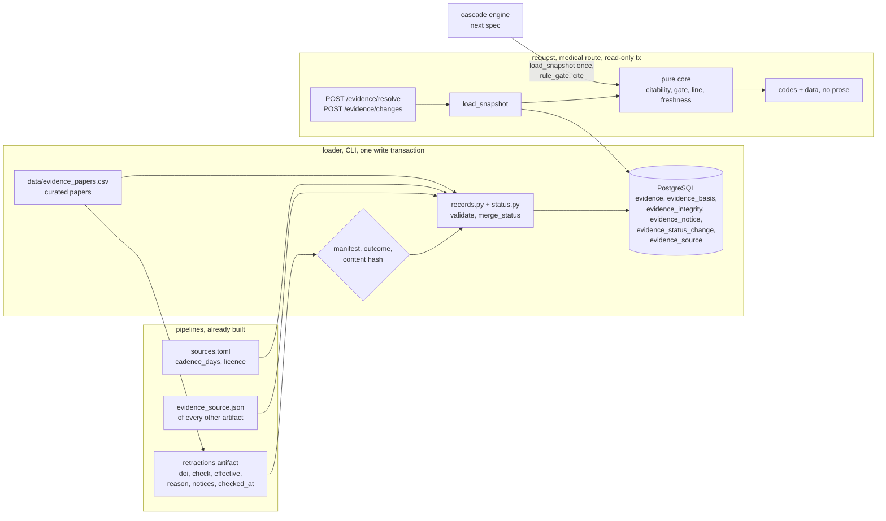

# Design: Evidence Integrity, Phase 1

> Scope: `apps/api/janus/integrity/`, two migrations (`0003_source_cadence`, `0004_evidence_integrity`), the `evidence` tables and their loader, the
> two API routes that give the doctor note and the evidence view their data, the freshness rule,
> and the rule gate the cascade engine consumes in the next spec. One small `pipelines/` change
> (§5.3). Criteria tagged **[Client: …]** and **[Phase 5: …]** are not designed here; the data
> they need is (§3.4, §6).
> Owner decisions of 2026-11-07: DP4 and DP14 confirmed; DP17 decided as "replace the constant".

## 1. Overview

Three things are kept apart so each has one home:

1. **What a status is** is decided by the `retractions` pipeline from Crossref notices
   (`data-pipelines` Req 9, DP9). The API never re-derives it.
2. **What a status means for output** is decided here by pure functions over an immutable
   *integrity snapshot*: whether a record is citable, whether a rule is enabled, what the
   integrity line says, whether a source is stale. Nothing in these functions reads a database,
   a clock or the network. The clock enters as a `today` argument.
3. **How data gets in** is a loader that verifies artifacts and writes one transaction. Nothing
   on the request path writes.



Facts checked on 2026-11-07 that shaped this design:

| Source / topic | Observed | Design consequence |
|---|---|---|
| Stored Crossref response for the PIPC paper (`retractions` run `20261107T164018Z-db513354-0401`) | `updated-by` holds one entry: notice DOI `10.1007/s41999-025-01378-7`, type `correction`, source `publisher`, updated 2025-12-18. Check status and effective status are both `corrected` | The first real status is `corrected`. It stays citable (DP4) and its notice must show with the PIPC evidence (Req 1.4, 3.2) |
| Crossref record of that notice (fetched today) | Title "Correction: International expert panel's potentially inappropriate prescribing cascades (PIPC) list", Eur Geriatr Med 17(1), pp. 409–410, back-reference `update-to` to the paper, licence CC BY 4.0 from 2025-12-18. The metadata says nothing about what changed. The owner states that the correction only changed the paper's licence | Janus shows type, date, source and link, and never characterises the change (DP14) |
| `retractions` rows | Columns `doi, check_status, effective_status, last_completed_status, reason, notices[{type, source, notice_doi, date}], checked_at`. A failed check produces `check_status = unknown`, `notices = []` and keeps `effective_status = retracted` when the last completed check was retracted | The loader must keep the previous notices in that case, or a retracted record would lose its notice (DP15) |
| `collect_dois` in the pipeline | Reads only `evidence_source.json` of the current artifacts, i.e. DOIs of datasets. A paper cited by a rule (BMJ 2026, ThinkCascades) would never be checked | Req 1.2 "after every rule-base update" needs a second input: the curated paper list (DP13) |
| `evidence_source.json` of the current artifacts | Source ids `titck`, `openfda_ndc`, `pipc`, `wikidata`, `crossref`; DOI only on `pipc`; `snapshot_date` is `2026-11-06` (titck, openfda_ndc), `2025-07-31` (pipc, the publication date) or a UTC timestamp (wikidata, crossref) | Snapshot dates arrive in two formats; one pure parser (§4.3). Source ids equal registry ids |
| `pipelines/sources.toml` | `cadence_days`: titck 7, titck_skrs 7, openfda_ndc 7, cima 7, crossref 7, bdpm 30, wikidata 30, faers 91, pipc 365. No cadence: onsides, openfda_label, rxnav, europepmc, pmc3941892, ancientbiotics (storage `cache`), and all `cited_only` and `separate_package` sources | Reuse the file (Req 2.1). A `cache` source used without cadence is refused when first used (DP8). Papers from `cited_only` sources have no cadence |
| drug-resolution DP18 | The notice `source_may_be_outdated` appears after 14 days for TİTCK and openFDA, both weekly | 14 = 2 × 7, the same rule as Req 2.2, written as a constant there (DP17) |
| API infrastructure | `Database.read_only_tx()` uses `REPEATABLE READ, READ ONLY`; `write_tx()` is limited to `contributions/repository.py` and `resolution/load.py` by a test; `LogEvent` is a closed enum; resolution has `read_rows` (DuckDB), `canonical.content_hash`, `LoadError`; latest migration is `0002`; the medical routers must not use a prefix | Reuse them; extend the boundary test and `LogEvent` (DP19, DP20) |

## 2. Code layout

```
apps/api/
  janus/integrity/
    model.py        Status, Kind, EvidenceRecord, IntegrityState, Notice, SourceInfo,
                    IntegritySnapshot (+ version()), closed vocabularies          (pure)
    status.py       SEVERITY, ATTENTION_ORDER, validate_incoming(), merge_status()  (pure)
    freshness.py    parse_snapshot_date(), age_days(), freshness(), check_is_stale() (pure)
    registry.py     parse_sources(toml_text) -> {source_id: SourceInfo}               (pure)
    records.py      make_id(), record_from_evidence_source(), records_from_papers(),
                    validate_records()                                                (pure)
    citability.py   verdicts(), cite(), keep_output(), roots()                        (pure)
    gate.py         RuleGate, rule_gate()                                             (pure)
    line.py         IntegrityLine, build_line()                                       (pure)
    view.py         EvidenceItem, IntegrityView, NoticeView, build_item()             (pure)
    load.py         read artifacts, build records and states, write one transaction;
                    register_records(); CLI                                           (I/O)
    repository.py   load_snapshot(), changes_since(), observed_dates(), is_loaded()   (I/O)
    service.py      resolve_evidence(), list_changes()
    router.py       POST /evidence/resolve, POST /evidence/changes
  migrations/versions/0004_evidence_integrity.py
data/
  evidence_papers.csv           curated papers (header only until cascade-engine adds rows)
pipelines/janus_pipelines/jobs/retractions.py   collect_dois() also reads the paper list
tests/
  integrity_strategies.py       graphs of records, states, notices, snapshots, registries
  integrity_db.py               synthetic artifact directories + loader helpers
  test_integrity_status_properties.py  test_integrity_freshness_properties.py
  test_integrity_records_properties.py test_integrity_citability_properties.py
  test_integrity_gate_properties.py    test_integrity_line_properties.py
  test_integrity_load_properties.py    test_integrity_api_properties.py
  test_integrity_real_artifacts.py     (local only)
```

`structure.md` already lists `janus/integrity/` ("retraction and freshness checks for every
evidence record"). Medical logic (everything marked pure) has no I/O, as `structure.md`
requires. `tomllib` is in the standard library; DuckDB and the resolution helpers are already
dependencies. No new dependency.

## 3. Data contracts

### 3.1 Evidence ids and records (Req 4)
`EvidenceId` = `<kind>:<source_id>[:<key>]`, matching
`^[a-z_]+:[a-z0-9_]+(:[A-Za-z0-9_.-]{1,64})?$`, at most 100 characters. Examples:
`dataset:pipc`, `dataset:titck`, `paper:bmj_2026:e100499`, `rule:pipc:12` (created by
`cascade-engine`). `make_id(kind, source_id, key)` is pure and uses no run id or time, so a new
run of the same source keeps its ids. Ids are never deleted.

`EvidenceRecord` (frozen): `id, kind, source_id, source_url, license, region | None,
snapshot_date: date, snapshot_is_retrieval_time: bool, doi | None, locator | None,
title | None, basis: tuple[EvidenceId, ...]`.

Kinds: `dataset, rule, faers_stat, paper, label, ancient, chembl, outcome` (the seven of
`MIMARI.md` plus `dataset`). There is no `payload` column (DP5): the content of a rule or a
statistic lives in the owning spec's table, keyed by the evidence id; this table holds what is
common to all of them.

Where records come from:
- **Pipeline artifacts.** For each `artifacts/<pipeline>/current/evidence_source.json`:
  `dataset:<source_id>` with its URL, licence, region, snapshot date (and
  `snapshot_date_is_retrieval_time` from the manifest), and the DOI if present. The title is the
  registry's source name.
- **Curated paper list** `data/evidence_papers.csv`, columns
  `key,doi,source_id,title,verified_on,note`: `paper:<source_id>:<key>`; the licence, region and
  URL base come from the registry entry of `source_id`; `source_url` is `https://doi.org/<doi>`;
  `snapshot_date = verified_on` (the day the bibliographic record was checked), not a
  retrieval time. The file has a header and no rows today; `cascade-engine` adds the papers its
  rules cite.
- **Other specs** call `register_records(conn, records)` inside their own load transaction. It
  runs the same validation (§4.5) against the records already stored.

### 3.2 Database (migration `0004_evidence_integrity`, forward-only, with downgrade)
No user data in any table. All SQL parameterised.

```sql
CREATE TABLE evidence_source (          -- one row per registry source, from sources.toml
  source_id    text PRIMARY KEY CHECK (source_id ~ '^[a-z0-9_]{1,40}$'),
  name         text NOT NULL,
  storage      text NOT NULL CHECK (storage IN
               ('runtime_only','cache','commit','separate_package','cited_only')),
  cadence_days integer NULL CHECK (cadence_days BETWEEN 1 AND 3660)
);
CREATE TABLE evidence (
  id            text PRIMARY KEY CHECK (id ~ '^[a-z_]+:[a-z0-9_]+(:[A-Za-z0-9_.-]{1,64})?$'
                                        AND length(id) <= 100),
  kind          text NOT NULL CHECK (kind IN ('dataset','rule','faers_stat','paper',
                                              'label','ancient','chembl','outcome')),
  source_id     text NOT NULL REFERENCES evidence_source,
  source_url    text NOT NULL CHECK (source_url ~ '^https?://[^[:space:]]+$'),
  license       text NOT NULL CHECK (length(btrim(license)) > 0),
  region        text NULL CHECK (region IN ('TR','EU','US')),
  snapshot_date date NOT NULL,
  snapshot_is_retrieval_time boolean NOT NULL,
  doi           text NULL CHECK (doi ~ '^10\.[0-9]{4,9}/[^[:space:]]+$' AND doi = lower(doi)),
  locator       text NULL CHECK (length(locator) <= 200),
  title         text NULL CHECK (length(title) <= 300)
);
CREATE TABLE evidence_basis (
  evidence_id text NOT NULL REFERENCES evidence,
  basis_id    text NOT NULL REFERENCES evidence,
  PRIMARY KEY (evidence_id, basis_id), CHECK (evidence_id <> basis_id)
);
CREATE TABLE evidence_integrity (       -- one row per DOI-bearing record
  evidence_id  text PRIMARY KEY REFERENCES evidence,
  status       text NOT NULL CHECK (status IN
               ('ok','corrected','expression_of_concern','retracted','unknown')),
  check_status text NOT NULL CHECK (check_status IN
               ('ok','corrected','expression_of_concern','retracted','unknown')),
  reason       text NULL CHECK (reason ~ '^(check_failed|not_found|unreadable_response|not_yet_checked|http_[0-9]{3})$'),
  checked_at   date NULL,
  check_run_id text NULL
);
CREATE TABLE evidence_notice (
  evidence_id text NOT NULL REFERENCES evidence,
  position    smallint NOT NULL,
  type        text NOT NULL CHECK (type ~ '^[a-z_]{1,40}$'),
  source      text NULL CHECK (length(source) <= 40),
  notice_doi  text NULL CHECK (notice_doi ~ '^10\.[0-9]{4,9}/[^[:space:]]+$'),
  notice_date date NULL,
  PRIMARY KEY (evidence_id, position)
);
CREATE TABLE evidence_status_change (
  id          uuid PRIMARY KEY DEFAULT gen_random_uuid(),
  evidence_id text NOT NULL REFERENCES evidence,
  from_status text NULL,                 -- NULL = first sighting
  to_status   text NOT NULL,
  observed_on date NOT NULL,
  run_id      text NULL
);
CREATE INDEX evidence_status_change_observed ON evidence_status_change (observed_on DESC, evidence_id);
```

`downgrade()` drops the tables in reverse order. Foreign keys have no `ON DELETE CASCADE`: the
loader never deletes evidence (Req 4.2), so a delete that would orphan a row fails loudly.
DB-level constraints repeat the loader's validation (privacy-spec practice); they cannot check
"a DOI-bearing record has an integrity row" or "the basis graph has no cycle", so the loader
and `load_snapshot` do (§4.5, §4.6).

### 3.3 Integrity snapshot (pure)
```python
@dataclass(frozen=True)
class IntegritySnapshot:
    records: Mapping[EvidenceId, EvidenceRecord]
    states: Mapping[EvidenceId, IntegrityState]    # DOI-bearing records only
    sources: Mapping[str, SourceInfo]              # source_id -> name, storage, cadence_days
    def version(self) -> str                       # sha256 of the canonical content, §4.7
```
`IntegrityState = (status, check_status, reason | None, checked_at: date | None, run_id | None,
notices: tuple[Notice, ...])`; `Notice = (type, source | None, notice_doi | None, date | None)`.
A DOI-bearing record with no state is read as `unknown / not_yet_checked` by every pure function
(`state_of(snapshot, id)`), so a missing row can never look like `ok` (P2).

`load_snapshot(conn)` reads all six tables in the request's read-only transaction (one
consistent view) and builds the snapshot. Size is bounded (`MAX_RECORDS = 5000`, loud failure
above it): Phase 1 holds a few dozen records and the 65 PIPC rules.

### 3.4 API models (Pydantic v2, `extra="forbid"`; responses are `_Out`-style, no free text)
| Route | Body |
|---|---|
| `POST /evidence/resolve` | `{evidence_ids: list[str], 1–200 items, distinct after trimming, each matching the id pattern}` |
| `POST /evidence/changes` | `{since?: "YYYY-MM-DD", limit?: int 1–500 (default 100)}` |

`EvidenceResolution`:
```
integrity_version: str           # sha256 hex
as_of: date                      # server UTC date used for ages
items: [EvidenceItem]            # sorted by id, one per distinct requested id
citable_ids: [str]
excluded: [{id, reason: retracted | not_registered | no_citable_basis}]
line: IntegrityLine
disclaimer: str                  # the research-prototype sentence, as in resolution

EvidenceItem:
  id, registered: bool
  kind?, title?, doi?, locator?
  source?: {source_id, name, source_url, license, region | null,
            snapshot_date, snapshot_is_retrieval_time}
  freshness: {state: current | stale | not_applicable, age_days, limit_days | null} | null
  doi_check: checked | not_applicable
  integrity: IntegrityView | null            # own state, DOI-bearing records only
  roots: [RootView]                          # records without DOI: the DOI-bearing or leaf
                                             # records they rest on, each with `citable`
  citable: bool
  exclusion_reason?: retracted | not_registered | no_citable_basis
  codes: [ItemCode]                          # closed set, below

IntegrityView:
  status, check_status, reason | null, checked_at | null, check_age_days | null,
  check_stale: bool,
  notices: [{type, source | null, date | null, notice_doi | null, notice_url | null}]  # newest first
RootView: {id, title | null, doi | null, citable, integrity: IntegrityView | null,
           freshness: {…} | null}

ItemCode ∈ {corrected_notice, expression_of_concern_notice, integrity_unknown,
            source_may_be_outdated, integrity_check_may_be_out_of_date,
            excluded_retracted, not_registered}

IntegrityLine:
  sources_total, checked_by_doi, without_doi_check,
  by_status: {ok, corrected, expression_of_concern, unknown}      # counts over used roots
  oldest_check | null, newest_check | null,
  stale_sources: [{source_id, snapshot_date, age_days, limit_days}],
  integrity_check_stale: bool,
  excluded: [{id, reason}],
  no_retracted_used: bool
```
`notice_url = "https://doi.org/" + notice_doi`. `ChangesResult`: `{integrity_version, as_of,
since, observed_dates: [date] (newest 20), status_counts: {…5}, changes: [{evidence_id, title |
null, doi | null, from_status, to_status, observed_on, run_id | null}], disclaimer}`.

Fixed codes only: statuses, reasons, item codes. Titles and licence text come from the registry
or the curated file (trusted data), never from a request. The client turns codes into the
five-language wording (`experience`, `doctor-loop`).

## 4. Pure core

### 4.1 Status rules (`status.py`, Req 1, 5.1)
- `Status`: `ok, corrected, expression_of_concern, retracted, unknown`. `SEVERITY = {ok: 0,
  corrected: 1, expression_of_concern: 2, retracted: 3}`; `unknown` has no severity.
  `ATTENTION_ORDER = (retracted, expression_of_concern, unknown, corrected, ok)` is the order
  in which a client lists statuses, worst first.
- `validate_incoming(row)` (the loader's check of one `retractions` row): both statuses are
  members of `Status`; `(check, effective)` is `(s, s)` for any `s`, or `(unknown, retracted)`
  (sticky); `reason` is present exactly when `check_status = unknown`; a status of `corrected`,
  `expression_of_concern` or `retracted` that comes from a completed check has at least one
  notice, and `ok` has none. Anything else raises `InvalidIncoming(code)`.
- `merge_status(previous | None, incoming | None, run_id) -> IntegrityState`:

| previous | incoming | result |
|---|---|---|
| none | none | `unknown`, reason `not_yet_checked`, no check date |
| some | none | `previous`, unchanged (Req 1.5, last bullet) |
| any | effective `unknown` | `unknown` with incoming reason, unless `previous.status = retracted` |
| `retracted` | `check_status = unknown`, effective `retracted` or `unknown` | `retracted`, incoming reason, **previous notices kept**, check date of the failed check |
| any | any other valid row | incoming status, notices, reason, date and run id |

  Only a completed check (`check_status ≠ unknown`) can replace `retracted`. The pipeline
  already keeps `retracted` through a failed check (`data-pipelines` DP9); the merge repeats it
  against the stored state so that a load from a fresh artifact directory cannot undo it
  (DP15).
- Notices are sorted newest first (date descending, nulls last, then type, then notice DOI).
  A notice type outside `^[a-z_]{1,40}$` after lower-casing and replacing `-` and spaces by `_`
  is stored as `other`; the status it caused was already decided by the pipeline.

### 4.2 Citability (`citability.py`, Req 5)
`verdict(id)` for an id, given the snapshot:

| Case | `citable` | `reason` |
|---|---|---|
| id not in `records` | false | `not_registered` |
| record has a DOI | `state_of(id).status != retracted` | `retracted` when false |
| no DOI, `basis` non-empty | any basis record citable | `no_citable_basis` when false |
| no DOI, no basis | true | – |

`roots(id)`: the record itself if it has a DOI or no basis; else the union of the roots of its
basis records. Every root is itself a record, so its citability is the one in the table. For a
citable record the **used roots** are its citable roots. A root below a non-citable
intermediate is non-citable by construction (that intermediate has no citable basis), so
"citable roots" and "roots reached through citable links only" are the same set.

The recursion uses a visiting set: a record met again while it is being evaluated counts as
not citable. Validation refuses cycles at load (§4.5), but the function terminates on any
graph (P9). `cite(snapshot, ids) -> Cited(kept: tuple[id], removed: tuple[(id, reason)])` keeps
the citable ids in input order without repeats. `keep_output(snapshot, ids) -> bool` is true
iff at least one id is citable: the rule for a finding, sentence or card (Req 5.4).

There is no stored "disabled" or "excluded" flag (Req 5.6): every answer is recomputed from the
statuses in the snapshot.

### 4.3 Freshness (`freshness.py`, Req 2)
- `parse_snapshot_date(text)`: `YYYY-MM-DD`, or an ISO 8601 date-time (a timezone offset is
  applied and the UTC date taken; no offset means UTC). Other text raises.
- `age_days(snapshot, today) = max(0, (today − snapshot).days)`.
- `freshness(snapshot, today, source) -> Freshness(state, age_days, limit_days)`: if the source
  has no cadence (`cited_only`, `separate_package`) → `not_applicable`; else `limit_days =
  2 × cadence_days` and `state = stale` iff `age_days > limit_days`.
- `check_is_stale(checked_at, today, crossref_cadence_days)` uses the same comparison for the
  check date of a DOI-bearing record (DP9). With no check date the check is not stale but the
  status is `unknown` (nothing was checked), and the item carries `integrity_unknown`.
- Freshness never changes a status and never changes citability (Req 2.2).

### 4.4 Rule gate (`gate.py`, Req 6)
```python
@dataclass(frozen=True)
class Removed:  id: str; reason: Literal["retracted", "not_registered", "no_citable_basis"]; notices: tuple[Notice, ...]
@dataclass(frozen=True)
class RuleGate:
    enabled: bool
    reason: Literal["no_source", "all_sources_retracted", "no_citable_source"] | None
    usable: tuple[EvidenceId, ...]       # sorted, unique
    removed: tuple[Removed, ...]         # sorted by id

def rule_gate(sources: Sequence[EvidenceId], snapshot: IntegritySnapshot) -> RuleGate
```
`enabled` iff at least one distinct source is citable. `reason`: `None` when enabled;
`no_source` for an empty list; `all_sources_retracted` when every distinct source is removed
with `retracted`; else `no_citable_source`. `Removed.notices` carries the notices of the
retracted root(s) so the cascade engine can report why (`cascade-engine` Req 1.5). The result
depends on the set of sources only; it has no state, so a rule comes back as soon as a
snapshot makes one source citable again.

Contract for `cascade-engine` (recorded there when that spec is refined): read the snapshot
once per request with `repository.load_snapshot(conn)`, call `rule_gate` for each rule (or at
rule-base load, per snapshot version), put only `gate.usable` into a finding's evidence ids,
and carry `integrity_version` in the output. Findings built on a disabled rule do not exist.

### 4.5 Record validation (`records.py`, Req 4)
`validate_records(new, known, sources) -> None | raises RecordError(code, id)` with codes:
`duplicate_id`, `bad_id`, `unknown_kind`, `missing_source_url`, `missing_license`,
`missing_snapshot_date`, `bad_doi`, `unknown_source` (not in the registry), `no_cadence`
(source with storage `runtime_only`, `cache` or `commit` and no `cadence_days`),
`unknown_basis`, `basis_cycle`, `rule_without_basis`. `known` is the set of ids already stored,
so a basis may point to a record from another spec. Cycles are found with a depth-first search
over `new ∪ known` basis links. Errors name the id and the field, never a request value. The
loader runs this before any write; a failure changes nothing (Req 4.1).

### 4.6 Integrity line and item view (`line.py`, `view.py`, Req 3)
`build_line(snapshot, ids, today)`: distinct requested ids → verdicts → used roots of the
citable ones. `sources_total = |used roots|`; `checked_by_doi` = used roots with a DOI;
`without_doi_check` = the rest; `by_status` counts the DOI roots by their state's status
(missing state counts as `unknown`); `oldest_check`/`newest_check` are the min/max `checked_at`
among DOI roots that have one; `stale_sources` are the used roots' sources that are stale;
`integrity_check_stale` is true if any DOI root's check is stale; `excluded` lists the removed
ids with reasons; `no_retracted_used` is `all(state_of(r).status != retracted for r in used
roots)`. Roots are counted once even when several records rest on them.

`build_item(snapshot, id, today)` assembles the item of §3.4 from the same functions. An item's
`codes`: `corrected_notice` / `expression_of_concern_notice` when its own state or one of its
roots has that status; `integrity_unknown` when its own state or a used root is `unknown`;
`source_may_be_outdated` when its source or a used root's source is stale;
`integrity_check_may_be_out_of_date` when a check is stale; `excluded_retracted` when the
reason is `retracted`; `not_registered`. Item fields are copied, never remapped: the `status`
of a view is the state's status (P2).

### 4.7 Integrity version
`version()` = SHA-256 of the canonical JSON lines (the same canonical form as
`resolution/canonical.py`) of: every record (all fields, basis sorted), every state (all
fields, notices in order), every source (id, storage, cadence). Sorted by id. It excludes the
request date. It is computed from the snapshot, not stored, so a registration by another spec
changes it too (DP18).

## 5. Loader (`load.py`, Req 8)

### 5.1 Steps
```
data_dir, repo = args (defaults: JANUS_DATA_DIR, repo root)
sources   = parse_sources(read pipelines/sources.toml)                    # cadence, storage, licence
for each artifacts/<pipeline>/current:
    manifest + evidence_source.json: run_id equal, outcome succeeded
    (or promoted needs_review)                                              else refuse
retractions: rows.parquet via read_rows; content_hash == manifest hash      else refuse
records   = [record_from_evidence_source(...)] + records_from_papers(csv)
validate_records(records, known=ids in DB, sources)                         else refuse
incoming  = {doi: row} validated by validate_incoming                       else refuse
one write transaction (LOCK TABLE evidence_integrity IN SHARE ROW EXCLUSIVE MODE):
    upsert evidence_source (all registry sources)
    upsert evidence, replace evidence_basis of the records written
    for each DOI-bearing record (written now or already stored):
        prev   = stored state
        new    = merge_status(prev, incoming.get(doi), run_id)
        upsert evidence_integrity; replace evidence_notice if changed
        if prev is None or prev.status != new.status:
            insert evidence_status_change(from = prev.status | NULL, to, observed_on = today, run_id)
commit
log_event(integrity_load, count=<records>)   # counts only
print summary: records, DOI-bearing, by status, not_yet_checked count
```
`today` is the UTC date at load. Records stored earlier and absent from this load (other
specs') keep their rows; their integrity row is merged the same way when their DOI is in the
current `retractions` artifact. A rerun on unchanged artifacts writes the same values and no
change rows (P4, P15). CLI: `python -m janus.integrity.load [--data-dir PATH] [--registry PATH]
[--papers PATH]`; needs `DATABASE_URL`. A load needs the repository checkout for
`pipelines/sources.toml`; the API image itself never reads it.

### 5.2 Registration by other specs
`register_records(conn, records)` takes an open write transaction, validates against the stored
records and sources, upserts records and basis, and creates `unknown / not_yet_checked` states
for DOI-bearing records that have none (recorded as a first-sighting change). It is the only
other function allowed to write these tables (Req 8.6). `evidence_source` must exist, so a
spec's loader runs after the integrity loader has run once.

### 5.3 Pipeline change (`retractions`, Req 1.2)
`RetractionsJob.collect_dois` also reads the `doi` column of `data/evidence_papers.csv` (path
resolved the way `pipc` finds `data/`; task 1 confirms). DOIs are normalised and de-duplicated
as before. Schema `retractions-1` and the output rows do not change, so no schema bump. A
missing file is an empty list; a malformed row fails the run (`bad_doi`). Weekly scheduling
remains Phase 5.

## 6. Request path

### 6.1 Routes (Req 7)
Both routes come from `medical_router()` with full paths and no prefix, so the body policy,
`no-store`, read-only transactions and the access-log rules apply unchanged. The operational
allowlist is not touched (DP11). They read the raw JSON body and validate it with Pydantic
themselves, as the resolution routes do, returning `422 {"error": "invalid_request", "fields":
[…]}` with field names only. The server date comes from a module-level `today()` that tests
replace.

```
resolve:  ids → sorted distinct → snapshot = load_snapshot(conn)
          if snapshot has no records → 503 {"error": "integrity_unavailable"}
          items = [build_item(...)], line = build_line(...), cite(...) → citable_ids, excluded
changes:  since default = max(observed_on) of evidence_status_change; rows with
          from_status not null, observed_on >= since, order by observed_on desc, evidence_id;
          LIMIT limit; status_counts from evidence_integrity
```
Unregistered ids give an item with `registered = false`, `citable = false`, reason
`not_registered` and 200, once evidence is loaded. With nothing loaded the route answers 503 and
no id is treated as citable (fail closed, DP12).

### 6.2 Privacy
No logging in `integrity/` except `log_event` with allowlisted fields. `LogEvent` gets
`integrity_load` (counts only). Evidence ids and DOIs appear only in request bodies and
responses. 422 responses name fields only.

## 7. Testing strategy

- **Property tests (Hypothesis)** for every item under "Properties to test", listed in §8, one
  test per property, tagged `Feature: evidence-integrity, Property Pn` with its requirement.
  Profiles `dev` (100) / `ci` (300, `derandomize=True`); database-backed properties 50 / 100.
- **Strategies** (`integrity_strategies.py`): a random DAG of records (kinds, DOI or not,
  `basis` links only to earlier records, `rule` records always with basis), a random state for
  every DOI record (all five statuses, notices of random types and dates, reasons), registries
  generated as TOML text (cadence present or absent, five storage values), and sets of ids drawn
  from the graph plus unregistered ids.
- **Reference implementations in the tests.** Citability is checked against a brute-force
  recursion written differently (enumerate all downward paths); the line against a recount; the
  freshness boundary against integer arithmetic on day numbers.
- **Database tests** (`db` marker) against PostgreSQL 16 as in the privacy and resolution specs:
  skippable locally, not in CI. Synthetic artifact directories are built by `integrity_db.py`
  (Parquet through DuckDB, manifests with correct hashes, `evidence_source.json`), following
  `resolution_db.py`.
- **Example tests:** the real PIPC case built by hand from the stored Crossref values (status
  `corrected`, notice `10.1007/s41999-025-01378-7`, `correction`, `publisher`, 2025-12-18,
  `notice_url`, citable, shown on `dataset:pipc` and on a synthetic `rule:pipc:12`); the same
  record with a retraction notice added becomes excluded and its rule disabled; migration
  upgrade → downgrade → upgrade; the real `pipelines/sources.toml` gives cadence 7 for `titck`,
  `openfda_ndc` and `crossref`, 365 for `pipc`; weekly sources are stale after 14 days through the shared rule
  in drug-resolution (DP17); `classify(app)` accepts the new routes; the import-boundary test
  allows `integrity/load.py`.
- **Real artifacts (local only)** `test_integrity_real_artifacts.py`, skipped in CI and when
  `.data` has no current artifacts: after a real load, `POST /evidence/resolve` for
  `dataset:pipc` returns `corrected`, the notice above, `citable`, and freshness `current`.
- **CI:** the existing `api` job runs the new tests (PostgreSQL service, `HYPOTHESIS_PROFILE=ci`,
  `alembic upgrade head`); the `pipelines` job runs the changed `retractions` test.

## 8. Correctness properties

Each property is one Hypothesis test, tagged `Feature: evidence-integrity, Property Pn` with the
requirement it validates. P1–P4 are the four original properties; P5–P20 were added in the
refinement.

| # | Property (for all …) | Validates | Hypothesis approach |
|---|---|---|---|
| P1 | **No retracted-only backing.** For any snapshot (any graph, any statuses) and any output modelled as a set of evidence ids: `cite` keeps only citable ids; every kept id has at least one citable root and no kept id's used roots include a retracted record; an output whose ids are all non-citable has `keep_output = False`. Original property. | Req 1.3, 5.2, 5.4 | Graph and state strategies; outputs drawn from ids plus unregistered ids; compare with the brute-force reference. |
| P2 | **Unknown is never ok.** For any snapshot, no view field of any item (`integrity.status`, root views, line counts) is `ok` for a record whose state is `unknown`, whose check is missing or whose record has no DOI; `by_status[ok]` equals the number of used roots whose status is exactly `ok`; a DOI record with no state is `unknown / not_yet_checked`. Original property. | Req 1.1, 1.5, 3.2, 5.3 | States including missing ones; recount per status; scan the serialised item for the string `ok`. |
| P3 | **Retraction removes, never adds.** For any snapshot and any one record whose status is not `retracted`, setting that status to `retracted` gives: citable set ⊆ before, every output's kept ids ⊆ before, every `keep_output` that was false stays false, the set of enabled rules ⊆ before, `no_retracted_used` still true. Original property. | Req 1.3, 5.5, 6.2 | Pick a record and a snapshot; compute both sides; compare as sets. Outputs and rules are generated id sets. |
| P4 | **Idempotence.** Applying `merge_status` to the same incoming row twice equals applying it once; loading the same artifacts twice gives identical table contents and integrity version and zero new `evidence_status_change` rows on the second load. Original property (re-running the check with unchanged responses gives identical statuses). | Req 1.1, 8.2, 8.4 | Pure part on generated rows; DB part loads a synthetic artifact directory twice and snapshots every table. |
| P5 | **Sticky retraction.** For any sequence of loads whose rows are completed checks, failed checks and missing rows: a record that is `retracted` changes only at a load whose row is a completed check with another status; failed and missing rows never change it; its notices are kept through a failed check; `unknown` is never turned into `ok`; a record never seen stays `unknown / not_yet_checked`. | Req 1.5 | Sequences of `Incoming | None` per record folded through `merge_status`; compare with a small state model. |
| P6 | **Malformed rows refused.** For any incoming row with a status outside the five, `(check, effective)` other than `(s, s)` or `(unknown, retracted)`, a reason on a completed check or none on a failed one, a non-`ok` completed status without notice, or `ok` with notices, `validate_incoming` raises and the load changes nothing. | Req 1.1, 8.1 | Mutations of a valid row, one defect per example. |
| P7 | **Freshness boundary.** For any snapshot date, today, and cadence ≥ 1: `stale` iff `age_days > 2 × cadence` with `age_days = max(0, days)`; age 2×cadence is not stale; a future snapshot has age 0; staleness is monotone in `today`; a source without cadence is `not_applicable` and never stale; the date parser gives the same date for `YYYY-MM-DD` and for any ISO date-time (with offset, converted to UTC) of that UTC day; freshness never changes status or `citable`. | Req 2.2 | Dates and offsets from `st.datetimes(timezones=…)`; integer day arithmetic as reference. |
| P8 | **Cadence comes from the registry.** For any generated registry TOML, `parse_sources` returns exactly each source's declared `cadence_days` (and none invented); `validate_records` refuses a record whose source is `runtime_only`, `cache` or `commit` without cadence (`no_cadence`) and accepts `cited_only` and `separate_package` sources without one; the real `pipelines/sources.toml` parses and gives the values listed in §1. | Req 2.1 | Registry text built from a source list; one example test on the real file. |
| P9 | **Citability is local and transitive.** For any snapshot and any order of records, basis rows and requested ids: the verdict equals the reference; a DOI-bearing record depends only on its own status; a record without DOI is citable iff a basis record is; verdicts are the same for duplicated ids; the function terminates on graphs with cycles and self-links (a cycle member is not citable). | Req 5.2 | Graph strategy plus a cyclic variant; permutations of record and basis order. |
| P10 | **Rule gate.** For any snapshot and source list: `enabled` iff some distinct source is citable; `removed` is exactly the non-citable sources with their reasons; `reason` is `no_source` / `all_sources_retracted` / `no_citable_source` as defined; the result is the same for any order and repetition of the sources; adding a non-citable source never changes `enabled`; adding a citable source never disables; making a retracted source `ok` never disables; the gate reads nothing but its arguments (same arguments, same result across calls). | Req 6.1–6.5 | Source lists drawn from the graph; set operations; status flips. |
| P11 | **Honest integrity line.** For any snapshot, ids and date: `sources_total`, `checked_by_doi`, `without_doi_check`, `by_status`, `oldest_check`, `newest_check`, `stale_sources` and `integrity_check_stale` equal an independent recount from the used roots; `oldest ≤ newest`; excluded ids plus citable ids are exactly the distinct requested ids; `no_retracted_used` is true iff no used root is `retracted`; roots shared by several records are counted once. | Req 3.1 | Recount in the test; ids with shared roots and unregistered ids. |
| P12 | **Notices complete and ordered.** For any record with k notices, its item lists exactly k notices, newest first, each with `notice_url = https://doi.org/<notice doi>` when a notice DOI exists; every record that rests on a `corrected` or `expression_of_concern` root shows that root's notices in `roots`; no view text describes what a notice changed. Example: the PIPC correction. | Req 1.4, 3.2 | Notices with random types, dates (including missing), and DOIs; graph with shared roots. |
| P13 | **Record validation.** For any valid record set `validate_records` accepts; for any set with one defect (duplicate id, malformed id or DOI, unknown kind, missing URL, licence or snapshot date, source not in the registry, source without cadence, unknown basis, basis cycle, `rule` without basis) it raises the matching code; after a refusal the database is unchanged. | Req 4.1, 4.4, 4.5 | One defect injected per example into a valid set; DB snapshot compare. |
| P14 | **Stable ids.** For any artifact set, ids from `make_id` and `record_from_evidence_source` are the same for any file order, run id and snapshot date; two different (kind, source, key) triples give different ids; a reload with a new run keeps the id and updates the snapshot date. | Req 4.2, 4.3 | Generated artifact descriptions; rerun with other run ids. |
| P15 | **Status-change log.** For any sequence of loads, the log has exactly one row per real change of a record's effective status (the first sighting has `from_status` NULL), none for an unchanged status; the newest row's `to_status` equals the stored status; `changes` lists only rows with a previous status, observed on or after `since`, newest first, at most `limit`. | Req 3.3 | Rule-based state machine over loads; compare with a model of statuses. |
| P16 | **Atomic load.** For any sequence of good loads, refused artifacts (hash mismatch, failed outcome, invalid records, invalid rows) and failures injected before each write statement, the tables always equal the state after the last successful load, with all or none of a load's changes. | Req 8.1 | `RuleBasedStateMachine` with a fault-injection hook, as in drug-resolution P23. |
| P17 | **Fail closed.** With no evidence loaded: every id is non-citable, every `rule_gate` is disabled, and `/evidence/resolve` answers 503 `integrity_unavailable`; with evidence loaded, any id that is not registered is `not_registered`, non-citable, status 200. | Req 7.4 | Empty and generated snapshots; DB-backed route test with empty and loaded tables. |
| P18 | **Deterministic and order independent.** For any loaded database, ids and date, the response is byte-identical for repeated calls and for any order or repetition of the same ids; the integrity version is the same for equal snapshots and differs after any change to a record, basis link, status, notice, check date or cadence (and only then). | Req 7.5, 8.4 | Permutations and repeats of ids; one-field mutations of the snapshot. |
| P19 | **Stateless, silent routes.** For any request to the two routes (including ids and `since` values that look like sentinel evidence ids), the database snapshot and temp directory are unchanged, the response carries `no-store`, and no id, DOI or notice DOI appears in any log output; 422 bodies contain no input value; the loader logs counts only. | Req 7.6, 8.5 | `assert_stateless()` and sentinel log capture from the privacy harness. |
| P20 | **Request validation and closed vocabulary.** For any body, the resolve route accepts it iff it has 1–200 distinct ids matching the pattern and no other keys; `since` accepts only `YYYY-MM-DD`; `limit` only 1–500; everything else is 422 `invalid_request` with field names. For any state, every `status`, `reason`, `exclusion_reason` and `codes` value in a response belongs to its fixed set, and the response contains none of the forbidden phrases of `medical-safety.md` in any language. | Req 7.1–7.3, 7.6 | Near-miss bodies (duplicate ids, 201 ids, extra keys, wrong types); state strategy; phrase list from the medical-language hook. |

## 9. Decisions

| # | Decision | Alternatives considered | Why |
|---|---|---|---|
| DP1 | New package `janus/integrity/`; pure modules for status, freshness, registry parsing, records, citability, gate, line and view; I/O in `load`, `repository`, `service`, `router`. No new dependency. | Put it under `resolution/` or `memory/`. | `structure.md` already names `janus/integrity/`; the cascade engine imports only the pure part. |
| DP2 | Current-state tables with an append-only status-change log, written in one transaction. | A dataset-version swap like `res_*`. | Statuses change weekly while records rarely do, and Req 3.3 needs history; PostgreSQL atomicity plus the log gives both without copying every table on each load. |
| DP3 | Status derivation (notice type → status, severity, effective status) stays in the `retractions` pipeline. The API validates the rows (§4.1) and merges them but has no copy of the notice-type map. | Copy the map to the API with a golden vector (as for the content hash). | One place per rule (`data-pipelines` DP7). A copy of a medical mapping can drift; a hash can be checked with a vector, a mapping needs the same review twice. |
| DP4 | **Citability policy:** only `retracted` removes a record. `corrected`, `expression_of_concern` and `unknown` stay citable and travel with their notice or their `unknown` status. **Confirmed by the owner.** | (a) Also exclude `expression_of_concern` from patient-facing findings. (b) Also exclude `unknown`. | Req 1.3 names only `retracted`; Req 1.4 and 1.5 say to show the other three. Excluding `unknown` would switch off every rule whenever Crossref is unreachable or a paper has not been checked yet, and would hide the very state Req 1.5 wants shown. The risk of staying citable is a finding that rests on a paper under an expression of concern; the notice is returned with it. |
| DP5 | Records without a DOI have no integrity status; their DOI check is `not_applicable`. Their trust comes from freshness and from their basis. No `payload` column. | Give them `unknown`; or `ok`. | `unknown` on a FAERS statistic would be noise and `ok` would be false. Specs that own a payload (rules, statistics) keep it in their tables keyed by the evidence id. |
| DP6 | Evidence ids are `<kind>:<source_id>[:<key>]`, deterministic, never deleted. | Hash or UUID ids. | Readable in a note, stable across runs, and a note issued earlier still resolves. |
| DP7 | A DOI-bearing record is judged by its own status; a record without DOI by its basis (at least one citable basis). The graph must be acyclic; the functions also terminate on cycles. | Judge every record by all its ancestors. | A rule citing a retracted paper and a sound one keeps the sound one (Req 6.2). Stopping at the first DOI-bearing record keeps the rule "one paper, one status". |
| DP8 | Cadence is read from `pipelines/sources.toml` by the loader and stored in `evidence_source`. A source stored `runtime_only`, `cache` or `commit` must declare it when first used; `cited_only` and `separate_package` sources are `not_applicable`. Limit = 2 × cadence, whole UTC days, strict `>`. | A second table of cadences in the API; require a cadence for every registry entry now. | One list (Req 2.1). The registry has six `cache` sources without cadence that Janus does not use yet; failing at first use is the point of Req 2.1 without changing the registry file today. |
| DP9 | A check older than twice the `crossref` cadence gives the notice `integrity_check_may_be_out_of_date`; the status is not changed. | Turn a stale `ok` into `unknown`. | A missed week should be visible, but the last completed check is still the best fact and always carries its date (Req 3.2). Degrading it would also make `unknown` mean two things. |
| DP10 | Responses carry fixed codes and data; no sentences. | Server-side text in the note language. | Wording and glossary belong to `doctor-loop` and `experience`, are reviewed per language, and are checked by the forbidden-phrase tests there. |
| DP11 | Both routes are `POST` medical routes, including the changes list, which takes no user data. The operational allowlist stays as it is. | `GET /evidence/changes` on the allowlist. | An evidence id can reveal a finding, so `resolve` must be medical; one policy for both avoids amending the privacy spec's fixed allowlist for a screen that does not exist yet. |
| DP12 | Fail closed: unloaded data gives 503 and nothing is citable; an unregistered id is never citable. | Treat unknown ids as citable "leaf" records. | "No evidence, no sentence" (`medical-safety.md` rule 5). |
| DP13 | One curated paper list, `data/evidence_papers.csv`, read by the `retractions` pipeline (for DOIs) and by the loader (for records). | Pipeline reads the `evidence` table; each spec its own list. | Pipelines have no database (`data-pipelines` DP1). One file, two readers, and a rule-base update that adds a row is checked by the next run. |
| DP14 | Notices are shown as published (type, date, source, link). Janus adds no annotation such as "licence change only". **Confirmed by the owner.** | A curated per-notice note, reviewed by the owner. | Crossref metadata does not say what a notice changed, so any such statement would be a claim Janus cannot cite. The owner's statement about the PIPC correction stays in this spec as a note. |
| DP15 | The loader repeats the sticky rule against the stored state and keeps the previous notices when a failed check keeps `retracted`. | Trust the pipeline's `effective_status` alone. | The pipeline's memory is its previous artifact; the database's memory is its own. Failed-check rows carry no notices, so without this a retracted record would lose its notice. |
| DP16 | The changes list defaults to the most recent day with a change, lists real transitions only, and returns the dates on which changes were seen. | Required `since`; include first sightings. | "Since the last snapshot" without client state; a first sighting is not a change in status. |
| DP17 | **Owner decision:** drug-resolution's hard-coded 14 days (`STALE_AFTER`) is replaced by the shared rule `integrity.freshness.freshness()` (twice the cadence). The resolution loader reads the cadence from `pipelines/sources.toml` through `integrity.registry.parse_sources`, stores it in `res_source_version.cadence_days` (migration `0003_source_cadence`) and includes it in the dataset version, so the request path stays inside one dataset. The sources checked stay `titck` and `openfda_ndc`. A missing cadence gives the notice. | Read the cadence from `evidence_source` at request time; leave the constant. | The rule lives in one place and the cadence in one file. Storing it with the dataset keeps a request on one consistent snapshot and avoids making resolution depend on the integrity load. |
| DP18 | `load_snapshot` reads all evidence in one `REPEATABLE READ` transaction (bounded at 5,000 records); the integrity version is computed from the snapshot and not stored. | Query only the requested ids and their ancestors; store the version. | At this size one read is simpler and gives the cascade engine the whole graph; a computed version cannot go out of date when another spec registers records. |
| DP19 | The loader lives in the API (`python -m janus.integrity.load`) and reuses `read_rows`, `canonical.content_hash` and `LoadError` from `resolution`. Only the `retractions` rows are hash-verified; other artifacts contribute their `evidence_source.json` after outcome and run-id checks. | A loader in `pipelines/`; re-hash every artifact. | Same pattern as drug-resolution (DP15 there). Re-hashing 23,000 TİTCK rows to read one JSON file adds time and no safety. |
| DP20 | `write_tx` may be used by `integrity/load.py`; `register_records` takes the caller's open transaction. The import-boundary test lists both. | Let any spec write the tables. | Writes stay in two reviewable places (privacy DP5, resolution DP16). |
| DP21 | Tests build synthetic artifacts and states; the PIPC example is hand-built from the stored Crossref values (no fixture file). | Commit the stored Crossref response. | The values that matter are four fields; the real-artifacts test covers the full response locally. |
| DP22 | **Owner decision 2026-11-08 (collective-memory DP12).** No new evidence records for FAERS statistics. The kind `faers_stat` stays valid and unused in Phase 2; FAERS is cited through the dataset record `dataset:faers`, which the loader already writes from the `faers` artifact, and the citing spec carries a locator next to the id (the locator belongs to the citation, not to the record). No change to loader, schema, `cite` or `register_records`. | Per-cell `faers_stat` records via `register_records`; a virtual rule making well-formed `faers_stat` ids citable. | Millions of possible cells; the API cannot write at request time; the virtual rule would change the fail-closed model for one source. |

## 10. Open items
- Owner decisions of 2026-11-07: DP4 (only `retracted` is excluded; `corrected`,
  `expression_of_concern` and `unknown` stay citable with their notice or status), DP14 (no
  annotation of notices; the PIPC licence correction is shown as a plain correction notice) and
  DP17 (the 14-day constant in drug-resolution is replaced by the shared rule) confirmed or set.
- Confirmed in task 1: `pipc` uses `ctx.repo_root / "data"`; the `retractions` job reads
  `evidence_papers.csv` the same way.
- `data/evidence_papers.csv` starts with a header only. `cascade-engine` adds the papers its
  rules cite (BMJ 2026, ThinkCascades) with their DOIs, and registers one `rule:pipc:<n>`
  record per rule with the PIPC dataset as basis. Until then the only DOI-bearing record is
  `dataset:pipc`.
- Sources without cadence that will need `cadence_days` when first used: `onsides`,
  `openfda_label`, `rxnav`, `europepmc`, `pmc3941892`, `ancientbiotics`.
- **[Phase 5]** Weekly schedule of the `retractions` pipeline and the integrity load; until
  then the stale-check notice (Req 1.2) shows a missed week.
- **Cascade engine contract** (to be recorded in `cascade-engine/requirements.md` open items in
  the last task): load the snapshot once per request; use `rule_gate`; put only `gate.usable`
  into evidence ids; carry `integrity_version`; use `cite` and `keep_output` for outputs.
- The crossref snapshot date of a record created from a `retractions` run is its retrieval time;
  the per-record check date (`checked_at`) is what the evidence view shows for a DOI check.

## 11. Result of the build (2026-11-07)
- Built as designed. Differences: the item view and the line are Pydantic models in `view.py`
  and `line.py` (pure data); request and response models are in `schemas.py`; `resolve` rejects
  repeated ids with 422 (P20), so "repetition" in P18 means repeated calls and permutations.
- Counts: 201 API tests (all properties P1-P20 as Hypothesis tests or, for P8 and P17, a
  Hypothesis test plus an example on the real file or database), 92 pipelines tests, all green
  with `HYPOTHESIS_PROFILE=ci` and PostgreSQL 16.
- Counterexample from the property tests: P9 compared the code with a path-based reference that
  also followed the basis of a retracted DOI-bearing record. That is the reference being wrong,
  not the code: Requirement 5.2 judges a DOI-bearing record by its own status only. The
  reference was fixed; the requirement text was already unambiguous. The other failures during
  development were generator mistakes in the tests (a "completed" check with status `unknown`;
  Hypothesis positional strategies filling fixtures), not defects in the code.
- Real data: `janus-pipelines run retractions` then `python -m janus.integrity.load` gave 5
  evidence records, one with a DOI: `dataset:pipc`, status `corrected`, notice
  `10.1007/s41999-025-01378-7` (correction, publisher, 2025-12-18). `POST /evidence/resolve` in
  the Docker API returns it citable, freshness `current` (464 days of 730), one source in the
  integrity line, `no_retracted_used` true. API and Postgres logs hold no evidence id or DOI.
- The resolution dataset of the dev database was reloaded: the cadence is now part of its
  version, and AMLIPIN still resolves to `C08CA01` and `C09AA03`.
