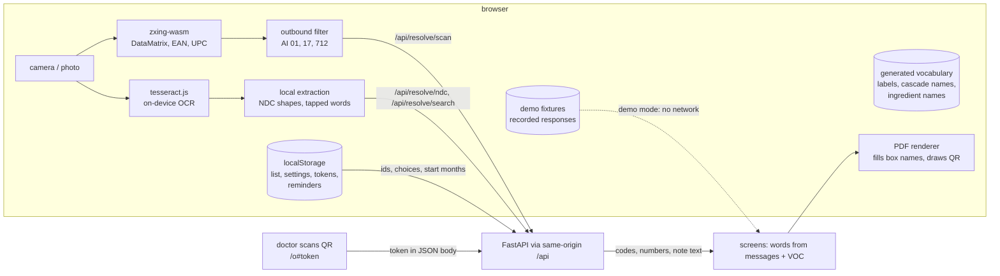

# Design: Experience, Phase 3 (client)

> Scope: `apps/web` only — routes and screens under `app/[locale]/` and the doctor page `app/o/`, the browser store, the
> typed API client, the scan and OCR modules, the doctor note PDF and QR code, the two themes, the message catalogues,
> the generated clinical vocabulary, the demo fixtures, the service worker, and the web tests (vitest, fast-check,
> Playwright with axe). Plus small non-code changes: `docker-compose.yml` and `.env.example` gain the web's API origin
> and the two consent versions, CI gains a Playwright job, `NOTICE` gains the fonts and libraries.
> Not here: the Passport screens and logic (`medication-passport`, slots in §15), researcher content (**[Phase 4]**),
> deployment, proxy rate limits and HTTPS (**[Phase 5]**). **No API change is planned**; if one becomes necessary the
> API suite runs at that checkpoint.
> Property numbers P1–P39, check numbers C1–C7 and decision numbers DP1–DP65 are this spec's own; upstream ones are
> written "doctor-loop DPn" and so on.
> **Owner decisions 2026-11-08 applied:** DP1–DP14 record them; they are not reopened here.

## 1. Overview



The client is a thin, careful presenter. Every medical result comes from the API (DP3); the client words the API's codes
in the interface language, lays out note text verbatim, and keeps the person's list on the device (DP5). Demo mode swaps
the HTTP client for a fixture client that has no network at all (DP11).

Facts checked on 2026-11-08 that shaped this design:

| What | Observed | Design consequence |
|---|---|---|
| API routes (`grep @router`, `@donation`, `@snapshot_router`) | 20 routes: `POST /resolve/{scan,ndc,search,products}`, `/cascades/evaluate`, `/evidence/resolve`, `/evidence/changes`, `/memory/{pair,combination,regions,shared}`, `GET /memory/snapshot`, `POST /contributions`, `/contributions/deletions`, `/notes/{document,token,withdraw}`, `/outcomes/form`, `/outcomes`, `GET /privacy/storage`, `GET /health` | The client uses all of them except `/evidence/changes` (researcher, Phase 4) |
| CORS | No CORS middleware in `janus/main.py`; `proxy.ts` matcher already skips `/api` | Same-origin `/api/*` rewrite to the API (DP15) |
| Request models | Every model `extra="forbid", strict=True`; error bodies `{error, fields?}`, fields only | Client builders produce exactly the model fields (P2); decoders and error map per route (§5) |
| Event key in findings | `FindingOut` has no event key; `faers_locator` is `faers:ingredient=…;event=…;region=ALL;scope=suspect` or null | Event key from the locator, else from `pipc_positions` of the vocabulary (P6, Req 7.5) |
| Localized clinical words | `CascadeResult.rule_text` is English PIPC text; five-language cascade names, event labels and reviewed ingredient names exist only in `apps/api/janus/notes/glossary/*.csv` (65 / 1,126 / 115 accepted rows) and `memory/memory_events.csv` | Generated vocabulary in the web with a parity test (DP17); no API change |
| Resolution labels | `IngredientKey.labels` are Wikidata labels; the glossary review cleared wrong non-English cells (doctor-loop DP39) | Patient screens use the same name rule as the note (doctor-loop DP16), not raw Wikidata labels |
| QR address | `qr_url` = `<JANUS_PUBLIC_BASE_URL>/o#<token>`, no locale segment; `null` when the base URL is unset | Doctor page at `app/o/` outside `[locale]` with its own root layout; client builds the address from its origin when null (DP19) |
| Token pattern | `^[A-Za-z0-9_-]{40,4096}$` | A demo fragment `demo-<patient>` can never match it (DP11) |
| Gate 1 (`apps/api/tests/test_cascades_real_artifacts.py`) | AMLIPIN (`C09BB03`) started 2024-01 + furosemide `C03CA01` 2024-06 + metformin, atorvastatin, paracetamol, omeprazole (start unknown), sertraline, lactulose, alprazolam (start unknown) → `pipc:5` `probable`, 5 months, `corrected_notice`; also rows 6, 9, 12; 2 abrupt-stop warnings; 63 rules checked | The Istanbul demo patient is exactly this list (§13.1). PIPC row 5's drug B is "Diuretic"; furosemide is a loop diuretic in that class |
| TİTCK strings | Not committable (`structure.md`; CI "No TİTCK list files tracked"); doctor-loop tests use invented names | Fixtures scrub every product text field to invented names (§13.3) |
| Web app today | Next.js 16.4.5, React 19.3, next-intl 4.14, Tailwind v4 (`@import "tailwindcss"` only), vitest 5 (`src/**/*.test.ts`, node env); messages hold `Metadata`, `LocaleSwitcher`, `Home`, `Disclaimer`, `Memory`; no shadcn/ui yet | Tokens and components built in-repo on Tailwind v4 (DP26); vitest include extended to `.tsx` |
| Library versions (npm, 2026-11-08) | `@react-pdf/renderer` 4.9.0 (MIT, 2026-08-27), `qrcode` 1.5.4 (MIT), `zxing-wasm` 3.1.6 (MIT, 2026-10-19), `tesseract.js` 7.0.0 (Apache-2.0), `fast-check` 4.10.2 (MIT), `@playwright/test` 1.64.0 (Apache-2.0, 2026-10-07; 1.65.0 is 3 days old), `@axe-core/playwright` 4.14.0 (MPL-2.0, 2026-10-15) | Pinned exactly (§2.1) |

## 2. Code layout

```
apps/web/
  messages/<locale>.json          existing + new namespaces (§8)
  public/manifest.webmanifest     PWA manifest (icons inline SVG → PNG at build)
  public/sw.js                    hand-written service worker (DP22)
  public/vendor/                  NOT committed: zxing reader wasm, tesseract worker/core, traineddata (§6.4)
  scripts/
    gen-vocabulary.mjs            glossary + memory_events.csv → src/vocabulary/*.json (DP17)
    vendor-assets.mjs             copies wasm/worker from node_modules, fetches traineddata with pinned SHA-256
    record-demo.ts                records demo fixtures from the local API, scrubs names (§13.3)
    bundle-budget.mjs             sums gzip sizes per route from the build manifest (§16)
  e2e/                            Playwright: routes.spec, a11y.spec, demo-flow.spec, doctor-page.spec, network.spec
  playwright.config.ts
  src/
    app/
      [locale]/layout.tsx         <html>, pre-paint script, fonts, providers, shell
      [locale]/page.tsx           home
      [locale]/start/             region choice (first step)
      [locale]/scan/              camera, photo, label text, type
      [locale]/confirm/           candidates, choices, box name, since when
      [locale]/medicines/         list   (+ Passport slots)
      [locale]/timeline/
      [locale]/results/           findings; [finding]/ detail with evidence and Collective Memory pair
      [locale]/memory/            list-level Collective Memory (combination, regions, shared)
      [locale]/note/              preview, side-by-side, QR opt-in, PDF; withdraw/
      [locale]/donate/            form, consent, done; delete/
      [locale]/settings/          incl. Appearance
      [locale]/privacy/
      [locale]/demo/              patients; codes/ (printable sheet); doctor/ (demo doctor form)
      [locale]/research/          layout (normal theme, DP48) + hypotheses/, seance/, validation/, export/
      [locale]/[...rest]/         not found (existing)
      o/layout.tsx, o/page.tsx    doctor QR page, own root layout, no locale segment
      not-found.tsx               existing
      globals.css                 @import "tailwindcss"; @import "../theme/tokens.css"; @theme inline mapping
    api/
      contracts.ts                request and response types per route (§5.1), hand-written from the Pydantic models
      decode.ts                   strict decoders for every response type (DP16)
      errors.ts                   ApiError union and the (route, status, code) → message-key map (§5.3)
      client.ts                   JanusClient interface; HttpClient (fetch, timeouts, JSON, no retries on writes)
      builders.ts                 the only functions that build request bodies (P2)
    store/
      storage.ts                  safe localStorage wrapper, in-memory fallback, schema version (P16)
      list.ts settings.ts tokens.ts reminders.ts   documents and actions (useSyncExternalStore)
    flow/
      evaluate.ts                 list → EvaluateIn, item index map (P3)
      reresolve.ts                409 re-resolution (P5)
      locator.ts                  faers_locator parse, event key (P6)
      findings.ts                 CascadeResult → findings view model (P7)
      memory.ts                   Memory responses → panel view models (P10)
      integrity.ts                EvidenceResolution → evidence view model (P30)
      timeline.ts                 (P23)
      confirm.ts                  ResolutionResult → confirm view model (P21)
    scan/
      gs1.ts                      element-string parser and outbound filter (P1)
      zxing.ts camera.ts          lazy reader, camera stream, photo decoding
      ocr.ts                      lazy tesseract worker
      ocr-extract.ts              NDC shapes, word list for tapping (P22)
    note/
      layout.ts                   NoteOut + list → layout model, slot filling, side-by-side pairing (P4, P24)
      pdf.tsx                     @react-pdf document (lazy chunk)
      qr.ts                       qrcode wrapper: version, level M, byte mode, SVG (P25)
    demo/
      codes.ts                    demo code range and detection (P15)
      client.ts                   DemoClient: fixture-only JanusClient without write routes (P14)
      fixtures/istanbul.json cologne.json ohio.json   recorded, scrubbed
      sheet.tsx                   printable codes
    theme/
      tokens.css                  both themes, exactly the steering tokens
      prepaint.ts                 inline script source (P17)
      words.ts                    theme vocabulary selector
    vocabulary/
      en.json tr.json de.json fr.json es.json index.json   generated (DP17)
      index.ts                    eventLabel, safetyLine, cascadeName, ingredientName, sentence (P13)
    components/                   Shell, Header, Nav, Disclaimer, EmergencyNotice, DemoLabel, SafetyLine,
                                  AbruptStopLine, Ghost, ZombieStamp, CiBar, SourceAttribution, StateView, ReadAloud,
                                  Card, Chip, Button, Field, MonthPicker, LanguageSwitcher
    fonts/                        Fraunces, Atkinson Hyperlegible, IBM Plex Mono, Figtree (woff2 + ttf) + OFL.txt
    passport/                     owned by `medication-passport` (empty here)
    i18n/                         existing + new tests
```

### 2.1 Dependencies (pinned, exact versions; DP6, DP7, DP9, DP13)
| Package | Version | Licence | Kind | Loaded |
|---|---|---|---|---|
| `zxing-wasm` | 3.1.6 | MIT (zxing-cpp Apache-2.0) | runtime | scan screen only, `zxing-wasm/reader` |
| `tesseract.js` | 7.0.0 | Apache-2.0 (traineddata Apache-2.0) | runtime | label-text screen only |
| `@react-pdf/renderer` | 4.9.0 | MIT | runtime | note "Download PDF" only |
| `qrcode` + `@types/qrcode` | 1.5.4 / 1.5.6 | MIT | runtime / dev | note screen only |
| `fast-check` | 4.10.2 | MIT | dev | vitest |
| `@playwright/test` | 1.64.0 | Apache-2.0 | dev | e2e |
| `@axe-core/playwright` | 4.14.0 | MPL-2.0 (dev only, not shipped) | dev | e2e |

Fonts (OFL 1.1, committed under `src/fonts/` with `OFL.txt`, listed in `NOTICE`): Fraunces, Atkinson Hyperlegible
(Latin + Latin Extended: covers ı İ ş ğ ç ö ü, ß, French and Spanish accents; a test reads each font's cmap through
`@react-pdf/renderer`'s fontkit for every letter in the five catalogues), IBM Plex Mono, Figtree.

## 3. Routes and pages

| Route | Surface (DP48) | Purpose | Data |
|---|---|---|---|
| `/[locale]` | shadow | emergency notice first, disclaimer, Start, Try the demo, resume list | store |
| `/[locale]/start` | shadow | scan regions (TR, US, EU, automatic), user region | settings |
| `/[locale]/scan` | shadow | tabs: Scan code · Photo of label · Type name or NDC | camera, OCR, `/resolve/*` |
| `/[locale]/confirm` | shadow | candidate choice, ambiguous positions, box name, since when | last resolution (memory) |
| `/[locale]/medicines` | shadow | list, edit, remove, re-resolution prompts; Passport slots | store, `/resolve/products` |
| `/[locale]/timeline` | shadow | start months, links of findings | store + last evaluation |
| `/[locale]/results` | shadow | ghosts / possible cascades, groups, chains, scope, not checked, statement | `/cascades/evaluate` |
| `/[locale]/results/finding#n` (DP35) | shadow | one finding: text, abrupt-stop and safety lines, evidence + integrity line, FAERS pair | `/evidence/resolve`, `/memory/pair` |
| `/[locale]/memory` | shadow | list-level panels: combination, regions, donated reports, doctor-confirmed outcomes | `/memory/*` |
| `/[locale]/note` | theme (page), paper (preview), white (PDF) | languages, side-by-side, QR opt-in, PDF | `/notes/document`, `/notes/token` |
| `/[locale]/note/withdraw` | shadow | withdraw outcome-loop data | `/notes/withdraw` |
| `/[locale]/donate`, `/donate/delete` | shadow | donation with consent; deletion by token | `/contributions*` |
| `/[locale]/settings` | shadow | settings incl. Appearance, delete everything | store |
| `/[locale]/privacy` | shadow | privacy page | `/privacy/storage` |
| `/[locale]/demo`, `/demo/codes`, `/demo/doctor` | theme; paper card (demo doctor form) | demo patients, printable sheet, demo doctor form | fixtures |
| `/[locale]/research/**` | theme | researcher shell, four Phase 4 empty states | none |
| `/o` | Night Pharmacy page, paper card | doctor QR page (no locale segment) | `/outcomes/form`, `/outcomes` |

`proxy.ts` matcher gains `o(?:$|/)` in its negative lookahead so `/o` is not locale-redirected (the fragment survives
a redirect anyway, but the page must not depend on it). Every `[locale]` page is a server component shell around client
components that read the store; until the store is read they render the loading state (no hydration mismatch, no flash
of an empty list).

## 4. Client state and storage (DP5, Req 9)

### 4.1 Documents (`localStorage`, keys prefixed `janus.v1.`)
```
settings  { v:1, theme: "two-faces"|"glass", largeText: bool, reduceTransparency: bool, readAloud: bool,
            noteLanguage: Locale, scanRegion: "TR"|"US"|"EU"|null, userRegion: "US"|"TR"|"EU"|"OTHER"|"UNKNOWN",
            statisticsRegion: "TR"|"EU"|"US"|null }
list      { v:1, items: Item[] }
Item      { id: string (crypto.randomUUID, local only),
            sourceKey: {kind:"scan", content: string /* filtered, §6.2 */}
                     | {kind:"ndc", ndc: string}
                     | {kind:"search", query: string, region: "TR"|"US"|"EU"|null,
                        pick: {kind:"product", sourceId: string, productName: string|null}
                            | {kind:"ingredient", qid: string}},
            datasetVersion: string, candidate: ProductCandidate | IngredientCandidate,  // as returned, for display
            choices: {position: number, ingredient: string}[], started: "YYYY-MM" | null,
            boxName: string, needsConfirmation: bool }
tokens    { v:1, notes: [{token, expiresOn, issuedOn /* local date */, findingsCovered, findingsTotal, language,
            reminderDue, reminderDismissed: bool}], deletions: [{token, storedSummary}] }   // only if the user keeps them
```
- `storage.ts` wraps every `getItem`/`setItem`/`removeItem` in try/catch, validates with the same decoders as the API
  client (§5.2), and falls back to an in-memory map with a one-time notice (`Storage.unavailable`) on any failure (P16).
- The store is a small module with `subscribe/getSnapshot` used through `useSyncExternalStore`; no state library.
- The last `CascadeResult`, evidence, memory and note responses are kept **in memory only**, keyed by a hash of the
  evaluation input; any list change marks them out of date (Req 13.5). Medical results are never persisted.
- Demo mode keeps its own in-memory session (`demo/client.ts`) and never reads or writes `list` or `tokens` (P14).

### 4.2 Passport fields
`candidate` already carries region, country, source with `snapshot_date`, ingredient keys and ATC codes (Req 26.1).

## 5. API client

### 5.1 Contracts the client depends on (from `apps/api/janus/**/model.py`, `schemas.py`, `models.py`, routers)
All bodies JSON, strict, unknown fields rejected; errors `{error: code, fields?: string[]}` with field paths only.

| Route | Request (exact fields) | Response fields used |
|---|---|---|
| `POST /resolve/scan` | `{content: 1–512 chars, region?: "TR"\|"US"\|"EU"}` | `ResolutionResult` |
| `POST /resolve/ndc` | `{ndc: 1–32 chars}` | `ResolutionResult` |
| `POST /resolve/search` | `{query: 2–100 chars, region?: "TR"\|"US"\|"EU", limit?: 1–20 (default 10)}` | `ResolutionResult` |
| `POST /resolve/products` | `{candidate_ids: 1–50 × ^(TR\|US\|EU):[a-z_]+:[0-9]{1,9}$}` | `ResolutionResult` |
| `POST /cascades/evaluate` | `EvaluateIn {dataset_version: hex64, items: 1–50 × {product?: candidate id \| ingredient?: ^(Q…\|J…)$, choices?: 1–10 × {position: 0–49, ingredient: QID}, started?: ^YYYY-MM$}}`; exactly one of product/ingredient; choices only with product, one per position | `CascadeResult` |
| `POST /evidence/resolve` | `{evidence_ids: 1–200 distinct}` | `EvidenceResolution` |
| `POST /memory/pair` | `{ingredient: key, event: {key} \| {pt}, region?: ALL\|TR\|EU\|US\|OTHER\|UNKNOWN, scope?: suspect\|any}` | `PairOut` |
| `POST /memory/combination` | `{ingredients: 2–20 distinct keys, region?, scope? (default any), top_events?: 1–50}` | `CombinationOut` |
| `POST /memory/regions` | `{ingredients: 1–20 distinct, event?: {key}\|{pt}, scope?}` | `RegionsOut` |
| `POST /memory/shared` | `{layer: contributions\|outcomes, ingredients: 1–20 distinct, event: key, direction: adverse\|benefit}` | `SharedOut` |
| `GET /memory/snapshot` | — | `SnapshotOut` |
| `POST /notes/document` | `NoteIn {evaluation: EvaluateIn, pins?: {rule_base_version?, integrity_version?, counts_build_id?}, languages: 1–2 distinct, region: US\|TR\|EU\|OTHER\|UNKNOWN, statistics_region?: TR\|EU\|US}` | `NoteOut` |
| `POST /notes/token` | `TokenIn {note: NoteIn (exactly 1 language), consent_version: ^[a-z0-9][a-z0-9.-]{0,31}$, outcome_region: TR\|EU\|US}` | `TokenOut {token, qr_url\|null, expires_on, findings_covered, findings_total, note: NoteOut}` |
| `POST /outcomes/form` | `{token}` | `OutcomeFormOut {language, expires_on, findings: [{ref, rule_id, cascade{drug_a, adverse_event, drug_b}, index{key,name,name_basis,tag,atc}, marker{…}, form_confirmed, action_on: [{code,text}]}], options{assessment:[{code,text}], action:[…]}, texts{heading, intro, stored_fields, limits, question_assessment, question_action, disclaimer}}` |
| `POST /outcomes` | `OutcomeIn {token, answers: 1–255 × {ref: 0–254, assessment: confirmed\|not_a_cascade, action?: dose_changed\|medicine_changed\|stopped\|no_change, action_on?: index\|marker}}`, distinct refs; `action_on` exactly for dose/medicine/stopped | `{stored: n}` |
| `POST /notes/withdraw` | `{token}` | `{status: "withdrawn"}` |
| `POST /contributions` | `{consent: {version, explicit: true}, age_band: 20,25,…,85,90, sex?: female\|male, region: TR\|EU\|US, ingredients: 1–20 distinct QIDs, event: key, direction: adverse\|benefit}` | 201 `{deletion_token: ^jdt_[A-Za-z0-9_-]{43}$, stored: {report_week, age_band, sex, region, ingredients, event, direction, consent_version}}` |
| `POST /contributions/deletions` | `{deletion_token}` | `{deleted: true}` |
| `GET /privacy/storage` | — | `{donation_storage_region: string\|null, in_eu: bool, donations_enabled: bool}` |

Response types used (fields as in the Pydantic models, abbreviated):
- `ResolutionResult {dataset_version, regions_searched[], sources: SourceRef[], scan?: {gtin, expiry, expiry_status, serial_present, lot_present, structural_hint}, notices: [{code: source_may_be_outdated|region_adapter_not_available|unmapped_ingredients|unknown_candidate_ids|no_open_product_database, region?, country?, source_id?, date?}], candidates: (ProductCandidate | IngredientCandidate)[], disclaimer}`.
  `ProductCandidate {kind:"product", candidate_id, region, country?, matched_by (barcode|ndc_gtin|ndc|name|candidate_id|cip13|ntin|gtin|ai_712|ntin_digits), score?, product_name, brand_name, generic_name, ingredient_text, published_atc, product_type, routes[], dosage_form, marketing_end_date, suspension_status, name_only, homeopathic, status_published[], product_rxcuis[], packages[{ndc_published, ndc11}], ingredients: ResolvedIngredient[], source}`;
  `ResolvedIngredient {position, published_name, strength, status: mapped|ambiguous|unmapped, reason?, ingredient_key?: {qid, label_en, labels}, key_candidates[], match_step, atc_codes[{code, source, product?}], atc_selection?, rxcuis[], rxcui_status?, source}`;
  `IngredientCandidate {kind:"ingredient", matched_by:"name", score?, ingredient_key, atc_codes[], atc_selection, rxcuis[], rxcui_status, source}`; `SourceRef {source_id, run_id, region, snapshot_date}`.
- `CascadeResult {rule_base_version, dataset_version, integrity_version, as_of_month, window_months, findings: FindingOut[], chains[{chain_id, ingredient_keys[], links[{index_key, marker_key, finding_ids[]}], status}], same_product[], item_warnings[{item, ingredient_key, code:"do_not_stop_suddenly", text}], not_checked[{item, position, reason}], rules{total, checked, disabled[{rule_id, reason, removed[]}], not_matchable[{rule_id, role, reason}]}, statement?: {code: no_pattern_found|rule_base_unavailable, text}, notices: ["chains_truncated"]?, disclaimer}`;
  `FindingOut {finding_id, rule_id, rule_evidence_id, rule_text{system, kind, drug_a, adverse_event, drug_b, locator}, index{ingredient_key, label_en, items[], matched_codes[], form_confirmed, start, via_form_extension}, marker{…}, status: probable|possible, timing: within_window|date_unknown|same_month|after_window, months_between?, low_priority, form_confirmed, via_form_extension, priority?{measure, value, ci_low, ci_high, unit, locator, evidence_id}, abrupt_stop: (index|marker)[], evidence_ids[], excluded_evidence[{id, reason}], integrity_codes[], faers_locator?, codes}`.
- `EvidenceResolution {integrity_version, as_of, items: [{id, registered, kind, title, doi, locator, source, freshness{state…}, doi_check, integrity{status, check_status, …notices[{type, source, date, notice_doi, notice_url}]}, roots[], citable, exclusion_reason?, codes[]}], citable_ids[], excluded[{id, reason}], line: IntegrityLine {sources_total, checked_by_doi, without_doi_check, by_status, oldest_check, newest_check, stale_sources[], integrity_check_stale, excluded[], no_retracted_used}, disclaimer}`.
- `PairOut {layer:"faers", snapshot{build_id, snapshot_date, window[], stale, age_days, counts_match_served…}, notices[], disclaimer, attribution, meddra_notice?, status: ok|not_available, ingredient, event{pt, key, pts[], reported_in_window, safety_line}, stats?: {region, scope, cells{a,b,c,d,n}, haldane_applied, estimates?{prr, ror, ror_ci{low, high, level, method}, chi2, chi2_form}, evans_met, ror_signal, assessment, sensitivity{…}, denominator_sensitive, codes[]}, citation?}`; `CombinationOut` adds `level, skipped[], ingredients[{key, reports, assessment}], combination{reports, n}, events[EventStatsOut], pairs[], singles[]`; `RegionsOut {scope, event?, rows[{region, n_primary, n_all, reports, stats?, citation?}], unknown{reports, share}, basis[{region, occurrence, reporter_fallback}], adrreports_url}`; `SharedOut {layer, status: ok|layer_unavailable|not_available, cells[{region, status: released|hidden, value?}], total_of_released?, disclosure{k, epsilon, wording}, disclaimer, notices[]}`; `SnapshotOut {build_id, snapshot_date, window[], stale, age_days, totals[], unknown_share, layers{faers, contributions, outcomes}, notices[], meddra_notice, attribution}`.
- `NoteOut {note_format:"janus-note-1", versions{…}, as_of_month, removals[{sentence_id, reason}], documents: [{language, sections: [{id, heading?: {template, text}, blocks: (Sentence|MedicineRow|StatRow)[]}]}]}` with `Sentence {type:"sentence", id, template, kind, text, evidence_ids[], numbers[]}`, `MedicineRow {type:"medicine", item, product_name_slot: true, product_label{text}, ingredients[{key, name?, name_basis, tag?, atc[], combination_code?}], not_checked[{position, reason, text}], started{text}, abrupt_stop?: Sentence}`, `StatRow {type:"stat", id, finding_ids[], region, ingredient_key, event_key, reports?, assessment, estimates?{ror, low, high}, pts?, citation, sentences[]}`; section ids in the order of `SECTION_ORDER` (doctor-loop §4.4).

### 5.2 Decoders (DP16)
`decode.ts` holds one decoder per response type: required fields and types, enum values, array bounds; unknown
enum values become a contract error, not a silent default; unknown extra fields are ignored (forward-compatible
reads). The recorded fixtures (§13) are the decoders' acceptance set; a mutation test rejects each removed required
field and each wrong enum (P19). A decode failure is shown as the generic error and logged nowhere.

### 5.3 Error mapping (`errors.ts`, Req 22.4, P20)
`ApiError = {kind: "http", route, status, code, fields?} | {kind: "network"} | {kind: "timeout"} | {kind: "contract"}`.

| Route(s) | Status / code | Message key | Behaviour |
|---|---|---|---|
| all | 422 `invalid_request` (fields) | `Errors.client_defect` | never show fields; no retry |
| `/resolve/scan` | 422 `gs1_serial_not_accepted` | `Errors.client_defect` | client defect (Req 10.4) |
| `/resolve/scan` | 422 `gs1_*`, `gtin_missing`, `gtin_check_digit` | `Scan.errors.<code>` | "this code could not be read; try again or type the name" |
| `/resolve/ndc` | 422 `ndc_malformed` | `Scan.errors.ndc_malformed` | |
| `/resolve/*` | 503 `resolution_unavailable` | `Errors.resolution_unavailable` | never "not found" (Req 12.6) |
| `/cascades/evaluate` | 409 `dataset_version_mismatch` | — | re-resolution (§5.4) |
| `/cascades/evaluate` | 503 `cascades_unavailable` | `Errors.cascades_unavailable` | no findings shown |
| `/evidence/resolve` | 503 `integrity_unavailable` | `Evidence.unavailable` | ids still shown |
| `/memory/*` | 503 `memory_unavailable` | `Memory.codes.memory_unavailable` | no numbers |
| `/notes/document`, `/notes/token` | 409 `version_mismatch` / `dataset_version_mismatch` | `Note.version_changed` | re-evaluate, show, then print (Req 17.2) |
| | 422 `note_language_unavailable` | `Note.language_unavailable` | offer other languages |
| | 422 `no_findings` | `Note.qr_no_findings` | note without QR |
| | 503 `notes_unavailable` | `Note.unavailable` / `Note.qr_unavailable` | |
| `/outcomes/form`, `/outcomes` | 400 `invalid_token`; 410 `token_expired`, `token_not_usable`; 409 `token_used`; 503 | `Doctor.errors.<code>` | Req 19.4 |
| `/notes/withdraw` | 400 `invalid_token`; 503 `notes_unavailable` | `Withdraw.errors.<code>` | keep token |
| `/contributions` | 503 `donations_unavailable`; 422 `invalid_donation` (`consent.version`) | `Donate.errors.*` | Req 20.7 |
| `/contributions/deletions` | 404 `no_donation_for_token`; 422 `invalid_deletion` | `Donate.delete.*` | |
| any | network / timeout (10 s reads, 20 s note and token) | `Errors.network` | retry offered; writes retried only on user action |
| any | unknown code / contract | `Errors.generic` | |

### 5.4 Version changes (DP20, Req 22.3, P5)
1. Before evaluating, if any item's `datasetVersion` differs from another's, re-resolve first (never mixed).
2. On `409 dataset_version_mismatch`: for each item, call the route of its `sourceKey` (scan content, NDC, or search
   with `query`/`region`). Accept the new candidate iff exactly one candidate is equivalent: for `scan`/`ndc`, the
   candidates of the response with the same `source.source_id` (one result expected); for `search`, the one product
   with the same `sourceId` and `productName`, or the ingredient with the same `qid`. Re-apply each choice iff the new
   ingredient at that position lists the chosen key in `key_candidates`. Keep `started`, `boxName`.
3. Otherwise set `needsConfirmation` and send the user to the confirm screen for that item.
4. Evaluate once more; a second 409 shows `Errors.dataset_changed_again` (no loop).
5. `/resolve/products` is used only to refresh display data when the served `dataset_version` equals the items'; a
   response with another `dataset_version` is discarded and step 2 runs (ids are not stable across versions).

### 5.5 Transport (DP15)
`next.config.ts` `rewrites()` maps `/api/:path*` to `${JANUS_API_ORIGIN}/:path*` (`http://127.0.0.1:8000` by default,
`http://api:8000` in compose, a build argument of the web image). `HttpClient` sends `content-type: application/json`,
`credentials: "omit"`, `cache: "no-store"`, `referrerPolicy: "no-referrer"`, and an `AbortSignal.timeout`. `headers()`
adds `Content-Security-Policy` (`default-src 'self'; connect-src 'self'; img-src 'self' data: blob:; worker-src 'self'
blob:; script-src 'self' 'unsafe-inline' 'wasm-unsafe-eval'; style-src 'self' 'unsafe-inline'; font-src 'self';
frame-ancestors 'none'`), `Referrer-Policy: no-referrer`, `Permissions-Policy: camera=(self), microphone=(),
geolocation=()` (DP31). `'unsafe-inline'` for scripts is needed by the App Router's inline payload scripts on static
pages (nonces would force dynamic rendering); the directives that enforce Req 23.4 are `connect-src`, `img-src`,
`font-src` and `worker-src`.
In Phase 5 Caddy maps `/api/*` to the API the same way.

## 6. Scan and OCR

### 6.1 Barcode reading (`scan/zxing.ts`, `camera.ts`, DP9)
`zxing-wasm/reader` loaded on demand; `prepareZXingModule({overrides: {locateFile: () => "/vendor/zxing/zxing_reader.wasm"}})`
so the wasm comes from the Janus origin. Camera: `getUserMedia({video: {facingMode: "environment"}})`, frames drawn to an
offscreen canvas every 150 ms, `readBarcodes(imageData, {formats: ["DataMatrix","EAN-13","EAN-8","UPC-A","Code128"],
tryHarder: true, maxNumberOfSymbols: 1})`; a picked photo is decoded the same way from an `ImageBitmap`. Frames and
photos stay in memory and are released after decoding. The decoded text goes only to `gs1.ts`.

### 6.2 Outbound filter (`scan/gs1.ts`, Req 10.2–10.3, P1)
- Input: decoded text (FNC1 form with `\x1d`, optional symbology identifier `]d2`/`]C1`/`]Q3`, or parenthesised, or
  bare digits).
- Bare 8/12/13/14 digits → valid GTIN check digit → sent as digits.
- Otherwise parse with the GS1 predefined-length table (two-digit prefixes with fixed lengths: 00 18, 01–04 14, 11–20 6
  or 2, 31–36 6, 41 13) and variable-length AIs ended by FNC1 or the end; keep the values of (01), (17), (712) only;
  output `"(01)<gtin>(17)<yymmdd>(712)<cn>"` with absent parts left out.
- If the string cannot be parsed but starts with AI (01) and 14 valid digits, send only `(01)<gtin>`; else show
  `Scan.errors.unreadable` and send nothing. The serial and lot values never leave `gs1.ts` (not stored, not logged).
- Demo detection (`demo/codes.ts`) runs on the GTIN before any request (§13.2).

### 6.3 Typed input (`Req 11.4`)
Digits of length 8/12/13/14 with a valid check digit → scan route; NDC shapes (`\d{4,5}-\d{3,4}-\d{1,2}`, 10–11 digits
with an `NDC` label) → NDC route; 7-digit CIP7, 6–7 digit CN, `PZN-\d{7,8}` → "cannot be looked up as a code" + name
search; anything else (2–100 characters) → name search.

### 6.4 OCR (`scan/ocr.ts`, `ocr-extract.ts`, DP9, DP10, P22)
`tesseract.js` worker created on demand with `workerPath`, `corePath`, `langPath` under `/vendor/tesseract/`
(`tessdata_fast` models eng, tur, deu, fra, spa; the interface language first). Assets are copied or fetched by
`scripts/vendor-assets.mjs` at build with pinned SHA-256 and are not committed. The result is shown as tappable words
and lines over the photo. Extraction: NDC shapes are offered as "look up NDC …" chips; the user taps the medicine name
(one or more adjacent words, ≤ 100 characters) and confirms before `POST /resolve/search`. Nothing else is sent; the
recognised text is dropped when the screen closes.

*(Amended 2026-11-10, `ocr-first` spec.)* The recognised text is first compared on the device with the accepted
ingredient names; the ingredients found are offered as candidates and a chosen candidate sends that ingredient's
English name to `POST /resolve/search`. The tappable words stay, behind a disclosure. The recognised words and the
candidates are kept in memory until the next photo, until the user removes them or until the tab closes (so a label
with several ingredients can be added one by one); the photo is dropped when it has been read.

## 7. Theming (DP1, DP2, DP18, DP21, Req 6)

- `theme/tokens.css` declares the steering tokens exactly under `:root[data-theme-style="two-faces"]`, `.paper` (the
  note preview and the doctor page card, in every theme), `:root[data-theme-style="glass"]` (light only since DP66; its dark block was removed);
  reduce transparency under `:root[data-theme-style="glass"][data-reduce-transparency="on"]`,
  `@media (prefers-reduced-transparency: reduce)` and `@supports not (backdrop-filter: blur(1px))`.
  `globals.css` maps them with `@theme inline` (`--color-bg: var(--bg)` …) so components use `bg-bg text-fg` utilities;
  components never use raw hex (a lint test scans `src/components` and `src/app` for hex colours).
- No faces (DP48, superseding DP18): every route of a theme uses that theme's tokens; there is no `data-face` attribute
  and no mask switch. "Research" is a header navigation entry in both themes, a footer link and a Settings button.
- Pre-paint (`theme/prepaint.ts`): an inline script in `<head>` reads `janus.v1.settings` in try/catch, validates each
  field, and sets `data-theme-style`, `data-large-text`, `data-reduce-transparency` before first paint; any failure
  leaves the defaults (Night Pharmacy, off) (P17).
- Theme vocabulary (`theme/words.ts`): messages with paired keys `<Namespace>.<key>.twoFaces` / `.glass`; `useThemeWord`
  selects by setting. Glass strings must not contain theme-device words (P12).
- Glass layout: floating pill tab bar (Scan, Medicines, Results, Settings), round glass icon buttons, 26 px cards,
  32 px large titles. Two Faces: header with navigation, theme and language switchers, bottom navigation with the same four
  entries, 16 px cards, 999 px chips, 14 px buttons. Same components, variant classes by theme.
- Large text: `html[data-large-text="on"] { font-size: 118.75% }` (19 px) and `line-height: 1.6`; layouts use `rem`.
- Ghost: inline SVG shape + label text; drift 6 s / 3 px in Two Faces only, off under reduced motion. Zombie stamp:
  SVG stamp with the text "Retracted · not used" in `--risk`, only in the excluded-sources list.

## 8. Language, message catalogues and the vocabulary

### 8.1 New namespaces (five languages each; drafted in task 4, reviewed in task 22)
`Shell` (nav, mask, header), `Emergency`, `Common` (buttons, states: loading, empty, error, retry), `Errors`, `Storage`,
`Settings` (incl. `Appearance`), `Start`, `Scan` (incl. `errors.*`, `ocr.*`), `Confirm` (matched_by notes, notices,
attribution, status strings, homeopathic, component code), `Medicines`, `Timeline`, `Findings` (status, timing, priority,
groups, chains, scope, not-checked reasons, statement rule 3 patient form, `twoFaces`/`glass` pairs), `Evidence`
(statuses, notices, freshness, integrity line, zombie / retracted), `Note` (preview, side-by-side, PDF labels, QR
opt-in), `OutcomeConsent` (versioned text), `Withdraw`, `Reminder`, `Donate` (form, consent text versioned, done,
delete, errors), `Privacy`, `Demo`, `Research`, `Doctor` (page chrome only; form texts come from the API), `ReadAloud`.
`Memory` stays as reviewed (`collective-memory`).

### 8.2 Tests extended (P12)
The existing tests (same keys in every locale, no empty value, forbidden phrases per locale, `Memory` word lists, the
screening exception) run over every namespace. Added: ICU placeholders identical across locales; `*.glass` values
contain none of the theme-device words (EN ghost, mask, zombie, séance; TR hayalet, maske, zombi, seans; DE Geist,
Maske, Zombie, Séance; FR fantôme, masque, zombie, séance; ES fantasma, máscara, zombi, sesión espiritista); the
reassurance words of `apps/api/janus/notes/phrases.py` (`REASSURANCE`, mirrored in `src/i18n/reassurance.ts` with a
parity test) appear in no value; `Disclaimer.text` unchanged.

### 8.3 Generated vocabulary (DP17, P13)
`scripts/gen-vocabulary.mjs` (tiny CSV reader, no dependency) reads the `accepted` rows of
`apps/api/janus/notes/glossary/{ingredients,cascades,sentences}.csv`, `apps/api/janus/memory/memory_events.csv` (status
`active`) and `data/pipc.csv` (English cascade text), and writes `src/vocabulary/<locale>.json`:
`{events: {key: {label, safety_line, direction, pipc_positions[]}}, cascades: {position: {drug_a, adverse_event, drug_b}},
ingredients: {key: name}, sentences: {abrupt_stop, name.not_translated, name.not_reviewed, name.combination_code,
not_checked.<reason>…}}` plus `index.json` (versions: hash of each source file). Each locale file is a lazy import.
`ingredientName(key, locale, fallbackLabelEn, atc)` returns `{text, basis: glossary|english_fallback|not_reviewed, tag?}`
exactly as doctor-loop DP16. A vitest parity test regenerates in memory and compares with the committed files.

## 9. Screens: behaviour and states

Every data view uses `StateView` with four states: **loading** (skeleton with a text label, `aria-busy`), **empty**
(sentence + next action), **error** (message from §5.3 + retry when idempotent), **long content** (wrapping, no
truncation of medical text; lists paginate at 20 rows with "show more"; long German compounds use `hyphens: auto` and
`overflow-wrap: anywhere`). The disclaimer is in the footer of every screen; the demo label in the header while demo.

| Screen | Loading | Empty | Error | Long content / other |
|---|---|---|---|---|
| Home | — | no list: Start, Try the demo | storage notice | resume card shows item count |
| Start | — | — | — | user region `UNKNOWN` until set; emergency numbers follow |
| Scan | camera starting; decoding | no code found after 15 s: "try a photo or type the name" | permission refused → photo / OCR / type; 503 → not available | demo code → demo prompt, no request |
| Label text | model loading (progress) | no text recognised | worker failure → type | many words → scroll; tapped words highlighted |
| Confirm | resolution in flight | not found with regions, sources, dates | §5.3 | many candidates → 10 shown, "show more" up to 20 |
| Medicines | store reading | "no medicines yet" + Scan | storage notice | > 50 items warning (Req 1.6); `needsConfirmation` badge |
| Timeline | — | "add start months to see the timeline" | — | unknown-start lane |
| Results | evaluating | `no_pattern_found` → rule-3 sentence | 503 / rule base unavailable → not available, no rule-3 | groups, chains, scope; out-of-date banner after list change |
| Finding detail | evidence and pair in flight (independent) | pair `not_available` → `Memory.codes.not_available` | per panel | evidence list paginated |
| Memory | per panel | < 2 keys → combination not offered | per panel | > 20 keys → choose |
| Note | document in flight | no items → back to list | §5.3 | overflow to page 2; side-by-side scroll-synced by block id |
| Doctor `/o` | form loading | — | §5.3 Doctor | many findings → one card each |
| Donate | — | no items → explain | §5.3 Donate | event picker grouped by label, searchable |
| Privacy | storage endpoint | — | region unknown sentence | — |
| Research | — | four "coming in Phase 4" states | — | — |

Screen notes:
- **Results.** Groups: `findings` (form-confirmed) then "Product form not confirmed" (P7). Each finding card: ghost or
  "possible prescribing cascade", class names and event label from the vocabulary (`cascades[position]`, `events[key]`),
  box names of `index.items` / `marker.items`, timing sentence from `Findings.timing.<timing>` with `months_between`,
  status `Findings.status.<status>`, low priority, priority range in IBM Plex Mono, supporting and form-extension notes,
  integrity notices, "may be worth discussing with your doctor", abrupt-stop lines for warned items, safety line of the
  event, read-aloud control. Scope block: "{checked} of {total}", not-matchable and disabled rules by name.
- **Finding detail.** Emergency notice first when the event has a safety line; evidence view with the integrity line
  (Req 15, P30); FAERS pair panel (P10): report count, ratio + range + CI bar, assessment only here with the screening
  sentence, limits, window, attribution, MedDRA notice when `pts` is shown (PT names only in this view).
- **Memory.** Four separate panels; FAERS combination (level, lower bounds, comparison group) and regions (UNKNOWN share,
  basis, `adrreports_url`), donated reports and doctor-confirmed outcomes (`hidden_under_20_noise_added`); no totals across.
- **Note.** Language selectors (note language default from settings, statistics region optional), "Make the note" →
  `/notes/document` with pins from the last evaluation; preview on the theme's page with the document on a
  "paper" card; side-by-side when the languages differ; QR opt-in card (§10.3); "Download PDF" and "Print".

## 10. Doctor note: layout, PDF and QR

### 10.1 Layout model (`note/layout.ts`, P4, P24)
`layout(note, list, demo)` returns pages of blocks in `SECTION_ORDER`, with each `MedicineRow`'s product-name slot filled
by `list.items[row.item].boxName` (`product_label.text` as the label), ingredients with `tag` and ATC codes, combination
code labels, abrupt-stop sentence in the row; every `Sentence.text` copied verbatim; empty sections keep their heading
(`section.empty` text is already in the document). Side-by-side pairs blocks of two documents by section id and block id
(sentence id, `item`, stat row id); a missing partner is a contract error.

### 10.2 PDF (`note/pdf.tsx`, DP6)
`@react-pdf/renderer` loaded on "Download PDF"; fonts registered from `/fonts/*.ttf` (same files as the web);
paper colours on white; A4 or Letter by locale (Letter for `en` with user region `US`, else A4; switch in the preview);
header with title and month, footer on every page with the disclaimer, the demo label when demo, versions short form and
"page n of m"; `wrap` lets the findings section flow to page 2; the QR block (§10.3) never splits. Text is real text
(selectable, accessible tags where the library supports them). The file name is `janus-note-<YYYY-MM>.pdf` (no name).

### 10.3 QR (`note/qr.ts`, DP7, P25)
`QRCode.create(url, {errorCorrectionLevel: "M", version: auto, segments: [{data: url, mode: "byte"}]})`; refuse to draw
if `version > 25` (the API already guarantees ≤ 25 for bases ≤ 40 bytes; a longer origin gives `Note.qr_too_long` and no
QR); drawn as SVG paths in the PDF at 50 mm with a 4-module quiet zone and the printed line "findings 1 to {k} of {n}"
from the `outcome_loop` section. The address is `qr_url`, or `<location.origin>/o#<token>` when null. In demo the
address is `<origin>/o#demo-<patient>`.

### 10.4 Outcome-loop opt-in (Req 18)
Opt-in card → `OutcomeConsent` text (versioned, `OUTCOME_CONSENT_VERSION` in `src/consent/versions.ts`) → accept →
`POST /notes/token` (`note` = the same `NoteIn` with the note language only, `outcome_region` from the user region or
asked) → the returned `note` replaces the preview → store `{token, expiresOn, issuedOn, reminderDue = issuedOn + 28
days}`. Reminder: on any app open after `reminderDue`, a card "Did the symptom you discussed get better?" → donation
flow with the event pre-selected; dismissible; never a push notification (DP23). Withdrawal screen lists stored tokens
by month and findings count; withdraw → `POST /notes/withdraw` → same confirmation always; token removed after 200.

## 11. Doctor page `/o` (DP19, Req 19)

- `app/o/layout.tsx` is its own root layout: `<html lang>` updated to the form language, Night Pharmacy tokens with the
  form on a paper card (DP48), Atkinson
  Hyperlegible preloaded, no providers beyond a 2 KB `Doctor` message map for five languages embedded in the page chunk.
- Script: read `location.hash.slice(1)`; if it starts with `demo-` → demo form from the fixture chunk, no request; if it
  does not match the token pattern → `invalid_token` message, no request; else `POST /api/outcomes/form {token}`.
- Form: one card per finding (cascade names, the two ingredient names with tags and ATC codes, form-confirmed note);
  assessment radio group, optional action radio group with the per-finding "which medicine" group shown when required;
  "Send" enabled with ≥ 1 answer; `POST /api/outcomes {token, answers}`; success disables the form.
- `performance.mark("janus:form-ready")` when the controls are enabled (for C5).
- No analytics, no storage, `Referrer-Policy: no-referrer`, the token kept only in a closure.

## 12. Donation, deletion and the privacy page

- **Donate** (Req 20): steps on one page: (1) emergency notice, (2) event picker (Janus labels; safety line shown),
  direction, ingredients from the list (checkboxes, 1–20), age band, sex (optional), region (TR/EU/US), (3) "what will be
  stored" summary, (4) consent text `Donate.consent.<version>` with legal basis and the explicit checkbox, (5) submit →
  deletion token screen (copy, keep on this device, or neither) with the `stored` record. `DONATION_CONSENT_VERSION` in
  `src/consent/versions.ts` must be listed in `JANUS_CONSENT_VERSIONS` (`.env.example` documents it).
- **Delete**: paste or pick a kept token → `POST /contributions/deletions`.
- **Privacy page** (Req 21): sections in order — on this device, what is sent, what is stored and where (region from
  `/privacy/storage`), how long, how to delete, protection of shared numbers and its limits (Req 21.3–21.4), legal frame,
  sources and attributions. Copy is reviewed in task 22; no compliance claim (forbidden word list `privacy-words` in the
  i18n tests: certified, compliant, HIPAA-compliant, GDPR-compliant and equivalents).

## 13. Demo mode (DP11, Req 4)

### 13.1 Patients
| Patient | Items (start month) | Shows |
|---|---|---|
| Istanbul (user region TR) | the gate-1 list: combination box amlodipine + lisinopril (2024-01), furosemide (2024-06), metformin (2022-05), atorvastatin (2023-01), paracetamol (2023-05), omeprazole (unknown), sertraline (2021-03), lactulose (2024-03), alprazolam (unknown); all TR boxes by code | row 5 `probable` (5 months, correction notice), rows 6, 9, 12; abrupt-stop lines (sertraline, alprazolam); combination decomposition |
| Cologne (user region EU) | proposed: TR boxes ramipril and pantoprazole by code; German boxes (prefix 400–440 → `no_open_product_database`) ibuprofen and a cough remedy by label text + name search | row 1 form-unconfirmed (ACE inhibitor → cough remedy), row 51 (NSAID → gastroprotective) with `urgent_care_gi`; mixed regions |
| Ohio (user region US) | proposed: pharmacy vials by NDC from label text: donepezil, oxybutynin, metoprolol, sertraline | row 24 (cholinesterase inhibitor → bladder medicine), row 3 (beta-blocker → depression → antidepressant) with `crisis_support` and abrupt-stop lines beside both (Req 7.6) |
The recording task checks each case on real data and records what the engine actually returns; if a proposed row does
not fire, the patient is adjusted and the table updated (owner sees the final lists at the wording stop, task 22).

### 13.2 Demo codes (P15)
GTIN-13 in the GS1 restricted-circulation range: prefix `29` + `5268` + 6-digit product number + check digit (GTIN-14
`0295268…`). No medicine source uses prefix 20–29 (TR 868/869, US 03, FR 034, ES 084, DE 400–440). The sheet prints, per
product, a GS1 DataMatrix `(01)0295268…(17)YYMMDD(21)DEMO…` (the serial is there on purpose, so a judge sees it is
stripped), the box name, "DEMO — synthetic product, not a medicine", and for Ohio a vial label with the line
`NDC 0295-268x-xx DEMO`; `ocr-extract` maps `DEMO` NDC shapes to the fixture. Detection runs before any request in both
modes; outside demo mode a demo code asks "This is a Janus demo code. Open the demo?".

### 13.3 Fixtures (recorded)
`scripts/record-demo.ts` runs against the local API with the real dataset (`docker compose up`, note keys and
`JANUS_PUBLIC_BASE_URL` set locally): resolves each patient's items (TR products chosen by ingredient ATC through
`/resolve/search`, as the gate-1 test does by `published_atc`; DE through `/resolve/scan` with a synthetic 400-prefix
GTIN plus `/resolve/search` region `EU`; US through `/resolve/ndc`), evaluates, resolves evidence, calls the memory
routes, `GET /memory/snapshot`, `/notes/document` once per language (five), `/notes/token` + `/outcomes/form` once
(both write nothing), and writes `src/demo/fixtures/<patient>.json`:
`{patient, recorded: {date, dataset_version, rule_base_version, integrity_version, counts_build_id, glossary_version},
items: [{demoCode, sourceKey, boxName, started, resolution, pick, choices}], evaluation, evidence, memory: {snapshot,
pairs: {locator: PairOut}, combination, regions, shared: {contributions, outcomes}}, notes: {lang: NoteOut},
doctorForm}`. Scrubbing: `product_name`, `brand_name`, `generic_name`, `ingredient_text`, `published_name` and NDC
packages are replaced by invented values from a table in the script; candidate ids stay (opaque). The token and
`qr_url` are not stored. A vitest check fails if any product text field is not from the invented table.
`DemoClient` implements the read routes from the fixture and has no method for the write and loop routes (P14).

### 13.4 Offline (DP22)
`public/sw.js` precaches the app shell of the demo routes for five locales, fonts, the vocabulary files and the
fixtures at install; cache-first for those, network-only for `/api/*` (never cached), stale-while-revalidate for other
static assets. A version string from the build invalidates old caches. "Delete everything" clears the caches.

## 14. Researcher shell (DP12, Req 24)
`/research` uses the normal theme (DP48), a section header ("Research"), the four entries and the
repurposing rule-7 sentence. *(Phase 4, 2026-11-08.)* All four entries open their screens (light-face design §10, séance
design §12), and the page states that Phase 4 content is AI-reviewed and pending expert review (`Research.review`).

## 15. Passport seam (DP25, Req 26)
- Store: `Item.candidate` carries everything the Passport needs; `listIngredientKeys(list)` (distinct, sorted) is
  exported for memory calls (order and duplicates change nothing).
- Slots: `<ItemBadges item>` (list row), `<ItemDetailExtra item>` (item sheet: equivalents), `<ListSummaryExtra list>`
  (duplicate-ingredient notice) — render nothing until `src/passport/` provides them. Passport screens are routes the
  passport spec adds under `app/[locale]/passport/` with the shell, theme and components of this spec.

## 16. Performance targets (Req 25)
- **Doctor page:** form ready (`janus:form-ready`) < 3,000 ms median of 5 cold loads on a phone profile: Chromium
  375 × 812, Slow-4G-like network (150 ms RTT, 1.6 Mbit/s down, 750 kbit/s up), CPU 4× slowdown, the
  `/outcomes/form` answer served by the Playwright route stub with a 300 ms delay (CI) or by the local API (local run).
  JavaScript before interaction ≤ 110 KB gzip (framework included), page chunk ≤ 15 KB gzip, no web font blocking
  render (`font-display: swap`).
- **Other routes:** first-load JavaScript ≤ 190 KB gzip per route; zxing, tesseract and the PDF renderer in lazy chunks
  excluded from that number but budgeted separately (zxing JS + wasm ≤ 1.2 MB, tesseract worker + core + one language
  ≤ 6 MB, PDF chunk + fonts ≤ 900 KB), measured by `scripts/bundle-budget.mjs` on `next build` output; the measured
  values are recorded here in task 21 and the budget is the measured value + 10 % when under these ceilings.
- **Rendering:** results for 15 items render < 2 s after the response on the dev machine (Playwright timing, local).
- **Measured 2026-11-08 (task 21, production build; budget = measured + 10 %, DP38):**

| Part | Measured (gzip unless noted) | Budget |
|---|---|---|
| Doctor page `/o`, JS before interaction | 183.1 KB; form ready median 2,139 ms (C5) | 202 KB |
| Largest patient route (`/en/note`) | 220.3 KB (other routes 199–214 KB) | 243 KB |
| zxing reader JS + wasm | 947 KB | 1,042 KB |
| OCR worker + core + largest language (tur) | 8,361 KB (raw) | 9,197 KB |
| PDF chunk + embedded fonts | 826 KB | 909 KB |
| 15-item results render | 55–252 ms after the response | < 2 s |
| Home `/en` first-load JS (cinematic home, DP46; motion chunks lazy) | 205.0 KB | 243 KB |
| Home LCP, desktop 1280 × 800, CPU 4×, 9 Mbit/s, 40 ms (Playwright, 4 runs) | 760–1,608 ms (median ≈ 980 ms), CLS 0.007, LCP element: hero image | < 2,500 ms |
| Home LCP, phone 375 × 812, same throttling (4 runs) | 932–1,228 ms, CLS 0.015 | < 2,500 ms |
| Home scroll, 2026-11-08 after DP49 (Playwright `e2e/home-scroll.spec.ts`, headless Chromium, wheel through the page and back, `longtask` observer between `performance.mark`s) | 1440 × 900: 0 long tasks in both themes; 375 × 812: 0 long tasks, frame p95 16.8 ms (Night Pharmacy and Glass Janus). Headless frame intervals at 1440 run on software compositing (p95 33–67 ms) and are not a GPU measure | no long task > 50 ms |
| Home LCP after DP49 (same throttling as above, 1 run each) | desktop 812 ms, CLS 0.000; phone 1,056 ms, CLS 0.005 | < 2,500 ms |
| Home media (lazy except the preloaded hero) | hero AVIF 1600 px 33 KB (night) / 36 KB (glass); door video 2.6 MB WebM / 3.6 MB MP4 (1280), 0.9 / 1.0 MB (640) | — |

## 17. Testing strategy
- **Vitest** (node environment, `src/**/*.test.{ts,tsx}`): unit tests and **fast-check** properties P1–P30 of pure
  modules and of server-rendered markup (`react-dom/server` `renderToStaticMarkup` with `NextIntlClientProvider`), no
  jsdom (DP13). Tag `Feature: experience, Property Pn`; profiles `dev` 100 runs, `ci` 300 runs
  (`FC_PROFILE`), seed printed on failure.
- **Arbitraries** (`src/test/arbitraries.ts`): `ResolutionResult`, `CascadeResult` (findings of every status, timing,
  form flag, chains, warnings, not-checked reasons, rules), memory responses of every assessment and status,
  `EvidenceResolution` with every integrity status, `NoteOut` with all section kinds in two languages, GS1 element
  strings (all supported AIs, any order, FNC1/parenthesised, symbology ids), OCR texts with names, addresses and NDCs,
  storage failure schedules, settings blobs. Strategies derive from the recorded fixtures where possible (shape-true).
- **Existing i18n tests** extended (§8.2) and the source-scan guard (forbidden phrases in `apps/`) unchanged.
- **Playwright checks** (`e2e/`, production build, Chromium, API stubbed by `page.route("**/api/**")` from fixtures):
  - C1 axe (WCAG 2.2 A/AA tags) on every route × 5 locales × 2 themes: no violation.
  - C2 at 375 px and 1280 px: `scrollWidth <= clientWidth`; interactive elements ≥ 44 × 44; visible focus on Tab.
  - C3 every route shows the disclaimer; the home screen shows the emergency notice first; demo routes show the label;
    rendered text has no forbidden phrase of its locale; Glass pages have no theme-device word.
  - C4 network: during the whole demo flow and a stubbed real flow, every request is same-origin, none goes to an
    outcome or contribution route in demo, no request body has an image type or exceeds 8 KiB except `/notes/*`.
  - C5 doctor page performance (§16).
  - C6 end-to-end demo flow: Istanbul → results (row 5 probable visible) → finding detail (evidence, FAERS pair) →
    memory → note (two languages) → PDF downloaded (non-empty, `%PDF`, text contains the disclaimer) — in one test.
  - C7 `prefers-reduced-motion` stops the ghost animation; reduce transparency gives solid cards.
- **Contract checks:** decoders over the fixtures (P19); fixtures re-recorded when the API changes.
- **CI:** the web job adds `pnpm test` with `FC_PROFILE=ci`, and a new `web-e2e` job (`pnpm exec playwright install
  --with-deps chromium`, `pnpm --filter @janus/web e2e`). The API job is untouched.

## 18. Correctness properties

The seed's properties are P12 (keys), P8 (disclaimer and phrases), P14 (demo) and P9 (safety lines).

| # | Property (for all …) | Validates | fast-check approach |
|---|---|---|---|
| P1 | **Outbound GS1 filter.** For any element string (FNC1 or parenthesised, any AI order, with or without symbology id, with (21), (10), (240), (710)–(716) and others), the output holds exactly the (01), (17), (712) values present, in that order, and no other AI; no serial or lot value of length ≥ 4 occurs in it unless it is a substring of a kept value; valid bare GTINs pass unchanged; unparseable input gives `(01)` only when a valid leading (01) exists, else nothing is sent. | Req 10.2, 10.3, 23.1 | Generated element strings from the AI table; serial/lot values as sentinels. |
| P2 | **Request bodies.** For any list (box names, choices, starts), settings and form state, every body from `builders.ts` has exactly the keys of its route model (§5.1), satisfies its patterns, contains no box name, no ATC-code-shaped value, no Blob/ArrayBuffer, no `demo` key, and every URL has no query string; the token occurs only in `/notes/withdraw`, `/outcomes/form`, `/outcomes` bodies. | Req 23.1, 23.2, 17.4, 4.3 | Sentinel box names (`ZZBOX…`) and ATC-like strings in every text field; walk the bodies. |
| P3 | **Evaluation input.** For any list of 1–50 confirmed items, `toEvaluateIn` keeps list order, gives exactly one of product/ingredient per item, choices with distinct positions drawn from `key_candidates`, `started` `YYYY-MM` not after the current month or null, one dataset version; the index map is a bijection item ↔ index; > 50 items gives no request; "since when" input maps every valid month and "don't know" correctly and rejects future months. | Req 14.1, 13.1, 1.6 | Generated lists and clocks across year ends. |
| P4 | **Product-name slots.** For any `NoteOut` and list, every medicine row shows the box name of `list.items[row.item]`, nothing else changes in the document, and no request built afterwards contains a box name. | Req 17.4, 23.1 | Generated notes with permuted item indices. |
| P5 | **Re-resolution.** For any list and any simulated new dataset (resolver answering zero, one or several candidates per source key), an item is replaced only by a unique equivalent candidate (§5.4), keeps start and box name, keeps a choice only if still in `key_candidates`; every other item is `needsConfirmation`; the next evaluation has one dataset version; at most one re-evaluation follows a 409. | Req 22.3, 14.2 | Model-based: fake resolver + fake engine returning 409 once. |
| P6 | **Locator and event key.** For any locator built from the pattern, `parseLocator` returns its four parts; for any malformed string it returns null; the event key of a finding equals the locator's or, when null, the single key whose `pipc_positions` holds the rule's row. | Req 7.5, 16.1 | Generated locators and mutations; the real vocabulary. |
| P7 | **Findings view model.** For any `CascadeResult`, each finding is in exactly one group by `form_confirmed` and in API order; `same_product` never becomes a finding; each item with `item_warnings` has exactly one abrupt-stop line on every screen model that shows it; every `not_checked` entry and every disabled or not-matchable rule appears as "cannot be checked"; `no_pattern_found` gives the rule-3 statement and `rule_base_unavailable` gives no statement and no finding; homeopathic items show "homeopathic product, not checked". | Req 1.3, 14.4–14.9 | Generated results. |
| P8 | **Rendered safety text.** For any result, memory panel, note preview and locale, in both themes, the rendered markup contains `Disclaimer.text` of the locale exactly once, no forbidden phrase and no reassurance word of the locale; Glass markup contains no theme-device word. | Req 1.3, 6.5, 8.1, 2.4 | `renderToStaticMarkup` of the screens' presentational components. |
| P9 | **Safety lines.** For any screen model showing an event whose key has a `safety_line`, the line is present with the user region's numbers, the emergency notice precedes it, `crisis_support` comes with the abrupt-stop line beside every warned item on the same screen, and no banner, list badge or notification text contains a PT string. | Req 7.1–7.8 | Generated events (all six lines and none) × five regions. |
| P10 | **Memory display.** For any memory response, list-level models contain no assessment, colour class or icon for it; detail models show the assessment with range and report count; every ratio has its range; values > 1,000 render "over 1,000"; `insufficient_data`/`no_reports` render no ratio and include coverage and `absence_is_not_reassurance`; no displayed number is derived from two layers; hidden cells render the hidden wording. | Req 16.5–16.8 | Generated responses of every status. |
| P11 | **CI bar and numbers.** For any `0 < low ≤ ror ≤ high`, the bar's positions on the log axis are ordered, the mark at 1 is drawn at its position or at the edge with an arrow when outside the axis, clamped ends say "over 1,000"; the bar's text equals the formatted numbers; numbers and dates format with `Intl` of the locale (decimal separator of the locale). | Req 16.6, 2.3, 3.6 | Generated triples incl. 0.005, 1, 999.9, 1,000.1, 10^6. |
| P12 | **Catalogues.** Every key in every locale, no empty value, identical ICU placeholders, no forbidden phrase per locale, `Memory` word lists, the screening exception, reassurance and compliance words absent, `*.glass` without theme-device words. | Req 2.1, 2.4, 6.5, 16.4, 21.5 | Extends the existing tests (example-based over all keys). |
| P13 | **Vocabulary.** The committed vocabulary equals the generator's output from the API files (accepted / active rows only); `ingredientName` follows doctor-loop DP16 exactly for any key, locale and availability pattern. | Req 2.5 | Regenerate in the test; generated availability patterns. |
| P14 | **Demo isolation.** For any sequence of user actions in demo mode (commands: pick patient, scan demo code, open finding, open memory, make note, opt in to QR, open doctor demo, donate, withdraw, switch language/theme, exit), no network request is made, nothing is written to `list` or `tokens`, every rendered screen model carries the demo label, and the write and loop routes are unreachable (no method on `DemoClient`). | Req 4.3, 4.4, 4.7, 20.8 | `fc.commands` model-based test with a fetch spy. |
| P15 | **Demo codes.** Every demo code is a valid GTIN in `0295268…`; for any real-prefix GTIN (TR, US, FR, ES, DE ranges) `isDemo` is false; for any input path (camera text, typed digits, OCR NDC line) a demo code is resolved from the fixture without a request. | Req 4.2, 4.5 | Generated GTINs per prefix range. |
| P16 | **Storage.** For any sequence of reads and writes with any failure schedule (throwing `getItem`/`setItem`, quota, corrupt JSON, wrong version), no call throws to the caller, the session continues in memory with one notice, and valid documents round-trip (`load(save(x)) = x`). | Req 9.4, 9.5 | Fake storage with injected faults. |
| P17 | **Pre-paint.** For any stored settings value (valid, partial, invalid types, non-JSON, throwing storage) and any pathname, the script sets only valid attribute values (defaults otherwise), sets no face attribute (DP48), and never throws. | Req 6.7, 9.2 | Run the script source against a fake `document`/`localStorage`. |
| P18 | **Contrast.** For every token pair marked as text-on-surface or boundary in `tokens.css` (both themes, both colour schemes, reduce transparency on/off, the note paper; Glass surfaces composited over each background field), contrast is ≥ 4.5:1 for text and ≥ 3:1 for boundaries and focus. | Req 3.1 | Parse `tokens.css`; exhaustive over pairs (example-based). |
| P19 | **Decoders.** Every recorded fixture decodes; for any decoded response and any single mutation (drop a required field, wrong type, unknown enum value, array over bound), the decoder returns a contract error. | Req 22.2 | Mutations of fixtures. |
| P20 | **Error mapping.** For any route, status, code (known, unknown, missing), body (JSON, non-JSON, empty), timeout or network failure, the client returns a typed `ApiError` with a message key that exists in every locale; no field value is ever in the message; `gs1_serial_not_accepted` and 422 `invalid_request` map to the client-defect message; `resolution_unavailable` never maps to "not found"; no exception escapes. | Req 22.4, 10.4, 12.6, 16.11, 19.4, 20.7 | Generated responses through a fake fetch. |
| P21 | **Confirm view model.** For any `ResolutionResult`, no candidate is preselected; `no_open_product_database` offers OCR and name search and no "not found"; an empty candidate list with loaded sources gives "not found" with each source and date; `ntin_digits`/`ai_712` carry the digits note; homeopathic, component code, unmapped and ambiguous positions get their texts; attribution is present on every product card; `published_atc` is labelled "as published" and never listed as an ingredient code. | Req 12.1–12.11 | Generated results of every notice and field combination. |
| P22 | **OCR extraction.** For any recognised text (with names, addresses, prescriber lines, NDCs), nothing is sent without a user choice; an NDC chip sends exactly the NDC; a tapped selection sends exactly the selected words (2–100 characters, trimmed); typed CIP7, CN and PZN shapes are never sent as codes. | Req 11.2, 11.4 | Generated texts with sentinel personal lines. |
| P23 | **Timeline.** For any list and result, dated items are in start order (stable), undated items are in their own lane, each finding is drawn exactly once from its index items to its marker items with its months between. | Req 13.3 | Generated lists and results. |
| P24 | **Note layout.** For any `NoteOut` (one or two documents), the layout has the sections in `SECTION_ORDER`, each `Sentence.text` verbatim, empty sections with headings, the disclaimer on every page, the demo label on every page when demo, and side-by-side pairs exactly the same ids in both columns; overflow never splits the QR block. | Req 17.3, 17.6, 17.7, 17.9, 17.10 | Generated documents; page breaking with a fixed line model. |
| P25 | **QR.** For any address `<origin ≤ 40 bytes>/o#<token within the API's bounds>`, the drawn code has version ≤ 25, level M, byte mode, and decodes (zxing-wasm in node) back to the same address; the token occurs only after `#`. | Req 18.2, 18.3 | Generated tokens up to the measured worst case (doctor-loop §6.6). |
| P26 | **Doctor page transport.** For any fragment, the page sends the token only as `{token}` in JSON bodies to `/api/outcomes/form` and `/api/outcomes`; a non-matching fragment sends nothing; a `demo-` fragment sends nothing and shows the demo form; the token is written to no storage and appears in no URL. | Req 19.1, 19.7 | Generated fragments; fetch and storage spies. |
| P27 | **Outcome answers.** For any form and any user input sequence, the built `OutcomeIn` has distinct refs below the findings count, `action_on` exactly for dose/medicine/stopped, omits unanswered findings, and Send is enabled iff ≥ 1 answer. | Req 19.2, 19.5 | Generated forms and click sequences. |
| P28 | **Donation request.** For any form state, the request exists only with the consent ticked, has exactly the allowed fields, an adult band, region TR/EU/US, 1–20 distinct keys from the list, `consent.explicit === true` with the current version; never built in demo mode. | Req 20.2, 20.3, 20.8 | Generated form states. |
| P29 | **Tokens and reminder.** For any issue date and clock, the reminder is due exactly 28 days after issue and shows until dismissed; a withdrawal removes the token only after a 200; a failed withdrawal keeps it. | Req 18.4, 18.5 | Generated clocks and responses. |
| P30 | **Evidence view model.** For any `EvidenceResolution`, retracted sources appear only among excluded sources with the stamp/label, the stamp never marks a source a finding uses, the integrity line says "no retracted source used" iff `no_retracted_used`, and every exception of the line is listed. | Req 15.2, 15.3 | Generated resolutions of every status mix. |
| P31 | **Passport summary.** For any presence answer of a box, the summary counts `listed` = answers with status `present` and `checked` = answers whose source was checked (not `source_unavailable`); `0 ≤ listed ≤ checked ≤ 5`, and there is no summary when `checked = 0`. | Req 29.2 | Generated `ItemOut` answers of every status mix (`src/passport/summary.test.ts`). |
| P32 | **Card primitives.** For any option list, value and labels, the segmented control renders a `fieldset` with a legend and exactly one checked native radio (the value, or the first option when the value is unknown), all with one `name`; the disclosure renders `details` > `summary` with its content in the markup while closed; a grouped list renders one row element per child. | Req 29.3, 29.6, 29.7 | `renderToStaticMarkup` over generated labels and option lists (`src/components/cards/cards.test.tsx`). |
| P33 | **Stat tiles carry their sentence.** For any count and locale, the tile shows the number formatted with `Intl` and an accessible sentence containing the same formatted number; the large figure and label are `aria-hidden`. | Req 29.4 | Generated counts × five locales. |
| P34 | **Required sentences survive the cards.** For any result, evidence resolution and FAERS pair, in every locale and theme, every finding card contains "This may be worth discussing with your doctor"; the pair panel caveats `spontaneous_reporting` / `not_incidence` (and the weak-pattern label when present) are outside every `<details>`; the integrity line keeps its sentences. Extends P8. | Req 29.10, 28.5, 16.5 | The P8 generators, with the HTML split at `<details>`/`</details>` (`src/components/render.test.tsx`). |
| P36 | **Patient timing gate.** For any set of cascade answers and index entries, `patientTiming(row, key)` is non-null iff exactly one cascade has that row and that index key, its onset is not a small sample and its agreement is `agrees`; the result is its middle half, rounded. | Req 30.6; time-machine Req 9 | Generated cascades (`src/timemachine/view.test.ts`), plus the recorded fixture: only amlodipine passes. |
| P37 | **No shape for a small sample.** `shapeShown` is false for every small-sample onset. | Req 30.4 | Recorded fixture. |
| P38 | **No PBPK next to a compartmental model.** `englishShownFor("compartmental", text)` never returns a text containing "PBPK"; for other methods it returns the text unchanged. | Req 30.8 | Generated strings. |
| P39 | **Chart axes.** For any positive values, log and linear axes place every value in [0, 1], keep order and cover the maximum. | Req 30.5 | Generated value lists. |
| P35 | **Collective Memory filter.** For any filter value, the shown panels are exactly those of the filter, `all` (the default) shows the four panels, and the safety line of the chosen event is shown whenever a donated or outcome panel is shown. | Req 29.7, 7 | All filter values (`src/flow/memory-filter.test.ts`). |

## 19. Decisions

| # | Decision | Alternatives considered | Why |
|---|---|---|---|
| DP1 | **Owner decision:** default theme Two Faces (shadow face for the patient side; light face for the researcher side, the doctor note PDF and the doctor QR page; *the faces were removed by DP48*); Glass selectable in Settings › Appearance; tokens exactly as `design.md`. | Single theme; Glass default. | Recorded owner decision 2026-11-08 from seven directions. |
| DP2 | **Owner decision:** Fraunces display, Atkinson Hyperlegible text, IBM Plex Mono codes; Glass system UI then Figtree. Self-hosted with `next/font/local` from committed OFL files; the same TTFs are embedded in the PDF. | `next/font/google` (downloads at build); CDN. | No third-party request (Req 23.4); one set of files for screen and PDF; offline demo. |
| DP3 | **Owner decision:** everything medical is decided by the API; the client computes no cascade, timing, ratio, assessment or integrity verdict, only words codes and formats numbers. | Client-side rule checks for speed. | `tech.md` core principle; one tested engine. |
| DP4 | **Owner decision:** the client never sends ATC codes or the box name (`product_name_slot` filled in the browser), never AI (21) or (10); it sends (01), (17) and (712) only. | Send the raw scan. | `privacy.md`; `drug-resolution` DP19/DP42; P1, P2. |
| DP5 | **Owner decision (local-first), detail chosen here:** versioned JSON documents in `localStorage`, every access in try/catch with an in-memory fallback; no IndexedDB. | IndexedDB (with `idb`), server sync. | The data are a few kilobytes; synchronous reads allow the pre-paint script; no dependency; owner allowed either. |
| DP6 | **Owner decision (PDF in the browser), library chosen here:** `@react-pdf/renderer` 4.9.0 (MIT), lazy-loaded. | `pdf-lib` + fontkit (manual layout and line breaking); jsPDF; print CSS only. | Automatic wrapping and page breaks for long notes and five languages, font embedding, React components shared with the preview; print CSS cannot produce a file reliably on iOS. |
| DP7 | **QR library:** `qrcode` 1.5.4 (MIT), SVG output, explicit level M, byte mode, version check ≤ 25. | `uqr`; the API returning a QR image. | Mature, controls version/level/mode; the API returns an address, and drawing stays in the browser. |
| DP8 | **Owner decision:** the token only in the URL fragment; the doctor page reads `location.hash` and posts it in a JSON body. | Query string. | Fragments are not sent to servers or logs (doctor-loop DP10). |
| DP9 | **Owner decision:** `zxing-wasm` 3.1.6 (reader build) for DataMatrix + GS1 and linear codes; `tesseract.js` 7.0.0 on-device OCR; images never leave the device. Wasm, worker, core and `tessdata_fast` traineddata are served from the Janus origin, copied or fetched at build with pinned SHA-256, not committed. | Native `BarcodeDetector` (no DataMatrix on many browsers); CDN-hosted assets. | Works on every current mobile browser; no third-party request; repository stays small. |
| DP10 | **OCR text is never sent as a whole:** NDC shapes are extracted locally; the user taps the words of the medicine name before a search. Refines `drug-resolution`'s "send OCR text to name search". | Send the OCR text to name search. | Pharmacy labels carry the patient's name, the prescriber and the pharmacy; the search route accepts free text, so the client must keep personal text on the device (P22). |
| DP11 | **Owner decision (demo), recommendation adopted:** fixed JSON fixtures of API responses recorded from the real local API with scrubbed, invented product names and codes; a fixture-only `DemoClient` without write or loop methods; demo GTINs in the restricted-circulation prefix `0295268…` recognised before any API call; demo doctor page via fragment `demo-<patient>`. | Demo against the live API with synthetic list; a demo flag sent to the API. | Works offline and with the API down; cannot reach contribution or outcome routes by construction; real engine output, no TİTCK strings committed. |
| DP12 | **Owner decision:** researcher area is a Phase 3 shell with honest Phase 4 empty states. | Mock content. | No invented numbers (rule 5). |
| DP13 | **Owner decision (testing), detail chosen here:** vitest + `fast-check` 4.10.2 (the one new dev dependency for properties) on pure modules and server-rendered markup in the node environment; Playwright 1.64.0 + `@axe-core/playwright` 4.14.0 for C1–C7, Chromium only. | jsdom + Testing Library for component tests; Lighthouse CI for performance; Pa11y. | `renderToStaticMarkup` needs no new dependency; the rendered checks (axe, 375 px, network, PDF, timing) need a real browser anyway, and axe-core is the reference rule engine. 1.65.0 was 3 days old, so 1.64.0 is pinned. |
| DP14 | **Owner decision:** large text (19 px / 1.6), read aloud (Web Speech API, findings only, off by default), reduce transparency. | — | Older users (`product.md`). |
| DP15 | Same-origin API: `next.config` rewrite `/api/:path*` → `JANUS_API_ORIGIN` (build argument); no CORS on the API; CSP `connect-src 'self'`. | Route-handler proxy with an allowlist; CORS on FastAPI. | No API change; the browser never talks to another origin; Caddy does the same mapping in Phase 5. |
| DP16 | Hand-written TypeScript contracts and strict decoders, validated against recorded fixtures. | `openapi-typescript` codegen; `zod` schemas. | No new dependency, no API run in CI; decoders are small and the fixtures are real responses; drift shows up when fixtures are re-recorded. |
| DP17 | Clinical words (cascade names, event labels, safety-line keys, reviewed ingredient names, the abrupt-stop line and name tags) generated from the API's reviewed files into `src/vocabulary/`, with a parity test. | A new API route returning the glossary; copying by hand. | One reviewed source, no API change, works offline in demo; the parity test keeps them equal (doctor-loop DP7 spirit). |
| DP18 | *(Superseded by DP48.)* Face from the route (patient → shadow; research, doctor page, demo doctor, PDF → light); the mask switch is navigation; pre-paint script sets the attributes. | Face as a free toggle on every screen. | A patient never lands on the researcher side by surprise (`design.md`); deterministic paint. |
| DP19 | Doctor page at `app/o/` with its own root layout, minimal JavaScript, language from the form response (browser language before it). | `/[locale]/o`; server-rendered form. | `qr_url` has no locale; the token must not reach the Next.js server (fragment); smallest bundle for the 3 s target. |
| DP20 | Re-resolution after a dataset change by source key with the unique-equivalent rule; `/resolve/products` only within the same dataset version. | Re-send old candidate ids; ask the user for every item. | Candidate ids are stable only within one dataset version (`cascade-engine`); asking only when ambiguous keeps the flow short without guessing. |
| DP21 | Theme vocabulary as paired message keys selected by setting; one component set. | Two component sets; CSS-only text swap. | Same content and safety rules (`design.md`); catalogue tests check Glass words (P12). |
| DP22 | Hand-written service worker: precache demo shell, fonts, vocabulary, fixtures; never cache `/api`. | Serwist / next-pwa. | Small and reviewable; no medical response is ever cached (Req 22.5). |
| DP23 | Reminder inside the app only. | Push notifications; calendar file. | Push needs a server-side subscription (device identifier); a calendar entry would copy health context to another service. |
| DP24 | Consent texts versioned in the catalogue (`Donate.consent.<v>`, `OutcomeConsent.<v>`) with `DONATION_CONSENT_VERSION` and `OUTCOME_CONSENT_VERSION` in `src/consent/versions.ts`; the API lists accepted versions in its environment. | Fetch consent versions from the API. | The consent text is the client's; a version mismatch is a clear 422 with a re-read prompt. |
| DP25 | Passport seam: this spec owns the store, the shell, theming and shared components and exposes three slots; `medication-passport` owns `src/passport/` and its routes. | Passport owns the list store. | One list, no second store; parallel authors do not edit the same files. |
| DP26 | Components built in-repo on Tailwind v4 tokens; shadcn/ui not added in Phase 3. | shadcn/ui (Radix). | `tech.md` lists shadcn/ui, but the two themes need their own visuals and few primitives (button, radio group, dialog, tabs); fewer dependencies; record for owner awareness (open item 4). |
| DP27 | Wording drafted by the assistant in five languages, reviewed by the localization reviewer and the pharmacologist for clinical wording, accepted by the owner at a review stop before the final checkpoint. | Owner review only. | Same procedure as the glossary (doctor-loop DP27). |
| DP28 | Numbers returned as numbers are formatted with `Intl` in the interface locale; note text is never re-formatted. | Format all numbers on the server. | Memory routes return raw floats (`collective-memory` Req 1.9); the note is server-rendered (doctor-loop DP3). |
| DP29 | Medical responses are kept in memory only, keyed by the evaluation input hash; never in storage or caches. | Persist the last result. | Results depend on versions that change; `privacy.md` keeps derived health data minimal. |
| DP30 | Lists over 50 items are not evaluated; Collective Memory asks the user to choose when the list has more than 20 ingredient keys. | Silently truncate. | Engine and memory bounds; truncation would hide medicines. |
| DP31 | Security headers: CSP with `connect-src`, `img-src`, `font-src`, `worker-src` limited to the own origin (inline scripts allowed for the App Router payload, wasm allowed), `Referrer-Policy: no-referrer`, `Permissions-Policy: camera=(self)`; no cookies, no analytics. | No CSP; nonce-based CSP. | Enforces Req 23.4 mechanically; nonces would make every page dynamic and break the static, offline demo shell. |
| DP32 | Demo patients Cologne and Ohio are proposals checked on real data in the recording task; Istanbul is fixed to the gate-1 list. | Fixed by hand-made fixtures. | Real engine output only; if a row does not fire the case changes, not the output. |
| DP33 | Fonts and tokens as built (2026-11-08): **Atkinson Hyperlegible Next** (OFL, 2024 release of the same family) replaces the 2020 Atkinson Hyperlegible, which has no `İ` (U+0130); Fraunces is a static SemiBold instance of the variable font; the PDF falls back to IBM Plex Mono (`→`) and a Noto Sans Greek/punctuation subset (`γ`, `Δ` in reviewed ingredient names). Tokens beyond the steering colours: Glass `--chip`/`--chip-fg`/`--ghost` and the three colour fields from the Glass mockup, `--card-edge`/`--card-shadow`, fonts, radii, blur; `.paper` holds the paper values for the note preview (and, since DP48, the doctor page card). The demo patient id is mirrored to `sessionStorage` (`janus.v1.demo`, the id only) so a reload stays in the demo. | Keep the 2020 font; system fallback in the PDF. | Turkish is a primary language; the PDF has no system fallback; contrast of every added pair is tested (P18). |
| DP34 | Demo fixtures keep only the chosen candidate of each resolution; Turkish single-ingredient boxes are resolved with `/resolve/products` from the product id the ingredient's ATC code was observed on (no database query, no TİTCK string in the recorder); notes are recorded once per language and the demo answers a two-language request with the two recorded documents (the API builds each language independently from the same inputs). | Scan real barcodes from the database; record every language pair (20 calls). | Real engine output, smaller fixtures, no TİTCK data in the repository. |
| DP35 | The finding detail is `/[locale]/results/finding#<position>`: the finding's position is in the URL fragment, never its id (which holds ingredient keys), so no health data reaches the web server in a path or an access log (privacy.md). | `/results/[finding]` with the finding id. | A path is sent to the server on load and on prefetch. |
| DP36 | Playwright (C1–C4, C6) runs locally against the production build and its results are recorded in tasks.md; the `web-e2e` CI job (browser install in CI) is left for the owner to enable. | Add the job now. | Owner instruction for Phase 3 runs: keep browser installs out of CI unless already supported. |
| DP37 | The evidence view requests the finding's `evidence_ids` together with the ids of its `excluded_evidence`, so a retracted source can be shown among the sources not used with its stamp (Req 15.2). | Only `evidence_ids`. | Without the excluded ids the response cannot describe them. |
| DP38 | Budgets recorded at measured + 10 % instead of the first ceilings: the Next.js 16 / React 19 runtime alone is about 160 KB gzip, so 110 KB for `/o` and 190 KB per route cannot hold without leaving the framework; `/o` still meets the requirement that matters (form ready in 2.1 s on the 4G profile, C5). OCR: `tessdata_fast` Turkish is 4.5 MB and the core 3.9 MB, so one language is 8.4 MB, not 6 MB; loaded only on the label-photo tab. | Server-render the doctor page without client React; `tessdata_fast` eng only. | Owner decision listed in the wording review. |
| DP39 | Review polish (owner, 2026-11-08): Atkinson Hyperlegible Next's slashed zero replaced by an unslashed zero drawn from its own `O` (OFL, no reserved name; codes keep IBM Plex Mono); Glass colour fields drawn on a fixed layer behind a transparent body (they were covered by the body background); result cards fold the class chain, start months, priority, notes and integrity notices into "Details" (the `corrected_notice` comes from the API per finding: the PIPC list itself carries a published correction, so every PIPC finding shows it); safe-area padding; a `web-e2e` CI job for en and tr. | — | Owner review of the checkpoint-1 screenshots. |
| DP40 | The demo session's patient id and the scan tab can come from the URL fragment (`/scan#label`, `/donate#event=<key>`); fragments never reach the server. The outcome-loop token record keeps the findings' event keys (browser only) so the 28-day reminder can open the donation with the event chosen. | Query strings. | privacy.md: nothing medical in a path or a query. |
| DP41 | **Owner decision (desktop layout, Req 27):** breakpoints `md` 768 px (header navigation replaces the bottom tab bar) and `lg` 1024 px (two-column layouts within 1,120 px); the shell widens `main` to 1,120 px on the wide routes (home, results, medicines, memory, note, settings) and keeps 720 px elsewhere; reading text is held to 72 ch inside cards; the results aside is sticky; theme control in the header next to the language switcher. | A centred 720 px column on every screen. | Janus is a website as much as a phone app; long lines stay readable. |
| DP42 | **Owner decision 2026-11-08 (wording review 3, 4): consent texts v2.** The client sends `2026-11-v2` for the outcome loop and for donations; the server lists `2026-11-v1,2026-11-v2` so tokens and donations made under v1 stay valid; only the v2 texts are in the catalogues (v1 in git history). Donations are called "a donated report, without your name or contact details" (pseudonymous). | Edit v1 in place; drop v1 on the server. | A consent text that changes is a new version (privacy.md); withdrawing v1 would invalidate live QR tokens. |
| DP43 | **Owner decision 2026-11-08 (wording review 1, 2): status and order wording.** The chip shows the order chosen from the timing: "Order fits the pattern" (`within_window`), "Order fits, later than the usual window" (`after_window`), "Order not confirmed" (`same_month`, `date_unknown`); the engine codes `probable` / `possible` are not shown, because `possible` also covers a known order after the window; the medicines line says "then" only for `within_window` / `after_window`, otherwise "First medicine of the pattern … Second …"; the same status wording is a note block (doctor-loop DP41). | "Probable / Possible"; "then" always. | The status is a timing class, not a causality judgement; "then" claimed an order the card says is unknown (pharmacologist B1, B2). |
| DP44 | **Owner decision 2026-11-08 (wording review 7, safety A4, A6): note screen.** The emergency notice comes first when the note has a non-empty `safety` section; Print opens the generated PDF in a new tab (saved instead when a popup blocker stops the tab), because only the PDF repeats the disclaimer, demo label and page numbers on every page. | Keep `window.print()` with a print footer. | Browser print cannot repeat a footer reliably without overlapping the text. |
| DP45 | **Owner note 2026-11-08: home hero isolated.** The hero (product sentence, actions, art) lives in `HomeHero.tsx`; the art direction (bust or isometric home diorama, possibly 3D) is still open and can be swapped there. Contract: h1 `home-title`, `Home.intro`, the demo link first; Two Faces art stays functional (links to the two faces), decorative art is `aria-hidden`. | Hero inline in `Home.tsx`. | The art can change without touching the rest of the page or its tests. |
| DP46 | **Owner decision 2026-11-08 (second): theme names and cinematic homes.** Night Pharmacy (was Two Faces) and Glass Janus (was Glass); internal ids `two-faces` / `glass` unchanged (stored settings stay valid). Night Pharmacy home: a pinned stage (`position: sticky`) over a scroll runway; one `requestAnimationFrame` loop maps scroll progress to the door video's `currentTime` (one seek at a time; files re-encoded with a key frame every 6 frames, no audio, 1280 and 640 px, WebM VP9 then H.264 MP4) and to the crossfades; pointer parallax, the ghosts' lean and the fireflies in the same loop (`nightMotion.ts`, a separate chunk loaded after hydration). Scene 3 is a normal-flow block that scrolls over the pinned cabinet (so it can grow with large text). Both heroes are server-rendered and CSS shows the active theme's (the theme is on `<html>` before paint); an inline script in the page preloads only that theme's first image (AVIF `imagesrcset`); the images are AVIF/WebP/JPEG at 2752/1600/960 px. Still mode (reduced motion via CSS; Save-Data, 2G and video error via `data-still`) shows the three stills. Ghost = one SVG component (home and findings). No GSAP: native sticky + rAF is enough and adds no dependency. | GSAP ScrollTrigger; a video autoplay; one hero per theme chosen in JS. | No dependency, no layout shift, no flash of the wrong theme, nothing loaded for the hidden theme. |
| DP47 | **Owner review 2026-11-08 of the cinematic homes.** The hero fills the first viewport: the home header lies over it (transparent, glass blur once scrolled, scene colours in both themes) and the emergency notice is a one-line bar under the header (`Emergency.line` with the region number, red border, a `<details>` that opens the full `Emergency.text`); it stays the first content of the page (Req 1.2). From 1024 px the diorama and the cabinet room are framed whole (84 % of the viewport height, house centre at 70 % of the width, soft edges) right of a text column of at most min(34 rem, 40 vw); on phones the house or room fills the upper part and the text follows on a scrim. Ghosts are glowing mist (translucent radial body, teal outer glow, fading wispy tail, inner shimmer, soft dark eyes). In scene 3 the ghosts hover over the cabinet shelves, each linked to its finding (hover or focus on either highlights the other; the ghost is a pointer shortcut, the list item the accessible control), and the glowing note on the table is a pointer hotspot for "Prepare the demo doctor note", which is also a button in the text column. | 100 px notice block above the hero; cover framing; findings over the room. | The first screen reads as one scene; nothing overlaps the art; every action stays reachable by keyboard and screen reader. |
| DP48 | **Owner decision 2026-11-08 (third): no light mode.** The shadow / light faces, the mask switch, `data-face`, the "Light face" link and the face messages are removed in all five languages; the researcher area keeps its place in the navigation ("Research" in the header in both themes, footer, Settings) and uses the normal theme. The doctor note preview stays on paper and the PDF on white paper (print). The doctor QR page is the Night Pharmacy page with the form on a paper card (ivory, dark text): it reads like the printed note the doctor holds and stays legible on a phone in a bright room. Glass Janus keeps following the system light / dark preference. Supersedes DP18; amends DP1, DP33. | Keep the light face for research; doctor page fully dark. | One theme set per theme is simpler and was the owner's call; the paper card keeps the doctor's view close to the print. |
| DP49 | **Owner decision 2026-11-08 (third): a home that scrolls smoothly.** Scroll-scrubbing is replaced by an explicit control: "Step inside" (play icon; an animated scroll-down cue under it does the same, pointer only) plays the door video once at normal speed in a fixed full-bleed layer (under the header and the emergency bar, above the page) with Skip (also Escape); `ended`, Skip, an error, a rejected `play()` or no start within 6 s cross-fade to the cabinet room (scene 3) in place, scroll the stage back to the top behind the layer and focus the scene 3 heading; Replay plays it again (still mode: back to the street). Nothing is sticky; no scroll listener (the home header uses an IntersectionObserver sentinel). Fireflies are 16 DOM dots (8 on phones) and ghosts float as whole elements, so every running animation is transform / opacity; `data-paused` pauses them off-screen and in a hidden tab; the Glass light sweep moves a band by transform. The video (and its poster) is attached only in `requestIdleCallback` after the motion chunk loads; reduced motion, Save-Data, 2G and a failed source skip it. Glass colour fields are the root background with `background-attachment: fixed` (a full-page capture still paints fixed backgrounds over one viewport, which is what the review saw; a real scroll keeps them). Desktop hero ghosts 3.5 % of the image width (was 2.8 %) with a stronger outer glow. Amends DP46 (scrubbing, sticky stage, canvas fireflies and the three stills are gone; the door-mid stills are deleted). | Smoother scrubbing (more key frames, WebCodecs); autoplay on load. | Scrubbing tied decoding to scroll and janked; an explicit control plays the decoded video smoothly and keeps scrolling free. |
| DP50 | **Owner request 2026-11-09 (card design, Req 29): shared card primitives** in `src/components/cards/`: `LargeTitle`, `GroupedList` + `Row` (inset grouped list, hairlines inset from the leading edge, section header and footer), `SummaryCard` (title, one-line summary, body), `StatTile` + `StatGrid`, `Disclosure`, `SegmentedControl`. Pattern chosen with the `ui-ux-pro-max` skill: iOS Settings / Health inset grouped lists (its SwiftUI `Form`/`Section` guideline), bento-style stat tiles for the key numbers, glass material kept for navigation and controls (its Liquid Glass guideline); both themes keep their colour tokens. | A component library (Radix, Headless UI, shadcn/ui); styling each screen by hand. | DP26 (no shadcn/ui); one set of primitives keeps spacing, radii and rows identical across eleven screens and both themes. |
| DP51 | **Disclosure on `<details>`/`<summary>`** with a chevron that turns and an opening animation of the content's opacity and `translateY` (220 ms, ease-out); closing is immediate; no animation under reduced motion. | A button with `aria-expanded` and a `grid-template-rows` 0fr→1fr height animation; `::details-content` with `interpolate-size` height transitions. | Native keyboard and screen-reader semantics without script; the closed content stays in the document (find in page, text checks; existing e2e use `details summary`); a height transition is layout work every frame, and `interpolate-size` is Chromium-only. |
| DP52 | **Segmented control = `fieldset` + native radio inputs** stretched invisibly over each segment (opacity 0), a visible or `sr-only` legend, the focus ring on the segment through `:has(:focus-visible)`; two variants: `segmented` (2–4 short options, equal widths, one row where they fit) and `pills` (many or long options, wrapping). | `role="tablist"` with roving `tabindex` and arrow-key script; a `<select>`. | Arrow keys, form semantics and "1 of 4" announcements come from the platform; the options filter one page rather than switch tab panels; pills wrap long German and French names at 375 px. |
| DP53 | **Stat tiles:** the large figure and its label are `aria-hidden`; the tile's sentence (an existing catalogue sentence where one exists, e.g. "424 reports") is in an `sr-only` span, so screen readers and text checks read one sentence; where a requirement names a sentence (integrity line, caveats, the scope sentence) it stays visible as secondary text next to the tile, and the tile is then `aria-hidden` as a whole so the number is read once. | `aria-label` on a non-interactive `div` (not read reliably); only the visible sentence. | Big numbers for sighted readers, the same sentence for everyone else; no second wording of a medical number. |
| DP54 | **Page transitions:** `<main>` is keyed by the pathname and gets a CSS enter animation (opacity 0→1, `translateY(8px)`→0, 240 ms) only after the first client-side navigation (state derived from the previous pathname during render); not on the home (its scenes have their own motion); the global reduced-motion rule turns it off. | View Transitions API (Next 16 `experimental.viewTransition`; no Firefox support, snapshots the fixed navigation too); a motion library. | Transform and opacity only, no dependency, no flash on the first load, nothing to configure in Next. |
| DP55 | **Layout tokens** in `tokens.css`, exposed to Tailwind in `globals.css` `@theme`: spacing `--space-row-x` 16 px, `--space-row-y` 12 px, `--space-stack` 12 px, `--space-group` 24 px, `--space-section` 32 px; radii `--radius-group` (16 / 22 px), `--radius-tile` (14 / 20 px), `--radius-segment` (12 px / 999 px), `--radius-card` and `--radius-button` unchanged; motion `--dur-fast` 150 ms, `--dur-base` 220 ms, `--dur-page` 240 ms, `--ease-out` `cubic-bezier(.22,1,.36,1)`; large title `--large-title` (2.125 rem, 2.5 rem from 1024 px, both themes). No new colour: rows, hairlines, tiles and segments use `--surface`, `--line`, `--chip`, `--fg`, `--muted`, `--accent`, all already in the contrast test (P18). | Raw Tailwind values per component. | One scale for both themes; the theme changes values, not markup. |
| DP56 | **Titles and summaries:** the results `h1` is the page name ("Ghosts" / "Results") and the count sentence moves to the one-line summary with `data-testid="finding-count"`; the finding detail's `h1` is the finding's title, the route joins the wide routes and from 1024 px the finding sits beside its evidence and reports. Collective Memory filter: All (default) / Medicines together / By region / Reported through Janus (donated reports and doctor-note outcomes); the emergency notice stays first whatever the filter, the chosen event's safety line moves with the donated and outcome panels. Passport item: "Countries" / "Comparison" when any row has a comparison; the 640 px table becomes an inset grouped list (one row per source, country and source as the row head). | Count as `h1`; detail at 720 px; keep the table. | A large title names the place (Apple HIG); the count is the summary. The table's two columns squeezed the long status sentences; one row per country reads the same at every width. |
| DP57 | **Owner decision 2026-11-09: "n medicines checked" is split.** The results summary reads "8 medicines: 6 fully checked, 2 partly" (`Cards.results.medicinesChecked` with `total`, `full`, `partly`; `data-testid="medicines-checked"`); "partly" = an item with at least one `not_checked` entry, computed by `checkedSplit` in `src/flow/summary.ts`, the same function as the Summary (janus-report DP14) and the same rule as the note (doctor-loop DP42). | One number "medicines checked". | A box with an unrecognised ingredient is not fully checked; one number overstated the check (cards safety review F6). |
| DP66 | **Owner decision 2026-11-09: Glass Janus becomes Clinical White, light only.** Tokens of steering Theme 2 (`--bg #F4F7F8`, solid `--surface #FFFFFF`, `--fg #0E1A1F`, `--muted #5A686E`, `--line #E3E8EA`, `--accent #0B6C62`, `--chip #E6F2F0`); the `prefers-color-scheme: dark` block of Glass and its reduced-transparency dark values are removed; `color-scheme: light`. Name and id unchanged, so stored settings stay valid. | Keep a dark variant of Glass; a third theme. | The owner asked for a clinical *white* theme and confirmed light only; Night Pharmacy already is the dark theme. |
| DP67 | **Glass only on navigation and floating controls.** New tokens `--nav-surface` (white 88 %) and `--nav-blur` (`blur(20px) saturate(1.6)`) used by the header bar (`.app-header`), the floating tab bar and the hero cards; `--blur: none` for cards; the three background colour fields are dropped (plain ground). Reduce transparency (three triggers) sets `--nav-surface #FFFFFF`, `--nav-blur none`. Radii: card 22, group 18, tile 16, button 14, segment 12, tab bar 26 / items 20 px. Shadows: `0 1px 2px` hairline shadow plus a soft `-16px` spread shadow. | Frosted cards as before (72 %). | The canvas uses solid white cards; frosted cards over a plain ground looked grey and cost blur on every card. |
| DP68 | **Hero image at its own ratio.** The section is a grid; the picture box has `aspect-ratio: 2752 / 1536` at 100 % width (never `cover`-cropped), the copy column sits from `max(24px, 4%)` to 29 % of the width (the left face's profile starts at about 31 %), the cards from 75.5 % (the right face ends at about 70 %); when the copy is taller than the image the section grows and the copy continues on the light floor and page ground. The desktop composition starts at 1,100 px; below it the image is in flow under the header and the emergency bar. Text over the image (copy column, floating cards) is outside the token test (P40): sampled on the image with the scrim (safety review F8: muted ≥ 4.67:1, accent ≥ 5.10:1 between 10 and 80 % of the height); the copy starts under the measured header and emergency bar (`--home-emergency-h`). | The canvas's `min-height: 620px` with `cover`; desktop from 960 px. | `cover` with a minimum height cropped the sides and pushed the faces under the copy between 960 and 1,100 px; the copy column is too narrow below 1,100 px in German and French. |
| DP69 | **Floating cards and capsules.** Cards: an outer float (translateY keyframes) and an inner tilt (`rotateY(-12deg)` with `perspective`), so the animation never replaces the tilt; frosted with `--nav-surface`. Capsules: CSS only (two-tone halves by a hard-stop gradient, a `::before` specular gradient, an `::after` highlight, an outer and inset shadow), four in the hero in the free bands (above the head, between head and cards, on the floor) and two in the grid; static `filter: blur()` on two for depth (never animated). A light band crosses the image by `translate3d` every 12 s. Pointer parallax (fine pointers) moves cards and capsules by a few px through `--mx/--my`; the image itself never moves. | Tilt the image (as before); SVG capsules; a canvas/WebGL scene. | No cropping or edge gaps from moving the image; pure CSS stays compositor-only and under the motion rules. |
| DP70 | **Real figures only.** `src/components/home/clinicalFacts.ts` holds the figures the Glass home shows (finding PIPC row 5, months between = 5, sources = 4, `PATTERNS` = 65); a unit test reads `src/demo/fixtures/istanbul.json` and the vocabulary and fails when a figure differs. The canvas's "3 sources" (the fixture says 4 in total, 3 checked by DOI) is corrected, and "26 sources current" is dropped (no source-wide figure exists in the client); the badge says what is true: "Checked against Crossref, including Retraction Watch data". | Import the 360 kB fixture into the home bundle; keep the canvas numbers. | Never an invented number (medical-safety rule 6); the home stays small. |
| DP71 | **Glass home sections.** In Glass Janus the shared home sections ("How it works", regions, privacy) are replaced by the Clinical White ones: "At a glance" bento (one column below 960 px, two from 960 px, six from 1,024 px where the page widens to 1,120 px: results phone 4, note 2, "65" 2, regions 2, sources 2), "How it works" (three cards with 3D icon chips: titles `Home.glass.how1Title…`, texts `Home.how1…3`), privacy (`Home.privacy`, `Home.privacyLine`). Both sets are server-rendered and the inactive one is hidden by `data-theme-style` before hydration and dropped after it (as HomeHero, DP46), with distinct ids. Night Pharmacy's sections are unchanged. Decorative mock-ups (phone screen, note paper, QR, capsules) are `aria-hidden`; each tile's heading and sentence carry the meaning; the TR / EU / US cards are a real list (region and source names), staggered so no card covers another. | One set restyled by tokens. | The canvas's sections differ in structure; Night Pharmacy must not change. |
| DP72 | **Home emergency bar in Glass Janus:** light (white `--nav-surface`, `--risk` border and icon, ink text), aligned to the copy column from 1,100 px so it never lies over the faces, and in flow above the image below 1,100 px. The home header in Glass uses the Glass tokens (ink on the light image; frosted white once scrolled) instead of the scene colours. | The dark scene bar of DP47 in both themes. | Dark bars on a white image; the bar must not cover the faces. |

## 21. Card design (Req 29, DP50–DP56)

### 21.1 Primitives (`src/components/cards/`)
| Component | Markup | Notes |
|---|---|---|
| `LargeTitle` `{title, eyebrow?, summary?, summaryTestId?}` | `header` > optional eyebrow `p`, `h1`, one-line summary `p` | `--large-title`; Fraunces in Night Pharmacy, system UI 800 in Glass Janus. |
| `GroupedList` `{header?, footer?, headingId?}` + `Row` `{href?}` | `section` > `h2` header, `ul.grouped` > `li`, footer `p` | Hairline `::before` on every row but the first, inset by `--space-row-x`; a row with `href` is one link with a chevron (44 px). |
| `SummaryCard` `{title, summary?, eyebrow?, level?, id?}` | `section`/`article.card` > header (`h2`/`h3`, summary `p`) + body | The one-line summary is `--muted`, never a second paragraph. |
| `StatTile` `{value, label, sentence}` / `StatGrid` | `div.tile` > `aria-hidden` figure + label, `sr-only` sentence | Tabular figures, `--radius-tile`, `--chip` surface. |
| `Disclosure` `{summary, children, open?}` | `details.disclosure` > `summary` (label + chevron) + `div.disclosure-body` | DP51. |
| `SegmentedControl` `{legend, legendVisible?, name, options, value, onChange, variant}` | `fieldset` > `legend` + `label.segment` > `input[type=radio]` + text | DP52. |

### 21.2 Screens
- **Results:** large title, summary (count · medicines checked); safety card first when present; each finding a summary
  card (kind eyebrow, title, order chip, the medicines line as summary; pattern, source and timing lines; `Details`
  disclosure; abrupt-stop and safety lines; the discuss sentence; a row link "Evidence and reports"); aside: grouped
  "Medicines checked" (abrupt-stop lines in the rows), "What Janus checked" with a stat tile and the rules that cannot be
  checked as rows, timeline summary, actions.
- **Finding detail:** two columns from 1024 px: the finding (its title is the `h1`) | evidence (stat tiles over the
  integrity line, cited and excluded sources as grouped rows) and the FAERS pair (report tile, the CI bar, visible
  caveats under them, the assessment in a disclosure, attribution footer).
- **Passport list:** large title, summary (medicines · boxes); each box a summary card (origin chip, ingredients as
  summary, source line and labels, the duplicate notice, an "Open" row link).
- **Passport item:** large title with the origin eyebrow and "Listed in n of m countries"; box values; segmented
  Countries / Comparison; one grouped row per source; notes as a grouped footer.
- **Collective Memory:** large title, summary (active ingredients), segmented filter, panels as summary cards with a
  report tile, grouped rows for combinations, regions and cells.
- **Research, light face, séance:** large title; rule-7 and review lines as note cards; entries as row links;
  hypothesis conditions and séance conditions as pills; a tile for the card total and the witness count; snapshot and
  attribution as a grouped footer.

## 22. Time machine screens (Req 30, DP58–DP64)

Code: `src/timemachine/` (`model.ts` decoders, `client.ts` live/demo clients, `view.ts` pure rules, `index.json` and
`fixture.recorded.json` from `scripts/record-timemachine.mjs`), `src/components/timemachine/` (`TimeMachine`,
`SubstanceView`, `CascadeView`, `TimingSentence`, `common` with the charts, validation, sources and references),
routes `research/time-machine{,/substance,/cascade}`, e2e `e2e/time-machine.spec.ts`.

| # | Decision | Alternatives | Why |
|---|---|---|---|
| DP58 | Three routes; the id travels in the fragment (`#rhubarb`), the index lists remedies and cascades as grouped row links; titles of cascades from the vocabulary row names, with the single index drug's name in place of the class when the cascade was built from one drug (amlodipine, metoclopramide) | Dynamic `[id]` segments; the API's English names | Same pattern as the finding detail (static export, nothing in a path); the data are about that drug, and row 18 has two cascades that would otherwise share a title |
| DP59 | **Owner rule: no "PBPK" next to a compartmental model.** The method is named by Janus's translated text; for a compartmental model the API's English `method_label`, `model.label` and `note` are not shown when they contain the word (they say "not PBPK"); the validation block on a compartmental page shows the compartmental table only; the AUC non-independence note is a translated fixed text | Show the labels verbatim (§10 says so) | The owner's rule wins over §10's "verbatim"; the facts of the hidden strings are in the translated texts |
| DP60 | The API sends its fixed reasons (`not_validated_reason`, `no_potency_reason`, `weibull_omitted_reason`) as English sentences; `reasonCode` maps each known one to a translated code, any other is shown verbatim | Ask the API for codes | No API change; a new reason is still shown, in English |
| DP61 | Charts in HTML/SVG with tokens only: interval bars (band = 5th–95th percentile or the stated interval, dot = median, log axis for concentrations, linear for days) and the onset curve (cumulative share with the middle half shaded); each plot is one `role="img"` with the numbers in its accessible name, followed by a `<details>` data table | A chart library; canvas | No dependency, accessible text, both themes from tokens |
| DP62 | **Patient sentence gate:** `patientTiming` requires exactly one time-machine cascade with the finding's PIPC row and the finding's index ingredient among its index drugs (from `data/time_machine/cascades.csv`, matched to vocabulary keys at record time), onset not a small sample, agreement `agrees`; the sentence uses `middle_half_days`. All cascades of the catalogue are fetched, so the requests do not reveal the person's medicines; any failure shows nothing | Fetch the one matching cascade; match on the row only | A GET path naming the cascade would reveal a medicine; the row alone would show amlodipine's timing for another calcium channel blocker |
| DP63 | Links: the séance substance card ("Open in the time machine") when the substance id is in the time machine; the cascade-map rule panel, one link per time-machine cascade of the row (row 18 has two, named by their index drugs) | A link from the patient finding | Req 9.4 of time-machine: details stay in the research area; the patient flow gets only the sentence |
| DP65 | **Patient sentence wording (review B1/S6):** the sentence names the event (vocabulary lay label of the row's event key) and the index drug, and says "half of the reports … the other half were earlier or later"; time-machine design §10.5 amended. Research-side fixes of the same reviews: steady-state days only for a credible model, a verdict line per population drug, no fitted curve for a small sample, out-of-range ADMET values not shown as numbers, the AUC note corrected, column heads of the comparison table | The §10.5 sentence as first written | "This combination" described the wrong interval; "most often between" overstated the middle half |
| DP64 | Validation block wherever a simulated concentration is shown (substance exposure, cascade populations, index), with every verdict including failures, open by default where a concentration is shown | A summary only | §10.4 and "verdicts shown honestly" |

## 23. Clinical White (Req 31, DP66–DP72)

### 23.1 Tokens and material
- `tokens.css`: one `:root[data-theme-style="glass"]` block (light), the three reduce-transparency triggers set
  `--nav-surface: #ffffff` and `--nav-blur: none`; no `prefers-color-scheme` rule. `globals.css`: the Glass root
  background is the plain `--bg`; `.app-header` (non-home header) gets `--nav-surface`, a hairline and `--nav-blur`
  in Glass only. `Shell.tsx`: the Glass tab bar uses `--nav-surface`, `--nav-blur`, `--nav-shadow`, 26 / 20 px radii.
- Contrast test (P18, P40): contexts Night Pharmacy, note paper, Glass light, Glass light with reduced transparency;
  Glass grounds = `--bg` only.

### 23.2 Home
| Part | Markup | Notes |
|---|---|---|
| `GlassJanusHero` | `section.gj` > `div.gj-media` (`ScenePicture name="clinical-hero"`, `.gj-sweep`) + `.gj-scrim` + `.gj-pills` (aria-hidden) + `.gj-copy` (h1 `gj-title`) + `aside.gj-cards` | DP68, DP69; motion chunk `glassMotion.ts` (pointer parallax, pause off-screen) |
| `GlassHomeSections` | `section` "At a glance" (`h2 gj-glance`, `.gj-bento`), `section#gj-how` "How it works", privacy card | DP71; motion observer pauses the grid capsules off-screen |
| `clinicalFacts.ts` | constants + P41 test | DP70 |

Assets: `public/home/clinical-hero-{2752,1600,960}.{avif,webp}`, `-{1600,960}.jpg` (README there; the old
`glass-hero-*` files are removed). `scenePreloadScript` preloads `clinical-hero` AVIF for Glass only.

### 23.3 Properties
| # | Property | Req | Test |
|---|---|---|---|
| P40 | **Clinical White tokens.** The Glass rule set has no `prefers-color-scheme` condition; every marked text pair ≥ 4.5:1 and boundary pair ≥ 3:1 with reduced transparency on and off; with reduced transparency `--nav-surface` is `#ffffff` and `--nav-blur` is `none`. | Req 31.1–31.3 | `src/theme/contrast.test.ts` |
| P41 | **Real home figures.** The months between, the source count and the medicines of the home's demo finding equal PIPC row 5 of the recorded Istanbul fixture; the pattern count equals `PATTERNS`; no catalogue text of the Glass home contains a digit that is not one of these figures. | Req 31.5 | `src/components/home/clinicalFacts.test.ts` |

## 20. Open items (for the owner)
1. **Brand names in the demo.** The gate-1 box is AMLIPIN (a real Turkish product; TİTCK strings are not committed and
   the name is a trademark). Recommendation: invented names ("Amlodis Plus 10/10 — demo") with the real ingredients;
   the spec is written that way (Req 4.6). Confirm, or allow the real name in the video only.
2. **Spanish numeric status codes** (`registration_status:<code>`, `presentation_status:<code>`): their meaning is not
   in the artifact; until confirmed against the AEMPS documentation the client shows the code as published with "status
   code as published by AEMPS" (Req 12.8). Confirm the meanings or keep that wording.
3. **Cologne and Ohio cases** (§13.1, DP32): approve the proposed medicine lists (they appear in the video), or name
   other cascades to show.
4. **shadcn/ui** (`tech.md` lists it): this design builds the few primitives in-repo (DP26). Confirm, or keep shadcn/ui
   for the primitives under the steering tokens.

### From medication-passport (2026-11-08, task 13)
- **Mounted:** routes `/[locale]/passport` and `/[locale]/passport/item#<id>` (fragment, nothing in the path), a fifth
  navigation entry (bottom bar now five columns; labels may hyphenate, DE "Medikamentenpass"), both routes in `WIDE`;
  slots filled: `ItemBadges` (link "Show this box in the passport"), `ListSummaryExtra` (duplicate-ingredient notice,
  information only); `ItemDetailExtra` stays empty. Routes are in `routes.spec` DEMO (C1–C4).
- **List fields:** `origin`, `boxes`, `demo` and strength/form origin are not stored in `Item`; `passport/model.ts`
  `fromListItem` derives them (one box per item; same box twice → one Passport item with two boxes). Typed strength and
  form (DP21) live in `janus.v1.passport` (`passport/entries.ts`); "delete everything" removes it and resets the doc.
  A typed German box is not marked DE in the store (only `EU`): it shows "Box from the European Union" unless the store
  gains a country (open).
- **Cologne list:** the Passport demo shows seven boxes (the four of `fixtures/cologne.json` with the same ids plus a
  Turkish combination, a German amlodipine box and a homeopathic German box); the other screens keep four.
- **Demo answers:** recorded for all three patients (`passport-<patient>.recorded.json`); demo mode makes no API call
  (passport DP26, C4).
- **Memory selection prompt:** the Passport links to `/memory`, which keeps its own > 20 ingredients selection
  (`MemoryView.tooMany`); the Passport only states the limit (Req 11.2).
- **Note:** the origin label in `product_name_slot` (passport Req 3.2) is not filled yet: `note/layout.ts` takes one
  `boxNames` list for both documents; it needs the label in each document's language (open, doctor-loop note).

## Owner decisions (2026-11-08, Phase 3 review)
1. **Demo brand names:** invented names only (real brand names are trademarks and TİTCK text, which is never committed). Accepted as written.
2. **Spanish numeric status codes:** shown as published until their meaning is confirmed with AEMPS documentation (pre-launch checklist).
3. **Demo cases:** Cologne (mixed TR + DE boxes): ramipril followed by a cough remedy, and ibuprofen followed by pantoprazole. Ohio (pharmacy vials): donepezil followed by oxybutynin, and gabapentin followed by furosemide (replaces metoprolol + sertraline: that case would put the depression crisis line in the video and its evidence is weaker). Every case is confirmed against the real engine during fixture recording; a case that does not reproduce is replaced and reported.
4. **Controls:** built in-repo (no shadcn/ui); `tech.md` updated.
5. **`fast-check`:** accepted as a web dev dependency (shared with medication-passport).
6. **Build tool:** Phase 3 is implemented with Claude Code (Claude Opus 5.5) outside Kiro, following these specs, the steering files and the `.kiro/hooks` scripts (run through `.kiro/hooks/scripts/claude-dispatch.py`).

## Owner decisions (2026-11-08, wording review)
All ten decisions of `wording-review.md` are applied (that sheet lists how): timing wording for the status (DP43,
doctor-loop DP41), "then" only when the order is known (DP43), consent texts v2 (DP42), pseudonymous donations (DP42,
`privacy.md`), one word for "report" per language (TR "bildirim", ES "notificación"; doctor-loop DP40, collective-memory
DP25), Memory caveats outside the fold, the smaller wording batch, the Ohio fixture with oral products, the measured
budgets (DP38; OCR loaded only when label reading opens), and the home page wording; the hero is isolated (DP45).

## Owner decisions (2026-11-09, Clinical White)
- Glass Janus is restyled as **Clinical White** from the owner-approved design canvas (home, results and finding detail,
  phone medicines list); the name "Glass Janus" / "Cam Janus" and the id `glass` stay (Req 31, DP66–DP72).
- **Glass Janus is light only** (confirmed by the owner 2026-11-09): its dark variant is removed (DP66).
