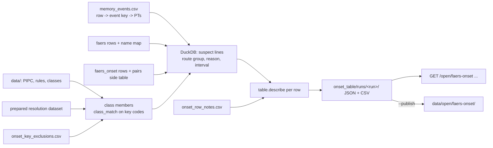

# Design: FAERS time to onset for all 65 PIPC cascades

> Scope: `apps/api/janus/onset_table/` (`table.py` pure statistics, `routes.py` pure route groups, `dataset.py`
> caveats, method, CSV, `build.py` offline build, `router.py` read-only routes), the `pairs` side table of the
> `faers_onset` pipeline (`pipelines/janus_pipelines/jobs/faers_onset.py`), `data/onset_key_exclusions.csv`,
> `data/onset_row_notes.csv`, `data/open/faers-onset/`. Decisions DP-O1-DP-O10, properties P1-P10. Reviews:
> `review-statistician.md`, `review-pharmacologist.md`.

## 1. Overview

## 2. Unit, candidates and intervals (Req 1-2)
- Unit: one report of the `faers` artifact (one case id, latest version). Counts are reports.
- Candidate line: a drug line with role PS or SS whose ingredient name maps (count-build name map) to a class
  member that is not excluded for the class, with an allowed route group (§3).
- Candidate report: has a candidate line and an event term of the row's key. Interval: per report, from the most
  recently started candidate line with a usable `faers_onset` interval (shortest interval); the earliest-start
  reading is published as `median_days_earliest_class_start` (DP-O4).
- Candidates without an interval are counted under the furthest `faers_onset` exclusion reason any of their lines
  reached (`candidates_without_interval_by_reason`, from the new `pairs` side table).

## 3. Routes and members (DP-O3, DP-O5)
`faers_onset` now writes a side table `pairs` (every report-drug pair: role, `DRUG.route`, `DRUG.dose_form` as
published, exclusion reason). `routes.route_group` maps the free-text route to `systemic_or_unknown`, `eye`,
`rectal`, `nasal_inhaled`, `joint_lesion`, `local` or `not_patient` (transplacental, breast milk, semen). Every class
counts `systemic_or_unknown` (empty and "Unknown" routes included); extras: eye for `beta_blocker_index_eye` (row 3,
with its S01ED form extension on), rectal for `laxative`, nasal/inhaled for opioids, antipsychotics,
benzodiazepines and dopaminergic antiparkinsonians, joint/lesion for systemic corticosteroids. Key exclusions per
class (13 rows, each with reason and note) in `data/onset_key_exclusions.csv`; they apply to this table only, never
to the cascade engine. Row notes (30 rows) in `data/onset_row_notes.csv`.

## 4. Statistics per row (Req 3)
| n = reports with an interval | Status | Published |
|---|---|---|
| no candidate | `no_candidate_reports` | counts |
| 0 | `no_interval` | counts, exclusion reasons |
| 1-9 | `count_only` | counts, raw zero-day/day-one counts (shares null) |
| largest identical (start, event) cluster > 25 % of n | `cluster_dominated` | counts and cluster sizes only |
| 10-29 | `small_sample` | median, quartiles, exact and bootstrap median intervals, sensitivities; no shape |
| ≥ 30 | `described` | as above, plus the Weibull shape if zero-day share ≤ 0.5 and ≥ 5 distinct intervals |
Exact order-statistic interval of the median is primary (coverage published); the seeded percentile bootstrap (1000,
time-machine parity) is kept with `median_ci_degenerate`. Sensitivities: without day-01 dates (≥ 10 left), distinct
date pairs (≥ 10), earliest class start. Flags: `median_reflects_zero_heaping` (zero-day share > 0.5).

## 5. Dataset (Req 4-5)
Top level: dataset, version (`faers-onset-pipc-1+` + hash of the rows), build time, FAERS receipt quarters and
snapshot, run ids of `faers`, `faers_onset` and the count build, resolution dataset, rule-base version, hashes of
the vocabulary and the two curated files, `faers_onset` global quality and exclusions, licence CC BY 4.0 with
attribution (PIPC CC BY 4.0, FAERS CC0, not an FDA endorsement), MedDRA notice, review status, disclaimer, the fixed
framing fields, caveats (12), method, summary, rows. CSV: one line per PIPC row (columns in `dataset.CSV_COLUMNS`).

## 6. Build (Req 5.3)
`python -m janus.onset_table.build [--data-dir] [--publish]`. Refuses when `faers_onset` or the count build rests on
another `faers` run, the count build on another resolution dataset, the `pairs` side table is missing, or a curated
exclusion names a key that is not a class member. Seven queries per distinct (class, event key) pair (60 pairs).

## 7. API contract **[Client: experience]**
Medical routes (no-store, access line only). 503 `{"error": "onset_table_unavailable"}` without a valid dataset.
- `GET /open/faers-onset` → `OnsetTableOut` (everything in §5; `rows[]` = `OnsetRowOut`).
- `GET /open/faers-onset.csv` → `text/csv`, header `x-janus-dataset-version`.
- `GET /open/faers-onset/{position}` → `{dataset, version, faers_receipt_quarters, license, attribution,
  meddra_notice, caveats, row}`; 404 `unknown_position`; 422 `{"error": "invalid_request", "fields": ["position"]}`
  when the position is not one or two digits.

`OnsetRowOut` (all keys always present; null when not published): `pipc_position, pipc_system, pipc_drug_a,
pipc_adverse_event, pipc_drug_b, pipc_locator, index_class, class_ingredient_keys[], excluded_class_keys[],
route_groups_counted[], form_extensions_on, event_key, event_pts[], shared_with_positions[], candidate_reports,
reports_with_interval, usable_share, candidates_without_interval_by_reason{reason: n}, members_with_reports[{key,
candidate_reports, reports_with_interval}], distinct_intervals, multi_line_reports, multi_event_reports,
event_year_min, event_year_max, status, small_sample, omitted_reason, median_days, q25_days, q75_days,
median_exact_ci_low_days, median_exact_ci_high_days, median_exact_ci_coverage, median_ci_low_days,
median_ci_high_days, median_ci_degenerate, median_reflects_zero_heaping, median_days_earliest_class_start,
median_days_distinct_date_pairs, zero_day_reports, zero_day_share, day_one_reports, jan_one_reports, day_one_share,
reports_without_day_one, median_days_without_day_one, sensitivity_omitted_reason, largest_date_cluster,
reports_in_clusters_ge3, weibull_shape, weibull_shape_ci_low, weibull_shape_ci_high, weibull_scale_days,
weibull_shape_class (early|random|wear_out), shape_omitted_reason, row_notes[{code, note}], descriptive_only (true),
causal (false), incidence (false), counts_are ("reports")`.
A screen should show the count and status first, the exact interval with any median, the caveats and row notes
always, and never present a number from a `count_only` or `cluster_dominated` row. Any patient-facing use is out of
scope (time-machine Req 9 governs the one patient sentence).

## 8. Result of the first build (2026-11-09; FAERS receipt quarters 2025Q4-2026Q3, snapshot 2026-10-28)
- 65 rows, 60 distinct (class, event) pairs. Status: 21 described, 11 small_sample, 3 cluster_dominated (rows 3, 6,
  48), 19 count_only, 9 no_interval, 2 no_candidate_reports (rows 44 rosiglitazone, 62 acitretin).
- 32 rows have a median (usable onset data), 54 have at least one interval. The usable share is 0-100 % of candidate
  reports (row median 6.6 %; row 29 has 1 of 1): most reports give no complete therapy start date.
- 18 rows have a published Weibull shape; all 18 are `early` (shape 0.32-0.53, all upper interval bounds below 1), which the statistician reads as
  heaping and receipt-window truncation as much as timing (caveat `weibull`).
- Examples (exact 95 % interval): statin → myalgia 35 days (20-61, n=216); anticonvulsant → rash 13 (10-14, n=226);
  ACE inhibitor → cough 19 (1-69, n=17, small sample); CCB → peripheral oedema 29 (7-73, n=23); PPI → deficiency
  245.5 (82-730, n=68); benzodiazepine → cognitive impairment 0 (0-0, n=122, heaping flagged).
- Surprises: (1) 16.2 % of usable FAERS event dates fall on the 1st of a month (3.3 % expected) and 4.0 % on 1 January
  (0.27 %), so "complete" dates are often filled in; (2) one batch of very large multi-drug reports (dozens of
  distinct cases with identical dates 2018-02-07 → 2021-01-01) produced the 1,059-day medians of rows 3 and 48 in the
  first draft, now caught by the cluster rule; (3) the route filter removed a large share of topical NSAID and
  corticosteroid lines (row 51: 246 → 153 reports with an interval); (4) plain "DOXEPIN" in FAERS maps to a
  topical-only key (open item).

## 9. Properties
| # | Property | Req | Test (`tests/test_onset_table_properties.py`) |
|---|---|---|---|
| P1 | status follows the thresholds; no median below 10; no shape below 30; shares null on count_only | 3.1-3.4 | Hypothesis |
| P2 | statistics do not depend on report order | 3.5 | Hypothesis, shuffled |
| P3 | rows sharing (class, event) get the same numbers; shared_with names them | 1.3 | Hypothesis |
| P4 | interval count ≤ candidates; reasons sum to the rest; q25 ≤ median ≤ q75; intervals contain the median | 2.1 | Hypothesis |
| P5 | descriptive / not causal / not incidence / reports on every row | 4.1 | Hypothesis |
| P6 | CSV = JSON rows, version in every line; version follows content | 5.2 | Hypothesis |
| P7 | exact median interval contains the median, coverage ≥ 0.95, none below n = 6 | 3.1 | Hypothesis |
| P8 | a dominating date cluster withholds every statistic | 3 | Hypothesis |
| P9 | shape withheld under heaping or few distinct values | 3.1 | Hypothesis |
| P10 | route grouping ignores case and spacing; class route policy | DP-O3 | Hypothesis + examples |
Plus: `faers_onset` side table (one row per pair, reason equals the pure rule), curated files valid, every PIPC row
has one event key, class members use the engine matcher, routes (503, table, row, 404, 422, medical GET only).

## 10. Decisions
| # | Decision | Alternatives | Why |
|---|---|---|---|
| DP-O1 | Offline build in `apps/api`, CC BY 4.0 dataset | Pipeline job; CC0 | Needs the resolution dataset and rule base; PIPC text is CC BY |
| DP-O2 | Event terms from the shared Collective Memory vocabulary, unchanged | Own term lists | One definition of "the event" across Janus; gaps become row notes and open items for the vocabulary owner |
| DP-O3 | Route filter from `DRUG.route` via a `faers_onset` side table | Key-level code filters | Keys like dexamethasone and diclofenac have systemic and local forms; only the route separates them |
| DP-O4 | Shortest interval per report, earliest-start median published too | Earliest only | Same rule as the time machine; the other reading shows the switch bias |
| DP-O5 | Curated key exclusions for this table only | Change cascade classes | The engine needs them (a patient on aspirin), the onset question does not |
| DP-O6 | Exact order-statistic interval primary; bootstrap kept | Bootstrap only (time machine) | Bootstrap collapses on tied data (statistician S3) |
| DP-O7 | Cluster rule > 25 % → counts only | Deduplicate clusters | Clusters may be real case series; hiding the statistic is safer than guessing |
| DP-O8 | Weibull only n ≥ 30, zero share ≤ 0.5, ≥ 5 distinct | Time machine's n ≥ 10 | Heaping and ties decide the shape otherwise (statistician S4) |
| DP-O9 | Count only below 10 | Median for any n | A median of 3 reports is not a description |
| DP-O10 | Rows sharing (class, event) published separately with `shared_with_positions` | Collapse to 60 rows | The dataset must have one row per PIPC row |

## 11. Open items
- Collective Memory vocabulary owner: fracture terms (row 48), vertigo (2, 56), muscle spasms (11), oedema/fluid
  retention (5, 31), vomiting (26-27), oesophageal terms (50), diabetes terms (22), atrial fibrillation (21, 63),
  "Amnesia" as acute effect (23), splitting the deficiency key (49).
- Drug resolution: plain "DOXEPIN" → topical-only key Q71704041 (rows 33-35, and probably the engine for US doxepin);
  unmapped oral iron names (row 65); codeine's analgesic code; duplicate lactulose key.
- Interval-censored Weibull likelihood instead of the half-day shift.
- Selection caveat: cite a study of date completeness in FAERS (wording softened to "may").
- Human review by a pharmacist and a statistician; web screen from §7.
