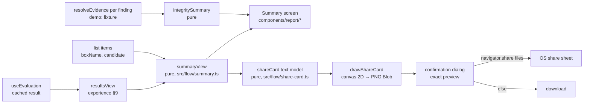

# Design: Janus report (Summary screen and share image)

> Scope: `apps/web` only. No API change, no new dependency. Requirements: `requirements.md`.

## 1. Overview



Everything right of the evaluation runs in the browser. The only requests are the ones the finding detail already
makes (`POST /evidence/resolve`, one per finding; none in demo mode, where the fixture client answers).

## 2. Code layout
| File | Role |
|---|---|
| `src/flow/summary.ts` | `summaryView(result, items, vocab)` and `integritySummary(resolutions)`; pure; built on `resultsView` |
| `src/flow/share-card.ts` | `shareCard(input)` text model and `shareCardText(card)`; pure |
| `src/components/report/rings.tsx` | `Ring` (segmented donut) and `SegmentBar`, inline SVG, `aria-hidden`, pattern per segment |
| `src/components/report/Summary.tsx` | `SummaryBody` (presentational, tested) and `Summary` (page: states, evidence calls) |
| `src/components/report/ShareImage.tsx` | options, dialog, preview, share / download |
| `src/components/report/draw.ts` | `drawShareCard(card, palette, fonts)` canvas 2D → `Blob` (browser only) |
| `src/app/[locale]/results/summary/page.tsx` | route |
| `messages/*.json` `Report` | five languages |

## 3. View model (`summaryView`)
```ts
interface SummaryView {
  kind: "ok";
  month: string;                                     // as_of_month
  medicines: { total: number; notFully: number[] };  // item indices with a not_checked entry
  patterns: { total: number; groups: Record<OrderGroup, FindingView[]>; unconfirmedForm: number };
  noPattern: boolean;
  warnedItems: number[];                              // = resultsView.warnedItems
  safetyLines: SafetyLineCode[]; emergencyFirst: boolean;
  rules: { checked: number; total: number };
  regions: Record<"TR" | "EU" | "US" | "name", number>;
  sources: { sourceId: string; date: string; items: number }[];   // date = YYYY-MM-DD
}
type OrderGroup = "fits" | "fitsLate" | "notConfirmed";
```
`orderGroup(timing)` moves from `FindingCard.tsx` (`ORDER_LABEL`) to `src/flow/findings.ts` so the card chip, the note
wording and the Summary use one map. `integritySummary` takes the evidence resolutions of the findings that loaded:
`sources` = the number of distinct used evidence ids (`evidenceView(r).used`), `noRetracted` = every line's
`no_retracted_used`, `stale` = union of `stale_sources` by `source_id`, `withExclusions` = the number of
resolutions whose line lists an exclusion, `missing` = findings whose evidence did not load.

## 4. Screen
Order (phone, one column): emergency notice (when a safety line applies) · back link "‹ Results" · large title
"Summary", eyebrow "Checked in November 2026", summary line "9 medicines checked · 4 patterns to discuss" · the
**patterns** tile (wide: ring with the total in the centre, legend per timing group with its findings as row links,
"unconfirmed form" line, safety lines, "This may be worth discussing with your doctor.") · a two-tile row
**medicines** (ring checked / not fully checked) and **patterns checked** (ring n of m) · **abrupt stop** (when any)
· **where the boxes come from** (segmented bar) · **sources** (grouped rows: product sources with dates; integrity
line; stale sources) · **share** card. Desktop (≥ 1024 px, 1120 px wide): a bento grid of 3 columns, the patterns
tile spans two columns and two rows, the share card spans the last row.

Each tile is a `SummaryCard` whose heading is a link with a chevron to the detail screen (one link per tile; the
inner finding rows are separate links), so every tile is reachable with the keyboard and announced by name.

## 5. Share image
- **Text model** (`shareCard`): `{ title, month, stats: {value, label}[], lines: string[], events: string[] | null,
  ingredients: string[] | null, safety: string[], noPattern: string | null, demo: string | null, disclaimer }`. The
  translator is passed in (`t`), so the model holds exactly the strings that are drawn. `shareCardText` joins them for
  the preview's `alt` text and the tests.
- **Drawing** (`drawShareCard`): canvas 1080 × 1350 (4:5, fits Messages / WhatsApp previews without cropping);
  colours are the active theme's tokens read with `getComputedStyle(document.documentElement)` (Glass surfaces drawn
  over a solid background), the document's fonts (`--font-display`, `--font-body`) after `document.fonts.ready`;
  text wraps by `measureText`; a ring of the patterns checked; the disclaimer in a band at the foot; the demo label in
  a pill at the top. `canvas.toBlob("image/png")`.
- **Flow**: options (two checkboxes, off) → "Prepare image" → modal dialog with the `` of the Blob URL, the
  confirmation sentence, "Share" (when `navigator.canShare({files:[file]})`) or "Save image", and "Cancel". Share
  rejected with `AbortError` keeps the dialog; any other share error falls back to the download. The Blob URL is
  revoked when the dialog closes.

## 6. Correctness properties
| # | Property | Validates | Approach |
|---|---|---|---|
| P1 | Every finding is in exactly one timing group, its group is `orderGroup(timing)`, and the group sizes add up to the number of findings | Req 2.2, 4.4 | fast-check over `cascadeResultArb` (`src/flow/summary.test.ts`) |
| P2 | The abrupt-stop count equals the number of distinct warned items, and the rendered Summary shows the abrupt-stop line once per warned item | Req 2.4 | fast-check over results; render test counts `data-testid="abrupt-stop"` |
| P3 | Fully checked + not fully checked = medicines; region counts add up to medicines; source rows cover every item | Req 2.1, 2.5, 2.6 | fast-check with generated item lists |
| P4 | Zero state: no finding + `no_pattern_found` ⇒ the no-pattern sentence is rendered and no reassurance word or forbidden phrase appears, in every locale and theme | Req 4.1, 4.3 | render test, all locales × themes |
| P5 | Integrity summary: `noRetracted` ⇔ every line says so; `sources` = distinct used ids | Req 2.6 | fast-check over the recorded evidence resolutions with flipped flags |
| P6 | The share model contains no box name, and no ingredient or event name unless that option is on (then all of them) | Req 5.2, 5.3 | fast-check with sentinel names (`ZZSENTINEL-…`) |
| P7 | The share model always holds the disclaimer; the demo label iff demo; the no-pattern sentence iff no finding; the abrupt-stop sentence iff a warned item; safety lines only with event names | Req 5.3, 5.4 | fast-check over all locales |
| P8 | Rendered Summary: emergency notice first iff a safety line; no forbidden phrase; Glass has no theme-device word | Req 4.2, 4.3, 6.2 | render test, fast-check over results × locales × themes |
| P9 | In the browser: the PNG is 1080 × 1350, a download happens after the confirmation, no request leaves the page | Req 5.1, 5.6, 6.3 | Playwright (`e2e/report.spec.ts`) reads the PNG header of the download |

## 7. Decisions
| # | Decision | Alternatives | Why |
|---|---|---|---|
| DP1 | Route `/results/summary`, linked by a row link under the results title; the Results tab stays active; back link to Results | `/report` as a new top-level route; a "Summary" segment on `/results`; make the Summary the landing screen after "Check" | A sub-route keeps the tab, the back link and the existing results flow (and its e2e) unchanged; a segment would hide the findings behind a control; the landing could follow once the owner has seen it |
| DP2 | User-facing name "Summary" (TR Özet, DE Übersicht, FR Résumé, ES Resumen); the namespace is `Report` | "Janus report" | Each language's report word is reserved for FAERS and donated reports (experience Req 28.4); "bildirim" would mean a pharmacovigilance report |
| DP3 | `summaryView` is built on `resultsView` | Count from the raw result again | One grouping, one warned-items list, one safety-line list; the counts cannot drift from the results screen |
| DP4 | `orderGroup` shared by card, Summary and share image | Copy the map | The order wording of experience Req 28.1 has one source |
| DP5 | "Not fully checked" = an item with any `not_checked` entry | Count ingredients | The person counts boxes; the medicines screen shows the per-ingredient reason (link) |
| DP6 | Regions from `candidate.region` (FR/ES products are EU); an ingredient candidate is "added by name" | Use the scan region setting | The candidate is what was confirmed; an ingredient has no region |
| DP7 | Evidence integrity combined over the findings' resolutions (one call per finding, the detail's request); "no retracted source" only if every line says so | One call with every id; skip the integrity part | Same request and fixture as the finding detail (demo answers per finding); the sentence is the server's, never widened by the client |
| DP8 | Rings and bars: solid / dashed / dotted strokes plus tone, legend with the same mark, label and number; neutral tones (`--accent`, `--chip-fg`, `--muted`); `--warn` only for the abrupt-stop line; no `--risk` | Colour-only segments; red for "order fits" | Never colour alone (Req 3.1); red is for real risk only (design.md) |
| DP9 | Zero state: the no-pattern sentence instead of a big "0" | A "0" tile | A large zero reads as an all-clear (cards safety review F1) |
| DP10 | Share image drawn on canvas 2D, 1080 × 1350 PNG, theme tokens and document fonts | SVG → image → canvas; a server render; html-to-image library | SVG-as-image cannot use the page's fonts; a server render would send health data; no dependency |
| DP11 | Share model pure, translator passed in; counts by default; opt-in event names and ingredient names; box names never | Medicine box names as an option | Box names identify products and the person; ingredient names are what a doctor reads |
| DP12 | Confirmation in a native `<dialog>` showing the same Blob as the share | An inline step; a preview re-rendered in HTML | "Exact image" means the same bytes; `<dialog>` gives focus handling and Escape for free |
| DP13 | No statistician pass | — | The Summary shows counts only (no ratio, interval or rate); the FAERS figures stay in the finding detail |

## 8. Open items
- Whether "Check" on the medicines screen should land on the Summary (owner, after seeing it).
- Native review of the `Report` namespace (pre-launch checklist).
