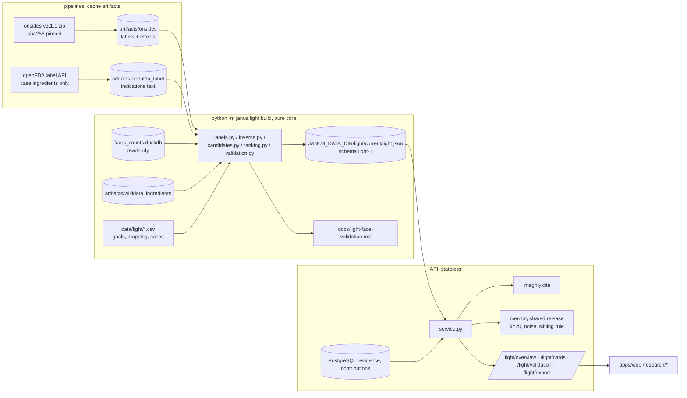

# Design: Light Face ("Dead Drugs Rise")

> Scope: `apps/api/janus/light/`, the `onsides` and `openfda_label` pipelines, `data/light/`, the `/light/*` routes and the
> researcher screens in `apps/web`. Requirement numbers refer to `requirements.md`; decisions DP1–DP20 and properties
> P1–P16 are this spec's own; upstream decisions are written "collective-memory DPn" and so on.
> Written 2026-11-08 by Claude Code standing in for the Kiro spec workflow. No owner stop (Phase 4 brief): every choice
> is a DP with its alternatives; the decisions that need an expert are collected in §13.

## 1. Overview



The deterministic part (which candidates exist, their numbers, their rank, the validation) is computed once per data
snapshot by the build; the request path only filters by integrity and adds the live patient-reported layer. Nothing in
the request path can create a candidate from FAERS or OnSIDES (P1).

### 1.1 Facts checked on 2026-11-08 (scratch scripts outside the repository)
| What | Observed | Consequence |
|---|---|---|
| OnSIDES release | GitHub release `v3.1.1` (2026-04-22), asset `onsides-v3.1.1.zip`, 84,862,297 bytes, SHA-256 `7739c73336786c92e73ca383af92d3f2814caf5e94206e08475b86d5a5ec22b9`. `v3.2.1` (2026-07-20) has no data asset (code only) | Pin the v3.1.1 asset and its hash (DP1) |
| OnSIDES licence | `LICENSE-DATA` on `main`: "The OnSIDES data … is licensed under the Creative Commons Attribution 4.0 International License (CC BY 4.0)"; code MIT. README asks to cite Tanaka et al., Med 2025, doi:10.1016/j.medj.2025.100642 (Crossref: Med 6(7):100642, 2025) | Attribution in NOTICE, cards and export (Req 2.4) |
| OnSIDES limits (README) | "The adverse drug event term extraction method is imperfect"; "Patients/healthcare professionals seeking health information should not trust or use this data" | Researcher area only; limits sentence on every card |
| OnSIDES tables | `product_label` 41,119 labels (US 35,340, UK 2,874, JP 1,884, EU 1,021); `product_adverse_effect` 6,928,666 rows (sections AR 5.28 M, WP 1.20 M, NA 0.39 M, BW 0.06 M); MedDRA names as PT and LLT (e.g. `Hypertrichosis` PT, `Hairiness` LLT); ingredient ids RxNorm or `OMOP…` | The mapping names terms exactly as published, PT or LLT (DP4) |
| US label ids | `source_product_id` = DailyMed set id + `.` + version; URL `dailymed.nlm.nih.gov/dailymed/lookup.cfm?<setid>` | openFDA label lookup by `set_id` (DP9) |
| Ingredient keys | Wikidata artifact maps RxCUI → item (e.g. minoxidil RxCUI 6984 → Q424165) | Key mapping DP3 |
| FAERS artifact | `rows.parquet` has drugs (role, ingredients) and events; **no indication (INDI) column** | FAERS cannot be restricted by indication (Req 5.1, DP9) |
| Prototype ranks (all labels, single-ingredient) | alopecia: 39 ingredients, minoxidil 2nd; erectile dysfunction: 40, sildenafil 4th; obesity: 482, topiramate not in the first 30; eyelash: 6, bimatoprost 6th | Ties and population size must be reported; obesity is a hard case (§8) |
| Topical corticosteroids | `Hypertrichosis` is listed for amcinonide, fluocinonide, clobetasol (local effect) | The pharmacologist pass must judge whether local effects belong to the goal (§13 Q2) |

## 2. Code layout

```
pipelines/janus_pipelines/jobs/onsides.py          fetch pinned zip → artifacts/onsides (rows: one per label)
pipelines/janus_pipelines/jobs/openfda_label.py    case ingredients → artifacts/openfda_label (rows: one per US set id)
data/light/goals.csv                               therapeutic goals (curated)
data/light/effect_goal_map.csv                     side-effect term → goal (curated, cited)
data/light/validation_cases.csv                    fixed validation cases (curated, cited)
data/evidence_papers.csv                           + the papers cited by the three files
apps/api/janus/light/
  model.py        enums and frozen dataclasses                                           pure
  curation.py     parse and validate the three curated files                             pure (text in)
  keys.py         OnSIDES ingredient id → Janus ingredient key                           pure
  labels.py       label-effect signals per (ingredient, goal)                             pure
  inverse.py      inverse FAERS signals from 2x2 tables (janus.memory.stats)             pure
  ranking.py      Wilson bound, ordering key, tied ranks                                 pure
  candidates.py   merge signals → ranked candidates per goal                             pure
  validation.py   evaluate the fixed cases (primary and sensitivity runs)               pure
  messages.py     closed code set, English canonical sentences                           pure
  cards.py        card content: integrity filter, benefit merge                          pure
  export.py       export rows                                                            pure
  report.py       docs/light-face-validation.md renderer                                 pure
  build.py        CLI: read inputs, run the pure core, write light.json and the docs     I/O
  store.py        LightHolder: follows the `current` link, refuses another schema       I/O
  benefit.py      patient-reported layer (discovery query + memory.shared release)       I/O + pure
  schemas.py      Pydantic response models
  service.py      orchestration
  router.py       /light/* routes (medical)
apps/web/src/light/          client: contracts, decoders, pure view logic (+ tests)
apps/web/src/components/light/   Hypotheses, CardView, Validation, Export screens
apps/web/src/app/[locale]/research/{hypotheses,validation,export}/page.tsx
apps/web/messages/*.json     namespace `Light`
docs/light-face-validation.md   generated by the build
```
No new runtime dependency (DuckDB, Pydantic, psycopg, Polars in pipelines are already used). No migration: the light
build is a file, like the counts file; donations are read through the existing `contributions` table.

## 3. Data sources (Req 6)

### 3.1 `onsides` pipeline
- Fetch `https://github.com/tatonetti-lab/onsides/releases/download/v3.1.1/onsides-v3.1.1.zip` (bulk timeout), refuse a
  body whose SHA-256 differs from the pinned value (a new release is a code change, reviewed). Snapshot date
  `2026-04-22` (the data release date, not the retrieval time).
- Parse the seven CSV tables from the zip in DuckDB (in memory, no external access). Output rows, one per label:
  `label_id:int, source:str (US|EU|UK|JP), product_name:str, source_product_id:str, url:str,
  ingredient_ids:list[str], effects:list[struct(meddra_id:int, section:str)]` (effects distinct per label and section).
  Side tables: `meddra` (`meddra_id, name, term_type`) and `ingredients` (`rxnorm_id, name`).
- Accounting: input = labels; excluded `no_ingredient` (labels without an RxNorm ingredient), `no_effect`.
- Storage `cache` (CC BY 4.0 allows redistribution, but 400 MB does not belong in git); cadence 91 days (README:
  quarterly updates).

### 3.2 `openfda_label` pipeline
- Input: the `ingredient_name` column of `data/light/validation_cases.csv` (9 names). For each name one query
  `https://api.fda.gov/drug/label.json?search=openfda.generic_name:"<name>"&limit=1000` (no key needed at this volume;
  240 requests a minute is the keyed limit). Output rows: `set_id, version, generic_names:list[str],
  indications:str` (the `indications_and_usage` text joined). Snapshot = retrieval time. Storage `cache`, cadence 30 days.
- Only labels whose generic names include the query name are kept; the query string and the count per name are
  recorded in the manifest metrics.

### 3.3 Inputs read by the build
`artifacts/onsides/current`, `artifacts/openfda_label/current`, `artifacts/wikidata_ingredients/current` (Parquet, via
DuckDB), `memory/faers_counts/current/faers_counts.duckdb` (opened read-only with the reader's settings,
collective-memory DP14), the three curated files. Missing inputs stop the build with a message naming the input.

## 4. Curated files (Req 2.1, 5.1, 5.4)

### 4.1 `data/light/goals.csv`
`key,label_en,label_tr,label_de,label_fr,label_es,faers_pts,benefit_keys,note`. `key` matches `^[a-z][a-z0-9_]{1,40}$`;
`faers_pts` `|`-separated MedDRA PTs (may be empty: then no inverse signal); `benefit_keys` `|`-separated Janus benefit
keys from `memory_events.csv` (may be empty). Labels are names of conditions in the reader's language, never a claim.

### 4.2 `data/light/effect_goal_map.csv`
`term,goal,status,evidence,rationale`. `status` ∈ {`active`, `excluded`}; `evidence` `;`-separated evidence ids of
`paper:` records in `data/evidence_papers.csv`. The loader refuses: an empty or unknown goal, a duplicate term, an
`active` row without evidence, an evidence id that is not in the paper list, a term absent from the OnSIDES vocabulary of
the run (the build checks this one; the pure loader gets the vocabulary as an argument).

### 4.3 `data/light/validation_cases.csv`
`id,ingredient_name,ingredient_key,goal,original_use,later_year,indication_terms,evidence,note`.
`indication_terms` is a `|`-separated list of lower-case phrases searched as whole words in the openFDA indications text;
`evidence` cites the paper that reports the later use. Fixed for a release: changing a case is a reviewed change.

### 4.4 Review status
Every row of the three files and the review sheets carry "AI-reviewed, pending expert review" (owner decision); the API
returns `review_status: "ai_reviewed_pending_expert"` and the screens show it. Review sheets:
`mapping-pharmacologist-review.md`, `validation-statistician-review.md` (§12).

## 5. Signals

### 5.1 Ingredient keys (`keys.py`, DP3)
`key_for(onsides_id, name) -> (key | None, method)`: an RxNorm id maps through the Wikidata artifact's `rxcuis` when
exactly one item carries it (`rxcui`); else an exact, case-folded match of the OnSIDES ingredient name with exactly one
item's English label (`label_en`); else `None` (`unmapped`, counted in the build report). Ambiguous matches are `None`.

### 5.2 Label effects (`labels.py`, Req 2.2, 2.3)
For each **single-ingredient** label (exactly one mapped key, DP2) and each active mapping row whose term is among the
label's effects: one hit (key, goal, label, region, section, term). Aggregation per (key, goal):
`labels_with_effect` (distinct labels), `labels_total` (the key's single-ingredient labels in the run's region filter),
`regions` (sorted subset of US, EU, UK, JP), `sections`, `terms`. Pure function of the label rows, the mapping and the
key map; order of rows never matters (P6).

### 5.3 Inverse FAERS signals (`inverse.py`, Req 1, DP6)
Per goal with a PT set: `ev_mapped`, `ev_all` = reports with any PT of the set (report level), per ingredient
`a` = reports naming the ingredient (scope `any`) and any PT, `ingredient` = the ingredient's report count (scope
`any`), N = mapped / all reports (region `ALL`). Cells by `cells_from_counts`, statistics by
`janus.memory.stats.evaluate`, sensitivity by `stats.sensitivity`. Inverse iff `a ≥ PARAMS.min_reports` and
`ror_ci.high < 1`. Pure part: `inverse_signal(a, ingredient, ev_mapped, ev_all, n_mapped, n_all) -> Inverse | None`.
SQL (build, parameterised, one statement per goal):
```sql
WITH ev AS (SELECT DISTINCT report_id FROM faers_report_event WHERE pt IN (SELECT unnest(?::VARCHAR[])))
SELECT i.ingredient_key, count(DISTINCT i.report_id)
FROM faers_report_ingredient i JOIN ev USING (report_id) GROUP BY 1
```
plus the event totals (`ev` joined with `faers_report.mapped`) and the precomputed ingredient counts. Ingredients with
`a = 0` are not evaluated: an estimate exists only for `a > 0` (collective-memory §3.1), and `a ≥ 3` is required anyway.
The same function gives the per-case FAERS numbers of the validation (§8.3).

### 5.4 Patient-reported layer (`benefit.py`, Req 3, DP7)
At request time, for the goal's benefit keys: one discovery statement
```sql
SELECT x.x, c.event, count(*) FROM contributions c CROSS JOIN LATERAL unnest(c.ingredients) AS x(x)
WHERE c.direction = 'benefit' AND c.event = ANY(%s) GROUP BY 1, 2 HAVING count(*) >= %s ORDER BY 1, 2 LIMIT %s
```
(k, at most 100 cells) finds the cells worth asking; each is then answered by `janus.memory.shared.shared` with
`SharedIn(layer="contributions", ingredients=[x], event, direction="benefit")`: regional cells, sibling rule, k = 20 on
the true count, discrete Laplace noise, total of released cells. Only `total_of_released` (and the released regional
values) leave the server; a cell whose regions are all hidden produces nothing (P8). The discovery count never leaves
the function.

## 6. Candidates and ranking (`candidates.py`, `ranking.py`, Req 4.4, DP5)

A candidate is (key, goal) with at least one signal (P1). Within a goal, the ordering key is, in this order:
1. number of signal types present (descending);
2. number of regions whose labels list the effect (descending);
3. the Wilson score lower bound (95 %) of `labels_with_effect / labels_total` (descending), computed exactly in
   `Fraction` up to the square root (`math.isqrt` on a scaled integer), so equal shares tie exactly;
4. `labels_with_effect` (descending);
5. FAERS `a` of the inverse signal (descending; report count, never the ratio);
then the key only to make the list order stable. **Ranks** are computed on keys 1–5 only: equal keys share a tied
range `best..worst` (competition ranking: best = 1 + number strictly ahead, worst = best + ties − 1). The display order
within a tie is the key order and is never presented as a rank (P7). The ratio never enters the key (Req 1.3).

The patient-reported layer is live and noisy: it is shown on the card but does **not** enter the ranking (the ranks are
the build's, so they are reproducible; DP5).

## 7. Cards (`cards.py`, Req 4)

```
Card {
  ingredient: {key, labels: {en,tr,de,fr,es}}, goal: {key, labels},
  rank: {best, worst, population},
  signals: [
    {type: "label_effect", regions: [..], labels_with_effect, labels_total, share_low: float, sections: [..],
     terms: [..], evidence_ids: ["dataset:onsides", <mapping papers>]},
    {type: "inverse_faers", cells, estimates {ror, ror_ci {low, high, level, method}, prr, chi2, chi2_form},
     haldane_applied, sensitivity {...}, denominator_sensitive, reports: a, evidence_ids: ["dataset:faers"],
     locator: faers:ingredient=<key>;event=goal:<goal>;…  (DP12)},
    {type: "patient_reported", total_of_released, cells: [{region, status, value?}], disclosure {k, epsilon}}
  ],
  sources: [{id, title, doi, url, status}], removed_sources: [{id, reason}],
  mechanism: null, mechanism_code: "mechanism_source_not_connected",
  codes: ["candidate_not_treatment", "label_extraction_limits", "inverse_reporting_bias", …]
}
```
- **Integrity (P1, DP8).** The card's evidence ids are the union of its signals' ids. They go through
  `integrity.citability.cite(snapshot, ids)`; a signal whose ids are all removed is dropped from the card; a candidate
  with no remaining signal that has a citable id is not a card. Removed ids are listed with their reason
  (`retracted` shows the stamp / "Retracted" label). The snapshot is loaded once per request in a read-only transaction.
- **Patient-reported only.** A released benefit cell with no build candidate becomes an entry of `patient_reported`
  (ingredient, goal, released counts, disclosure), never a card (DP7).
- **Warnings.** `inverse_faers` carries the codes `inverse_reporting_bias` (notoriety and indication bias), `screening_statistic`,
  `spontaneous_reporting`, `not_incidence`, the FAERS snapshot date and window; `label_effect` carries
  `label_extraction_limits`; every card carries `candidate_not_treatment` and the disclaimer.
- **Wording (Req 4.5, P3).** The API returns codes; the sentences live in `messages.py` (English canonical) and the
  `Light` namespace (five languages). Forbidden phrases of `medical-safety.md` rule 2 are checked over both, in every
  language, and over the goal and ingredient labels shown on cards. "Treatment for" never appears; the rule-7 label is
  the only sentence with "treatment", and it is a negation.

## 8. Retrospective validation (`validation.py`, Req 5, DP9, DP10)

### 8.1 Cases (fixed; every citation checked in Crossref on 2026-11-08)
| id | Ingredient | Original use | Later goal (year) | Evidence (DOI) |
|---|---|---|---|---|
| `minoxidil_alopecia` | minoxidil | hypertension | alopecia (topical approval 1988) | Zappacosta 1980, 10.1056/NEJM198012183032516 |
| `sildenafil_ed` | sildenafil | angina (trials) | erectile dysfunction (1998) | Goldstein 1998, 10.1056/NEJM199805143382001 |
| `sildenafil_pah` | sildenafil | erectile dysfunction | pulmonary arterial hypertension (2005) | Galiè 2005, 10.1056/NEJMoa050010 |
| `thalidomide_enl` | thalidomide | sedative | erythema nodosum leprosum (1965 report) | Sheskin 1965, 10.1002/cpt196563303 |
| `thalidomide_mm` | thalidomide | sedative | multiple myeloma (1999 report) | Singhal 1999, 10.1056/NEJM199911183412102 |
| `bimatoprost_eyelash` | bimatoprost | glaucoma | eyelash hypotrichosis (2008) | Smith 2012, 10.1016/j.jaad.2011.06.005 |
| `topiramate_obesity` | topiramate | epilepsy | obesity | Bray 2003, 10.1038/oby.2003.102 |
| `liraglutide_obesity` | liraglutide | type 2 diabetes | obesity (2014) | Pi-Sunyer 2015, 10.1056/NEJMoa1411892 |
| `amantadine_parkinson` | amantadine | influenza A | Parkinson's disease (1969 report) | Schwab 1969, 10.1001/jama.1969.03160070046011 |
The set as a whole cites Ashburn and Thor 2004 (10.1038/nrd1468), a review that names minoxidil, sildenafil and
thalidomide as repositioning examples, and Yang and Agarwal 2011 (10.1371/journal.pone.0028025), side-effect based
repositioning. The cases include ones the method cannot reach by construction (thalidomide → myeloma came from the
anti-angiogenesis hypothesis; sildenafil → PAH from its mechanism; amantadine and thalidomide → ENL from patients'
observations): they are kept to measure misses honestly.

### 8.2 Runs
- **Primary (later indication excluded where possible).** Label rows: US only. For the case drug, a US label is removed
  when its set id is absent from the openFDA artifact or its indications text contains any of the case's
  `indication_terms` as a whole phrase. Every other drug keeps all its US labels. FAERS inverse signals are computed as
  in §5.3 (FAERS cannot be restricted, §8.3). The candidates of the case's goal are rebuilt and ranked (§6).
- **Sensitivity (all labels).** All regions, no removal: the ranking the researcher sees.
- A case is **not evaluable** in a run when the case drug has no label left (e.g. thalidomide: its only US label is
  indicated for both later uses). A goal without active mapping terms gives every case of it `no_signal_type`.

### 8.3 Result per case and run
`rank {best, worst} | null, population, hit: worst ≤ TOP_K (10), informative: population > TOP_K, labels_used,
labels_removed {indication, not_in_openfda}, signal_types_present, reason ∈ {hit, ranked_below_top, not_a_candidate,
no_signal_type, not_evaluable}`, and the FAERS numbers of (case drug, goal PTs): cells, ROR and interval, `a`, flag
`faers_includes_later_indication: true`. **Status** = `experimental` iff no case is an informative hit in the primary run
(Req 5.3); otherwise `prototype` (still a research prototype; hits are never called proof).

### 8.4 Determinism (P4)
The build sorts every input (labels by id, effects by (id, section), cases by id) before use and writes JSON with sorted
keys and no timestamp; `build_id` is the SHA-256 of the canonical inputs description (run ids, counts build id,
curated-file hashes, code hash of `janus/light/*.py`). Running the build twice gives byte-identical files (P4 on
synthetic data; checked once on real data in task 9).

## 9. API (`router.py`, `schemas.py`, Req 4.2, 6.4, 6.5)

All routes are **medical** (`medical_router`): nothing is logged but the access line, `Cache-Control: no-store`. They
carry no user data in the request; the goal key is in a POST body so that the access log never holds a condition.

| Route | Body | Answer |
|---|---|---|
| `GET /light/overview` | — | `{schema_version, build_id, status, review_status, snapshot {onsides_version, onsides_date, faers_snapshot_date, faers_window, openfda_date}, goals: [{key, labels, candidates, label_terms}], codes, disclaimer, attribution}` |
| `POST /light/cards` | `{goal, offset = 0, limit = 20 (1..50)}` | `{goal, total, offset, cards: [Card], patient_reported: [...], patient_layer: ok|layer_unavailable, removed_by_integrity: int, snapshot, codes, disclaimer}` |
| `GET /light/validation` | — | `{status, top_k, cases: [CaseResult per run], summary {primary: {hits, informative_hits, misses, not_evaluable}, sensitivity: {...}}, snapshot, evidence: [source rows], codes, disclaimer}` |
| `GET /light/export` | — | `{licence: "CC BY 4.0", attribution: [...], snapshot, rows: [flat card rows of every goal], patient_reported: [...], codes, disclaimer}` |
Errors: `422 {"error":"invalid_request","fields":[…]}` (unknown goal, bad paging; never echoes a value); `503
{"error":"light_unavailable"}` (no build, wrong schema, no integrity snapshot). The patient layer failing alone gives
`patient_layer: "layer_unavailable"`, not an error.

## 10. Web (`apps/web`, Req 4, 5.2, 5.3)

Design system: the existing tokens and components (design.md steering; light face in Night Pharmacy, "Research" section
in Glass); no new component library. Screens under `/research` (the shell already gives the light face):
- **Research home** (`/research`): the three Phase 4 entries become links (hypotheses, validation, export); the séance
  entry is left to the séance spec. The experimental notice when `status = experimental`.
- **Hypotheses** (`/research/hypotheses`): goal picker (radio chips, keyboard), card list (20 per page, "show more"),
  each card: title "<ingredient> → <goal>", tied rank text ("rank 3–5 of 39"), signal chips (text, never colour only),
  label signal (regions, "listed in 29 of 32 labels"), inverse signal (CiBar from Memory, report count, warnings,
  snapshot), patient layer (released count or hidden), sources with integrity status, mechanism line, review status,
  the rule-7 label. States: loading, empty (no candidate for the goal), error (retry), long content (show more).
- **Validation** (`/research/validation`): summary (hits / informative / misses / not evaluable per run), the experimental
  notice, one card per case (case, original use, later goal, year, citation, rank range and population per run,
  reason, labels removed, FAERS numbers with the "includes the later indication" warning), the data snapshot.
- **Export** (`/research/export`): what is exported, licence and attribution, buttons "Download JSON" and
  "Download CSV" (built in the browser from the export answer; no new request per format).
- Strings in the `Light` namespace (five languages), Glass/Night Pharmacy paired keys only where a theme word is used.
- Tests: vitest + fast-check for the pure view logic (rank text, CSV escaping, decoders), the message tests (keys
  equal across locales, forbidden phrases), Playwright with route stubs from a fixture recorded from the real build
  (`src/light/fixture.recorded.json`), axe, 375 and 1280 px, both themes.

## 11. Correctness properties

| P | Property | Requirements |
|---|---|---|
| P1 | Every candidate has ≥ 1 signal; every card has ≥ 1 signal with a citable (non-retracted, registered) evidence id; a card never shows a signal whose ids were all removed | 4.1, seed 1 |
| P2 | Adding reports or labels of an unrelated ingredient (or of an unmapped term) never removes or changes an existing candidate's signals | seed 2 |
| P3 | No canonical sentence, `Light` message or curated label contains a forbidden phrase in its language; generated card text likewise | 4.5, seed 3 |
| P4 | Build and validation are deterministic: same inputs → identical output, independent of input order | 5, 6.3, seed 4 |
| P5 | `inverse_signal` agrees with an independent reference (Fractions + `decimal` interval) and is `None` whenever `a < 3` | 1.1 |
| P6 | Label aggregation is invariant to row order and duplicates; multi-ingredient labels never contribute | 2.2 |
| P7 | Tied ranks: best ≤ worst, equal keys ⇔ equal ranges, ranges partition 1..n, invariant to input order; the ratio never changes a rank | 4.4, 1.3 |
| P8 | The patient layer never outputs a value for a cell whose true count is < k or that the sibling rule hides; only released totals appear | 3.1 |
| P9 | Wilson bound: in [0, 1], monotone in successes for fixed n, exact ties for equal fractions | 4.4 |
| P10 | Curated loaders accept the committed files and name each injected defect | 2.1, 5.1 |
| P11 | Validation: removing a case drug's labels never improves its rank range in the primary run beyond the sensitivity run's population logic; a case with no labels is `not_evaluable`; status is experimental iff no informative hit | 5.1–5.3 |
| P12 | Key mapping: one-to-one only; ambiguous → None | 2.2 |
| P13 | API: unknown goal → 422 without echo; no build → 503; responses carry the disclaimer and the rule-7 code | 6.4 |
| P14 | Export rows equal the cards shown (same integrity filter), hold no true user count, and carry the licence | 4.2 |
| P15 | Inverse list order is by report count then key, never by ratio | 1.3 |
| P16 | Web: rank text, CSV escaping round-trip, decoders reject malformed answers | 4, 5.2 |

## 12. Reviews (owner decision: separate, labelled passes)
- **Pharmacologist pass** (`.kiro/agents/pharmacologist.md` scope extended by the brief): every mapping row and goal,
  every validation case (is the original use right, is the later goal right, are the indication terms right), the
  local-effect question. Sheet: `mapping-pharmacologist-review.md`.
- **Statistician pass** (`.kiro/agents/statistician.md`): the inverse rule, the ranking key and the Wilson bound, the
  hit definition, top-K, informativeness, the reporting of ties and of the FAERS contamination. Sheet:
  `validation-statistician-review.md`.
- Both sheets end "AI-reviewed, pending expert review"; changes they ask for are applied and recorded in §14.

## 13. Decisions

| DP | Decision | Alternatives | Reason |
|---|---|---|---|
| DP1 | OnSIDES v3.1.1 asset pinned by SHA-256; cache artifact; cadence 91 days | SIDER 4.1; v3.2.1; commit the CSVs | SIDER is unmaintained since 2015 (data-sources). v3.2.1 has no data asset. 400 MB does not belong in git; CC BY 4.0 would allow it |
| DP2 | Only single-ingredient labels give label signals | Attribute a combination label's effects to every ingredient | A combination label cannot say which ingredient causes an effect; attributing to all would make phentermine/topiramate weight loss count for both |
| DP3 | Keys: unique RxCUI → Wikidata item, else unique exact English label; else unmapped | Fuzzy names; the full drug-resolution ladder | Same identity as FAERS counts (Q keys); fuzzy matches would merge different substances. Unmapped share is reported |
| DP4 | Mapping by exact OnSIDES term name (PT or LLT), curated, cited; `excluded` rows kept with reasons (e.g. Hirsutism → alopecia excluded: androgen pattern; Painful erection excluded) | MedDRA hierarchy (needs a licence, pre-launch item); embedding similarity | Exact terms are auditable; no MedDRA hierarchy is licensed for Janus |
| DP5 | Ranking key: signal types, regions, Wilson lower bound of label share, labels, FAERS reports; tied ranks shown as ranges; patient layer not in the rank | Share alone (1/1 labels tie 29/32); raw label count (rewards many generic copies); a score mixing the ratio | Rewards consistency across regulators and labels without letting single labels or generics dominate; the ratio is excluded by collective-memory rules; ranges are honest about ties. Generic copies make labels non-independent: the Wilson bound is an ordering device, not an inference (statistician to judge, §12) |
| DP6 | Inverse: union of goal PTs, scope `any`, `ALL`, N mapped, a ≥ 3, Woolf upper < 1; worded "reported less often than expected"; bias warnings cite Pariente 2007 (notoriety) and Uesawa 2026 (inverse signals are lower-than-expected reporting, not protection) | Scope suspect; Haldane estimates for a = 0; "protective association" wording | Exposure is taking the drug, not being suspected; a = 0 has no estimate in collective-memory; Uesawa 2026 warns against reading ROR < 1 as protection |
| DP7 | Patient layer live per request through `memory.shared`; benefit-only candidates listed separately, not as cards | Precompute in the build; a new evidence record for donations | Donations change and can be deleted (privacy); the release rules must be the same code; a card needs a citable source (P1) |
| DP8 | Cards are integrity-filtered per request; no integrity snapshot → 503 | Filter at build time; show unfiltered | Retraction status changes weekly; fail closed like the cascade engine |
| DP9 | Validation primary run on US labels with the case drug's later-indication labels removed via openFDA indications text; sensitivity on all labels; FAERS reported as contaminated | Exclude by product name rules per region; drop FAERS; date-sliced historical data | Only US labels have an indication text Janus can read; product-name rules would be guesses; historical FAERS (pre-1998) is not in the window. Honest reporting of what could not be excluded |
| DP10 | Mapping curated with knowledge of the cases: the validation is not blind; stated in the report | Blind curation by a second person | Not possible within Phase 4; mitigated by effect-level mappings shared by all drugs and by keeping cases the method cannot reach |
| DP11 | Build output is one JSON file per run under `$JANUS_DATA_DIR/light/runs/<build_id>`, `current` link; the docs report is generated from it | A PostgreSQL table; computing per request | Same pattern as the counts file; per-request computation would make the validation non-reproducible |
| DP12 | FAERS locator of an inverse signal: `faers:ingredient=<key>;event=;region=ALL;scope=any` with the goal named separately | A new locator grammar with a goal | The collective-memory grammar has no PT-set form; adding one changes another spec. The card states the PT set |
| DP13 | Export: JSON from the API, CSV built in the browser; CC BY 4.0; only shown counts | CSV endpoint; CC0 | One contract; CC BY carries OnSIDES's attribution requirement |
| DP14 | Mechanism not shown yet: the card says no mechanism source is connected; ChEMBL arrives with the séance spec's molecular witness | Fetch ChEMBL mechanisms here | ChEMBL is CC BY-SA 3.0 (share-alike would bind the export); the séance spec owns the molecular witness; parallel work would duplicate it |
| DP15 | Goals with no mapped term are allowed (validation goals like multiple myeloma) and give `no_signal_type` | Leave such cases out | Keeps the method's blind spots visible |
| DP16 | Candidates are not checked against the drug's current indications | Check every candidate against openFDA indications | Only US labels have an indication text; a partial check would mislead. Stated as a limit on the hypotheses screen |
| DP17 | TOP_K = 10; hit = worst tied rank ≤ 10; informative iff population > 10 | Percentile; top 5; best rank | A researcher reads about one screen; worst rank is conservative under ties; a small population makes any hit trivial |
| DP18 | Researcher screens call the API directly (no demo fixtures); e2e uses a fixture recorded from the real build | Demo-client fixtures | The researcher area is not part of the patient demo; the fixture keeps e2e offline |
| DP19 | Review: pharmacologist and statistician passes as separate sheets, "AI-reviewed, pending expert review"; pre-launch checklist item | Owner review stop | Owner decision of the Phase 4 brief |
| DP20 | Status `experimental` or `prototype` from the primary run only | From the sensitivity run | The sensitivity run includes labels written after the later indication |

## 14. Results and review outcomes
Filled in by tasks 9 and 10 (build facts, validation table, review changes).
