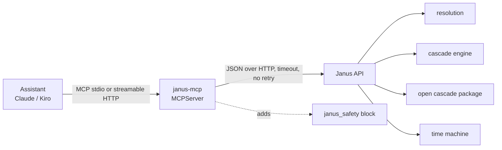

# Design: Janus MCP server

> Scope: `apps/mcp/` (`janus_mcp/config.py`, `client.py`, `safety.py`, `server.py`, tests), the API route
> `GET /open/cascade-package/pipc` (`apps/api/janus/open/router.py`), `docs/mcp.md`, `.kiro/settings/mcp.json`, the
> NOTICE entry. Decisions DP1–DP10, properties P1–P7.

## 1. Overview

The server holds no medical logic. Each tool validates its arguments with the same limits as the API's Pydantic
models (so an assistant gets a clear argument error before a request is sent), sends one request, and returns
`{"janus_safety": {...}, "result": <API JSON>}`.

## 2. Tools (Req 1)
| Tool | API route | Arguments |
|---|---|---|
| `janus_resolve_code` | `POST /resolve/scan` | `code` (1–512 chars: barcode digits or GS1 element string), `region` (TR/US/EU, optional) |
| `janus_resolve_ndc` | `POST /resolve/ndc` | `ndc` (1–32 chars) |
| `janus_search_medicines` | `POST /resolve/search` | `query` (2–100), `region` (optional), `limit` (1–20, default 10) |
| `janus_check_cascades` | `POST /cascades/evaluate` | `dataset_version` (64 hex), `items` (1–50: `product` candidate id or `ingredient` key, optional `choices`, optional `started` YYYY-MM) |
| `janus_cascade_package_rows` | `GET /open/cascade-package/pipc` | `row` (1–65, optional; filters the returned rows client-side by position only) |
| `janus_time_machine_catalogue` | `GET /timemachine/catalogue` | — |
| `janus_time_machine_cascade` | `GET /timemachine/cascade/{cascade_id}` | `cascade_id` (1–64 chars, letters, digits, `_`) |

All tools carry MCP annotations `readOnlyHint: true`, `idempotentHint: true`, `openWorldHint: false` (they only read
from one configured Janus API). `janus_cascade_package_rows` filtering by `row` is a selection of whole rows by their
published position, not a computation (DP6).

### 2.1 New API route: `GET /open/cascade-package/pipc`
The open cascade package lived only as files under `data/open/cascade-package/`. To keep the server a client of the
HTTP API (DP2), the API serves the PIPC rows of the package: `pipc.csv` (CC BY 4.0, Rochon et al. 2025) joined by
`position` with `pipc_rules.csv` (Janus mappings, Apache-2.0), plus the package name, version, creation date,
licences and the citation. Read-only, no body, no personal data: a public GET route, listed in
`docs/openapi-public.json`. 503 `package_unavailable` when the files are missing.

## 3. Safety block (Req 2)
`janus_mcp/safety.py` holds fixed texts. Every result carries:
```json
{
  "disclaimer": "Janus provides information, not medical advice. Research prototype — not a medical device.",
  "wording": ["Describe a finding as a possible prescribing cascade: ...", "..."],
  "emergency": "If the person reports chest pain, breathing difficulty, signs of stroke or a severe allergic reaction: say 'Call emergency services' first (112 in Türkiye and the EU, 911 in the US), before anything else."
}
```
Tool-specific lines are added: the abrupt-stop and no-reassurance lines for `janus_check_cascades`, the reports-not-
people and in-silico lines for the time machine tools, the CC BY attribution for the package rows. The same rules are
in the server `instructions` (sent at MCP initialisation) and in each tool description, because clients differ in
which of these they show the model (DP4).

## 4. Errors (Req 1.4, 3.4)
| Situation | Tool error text |
|---|---|
| API 4xx/5xx with `{"error": code}` | `janus_api_error: <code>` (+ ` fields: a, b` when the API named fields) |
| Non-JSON or unexpected API body | `janus_api_bad_response` |
| Timeout, connection refused, DNS | `janus_api_unreachable` |
| Argument outside the limits | the SDK's argument error, returned to the calling client only (it quotes the rejected value back to that client; the SDK logs field names, not values) |

Error texts are built only from the API's fixed codes and field names; the server never formats an input value into
a message. Tools catch every exception and raise `ToolError` with a fixed text, so the SDK never logs a traceback that
could carry a value (DP8).

## 5. Privacy (Req 3)
- The SDK logger runs at `WARNING`; `httpx2` and `httpcore` loggers are set to `WARNING` (their INFO line names the
  URL; the time machine id is a curated key, but no request URL is ever logged).
- No cache, no file, no state between calls; one `httpx2.AsyncClient` per call.
- The only network peer is `JANUS_API_URL`.

## 6. Transports and configuration (Req 4)
`janus-mcp` (stdio). `janus-mcp --transport streamable-http [--host 127.0.0.1] [--port 8765]` serves `/mcp`; the SDK
adds DNS-rebinding protection for localhost hosts; `--host` accepts only 127.0.0.1, localhost or ::1 (safety review
S9). `JANUS_API_URL` must be `https://host[:port][/path]`, or `http://` only for a loopback host (S9);
`JANUS_API_TIMEOUT` a number of seconds in (0, 60]. Invalid values stop the server with the variable's name.

## 7. Properties and tests
| # | Property | Req | Test |
|---|---|---|---|
| P1 | For any valid arguments, the request sent to the stub API has the API's field names and the argument values unchanged | 1.2 | Hypothesis, `test_tools_properties.py` |
| P2 | For any API JSON body, `result` equals it exactly and `janus_safety.disclaimer` is the rule-9 sentence | 1.2, 2.1 | Hypothesis |
| P3 | For any API error code and field list, the tool error text is `janus_api_error: <code>` with the fields and contains no argument value | 1.4, 3.4 | Hypothesis with sentinel values |
| P4 | During any tool call, nothing an argument contained appears in captured logs, stdout or stderr | 3.1 | Hypothesis with sentinels, log capture |
| P5 | No tool description, instruction or safety text contains a forbidden phrase (five languages) | 2.6 | pytest over the list in `medical-safety.md` |
| P6 | Arguments outside the API's limits are rejected before any request | 1.2 | Hypothesis |
| P7 | `row` returns exactly the package rows with that position, unchanged | 1.3 | Hypothesis |
Plus: the tool list and annotations; configuration errors; an integration test against a real API
(`JANUS_MCP_INTEGRATION_URL`, skipped when unset).

## 8. Decisions
| # | Decision | Alternatives | Why |
|---|---|---|---|
| DP1 | Official MCP Python SDK `mcp==2.3.0` (MIT, Anthropic PBC; pinned) | Hand-written JSON-RPC; FastMCP 2 fork | Maintained reference implementation; stdio and streamable HTTP built in; MIT is compatible with Apache-2.0; already depends on `httpx2`, which Janus uses |
| DP2 | Thin client of the HTTP API, separate package `apps/mcp` | Import `janus` and call the services in-process | One engine, one set of contracts; the MCP server can point at any Janus deployment; the API keeps its privacy middleware (body policy, access log) on every call |
| DP3 | Return the API JSON unchanged under `result`, next to `janus_safety` | Rewrite results into sentences | Sentences are the assistant's job; rewriting would be a second, untested presentation layer and could drop evidence ids |
| DP4 | Safety rules in three places: server instructions, tool descriptions, every result | Instructions only | Clients differ in what they pass to the model; a result travels with the data even when instructions are dropped |
| DP5 | `dataset_version` is a required argument of `janus_check_cascades` | The server fetches it first | The API requires it so that a list is evaluated against the dataset it was resolved with; a hidden extra call would make the tool non-thin and could mix datasets |
| DP6 | New public route `GET /open/cascade-package/pipc` | Read package files from disk or from the repository host | Keeps the server a client of the API; the data is already public (CC BY 4.0 / Apache-2.0) |
| DP7 | No retries; 10 s timeout | Retry on timeout | POSTs are stateless but the client cannot know a deployment's proxy rules; an assistant can call again |
| DP8 | Catch every exception in a tool, raise `ToolError` with a fixed code | Let the SDK report exceptions | The SDK logs `str(exc)` and tracebacks; exception text from HTTP libraries can contain URLs or values |
| DP9 | Streamable HTTP binds a loopback address only and has no authentication; `JANUS_API_URL` is https unless loopback (safety review S9) | OAuth (SDK auth); any host | Local use only; a remote deployment needs authentication first (open item); medicine lists never cross a network unencrypted |
| DP10 | Only these tools (seven, plus the two read-only model kit tools `janus_modelkit_search` and `janus_modelkit_get`, spec `model-kit`); no notes, donations or outcomes | Expose all POST routes | Notes, donations and outcomes involve consent and tokens that must be handled by the person in the web app, not by an assistant |

## 9. Open items
- Authentication for a remote streamable-HTTP deployment (MCP authorization spec, OAuth 2.1).
- The API has no request limits at the proxy for assistant traffic (pre-launch checklist).
- A clinical review of how assistants phrase findings in practice (evaluation with real prompts).
