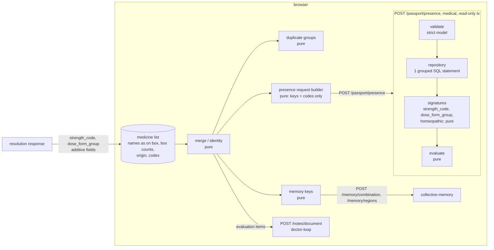

# Design: Medication Passport (cross-border list)

> Written 2026-11-08 from the refined requirements (spec author standing in for the Kiro spec workflow).
> **Scope:** `apps/api/janus/passport/` (pure strength and dose-form functions, presence evaluation, repository, router),
> migration `0012_passport_presence_index`, two additive output fields in `janus/resolution/` (Req 6.6), the curated
> table `data/dose_form_groups.csv`, and in `apps/web/src/passport/` the pure list logic, the presence client, the
> `Passport` message namespace and the content of the Passport screens.
> **Not here (seams):** shell, routes, navigation, themes, shared components, list storage and the scan/search flow are
> `experience`; the note document and its glossary are `doctor-loop`; the Collective Memory screens are `experience` on
> `collective-memory` contracts; resolution itself is `drug-resolution`.
> Property numbers P1–P21 and decision numbers DP1–DP21 are this spec's own; upstream ones are written
> "drug-resolution DPn" and so on.

## 1. Overview



The Passport never sends a list to the server. The browser builds a request of ingredient keys and normalised codes; the
server answers, per item and per source, whether the source lists a product with exactly those ingredients and, for
`present`, whether the listed strength and dose form match the item's. Answers are counts and codes; the browser words
them in five languages.

Facts checked on 2026-11-08 on the dev database (resolution dataset `7db3a513…`) that shaped this design:

| What | Observed | Design consequence |
|---|---|---|
| Sources in the dataset | `titck` 2026-11-06, `openfda_ndc` 2026-11-06, `eu_fr_bdpm` 2026-11-03, `eu_es_cima` 2026-11-07, `wikidata`, `janus_curated`; `res_source_version` has `snapshot_date`, `cadence_days`, `license`, `source_url` | Every source block carries its snapshot date and staleness (Req 7) |
| `res_product.dosage_form` | TİTCK 0 of 23,137 products; openFDA 138,262 of 138,262 (142 distinct SPL names, e.g. `TABLET, FILM COATED`); BDPM 20,910 of 20,914 (358 distinct French strings, e.g. `comprimé pelliculé`); Nomenclátor 0 of 30,900 | Form comparable only for openFDA and BDPM (Req 6.4) |
| `res_product_ingredient.strength` | TİTCK 0 of 31,885 rows; openFDA 220,222 of 220,238 (`N mg/N` 59,319, `N [hp_X]/mL` 31,486, `N mg/mL` 16,223, `N mg/NmL` 10,181, …); BDPM 29,057 of 29,057 (`N mg` 19,036, `N g` 5,307, `N microgrammes` 1,241 — no reference quantity); Nomenclátor 35,875 of 35,875 (`N mg` 31,228, `N microgramos` 1,175, `N % v/v` 1,033, `N UI` 681); 12,766 distinct strings overall | Server-side normaliser with a per-source grammar; CIMA and BDPM basis unknown without a form (DP5) |
| Not loaded but available upstream | BDPM `reference` ("un comprimé", "100 ml") is in the prepared rows and dropped by the loader; Nomenclátor `formasfarmaceuticas` carries `cod_forfar` and per ingredient `dosis_composicion`/`unidad_composicion` (the strength basis), not read by the pipeline, and `route_codes` are extracted by the pipeline but `res_product.routes`/`dosage_form` are empty for `eu_es_cima` | Open decision OD1 (load them) |
| TİTCK product names | 15,518 of 18,731 single-ingredient TİTCK products have an amount pattern (`0.25 MG TABLET`) in the name; 16,518 a form word | Not parsed in this spec (OD2) |
| Homeopathic flag | No column; computed on the request path from strengths (`[hp_X]` etc., `drug-resolution` DP24) and, for EU, the BDPM name marker (DP37); 1,573 BDPM ingredient rows carry the marker | Same functions, same rule (DP9, P8) |
| Index on ingredient key | None: `res_product_ingredient` has only its primary key `(dataset_id, source_id, product_id, position)`; a key lookup is a parallel sequential scan (317,055 rows) | Partial index in migration `0012` (DP12) |
| Query timing (grouped SQL of §4.2) | 14 common keys (metformin, amlodipine, …): 11,214 products, 959 signatures, **273–428 ms** with the index (measured in a rolled-back transaction), 550 ms without. 50 most frequent keys: 55,970 products, 7,611 signatures, **1.07 s** | Targets of Req 13; DP12 |
| Ingredient keys | 3,270 keys in `res_ingredient`, 2 curated `J` keys | Unknown keys answered, not rejected (Req 2.7) |
| Route kinds | `medical_router()` gives `no-store`, JSON only, 64 KiB; `classify()` fails on an unclassified route | The router is a medical router; registered in `main.py` |
| Web tests | vitest, no property-testing library | `fast-check` as a dev dependency (DP16, OD5) |

## 2. Code layout

```
apps/api/janus/passport/
  strength.py      strength_code(source_id, published, form_group) -> StrengthCode | None      pure
  forms.py         FormTable.load(path), group(source_id, published_form) -> str | None,
                   COUNTABLE_GROUPS, version (sha256)                                         pure (load = file read at startup)
  forms_draft.py   python -m janus.passport.forms_draft: distinct forms with counts and a proposed group  (dev tool)
  presence.py      Signature, ItemQuery, evaluate(items, signatures, sources, known_keys)     pure
  repository.py    presence_rows(conn, dataset, keys), known_keys(conn, dataset, keys)        parameterised SQL
  schemas.py       PresenceIn, PresenceOut (strict, extra="forbid")
  service.py       presence(conn, body, forms, today) -> PresenceOut
  router.py        POST /passport/presence (medical_router)
  bench.py         python -m janus.passport.bench (15 items and worst case, p50/p95)
apps/api/migrations/versions/0012_passport_presence_index.py
apps/api/janus/resolution/model.py, service.py   + strength_code, dose_form_group (additive, Req 6.6)
data/dose_form_groups.csv                         curated, Apache-2.0 (Janus), reviewed
apps/web/src/passport/
  model.ts         PassportItem, Origin, StrengthCode, PresenceOut types (mirror of schemas.py)
  identity.ts      itemIdentity(item)
  merge.ts         addItem(list, item), mergeLists(a, b)
  duplicates.ts    duplicateGroups(list)
  request.ts       buildPresenceRequest(list) -> {body, itemIndex}
  memory-keys.ts   memoryKeys(list)
  entry.ts         strengthFromEntry(amount, unit, basis) -> StrengthCode | null   (DP21)
  words.ts         substitution and removal word lists, passportWordViolations()
  screens/         PassportList, PassportItem (content and states; components from experience)
apps/web/src/demo/passport-cologne.ts, passport-cologne.recorded.json
apps/web/messages/{en,tr,de,fr,es}.json            namespace "Passport"
```

Tests live in `apps/api/tests/test_passport_*_properties.py` (Hypothesis, as the other specs) and
`apps/web/src/passport/*.test.ts` (vitest with fast-check).

## 3. API contract

### 3.1 Request (`PresenceIn`, strict, `extra="forbid"`)
```
PresenceIn  { items: [ItemIn] (1..50) }                                  # ≤ 50 distinct keys overall
ItemIn      { ingredients: [IngIn] (1..10, distinct keys), dose_form?: FormGroup | null }
IngIn       { key: ^(Q[1-9][0-9]{0,9}|J[1-9][0-9]{0,5})$, strength?: StrengthCode | null }
StrengthCode{ amount: ^(0|[1-9][0-9]{0,8})(\.[0-9]{0,5}[1-9])?$  (> 0, canonical: no trailing zeros),
              unit: "ug" | "IU", basis: "unit" | "mL" | "g" }
FormGroup   = one code of the loaded table (validated after parsing; unknown code -> 422 field items.i.dose_form)
```
Bodies are parsed and validated in the router exactly as `resolution/router.py` does (JSON, `model_validate`, a 422 that
lists field paths and never a value). No product name, code, candidate id, item region, item id, date, free text or
`demo` field exists in the model (Req 4.3, 9.1).

### 3.2 Response (`PresenceOut`)
```
PresenceOut {
  dataset_version: hex64, form_table_version: hex64,
  sources: [SourceOut] (fixed order: TR titck, EU-FR eu_fr_bdpm, EU-ES eu_es_cima, EU-DE none, US openfda_ndc),
  items:   [ItemOut] (request order),
  notices: ["presence_is_lower_bound", "unknown_ingredient_keys"?],
  disclaimer: messages.DISCLAIMER
}
SourceOut {
  source: 0..4 (index), source_id: "titck"|"eu_fr_bdpm"|"eu_es_cima"|"openfda_ndc"|null,
  region: "TR"|"EU"|"US", country: "FR"|"ES"|"DE"|null,
  status: "loaded"|"source_unavailable", reason: "not_loaded"|"no_open_product_database"|null,
  snapshot_date: str|null, stale: bool,
  attribution: "titck"|"bdpm"|"cima"|"openfda"|null, as_published: bool,            # true for bdpm
  can_compare: {strength: bool, dose_form: bool}                                     # what the source data allows at all
}
ItemOut { item: int, keys: [Key] (sorted), unknown_keys: [Key], answers: [Answer] (one per source, same order) }
Answer {
  source: 0..4,
  status: "present"|"not_present"|"not_in_source"|"source_unavailable",
  products: int,                 # present: products with exactly the item's keys, complete, not homeopathic
  with_other_ingredients: int,   # products containing all item keys plus others, or incomplete ones
  keys_found: [Key],             # item keys that are a mapped ingredient of some counted product of the source
  homeopathic_left_out: int,
  comparison: { strength: Cmp, dose_form: Cmp, strength_and_dose_form: Cmp } | null    # only for present
}
Cmp { result: "matched"|"differs"|"could_not_compare",
      reason: "not_known_for_item"|"not_known_in_source"|"not_all_comparable"|null,
      comparable: int, equal: int }
```
`can_compare` on 2026-11-08: `titck` {false, false}; `openfda_ndc` {true, true}; `eu_fr_bdpm` {true, true} (strength only
for countable forms); `eu_es_cima` {false, false}. It is derived from the data rules of §5, not configured.

### 3.3 Errors
| Case | Answer |
|---|---|
| Body not JSON, schema violation, > 50 distinct keys, unknown form group | 422 `{"error":"invalid_request","fields":[…]}` |
| No database, no `res_current`, dose-form table not loaded, statement timeout (3 s) | 503 `{"error":"passport_unavailable"}` |
| A source missing from the current dataset | 200; that block `source_unavailable` / `not_loaded` (Req 5.4) |
| Unexpected error | 500 with the request id only (privacy error handler) |

## 4. Server data access

### 4.1 Migration `0012_passport_presence_index` (forward-only, with downgrade)
```sql
-- upgrade
CREATE INDEX res_product_ingredient_key ON res_product_ingredient (dataset_id, qid, source_id, product_id)
  WHERE status = 'mapped';
-- downgrade
DROP INDEX res_product_ingredient_key;
```
Reference data only; no user data; no column changes, so no dataset reload. The loader's COPY into
`res_product_ingredient` maintains one more index (load time measured in task 1).

### 4.2 The statement (one per request, inside `read_only_tx`)
```sql
SET LOCAL statement_timeout = '3s';
WITH hit AS (
  SELECT DISTINCT source_id, product_id
  FROM res_product_ingredient
  WHERE dataset_id = %(d)s AND status = 'mapped' AND qid = ANY(%(keys)s::text[])
), prod AS (
  SELECT i.source_id, i.product_id,
         array_agg(i.qid      ORDER BY i.qid, i.position) FILTER (WHERE i.status = 'mapped') AS keys,
         array_agg(i.strength ORDER BY i.qid, i.position) FILTER (WHERE i.status = 'mapped') AS strengths,
         bool_and(i.status = 'mapped')                                                     AS complete,
         bool_or(i.strength ~* '\[(hp|kp)_[a-z]+\]')                                        AS hp_strength,
         array_agg(i.published_name) FILTER (WHERE i.published_name ILIKE '%%pathiques%%') AS hp_names
  FROM hit h
  JOIN res_product_ingredient i
    ON i.dataset_id = %(d)s AND i.source_id = h.source_id AND i.product_id = h.product_id
  GROUP BY i.source_id, i.product_id
)
SELECT p.source_id, p.keys, p.strengths, p.complete, p.hp_strength, p.hp_names, r.region, r.dosage_form,
       count(*) AS products
FROM prod p
JOIN res_product r ON r.dataset_id = %(d)s AND r.source_id = p.source_id AND r.product_id = p.product_id
GROUP BY 1, 2, 3, 4, 5, 6, 7, 8;
```
Plus, in the same transaction: `repository.current(conn)` (dataset id and source versions, existing) and
`known_keys`: `SELECT qid FROM res_ingredient WHERE dataset_id = %s AND qid = ANY(%s)`. All parameters are bound; the
statement text is fixed. The `hp_strength` pattern is exactly `HOMEOPATHIC_UNIT` of `resolution/model.py` (POSIX `~*`
and Python `re.IGNORECASE` agree on this pattern; P8 checks it); `hp_names` is a superset pre-filter and
`is_homeopathic_name` decides exactly in Python, for EU products only, as `resolution/service.py` does.

Grouping by signature collapses identical labeller products (openFDA has thousands of paracetamol products with a
handful of distinct strength and form combinations): 11,214 products become 959 rows for a 14-key list.

## 5. Pure functions (server)

### 5.1 Strength codes (`strength.py`)
`strength_code(source_id, published, form_group) -> StrengthCode | None`, exact `Decimal` arithmetic, never raises,
cached per `(source_id, published, form_group)` (12,766 distinct strings).

| Source | Accepted grammar (after trimming, case-insensitive units) | Basis |
|---|---|---|
| `openfda_ndc` | `A U/D` and `A U/N DU`: A a decimal (`.5` allowed); U ∈ {`kg`,`g`,`mg`,`ug`,`mcg`} or {`[iU]`,`[IU]`}; D = `1`; DU ∈ {`mL`,`g`} | `/1` → `unit` only when `form_group` ∈ `COUNTABLE_GROUPS` (else `None`: per spray or per actuation; review R2, accepted); `/N mL` → `mL` (A ÷ N); `/N g` → `g` |
| `eu_fr_bdpm` | `A U` with French decimals (`0,5`) and space-grouped thousands (`1 000`); U ∈ {`mg`,`g`,`microgramme(s)`,`µg`,`UI`} | `unit` only when `form_group` ∈ `COUNTABLE_GROUPS`; else `None` |
| `eu_es_cima` | parsed for tests and reports, but no form is loaded | always `None` (basis unknown) |
| `titck` | no strength stored | always `None` |

Rules: mass is converted to micrograms (kg 10⁹, g 10⁶, mg 10³, µg/mcg/microgramme 1); IU stays IU; `[USP'U]`, `[PNU]`,
`%`, `% v/v`, `mL/mL`, `kg/kg`-style ratios and every homeopathic unit give `None`. A division that does not terminate
within 6 decimals (100 mg/3 mL) gives `None`, never a rounded value. The amount is rendered canonically (no exponent,
no trailing zeros) and must fit the request pattern of §3.1, else `None`. `COUNTABLE_GROUPS` = the tablet and capsule
groups (§5.2). Unit-amount equivalence is exact: `1 g/1` and `1000 mg/1` give the same code (P5).

### 5.2 Dose-form groups (`forms.py`, `data/dose_form_groups.csv`)
```
source_id,published_form,route,group,note
openfda_ndc,"TABLET, FILM COATED",ORAL,oral_solid,proposed; …
openfda_ndc,"TABLET, EXTENDED RELEASE",ORAL,oral_solid_modified_release,proposed; …
openfda_ndc,SOLUTION,OPHTHALMIC,ophthalmic,proposed; …
eu_fr_bdpm,comprimé pelliculé,*,oral_solid,proposed; …
eu_fr_bdpm,poudre et  solvant pour solution injectable,*,injection,proposed; … (two spaces as published)
```
- Key: the exact published string of the source (no folding: the BDPM data are matched as published). A string not in
  the table, or with an empty group, is unknown.
- ~~Draft groups (22 fine groups)~~ superseded by owner decision 6: a coarse Janus grouping, **accepted after the
  task 4 review (2026-11-08, `dose-form-review.md` Part C)**. Fourteen groups: `oral_solid`,
  `oral_solid_delayed_release` (gastro-resistant), `oral_solid_prolonged_release` (extended, prolonged, modified,
  osmotic), `oral_liquid`, `injection`, `inhaled`, `nasal`, `ophthalmic`, `otic`, `cutaneous`, `transdermal`, `rectal`,
  `vaginal`, `other`. The owner's twelve with oral modified release split in two (Req 6.5; review R1). A
  modified-release form outside the oral solids (depot injection, prolonged-release eye drops, vaginal ring), a
  liposomal or lipid-complex injection and a multi-part pack of different forms have no group and stay unknown.
  `COUNTABLE_GROUPS` = the three oral solid groups. `other` (sublingual, buccal and dental forms, lozenges, kits,
  devices) is shown but **never compared** (`NOT_COMPARED_GROUPS`).
- *(Added in task 3; DP22, DP23.)* **Route column.** openFDA and the BDPM publish forms that do not name the route (`SOLUTION`
  1,729 oral / 1,042 topical / 323 ophthalmic products; `TABLET` 17,971 oral / 242 sublingual; `crème`, `gel`,
  `solution`), so the key is `(source_id, published_form, route)`: `route` is `*` (any route set), an empty string (no
  route published) or the product's `res_product.routes` sorted and joined with `|` as published. A product takes the
  row of its own route set first, then the `*` row. `group(source_id, published_form, routes)` gains the routes
  argument; the presence statement (§4.2) also selects `r.routes`, and task 5 passes `ProductCandidate.routes`. A `*`
  row exists only where the group does not depend on the route or the form string fixes the route; the column
  `route_from_form` then names the route class (film-coated tablet, capsule, orodispersible tablet, transdermal patch,
  eye drops, suppository; DP23). A product without a published route takes that route; otherwise no route is guessed.
- **Packaged:** the table ships as `apps/api/janus/passport/dose_form_groups.csv` (the API image is built from
  `apps/api`); a test checks that it equals `data/dose_form_groups.csv`.
- Where it comes from: drafted by `forms_draft.py` from the distinct `(source_id, dosage_form, routes)` values of the
  current dataset (openFDA 142 forms, BDPM 358; 927 rows) with keyword rules, then reviewed row by row by `agent://pharmacologist` and accepted
  by the owner (task 4). EDQM Standard Terms are not used (registration and reuse terms not checked; OD4). Licence of
  the table: Apache-2.0 (Janus curated); the published strings it contains are cited with their source.
- Startup loads and validates it (unique keys, group in the closed set, source id known); a defect stops startup, a
  missing file makes the route answer 503 (Req 5.3). `version` = SHA-256 of the file.
- The draft command reports coverage (share of products with a group per source); a report, not a gate.

### 5.3 Signatures and evaluation (`presence.py`)
```
Signature  { source_id, keys: tuple[Key, ...] (sorted, may repeat), strengths: tuple[StrengthCode|None, ...],
             complete: bool, homeopathic: bool, form_group: str|None, products: int }
ItemQuery  { keys: frozenset[Key], strengths: dict[Key, StrengthCode|None], form_group: str|None }
evaluate(items, signatures, sources, known_keys) -> list[ItemOut]
```
For each item and each loaded source, over non-homeopathic signatures S of that source:
- `exact` = S with `complete` and `set(keys) == item.keys`; `products` = Σ products over `exact`.
- `with_other_ingredients` = Σ products of S, not in `exact`, with `item.keys ⊆ set(keys)`.
- `keys_found` = item keys occurring in any S; status: `present` if `products > 0`, else `not_present` if `keys_found`
  is not empty, else `not_in_source`. `homeopathic_left_out` = Σ products of homeopathic signatures that contain any
  item key.
- Comparison (only `present`), per counted product (signature × count):
  - strength comparable iff the item has a code for every key, the signature's keys have no repeat, and every
    signature strength code is known; equal iff all codes are equal per key.
  - form comparable iff both groups are known; equal iff equal.
  - both: comparable iff both comparable; equal iff both equal.
  - result: `matched` if `equal > 0`; `differs` if `comparable == products` and `equal == 0`; else
    `could_not_compare` with reason `not_known_for_item` (the item lacks the value), `not_known_in_source`
    (`comparable == 0`) or `not_all_comparable` (0 < `comparable` < `products`, `equal == 0`).
- Sources not loaded and Germany: `source_unavailable`, zeros, no comparison.
`evaluate` depends only on the multiset of signatures and on item sets, so item order, key order and repeated items do
not change answers (P10).

## 6. Client logic (`apps/web/src/passport/`, pure TypeScript)

### 6.1 Item model
```
PassportItem {
  id: string (random, browser only), demo: boolean,
  origin: {region: "TR"|"EU"|"US"|"OTHER", country: "TR"|"FR"|"ES"|"DE"|"US"|null},
  source: {source_id, snapshot_date} | {entered_by_name: true},
  code: {kind: "tr_barcode"|"ndc_product9"|"fr_cip13"|"es_cn"|…, value} | null,   # from resolution, browser only
  boxName: string,                                                                 # as on the box, browser only
  ingredients: [{key: Key|null, label, status, strength: StrengthCode|null, strengthOrigin: "source"|"entered"|null}],
  doseForm: {group, origin: "source"|"entered"} | null,
  homeopathic: boolean, boxes: int ≥ 1, started: "YYYY-MM"|null,
  evaluation: {candidate_id | key, choices?}                                        # what doctor-loop / cascades need
}
```
Strength and form codes come from the resolution response fields of Req 6.6 or, with DP21, from controlled entry.

### 6.2 Identity and merge
`itemIdentity(item)` =
- product with a code: `source_id | code.kind | code.value`;
- product without a code (name-only candidate): `source_id | sorted keys | strength codes | form group | fold(boxName)`;
- typed by name (Germany and others): `country | "name" | sorted keys | fold(boxName)`.

`addItem(list, item)`: same identity → `boxes += item.boxes`, `started = min(known months)`; else append.
`mergeLists(a, b)` = fold of `addItem`. The list is a map identity → item; display order is a deterministic sort
(origin, then box name, then identity), so `mergeLists(a, b)` and `mergeLists(b, a)` display the same list (P1).

### 6.3 Duplicate groups
`duplicateGroups(list)` → for every key K carried by ≥ 2 distinct checked items: `{key: K, items: [ids sorted]}`.
Checked = non-homeopathic with ≥ 1 key; a key repeated inside one item (two salt lines) is not a duplicate. The flag is
shown on each item of the group: "Same active ingredient under two names: {ingredient} is in {box names}. Both stay on
your list. This may be worth mentioning to your doctor or pharmacist."

### 6.4 Presence request builder
`buildPresenceRequest(list)` → body of §3.1 from the checked items: per item its distinct keys with strength codes and
its form group; identical item queries are sent once and fanned back through `itemIndex`; > 50 distinct keys are split
into consecutive requests (each ≤ 50 items, ≤ 50 keys) and the answers concatenated. The body has no name, code, id,
region or count (P18). The detail view shows the item's own source last ("this box's source").

### 6.5 Memory keys
`memoryKeys(list)` = sorted distinct keys of checked items; `combination` only when 2–20, `regions` when 1–20;
otherwise the selection prompt of Req 11.2 (P20).

### 6.6 Manual entry (DP21, needs owner confirmation)
For an item whose source gives no strength or form, the detail view offers "Add strength and form from the box":
amount (decimal), unit (`mg`, `g`, `µg`, `IU`), "per tablet/capsule/unit" or "per mL", and a form group picked from a
short localised list. `strengthFromEntry` converts with the same rules as §5.1 (P21; `entry_code` in `strength.py`, ambiguous thousands groups
refused, DP25); the values are marked `entered` and the comparison rows say "as entered from the box" (owner decision 1).

## 7. Wording (`Passport` namespace)

### 7.1 Codes to messages
Each API code has a key: `Passport.status.<status>`, `Passport.reason.<reason>`, `Passport.compare.<field>.<result>`,
`Passport.compareReason.<reason>`, `Passport.attribution.<code>`, `Passport.origin.<country>`, `Passport.notice.<code>`,
`Passport.duplicate.*`, `Passport.states.*` (loading, empty, error, partial), `Passport.listingsOnly`.

### 7.2 English reference texts (drafts; all five languages reviewed in task 11)
| Key | EN |
|---|---|
| `status.present` | "{source} lists {n, plural, one {# product} other {# products}} with this active ingredient (data of {date})." |
| `status.not_present` | "{source} lists no product with exactly these active ingredients (data of {date}). {k} products contain them together with other ingredients." |
| `status.not_in_source` | "{source} lists no product with this active ingredient as Janus recognises it (data of {date}). This does not show that it is unavailable in {country}." |
| `reason.no_open_product_database` | "Germany has no open product database that Janus can check. Not checked." |
| `reason.not_loaded` | "This source is not available right now. Not checked." |
| `compare.strength.matched` | "Listed with the same stated strength ({strength})." |
| `compare.strength.differs` | "No product is listed with the same stated strength. Sources may state the amount of a salt or of the base, so this does not prove a different dose." |
| `compare.*.could_not_compare` | "Strength could not be compared: {reason}." / "Form could not be compared: {reason}." |
| `homeopathic` | "Homeopathic product, not checked." |
| `listingsOnly` | "Janus shows listings in public data only. Only your doctor or pharmacist can say which medicine fits you." |
| `notice.presence_is_lower_bound` | "Products whose ingredients Janus could not recognise are not counted." |

### 7.3 Word lists (`words.ts`, checked over every `Passport.*` string; whole-word prefix match, case-insensitive)
| Lang | Substitution and equivalence (all Passport strings) | Removal (all `Passport.duplicate.*`) |
|---|---|---|
| EN | equivalent, interchangeab, instead, switch, replac, substitut, alternative, "same as your", "you can use" | remove, delet, "take only one", "need both", "one of them is enough", drop |
| TR | muadil, eşdeğer, yerine, değiştir, "kullanabilirsiniz", aynısı | çıkar, sil, "birini bırak", "ikisine gerek", "yalnızca birini" |
| DE | gleichwertig, äquivalent, austauschbar, stattdessen, ersetz, Ersatz, wechseln, umsteigen, Alternative | entfern, lösch, "nur eines", "brauchen Sie nicht" |
| FR | équivalent, interchangeable, "à la place", remplac, substitu, "changer de", alternative | supprim, retir, "un seul suffit", "besoin des deux" |
| ES | equivalente, intercambiable, "en lugar de", "en vez de", sustitu, reemplaz, "cambiar a", alternativa | elimin, quit, borr, "solo uno", "necesita ambos" |

Plus the rule-2 forbidden phrases (`forbidden-phrases.ts`) and the reassurance words (`doctor-loop` §5.4) for every
Passport string. The lists are reviewed with the texts (task 11).

## 8. Screens: content and states

Components, layout, routes and theme tokens are from `experience`; this section fixes what the two screens contain.

**Passport list** (`screens/PassportList`): heading; demo label when demo; one card per item in display order: box name
(as on the box, wrapped), origin label and flag-free country name, source and date (or "entered by name"; Germany:
"no open product database, identified by name"), ingredient names, box count, labels `homeopathic` / `cannot be checked`;
duplicate flags as an informational chip (`--chip`, "copy" icon) on each item of a group with the §6.3 text; the
Collective Memory entry point (Req 11); the disclaimer.

**Item detail** (`screens/PassportItem`): box name and origin; the presence rows in the order of Req 2.1 (own source
last): source name, status text and icon (check, dash, circle-slash, cloud-off: shape differs per status), counts,
`homeopathic_left_out` line when > 0, comparison rows (strength, form, both) with result text and reason, attribution line
(Req 7.2), stale notice; the lower-bound notice; `listingsOnly`; the disclaimer.

| State | Behaviour |
|---|---|
| Loading | skeleton rows with `aria-busy="true"`; a polite live region announces "Results for {n} sources loaded" on completion |
| Empty list | "Your list is empty. Add a box by scanning its code or typing its name." with the experience scan/search action |
| Error (503, offline, timeout) | "These listings could not be checked now." + Retry; never "not found"; the list itself stays usable |
| Partial | rows of unavailable sources show their reason; the other rows render normally |
| Long content | 50 items; names wrap (`overflow-wrap: anywhere`), never truncated; presence rows stack at 375 px |
| Item not checkable | homeopathic or keyless: the detail shows the reason and no presence rows |

Accessibility: the presence rows are a `<table>` with `<caption>` and `<th scope="row">` per source at ≥ 640 px and a
`<dl>` per source at 375 px (same content order); statuses never by colour alone and never `--risk`; focus order follows
reading order; targets ≥ 44 × 44 px; large-text mode; both themes. Verified visually at 375 px and 1280 px.

## 9. Demo mode (Cologne)

`apps/web/src/demo/passport-cologne.ts` (invented names, real keys, `demo: true`):
1. TR box "DEMO-AMLOLIS 5/20 tablet" (amlodipine + lisinopril, TİTCK-style combination, no strength/form from source);
2. TR box "DEMO-GLUKOFIN 1000 mg" (metformin);
3. DE box typed by name "Demoamlo 5 mg" (amlodipine) → duplicate flag with item 1 on amlodipine;
4. DE box typed by name "Demopanto 40" (pantoprazole), strength entered as on the box (40 mg per tablet, gastro-resistant
   tablet) if DP21 is accepted;
5. DE box "Demo-Arnica Globuli" (homeopathic) → "not checked".
The demo calls the live endpoint; if it fails, it shows `passport-cologne.recorded.json` (a response recorded from the
API with its `dataset_version` and source dates), labelled "recorded answer of {date}" (Req 12.2). Demo items carry
`demo: true`; the donation and outcome clients refuse them (P19).

## 10. Testing strategy
- **Property tests** (Hypothesis) P5–P15, P17, tagged `Feature: medication-passport, Property Pn`; profiles `dev` 100 /
  `ci` 300 examples; database properties against PostgreSQL 16 (`janus_test`, after `alembic upgrade head`) with
  synthetic datasets loaded through the resolution loader's test helpers (`tests/resolution_db.py`), never TİTCK strings.
- **Web property tests** (vitest + fast-check) P1–P4, P16, P18–P21; the message tests reuse the flatten helpers of
  `memory-words.test.ts`.
- **Real-data tests** (skipped without the local dataset): strength-code and form-group coverage per source; the 15-item
  benchmark; the Cologne recorded answer regenerated and schema-checked.
- **Logs:** sentinel keys (`Q999999901`…) and `capture_logs` as in the other medical routes.

## 11. Correctness properties

The seed's four properties are P1–P4.

| # | Property (for all …) | Validates | Hypothesis / fast-check approach |
|---|---|---|---|
| P1 | **Merge.** For any lists A, B, C: `merge(A,B)` displays the same list as `merge(B,A)`; `merge(merge(A,B),C) = merge(A,merge(B,C))`; `merge(A,A)` has the same identities and fields as A with every box count doubled; adding an item already present changes only its count; the start month is the earliest known. Seed property 1. | Req 1.4 | Generated items with colliding identities, unknown months. |
| P2 | **Duplicates.** Two distinct items appear together in a duplicate group iff both are checked and share a key; each group lists exactly the checked items carrying its key; a key repeated within one item alone never makes a group; flags change no item (all stay visible). Seed property 2. | Req 1.2, 1.3, 1.5, 1.6 | Brute-force pair check over generated lists incl. combinations, homeopathic, keyless items. |
| P3 | **No match when unknown.** For any item and signatures, a comparison is `matched` only if ≥ 1 counted product has both values known and equal; any missing value on the item side gives no `matched` for that field; `differs` only if every counted product is comparable; the rendered rows never say "same" for `could_not_compare`. Seed property 3. | Req 2.2, 6.1, 6.2 | Server: generated signatures with None values; client: rendering of every Cmp. |
| P4 | **No substitution language.** Every `Passport.*` string in each of the five locales, rendered with generated parameters, contains no word of the substitution list, no forbidden phrase and no reassurance word of its language; every `Passport.duplicate.*` string none of the removal list; the API response contains no string but codes, dates and the disclaimer. Seed property 4. | Req 1.3, 8.1, 8.2 | All locales × keys × generated ICU parameters; API body string walk. |
| P5 | **Strength codes.** For any generated published string of each grammar: equal physical quantities give equal codes (1 g/1 = 1000 mg/1; 250 mg/5mL = 50 mg/mL; `0,5 mg` = `500 microgrammes` for countable forms); unsupported units, homeopathic units, non-terminating divisions and out-of-range amounts give `None`; CIMA and TİTCK always `None`; BDPM non-countable forms `None`; the function never raises and every code matches the request pattern. | Req 6.3, 6.4 | Generated amounts and unit spellings; a reference implementation with `fractions.Fraction`. |
| P6 | **Form table.** The committed table loads; keys are unique; every group is in the closed set; `group()` is total (unknown → `None`); each single defect (duplicate key, unknown group, unknown source) is named at load; `COUNTABLE_GROUPS` ⊂ groups. | Req 6.5 | Generated tables with one injected defect. |
| P7 | **Presence equals a model.** For any synthetic dataset (products with mapped/unmapped/ambiguous rows, combinations, repeated keys, homeopathic products) and any request, every answer (status, products, with_other_ingredients, keys_found, homeopathic_left_out, comparisons) equals a brute-force evaluation over the raw rows. | Req 2.4, 2.6, 2.7, 6.2 | DB property: load via test helpers, call the service, compare with a Python model. |
| P8 | **Homeopathic parity.** For any product, the signature's `homeopathic` equals `ProductCandidate.homeopathic` of `/resolve/products` for the same product; the SQL pattern and `HOMEOPATHIC_UNIT` agree on generated strings; homeopathic products never count towards a status or comparison. | Req 2.6, Req 1.5 | Generated strengths and BDPM names incl. accents, case, decomposed forms. |
| P9 | **Comparison counts.** `equal ≤ comparable ≤ products`; the result is a function of (products, comparable, equal, item side known) exactly as §5.3; `strength_and_dose_form` is `matched` only if one product is equal on both. | Req 6.2 | Generated signatures. |
| P10 | **Invariance.** Permuting items permutes answers; permuting keys inside an item, repeating an item, or splitting a request into two changes no answer; answers list keys sorted. | Req 4.4 | Generated permutations against one dataset. |
| P11 | **Stateless, silent, closed.** For any request (valid, 422, 503) the database is unchanged and the response has `no-store`; no key, code or body value appears in any log record; 422 bodies list field paths only and echo nothing; every string field of `PresenceIn` has a pattern or literal (schema walk); unknown fields (`demo`, `name`, `candidate_id`) are rejected. | Req 4.1–4.3, 5.2, 9.1, 9.2 | `assert_stateless()`, sentinel values, `capture_logs`. |
| P12 | **Validation bounds.** 0 or 51 items, 0 or 11 ingredients, repeated keys in an item, 51 distinct keys, malformed keys, non-canonical or zero amounts, unknown units, bases or form groups each give 422 naming that field; the boundary values 1, 10, 50 are accepted. | Req 5.1, 5.2 | Generated near-miss bodies. |
| P13 | **Sources named.** Every answer refers to a source block with source id (or Germany), snapshot date when loaded and attribution; `as_published` is true exactly for the BDPM; a source absent from the dataset gives `source_unavailable`/`not_loaded` in every item and the others are answered; Germany is always `no_open_product_database`; `stale` equals the resolution staleness rule. | Req 2.1, 5.4, 7.1, 7.4, 7.5 | Datasets with sources removed; clock moved past cadence. |
| P14 | **Unavailable.** Without a database, without `res_current`, without the form table, or when the statement times out, the answer is 503 `passport_unavailable` with no other field. | Req 5.3 | Fault injection (`SET LOCAL statement_timeout` with a sleeping statement hook). |
| P15 | **Statement budget.** The number of SQL statements per request is constant (transaction setup, timeout, current, known keys, presence) for 1 to 50 items. | Req 13.2 | Statement counter as `doctor-loop` P24. |
| P16 | **Messages complete.** Every API code (statuses, reasons, comparison results and reasons, attributions, notices) and every origin has a `Passport` key in all five locales with the same ICU parameters; both screens render the disclaimer and the detail view `listingsOnly`. | Req 8.1, 8.3, 10.2 | Code lists generated from `schemas.py` literals (exported JSON) vs message files. |
| P17 | **Resolution fields.** For any product, `strength_code` and `dose_form_group` in the resolution response equal `strength_code()` and `group()` on the stored values; all other fields are unchanged from before the change. | Req 6.6 | DB property on synthetic datasets; snapshot of the old output. |
| P18 | **Request content.** For any list, the built bodies contain only keys, strength codes and form groups (schema walk: no box name, code, id, count, origin, date); they cover exactly the checked items' distinct queries; every body satisfies the limits of §3.1; the fan-back maps every checked item to one answer. | Req 9.1, 4.3 | Generated lists with sentinel box names. |
| P19 | **Demo isolation.** Demo items never appear in a contribution or outcome request body built by the client; the recorded Cologne answer validates against the `PresenceOut` schema and names its dataset version and source dates; every demo screen renders the demo label. | Req 9.3, 12 | Client builders with generated demo/non-demo mixes. |
| P20 | **Memory keys.** `memoryKeys` is the sorted distinct checked keys; box counts, item order and duplicates change nothing; above 20 keys no request is built without the user's selection. | Req 11.1, 11.2 | Generated lists. |
| P21 | **Entry parity.** For any entered amount, unit and basis, `strengthFromEntry` (TS) equals the Python rule on the same quantity (shared fixture file of 500 generated cases, regenerated by a Python test). | Req 6.7 | Fixture generated by Hypothesis, checked by both suites. |

## 12. Decisions

| # | Decision | Alternatives considered | Why |
|---|---|---|---|
| DP1 | One endpoint, `POST /passport/presence`, answering all sources for up to 50 items in one call. | A GET per key; one call per region; reusing `/resolve/search` per ingredient. | Keys never appear in URLs; one read-only transaction gives one dataset snapshot; the detail view needs all regions at once. |
| DP2 | An item is an ingredient **set**; `present` means a product with exactly those mapped keys; combinations found only as larger products are `not_present` with `with_other_ingredients`. | Per-key presence only. | Amlodipine + lisinopril from Türkiye is not answered by "amlodipine exists in France"; per-key presence would overstate sameness. A single-ingredient item is the per-key case. |
| DP3 | Counts and codes only; no product name, id or code from another source. | List matching products; list distinct published strengths. | A list of foreign products reads as a substitute list (Req 2.3). Showing published strengths is useful to a doctor but is still a step towards choosing a product: open decision OD3. |
| DP4 | Normalisation runs on the server (Python) and reaches the client as two additive resolution fields; the client echoes codes. | A TypeScript port of the normaliser; sending published strings; sending candidate ids. | One implementation for 12,766 strings; the request stays codes-only as the owner asked; candidate ids would tell the server the exact product. |
| DP5 | Strength basis: openFDA by its denominator; BDPM per unit only for countable form groups; Nomenclátor and TİTCK never comparable. | Assume "per unit" everywhere; load the BDPM reference and the Nomenclátor form now (OD1). | The BDPM drops the reference quantity, so "250 mg" of a syrup has no basis; the Nomenclátor has no form. Assuming a basis would assert matches that are not known (Req 6.1). |
| DP6 | Exact equality after unit conversion; no tolerance; salt/base caveat in the `differs` wording. | A tolerance (±5 %); salt-to-base conversion. | A tolerance creates matches the source never stated; salt conversion needs molar masses per salt and a review. |
| DP7 | Curated dose-form groups in `data/dose_form_groups.csv`, keyed by exact published string, drafted from the dataset and reviewed. | EDQM Standard Terms; openFDA SPL form list only; string equality. | No open, checked cross-language form vocabulary covers SPL and BDPM; 500 strings are reviewable; exact keys respect "as published". |
| DP8 | Three comparison results (strength, form, both), with counts; `differs` only when every counted product is comparable. | One combined result; `differs` when any comparable product differs. | Req 2.2 asks for strength and form; asserting a difference when an incomparable product might match is as misleading as a false match. |
| DP9 | Homeopathic products are left out on both sides, with `homeopathic_left_out`; detection reuses the resolution functions on the request path (no column). | A stored flag column. | Same rule as `drug-resolution` DP24/DP37; P8 checks parity. |
| DP10 | Germany is a fixed source block with `no_open_product_database`. | Omit Germany; answer "not present". | The Cologne family's main question is Germany; saying nothing would look like an answer. |
| DP11 | Only `mapped` rows count; products with `unmapped` or `ambiguous` rows are never `exact`; notice `presence_is_lower_bound`. | Count ambiguous rows whose candidates include the key. | Presence must not rest on a guess; the notice keeps the limit visible. |
| DP12 | One grouped statement, a partial index (`0012`), `SET LOCAL statement_timeout = '3s'`. | No index (550 ms for 14 keys); a signature table built by the loader. | The index is the smallest change that meets Req 13; the loader table would be faster but changes `drug-resolution`'s loader and dataset; kept as the fallback if the benchmark misses the target. |
| DP13 | Item identity by source code, else by keys, codes and folded box name; merge = map union with summed box counts and the earliest month. | Identity by candidate id; by ingredient keys only. | Candidate ids change with the dataset; keys alone would merge two different German brands of the same ingredient. |
| DP14 | Duplicate groups per shared key over checked items; informational chip, no action button. | Pairwise flags; a "review duplicates" action. | One group per ingredient names all boxes at once; an action would read as a removal suggestion. |
| DP15 | API returns codes; words live in the `Passport` namespace with three word lists (substitution, removal, plus the existing forbidden and reassurance lists); "equivalent" is never used in the UI. | English sentences from the API (as `memory`). | Five-language review in one place; the word lists make the owner's rule testable. |
| DP16 | `fast-check` as a web dev dependency for P1–P4 and P18–P21. | Hand-written seeded generators. | Shrinking and model checking for the merge and duplicate logic; dev-only, widely used. Owner to confirm (OD5). |
| DP17 | Demo uses the live endpoint with a recorded fallback answer. | A fully recorded demo; live only. | Judges see real source dates; the demo still works without the API (`experience` Req 4.4). |
| DP18 | No dataset pin and no 409; the response states `dataset_version`. | Pin and 409 as cascades. | Keys are stable across datasets and the answer is informational; the client re-asks when its resolution dataset changes. |
| DP19 | The request carries no item region; the server answers every source; the client marks the item's own source. | Send the item's region and skip it. | One less field about the patient; the own-source row is useful as a check ("this box's source lists it"). |
| DP20 | The note stays `doctor-loop`'s; the Passport only fills `product_name_slot` with the box name and the origin label in the note language. | A Passport-specific note section. | No server change; product names and origins stay in the browser. |
| DP21 | **Proposed, needs the owner:** optional entry of strength and form from the box for items whose source has none (TİTCK, typed German boxes), labelled "as entered by you". | No entry (TİTCK and German items never comparable). | Without it, the two regions of the main user story never get a comparison; the values stay in the browser and are sent as codes only. |
| DP22 | *(Added in task 3, accepted 2026-11-08.)* The dose-form table is keyed by `(source, published form, published route set)`, with `*` for any route set. | Key by the published form alone; map route-ambiguous forms to nothing. | openFDA `SOLUTION` is oral, topical, ophthalmic and sublingual; `TABLET` is oral and sublingual. One group per string would put eye drops with oral solutions; mapping them to nothing would lose most liquids. |
| DP23 | *(Owner decision 2026-11-08.)* No route is guessed: a product without a published route has no group unless the form string fixes the route (`route_from_form`); a `*` row exists only then or when the group does not depend on the route. | Treat tablets without a route as oral (3,068 openFDA products); keep every `*` row the draft wrote. | A sublingual or vaginal tablet without a route would be compared as oral; a `*` row from observed data generalises to route sets never seen. |
| DP24 | *(Added in task 9, 2026-11-08; owner to confirm at the task 11 stop.)* An item is sent to the presence endpoint only when every ingredient has a key; an item with one recognised and one unrecognised ingredient stays "checked" for duplicate flags but shows "not every ingredient could be recognised" instead of presence rows (`request.ts`, reason `partial`). | Send the recognised keys alone (§6.4 as first written). | The recognised keys alone describe a smaller product: a combination box with an unmapped component would read "present" from single-ingredient products. Same rule as DP11 on the server side. |
| DP25 | *(Added in task 9.5.)* Typed strengths (DP21): an amount with a separator followed by exactly three digits after a non-zero whole part ("1,000", "1.000") is refused with a hint to type it without grouping. Same rule in `entry_code` (Python) and `strengthFromEntry` (TS). | Read the comma as the decimal separator everywhere (§6.6 as first written). | "1,000 mg" is a thousand in English and one in German ("1.000" the reverse); a misread amount must never become a "same stated strength" answer. "0,125" and "2,5" are unaffected. |

## 13. Performance
Measured 2026-11-08 (§1): 273–428 ms for 14 common keys with the partial index, 1.07 s for the 50 most frequent keys.
**Loader cost of the index (task 1, 2026-11-08):** writing the 317,055 `res_product_ingredient` rows of the dev dataset
into a copy of the table, three runs each in a rolled-back transaction: 1.45–1.48 s with the primary key only,
2.45–2.50 s with the partial index added, so about +1.0 s per dataset load (the full load, preparation included, takes
minutes). Task 1.1 checks on a synthetic dataset of 40,000 products that the §4.2 key lookup is an index scan of
`res_product_ingredient_key`.
Targets (Req 13): p95 ≤ 500 ms for 15 items, ≤ 2 s worst case, 3 s statement limit. `bench.py` records p50/p95 in this
section (task 7). If the 15-item p95 misses the target: first a two-step fetch (hits, then rows by primary key), then the
loader-built signature table (DP12 fallback). The pure evaluation is linear in signatures × items (≤ 7,611 × 50).

**Benchmark (task 7.6, 2026-11-08).** `python -m janus.passport.bench --runs 30`, full HTTP route in-process, dev dataset
`7db3a513…` copied into `janus_test` at migration head (index present; the dev database itself stays at 0011 because
`main` does not know 0012 yet). The machine was shared with another build (load average 6–8 on 8 cores); three runs:

| List | Items | Products behind it | p50 | p95 | Target |
|---|---|---|---|---|---|
| common (15 frequent medicines of older adults, `bench.COMMON`) | 15 | 12,459 | 238–243 ms | 267–332 ms | ≤ 500 ms: **met** |
| worst (50 keys with the most products) | 50 | 55,805 | 1,465–2,102 ms | 1,703–2,251 ms | ≤ 2 s: met in 2 of 3 runs |
| stress (15 keys with the most products; not a Req 13 case) | 15 | 28,677 | 653–734 ms | 700–1,093 ms | (500 ms) |

Without the index (dev database, 5 runs) the worst case took p95 2,072 ms. Profile of the stress case: the statement
takes about 480 ms (a parallel hash join of the hit products with their ingredient rows, then grouping by signature);
signatures and evaluation 50 ms; the rest is HTTP and JSON. Variants measured and rejected (median, 15 / 50 keys):
current 483 / 864 ms; forced index nested loop 569 / 1,426 ms; lateral per-product fetch (the "two-step" fallback) 750
/ 1,018 ms; no parallel workers 688 / 1,114 ms; final grouping in Python 455 / 806 ms. The 15-item target holds; the worst
case sits at the 2 s line under load and below it on an idle run. **Open (owner):** if the worst case must hold under load,
the remaining fallback is the loader-built signature table (DP12), a `drug-resolution` loader and dataset change.

## 14. Open items and open decisions
- **OD1 (owner):** load the BDPM `reference` quantity and the Nomenclátor form code and routes (`drug-resolution` loader,
  `eu_es_cima` schema `eu_es_cima-2`, a column migration and a dataset reload) so that French liquids and all Spanish
  products become comparable. Checked on a local `Prescripcion.xml` (2026-11-08): each `formasfarmaceuticas` element carries `cod_forfar` and `cod_forfar_simplificada` (numeric form codes; their dictionary file is not yet ingested) and each `composicion_pa` carries `dosis_composicion` + `unidad_composicion` (the basis, e.g. `1` `vial para inyección`); the pipeline reads neither today.
  Recommendation: after this spec, as a `drug-resolution` change.
- **OD2 (owner):** parse strength and form from TİTCK product names (15,518 of 18,731 single-ingredient products show an
  amount). Free-text parsing of a source whose redistribution terms are unclear; needs review. Recommendation: not now;
  DP21 covers the user story.
- **OD3 (owner):** show the distinct published strengths of a source (as published) next to the counts.
- ~~**OD4 (pharmacologist, owner):** granularity of the dose-form groups; EDQM Standard Terms.~~ **Closed 2026-11-08**:
  fourteen groups, no EDQM data (owner decision 6; `dose-form-review.md` Part C).
- **OD5 (owner):** `fast-check` dev dependency (DP16).
- **DP21 (owner):** manual strength/form entry.
- **Seams to record in other specs (task 13):** `experience` open items (routes and mounting of the two screens, list
  storage fields `origin`, `boxes`, `demo`, the Cologne list); `drug-resolution` open items (the two additive fields,
  migration `0012`); `doctor-loop` (origin label in the slot, no server change).

## Owner decisions (2026-11-08, Phase 3 review)
1. **DP21, typed strength and form:** yes. The user may enter strength and dose form from the box (optional); the item is marked "as entered from the box" and the comparison says so. This gives TİTCK and German items a comparison in the Cologne story.
2. **`fast-check`:** accepted as a web dev dependency.
3. **Missing BDPM unit basis and Spanish form fields:** deferred; recorded as a drug-resolution follow-up (pipeline and reload). Until then those sides answer "could not compare".
4. **Parsing strength from TİTCK product names:** deferred (a wrong parse would be a clinical error); typed entry covers the need.
5. **Published strengths next to the counts:** no. Counts only, so the answer can never read as a substitute list.
6. **Dose-form groups:** a coarse Janus grouping of about 12 groups (oral solid, oral liquid, injection, inhaled, nasal, ophthalmic, otic, cutaneous, transdermal, rectal, vaginal, other), curated in `data/dose_form_groups.csv`; no EDQM data copied. Pharmacologist review stop stays.
7. **Build tool:** implemented with Claude Code (Claude Opus 5.5) outside Kiro, following the specs, steering and `.kiro/hooks` scripts.
