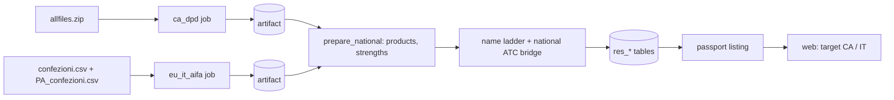

# Design: National products, Canada (DPD) and Italy (AIFA)

> Scope: `pipelines/janus_pipelines/jobs/{ca_dpd,eu_it_aifa}.py`; `apps/api/janus/resolution/{prepare_national,
> prepare,load,service,matching}.py`; migration `0015`; `apps/api/janus/passport/{strength,listing,presence,schemas,
> service,forms}.py`; `apps/web/src/passport/*`, source attribution components, `messages/*.json`; one loop in
> `deploy/titck-refresh.sh`. Decisions DN1-DN6, properties N1-N7. Expert review has not yet been done.

## 1. Overview

## 2. Sources and licence (Req 1)
| | Canada | Italy |
|---|---|---|
| Page | open.canada.ca dataset record of the DPD extract | aifa.gov.it/open-data |
| Licence | Open Government Licence - Canada 2.0 | CC BY 4.0 |
| Decisive sentence | record field "Licence: Open Government Licence - Canada" | "La licenza di distribuzione dei dati utilizzata da AIFA la CC-BY (attribuzione) nella versione 4.0" |
| Checked | 2026-11-10 | 2026-11-10 |
Both agree with the private licence report. Attribution texts are in `sources.toml` and shown with every list.

## 3. Pipelines (Req 2)
`ca_dpd`: zip, eight tables, comma, double quote, no header, UTF-8; one row per `DRUG_CODE` with ingredients,
forms, routes, ATC, current status, schedules, UPCs. `eu_it_aifa`: two semicolon files with a header; one row per
pack with its ingredient lines. Both refuse a changed shape by name (`SchemaMismatchError`), count malformed lines,
and keep cells as published. First real runs (2026-11-10): DPD 13,379 products (11,487 human), 7,617 package lines,
0 with a UPC; AIFA 160,015 packs, 339,589 ingredient lines, 0 malformed.

## 4. Preparation (`prepare_national.py`, pure; Req 3, 4)
DPD strength text is `S U` or `S U / D DU`; AIFA text is quantity plus unit, only where AIFA gives both. An `N.D.`
ingredient name stays an unnamed ingredient so it is never an exact match. Left out and counted: non-human DPD
classes, homeopathic AIFA registrations, suspended AIFA packs.

## 5. Resolution tables (Req 4.4-4.6)
Migration `0015` widens two CHECK constraints (`res_product_code.kind` adds `ca_din`, `it_aic`;
`res_product.region` adds `CA`). Downgrade deletes datasets that hold such rows (reference data, reloadable) and
restores the old checks. The loader reads the two artifacts if present.

## 6. Mapping (Req 3)
Same ladder as every source. Two deterministic additions that can only leave a name unmapped or ambiguous: the
parenthesis rule (DPD) and the national ATC bridge per source. DN3: the bridge key is (source, folded name).

## 7. Strength and form (Req 5)
`strength.py` parses `ca_dpd` and `eu_it_aifa` text to the existing representation (amount in micrograms or IU,
basis unit / mL / g). Per unit only for tablets and capsules, which needs the dose-form group. The form table has no
rows for the new sources (DN5), so a per-unit strength is not normalised and shows as published. Per-mL and per-g
strengths do not need the group.

## 8. Passport and API (Req 6, 7)
`LISTABLE_SOURCES` adds `eu_it_aifa`, `ca_dpd`. The source list order is TR, EU-FR, EU-ES, EU-DE, US, EU-IT, CA.
Source object carries `attribution` (`aifa`, `dpd`), snapshot date, licence. DN4: Canadian products are not name
index entries, not resolve candidates; Italian ones are, region `EU`, country `IT`, name-only sources
(`NAME_ONLY_SOURCES`). DPD status: `listed_as_marketed` when the published status says MARKETED, else `not_stated`.

## 9. Web (Req 6.1, 9)
Types and decoders accept `CA`, `IT`, `aifa`, `dpd`; `SourceAttribution` and the passport rows show source and date;
texts under `passport.sources.*`, `sourceAttribution.*`, country names.

## 10. Properties
- **N1** Strength code: per-unit only for countable forms, volume gives the mL code, everything else none.
- **N2** The parenthesis rule never chooses between two keys.
- **N3** The ATC bridge is per source and a combination code never feeds it.
- **N4** Prepared products keep what the source publishes; left-out rows are counted.
- **N5** Listing: no product is listed with an unmapped ingredient; strength "same" only when normalised strengths equal.
- **N6** Italian products are found by name; Canadian ones are not.
- **N7** Migration 0015 is reversible.

## 11. Decisions
- DN1 Canada uses the marketed extract only (not the approved or cancelled files).
- DN2 UPC is measured but unused (0 of 7,617 lines carry one).
- DN3 Per-source national ATC bridge.
- DN4 Canada is a passport target only.
- DN5 No dose-form rows without owner review; form group unknown for both sources.
- DN6 Weekly refresh runs inside the existing timer job.

## 12. Limits and open items
- Form groups for the two sources need the owner's row review (Req 5.6).
- Italian names have no word list; unmapped names (for example paracetamolo) stay out until mapped by label or ATC.
- Box origin (GS1 prefix) is not extended to Italy or Canada: AIFA has no GTIN and the DPD UPC is empty.
- Measured mapping rates are in `tasks.md`.
- Safety-audit fixes: parenthesis rule, declared ingredient counts, base strengths, "1.000" quantities (`review-safety-auditor.md`).
