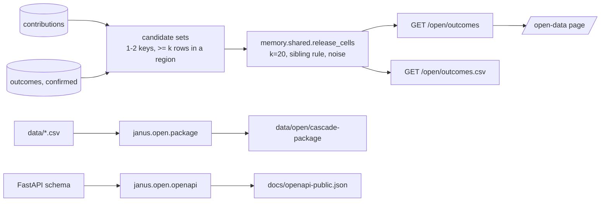

# Design: Open data

> Scope: `apps/api/janus/open/` (`outcomes.py`, `router.py`, `package.py`, `openapi.py`, `titck_name_hashes.txt`),
> `data/open/cascade-package/`, `docs/open-data.md`, `docs/open-api.md`, `docs/openapi-public.json`,
> `docs/contributing-corrections.md`, `apps/web/src/open/`, `apps/web/src/components/open/OpenData.tsx`, route
> `/[locale]/open-data`. Decisions DP1–DP10, properties P1–P6.

## 1. Overview

## 2. Outcome dataset (Req 1–2)
Candidates: SQL over each layer's rows, sets of one key and every pair of keys, grouped by (set, event, direction,
region) with `count(*) >= k`; distinct (set, event, direction). For each candidate the layer's `UserLayerSource.cells`
and `release_cells` run exactly as for `POST /memory/shared`, so a cell has the same value in both places (P4). Only
`status = released` cells are kept. Order: layer, ingredients, event, direction, region. `version` =
`open-outcomes-1+` + 12 hex of SHA-256 over (rule version, k, ε, released cells). `snapshot_date` = the UTC day.

## 3. Routes (Req 1.4, 2)
Medical routes (no-store, access line only). `GET /open/outcomes` → `OpenOutcomesOut`; `GET /open/outcomes.csv` →
`text/csv`, columns `dataset_version,snapshot_date,layer,ingredients,event,direction,region,value` (ingredients joined
with `|`), header `x-janus-dataset-version`, `content-disposition` with the date. 503 `open_data_unavailable` without
database or noise key.

## 4. Web (Req 3)
`src/open/model.ts` (decoder, live and demo clients, `byLayer`), `src/open/fixture.recorded.json`
(`scripts/record-open-data.mjs`), `src/open/package-summary.json` (written by the package builder), the page in
`components/open/OpenData.tsx`: large title and summary; the dataset card (cells line; the empty sentence, or tiles per
layer with released cells and a table per layer; the notices); the release rule as a grouped list; downloads (CSV,
JSON, dictionary) with version, snapshot and licence in the footer; the package card (version, date, files with rows
and licences) and links (package, OpenAPI, corrections). Route in the wide layout; entry in Research and in the footer.

## 5. Cascade data package (Req 4)
`python -m janus.open.package` (also `--check`, `--refresh-titck-hashes ROWS_PARQUET`). Resources and licences:
`pipc.csv` CC BY 4.0 (Rochon 2025); Janus mappings Apache-2.0; `dose_form_groups.csv` Apache-2.0 + CC0 (openFDA
names) + Licence Ouverte 2.0 (BDPM names). Synonym filter: note cites TİTCK, or note says "Proposed from the PIPC
coverage report" (built over the TİTCK list), or SHA-256 of the casefolded name is in `titck_name_hashes.txt`. Today:
26 of 134 rows kept, 108 left out. Version 1.0.0, created 2026-11-09, per-file `sha256` and `rows`.

## 6. API document (Req 5)
`python -m janus.open.openapi` cuts `app.openapi()` to `PUBLIC` (health, privacy storage, memory snapshot, séance
catalogue, light overview/validation/export, the three time-machine routes, the two open routes), drops FastAPI's
validation 422, adds `PublicError` and examples, and closes over the referenced schemas.

## 7. Properties and tests
| # | Property | Req | Test |
|---|---|---|---|
| P1 | CSV has the columns, one row per cell, the version in every row, the values in order | 2.1, 2.2 | Hypothesis over cell lists |
| P2 | `version` equal iff the released cells are equal; prefixed by the rule version | 2.2 | Hypothesis, pairs of lists |
| P3 | Any spelling of TİTCK in a note is recognised; name hashes ignore case and spacing | 4.3 | Hypothesis |
| P4 | The released value of a cell equals the `/memory/shared` value | 1.1 | PostgreSQL |
| P5 | A group under k is never listed; the sibling rule hides a revealing cell; release is deterministic | 1.2, 1.3 | PostgreSQL |
| P6 | Committed package and API document equal the builders' output; the document has GET only, no body | 4.4, 5.1 | pytest |
Plus: the routes' empty state, CSV header and 503; the local check against the TİTCK artifact (skipped in CI);
vitest message tests; Playwright `e2e/open-data.spec.ts`.

## 8. Decisions
| # | Decision | Alternatives | Why |
|---|---|---|---|
| DP1 | Cells of one and two ingredient keys | All subsets of a donation's list | One and two keys answer the research question (a medicine, a pair) and keep the sibling rule's scope small |
| DP2 | The one release path (`release_cells`, same noise source and data version) | A separate open-data release | Two paths could release different values for the same cell and allow differencing |
| DP3 | Hidden cells are not listed at all | List them as "hidden" | A listed hidden cell says that 1–19 contributors exist |
| DP4 | Computed per request, versioned by content; snapshot = the day of the request | Nightly snapshot files | Deterministic noise gives the same file for the same data; no job, no stored copy |
| DP5 | CC BY 4.0 for the dataset | CC0; ODbL | Attribution keeps the caveats with the numbers; compatible with the PIPC licence |
| DP6 | Package per-file licences; Janus mappings Apache-2.0 as in `data/README.md` | One licence for the package | The PIPC table is CC BY; dose-form names keep their sources' terms |
| DP7 | `/open-data` outside the research area, linked from Research and the footer | A research sub-route | The dataset is public and partly patient-contributed; it is not a research hypothesis |
| DP8 | TİTCK exclusion by evidence note, coverage-report origin and committed hashes | Commit an exclusion list of names; check only at build time with the artifact | A name list would itself be TİTCK strings; hashes make CI reproducible without the list |
| DP10 | **Consent gate (safety-auditor O1):** a layer is published only when every stored row of it was given under a consent version in `OPEN_RELEASE_CONSENT_VERSIONS` (empty today); otherwise the whole layer is withheld and named in `withheld_layers`. The consent texts 2026-11-v2 name Collective Memory and research, not open publication | Filter rows by consent; publish under the current consent | Publication under CC BY is a new purpose (GDPR Art. 9, KVKK); filtering rows would give a second count of nearly the same cell and allow differencing |
| DP9 | The upstream errors are documented, not submitted | Submit Wikidata edits from Janus | Owner instruction; a reviewer should confirm each before an upstream edit |

## 9. Open items
Legal review of publishing donated and outcome counts (GDPR Art. 9 / KVKK: whether k = 20 + noise is enough for
"anonymous" aggregate release); native review of `OpenData`; pharmacist review of the package.
