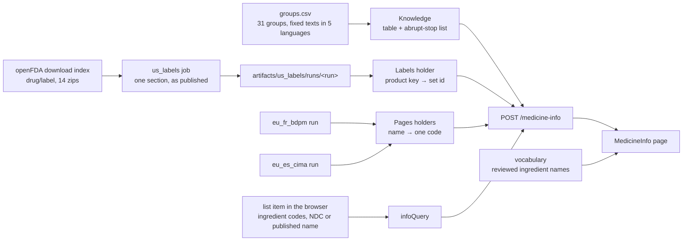

# Design: Medicine information in your own language

> Scope: `pipelines/janus_pipelines/jobs/us_labels.py`; `apps/api/janus/plaininfo/` (`groups.csv` and `groups.py`
> pure, `official.py` the current runs, `router.py` the route); `apps/web/src/plaininfo/` (`model.ts`, `query.ts`,
> `client.ts`, `useMedicineInfo.ts`), `apps/web/src/components/plaininfo/MedicineInfo.tsx`, the page
> `/medicines/info`, one link in `components/medicines/Medicines.tsx`. Decisions DP-M1-DP-M12, properties P1-P8
> (API), L1-L3 (pipeline) and W1-W6 (web). Automated review passes: `review-safety-auditor.md`,
> `review-localization.md`. Expert review has not yet been done.

## 1. Overview


## 2. What the page may say (Req 1, 6)
Three kinds of text, each with its own rule:

| Text | Where it comes from | Rule |
|---|---|---|
| Ingredient name | the reviewed glossary through the web vocabulary (doctor-loop DP16) | reviewed name of the language, else the English name with the tag "name not translated" or "name not reviewed" |
| Group name and group sentence | `groups.csv`, written once per language | whole text only, never composed; shown with the review status |
| Official text | the label section as published by openFDA | quoted, `lang="en"`, never translated, cut only at the end and flagged |

The interface texts around them (headings, the three fixed sentences, the notes about the label) are ordinary
catalogue texts in `apps/web/messages/*.json` under `PlainInfo`.

## 3. Covered groups (`groups.csv`, `groups.py`; Req 2)
A group sentence must be true of every medicine that can match it. So a group is listed only when the members
share their main use, the list is short, and single codes that are used for something else are excluded by code.
A code belongs to at most one group: the loader refuses a prefix that repeats or contains another.

Not covered in this version, on purpose:
- Nervous-system groups other than paracetamol and triptans (N01, N03-N07, opioids): uses differ inside a group
  (an antiepileptic for pain, an antidepressant for sleep), and a group sentence that names a mental-health or
  neurological condition can be read as a statement about the person.
- Cancer and immune-system medicines (L), antivirals (J05), sex hormones and contraceptives (G03): same reasons,
  and a wrong reading costs more.
- Skin, eye (other than eye-pressure medicines), ear and combination groups; vitamins other than D; anything with
  one member that has an unrelated use that cannot be excluded by a single code.
- Salicylates (N02BA): acetylsalicylic acid is an antiplatelet in a low strength and a pain medicine in a high
  one; Janus does not read strength for this purpose. It is reported as `mixed` (antiplatelet plus other uses).

Group names are common class names and Janus's own words. No text of the WHO ATC index is copied; the ATC codes
come from the sources drug resolution already uses (`whocc_atc` in NOTICE).

`describe(table, codes)` gives the status of one ingredient:
- `single`: every code is in the same covered group → the sentence.
- `mixed`: some code is covered, and the codes are in more than one group or some are in none → every covered
  group's sentence under "this ingredient is in more than one kind of medicine"; `other_uses` when a code is in
  no group.
- `none`: no sentence.

### The groups and the exact sentences
<!-- groups-table:start (generated from apps/api/janus/plaininfo/groups.csv by the test helper; do not edit by hand) -->
31 groups, 372 texts. Status of every row: `not_reviewed`.

| Group id | ATC prefixes (excluded codes) | Lang. | Name | Sentence |
|---|---|---|---|---|
| `ppi` | A02BC | en | Proton pump inhibitors (medicines that reduce stomach acid) | Medicines in this group lower the amount of acid the stomach makes. They are used for heartburn, acid reflux and stomach ulcers. |
|  |  | tr | Proton pompası inhibitörleri (mide asidini azaltan ilaçlar) | Bu gruptaki ilaçlar midenin ürettiği asit miktarını azaltır. Mide yanması, reflü ve mide ülserinde kullanılır. |
|  |  | de | Protonenpumpenhemmer (Magensäurehemmer) | Medikamente dieser Gruppe verringern die Menge an Säure, die der Magen bildet. Sie werden bei Sodbrennen, Rückfluss von Magensäure (Reflux) und Magengeschwüren angewendet. |
|  |  | fr | Inhibiteurs de la pompe à protons (médicaments qui réduisent l'acidité de l'estomac) | Les médicaments de ce groupe réduisent la quantité d'acide produite par l'estomac. Ils sont utilisés en cas de brûlures d'estomac, de reflux acide et d'ulcère de l'estomac. |
|  |  | es | Inhibidores de la bomba de protones (medicamentos que reducen el ácido del estómago) | Los medicamentos de este grupo reducen la cantidad de ácido que produce el estómago. Se usan para el ardor de estómago, el reflujo ácido y las úlceras de estómago. |
|  |  | pt | Inibidores da bomba de protões (medicamentos que reduzem o ácido do estômago) | Os medicamentos deste grupo reduzem a quantidade de ácido que o estômago produz. Usam-se para a azia, o refluxo ácido e as úlceras do estômago. |
| `h2_blocker` | A02BA | en | H2 blockers (medicines that reduce stomach acid) | Medicines in this group lower the amount of acid the stomach makes. They are used for heartburn, acid reflux and stomach ulcers. |
|  |  | tr | H2 reseptör blokerleri (mide asidini azaltan ilaçlar) | Bu gruptaki ilaçlar midenin ürettiği asit miktarını azaltır. Mide yanması, reflü ve mide ülserinde kullanılır. |
|  |  | de | H2-Blocker (Magensäurehemmer) | Medikamente dieser Gruppe verringern die Menge an Säure, die der Magen bildet. Sie werden bei Sodbrennen, Rückfluss von Magensäure (Reflux) und Magengeschwüren angewendet. |
|  |  | fr | Anti-H2 (médicaments qui réduisent l'acidité de l'estomac) | Les médicaments de ce groupe réduisent la quantité d'acide produite par l'estomac. Ils sont utilisés en cas de brûlures d'estomac, de reflux acide et d'ulcère de l'estomac. |
|  |  | es | Anti-H2 / antihistamínicos H2 (medicamentos que reducen el ácido del estómago) | Los medicamentos de este grupo reducen la cantidad de ácido que produce el estómago. Se usan para el ardor de estómago, el reflujo ácido y las úlceras de estómago. |
|  |  | pt | Antagonistas dos recetores H2 (medicamentos que reduzem o ácido do estômago) | Os medicamentos deste grupo reduzem a quantidade de ácido que o estômago produz. Usam-se para a azia, o refluxo ácido e as úlceras do estômago. |
| `laxative` | A06A | en | Laxatives | Medicines in this group help to empty the bowel. They are used for constipation, and some are used to clear the bowel before an examination or operation. |
|  |  | tr | Laksatifler (kabızlık ilaçları) | Bu gruptaki ilaçlar bağırsakların boşalmasına yardımcı olur. Kabızlıkta kullanılır; bazıları bir muayene veya ameliyattan önce bağırsağı temizlemek için de kullanılır. |
|  |  | de | Abführmittel | Medikamente dieser Gruppe helfen, den Darm zu entleeren. Sie werden bei Verstopfung angewendet, einige auch, um den Darm vor einer Untersuchung oder Operation zu reinigen. |
|  |  | fr | Laxatifs | Les médicaments de ce groupe aident à vider l'intestin. Ils sont utilisés en cas de constipation, et certains pour nettoyer l'intestin avant un examen ou une opération. |
|  |  | es | Laxantes | Los medicamentos de este grupo ayudan a vaciar el intestino. Se usan para el estreñimiento y algunos también para limpiar el intestino antes de una exploración o una operación. |
|  |  | pt | Laxantes | Os medicamentos deste grupo ajudam a esvaziar o intestino. Usam-se para a obstipação e alguns também para limpar o intestino antes de um exame ou de uma cirurgia. |
| `antidiarrheal` | A07DA | en | Medicines that slow the bowel (for diarrhea) | Medicines in this group slow down the movement of the bowel. They are used for diarrhea. |
|  |  | tr | Bağırsak hareketlerini yavaşlatan ilaçlar (ishal için) | Bu gruptaki ilaçlar bağırsak hareketlerini yavaşlatır. İshalde kullanılır. |
|  |  | de | Medikamente, die die Darmbewegung bremsen (gegen Durchfall) | Medikamente dieser Gruppe verlangsamen die Bewegung des Darms. Sie werden bei Durchfall angewendet. |
|  |  | fr | Médicaments qui ralentissent l'intestin (contre la diarrhée) | Les médicaments de ce groupe ralentissent les mouvements de l'intestin. Ils sont utilisés en cas de diarrhée. |
|  |  | es | Medicamentos que frenan el intestino (para la diarrea) | Los medicamentos de este grupo frenan el movimiento del intestino. Se usan para la diarrea. |
|  |  | pt | Medicamentos que abrandam o intestino (para a diarreia) | Os medicamentos deste grupo abrandam o movimento do intestino. Usam-se para a diarreia. |
| `insulin` | A10A | en | Insulins | Medicines in this group are insulins. They lower blood sugar and are used for diabetes. |
|  |  | tr | İnsülinler | Bu gruptaki ilaçlar insülindir. Kan şekerini düşürür ve diyabette (şeker hastalığında) kullanılır. |
|  |  | de | Insuline | Medikamente dieser Gruppe sind Insuline. Sie senken den Blutzucker und werden bei Diabetes (Zuckerkrankheit) angewendet. |
|  |  | fr | Insulines | Les médicaments de ce groupe sont des insulines. Ils font baisser le sucre dans le sang (glycémie) et sont utilisés en cas de diabète. |
|  |  | es | Insulinas | Los medicamentos de este grupo son insulinas. Bajan el azúcar en la sangre y se usan para la diabetes. |
|  |  | pt | Insulinas | Os medicamentos deste grupo são insulinas. Baixam o açúcar no sangue e usam-se para a diabetes. |
| `diabetes_non_insulin` | A10B | en | Blood sugar lowering medicines other than insulin | Medicines in this group lower blood sugar. Most are used for diabetes; some are also used for weight management or for heart and kidney conditions. |
|  |  | tr | İnsülin dışındaki kan şekeri düşürücü ilaçlar | Bu gruptaki ilaçlar kan şekerini düşürür. Çoğu diyabette (şeker hastalığında) kullanılır; bazıları kilo kontrolü veya kalp ve böbrek hastalıkları için de kullanılır. |
|  |  | de | Blutzuckersenkende Medikamente außer Insulin | Medikamente dieser Gruppe senken den Blutzucker. Die meisten werden bei Diabetes (Zuckerkrankheit) angewendet; einige auch zur Gewichtsregulierung oder bei Herz- und Nierenerkrankungen. |
|  |  | fr | Médicaments qui font baisser le sucre dans le sang, autres que l'insuline | Les médicaments de ce groupe font baisser le sucre dans le sang (glycémie). La plupart sont utilisés en cas de diabète ; certains le sont aussi pour la gestion du poids ou pour des maladies du cœur et des reins. |
|  |  | es | Medicamentos que bajan el azúcar en la sangre, distintos de la insulina | Los medicamentos de este grupo bajan el azúcar en la sangre. La mayoría se usan para la diabetes; algunos también se usan para el control del peso o para enfermedades del corazón y del riñón. |
|  |  | pt | Medicamentos que baixam o açúcar no sangue, diferentes da insulina | Os medicamentos deste grupo baixam o açúcar no sangue. A maioria usa-se para a diabetes; alguns também se usam para o controlo do peso ou para doenças do coração e do rim. |
| `vitamin_d` | A11CC | en | Vitamin D | Medicines in this group contain vitamin D. They are used when the body has too little vitamin D and for some bone conditions. |
|  |  | tr | D vitamini | Bu gruptaki ilaçlar D vitamini içerir. Vücutta D vitamini eksikliği olduğunda ve bazı kemik hastalıklarında kullanılır. |
|  |  | de | Vitamin D | Medikamente dieser Gruppe enthalten Vitamin D. Sie werden angewendet, wenn der Körper zu wenig Vitamin D hat, und bei einigen Knochenerkrankungen. |
|  |  | fr | Vitamine D | Les médicaments de ce groupe contiennent de la vitamine D. Ils sont utilisés lorsque le corps manque de vitamine D et pour certaines maladies des os. |
|  |  | es | Vitamina D | Los medicamentos de este grupo contienen vitamina D. Se usan cuando al cuerpo le falta vitamina D y para algunas enfermedades de los huesos. |
|  |  | pt | Vitamina D | Os medicamentos deste grupo contêm vitamina D. Usam-se quando o corpo tem pouca vitamina D e para algumas doenças dos ossos. |
| `anticoagulant` | B01AA B01AB B01AE B01AF | en | Anticoagulants (often called blood thinners) | Medicines in this group make the blood clot less easily. They are used to prevent harmful blood clots, and when a clot has already formed. |
|  |  | tr | Antikoagülanlar (halk arasında kan sulandırıcılar) | Bu gruptaki ilaçlar kanın pıhtılaşmasını zorlaştırır. Zararlı kan pıhtılarını önlemek için ve pıhtı oluştuğunda kullanılır. |
|  |  | de | Gerinnungshemmer (oft Blutverdünner genannt) | Medikamente dieser Gruppe sorgen dafür, dass das Blut weniger leicht gerinnt. Sie werden angewendet, um schädlichen Blutgerinnseln vorzubeugen, und wenn sich bereits ein Gerinnsel gebildet hat. |
|  |  | fr | Anticoagulants (souvent appelés « fluidifiants du sang ») | Les médicaments de ce groupe rendent le sang moins apte à coaguler. Ils sont utilisés pour prévenir les caillots sanguins dangereux, et lorsqu'un caillot s'est déjà formé. |
|  |  | es | Anticoagulantes (a menudo llamados «diluyentes de la sangre») | Los medicamentos de este grupo hacen que la sangre coagule con menos facilidad. Se usan para prevenir coágulos de sangre peligrosos y cuando ya se ha formado un coágulo. |
|  |  | pt | Anticoagulantes (muitas vezes chamados «diluidores do sangue») | Os medicamentos deste grupo fazem com que o sangue coagule com menos facilidade. Usam-se para prevenir coágulos de sangue prejudiciais e quando já se formou um coágulo. |
| `antiplatelet` | B01AC (not B01AC09 B01AC11 B01AC21 B01AC23 B01AC27) | en | Antiplatelet medicines | Medicines in this group make blood platelets less sticky. They are used to make harmful blood clots less likely, for example after a heart attack or a stroke. |
|  |  | tr | Antitrombosit (antiagregan) ilaçlar | Bu gruptaki ilaçlar kan pulcuklarının (trombositlerin) birbirine yapışmasını azaltır. Örneğin kalp krizi veya inmeden sonra zararlı kan pıhtılarının oluşma olasılığını azaltmak için kullanılır. |
|  |  | de | Thrombozytenaggregationshemmer (Plättchenhemmer) | Medikamente dieser Gruppe sorgen dafür, dass die Blutplättchen weniger leicht verklumpen. Sie werden angewendet, damit schädliche Blutgerinnsel seltener entstehen, zum Beispiel nach einem Herzinfarkt oder Schlaganfall. |
|  |  | fr | Antiagrégants plaquettaires | Les médicaments de ce groupe diminuent la tendance des plaquettes du sang à s'agglutiner. Ils sont utilisés pour réduire le risque de caillots sanguins dangereux, par exemple après un infarctus ou un accident vasculaire cérébral (AVC). |
|  |  | es | Antiagregantes plaquetarios | Los medicamentos de este grupo hacen que las plaquetas de la sangre se peguen menos entre sí. Se usan para reducir el riesgo de coágulos de sangre peligrosos, por ejemplo después de un infarto o de un ictus (accidente cerebrovascular). |
|  |  | pt | Antiagregantes plaquetários | Os medicamentos deste grupo fazem com que as plaquetas do sangue fiquem menos aderentes. Usam-se para tornar menos prováveis os coágulos de sangue prejudiciais, por exemplo após um enfarte do coração ou um AVC. |
| `iron` | B03A | en | Iron medicines | Medicines in this group contain iron. They are used when the body has too little iron, which can cause a low blood count (anemia). |
|  |  | tr | Demir ilaçları | Bu gruptaki ilaçlar demir içerir. Vücutta demir eksikliği olduğunda kullanılır; demir eksikliği kansızlığa (anemi) yol açabilir. |
|  |  | de | Eisenpräparate | Medikamente dieser Gruppe enthalten Eisen. Sie werden angewendet, wenn der Körper zu wenig Eisen hat; das kann zu Blutarmut (Anämie) führen. |
|  |  | fr | Médicaments à base de fer | Les médicaments de ce groupe contiennent du fer. Ils sont utilisés lorsque le corps manque de fer, ce qui peut entraîner une anémie. |
|  |  | es | Medicamentos con hierro | Los medicamentos de este grupo contienen hierro. Se usan cuando al cuerpo le falta hierro, lo que puede causar anemia. |
|  |  | pt | Medicamentos com ferro | Os medicamentos deste grupo contêm ferro. Usam-se quando o corpo tem pouco ferro, o que pode levar a uma contagem de células do sangue baixa (anemia). |
| `nitrate` | C01DA | en | Nitrates | Medicines in this group widen the blood vessels. They are used for chest pain that comes from the heart (angina). |
|  |  | tr | Nitratlar | Bu gruptaki ilaçlar kan damarlarını genişletir. Kalpten kaynaklanan göğüs ağrısında (anjina) kullanılır. |
|  |  | de | Nitrate | Medikamente dieser Gruppe erweitern die Blutgefäße. Sie werden bei Brustschmerzen, die vom Herzen ausgehen (Angina pectoris), angewendet. |
|  |  | fr | Dérivés nitrés | Les médicaments de ce groupe dilatent les vaisseaux sanguins. Ils sont utilisés en cas de douleurs dans la poitrine venant du cœur (angine de poitrine). |
|  |  | es | Nitratos | Los medicamentos de este grupo dilatan los vasos sanguíneos. Se usan para el dolor en el pecho que viene del corazón (angina de pecho). |
|  |  | pt | Nitratos | Os medicamentos deste grupo alargam os vasos sanguíneos. Usam-se para a dor no peito que tem origem no coração (angina de peito). |
| `diuretic` | C03AA C03BA C03CA | en | Diuretics (water tablets) | Medicines in this group help the body pass more water in the urine. They are used for high blood pressure and for swelling caused by too much fluid in the body. |
|  |  | tr | Diüretikler (idrar söktürücüler) | Bu gruptaki ilaçlar vücudun idrarla daha fazla su atmasına yardımcı olur. Yüksek tansiyonda ve vücutta fazla sıvı birikmesine bağlı şişlikte (ödem) kullanılır. |
|  |  | de | Diuretika (Wassertabletten) | Medikamente dieser Gruppe helfen dem Körper, mehr Wasser über den Urin auszuscheiden. Sie werden bei Bluthochdruck und bei Schwellungen durch zu viel Flüssigkeit im Körper (Ödeme) angewendet. |
|  |  | fr | Diurétiques | Les médicaments de ce groupe aident le corps à éliminer plus d'eau dans les urines. Ils sont utilisés en cas d'hypertension artérielle (tension élevée) et de gonflements dus à un excès de liquide dans le corps (œdèmes). |
|  |  | es | Diuréticos | Los medicamentos de este grupo ayudan al cuerpo a eliminar más agua por la orina. Se usan para la presión arterial alta (hipertensión) y para la hinchazón causada por un exceso de líquido en el cuerpo (edema). |
|  |  | pt | Diuréticos (comprimidos para urinar mais) | Os medicamentos deste grupo ajudam o corpo a eliminar mais água na urina. Usam-se para a tensão arterial elevada (hipertensão) e para o inchaço provocado por excesso de líquido no corpo. |
| `beta_blocker` | C07A | en | Beta blockers | Medicines in this group are used for high blood pressure and for some heart conditions, such as chest pain that comes from the heart (angina) or an irregular heartbeat Some are also used for other conditions, such as migraine. |
|  |  | tr | Beta blokerler | Bu gruptaki ilaçlar yüksek tansiyonda ve kalpten kaynaklanan göğüs ağrısı (anjina) veya düzensiz kalp atışı gibi bazı kalp hastalıklarında kullanılır. Bazıları migren gibi başka durumlarda da kullanılır. |
|  |  | de | Betablocker | Medikamente dieser Gruppe werden bei Bluthochdruck und bei einigen Herzerkrankungen angewendet, zum Beispiel bei Brustschmerzen, die vom Herzen ausgehen (Angina pectoris), oder bei unregelmäßigem Herzschlag. Einige werden auch bei anderen Beschwerden angewendet, zum Beispiel bei Migräne. |
|  |  | fr | Bêtabloquants | Les médicaments de ce groupe sont utilisés en cas d'hypertension artérielle (tension élevée) et pour certaines maladies du cœur, par exemple des douleurs dans la poitrine venant du cœur (angine de poitrine) ou un rythme cardiaque irrégulier. Certains sont aussi utilisés dans d'autres cas, par exemple la migraine. |
|  |  | es | Betabloqueantes | Los medicamentos de este grupo se usan para la presión arterial alta (hipertensión) y para algunas enfermedades del corazón, como el dolor en el pecho que viene del corazón (angina de pecho) o los latidos irregulares. Algunos también se usan para otros problemas, como la migraña. |
|  |  | pt | Betabloqueantes | Os medicamentos deste grupo usam-se para a tensão arterial elevada (hipertensão) e para algumas doenças do coração, como a dor no peito que tem origem no coração (angina de peito) ou o batimento cardíaco irregular. Alguns também se usam para outras situações, como a enxaqueca. |
| `calcium_channel_blocker` | C08CA (not C08CA06) | en | Calcium channel blockers (dihydropyridines) | Medicines in this group are used for high blood pressure. Some are also used for chest pain that comes from the heart (angina). |
|  |  | tr | Kalsiyum kanal blokerleri (dihidropiridinler) | Bu gruptaki ilaçlar yüksek tansiyonda kullanılır. Bazıları kalpten kaynaklanan göğüs ağrısında (anjina) da kullanılır. |
|  |  | de | Kalziumkanalblocker (Dihydropyridine) | Medikamente dieser Gruppe werden bei Bluthochdruck angewendet. Einige werden auch bei Brustschmerzen, die vom Herzen ausgehen (Angina pectoris), angewendet. |
|  |  | fr | Inhibiteurs calciques (dihydropyridines) | Les médicaments de ce groupe sont utilisés en cas d'hypertension artérielle (tension élevée). Certains le sont aussi en cas de douleurs dans la poitrine venant du cœur (angine de poitrine). |
|  |  | es | Antagonistas del calcio (dihidropiridinas) | Los medicamentos de este grupo se usan para la presión arterial alta (hipertensión). Algunos también se usan para el dolor en el pecho que viene del corazón (angina de pecho). |
|  |  | pt | Bloqueadores dos canais de cálcio (di-hidropiridinas) | Os medicamentos deste grupo usam-se para a tensão arterial elevada (hipertensão). Alguns também se usam para a dor no peito que tem origem no coração (angina de peito). |
| `ace_inhibitor` | C09AA | en | ACE inhibitors | Medicines in this group are used for high blood pressure and for some heart and kidney conditions. |
|  |  | tr | Anjiyotensin dönüştürücü enzim (ACE) inhibitörleri | Bu gruptaki ilaçlar yüksek tansiyonda ve bazı kalp ve böbrek hastalıklarında kullanılır. |
|  |  | de | ACE-Hemmer | Medikamente dieser Gruppe werden bei Bluthochdruck und bei einigen Herz- und Nierenerkrankungen angewendet. |
|  |  | fr | Inhibiteurs de l'enzyme de conversion de l'angiotensine (IEC) | Les médicaments de ce groupe sont utilisés en cas d'hypertension artérielle (tension élevée) et pour certaines maladies du cœur et des reins. |
|  |  | es | Inhibidores de la enzima convertidora de angiotensina (IECA) | Los medicamentos de este grupo se usan para la presión arterial alta (hipertensión) y para algunas enfermedades del corazón y del riñón. |
|  |  | pt | Inibidores da enzima de conversão da angiotensina (IECA) | Os medicamentos deste grupo usam-se para a tensão arterial elevada (hipertensão) e para algumas doenças do coração e do rim. |
| `angiotensin_receptor_blocker` | C09CA | en | Angiotensin receptor blockers (sartans) | Medicines in this group are used for high blood pressure and for some heart and kidney conditions. |
|  |  | tr | Anjiyotensin reseptör blokerleri (sartanlar) | Bu gruptaki ilaçlar yüksek tansiyonda ve bazı kalp ve böbrek hastalıklarında kullanılır. |
|  |  | de | Angiotensin-Rezeptorblocker (Sartane) | Medikamente dieser Gruppe werden bei Bluthochdruck und bei einigen Herz- und Nierenerkrankungen angewendet. |
|  |  | fr | Antagonistes des récepteurs de l'angiotensine II (sartans) | Les médicaments de ce groupe sont utilisés en cas d'hypertension artérielle (tension élevée) et pour certaines maladies du cœur et des reins. |
|  |  | es | Antagonistas de los receptores de la angiotensina II (sartanes) | Los medicamentos de este grupo se usan para la presión arterial alta (hipertensión) y para algunas enfermedades del corazón y del riñón. |
|  |  | pt | Antagonistas dos recetores da angiotensina (sartanos) | Os medicamentos deste grupo usam-se para a tensão arterial elevada (hipertensão) e para algumas doenças do coração e do rim. |
| `statin` | C10AA | en | Statins (cholesterol-lowering medicines) | Medicines in this group lower cholesterol in the blood. |
|  |  | tr | Statinler (kolesterol düşürücü ilaçlar) | Bu gruptaki ilaçlar kandaki kolesterolü düşürür. |
|  |  | de | Statine (Cholesterinsenker) | Medikamente dieser Gruppe senken das Cholesterin im Blut. |
|  |  | fr | Statines (médicaments qui font baisser le cholestérol) | Les médicaments de ce groupe font baisser le cholestérol dans le sang. |
|  |  | es | Estatinas (medicamentos que bajan el colesterol) | Los medicamentos de este grupo bajan el colesterol en la sangre. |
|  |  | pt | Estatinas (medicamentos que baixam o colesterol) | Os medicamentos deste grupo baixam o colesterol no sangue. |
| `prostate_alpha_blocker` | G04CA | en | Alpha blockers for the prostate | Medicines in this group are used for difficulty passing urine that is caused by an enlarged prostate. |
|  |  | tr | Prostat için alfa blokerler | Bu gruptaki ilaçlar prostat büyümesine bağlı idrar yapma güçlüğünde kullanılır. |
|  |  | de | Alphablocker für die Prostata | Medikamente dieser Gruppe werden bei Beschwerden beim Wasserlassen angewendet, die durch eine vergrößerte Prostata verursacht werden. |
|  |  | fr | Alpha-bloquants pour la prostate | Les médicaments de ce groupe sont utilisés en cas de difficultés à uriner dues à une augmentation du volume de la prostate. |
|  |  | es | Alfabloqueantes para la próstata | Los medicamentos de este grupo se usan para la dificultad al orinar causada por el aumento de tamaño de la próstata. |
|  |  | pt | Alfabloqueantes para a próstata | Os medicamentos deste grupo usam-se para a dificuldade em urinar provocada pelo aumento do tamanho da próstata. |
| `systemic_corticosteroid` | H02AB | en | Corticosteroids (often called cortisone or steroids) | Medicines in this group calm inflammation and the body's defense (immune) system, or replace a hormone the body makes too little of. They are used for many different conditions. |
|  |  | tr | Kortikosteroidler (halk arasında kortizon) | Bu gruptaki ilaçlar iltihabı ve vücudun savunma (bağışıklık) sistemini yatıştırır ya da vücudun yeterince üretemediği bir hormonun yerini tutar. Birçok farklı hastalıkta kullanılır. |
|  |  | de | Kortikosteroide (oft Kortison genannt) | Medikamente dieser Gruppe dämpfen Entzündungen und das Abwehrsystem (Immunsystem) des Körpers oder ersetzen ein Hormon, das der Körper zu wenig bildet. Sie werden bei vielen verschiedenen Erkrankungen angewendet. |
|  |  | fr | Corticoïdes (souvent appelés cortisone) | Les médicaments de ce groupe calment l'inflammation et le système de défense (immunitaire) du corps, ou remplacent une hormone que le corps ne produit pas en quantité suffisante. Ils sont utilisés pour de nombreuses maladies différentes. |
|  |  | es | Corticoides (a menudo llamados cortisona) | Los medicamentos de este grupo calman la inflamación y el sistema de defensa (inmunitario) del cuerpo, o reemplazan una hormona que el cuerpo produce en cantidad insuficiente. Se usan para muchas enfermedades distintas. |
|  |  | pt | Corticosteroides (muitas vezes chamados cortisona ou esteroides) | Os medicamentos deste grupo acalmam a inflamação e o sistema de defesa (imunitário) do corpo, ou substituem uma hormona que o corpo produz em quantidade insuficiente. Usam-se para muitas doenças diferentes. |
| `thyroid_hormone` | H03AA | en | Thyroid hormones | Medicines in this group contain thyroid hormone. They are used when the thyroid gland makes too little of it. |
|  |  | tr | Tiroid hormonları | Bu gruptaki ilaçlar tiroid hormonu içerir. Tiroid bezi bu hormonu yeterince üretmediğinde kullanılır. |
|  |  | de | Schilddrüsenhormone | Medikamente dieser Gruppe enthalten Schilddrüsenhormon. Sie werden angewendet, wenn die Schilddrüse zu wenig davon bildet. |
|  |  | fr | Hormones thyroïdiennes | Les médicaments de ce groupe contiennent de l'hormone thyroïdienne. Ils sont utilisés lorsque la glande thyroïde n'en produit pas assez. |
|  |  | es | Hormonas tiroideas | Los medicamentos de este grupo contienen hormona tiroidea. Se usan cuando la glándula tiroides no produce suficiente. |
|  |  | pt | Hormonas da tiroide | Os medicamentos deste grupo contêm hormona da tiroide. Usam-se quando a glândula tiroide produz pouca. |
| `antibiotic` | J01 | en | Antibiotics (medicines against bacteria) | Medicines in this group are antibiotics. They are used for infections caused by bacteria. |
|  |  | tr | Antibiyotikler (bakterilere karşı ilaçlar) | Bu gruptaki ilaçlar antibiyotiktir. Bakterilerin yol açtığı enfeksiyonlarda kullanılır. |
|  |  | de | Antibiotika (Medikamente gegen Bakterien) | Medikamente dieser Gruppe sind Antibiotika. Sie werden bei Infektionen angewendet, die durch Bakterien verursacht werden. |
|  |  | fr | Antibiotiques (médicaments contre les bactéries) | Les médicaments de ce groupe sont des antibiotiques. Ils sont utilisés en cas d'infection due à des bactéries. |
|  |  | es | Antibióticos (medicamentos contra las bacterias) | Los medicamentos de este grupo son antibióticos. Se usan para las infecciones causadas por bacterias. |
|  |  | pt | Antibióticos (medicamentos contra as bactérias) | Os medicamentos deste grupo são antibióticos. Usam-se para infeções provocadas por bactérias. |
| `nsaid` | M01AB M01AC M01AE M01AH | en | Non-steroidal anti-inflammatory medicines (NSAIDs) | Medicines in this group are used for pain and for swelling and soreness (inflammation). Some are also used for fever. |
|  |  | tr | Steroid olmayan antiinflamatuar ilaçlar (NSAİİ) | Bu gruptaki ilaçlar ağrı ve iltihap (şişlik ve hassasiyet) için kullanılır. Bazıları ateş için de kullanılır. |
|  |  | de | Nichtsteroidale Antirheumatika (NSAR) | Medikamente dieser Gruppe werden bei Schmerzen und Entzündungen (Schwellung und Reizung) angewendet. Einige werden auch bei Fieber angewendet. |
|  |  | fr | Anti-inflammatoires non stéroïdiens (AINS) | Les médicaments de ce groupe sont utilisés contre la douleur et l'inflammation (gonflement et irritation). Certains sont aussi utilisés contre la fièvre. |
|  |  | es | Antiinflamatorios no esteroideos (AINE) | Los medicamentos de este grupo se usan para el dolor y la inflamación (hinchazón e irritación). Algunos se usan también para la fiebre. |
|  |  | pt | Anti-inflamatórios não esteroides (AINE) | Os medicamentos deste grupo usam-se para a dor e para o inchaço e a dor local (inflamação). Alguns também se usam para a febre. |
| `urate_lowering` | M04AA | en | Medicines that lower uric acid | Medicines in this group lower uric acid in the blood. They are used for gout. |
|  |  | tr | Ürik asidi düşüren ilaçlar | Bu gruptaki ilaçlar kandaki ürik asidi düşürür. Gut hastalığında kullanılır. |
|  |  | de | Harnsäuresenkende Medikamente | Medikamente dieser Gruppe senken die Harnsäure im Blut. Sie werden bei Gicht angewendet. |
|  |  | fr | Médicaments qui font baisser l'acide urique | Les médicaments de ce groupe font baisser l'acide urique dans le sang. Ils sont utilisés en cas de goutte. |
|  |  | es | Medicamentos que bajan el ácido úrico | Los medicamentos de este grupo bajan el ácido úrico en la sangre. Se usan para la gota. |
|  |  | pt | Medicamentos que baixam o ácido úrico | Os medicamentos deste grupo baixam o ácido úrico no sangue. Usam-se para a gota. |
| `bisphosphonate` | M05BA | en | Bisphosphonates (bone medicines) | Medicines in this group slow down the loss of bone. They are used for conditions that make bones weak, such as osteoporosis. |
|  |  | tr | Bifosfonatlar (kemik ilaçları) | Bu gruptaki ilaçlar kemik kaybını yavaşlatır. Osteoporoz (kemik erimesi) gibi kemikleri zayıflatan hastalıklarda kullanılır. |
|  |  | de | Bisphosphonate (Knochenmittel) | Medikamente dieser Gruppe verlangsamen den Abbau von Knochen. Sie werden bei Erkrankungen angewendet, die die Knochen schwächen, zum Beispiel bei Osteoporose (Knochenschwund). |
|  |  | fr | Bisphosphonates (médicaments des os) | Les médicaments de ce groupe ralentissent la perte osseuse. Ils sont utilisés pour des maladies qui fragilisent les os, comme l'ostéoporose. |
|  |  | es | Bisfosfonatos (medicamentos para los huesos) | Los medicamentos de este grupo frenan la pérdida de hueso. Se usan para enfermedades que debilitan los huesos, como la osteoporosis. |
|  |  | pt | Bifosfonatos (medicamentos para os ossos) | Os medicamentos deste grupo abrandam a perda de osso. Usam-se para doenças que enfraquecem os ossos, como a osteoporose. |
| `paracetamol` | N02BE | en | Paracetamol (acetaminophen) medicines | Medicines in this group are used for pain and fever. |
|  |  | tr | Parasetamol içeren ilaçlar | Bu gruptaki ilaçlar ağrı ve ateş için kullanılır. |
|  |  | de | Paracetamol-Präparate | Medikamente dieser Gruppe werden bei Schmerzen und Fieber angewendet. |
|  |  | fr | Médicaments à base de paracétamol | Les médicaments de ce groupe sont utilisés contre la douleur et la fièvre. |
|  |  | es | Medicamentos con paracetamol | Los medicamentos de este grupo se usan para el dolor y la fiebre. |
|  |  | pt | Medicamentos com paracetamol | Os medicamentos deste grupo usam-se para a dor e a febre. |
| `triptan` | N02CC | en | Triptans (migraine medicines) | Medicines in this group are used for migraine attacks. |
|  |  | tr | Triptanlar (migren ilaçları) | Bu gruptaki ilaçlar migren ataklarında kullanılır. |
|  |  | de | Triptane (Migränemittel) | Medikamente dieser Gruppe werden bei Migräneanfällen angewendet. |
|  |  | fr | Triptans (médicaments de la migraine) | Les médicaments de ce groupe sont utilisés en cas de crise de migraine. |
|  |  | es | Triptanes (medicamentos para la migraña) | Los medicamentos de este grupo se usan para las crisis de migraña. |
|  |  | pt | Triptanos (medicamentos para a enxaqueca) | Os medicamentos deste grupo usam-se para as crises de enxaqueca. |
| `nasal_corticosteroid` | R01AD | en | Corticosteroids for the nose | Medicines in this group reduce swelling and irritation (inflammation) inside the nose. They are used for hay fever and other allergies that affect the nose. |
|  |  | tr | Burun için kortikosteroidler | Bu gruptaki ilaçlar burun içindeki iltihabı (şişlik ve hassasiyeti) azaltır. Saman nezlesinde ve burnu etkileyen diğer alerjilerde kullanılır. |
|  |  | de | Kortikosteroide für die Nase (Kortison-Nasensprays) | Medikamente dieser Gruppe verringern die Entzündung (Schwellung und Reizung) in der Nase. Sie werden bei Heuschnupfen und anderen Allergien angewendet, die die Nase betreffen. |
|  |  | fr | Corticoïdes pour le nez | Les médicaments de ce groupe réduisent l'inflammation (gonflement et irritation) à l'intérieur du nez. Ils sont utilisés en cas de rhume des foins et d'autres allergies qui touchent le nez. |
|  |  | es | Corticoides para la nariz | Los medicamentos de este grupo reducen la inflamación (hinchazón e irritación) dentro de la nariz. Se usan para la fiebre del heno y otras alergias que afectan a la nariz. |
|  |  | pt | Corticosteroides para o nariz | Os medicamentos deste grupo reduzem o inchaço e a irritação (inflamação) dentro do nariz. Usam-se para a febre dos fenos e outras alergias que afetam o nariz. |
| `inhaled_bronchodilator` | R03AC R03BB | en | Inhaled medicines that open the airways (bronchodilators) | Medicines in this group open the airways. They are used for asthma or for other long-term lung conditions in which the airways are narrow, such as COPD. |
|  |  | tr | Hava yollarını genişleten inhaler ilaçlar (bronkodilatörler) | Bu gruptaki ilaçlar hava yollarını genişletir. Astımda veya KOAH gibi hava yollarının daraldığı diğer uzun süreli akciğer hastalıklarında kullanılır. |
|  |  | de | Inhalative Medikamente, die die Atemwege erweitern (Bronchodilatatoren) | Medikamente dieser Gruppe erweitern die Atemwege. Sie werden bei Asthma oder bei anderen dauerhaften Lungenerkrankungen mit verengten Atemwegen angewendet, zum Beispiel bei COPD. |
|  |  | fr | Médicaments inhalés qui ouvrent les voies respiratoires (bronchodilatateurs) | Les médicaments de ce groupe ouvrent les voies respiratoires. Ils sont utilisés en cas d'asthme ou d'autres maladies pulmonaires de longue durée dans lesquelles les voies respiratoires sont rétrécies, comme la BPCO. |
|  |  | es | Medicamentos inhalados que abren las vías respiratorias (broncodilatadores) | Los medicamentos de este grupo abren las vías respiratorias. Se usan para el asma o para otras enfermedades pulmonares de larga duración en las que las vías respiratorias están estrechadas, como la EPOC. |
|  |  | pt | Medicamentos inalados que abrem as vias respiratórias (broncodilatadores) | Os medicamentos deste grupo abrem as vias respiratórias. Usam-se para a asma ou para outras doenças pulmonares de longa duração em que as vias respiratórias estão estreitadas, como a DPOC. |
| `inhaled_corticosteroid` | R03BA | en | Inhaled corticosteroids | Medicines in this group reduce swelling and irritation (inflammation) in the airways. They are used for asthma and for some other lung conditions. |
|  |  | tr | İnhaler kortikosteroidler | Bu gruptaki ilaçlar hava yollarındaki iltihabı (şişlik ve hassasiyeti) azaltır. Astımda ve bazı diğer akciğer hastalıklarında kullanılır. |
|  |  | de | Inhalative Kortikosteroide (Kortison zum Inhalieren) | Medikamente dieser Gruppe verringern die Entzündung (Schwellung und Reizung) in den Atemwegen. Sie werden bei Asthma und bei einigen anderen Lungenerkrankungen angewendet. |
|  |  | fr | Corticoïdes inhalés | Les médicaments de ce groupe réduisent l'inflammation (gonflement et irritation) des voies respiratoires. Ils sont utilisés en cas d'asthme et de certaines autres maladies des poumons. |
|  |  | es | Corticoides inhalados | Los medicamentos de este grupo reducen la inflamación (hinchazón e irritación) de las vías respiratorias. Se usan para el asma y para algunas otras enfermedades de los pulmones. |
|  |  | pt | Corticosteroides inalados | Os medicamentos deste grupo reduzem o inchaço e a irritação (inflamação) das vias respiratórias. Usam-se para a asma e para algumas outras doenças dos pulmões. |
| `antihistamine` | R06AE07 R06AE09 R06AX13 R06AX22 R06AX26 R06AX27 R06AX28 R06AX29 | en | Antihistamines (allergy medicines) | Medicines in this group are used for allergy symptoms, such as sneezing, a runny nose, itchy eyes and an itchy skin rash (hives). |
|  |  | tr | Antihistaminikler (alerji ilaçları) | Bu gruptaki ilaçlar hapşırma, burun akıntısı, gözlerde kaşıntı ve kaşıntılı deri döküntüsü (kurdeşen) gibi alerji belirtilerinde kullanılır. |
|  |  | de | Antihistaminika (Allergiemittel) | Medikamente dieser Gruppe werden bei Allergiebeschwerden angewendet, zum Beispiel bei Niesen, laufender Nase, juckenden Augen und juckendem Hautausschlag (Nesselsucht). |
|  |  | fr | Antihistaminiques (médicaments contre l'allergie) | Les médicaments de ce groupe sont utilisés contre les symptômes d'allergie, comme les éternuements, le nez qui coule, les yeux qui démangent et les plaques sur la peau qui démangent (urticaire). |
|  |  | es | Antihistamínicos (medicamentos para la alergia) | Los medicamentos de este grupo se usan para los síntomas de alergia, como estornudos, goteo nasal, picor de ojos y erupción en la piel con picor (urticaria). |
|  |  | pt | Anti-histamínicos (medicamentos para a alergia) | Os medicamentos deste grupo usam-se para os sintomas de alergia, como espirros, nariz a pingar, comichão nos olhos e erupção na pele com comichão (urticária). |
| `eye_pressure_drops` | S01ED S01EE | en | Eye medicines that lower pressure in the eye | Medicines in this group lower the pressure inside the eye. They are used for glaucoma and for raised eye pressure. |
|  |  | tr | Göz içi basıncını düşüren göz ilaçları | Bu gruptaki ilaçlar göz içi basıncını düşürür. Glokomda (göz tansiyonu) ve yüksek göz içi basıncında kullanılır. |
|  |  | de | Augenmedikamente, die den Augeninnendruck senken | Medikamente dieser Gruppe senken den Druck im Auge. Sie werden bei Glaukom (grünem Star) und bei erhöhtem Augeninnendruck angewendet. |
|  |  | fr | Médicaments pour les yeux qui font baisser la pression dans l'œil | Les médicaments de ce groupe font baisser la pression à l'intérieur de l'œil. Ils sont utilisés en cas de glaucome et de pression trop élevée dans l'œil. |
|  |  | es | Medicamentos para los ojos que bajan la presión dentro del ojo | Los medicamentos de este grupo bajan la presión dentro del ojo. Se usan para el glaucoma y para la presión ocular alta. |
|  |  | pt | Medicamentos para os olhos que baixam a pressão dentro do olho | Os medicamentos deste grupo baixam a pressão dentro do olho. Usam-se para o glaucoma e para a pressão ocular elevada. |
<!-- groups-table:end -->

## 4. Pipeline `us_labels` (Req 3.1-3.3)
Schema `us_labels-1`, source `openfda_label_indications`, storage `cache`, cadence 7 days. Reuses `us_ndc`'s
`iter_results`, `partition_text` and `parse_index`, and `us_recalls`'s `iso_date`.

| Column | From | Rule |
|---|---|---|
| `set_id` | `set_id` | stripped; missing → excluded `no_set_id`; repeated → `duplicate_set_id` |
| `version` | `version` | stripped; empty → null |
| `effective_date` | `effective_time` | `YYYYMMDD` → ISO; anything else null |
| `product_type` | `openfda.product_type` | exactly one value, `HUMAN PRESCRIPTION DRUG` or `HUMAN OTC DRUG`; else `other_product_type` |
| `product_ndcs` | `openfda.product_ndc` | as published, sorted; none → `no_product_code`; `openfda.spl_set_id` must be the label's own set id, else `set_id_not_linked` |
| `indications` | `indications_and_usage` | the list of paragraphs exactly as published (not stripped, not joined); paragraphs of whitespace only dropped; none → `no_indications` |

A label whose application numbers are not all `NDA…`, `ANDA…` or `BLA…` is excluded (`no_approved_application`):
OTC monograph labels put directions for use under the indications heading (seen in the data), and FDA has not
evaluated unapproved products, homeopathic ones among them (openFDA's disclaimer).

The download is 1.8 GB in 14 zip files. `fetch` reads one file, reduces it to a small Parquet part in the scratch
directory and drops it before the next (about 1.5 GB of memory, 4 minutes); `parse` joins the parts, checks the
count against the index and the schema, and hands the runner a file-backed result. Only `download.json` is kept
as a raw file; the source hash is the hash of the 14 file hashes.

First run (export date 2026-11-09): 264,510 records read; 40,298 rows (34,849 prescription, 5,449 OTC), naming
59,981 product NDCs; excluded 177,427 `no_product_code` (labels openFDA does not link to the NDC directory),
45,911 `no_approved_application`, 856 `no_indications`, 18 `other_product_type`. `rows.parquet` 9.7 MB (not
committed; `.data/`).

## 5. Official texts and pages (`official.py`; Req 3.4-3.7)
- `Holder(data_dir, pipeline, read)` reads `artifacts/<pipeline>/current` on first use and whenever `current`
  resolves to another run directory (the recall check's pattern, DP-R4). A run that failed, was not promoted or
  has another source or schema gives no value.
- **Labels:** an in-memory index from the 9-digit product key (`janus.resolution.ndc.canonical_product`) to the
  set ids that name it (59,488 keys, 0.6 s, a few MB). The text of one label is read from the Parquet file by set
  id when asked (rows are sorted by set id, row groups of 2,000; 0.1 s). 411 product keys are named by more than
  one label; they get no text.
- **Pages:** per country a map from the published product name to its code, only for names with exactly one
  well-formed code: France `denomination` → CIS (8 digits; 14,268 of 14,388 names), Spain `name` → registration
  number (4-10 digits; 20,288 of 21,271 names; parallel-import numbers are left out).
  Addresses: `https://base-donnees-publique.medicaments.gouv.fr/medicament/<CIS>/extrait` and
  `https://cima.aemps.es/cima/publico/detalle.html?nregistro=<n>` (both checked by hand on 2026-11-10: the page
  shows the product of that code; CIMA's REST answer for the number gives the same name).
- The full label: `https://dailymed.nlm.nih.gov/dailymed/drugInfo.cfm?setid=<set id>` (checked by hand).

## 6. API contract **[Client: experience, MCP]**
`POST /medicine-info`, medical route (no-store, access line only).

Body:
```json
{"language": "tr",
 "ingredients": [{"atc_codes": ["C08CA01"]}],
 "product": {"country": "US", "ndc": "0069-1530"}}
```
`product` is optional: `{"country": "US", "ndc": …}` or `{"country": "FR" | "ES", "name": …}`.
- 422 `{"error": "invalid_request", "fields": [...]}` (`language`, `ingredients`, `product` or `body`);
  422 `ndc_malformed`; 503 `medicine_info_unavailable`. No answer echoes input.
- 200 `MedicineInfoOut`: `language`, `groups_version`, `ingredients[]`, `official`, `official_status`, `notices[]`,
  `disclaimer`.
- `IngredientOut`: `status` (`single`, `mixed`, `none`), `groups[]` (`id`, `name`, `text`, `codes[]`,
  `review_status`), `other_uses`, `abrupt_stop`.
- `official`: null, or `{kind: "label_text", country: "US", language: "en", section, paragraphs[], truncated,
  set_id, version, effective_date, url, source}`, or `{kind: "product_page", country, language, url, source}`;
  `source` = `{source_id, run_id, snapshot_date, license, url}`.
- `official_status`: `text`, `page`, `not_asked`, `not_found`, `several_labels`, `source_unavailable`.
- Notices (fixed codes): `no_dose_information` always; `group_level_only` with a group; `expert_review_not_done`
  with a group that is `not_reviewed`; `official_text_not_translated` with a text or a page;
  `label_not_verified_by_fda`, `label_may_differ_from_box` with a text; `page_found_by_name` with a page;
  `snapshot_outdated` when the label data is older than 14 days (the evidence-integrity freshness rule).
- Shown label text: whole paragraphs while the total stays within 6,000 characters; when the first paragraph
  alone is longer it is cut at 6,000. The 99th percentile of the first run is 4,700 characters.
- `apps/web/src/plaininfo/fixtures/info.json` holds this API's answers for invented inputs; an API test fails
  when it differs, and the web decoder and renderer are tested on it.

## 7. Properties
| # | Property | Req | Test |
|---|---|---|---|
| P1 | a group is returned for an ingredient iff one of its codes is under a prefix of that group and not excluded; matched codes ⊆ asked codes; every asked code is matched or uncovered, never both | 2.2 | Hypothesis, brute-force oracle over the table |
| P2 | a code has at most one group; a prefix overlap is refused | 2.1 | Hypothesis + loader examples |
| P3 | status: `single` iff one group and no uncovered code; `none` iff no group; `other_uses` iff a group and an uncovered code | 2.3 | Hypothesis |
| P4 | order and repetition of codes never change the answer | 2.4 | Hypothesis |
| P5 | every group has a name and a use text in five languages; no digit in a use text; no forbidden, reassurance or "AI" word; the loader refuses each defect | 2.5, 2.6, 6.1, 6.2 | examples + mutation of the real file |
| P6 | the shown label text is a prefix of the published text, paragraph by paragraph; `truncated` iff something was left out; never longer than the limit | 1.4 | Hypothesis |
| P7 | a label text is returned iff exactly one label names the product key; a page iff exactly one code carries the name | 3.4, 3.5 | Hypothesis on built runs |
| P8 | `abrupt_stop` equals the cascade rule base's list for any code, covered or not; the answer never contains a text that is not a row of the table or a published paragraph | 4.5, 4.6, 1.2 | Hypothesis over the real files |
| L1 | a row is kept iff the label has a product NDC, its own set id in the link, one human product type, only NDA/ANDA/BLA numbers and a non-empty section; every other record is excluded with its reason | 3.2 | examples |
| L2 | paragraphs are stored exactly as published (inner and outer whitespace kept) | 3.2, 1.3 | Hypothesis |
| L3 | a count that differs from the index fails the run; source, licence and data date are in the manifest | 3.1, 3.3 | examples |
| W1 | the request holds only language, ingredient codes and the NDC or the published name; nothing for an unchecked ingredient; no product in demo mode or for a homeopathic product | 5.8, 5.9 | fast-check |
| W2 | the decoder accepts the API's answers and refuses changed ones; errors map to catalogue keys | 4 | unit |
| W3 | every `PlainInfo` text in five languages: same keys and parameters, no forbidden, reassurance or "AI" word; the review sentence equals `TimeMachine.review` | 5.3, 6.2, 6.3 | fast-check |
| W4 | a group sentence is rendered only from the answer, each with the review line; the official paragraphs are rendered unchanged inside a `lang="en"` quotation | 5.3, 5.4, 1.3 | render, 5 languages |
| W5 | the no-information state appears iff there is no group and no official part, and says it is no statement about the medicine | 5.6 | render, 5 languages |
| W6 | no `--risk` class outside the emergency notice; the abrupt-stop line appears iff the flag is set | 5.2, 5.7 | render |
Plus: route tests (medical POST, 200, 422 without echo, 503, reload without restart, the real runs when present),
Playwright (`e2e/plain-info.spec.ts`: five languages × two themes × 375 px and 1280 px, axe, touch targets, no
horizontal scroll, large text, the request body, no information, error and retry, demo mode).

## 8. Web (Req 5)
- `plaininfo/query.ts` (pure): from a list item, the ingredients to ask about (those with a key and no
  `notChecked` reason, with their codes) and the product part: a US product with one product code among its
  packages (the hyphenated 9-digit code, as the recall check derives it); a French or Spanish product by
  `product_name` (France) or `brand_name` (Spain), the names the lookup tables are keyed by; nothing for a
  homeopathic product, a name-only candidate, other countries, or demo mode.
- `plaininfo/useMedicineInfo.ts`: one request per query, kept in memory for the session; retry on error.
- `MedicineInfo` (page `/medicines/info#<item id>`): emergency notice, back link, title (box name), one card per
  ingredient ("This medicine contains …", group name with its code, the sentence, the abrupt-stop line), the
  review line and the method line, the three fixed sentences, then "What the official source says": the quoted
  label text with its notes and the DailyMed link, or the product page link, or the reason there is none.
  `--warn` only for the abrupt-stop line; no icon or colour makes a statement about the medicine.
- Reached from each row of the medicine list ("What is this medicine?"). Demo lists get the group sentences
  (their codes are real ATC codes) and no official part.

## 9. Decisions
| # | Decision | Alternatives | Why |
|---|---|---|---|
| DP-M1 | Fixed sentences per ATC group, written once in five languages | A language model at run time; machine translation of the label; a sentence per ingredient | No runtime model (tech.md keeps medicine deterministic); an untranslated-by-experts clinical text must not be shown as a translation; a per-ingredient text is thousands of unreviewed claims, 31 groups are 62 sentences per language that one professional can read in an hour |
| DP-M2 | A group only when the statement is true of the whole group; outliers excluded by code; whole areas left out | Broad coverage with hedged wording | A wrong "used for" is the worst error of this page; "no information" is honest. 21 % of ingredient keys, about 31 % of products by published code |
| DP-M3 | `mixed` shows every covered group and says Janus cannot tell which applies | Pick the most common use; show nothing | Picking is a clinical judgment; hiding loses a true and useful statement. The sentence about other kinds of medicine keeps it honest |
| DP-M4 | The sentences live in the API package, with a review status per row | In `apps/web/messages` | One table carries code rule, text and status; other clients (MCP) get the same texts; the loader enforces the safety rules on them at startup |
| DP-M5 | The official text is the exact product's label only | The label of any product with the same ingredient | Indications differ by product, strength and form; another product's label is not "the official text of this box" |
| DP-M6 | Bulk download of the label dataset, weekly; one section kept | A request to openFDA per user request; keeping the whole label | No user's product code is sent to FDA, the API makes no outbound call at run time (as the recall check, DP-R1); dosage and other sections never enter Janus, so they cannot be shown by mistake |
| DP-M7 | Only labels with NDA, ANDA or BLA numbers | Every label with an indications section | OTC monograph labels carry directions for use under the heading; unapproved and homeopathic labels are not evaluated by FDA. Cost: OTC monograph products (many paracetamol products) get no text |
| DP-M8 | No text when several labels name the product code | The newest label | Janus does not choose between official texts |
| DP-M9 | France and Spain: a link to the product's page, found by the exact published name when it has one code | Carry CIS and registration number through drug resolution; quote the leaflet | The candidate carries no source code today, and adding it changes the resolution contract (other work in parallel); the leaflet text is not in our data. Open item: carry the codes |
| DP-M10 | `abrupt_stop` is computed from the cascade rule base's list for every ingredient, and the route fails closed without it | A column in `groups.csv` | medical-safety rule 4 says always; one reviewed list, no copy |
| DP-M11 | The emergency notice is always first on the page | Only for groups whose sentence names chest pain or stroke | Nine sentences name a rule 10 symptom or a condition behind one; one rule for the page is simpler to keep right |
| DP-M12 | Demo mode asks for group sentences only | No page in demo; a recorded answer | The demo's ATC codes are real codes of a synthetic patient; its products are invented, so no official text is asked for |

## 10. Limits and open items
- 31 groups: 714 of 3,406 ingredient keys with an ingredient-level code get a sentence (603 `single`, 111
  `mixed`); of the 1,126 reviewed glossary names, 349. By published product code: 7,336 of 23,137 Turkish rows and
  9,709 of 30,900 Spanish rows are in a covered group.
- Official text: 59,045 of 138,262 US product codes (43 %) have exactly one label in the run; 52,590 of 57,102
  prescription products (92 %). OTC monograph products, unapproved products and 893 product codes with several
  labels have none.
- No official text for Türkiye (TİTCK's terms are unclear), Germany (no open product data) or other countries.
- The French and Spanish page is found by name: a product whose name is shared by two codes gets no link (120
  French and 755 Spanish names); the person is asked to compare the name on the page with the box.
- The label text is what the company submitted; openFDA says FDA has neither altered nor verified it and it may
  differ from the labeling in the box. It can contain clinical words Janus never uses itself; it is a marked
  quotation.
- A label section longer than 6,000 characters is cut at a paragraph end where there is one; otherwise in the
  middle of a sentence, with the flag and the link.
- `mixed` is common for ingredients found by name (all codes of the ingredient); a product narrows the codes by
  route.
- The weekly server step for `us_labels` is not written (nothing was deployed in this work): it needs 1.8 GB of
  download and 1.5 GB of memory on the jobs host. Until a run is installed the page shows no US label text.
- Open: MCP tool for the route; CIS and registration number through drug resolution; the leaflet's own section
  "what it is used for" from BDPM/CIMA documents; expert review of every sentence (the list is in
  `review-localization.md`).
