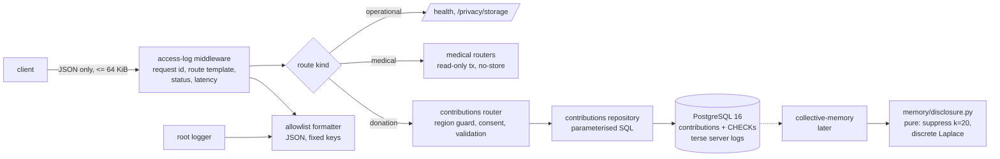

# Design: Privacy and Consent, Phase 1 (server side)

> Scope: `apps/api` only. Requirement 2 (stateless medical endpoints, logging), Requirement 4
> (k-suppression and noise, shared with `collective-memory`), and the server parts of
> Requirements 1, 3 and 5 (body rules, donation storage and deletion, EU storage region,
> migration, retention purge). Criteria tagged **[Client: experience spec]** are not designed here.
> Owner decisions of 2026-11-07 are applied (§9): adults only (age bands from 20), consent
> version stored, 24-month retention purge (§5.7), `"demo": true` rejected, placeholder event
> vocabulary.

## 1. Overview

Three independent safeguards, each enforced in one place:

1. **Nothing medical is kept by accident.** Every route is medical unless allowlisted. Medical
   routes accept small JSON bodies only, use read-only database transactions and send
   `no-store`. Only the donation routes may write, and only to `contributions`.
2. **Nothing medical is logged.** One ASGI middleware writes one access line per request
   (request id, route template, status, latency). One allowlist formatter on the root logger
   reduces every other record, including library records, to logger name, level and a fixed
   marker.
3. **Donations are minimal, deletable and protected in aggregate.** The schema holds only the
   allowed fields, enforced by Pydantic and again by database CHECK constraints. A deletion
   token (hash stored) deletes the row. Aggregates pass through a pure module that suppresses
   cells below k = 20 and adds discrete Laplace noise.



Facts checked on 2026-11-07 that shaped this design:

| Fact | Where | Design consequence |
|---|---|---|
| `httpx2` logs `HTTP Request: <method> <url>` at INFO (`httpx2/_client.py`). Outbound URLs carry product codes (openFDA NDC, RxNav, CIMA). | installed package | Library records cannot be trusted; the formatter allowlists, it does not blocklist (§4.2). |
| Starlette (1.10.0, FastAPI 0.162.1) sets `scope["route"]` to the matched route; `route.path` is the template. | `starlette/routing.py`, `fastapi/routing.py` | The middleware reads the template after the app returns (§4.1). |
| Starlette spools multipart parts over 1 MB to a `SpooledTemporaryFile` on disk. | `starlette/formparsers.py` | Medical routes reject non-JSON bodies before parsing (§4.3). |
| PostgreSQL logs a CHECK violation with `DETAIL: Failing row contains (…)` and the statement; `log_error_verbosity = terse` drops DETAIL, HINT, QUERY and CONTEXT. | PostgreSQL docs and mailing-list thread "Row data is reflected in DETAIL message…" (2019) | Local Postgres runs with terse errors and no error statements (§5.4). |
| OCI region ids starting `eu-` include non-EU countries: `eu-zurich-1` (Switzerland), `eu-jovanovac-1` (Serbia). EU-member ids: `eu-frankfurt-1`, `eu-paris-1`, `eu-marseille-1`, `eu-milan-1`, `eu-turin-1`, `eu-amsterdam-1`, `eu-madrid-1`, `eu-madrid-3`, `eu-stockholm-1`. | [OCI Regions and Availability Domains](https://docs.oracle.com/en-us/iaas/Content/General/Concepts/regions.htm) | Explicit allowlist, never a prefix check (§5.5). |
| Floating-point Laplace sampling leaks through low-order bits (Mironov 2012). Canonne, Kamath and Steinke give an exact discrete Laplace sampler with integer and rational arithmetic ([arXiv:2004.00010](https://arxiv.org/abs/2004.00010)). A 2026 report found periodic artifacts in OpenDP's implementation, caused by inexact rational arithmetic in `bernoulli_exp` ([arXiv:2610.01907](https://arxiv.org/html/2610.01907v1)). | papers | Exact sampler with `fractions.Fraction`, plus a goodness-of-fit test (§6.3, S1). |

## 2. Code layout

```
apps/api/
  janus/
    main.py                 create_app(): settings, logging, middleware, routers
    settings.py             Settings (Pydantic v2) from os.environ; validated at startup
    observability/
      logging.py            AllowlistFormatter, configure_logging(), log_event()
      middleware.py         AccessLogMiddleware (pure ASGI), request id, route template
      errors.py             unhandled-exception handler (class name only)
    http_policy/
      routes.py             RouteKind (operational | medical | donation), medical_router(),
                            donation_router(), OPERATIONAL_ALLOWLIST, classify(app)
      body_limits.py        BodyPolicyMiddleware: JSON-only, 64 KiB, before parsing
    db/
      pool.py               psycopg 3 ConnectionPool; read_only_tx(), write_tx()
    contributions/
      models.py             ContributionIn, ContributionStored, DeletionIn (Pydantic, extra="forbid")
      week.py               report_week(now) (pure)
      tokens.py             new_token(), token_hash() (pure apart from the CSPRNG)
      vocabulary.py         EventVocabulary + loader; placeholder_events.txt (until collective-memory)
      retention.py          retention_cutoff(today), is_expired() (pure)
      purge.py              purge_expired(conn, today); `python -m janus.contributions.purge`
      repository.py         insert(), delete_by_token_hash(), parameterised SQL
      router.py             POST /contributions, POST /contributions/deletions
    privacy/
      router.py             GET /privacy/storage
      regions.py            EU_STORAGE_REGIONS, donations_enabled(region) (pure)
    memory/
      disclosure.py         Cell, Release, suppress(), release_table(), noisy_count() (pure)
      noise.py              discrete Laplace exact sampler, keyed DRBG (pure)
  migrations/               Alembic env + versions/0001_contributions.py
  alembic.ini
  tests/                    pytest + Hypothesis; property tests test_<module>_properties.py
    conftest.py             Hypothesis profiles dev/ci; Postgres fixtures (§7)
    harness.py              assert_stateless(), capture_logs(), sentinel strategies (reused by later specs)
```

`memory/disclosure.py` and `memory/noise.py` sit in `janus/memory/` because `structure.md`
places k-anonymity and differential privacy there; `collective-memory` imports them. The other
new packages (`observability`, `http_policy`, `db`, `contributions`, `privacy`) are not in
`structure.md` yet (DP1).

New dependencies (DP18): `psycopg[binary]` and `psycopg-pool` (runtime), `alembic` with
`sqlalchemy` (migrations only; queries use psycopg with parameters, no ORM).

## 3. Configuration

`Settings` is a Pydantic model built from the environment at startup; invalid values stop the
process with the variable's name (never its value, for secrets).

| Variable | Type / range | Default | Used by |
|---|---|---|---|
| `DATABASE_URL` | PostgreSQL URL | none (DB features off when unset) | `db/pool.py` |
| `JANUS_DONATION_REGION` | `local` or an EU storage region id | unset → donations disabled | Req 3.4 |
| `JANUS_CONSENT_VERSIONS` | comma-separated ids, each `^[a-z0-9][a-z0-9.-]{0,31}$` | unset → donations disabled | Req 3.1 |
| `JANUS_EVENT_VOCABULARY` | path to a newline-separated event-key file | the bundled placeholder `contributions/placeholder_events.txt` | Req 3.2 |
| `JANUS_K` | integer ≥ 20 | 20 | Req 4.1 |
| `JANUS_DP_EPSILON` | decimal in (0, 10], parsed exactly as a `Fraction` | 1 | Req 4.2 (DP17) |
| `JANUS_NOISE_KEY` | ≥ 32 bytes, base64url | required only where aggregates are released (`collective-memory`) | Req 4.2 |

Added to `.env.example` without values. The donation routes are enabled only when region,
consent versions and database are all configured; otherwise they return 503.

## 4. Logging and stateless endpoints (Req 1.4, 2)

### 4.1 Access-log middleware (Req 2.2)
A pure ASGI middleware, outermost in the stack (so it also sees errors raised by other
middleware):

```
request_id = uuid4()                          # caller's X-Request-ID is ignored
t0 = perf_counter_ns()
wrap send: capture status; add X-Request-ID header to the response start message
try: await app(scope, receive, send)
except BaseException: status = 500 if no response started; re-raise to the error handler path
finally:
  route = scope.get("route").path if matched else "<unmatched>"
  log access(request_id, route, status, latency_ms = round((now - t0) / 1e6, 1))
```

`route` is always `route.path` (the template, e.g. `/resolve/{code}`), never `scope["path"]`
or `scope["query_string"]`. Mounted sub-apps (docs) log their mount template. Uvicorn's own
access log stays off (`--no-access-log`, already in the Dockerfile).

### 4.2 Allowlist formatter (Req 2.2)
`configure_logging()` replaces all handlers on the root logger and on `uvicorn`,
`uvicorn.error`, `uvicorn.access`, `fastapi`, `httpx2`, `alembic` and `psycopg` with one
stream handler whose formatter emits one JSON object per record:

| Key | Source | Rule |
|---|---|---|
| `ts` | record time, UTC ISO 8601 | always |
| `level` | record level name | always |
| `logger` | record logger name | always |
| `event` | `record.janus_event` if it is a member of the `LogEvent` enum, else `"suppressed"` | always |
| `request_id` | `record.janus_fields` | must match a UUID |
| `route` | `record.janus_fields` | must be a registered route template or `<unmatched>` |
| `status` | `record.janus_fields` | int 100–599 |
| `latency_ms` | `record.janus_fields` | float ≥ 0 |
| `error_class` | `record.janus_fields` | an exception class object; its `__qualname__` is written |
| `count` | `record.janus_fields` | int ≥ 0 (purge) |
| `logger` | record logger name | only the top-level package from a fixed list (`janus`, `uvicorn`, `httpx2`, …), else `other` |

The formatter never reads `record.msg`, `record.args`, `record.exc_info`, `record.stack_info`
or any other attribute. A field that fails its rule is dropped. So a record from any logger,
with any message, arguments or exception, can only produce these keys with validated values.
Own code logs through `log_event(LogEvent.X, **fields)`; `LogEvent` members are fixed strings
(`access`, `unhandled_error`, `startup`, `shutdown`, `migration`, `donations_disabled`,
`purge`).

### 4.3 Route kinds and body policy (Req 1.4, 2.1)
- Routers are created only through `medical_router()`, `donation_router()` or the operational
  router; each sets a `RouteKind` on its routes (custom `APIRoute` subclass).
  `OPERATIONAL_ALLOWLIST = {"/health", "/privacy/storage", "/openapi.json", "/docs",
  "/docs/oauth2-redirect", "/redoc"}`. A startup check (`classify(app, routers)`) fails if any route
  has no kind, or if an operational route is not on the allowlist (DP2). FastAPI 0.162
  includes routers lazily (`_IncludedRouter`, not flattened into `app.routes`), so the check
  walks the routers the app includes; policy routers must not use a prefix, which keeps a
  matched route's `path` equal to its full template (found in task 3).
- `BodyPolicyMiddleware` runs before routing for every non-operational path: methods with a
  body must send `Content-Type: application/json` (else 415) and at most 64 KiB, checked
  against `Content-Length` and while streaming (else 413). It never parses multipart, so
  nothing is spooled to disk.
- Every medical and donation response gets `Cache-Control: no-store` (set by the route class).
- Medical routes get the database only through `read_only_tx()`, which opens the transaction
  with `SET TRANSACTION READ ONLY`; PostgreSQL then rejects any write. `write_tx()` is
  importable only from `contributions/repository.py` (enforced by an import-boundary test).

### 4.4 Errors (Req 2.2)
The unhandled-exception handler logs `LogEvent.unhandled_error` with `request_id` and
`error_class = type(exc).__qualname__`, and returns `500 {"error": "internal_error",
"request_id": …}`. Validation errors (422) keep FastAPI's default body to the caller (it echoes
the caller's own input back to the caller only) and are not logged beyond the access line.

## 5. Donations (Req 3)

### 5.1 API
| Route | Kind | Body | Success | Errors |
|---|---|---|---|---|
| `POST /contributions` | donation | `ContributionIn` | `201 {deletion_token, stored: ContributionStored}` | 422 invalid / no consent; 503 disabled |
| `POST /contributions/deletions` | donation | `{"deletion_token": str}` | `200 {"deleted": true}` | 404 no match; 422 malformed; 503 disabled |
| `GET /privacy/storage` | operational | – | `200 {"donation_storage_region": str, "in_eu": bool, "donations_enabled": bool}` | – |

`ContributionIn` (`extra="forbid"`, strict types):
```
consent:     {version: one of JANUS_CONSENT_VERSIONS, explicit: Literal[True]}
age_band:    Literal[20, 25, …, 85, 90]     # adults only; 90 = "90 and over" (DP6)
sex:         Literal["female", "male"] | None = None
region:      Literal["TR", "EU", "US"]
ingredients: list[str], 1–20 items, each ^Q[1-9][0-9]{0,9}$, distinct   # stored sorted
event:       str in EventVocabulary
direction:   Literal["adverse", "benefit"]
```
There is no date, timestamp, free-text or identifier field. The consent version is stored with
the donation (DP8). Before model validation the router checks the raw JSON object: if it
carries `"demo": true` the request is rejected with `422 {"error": "demo_donation_rejected"}`;
any other `demo` value is an unknown field and fails `extra="forbid"` (422). `ContributionStored` is the stored row without `id` and token hash, returned
so the client can show exactly what was kept.

### 5.2 Schema (migration `0001_contributions`, Req 3.2, 3.5)
```sql
CREATE TABLE contributions (
  id                  uuid PRIMARY KEY DEFAULT gen_random_uuid(),
  report_week         date NOT NULL CHECK (extract(isodow FROM report_week) = 1),
  age_band            smallint NOT NULL CHECK (age_band BETWEEN 20 AND 90 AND age_band % 5 = 0),
  sex                 text NULL CHECK (sex IN ('female', 'male')),
  region              text NOT NULL CHECK (region IN ('TR', 'EU', 'US')),
  ingredients         text[] NOT NULL CHECK (
                        cardinality(ingredients) BETWEEN 1 AND 20
                        AND array_to_string(ingredients, ',') ~ '^Q[1-9][0-9]{0,9}(,Q[1-9][0-9]{0,9})*$'),
  event               text NOT NULL CHECK (event ~ '^[a-z0-9][a-z0-9_.-]{0,63}$'),
  direction           text NOT NULL CHECK (direction IN ('adverse', 'benefit')),
  consent_version     text NOT NULL CHECK (consent_version ~ '^[a-z0-9][a-z0-9.-]{0,31}$'),
  deletion_token_hash bytea NOT NULL UNIQUE CHECK (octet_length(deletion_token_hash) = 32)
);
```
No `created_at`, no defaults that read the clock, no sequence (`gen_random_uuid()` is built
into PostgreSQL 13+). `downgrade()` drops the table. Migrations are forward-only: an applied
revision is never edited; a change is a new revision with its own downgrade. Distinctness of
ingredients is checked in the API (sorted, unique) because a CHECK cannot use a subquery.

### 5.3 Report week and tokens (Req 3.2, 3.3)
- `report_week(now: datetime) -> date`: `now` must be timezone-aware; convert to UTC; return
  `date - timedelta(days=weekday())`. The router passes the server clock; nothing from the
  request reaches it.
- `new_token()`: `"jdt_" + base64url(secrets.token_bytes(32))` (256 bits). `token_hash(t)`:
  SHA-256 of the UTF-8 token. Plain SHA-256 is enough: the token has 256 bits of entropy, so
  the hash cannot be reversed by guessing (DP9).
- Delete: `DELETE FROM contributions WHERE deletion_token_hash = %s RETURNING 1` in one
  transaction; no row → 404. The same 404 is used for "never issued" and "already used".

### 5.4 Database server logging (Req 2.3)
`docker-compose.yml` starts Postgres with `-c log_error_verbosity=terse -c
log_min_error_statement=panic -c log_statement=none -c log_min_duration_statement=-1`. The API
validates every donation before the INSERT, so a CHECK violation means a bug, and even then the
server log names only the constraint. Production settings follow in Phase 5 (DP11).

### 5.5 Storage region (Req 3.4)
`EU_STORAGE_REGIONS = {"eu-frankfurt-1", "eu-paris-1", "eu-marseille-1", "eu-milan-1",
"eu-turin-1", "eu-amsterdam-1", "eu-madrid-1", "eu-madrid-3", "eu-stockholm-1"}` (OCI region
ids in EU member states, checked 2026-11-07; `eu-zurich-1` and `eu-jovanovac-1` are excluded).
`donations_enabled(region) = region == "local" or region in EU_STORAGE_REGIONS` (exact,
case-sensitive match). `/privacy/storage` reports the region and `in_eu` (false for `local`);
it states facts only, no compliance claims (Req 5.2).

### 5.6 What "complete deletion" covers (Req 3.3)
In Phase 1 the row is the only copy: no materialised aggregates, no caches, nothing in logs.
Rule for later specs: any stored aggregate or cache derived from donations is keyed by the data
version (§6.2), so a deletion changes the version and the old value is never served again.
PostgreSQL removes the dead tuple physically at the next (auto)vacuum. Backups do not exist
before Phase 5; their retention is decided then and stated on the privacy page (DP10).

### 5.7 Retention purge (Req 3.6)
- `retention_cutoff(today) = today − 24 months` (same day of month; clamped to the month's last
  day, e.g. 2028-02-29 → 2026-02-28). Pure.
- `is_expired(report_week, today) = report_week <= retention_cutoff(today)`. A donation is
  received on or after its report week's Monday, so deleting by report week never keeps a
  donation longer than 24 months after receipt (it may delete up to 6 days early).
- `purge_expired(conn, today) -> int`: `DELETE FROM contributions WHERE report_week <= %s` in one
  transaction; returns the number deleted (logged as a count only, `LogEvent.purge`).
  Idempotent. CLI: `python -m janus.contributions.purge` (uses today's UTC date). A daily
  schedule is added in Phase 5.

### 5.8 Placeholder event vocabulary (DP6 d)
`contributions/placeholder_events.txt` holds a few keys, marked as a placeholder in a header
comment, so donations can be tested end to end. `collective-memory` replaces it with the Janus
vocabulary derived from the PIPC adverse events plus improvement terms for `benefit`.

## 6. Aggregate protection (Req 4) — `janus/memory/disclosure.py`, `noise.py`

### 6.1 Suppression (Req 4.1)
```python
@dataclass(frozen=True)
class Cell:  key: tuple[str, ...]; count: int          # true contributor count

@dataclass(frozen=True)
class Released:  key: tuple[str, ...]; value: int       # noisy, non-negative

@dataclass(frozen=True)
class Release:
    cells: tuple[Released, ...]       # only cells with count >= k, sorted by key
    suppressed: int                   # how many cells were withheld
    total_of_released: int | None     # sum of released noisy values; None if nothing released

def release_table(cells, *, k, epsilon, noise_source, data_version) -> Release
```
- A cell is released iff its true `count >= k` (decided before noise).
- Noise is drawn only for released cells; the total is the sum of released noisy values, never
  a noisy true total. So nothing in a `Release` depends on a suppressed cell, which blocks
  recovering a suppressed cell by subtraction.
- `suppressed` is the number of withheld cells, not their sum.
- `k < 20` raises `ValueError` (the module repeats the config rule).

### 6.2 Noise (Req 4.2)
- `noisy_count(true_count, *, epsilon, rng) = max(0, true_count + discrete_laplace(1/epsilon, rng))`.
  Discrete Laplace with scale `t = 1/ε` has P(Z = z) ∝ exp(−|z|/t); with sensitivity 1 this
  gives ε-DP for a single count (CKS20). The result is already an integer; clamping at zero is
  post-processing (DP15).
- Exact sampler (CKS20, Algorithm 2) with `Bernoulli(exp(−γ))` for rational γ (Algorithm 1),
  all arithmetic on `int` and `fractions.Fraction`; no floats anywhere in the sampling path.
- `rng` is a protocol with one method `randbelow(n: int) -> int`. Production: a keyed
  deterministic generator (HMAC-SHA256 in counter mode, key `JANUS_NOISE_KEY`, seeded with
  `cell key ‖ data version`), so a repeated query for the same cell and version returns the
  same value and cannot be averaged away (DP16). Tests pass a seeded generator.
- `randbelow` uses rejection sampling over HMAC output blocks, so it is uniform (no modulo
  bias).
- FAERS counts never call this module; `collective-memory` keeps FAERS on its own path.

### 6.3 What we claim
Suppression uses the true count, so the release decision itself is not covered by the ε
guarantee: a donation that lifts a cell from 19 to 20 changes whether it is shown. Product
copy and docs say "cells under 20 donations are hidden and noise is added to the counts", and
do not claim formal ε-differential privacy for the whole release (DP14).

## 7. Testing strategy

- **Property tests (Hypothesis)** for every item under "Properties to test", listed in §8.
  Profiles `dev` (100 examples) and `ci` (300, `derandomize=True`) selected by
  `HYPOTHESIS_PROFILE`, as in `pipelines/`. Database-backed properties use 50 / 100 examples.
- **Sentinel values.** Medical values in log tests are generated as `"zz" + text + "zz"` over
  an alphabet that includes Turkish letters, so they cannot occur by chance in a UUID, a route
  template, a status or a latency. The check is: no sentinel substring in any captured byte of
  log output (all loggers, stdout and stderr).
- **Test app.** `harness.py` builds an app with the real middleware and a stub medical router
  (`/test/resolve/{code}` GET with query, `/test/echo` POST JSON) so the stateless and logging
  properties run before real medical endpoints exist. `assert_stateless(app, route,
  payload_strategy)` is reused by `drug-resolution`, `cascade-engine` and later specs for their
  own endpoints.
- **Database.** Tests marked `db` run against PostgreSQL 16: locally the compose service with a
  separate `janus_test` database (`JANUS_TEST_DATABASE_URL`), in CI a `postgres:16` service
  container. Locally the `db` tests are skipped when the variable is unset; in CI (`CI=true`)
  an unset variable fails the run, so the tests cannot be skipped silently (DP19). Each
  example truncates `contributions` first.
- **State snapshots** for P4: row counts and an `md5` of every user table's sorted rows, plus a
  recursive listing (names, sizes, mtimes) of a temporary directory set as `TMPDIR`.
- **Statistical test S1** (not Hypothesis): 200,000 seeded draws per ε in {0.1, 0.5, 1, 2};
  chi-square goodness of fit against the discrete Laplace pmf (tail bins pooled), p > 0.001;
  mean within 4 standard errors of 0. This is the check that found the OpenDP artifacts.
- **Example tests:** migration upgrade → downgrade → upgrade on an empty database gives the
  same `information_schema` columns and constraints; `/privacy/storage` in `local`;
  donation routes return 503 when not configured; `classify(app)` fails on an unclassified
  route; import-boundary test for `write_tx`; Postgres container runs with
  `log_error_verbosity = terse` (`SHOW`).
- **CI:** the `api` job gains the `postgres:16` service, `JANUS_TEST_DATABASE_URL`,
  `HYPOTHESIS_PROFILE=ci`, and `alembic upgrade head` before pytest. The `log-guard` hook keeps
  checking logging calls on save.

## 8. Correctness properties

Each property is one Hypothesis test, tagged in its docstring with
`Feature: privacy, Property Pn` and the requirement it validates.

| # | Property (for all …) | Validates | Hypothesis approach |
|---|---|---|---|
| P1 | **No medical value in logs.** For any request to a medical or donation endpoint (path parameters, query values, JSON body fields, headers including `X-Request-ID`, `User-Agent`, with any status 2xx/4xx/5xx), no captured log output contains any of the request's medical values. | Req 2.2 | Sentinel strategies for every value; stub router that sometimes raises an exception whose message contains the values and logs via `logging` and `httpx2`-style loggers; plus `POST /contributions` with sentinel-bearing invalid payloads. Original property. |
| P2 | **Formatter allowlist.** For any `LogRecord` (any logger name, level, `msg`, `args`, `exc_info`, `stack_info`, arbitrary extra attributes incl. fake `janus_fields`), the output is one JSON object, its keys ⊆ the allowlist, every value passes its rule, and no sentinel from the record appears. | Req 2.2 | `st.builds(LogRecord, …)` with sentinel text everywhere; invalid `janus_fields` values. |
| P3 | **One access line, template route.** For any request (matched, unmatched, with query string, raising), exactly one `access` line is written; `route` is the matched template or `<unmatched>`; `request_id` equals the `X-Request-ID` response header, is a fresh UUID and never equals a caller-sent id; `latency_ms ≥ 0`. | Req 2.2 | Generated paths and queries against the test app; caller-sent ids from a strategy. |
| P4 | **Medical endpoints persist nothing.** For any request to a non-donation medical endpoint, the database snapshot and the temp-directory listing are identical before and after, and the response carries `Cache-Control: no-store`; a write attempted inside `read_only_tx()` fails. | Req 2.1 | `assert_stateless` with the stub router; the stub also tries an INSERT through `read_only_tx()` and must get PostgreSQL's read-only error. |
| P5 | **Body policy.** For any body to a medical or donation endpoint whose content type is not `application/json`, or whose size exceeds 64 KiB, the response is 415 or 413, the endpoint is not called, nothing is stored and no file appears in the temp directory. | Req 1.4, 2.1 | Content types (incl. `multipart/form-data`, `image/png`, missing), sizes around the limit, with and without `Content-Length`. |
| P6 | **Only allowed fields stored.** For any valid donation, the stored row has exactly the columns {id, report_week, age_band, sex, region, ingredients, event, direction, consent_version, deletion_token_hash}, the values equal the normalised input (ingredients sorted), and the table's columns in `information_schema` are exactly that set. | Req 3.2 | Valid `ContributionIn` strategy; read back by id. Original property. |
| P7 | **Invalid donations rejected.** For any payload with an extra field (any name, incl. `date`, `email`, `ip`, `notes`), a missing required field, a value outside its domain (incl. any age band under 20), a duplicate ingredient, a missing or `false` consent, an unknown consent version, or `"demo": true`, the response is 422 and the table is unchanged. | Req 3.1, 3.2 | Mutations of a valid payload, one per example. |
| P8 | **Report week.** For any timezone-aware instant, `report_week` returns a Monday, `0 ≤ (utc_date − week) ≤ 6` days, and the same value for every instant in that UTC ISO week; for any request content, the stored week equals `report_week(server clock)`. | Req 3.2 | `st.datetimes(timezones=st.timezones())`; frozen clock in the router test. |
| P9 | **Deletion is complete.** For any set of stored donations and any one of their tokens, after deletion no query returns that donation (by id, by any field combination, by full scan), every other donation is unchanged, and an aggregate recomputed afterwards does not count it. | Req 3.3 | Insert N donations, delete one, compare full-table snapshots minus the deleted row. Original property. |
| P10 | **Token secrecy and single use.** For any stored donation, no column of any row contains the token or its base64 payload; presenting any other token deletes nothing and returns 404; presenting the right token twice returns 200 then 404. | Req 3.3 | Random tokens; scan every text/bytea column. |
| P11 | **Suppression.** For any list of cells, every released cell has true count ≥ k; and for any change to the counts of suppressed cells that keeps them < k, the `Release` (cells, values, total) is identical for the same noise source and data version. | Req 4.1 | Generated cells around the threshold; perturb only suppressed counts. Original property, strengthened to cover totals. |
| P12 | **Noisy counts are non-negative integers.** For any true count ≥ 0, ε in range and seed, `noisy_count` returns an `int` ≥ 0. | Req 4.2 | Integers, `Fraction` ε, seeds. (Also listed in `collective-memory`.) |
| P13 | **Deterministic per cell and version.** For any key, cell key, data version and true count, two calls give the same value; `release_table` is independent of the input order of cells. | Req 4.2 | Repeat calls; `st.permutations` of cells. |
| P14 | **Config bounds.** For any integer k and any decimal ε, `Settings` accepts k iff k ≥ 20 and ε iff 0 < ε ≤ 10; `release_table` raises for k < 20. | Req 4.1, 4.2 | Integers and decimal strings incl. `0`, negatives, `NaN`, `inf`, exponents. |
| P15 | **Storage-region guard.** For any string, `donations_enabled` is true iff the string is `local` or exactly one of the EU storage region ids; prefix or case variants (`EU-FRANKFURT-1`, `eu-zurich-1`, `eu-frankfurt-1 `) are rejected. | Req 3.4 | Region ids, near-miss mutations, arbitrary text. |
| P16 | **Retention purge.** For any set of donations with report weeks spread over 4 years and any purge day, `purge_expired` deletes exactly the donations with `report_week <= retention_cutoff(day)`, leaves the rest unchanged, and a second run deletes nothing; `retention_cutoff(day)` is 24 calendar months before `day` (clamped). | Req 3.6 | Generated weeks and days; compare with a reference computed independently with `calendar.monthrange`. |

P1, P6, P9 and P11 are the four original properties; P2–P5, P7, P8, P10 and P12–P15 were
added in the refinement; P16 follows the owner's retention decision.

## 9. Decisions

| # | Decision | Alternatives considered | Why |
|---|---|---|---|
| DP1 | New API packages `observability/`, `http_policy/`, `db/`, `contributions/`, `privacy/`; shared pure functions in `memory/disclosure.py` and `memory/noise.py`; Alembic in `apps/api/migrations/`. `structure.md` gets these lines. **Confirmed.** | Everything under `memory/`; a top-level `privacy/` holding the pure functions. | `structure.md` already puts k-anonymity and DP in `memory/`; the rest has no home there yet. |
| DP2 | Every route is medical unless on a fixed operational allowlist; startup fails on an unclassified route. | Mark medical routes explicitly. | Fail-safe: a new route that forgets its marker is treated as medical. |
| DP3 | One allowlist formatter for all loggers; library messages are replaced by `"suppressed"`. | Blocklist of sensitive words; leave library loggers alone. | `httpx2` logs full outbound URLs with product codes; a blocklist cannot list every value. Cost: less detail when debugging. |
| DP4 | Request id is always generated by the API; incoming ids are ignored. | Accept a validated incoming id (e.g. from Caddy). | A caller-supplied string is untrusted log content. Correlation with Caddy can be revisited in Phase 5. |
| DP5 | Medical routes: JSON only, ≤ 64 KiB, `no-store`, read-only transactions. Separate database roles (read-only and contributions-only) wait for Phase 5. | Separate roles now. | Read-only transactions give the guarantee testably now; roles are deployment hardening. |
| DP6 | Field domains (**owner decision**): adults only, age band lower bounds 20–85 plus 90 = "90 and over" (no parental-consent flow, lower bands rejected); sex `female`/`male`/absent; ingredients as 1–20 Wikidata item ids; event keys from a Janus vocabulary derived from the PIPC adverse events plus improvement terms for `benefit`, defined in `collective-memory` (no MedDRA dependency); a small placeholder vocabulary until then (§5.8); no free text. | Bands from 0; INN text; free-text event; MedDRA PT names. | Free text could carry names or details; QIDs are the shared ingredient key in `product.md`; minors cannot give valid consent without a parental flow. |
| DP7 | Report week = Monday of the UTC ISO week of receipt, set by the server; random UUID ids; no timestamps. | Client-sent week; serial ids. | The client cannot leak a date it never sends; serial ids would reveal donation order. |
| DP8 | The request must confirm `{consent: {version, explicit: true}}`; the consent version is **stored** with the donation (**owner decision**; not personal data; documents consent, GDPR Art. 7(1)). `privacy.md` lists it among the allowed fields. | Check but do not store. | Shows which consent text a donor accepted. |
| DP9 | Deletion token: 256-bit, `jdt_` + base64url, returned once; SHA-256 stored; presented only in a POST body; 404 for unknown or used. | Slow password hash; DELETE with token in the URL. | High-entropy token needs no slow hash; URLs end up in proxy logs. |
| DP10 | Deletion removes the only copy in Phase 1; later caches are keyed by data version. Backups and their retention are decided in Phase 5 and stated on the privacy page. **Confirmed.** | Design backups now. | Nothing is deployed before Phase 5. |
| DP11 | Local Postgres runs with terse error logging and no error statements; production settings are copied in Phase 5. | Rely on API validation alone. | A CHECK violation would otherwise write the whole row to the server log. |
| DP12 | Storage region from `JANUS_DONATION_REGION`, checked against an explicit list of OCI region ids in EU member states; `local` for development. The production region is chosen in Phase 5. **Confirmed.** | Prefix match on `eu-`. | `eu-zurich-1` and `eu-jovanovac-1` are outside the EU. |
| DP13 | k counts donations, not people: donations are anonymous, so one person donating twice counts twice. **Confirmed.** Known limit: one source can submit many donations to fill or poison a cell; rate limiting is done in Phase 5 at the Caddy reverse proxy, with no IP addresses stored or logged (Req 3.7). | Dedupe by a device id. | A device id is forbidden by `privacy.md`. |
| DP14 | Suppression uses true counts (as `privacy.md` requires); totals are sums of released cells only. Copy says "hidden under 20, noise added" and does not claim formal ε-DP for the release. **Confirmed.** the wording rule. | Noisy threshold (formal DP, but may release a cell with fewer than 20 donations). | The steering rule "never shown for groups smaller than k = 20" is absolute. |
| DP15 | Discrete Laplace (exact integer sampler, CKS20) instead of continuous Laplace plus rounding. **Confirmed.** that this counts as "Laplace noise" (it is its integer form). | `numpy` Laplace + round. | Floating-point Laplace leaks (Mironov 2012); the output must be an integer anyway. |
| DP16 | Noise is deterministic per (cell, data version), from HMAC-SHA256 keyed by `JANUS_NOISE_KEY`. **Confirmed.** | Fresh noise per request. | Fresh noise lets a caller average repeated queries back to the true count. |
| DP17 | ε = 1 per released count by default, configurable in (0, 10]; k fixed at ≥ 20. **Confirmed.** (open in the architecture notes). | ε = 0.5 (more noise); ε = 2. | ε = 1 gives noise with standard deviation ≈ 1.4 on counts ≥ 20: readable, still protective. |
| DP18 | psycopg 3 (sync pool) with parameterised SQL; Alembic (SQLAlchemy only inside migrations). **Confirmed.** the new dependencies. | Own SQL migration runner; asyncpg; SQLAlchemy ORM. | Boring, widely used; Alembic gives upgrade/downgrade and a version table without custom code. |
| DP19 | Database tests run against real PostgreSQL 16 (compose locally, service container in CI) and cannot be skipped in CI. | SQLite; mocks. | CHECK constraints, `READ ONLY` and `gen_random_uuid()` are PostgreSQL behaviour. |
| DP20 | Retention (**owner decision**): donations are kept at most 24 months, then purged by `purge_expired` (§5.7); the daily schedule comes in Phase 5; the privacy page states the period (`experience`). | No limit; 12 months. | GDPR / KVKK storage limitation. |
| DP21 | Demo mode (**owner decision**): the client never sends donations in demo mode (`experience`), and the API also rejects any donation carrying `"demo": true` with a specific 422. | Client-side rule only. | Defence in depth: synthetic data must never reach Collective Memory. |

## 10. Open items
- All decisions DP1–DP21 confirmed or set by the owner on 2026-11-07.
- Phase 5: daily purge schedule; Caddy rate limiting without IP storage or logging (DP13);
  database roles; production Postgres log settings; Caddy access logs (they record IP and URL
  by default; must be off or reduced); backups and their retention (DP10); production region
  (DP12).
- `collective-memory`: replace the placeholder event vocabulary (DP6 d).
- `experience`: consent screen, privacy page (region, 24-month retention, what is stored),
  no donations in demo mode.
- Confirm in task 1: `scope["route"]` is set for mounted apps and for 404/405 responses in
  FastAPI 0.162.1; current Alembic, psycopg and psycopg-pool versions.
