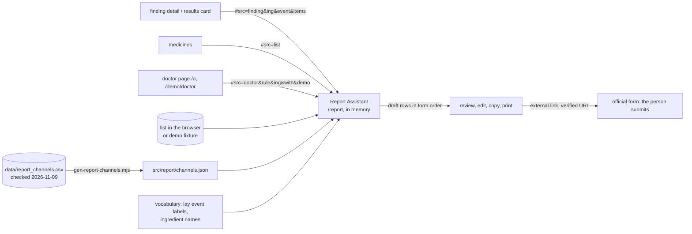

# Design: Report Assistant

> Scope: `apps/web` and `data/` only. Decisions DP1–DP12 (§6), properties P1–P10 (§5). No API route
> is added or changed; the assistant makes no network request at all.

## 1. Overview



## 2. Code layout

```
data/report_channels.csv (+ .meta.json)   the cited channel table (Req 1)
apps/web/scripts/gen-report-channels.mjs  CSV → src/report/channels.json
apps/web/src/report/csv.mjs               pure CSV parser and row → Channel (shared by script and test)
apps/web/src/report/types.ts              the Channel type
apps/web/src/report/channels.ts           types, the channel list, channels by country, field lists
apps/web/src/report/mapping.ts            field mappings per field list (native labels, form order)
apps/web/src/report/draft.ts              pure: buildDraft, copy-all text, required fields not filled
apps/web/src/report/fragment.ts           pure: parse and build the prefill fragments
apps/web/src/report/*.test.ts             vitest + fast-check P1–P10, CSV checks
apps/web/src/components/report/ReportAssistant.tsx   the screen
apps/web/src/app/[locale]/report/page.tsx           the route
apps/web/e2e/report-assistant.spec.ts                Playwright
```

Additive lines in existing files: `FindingDetail` and `FindingCard` (the link), `Medicines` (the
link), `DoctorForm` (a per-finding link, plain `<a>` because the doctor page has no app providers),
`MonthPicker` (an optional `legend`), `globals.css` (print rules), `e2e/routes.spec.ts` (the route).

## 3. Data

### 3.1 Channel (`channels.json`, one per CSV row)

```ts
{ id, region: "TR"|"EU"|"US", country: "TR"|"US"|"EU"|"DE"|"FR"|"ES", authority, name,
  audience: string[], kind: "online"|"pdf"|"document"|"email"|"phone"|"guidance"|"directory",
  url, formId, formVersion, languages: string[], patientMayReport: boolean,
  fieldsStatus: "verified"|"derived"|"partial"|"unverified"|"none", fieldSource: string|null,
  fields: string[], required: string[] (as recorded; "one-of(a|b)" kept), outcomeField: string|null,
  outcomeOptions: string[], sourceUrl, checkedOn: "YYYY-MM-DD", notes }
```

`fields` are "Section > Label" strings as published. A field list is usable for a mapping only when
`fieldsStatus` of the `fieldSource` row is `verified` or `derived` (DP4); `partial` with another
`fieldSource` (3500B online → PDF) uses that row's list and says so (Req 5.3).

### 3.2 Field mappings (`mapping.ts`)

Keyed by the field-list channel. Order = form order (index in `fields`, non-decreasing).

| field list | event | onset | outcome | medicine | others |
|---|---|---|---|---|---|
| tr-tufam-eform | Reaksiyonlar/belirtiler > Reaksiyon/belirti | … > Başlangıç tarihi | … > Sonuç (6 options) | İlaçlar > İlaç adı | İlaçlar > İlaç adı |
| tr-tufam-docx | 2 … > Yaşanan yan etkiyi ve nasıl meydana geldiğini tanımlayın | 2 … > Ne zaman başladı? | 2 … > Yan etkiyi yaşayan kişinin şimdiki durumu nasıl? (6 options) | 3 … > İlacın Adı | 3 … > Diğer ilacın adı |
| us-fda-3500b-pdf | A4 Tell us what happened, … | A3 Date the problem occurred | — (Janus label) | C1 Name(s) of the product as it appears on the box, … | E11 List all current prescription medications … |
| eu-ema-guidance | — (Janus label) | Onset of side effect | Is it ongoing? | Medicine | Other medicines |
| de-bfarm-pdf | Beschreibung > Beschreibung des Arzneimittelrisikos / der Nebenwirkung | Beschreibung > Startdatum der Nebenwirkung | Beschreibung > Ausgang der Nebenwirkung | Verdächtigte(s) Arzneimittel > Bezeichnung o. PZN | Weitere(s) Arzneimittel |
| fr-ansm-cerfa-10011 | Effet > Nature et description de l'effet | Effet > Date de survenue | Evolution | Médicament | Médicament |
| es-notificaram-ciudadano | 4 … > Síntomas de la reacción adversa | 4 … > ¿Cuándo han empezado esos síntomas? | 4 … > ¿Cuál es el estado actual de la persona afectada? | 2 … > Nombre del medicamento | 3 … > Nombre del medicamento |

No mapping: `de-bund-online` (page 1 only), `fr-portail-signalement` (unverified). The 3500B has no
outcome question in the patient sense (A2 is seriousness), so the outcome stays under the Janus
label; Janus does not guess a free field for it.

### 3.3 Draft

```ts
DraftInput = { channel, demo, hcp, medicine: {box, ingredient}, event, onset: "YYYY-MM"|null,
               outcome: {option: number|null, text}, others: {label, ticked}[], monthFormat }
Draft      = { rows: {key, label: string|null (native), section, id, value}[],
               demo: boolean, fieldList: string|null, borrowed: boolean, missingRequired: string[] }
copyAll(d, demoLine, janusLabel) = [demoLine if demo, ...rows.map(r => `${label ?? janusLabel(r.key)}: ${value}`)].join("\n")
```

Empty values are left out. The medicine value is `box (ingredient)`, or the ingredient alone, or the
box alone when it equals the ingredient. Other medicines are joined with "; ". The onset month is
written in the channel's language (`Intl`, month and year).

### 3.4 Fragments (`fragment.ts`)

`#src=finding&ing=<key>&event=<key>&items=<i,j>`, `#src=list`, `#src=doctor&rule=pipc:<n>&ing=<key>&with=<k1,k2>&demo=1`.
Keys `Q[1-9][0-9]{0,9}|J[1-9][0-9]{0,5}`, events `[a-z][a-z0-9_]{0,39}`, items `0..499`, at most 50
others. Anything else is dropped (Req 2.5); unknown event keys are dropped against the vocabulary.

## 4. Screen

Large title "Prepare a report to the authority", summary "Janus does not send this report. You submit
it yourself on the official form." Then, in order: the emergency notice (always first, DP9) and the
safety line of a rule-10 event; an intro card (own choice, suspicion not proof, the cited
under-reporting fact); **1 Where** (segmented TR / EU / US, EU country pills, form pills when a
country has several, the doctor note); **2 What** (medicine select or prefill, box name field,
ingredient, event select + own words, onset month, outcome options or free text, other medicines
checkboxes); **3 Draft** (paper card: authority, channel, form id/version, checked date, demo stamp,
rows with native label, translation, value and Copy; Copy all, Print, Open the official form; the
required fields Janus does not fill; the not-sent sentence; the disclaimer); other ways (e-mail,
phone); the source line. On desktop (≥ 1024 px) the inputs and the draft sit side by side.

States: loading (vocabulary or demo fixture), empty (no medicine in the list and no doctor prefill:
the event can still be described, the medicine typed), error (vocabulary failed: retry),
long content (long box names and labels wrap; the draft never scrolls sideways).

## 5. Correctness properties (fast-check, `src/report/*.test.ts`)

| # | Property | Req |
|---|---|---|
| P1 | For any channel and any input, every native label of the draft is in the channel's verified field list; a channel without a usable list (unverified, none, page-1-only) yields no native label | 1.3, 5.2 |
| P2 | Every URL the assistant can show (channel URL, source URL, finder) is a URL of the CSV; every CSV URL is `https:`, `mailto:` or `tel:` | 1.2, 5.7 |
| P3 | Nothing is sent: building a draft and its copy-all text for any input never calls `fetch`, `XMLHttpRequest`, `sendBeacon` or storage | 6.1, 4.5 |
| P4 | The demo line is in the copy-all text and `draft.demo` is true iff the input is a demo | 9.2 |
| P5 | The other-medicines value is exactly the ticked labels in list order (none ticked → no row) | 4.2 |
| P6 | Copy-all is the rows in form order: its lines after the demo line equal `label: value` of the rows, and the rows' label indexes in the field list are non-decreasing | 5.1, 5.4 |
| P7 | An outcome option index yields exactly that option of the channel's recorded options; a channel without recorded options never shows an option | 4.3 |
| P8 | Fragments: for any string the parser never throws and returns only well-formed codes; build → parse round-trips; the built fragment holds no box name or free text | 2.4, 2.5, 8.1 |
| P9 | In the doctor view a channel whose audience lacks `hcp` yields no native label | 8.3 |
| P10 | Missing required fields: every listed field is a recorded required field of the field list and is not one the draft fills; none for an UNVERIFIED list | 5.5 |

Also unit-tested: the CSV (every row has `source_url`, `checked_on`, an allowed URL scheme; the JSON
equals the CSV; no MedDRA PT of `memory_events.csv` appears as a field label or option of the table,
DP3), every mapping label exists in its field list in form order, no label the assistant can show holds
a forbidden phrase, the 3500B PDF URL is `/media/85598/download?attachment` and no URL contains
`/media/76299` or the legacy French domain. `channels.json` (official labels quoted as published, e.g.
FDA "B2 Do you have a picture of the product?") is excluded from the source phrase scan; the shown
labels are scanned by `channels.test.ts` instead.

## 6. Decisions

| # | Decision | Alternatives | Why |
|---|---|---|---|
| DP1 | Janus prepares a draft on the device; the person copies values into the official form and submits it themselves | submit through an authority API (E2B/ICSR gateway); pre-fill the form by URL parameters | No authority offers a public patient submission API; a gateway would make Janus a reporter and send health data to its server (privacy.md). URL pre-fill is not documented by any of the forms |
| DP2 | Channel facts live in `data/report_channels.csv`, checked by hand on official sites, with `checked_on` and `source_url`; the client uses a generated JSON and a test keeps them equal | fetch the forms at runtime; hard-code in components | Nothing is fetched (Req 6.1); a cited table can be re-verified and reviewed; one source of truth |
| DP3 | **No MedDRA term is shipped or suggested.** The event is the Janus lay label of the vocabulary (Janus's own wording, `memory_events.csv` `label_*`, accepted by the owner 2026-11-08) or the person's words; the PT list of `memory_events.csv` is not used by the client | ship PTs for the authority's coding; MedDRA autocomplete | The MSSO statement (20 May 2026) forbids distribution to non-subscribers, including in open-source apps; authorities code the free text themselves (AEMPS manual). The vocabulary JSON shipped to the client has no PT field. Pre-launch checklist line |
| DP4 | A field mapping only on lists read in the form itself (`verified`) or in the form's official definition file (`derived`, TÜFAM JSON); `partial` lists borrow another edition only where the CSV says so (3500B online ← PDF) | map from the EMA list everywhere; guess the online forms | "Never invent a field": the German online pages 2–4 and the French portal were not read, so their drafts use Janus labels only |
| DP5 | Native label + translation in the interface language; the translation comes from `ReportAssistant.labels.<id>`, not machine translation at runtime | native label only; translated label only | The person must find the exact label on the official form, and understand it. When the form's language is the interface language the translation is not repeated |
| DP6 | Outcome: the channel's own options where they were read (TÜFAM e-form `Sonuç`, TÜFAM patient form current-state question); free text elsewhere; 3500B outcome under the Janus label | map to a Janus outcome scale; map to 3500B "Additional Comments" | Uses the authority's own words; the 3500B has no outcome question for patients and no field is guessed |
| DP7 | The region, country and channel chosen are not stored; the default is the user region of Settings (the demo patient's in demo) | a new setting | The assistant stores nothing (Req 4.5); one less key on the privacy page; the default already comes from Settings |
| DP8 | **No usage counting at all** | an opt-in on-device anonymous tally | Simplest and no privacy risk: a tally of reports prepared is health-adjacent information and would need consent text and a privacy-page entry for no product need |
| DP9 | The emergency notice is always first on the assistant, and the rule-10 safety line before the draft when the event has one | only for rule-10 events | The person may describe a symptom in their own words that Janus cannot classify; reporting is never the first thing to do in an emergency |
| DP10 | Doctor link carries codes only in the fragment (`rule`, `ing`, `with`, `demo`); the doctor page stays stateless; names come from the vocabulary; the medicine is the ingredient name (no box name exists) | carry the note's text; open with the token | privacy.md: no free text, no token beyond the page; the vocabulary gives the same names as the note |
| DP11 | Health-professional routes are named only where the research shows them; the field mapping is used in the doctor view only when the channel's audience includes `hcp` (TÜFAM e-form, BfArM PDF and online, ANSM Cerfa, EMA); otherwise Janus labels, with a note | map the 3500B for doctors | Form 3500 (professionals) differs from 3500B and its fields were not read; the TÜFAM professional form's address was not verified, so it is named, not linked |
| DP12 | The under-reporting sentence is fixed text with its citation (Hazell & Shakir 2006, DOI), the median, the number of studies and the IQR, shown once in the intro card; no "you should report" | a headline figure "94 % are never reported" | Statistician review: a median across heterogeneous studies is not a rate for this person or country; the IQR shows the spread; the line informs without pressure (product.md, medical-safety rule 1) |

## 7. Reviews

`report-assistant-safety-auditor-review.md`, `report-assistant-pharmacologist-review.md`,
`report-assistant-statistician-review.md`, `report-assistant-localization-reviewer-review.md`.
