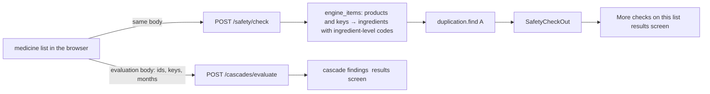

# Design: Safety check of the medicine list

> Scope: `apps/api/janus/safety/` (`duplication.py` pure rules, `schemas.py`, `service.py`, `router.py`);
> `engine_items` in `apps/api/janus/cascades/service.py` (the list read once, shared with the cascade check);
> `apps/web/src/safety/` (`model.ts`, `client.ts`, `useSafety.ts`), `apps/web/src/components/safety/SafetyChecks.tsx`,
> one slot in `components/results/Results.tsx`. Decisions DP-S1-DP-S6, properties S1-S7 (API) and W1-W4 (web).
> Parts B (label interaction text) and C (anticholinergic burden) add their sections to this file when they are
> built. Expert review has not yet been done.

## 1. Overview

The cascade check is unchanged. The safety check reads the same list through the same function
(`engine_items`, extracted from `cascades.service.derive` without a change of behaviour), so "checked
ingredient", combination products, ambiguous choices and homeopathic products mean the same in both.

## 2. Sources
Part A uses no new source: ingredient keys and ingredient-level ATC codes of the current resolution dataset
(TİTCK, CIMA, BDPM, openFDA NDC, Wikidata, RxClass; ATC is the WHO Collaborating Centre's classification, already
credited in NOTICE). The answer names the sources and snapshot dates of the codes of the list's ingredients.
No ATC group name is shown: Janus holds codes, not the WHO index (data-sources.md), so a group is shown by its
code.

## 3. Reading the list (Req 1)
`service.check(conn, body, today)`: current dataset id (none → 503), dataset version equal (else 409),
`cascades.engine_items` (unknown candidate id or key, a bad choice or a start month in the future → 422 with
field paths). One read-only transaction; nothing is written; the access log line carries the route only.

## 4. Duplication (`duplication.py`, pure; Req 2)
Input: the engine items (index, ingredients with key, ingredient-level codes, form confirmed, English label).
- `same_ingredient`: a key that occurs in two or more items. One member (the key) with its items.
- `same_group`: `group_of(code)` is the first five characters of an ingredient-level code, or nothing when the
  fourth-level letter is `X`. A group is reported when two members with different keys have items that differ.
  Members: every key with a code of the group, its items, its codes of that group.
- A finding's `form_confirmed` is true when every occurrence of its members in the named items is.
- `finding_id`: `same_ingredient:<key>` or `same_group:<group>`; unique in an answer.
- Order: same-ingredient findings by key, then groups by code. No cap is needed: at most one finding per key
  and one per group of a list of at most 50 items.

Examples (`test_examples_from_the_spec`): AMLIPIN (amlodipine + lisinopril, combination code `C09BB03`) alone →
nothing; with an amlodipine product → `same_ingredient` amlodipine; with a ramipril product → `same_group`
`C09AA` (lisinopril inside AMLIPIN, ramipril); `C09BB03` appears nowhere.

## 5. Label interaction text: the pipeline (Part B, Req 3)
Job `us_label_interactions` (source `openfda_label_interactions`, CC0 1.0). It reads the openFDA label bulk
download (the index `download.json`, 14 partitions of about 1.8 GB in all), writes one partition at a time to the
run's scratch directory, streams it (`iter_results_stream`: one label in memory at a time) and leaves no partition
behind; only the index is kept as raw input. A label is kept when it has a "Drug Interactions" section and exactly
one active substance name; per substance name the label with the latest effective date is kept (ties: smaller set
id, so the choice does not depend on download order). Rows: substance name as published, set id, version,
effective date, product type, the section text as published, number of labels of the substance. The run fails when
the parsed record count differs from the index; exclusions with reasons are in the manifest. Output: the usual
`artifacts/us_label_interactions/current` run (parquet + manifest), a few megabytes; nothing is committed.
**DP-S7** one label per single-substance name (latest effective date). Alternatives: all labels; the brand label.
Why: bounded size, a stable choice; limit: the kept label can differ from the one a person holds.

## 6. Label interaction text: matching (Part B, Req 4; `safety/interactions.py` pure, `store.py`, `repository.py`)
- `LabelsHolder` reads the current run once and again when `current` points elsewhere (like the recall records);
  no run installed, or an unreadable one: `interactions.status = "unavailable"`, the other blocks still answer.
- The list's ingredients come from the same `engine_items`. Names searched for an ingredient B: its English label
  and the leading words of the US substance names (NDC directory) mapped to B, kept only when the resolution
  dataset knows the name for B and for no other ingredient (**DP-S9**), at least four characters, not on
  `data/label_interaction_name_exclusions.csv` (names that in label text mostly mean a level, a salt or a class).
- The label of A is the label kept for one of A's US substance names (latest effective date). A finding is made
  for an ordered pair (A, B) of different ingredients in different list items when a sentence of that label
  contains a name of B as whole words (case-insensitive; not inside a longer word or number); the longest name
  that is found is reported. At most three sentences per finding (a sentence longer than 600 characters is cut
  around the match, flagged), at most 30 findings (the total is reported). No class is inferred; no severity,
  grade or instruction is produced; the notices say that a passage can state that no effect was seen.
- Result and order do not depend on the order of the items (findings by label ingredient key, then named key).
- Nothing found: the statement `no_label_passage_found`, the labels read with their dates, the ingredients with
  no label (`labels_not_found`), the source and its date; "this does not mean ... do not affect each other".
- Web: one card "Label text that names another medicine": per finding the box names, the quoted sentence
  (`<blockquote lang="en">`), the matched name, label substance, effective date, set id and a DailyMed link; then
  the sentence that Janus quotes the label and does not judge it, with the pharmacist-or-doctor line. Neutral
  surface (no `--warn`/`--risk`).
Properties: B1 a quoted passage is exact label text and contains the name; B2 whole words only; B3 order
independence and documented order; B4 same-item pairs and self-names give no finding; B5 only unambiguous,
long-enough, non-excluded names are searched; B6 long sentences are cut around the match; route tests with a
synthetic run (quote, nothing found, unavailable keeps duplication); pipeline tests (stream reader property,
exclusions, newest label, count mismatch, scratch removed); web W1-W3 extended; Playwright extended.

## 7. API contract **[Client: experience, MCP]**
`POST /safety/check`, medical route. Body: `EvaluateIn` of the cascade engine.
- 422 `{"error": "invalid_request", "fields": [...]}` (the route's own field names and positions only; an unknown
  key is reported as `body`); 409 `dataset_version_mismatch`; 503 `safety_unavailable`.
- 200 `SafetyCheckOut`: `dataset_version`, `items`, `ingredients_checked`, `not_checked[]` (item, position,
  reason: the cascade engine's reasons), `duplication`, `disclaimer`.
- `duplication`: `status` ("checked"), `rules_version` ("duplication-1"), `atc_level` (4), `findings[]`,
  `sources[]` (source id, run id, region, snapshot date of the compared codes), `statement`
  (`no_duplication_found` with its sentence, or null), `notices[]` (`between_list_items_only`,
  `residual_groups_not_compared`, `may_be_intended`).
- A finding: `finding_id`, `kind`, `atc_group` (null for `same_ingredient`), `members[]` (`ingredient_key`,
  `label_en`, `items[]`, `codes[]`, `form_confirmed`), `items[]`, `form_confirmed`.
- `apps/web/src/safety/fixtures/check.json` is this API's answer for an invented list; an API test fails when it
  differs (`JANUS_WRITE_FIXTURES=1` rewrites it), and the web decoder and renderer are tested on it.

## 8. Web (Req 7)
- `useSafety(body)`: one request per evaluation input (the key of the evaluation cache), kept in memory for the
  session; retry on error. The body is the evaluation's own input, so a box name can never be in it.
- `SafetyChecks` sits in the main column of the results screen after the findings and chains (`more` slot of
  `ResultsBody`). The cascade findings do not wait for it.
- Section: heading, one intro line ("Automated comparisons … not advice. Expert review has not yet been done."),
  the number of ingredients that could not be read, then one card per part.
- Duplication card: one bordered tile per finding (title, one row per medicine: box name, ingredient, and for a
  group the codes; the "product form not confirmed" line), then the sentence that this can be intended and that
  a pharmacist or doctor can look at it, the method and the sources with dates. Nothing found: the sentence
  with the number of ingredients compared, ending "This does not mean your medicines are free of problems";
  method and sources folded under "About this check".
- Neutral surface (`border-line`), no `--warn` and no `--risk`: a comparison, not an alert (design.md keeps
  amber for attention and red for emergencies and retractions). Existing components and tokens only
  (`Card`, `SectionTitle`, `Disclosure`, `Mono`, `Button`, `group-header`).
- States: loading (`role=status`), error with retry (`role=alert`), findings, nothing found; long box names
  wrap (`break-words`).

## 9. Properties
| # | Property | Req | Test |
|---|---|---|---|
| S1 | `same_ingredient` iff a key stands in two or more items; once per key; all its items | 2.1 | Hypothesis, oracle |
| S2 | `same_group` iff two different keys in different items carry a code of one non-residual subgroup; once per group; every member really carries a code of the group in every item it names; nothing of the group is left out | 2.2 | Hypothesis, brute-force oracle |
| S3 | one item alone gives no finding | 2.3 | Hypothesis |
| S4 | the result does not depend on item order; ids unique; documented order | 2.6 | Hypothesis, shuffled |
| S5 | only ingredient-level codes of a non-residual subgroup form a group | 2.2, 2.4 | Hypothesis + examples |
| S6 | `form_confirmed` iff every occurrence of the members is | 2.5 | Hypothesis |
| S7 | route: medical, POST only, `no-store`; the ingredient inside a combination product is found and the combination code never appears; nothing found carries the statement; 422 without echo; 409; 503; unknown items by position; database and temp directory unchanged, nothing of the request logged | 1, 2.4, 2.7, 2.8 | route tests (PostgreSQL) |
| W1 | the decoder accepts the API's answer and refuses changed ones; errors map to catalogue keys | 1.3 | unit |
| W2 | every SafetyCheck text in five languages: same keys and parameters; no forbidden, reassurance or "AI" word, also when rendered | 7.7 | fast-check |
| W3 | nothing found: what was compared, data dates, not a clearance, no advice line; findings: box names, group code, form line, advice, review status, no `--warn`/`--risk`; loading and error with retry | 7.2-7.6 | render, 5 languages |
| W4 | one row per (member, item); a box name is shown iff its item is named by a finding | 7.3 | fast-check |
Plus Playwright (`e2e/safety.spec.ts`): five languages × two themes × 375 px and 1280 px, axe, touch targets, no
horizontal scroll, the request equals the evaluation body and holds no box name, nothing found, loading → error
→ retry, demo mode without a request.

## 10. Decisions
| # | Decision | Alternatives | Why |
|---|---|---|---|
| DP-S1 | One route `POST /safety/check` with the evaluation body; the cascade route and its answer are not changed | Add blocks to `/cascades/evaluate`; three routes | The cascade answer is a frozen contract for the note, the report and the MCP server; one extra request, the parts can be added one at a time, a missing part does not break the others |
| DP-S2 | "Same class" is the ATC chemical subgroup (4th level, 5 characters) | 3rd level (pharmacological subgroup); 5th level only | Level 3 flags standard combinations as overlap (`A10B` metformin with a gliptin, `C03` two diuretic types, `N02B`, `J01C`); level 4 groups substances of one chemical class (`C09AA` ACE inhibitors, `C10AA` statins, `A02BC` proton pump inhibitors, `N06AB` SSRIs). Cost: related substances in different subgroups are missed (NSAIDs `M01AB`/`M01AE`, benzodiazepines `N05BA`/`N05CD`); the method text says so. **Owner to confirm** |
| DP-S3 | Residual subgroups (4th-level letter `X`) are not compared | Compare all | They collect unrelated substances ("other antidepressants", "other antiepileptics"); a finding there would not state a shared class |
| DP-S4 | No check in demo mode; one line says so | Recorded answers per demo patient | The demo client answers from recorded fixtures only and has no route for it; recording needs the full dataset and the label artifact. Open item |
| DP-S5 | Findings only between different list items | Also inside one product | A fixed combination is one prescribed product; its own composition is not a duplication of the list |
| DP-S6 | Neutral presentation; wording "can be intended … a pharmacist or doctor can look at it" | `--warn` tiles like the recall notice | Two strengths of one medicine and many same-group pairs are prescribed on purpose; medical-safety rules 1 and 3 |

## 11. Limits and open items
- Same-group: see DP-S2 and DP-S3. Ingredients found by name carry all their codes (all forms), so a group can
  be reported for a form the person does not take; such findings are labelled.
- An ingredient with no ingredient-level ATC code is "not checked" (the cascade engine's rule), also for
  `same_ingredient`.
- Dose, route and schedule are not read; "two strengths of one medicine" cannot be told from a true
  duplication.
- No MCP tool and no demo answers yet. Expert review of the wording.
