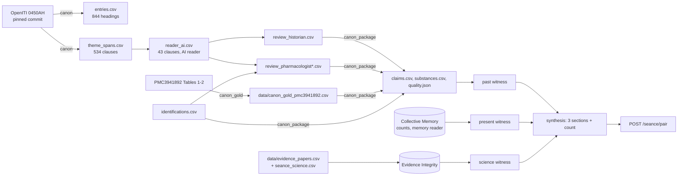

# Design: The Séance ("Three Witnesses"), Phase 4

> Scope: the `canon`, `canon_gold` pipelines and the claim assembly (`pipelines/`), the separate
> CC BY-NC-SA data package `datasets/canon/`, the curated séance tables in `data/`, the
> three-witness synthesis and its routes (`apps/api/janus/seance/`), and the data contract of the
> séance screen (§7). The screen itself is built by `experience` in `apps/web` (not here).
> Decisions are DP1–DP16, properties P1–P21. Owner decisions of 2026-11-08 are applied (DP9,
> DP10); every other decision is recorded for the experts in §9 and was not stopped for review.

## 1. Overview



Three things are kept apart:
1. **Text work** (offline): splitting, theme filter, rules, the reader, two AI review passes. Its
   outputs are files with locators; nothing about it runs on a request.
2. **Each witness** is a pure function from data to a `Witness`: past (claims), present (2x2
   counts), science (studies + integrity verdicts).
3. **Synthesis** only puts the three side by side and counts the supporting sections. It never
   combines them into one value (Req 2.2).

## 2. Code layout

```
pipelines/janus_pipelines/jobs/
  canon_text.py     pure: mARkdown → entries, sections, theme spans, rule tags
  canon.py          job: pinned fetch + blob check, rows, writes datasets/canon/{entries,theme_spans}.csv, source.json
  canon_gold.py     job: PMC3941892 name columns → data/canon_gold_pmc3941892.csv (+ meta)
  canon_reader.py   reader step: Reader protocol, AnthropicReader (SDK client passed in), validation
  canon_package.py  pure assembly → claims.csv, substances.csv, quality.json (python -m …)
pipelines/tests/test_canon*.py
datasets/canon/     CC BY-NC-SA 4.0 package: LICENSE (full legal code), README.md, the files above
data/               seance_conditions.csv, seance_present.csv, seance_science.csv (Apache-2.0, Janus)
apps/api/janus/seance/
  model.py          pure: Locator, items, Witness (invariants), Seance (count, missing), synthesize
  witnesses.py      pure: past_witness, present_witness, science_witness
  catalogue.py      loads and validates package + data tables (startup)
  service.py        catalogue + counts session + integrity snapshot → SeanceOut
  schemas.py        request/response models = the web contract (§7)
  router.py         POST /seance/pair, GET /seance/catalogue (medical routes)
apps/api/tests/test_seance_{properties,api_properties,db_properties}.py
```

## 3. Ancient-text pipeline

### 3.1 Source (Req 1.1)
OpenITI `0428IbnSina.QanunFiTibb.Shamela0010706-ara1.completed` (primary version, 703,674 words,
based on OCLC 43503513), repository `OpenITI/0450AH`, commit `81d1d9e0…ef702` of 2025-11-27 (the
last commit touching the file), git blob `de2e5845…cbc9`. Licence verified 2026-11-08 on the
Zenodo record of OpenITI release 2025.1.9 (doi:10.5281/zenodo.17767721, `cc-by-nc-sa-4.0`); the
GitHub repository itself carries no licence file. OpenITI's metadata flags `MANY_TYPOS,
PAGINATION, MISSING_PARTS`; these flags travel with the package and the response `sources`.

### 3.2 Split and locators (Req 1.2)
Book 2 runs from the level-1 heading `الكتاب الثاني الأدوية المفردة` to the level-1 heading that
starts with `الكتاب الثالث`. Every `### |…|` line between them starts an entry (844: 1 book, 2
*jumla*, 19 *maqala*/tables, 2 parts, 28 letter chapters, 792 simple drugs). An entry's locator is
`(book 2, entry id canon.b2.hNNNN, line_start, line_end, page)`: lines of the pinned file, page =
the first `# PageVxxPyyy` marker after the heading (OpenITI page markers close a page). Body text
drops paragraph marks (`# `, `~~`), page lines and milestones (`msNNNN`); every character keeps its
source line (`line_of`) so a span maps back to lines.

### 3.3 Sections and theme filter (Req 1.3)
Simple-drug entries use inline labels (`الماهية:`, `الطبع:`, `الأفعال والخواص:`, `الزينة:`,
`الأورام والبثور:`, `الجراح والقروح:`, `أعضاء الرأس:` …); they split the entry into sections whose
ids follow the section names of the English Book 2 tradition (`wounds_ulcers`, `head`, …). Theme
terms are matched on a normalised copy (diacritics and tatweel removed, alef forms unified) with
an index map back to the original. Prefixes `و ف ب ل` and `لل` (li- + al-), and pronoun suffixes,
are matched (DP3). A span is the sentence around the term, inside its section, ≤ 260 characters;
terms in one clause share one span (DP5). Infection terms are an interpretive bridge (DP4).
Result on the pinned version: **534 spans in 299 entries** (ulcer 381, infection 149, wound 103,
burn 48 theme tags; a span can carry several).

### 3.4 Reader step (Req 1.3b, 1.3c)
1. **Rules** (`rule_extract`, deterministic): glossary tags for preparation form (plaster,
   liniment, powder, ointment, cerate, affusion, by mouth), vehicle (vinegar, honey, olive oil,
   rose oil, egg white, wax, wine, water), plant part and action words. Janus's own glosses.
2. **Reader** (`canon_reader.Reader`): returns, per span, conditions (wound, burn, ulcer,
   infection, out_of_scope), body site, a one-line use, an English machine translation that
   marks doubtful readings, and whether the rule tags agree. `AnthropicReader` calls
   `claude-opus-5-5` through the Anthropic SDK client (passed in) with JSON-schema structured
   output, a 120 s timeout and server-side refusal fallbacks; a refusal or invalid JSON fails
   loudly. Every row passes `validate` (closed vocabularies, no forbidden words); invalid rows are
   refused, never repaired. Tests use a fake reader and a fake client.
3. **No key configured (2026-11-08)**: the reading of the 43-clause sample was done offline by
   Claude acting as the reader agent and stored as `reader_ai.csv` with its provenance in the
   package README (DP6). The committed file passes the same `validate`.

### 3.5 Identifications (Req 1.4)
`identifications.csv` lists the 31 substances of the sample: Janus identification, gold row of
PMC3941892 (Aliasl and Khoshzaban 2013, Jundishapur J Nat Pharm Prod 8(4):192-196,
doi:10.17795/jjnpp-11686; licence verified 2026-11-08 on PMC: CC BY 3.0; Tables 1-2, 29 rows,
28 substances), and the Hamdard 1998 entry (letter chapter, entry number, PDF page — looked up for
the fact only, no text stored; DP7). Status rule: `matches_gold` when the gold row agrees at the
gold's own level (species, or genus when the gold gives `sp.`/`spp`); `uncertain` when the
sources disagree on the genus, agree on the genus only, or a review pass says so; `not_in_gold`
for substances without a gold row (shown as uncertain). The pharmacologist pass corrected 7 rows
(two `matches_gold` → `uncertain`: lablab, iris/sawsan; final: 15 matches_gold, 6 uncertain,
10 not_in_gold) and flagged 4 hazards (isfidaj, litharge,
verdigris toxic or caustic; narcissus toxic).

Coverage against the gold table: of 28 gold substances, **25 have a heading** in this OpenITI
version (abu khalsa, olive oil and sesame have none: missing or untagged, OpenITI MISSING_PARTS)
and **20 have at least one theme span**; camphor, coriander, sandal, betel nut and garden nightshade have headings
but their gold uses ("hot swellings") are not theme terms, by design.

### 3.6 Review passes and assembly (Req 1.5, 4.2, 5)
The historian and the pharmacologist agents reviewed the 43 clauses independently (separate
runs, separate files, neither saw the other). `canon_package.assemble` keeps a clause only when
neither pass rejects it, keeps only the conditions both passes leave standing (intersection), takes
the historian's translation when given (fidelity owner) and the pharmacologist's otherwise, merges
the identification corrections, and marks every claim `ai_review = passed_both`,
`expert_review = pending`, `headline_eligible = no` for hazardous substances. Assembly is pure and
reproducible (P7).

**Extraction quality (`quality.json`, 2026-11-08):**

| Measure | Result |
|---|---|
| Clauses checked | 43 (31 substances, 20 of them in the gold table) |
| Rule theme vs reader | 34 agree, 5 partial, 4 disagree |
| Rule use tags vs reader | 21 agree, 19 partial, 3 wrong |
| Reader marked out of scope | 5 (scars, general properties ×2, enema, garbled text) |
| Historian pass | 27 accept, 11 correct, 5 reject |
| Pharmacologist pass | 37 accept, 6 correct, 0 reject |
| Same verdict in both passes | 27 of 43; agree on reject-or-not: 38 of 43 |
| Clauses passing both | 38 → **76 claims** (burn 20, infection 21, ulcer 23, wound 12) |
| Corrections | 12 translations, 3 condition lists, 7 identifications |
| Expert-reviewed | **0** |

What the passes found, in short: translations that overstated the text ("ranks first" for
"among the foremost"), silently emended typos ("grows blood" → "flesh"), a reported view turned
into an assertion (henna on wounds, "it is said": now burn only), smoothed corrupt clauses, two
doubtful identifications, a disputed source plant (dragon's blood), and a guess of the reader
("harfiyya" = burn ulcers) that the historian rejects. Rules alone miss about a quarter of uses
(verbs like "agglutinates", typos like `تطولا`, labels without a sentence boundary). This is the
honest level: a usable research index, not a scholarly edition.

### 3.7 Ottoman samples (Req 1.6)
None were added (DP8): the theses and editions named in the research notes could not be read
with page-level citations in this phase. The package README says so.

## 4. Witnesses and synthesis (Req 2)

### 4.1 Model
`Witness(name, items, confidence, missing, context)` with enforced invariants: items ⇔ supports;
a silent witness has a missing reason and confidence `none`; a supporting one has no reason and
confidence `low` or `moderate`. `Seance` computes `supporting` (0–3) and `missing` from the three
witnesses; there is no other derived value (P9–P11).

### 4.2 Past
Claims of (substance, condition) with `ai_review = passed_both`. Confidence `low` until at least
one passage is expert-reviewed (`moderate` then). Missing: `no_canon_passage`,
`passages_rejected_by_review`.

### 4.3 Present
Through `janus.memory.reader.Session.cells` (the existing reader, read-only, parameterised SQL):
the substance's ingredient key (`data/seance_present.csv`), the condition's PT group
(`data/seance_conditions.csv`), suspect scope, region ALL; statistics from `janus.memory.stats`.
Supports only for exposure `same`/`component`, a ≥ 3 and ROR 95 % upper bound < 1 (P13). The
response always carries `observed` (counts, ROR, interval) when counts exist, the PTs, and caveat
codes (spontaneous reports; reports not people; not deduplicated; notoriety and indication bias;
screening pattern, not an effect). Missing: `no_faers_mapping`, `exposure_differs`,
`counts_unavailable`, `too_few_reports`, `no_protective_association`.

Why this is usually silent (DP11): FAERS names herbal products rarely and the resolution ladder
maps none of the sample's plants (henna, St John's wort, honey, aloe, myrrh are `none` in the
name map of the counts build of 2026-11-08). Of the sample, only vinegar (→ acetic acid, a
component) and salt (→ sodium chloride, a different exposure: IV saline) link at all. Vinegar /
infection: 0 of 59 suspect acetic-acid reports name an infection PT → `too_few_reports`.

### 4.4 Science
Studies listed per pair in `data/seance_science.csv` (papers in `data/evidence_papers.csv`,
source `seance_science`); verdicts from `integrity.citability.verdict_map` over the integrity
snapshot (DB, read-only). A retracted or unregistered paper is excluded and listed in `excluded`;
only `direction = supports` counts. Confidence `moderate` with a supporting systematic review,
else `low`. Missing: `no_study_listed`, `integrity_unavailable`, `no_citable_study`,
`studies_do_not_support`. Listed (DOIs and abstracts checked on Crossref and Europe PMC
2026-11-08; no update notice except Cochrane's `new_version`, which integrity treats as
corrected): Samadi 2010 (RCT, St John's wort, caesarean wounds), Halstead 2015 (in vitro, acetic
acid, burn-wound pathogens; CC BY), Nagoba 2013 (narrative review, acetic acid, Pseudomonas wound
infection), Jull 2015 Cochrane (honey: supports partial-thickness burns; mixed for other wounds).
Targets: none yet (DP12).

### 4.5 Results (Gate 4)
No pair reaches three witnesses. The best pairs reach two:

| Pair | Past | Present | Science | Count |
|---|---|---|---|---|
| St John's wort / wound | 1 passage (h0219, "closes large wounds"), low, identification matches gold | missing: `no_faers_mapping` | Samadi 2010 RCT, low | **2 of 3** |
| Vinegar / infection | 2 passages (h0802: wool soaked in vinegar on wounds, creeping ulcers, gangrene), low, matches gold | missing: `too_few_reports` (0 of 59 reports) | Halstead 2015, Nagoba 2013, low | **2 of 3** |
| Honey / burn | missing: `no_canon_passage` (the honey clauses are wounds and foul ulcers) | missing | Jull 2015, moderate | 1 of 3 |

The present witness is the missing one, for a structural reason (DP11), not a tuning one.

## 5. Catalogue and data tables
Loaded at startup; a missing package (`claims.csv`) gives 503 on `/seance/*`, an inconsistent
file stops startup with the file and row named. Validation: every claim's entry exists and its
lines lie inside the entry; every substance's entry exists; conditions and statuses are closed
vocabularies; each present link has a note; each study's paper is in `evidence_papers.csv`.

## 6. Request path (Req 6)
`POST /seance/pair` `{substance, condition}` (strict, unknown keys refused; substance must be in
the catalogue) and `GET /seance/catalogue`. Medical routes: `no-store`, JSON only, 64 KiB,
read-only transaction for the integrity snapshot, nothing logged but the access line. A missing
counts file or evidence store makes that witness missing; the request still answers 200.

## 7. Séance view data contract (for `experience`, `apps/web`) — Req 4.4, 7

### 7.1 Calls
- `GET /seance/catalogue` → `CatalogueOut`: `substances[]` (`SubstanceOut`), `pairs[]`
  `{substance, condition, past_passages, science_studies, present_link: same|component|different|none,
  present_ingredient_key|null}` (the FAERS ingredient of the link; added 2026-11-08 for the hypothesis-card cross-reference),
  `sources[]`, `disclaimer`. Use it to build the pair picker; it lists only pairs with at least one
  passage or study.
- `POST /seance/pair` body `{"substance": "<id>", "condition": "wound|burn|ulcer|infection"}` →
  `SeanceOut`. Errors: 422 `{error: "invalid_request", fields: [...]}`, 503
  `{error: "seance_unavailable"}`. Never put the pair in a URL.

### 7.2 `SeanceOut` (schema_version `seance-1`)
```
substance: { id, name_en, transliteration, heading_ar (Arabic, RTL), kind,
             identification, identification_status: matches_gold|uncertain|not_in_gold,
             identification_label: identified|uncertain,
             gold: {gold_id, scientific_name, citation} | null,
             hamdard_ref: string|null (citation only), hazard: toxic|caustic|null, note }
condition
witnesses:
  past:    { supports, confidence: none|low|moderate, missing_reason|null,
             items[]: { claim_id, locator{entry_id, span_id, book, page, line_start, line_end},
                        arabic_span (Arabic, RTL), translation, translation_kind: "machine_translation",
                        use_en, ai_review: "passed_both", expert_review: pending|reviewed,
                        headline_eligible } }
  present: { supports, confidence, missing_reason|null,
             items[]: { ingredient_key, exposure_match, reports_with_both, reports_with_ingredient,
                        ror, ror_ci{low, high, level}, region: "ALL", scope: "suspect", snapshot_date },
             observed: { …same counts, ror|null, ror_ci|null, exposure_match incl. "different" } | null,
             pts[], codes[] }
  science: { supports, confidence, missing_reason|null,
             items[]: { evidence_id, doi, title, study_type, finding_en, integrity_status },
             excluded[] (evidence ids removed by Evidence Integrity) }
supporting_witnesses: 0..3
missing_witnesses: ["past"|"present"|"science", …]
framing: "hypothesis_not_treatment"
headline: { eligible, reasons[]: no_eligible_passage|hazardous_substance }
sources[]: { id, citation, license }   (OpenITI, PMC3941892, Hamdard cited-only, FAERS)
disclaimer
```
There is no score, strength or "proven" field, and the screen must not compute one.

### 7.3 Display rules
1. **Séance table**: three seats (past, present, science), always all three, in that order, each
   with its own confidence chip and items. A silent seat shows its localised `missing_reason`
   (e.g. "No FAERS link for this substance"). The count reads "2 of 3 witnesses" — never a
   percentage, bar or colour scale; `--risk` red is not used for any witness state (design.md).
2. **Past items**: Arabic `arabic_span` in Arabic script (`dir="rtl" lang="ar"`), then
   `translation` with the label "Machine translation" (localised), then "AI-reviewed, pending
   expert review" while `expert_review = pending`, then the locator as "Canon, Book 2, entry
   h0219, page V01P447, lines 12231–12232 (OpenITI)". Show `use_en` as Janus's summary.
3. **Identification**: next to the name, "Identified (matches PMC3941892)" only for
   `identified`; otherwise "Identification uncertain" (Req 1.4, 4.1). Show `hamdard_ref` as a
   citation only. When `hazard` is set, show "Historical record only — toxic substance" in
   `--warn`, and never offer the pair as a headline.
4. **Present**: `observed` numbers with the confidence-interval bar of design.md (axis, mark at 1,
   range, point); render every `codes[]` caveat as text; counts are "reports". When
   `exposure_match = different`, say the FAERS ingredient is a different exposure and that it is
   not counted.
5. **Science**: title, DOI link, study type, `finding_en`, integrity status chip (corrected /
   expression of concern / not yet checked); `excluded` papers appear only as "1 study removed:
   retracted" with the zombie stamp.
6. **Framing and safety**: the line "Candidate worth investigating — not a treatment" and the
   disclaimer on the screen; no advice, no forbidden phrases (rule 2) in any language; interface
   text in EN, TR, DE, FR, ES; Arabic quotations and the English machine translation are data and
   are not localised (a localised machine translation, if added later, must also be labelled).
7. **States**: loading, 503 (séance not installed), 422, a pair with 0 witnesses, long Arabic
   spans (wrap, no horizontal scroll at 375 px).
8. **Headline demo**: use only pairs with `headline.eligible = true`; with today's data that
   means St John's wort / wound or vinegar / infection, shown as "2 of 3 witnesses".

### 7.4 Code vocabularies to localise
`missing_reason` (11 values, §4.2–4.4), present `codes` (5 values, §4.3), `confidence` (3),
`identification_label` (2), `study_type` (6), `integrity_status` (4), `hazard` (2),
`headline.reasons` (2), condition names (4).

## 8. Correctness properties

| # | Property | Req | Test |
|---|---|---|---|
| P1 | One entry per Book 2 heading in order; locators resolve to lines starting at the heading; every body line in exactly one entry | 1.2 | `test_canon.py` |
| P2 | A span is a trimmed substring of its entry, inside its lines, with a theme term; labels alone never make a span | 1.3 | `test_canon.py` |
| P3 | Normalisation is idempotent and maps back to the source | 1.3a | `test_canon.py` |
| P4 | Span ids change when the text changes | 1.3d | `test_canon.py` |
| P5 | Gold rows are exactly the three name columns, in order | 1.4, 3.2 | `test_canon_gold.py` |
| P6 | A reject removes the clause; final conditions ⊆ both passes'; symmetric | 1.5, 5.2 | `test_canon_package.py` |
| P7 | Committed claims and substances are what assembly gives; locators inside entries | 4.2 | `test_canon_package.py` |
| P8 | Reader output is validated, never repaired; no forbidden words | 1.3c | `test_canon_reader.py` |
| P9 | Witness count = non-empty sections; missing = the empty ones | 2.2, 2.3 | `test_seance_properties.py` |
| P10 | Removing a witness's data never raises the count | PBT 3 | `test_seance_properties.py` |
| P11 | No score / strength / proven field in the response schema | 2.2 | `test_seance_properties.py` |
| P12 | Past items = reviewed claims of the pair; confidence ≤ low before expert review | 1.5, 2.1 | `test_seance_properties.py` |
| P13 | Present supports only for same/component exposure, a ≥ 3, ROR upper < 1 | 2.1b | `test_seance_properties.py` |
| P14 | Science items are registered and never retracted | 4.3 | `test_seance_properties.py` |
| P15 | Dropping a study never adds support | 2.1c | `test_seance_properties.py` |
| P16 | Every ancient claim's locator resolves to an entry of the package | PBT 1 | `test_seance_properties.py` |
| P17 | Every pair answers with separate witnesses, labelled translations, correct identification label | 2.1–2.3, 1.4 | `test_seance_api_properties.py` |
| P18 | No forbidden phrase or reassurance word in any English text served | rules 2, 3 | `test_seance_api_properties.py` |
| P19 | Invalid input → 422 naming fields, value never echoed or logged | 6.2 | `test_seance_api_properties.py` |
| P20 | Only the access line is logged | privacy | `test_seance_api_properties.py` |
| P21 | A retracted trial drops out, is listed as excluded, the count falls | 4.3 | `test_seance_db_properties.py` |

## 9. Decisions (for the experts)

| # | Decision | Alternatives | Why |
|---|---|---|---|
| DP1 | Primary OpenITI version, pinned commit + blob hash check | latest master; another version (JK, ALCorpus) | Reproducible locators; OpenITI marks this one primary |
| DP2 | One entry per heading of any level (844), not only drug headings | 792 drug headings only | Matches the spec's 844 and keeps the tables (*alwah*) addressable |
| DP3 | Match normalised text with li-/al- and suffix forms | exact strings | `للقروح` and `قيحها` were missed otherwise (recall) |
| DP4 | "Infection" = putrefaction, pus, spreading/foul/malignant ulcers, whitlow, carbuncle, gangrene, fistula | omit infection | The Canon has no infection concept; the bridge is named as interpretive in data and screen |
| DP5 | Span = sentence around the term within its section, ≤ 260 chars | fixed window; whole section | Readable quotation, short-quote friendly; long sections were cut mid-clause (reviewers flagged some) |
| DP6 | No API key: Claude as reader agent offline, stored as AI artifact; LLM path behind a `Reader` interface | wait for a key | Owner instruction; same validation either way |
| DP7 | Hamdard looked up for identification facts only; cited by entry and page | not consulted; quote it | Two-source check needs it; text is © Jamia Hamdard |
| DP8 | No Ottoman samples | add from secondary summaries | No page-level source could be verified |
| DP9 | Headline = passed both AI passes, not hazardous; identification shown as identified/uncertain | wait for experts | Owner decision 2026-11-08 |
| DP10 | `reviewed` reserved for experts; AI status separate | reuse `reviewed` | Owner decision 2026-11-08 |
| DP11 | Present witness = protective FAERS pattern only, for matching exposures; `different` never counted | count disproportionality; count salt via IV saline | FAERS records harms, not benefits; topical salt ≠ IV sodium chloride |
| DP12 | Science = curated papers through Evidence Integrity; no targets | ChEMBL targets | No target source in the stack yet; papers are checkable now |
| DP13 | Confidence per witness: past low (moderate after expert review), present low, science moderate only with a systematic review | numeric scores | Req 2.2 forbids merging; levels stay coarse |
| DP14 | Conditions of a claim = intersection of both passes | union; historian wins | Conservative: a claim stands only where both reviewers let it |
| DP15 | Historian's translation wins over the pharmacologist's | the reverse | Fidelity is the historian's scope |
| DP16 | Package in `datasets/canon/`, gold table in `data/` | everything in data/ | data/ is Apache-side, small and CC BY-compatible; the Canon derivative is NC-SA |

**Open questions for the experts:** lablab vs ivy (*habl al-masakin*); *sawsan* iris vs white
lily; *sirish* (Eremurus vs Asphodelus); frankincense and mallow species; isfidaj white lead vs
zinc oxide; dragon's blood source; "harfiyya" ulcers; pellitory "given to drink" for burns;
whether vinegar → acetic acid is an acceptable component bridge; each one-line study finding.

## 10. Open items
- Register Canon claims as `ancient:` evidence records (kind exists) so notes can cite them by id;
  today the dataset record `dataset:openiti_canon` (from the `canon` artifact) and the locator stand.
- Targets for the science witness (ChEMBL), with licence check.
- Janus benefit reports (light-face Req 3) as a second present-witness layer once k = 20 groups exist.
- Extend the reader to all 534 spans when an API key is configured; every new row needs both passes.
- The API Docker image does not yet ship `datasets/canon/` (Phase 5 deployment).
- The `retractions` run in the shared data directory has not yet checked the four séance DOIs;
  until it does their status is `unknown` (citable under integrity DP4).

## 11. Result of the build (2026-11-08)
Pipelines: `canon` (844 entries, 534 spans), `canon_gold` (29 rows), assembly (76 claims, 31
substances). API: `/seance/pair`, `/seance/catalogue`. Gate 4: **not met** — best pairs have two of
three witnesses (§4.5); the present witness is missing for structural reasons (DP11).

## 12. Web screen (built 2026-11-08, `experience`)
`/research/seance` (`apps/web/src/components/seance/Seance.tsx`, `src/seance/`): pair picker (substance, then its listed
conditions; opens on St John's wort / wound), the substance card, the count card ("n of 3 witnesses", missing witnesses,
rule-7 line, headline status, the infection bridge), the three seats in fixed order and the sources. Glass Janus calls it
"evidence summary". Demo mode answers from `src/seance/fixture.recorded.json` (catalogue + the two headline pairs, recorded
from the local API by `scripts/record-seance.mjs`) with no request. A hypothesis card links here when its ingredient is the
present link of a séance substance with `same` or `component` exposure (today: acetic acid → vinegar; no recorded light
card has it; salt → sodium chloride is `different` and never linked). Review passes and outcomes:
`seance-screen-review.md`. Choices made there without stopping: titles holding a forbidden phrase are withheld (DOI kept);
excluded studies say "retracted or not registered" (no per-id reason in the contract); a silent seat reads "Does not
support".

