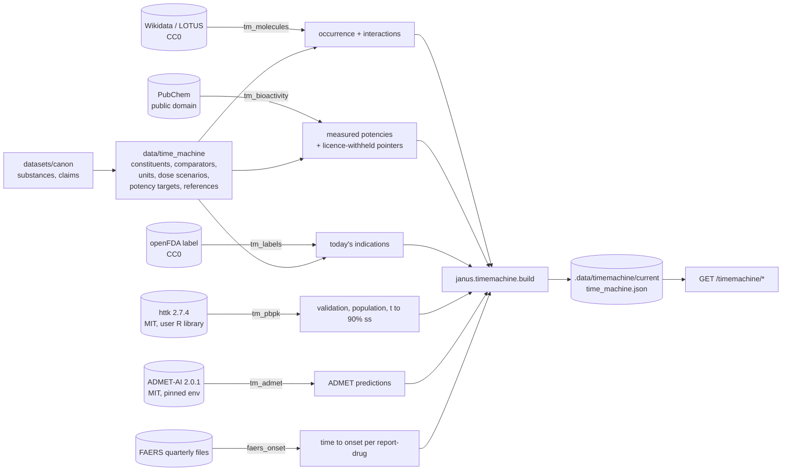

# Design: The Time Machine

> Scope: the pipelines `faers_onset`, `tm_molecules`, `tm_bioactivity`, `tm_labels`, `tm_pbpk`,
> `tm_admet`; the curated tables in `data/time_machine/`; the pure package
> `apps/api/janus/timemachine/`; the offline build and the read-only `/timemachine` routes. The
> web screens are built by `experience` in `apps/web` from the contract in §10.
> Decisions are DP-T1–DP-T15, properties P1–P20. Every decision was taken by this build and is
> listed for the experts in §11.

## 1. Overview



Three things are kept apart, as in the séance:
1. **Fetching and modelling** (offline, may need R or a model environment).
2. **Pure maths** (`units`, `pk`, `onset`, `exposure`, `twin`, `validation`): no I/O, property
   tested, the only place a number is derived.
3. **Serving**: reading one precomputed file. Nothing is computed per request (Req 8.1).

## 2. Code layout

```
pipelines/janus_pipelines/jobs/
  faers_onset.py    time to onset per (report, drug) from the raw quarterly archives
  time_machine.py   tm_molecules (Wikidata), tm_bioactivity (PubChem), tm_labels (openFDA)
  tm_models.py      tm_pbpk (Rscript + httk), tm_admet (pinned ADMET-AI environment)
pipelines/tools/admet_predict.py   runs in the model environment, never imported by Janus
data/time_machine/  constituents, comparators, units, observed_pk, compartmental_pk,
                    dose_scenarios, potency_targets, cascades, references   (all Apache-2.0, Janus)
apps/api/janus/timemachine/
  units.py       historical mass → grams with the spread between sources (pure)
  pk.py          one-compartment closed form, Monte Carlo bands (pure)
  onset.py       Weibull MLE, likelihood-ratio interval, shape rule (pure)
  exposure.py    concentration band versus measured potency (pure)
  twin.py        risk window, agreement with published timing (pure)
  validation.py  the credibility rule (pure)
  httk_run.R     the PBPK runs; called only by tm_pbpk
  build.py       offline assembly → .data/timemachine/<run>/time_machine.json
  store.py       reader + holder (startup)
  schemas.py     response models = the web contract (§10)
  router.py      GET /timemachine/{catalogue,substance/{id},cascade/{id}}
apps/api/tests/test_timemachine_{properties,api}.py
pipelines/tests/test_{faers_onset,time_machine}.py
```

## 3. Sources, versions and licences (verified 2026-11-09)

| Source / tool | Version | Licence | Verified | Use |
|---|---|---|---|---|
| Wikidata (incl. LOTUS uploads) | live, query date recorded | CC0 1.0 | Wikidata:Licensing; Rutz et al. 2022 (doi:10.7554/eLife.70780) states CC0 for LOTUS | occurrence statements, interactions |
| PubChem PUG REST | live | NCBI-created data public domain; **deposited records keep the depositor's licence** | NCBI policies page; PubChem downloads page (Wayback 2025-01-02, live page behind reCAPTCHA) | measured potencies, structures |
| ChEMBL (as a PubChem depositor) | — | CC BY-SA 3.0 | ChEMBL interface documentation | **values never stored**; pointers only |
| openFDA drug label | live | CC0 1.0 | existing registry entry | today's indications |
| FAERS quarterly files | 2025Q4–2026Q3 | CC0 1.0 | existing registry entry | time to onset |
| httk | 2.7.4 (R 4.6.1) | MIT + file LICENSE | CRAN page | PBPK, HTTK-Pop |
| ADMET-AI | 2.0.1 (chemprop 2.3.1, torch 2.9.1+cpu, rdkit 2026.3.6) | MIT; TDC training sets carry their own licences (FreeSolv CC BY-NC-SA 4.0) | GitHub LICENSE.txt, PyPI metadata | ADMET predictions |
| OpenITI Canon (via `datasets/canon`) | pinned commit | CC BY-NC-SA 4.0 | séance design §3.1 | substance identification, dose statements |

**DP-T1. httk for PBPK, a compartmental model for everything else.** R was installed
system-wide by the owner; httk is installed into `.data/tools/R-library` with `R_LIBS_USER` and
is never committed. httk is a real PBPK model and is called PBPK. Where httk has no human
parameters for a drug, Janus's one-compartment model is used and is called "minimal
compartmental model with cited physiological parameters", never PBPK (Req 4.2a).

**DP-T2. Which drugs httk can carry.** httk 2.7.4 has human `Clint` and `Funbound.plasma` for
metoclopramide, haloperidol, risperidone, midazolam and furosemide. It has **no human
`Clint`** for amlodipine, gabapentin, pregabalin, donepezil, rivastigmine, galantamine,
lisinopril, enalapril or ramipril — only `Funbound.plasma` for some. The cascades those drugs
index therefore cannot carry a PBPK layer; this is recorded per cascade in `cascades.csv` and
shown in the contract as `method`.

## 4. L1 — molecules (Req 2)

`constituents.csv` curates 14 compounds for four substances, each with a reason:

| Substance | Canon entry | Constituents |
|---|---|---|
| St John's wort (`st_johns_wort`) | `canon.b2.h0219` | hyperforin, hypericin, pseudohypericin, quercetin, hyperoside |
| rhubarb (`rhubarb`) | `canon.b2.h0693` | rhein, emodin, aloe-emodin, chrysophanol, sennoside A |
| anise (`anise`) | `canon.b2.h0027` | trans-anethole, estragole, p-anisaldehyde |
| vinegar (`vinegar`) | `canon.b2.h0802` | acetic acid |

St John's wort and vinegar come from the séance's `matches_gold` identifications; rhubarb and
anise were added because their Canon entries **state a dose**, which L4 needs (§6.2). All four
are well identified and none carries a hazard flag.

**DP-T3. Occurrence is checked on the InChIKey, never on the name.** `tm_molecules` requires a
referenced P703 statement whose compound carries the curated full InChIKey; the reference
article items are recorded. Of the 14, 13 had a referenced statement for their taxon; acetic
acid is recorded without a taxon because vinegar is a preparation (Req 2.2b). Result: 14
occurrence rows, 0 excluded.

**DP-T4. LOTUS provenance is the article, not a LOTUS item.** LOTUS writes "stated in" (P248)
pointing at the source publication, not at a LOTUS database item, so Janus records the
reference article ids (55 for hyperforin, 73 for hypericin, 11 for rhein …) and does not filter
on a LOTUS marker. A query filtering on a LOTUS item returns nothing, which is why the first
attempt found zero.

## 5. L2 — targets and today's drugs (Req 3)

**DP-T5. Only US-government depositors supply values.** `tm_bioactivity` reads PubChem activity
summaries for every constituent and comparator. A row is stored only when its depositor is a
US-government source (NCGC, Tox21, NCATS, DTP/NCI, EPA DSSTox, ToxCast) and its measure is a
potency. ChEMBL-deposited rows (CC BY-SA 3.0) and rows whose depositor could not be verified are
counted and dropped. First run: 40,942 rows in, 1,538 stored, 3,065 dropped as ChEMBL, 8,185 as
unverified depositor, 28,154 with no potency value.

**DP-T6. Structures are resolved by name and checked.** Comparator drugs are resolved through
PubChem's name endpoint; constituents use their curated CID. Every fetched structure must carry
the curated InChIKey or the run fails (Req 2.3). This exists because a CID recalled from memory
during exploration was wrong (a CID believed to be midazolam is zaleplon); nothing may depend on
a remembered identifier.

**DP-T7. Interaction flags, with the value withheld.** A stored or dropped activity on PXR
(NR1I2), CYP3A4, 2C9, 2D6, 2C19, 1A2 or P-glycoprotein raises a flag carrying the assay id, the
target, the depositor and the licence class — never a withheld value. 33 flags were raised.
Only a curated (compound, target) pair is marked `established` with its own evidence: currently
one, **hyperforin–PXR** (PubChem AID 338905, a Ki record deposited by ChEMBL, value withheld),
cited to Moore et al. 2000 (doi:10.1073/pnas.130155097, Ki = 27 nM in the abstract). Every other
flag says it is a screening-panel record (Req 3.4a). This is how the CYP3A4 induction of St
John's wort is found by the pipeline rather than asserted.

**Today's drugs.** `comparators.csv` names, per condition, the drugs used today, and `tm_labels`
confirms the condition on a US label: pregabalin, duloxetine and gabapentin for sciatica
(neuropathic pain); ibuprofen, naproxen and diclofenac for falls and muscle injury; dicyclomine
and hyoscyamine for colic. All 8 matched a label term; 0 excluded. Each bridge from a Canon
condition to a modern indication is marked interpretive in the table.

**Overlap.** Wikidata records interactions (P129) for dicyclomine (CHRM1/2/3), ibuprofen
(PTGS1, PTGS2, ASIC1, SLC5A8) and naproxen (PTGS1, PTGS2); it records none for the curated
constituents. So the honest L2 result is: **no target overlap was found between the Canon
constituents and today's drugs in open interaction data**, while measured potencies exist for
the constituents on other (mostly screening) targets. That negative result is reported, not
hidden.

## 6. L3 — ADMET and the body simulation (Req 4)

### 6.1 Time to onset from FAERS (`faers_onset`, Req 6)
The promoted `faers` artifact carries `quarter` and `fda_dt` only, so the onset job reads the
**raw archives of that run** (no network): `THER.start_dt` matched on `dsg_drug_seq` for the
drug, and `DEMO.event_dt` for the report. The `faers` artifact and its contract are untouched;
`faers_onset` is a separate artifact.

**DP-T8. Only complete dates, with every exclusion counted.** FAERS dates may be `YYYY`,
`YYYYMM` or `YYYYMMDD`; only the complete form is used, and impossible dates are rejected.
Intervals must satisfy 0 ≤ days ≤ 3650; a longer interval is usually the start of long-standing
therapy, not an onset. First run over four quarters: 5,114,466 (report, drug) pairs, **456,948
usable (8.9 %)**; excluded as no therapy start 4,096,840, partial start date 270,568, negative
interval 159,947, missing event date 122,035, interval over ten years 8,128. **42.7 %** of
reports carry a complete event date. These shares are published with every result.

### 6.2 Historical dose (Req 7.1)
`units.csv` gives each unit a low, central and high value in grams with its sources:
dirham 2.80 / 2.975 / 3.30 g, mithqal 4.00 / 4.25 / 4.464 g. The central dirham is 7/10 of the
4.25 g gold-dinar mithqal (Bates 1995, Encyclopaedia Iranica); the ends are the Islamic coin
standard and the later Persian weight-dirham. Hinz's legal values (3.125 g, 4.464 g), cited
through Bos 1996, were verified only from indexed footnote snippets and are flagged for the
experts; they lie inside the range. "Sharba" is a drink, not a mass, and is not modelled.

Two Canon entries state a dose; no séance substance did, which is why rhubarb and anise were
added:
* rhubarb `canon.b2.h0693`: "the dose is two dirhams in a mixed syrup", for falls and blows and
  muscle tears → 5.6–6.6 g of root → **168–792 mg** total hydroxyanthracenes (3–12 % as rhein,
  EMA/HMPC/113701/2019). Most is present as glycosides, so modelling it as rhein overestimates
  immediate free rhein.
* anise `canon.b2.h0027`: "the full dose on its own is half a dirham", as a carminative →
  1.4–1.65 g of fruit → **16.8–94 mg** trans-anethole (oil 1.5–6 % v/w × trans-anethole 80–95 %
  of the oil, EMA/HMPC/321181/2012); the volume-to-mass step ignores oil density, which was not
  verified, so the range is approximate.

St John's wort states no dose, so it has **no exposure scenario** (Req 7.1b).

### 6.3 The compartmental model (`pk.py`)
One compartment, first-order absorption, lag, linear elimination, in closed form (Bateman), so
no ODE solver: `C(t) = F·D·ka/(V(ka−k))·(e^{−k(t−tlag)} − e^{−ka(t−tlag)})`, with the ka = k
limit handled separately. Repeated doses by superposition. Uncertainty by seeded Monte Carlo
over log-normal CL, V, ka and uniform F and lag; bands are the 5th, 50th and 95th percentile.

Parameters (`compartmental_pk.csv`), each cited:
* **amlodipine** — CL 29.4 L/h and V 1470 L at 70 kg, F 0.64 (Faulkner 1986, IV + oral, n = 12);
  ka 0.62 /h chosen so Tmax is 6.0 h, the observed oral Tmax (Soria-Chacartegui 2023, n = 160);
  CL spread covers the elderly-versus-young difference 19 vs 25 L/h (Abernethy 1990).
* **rhein** — apparent CL/F 1.6 L/h and t½ 4.3 h (Magnard 1993) → V/F 9.93 L, F = 1 because the
  parameters are already apparent; diacerein is entirely converted to rhein (Nicolas 1998).
  ka 1.5 /h is an **assumption** (no verified Tmax) and carries a wide spread.

### 6.4 ADMET (`tm_admet`)
ADMET-AI 2.0.1 runs in `.data/tools/admet-ai-env` (Python 3.12, CPU, torch 2.9.1+cpu) and
predicts 14 endpoints for all 25 structures. Predictions are labelled predictions. The unbound
fraction used in §6.5 comes from the `PPBR_AZ` prediction and is named as a prediction, not a
measurement — a known weakness, listed for the experts.

### 6.5 PBPK (`tm_pbpk`, `httk_run.R`)
`Rscript` runs three things with httk's package defaults (`model = "pbtk"`,
`restrictive.clearance = TRUE`), seeded, and records the version of R and of every package used:
single oral doses for validation; HTTK-Pop steady-state plasma concentration at 1 mg/kg/day for
**ages 65–79** against **20–50**, 1000 virtual individuals each; and the day at which 90 % of
steady state is reached.

**DP-T9. The httk configuration is chosen in advance, not fitted.** A sensitivity check with
`restrictive.clearance = FALSE` changes the predictions by up to 13-fold and would make
metoclopramide credible while leaving the others failing. Choosing the option per drug would be
fitting to the validation set, so the package default is kept and the sensitivity is recorded
here.

**DP-T10. HTTK-Pop stops at 79.** HTTK-Pop resamples NHANES 2013–2018 records and
`httkpop_generate` defaults to ages 0–79 with no record above 79; `agelim_years = c(65, 79)` is
therefore the oldest population available, and 80+ is never simulated or claimed (Req 4.4).

## 7. The digital twin of the cascade (Req 7.3, 7.4)

### 7.1 Cascades covered (`cascades.csv`)
| Cascade | PIPC row | Method | Why |
|---|---|---|---|
| amlodipine → oedema → diuretic | 5 | **compartmental** | demo headline; httk has no human clearance for amlodipine (DP-T2) |
| gabapentinoid → oedema → diuretic | 31 | onset only | no httk parameters for gabapentin or pregabalin |
| antipsychotic → extrapyramidal symptoms → antiparkinson | 18 | **PBPK** | haloperidol and risperidone are in httk |
| metoclopramide → extrapyramidal symptoms → antiparkinson | 18 | **PBPK** | metoclopramide is in httk; PIPC row 18 names antipsychotics, so applying it to metoclopramide is an interpretive extension and is labelled one |
| ACE inhibitor → cough → antitussive | 1 | onset only | no httk parameters for these ACE inhibitors |

### 7.2 Weibull time to onset (`onset.py`)
Maximum likelihood through the profile likelihood of the shape (the scale is closed-form given
the shape), computed with log-sum-exp so a large shape cannot overflow; 95 % interval for the
shape from the likelihood-ratio test (χ²₁ = 3.841). The shape rule is Hatahira 2017
(doi:10.1186/s40780-017-0088-5) and Hasegawa 2020 (doi:10.1002/pds.5108): interval below 1 →
decreasing hazard ("early"), containing 1 → constant, above 1 → increasing ("wear-out");
Cornelius 2012 (doi:10.2165/11599740-000000000-00000) is the method paper for the shape test.

**DP-T11. Same-day onset is shifted by half a day.** A Weibull needs positive times and FAERS
records whole days, so every interval is fitted as `days + 0.5`; quantiles and the curve are
reported back in reported days.

### 7.3 Risk window and agreement
The risk window is the 10th–90th percentile of the fit, or of the reports when no fit is
possible.

**DP-T14. The patient sentence uses the interquartile range, the research area the 80 % band.**
Every cascade here has a Weibull shape below 1 (decreasing hazard), so the 90th percentile sits
far beyond the median. The middle half is the honest summary for one sentence; the wide band is
kept, with its coverage stated, for the research area.

**DP-T15. An out-of-range predicted protein binding gives no unbound fraction.** `PPBR_AZ` is a
regression output and is not bounded to 0–100: it predicts 112.6 % for hyperforin, 101.9 % for
chrysophanol and 101.6 % for emodin. Such a value would imply a negative unbound fraction, so it
is rejected and the comparison falls back to the total concentration (basis `total_only`, an
upper bound on exposure) rather than computing a negative one.

**DP-T12. The agreement rule depends on what was published.** A published median with IQR is
compared by IQR overlap; a published window is compared by whether our median falls inside it;
qualitative timing gives `not_comparable` rather than a forced verdict (Req 7.4a).

First run (four FAERS quarters):

| Cascade | reports | median days | Weibull shape class | published | agreement |
|---|---|---|---|---|---|
| amlodipine → oedema → diuretic | 35 | 23 | early | excess over the first months (Savage 2020 days 1–90 with risk still rising; Vouri 2019 first 4 months) | **agrees** |
| gabapentinoid → oedema → diuretic | 19 *(small sample)* | 7 | early | median 36 days, IQR 15–61 (Hayes 2026) | agrees |
| antipsychotic → EPS → antiparkinson | 29 *(small sample)* | 3 | early | days to weeks (Shin 2012), qualitative | not comparable |
| ACE inhibitor → cough → antitussive | 17 *(small sample)* | 19 | early | hours to months (Dicpinigaitis 2006), qualitative | not comparable |
| metoclopramide → EPS → antiparkinson | 0 | — | — | qualitative | no data |

Four of five cascades fall below 30 usable reports and are marked small samples; one has no
usable report at all. Savage 2020 found the risk still *rising* to day 90, which does not support
a claim that risk is highest in the first 90 days; the published window is therefore recorded as
1–120 days, not as a peak.

### 7.4 Population layer
For a PBPK cascade the twin reports the steady-state concentration band for ages 65–79 and
20–50 and their ratio of medians, at 1 mg/kg/day, as a **relative** comparison only (the
absolute values failed validation, §8). Older-to-younger ratio of medians: haloperidol 1.63,
risperidone 1.61, metoclopramide 1.51.

## 8. Validation (Req 5)

**DP-T13. The credibility rule is fixed before the comparison.** `credible` when the predicted
Cmax **and** AUC are both within 2-fold of the published observed value; `borderline` within
3-fold; otherwise `failed`. Only a `credible` drug may carry an exposure-versus-potency verdict.

### 8.1 Results, as they came out

| Model | Drug | Cmax obs → pred (fold) | AUC obs → pred (fold) | Verdict |
|---|---|---|---|---|
| httk PBPK | risperidone | 14.66 → 4.49 ng/mL (3.27×) | 91.3 → 88.1 ng·h/mL (1.04×) | **failed** |
| httk PBPK | midazolam | 8.19 → 11.97 (1.46×) | 19.3 → 228.9 (11.86×) | **failed** |
| httk PBPK | metoclopramide | 44.0 → 30.79 (1.43×) | 314.3 → 740.4 (2.36×) | borderline |
| httk PBPK | haloperidol | 0.85 → 6.62 (7.79×) | 21.8 → 696.8 (**32.01×**) | **failed** |
| compartmental | amlodipine | 9.22 → 3.88 (2.37×) | 303.5 → 217.7 (1.39×) | borderline |
| compartmental | rhein | 3200 → 2970 (1.08×) | 21300 → 24113 (1.13×) | **credible** |

**httk: 0 of 4 credible.** The failures are AUC over-predictions, i.e. under-predicted
clearance: httk's in-vitro-to-in-vivo extrapolation is built for environmental chemicals and, in
this configuration, does not reproduce the hepatic clearance of these pharmaceuticals at
therapeutic doses. Haloperidol is the worst (32-fold on AUC) and its observed Cmax is itself
from an abstract whose own CL/F is arithmetically inconsistent. Risperidone's parent-drug Cmax
is also affected by CYP2D6, which was not genotyped in the observed study.

**Consequence, applied:** no httk drug carries an exposure statement. The PBPK layer is
published only as the *relative* older-versus-younger comparison of §7.4, and every card says
the model is not validated for that drug.

**Compartmental: rhein credible, amlodipine borderline.** Rhein's AUC comparison is
**not independent** — CL/F comes from Magnard 1993 while the observed AUC comes from Debord
1993, and the two papers may share one control group — so only the Cmax agreement (1.08×) is a
real check; this is stated in the artifact (Req 5.5). Amlodipine under-predicts Cmax 2.37×,
most likely because Faulkner's 21 L/kg is a terminal volume; it stays `borderline`, so the
headline cascade carries no "reaches the active level" statement either.

### 8.2 L4 outcome
Both exposure scenarios end **without a verdict**, for different honest reasons:
* **rhein** — model credible, but PubChem holds no measured potency on a curated,
  condition-relevant target (PTGS2, IL1B) from a public-domain depositor. Its most sensitive
  public-domain assay is an inhibitor screen against a DNA-repair endonuclease at 0.32 µM, which
  says nothing about falls and bruises; using it would have produced a confident, meaningless
  "reaches". Recorded as a gap (Req 7.2b).
* **trans-anethole** — no published human PK parameters, so no model and no comparison.

So the Time Machine currently produces **no** "the concentration reaches the active level"
statement for any substance. That is the correct result of the rules, not a gap to be filled by
loosening them.

## 9. Properties (traceable to requirements)

| # | Property | Requirement | Test |
|---|---|---|---|
| P1 | Unit conversion is linear in the amount; low ≤ central ≤ high | 7.1, 7.1a | `test_timemachine_properties` |
| P2 | A non-positive amount or unknown unit is refused | 7.1 | same |
| P3 | The unit table is ordered (dirham < mithqal) and every unit is cited | 1.1, 7.1a | same |
| P4 | Concentration is never negative and mass is conserved | 4.2 | same |
| P5 | Concentration is linear in dose | 4.2 | same |
| P6 | Repeated doses superpose | 4.2 | same |
| P7 | Closed-form Cmax and AUC agree with numerical integration; Tmax ≥ lag | 4.2 | same |
| P8 | Simulation bands are ordered and reproducible from the seed | 4.3 | same |
| P9 | The Weibull fit recovers shape and scale of synthetic data within 5 standard errors | 6.4 | same |
| P10 | The shape interval contains the estimate; the shape class follows the interval | 6.4 | same |
| P11 | Degenerate or negative onset data is refused | 6.2 | same |
| P12 | Quartiles are ordered; small samples are flagged exactly below 30 | 6.4b | same |
| P13 | The exposure verdict is monotone in concentration and matches its margins | 7.2a | same |
| P14 | A published window equal to ours agrees; qualitative gives not comparable | 7.4, 7.4a | same |
| P15 | `/timemachine` is GET-only and classified medical | 8.2 | `test_timemachine_api` |
| P16 | An invalid id is never echoed back | 8.3 | same |
| P17 | A model that failed validation never carries an exposure verdict; established flags cite evidence | 5.4, 3.4a | same |
| P18 | Every (report, drug) pair is either output or counted as excluded | 6.2 | `test_faers_onset` |
| P19 | The Polars extraction agrees with the pure date rule | 6.1, 6.2 | same |
| P20 | A non-public-domain depositor never supplies a value; a pointer never carries one | 1.2, 1.2a | `test_time_machine` |

## 10. Web contract **[Client: experience]**

All routes are `GET`, medical, `no-store`, and need no body. Every response carries
`meta.built_at`, `meta.review_status` (always `"AI-reviewed, pending expert review"`),
`meta.disclaimer`, `meta.seed`, `meta.simulations`. 503 `{"error":"time_machine_not_installed"}`
when the artifact is absent; 404 `unknown_substance` / `unknown_cascade`; 422
`{"error":"invalid_request","fields":["substance_id"]}` without echoing the value.

### 10.1 `GET /timemachine/catalogue`
`substance_ids: string[]`, `cascade_ids: string[]`, `validation` (§10.4), `sources` — per
pipeline: `run_id`, `snapshot_date`, `license`, `source_urls[]`, `tool_versions`.
Use it to build the index and the "how it was made" panel.

### 10.2 `GET /timemachine/substance/{substance_id}`
`substance.constituents[]`: `compound`, `pubchem_cid`, `inchikey`, `wikidata_qid`,
`taxon_qids[]`, `occurrence_reference_qids[]`, `why_selected`, `molecular_weight` (g/mol),
`admet` (object of prediction name → number; `PPBR_AZ` is percent bound, `Half_Life_Obach`
hours, `VDss_Lombardo` L/kg, the rest probabilities 0–1), `measured_activities[]`
(`gene`, `target`, `measure`, `value_um` µmol/L, `outcome`, `assay`, `depositor`, `aid`),
`measured_activity_count`, `interaction_flags[]` (`gene`, `entrez_gene`, `measure`,
`pubchem_aid`, `value_withheld_licence`, `established` boolean, `evidence_reference_key`,
`meaning`).
`substance.todays_drugs[]`: `drug`, `condition_key`, `indication_term`, `label_set_id`,
`label_effective_time`, `bridge_note`.
`exposure[]`: `constituent`, `historical_dose` (`amount`, `unit`, `grams_low/central/high`,
`unit_sources[]`), `constituent_dose_mg` (`low`, `high`), `content_percent`, `reference_keys[]`,
`note`, `model` (`kind` ∈ `compartmental`, `label`, `peak_mg_per_l` {p5,p50,p95}, `tmax_h`,
`parameter_sources[]`) or `null`, `model_validated` boolean, `not_validated_reason`,
`no_potency_reason`, `curated_targets[]`, `comparison` or `null` (`verdict` ∈
`reaches|overlaps|stays_below`, `basis` ∈ `unbound|total_only`, `margin_low`, `margin_high`,
`potency_um`, `potency_measure`, `potency_assay`, `potency_aid`, `unbound_fraction_source`).
`references[]`: `key`, `citation`, `doi_or_url`, `verified`, `note`.

**Rendering rules.** Show `model.label` verbatim wherever a curve or band is shown — never the
word PBPK for a `compartmental` model. When `model_validated` is false, show
`not_validated_reason` in place of any verdict. When `comparison` is null, show
`no_potency_reason`. Show `measured_activities` with their assay name: a potency on an
uncurated target is a screening result, not an effect. Never render a dose as a dose a person
could take.

### 10.3 `GET /timemachine/cascade/{cascade_id}`
`cascade`: `cascade_id`, `pipc_position`, `index_class`, `event`, `treating_class`, `method` ∈
`pbpk|compartmental|onset_only`, `method_label` (render verbatim), `note`, `reference_keys[]`,
`onset` (`reports`, `median_days`, `q25_days`, `q75_days`, `median_ci_low`, `median_ci_high`,
`small_sample` boolean, `zero_day_reports`, `zero_day_caveat`,
`weibull` {`shape`, `shape_ci_low`, `shape_ci_high`, `scale`,
`shape_class` ∈ `early|random|wear_out`} or null, `weibull_omitted_reason`),
`risk_window` (`start_days`, `end_days`, `basis` ∈ `weibull|reports`, `coverage`),
`middle_half_days` (`start_days`, `end_days`: the interquartile range, used by the patient
sentence),
`onset_curve` (`days[]`, `share[]` 0–1) or null,
`published` (`kind` ∈ `median_iqr|window|qualitative`, `low_days`, `high_days`, `median_days`,
`reference_keys[]`), `agreement` ∈ `agrees|disagrees|not_comparable` or null,
`population` (`age_range_older` `"65-79"`, `age_range_younger` `"20-50"`, `source`,
`dose_basis`, `drugs[]` with `drug`, `css_older_mg_per_l` {p5,p50,p95},
`css_younger_mg_per_l`, `older_to_younger_ratio`, `days_to_90pct_steady_state`) or null.
`faers_quality`: the onset pipeline's metrics, including `usable_pair_share` and
`complete_event_date_share`. `onset_subset_caveat` (on this response and on the catalogue) states that the usable subset is selected, not random, and must be shown wherever
an onset figure is shown.

**Rendering rules for onset.** Show `reports` with the word "reports", never "people". When
`small_sample` is true, show the count and the interval and do **not** present `shape_class` as
a finding. Show `zero_day_reports` next to the count with `zero_day_caveat`, because same-day
reports drive the "early" shape. Show `agreement` with both intervals side by side, never as a
bare verdict: at these widths "agrees" means "not inconsistent with".

**Codes to translate** (en, tr, de, fr, es): `method` and `agreement` values, `shape_class`,
`risk_window.basis`, `verdict`, `basis`, the error codes, `small_sample`, and the fixed reason
codes `no_potency_reason` / `not_validated_reason` / `weibull_omitted_reason`. The API sends no
user-facing sentence in any language; `method_label`, `model.label`, `note` and `meaning` are
English source strings for the research area and are shown verbatim there.

**Units in field names**: `_days`, `_h`, `_mg`, `_mg_per_l`, `_ng_ml`, `_ng_h_ml`, `_um`,
`_percent`, `grams_*`. Percentiles are always `p5`/`p50`/`p95`.

### 10.4 Validation block
`validation.rule` (string, show it next to any model output), `validation.pbpk[]` and
`validation.compartmental[]` with `drug`, `reference_key`, `observed_cmax_ng_ml`,
`predicted_cmax_ng_ml`, `cmax_fold_error`, `observed_auc_ng_h_ml`, `predicted_auc_ng_h_ml`,
`auc_fold_error`, `credibility` ∈ `credible|borderline|failed`, `note`; plus
`pbpk_summary` and `compartmental_summary` counts. The research area must show this table
wherever a simulated concentration is shown.

### 10.5 The one patient-facing sentence (Req 9)
Built by the web app from codes, only when `onset.small_sample` is false and `agreement` is
`agrees`:

> In reports others have filed, this combination was most often reported between
> **{middle_half_days.start_days}** and **{middle_half_days.end_days}** days after the first
> medicine was started. This is information from reports, not a prediction about you — it may be
> worth discussing with your doctor.

The sentence uses `middle_half_days` (the middle half of the reports), **not** `risk_window`.
With a decreasing hazard (shape below 1) the central-80 % band runs to 475 days for the
amlodipine cascade while its median is 23 days; "between 0 and 475 days" would be true and
useless. The 80 % band belongs in the research area, with its `coverage` text.

Nothing else from this feature is patient-facing: no concentration, dose, potency, molecule,
fold error or population figure. With the current build only
`amlodipine_oedema_diuretic` qualifies (35 reports, agrees).

## 11. Decisions for the experts
DP-T1 (httk for PBPK, compartmental elsewhere), DP-T2 (which drugs httk can carry),
DP-T3/DP-T4 (occurrence by InChIKey; LOTUS provenance is the article),
DP-T5 (US-government depositors only), DP-T6 (resolve by name, verify the key),
DP-T7 (interaction flags without values; one curated established pair),
DP-T8 (complete dates only; 10-year cap), the unit ranges of §6.2 and the Hinz snippet caveat,
the content ranges and the anise volume-to-mass gap, DP-T9 (httk defaults, not fitted),
DP-T10 (65–79), DP-T11 (half-day shift), DP-T12 (agreement rule), DP-T13 (2-fold rule),
DP-T14 (interquartile range for the patient sentence), DP-T15 (out-of-range predicted binding),
the use of an ADMET-AI prediction as the unbound fraction, and the interpretive extension of
PIPC row 18 to metoclopramide.
