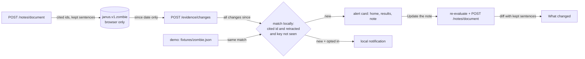

# Design: Zombie Alert

> Scope: `apps/web` only. Decisions DP1–DP10 (§6), properties P1–P9 (§5). No API change: the
> routes of evidence-integrity design §6.1 are used as they are.

## 1. Overview



## 2. Code layout

```
apps/web/src/flow/zombie.ts           pure: cited ids, check body, matching, diff, demo rule, due times
apps/web/src/flow/zombie.test.ts      fast-check properties P1–P9
apps/web/src/store/zombie.ts          the versioned document janus.v1.zombie, validation, the demo memory doc
apps/web/src/flow/useZombie.ts        watcher (open / 24 h / visibility), notifications, update actions
apps/web/src/components/zombie/*.tsx  ZombieWatch (mounted in Shell), ZombieAlertCard, ZombieChanges,
                                      ZombieSettings, DemoRetraction button
apps/web/src/demo/fixtures/zombie.json  the one simulated change
apps/web/src/api/{client,decode,errors}.ts  evidenceChanges() + decoder + route
apps/web/public/sw.js                 notificationclick → open the note
apps/web/e2e/zombie-alert.spec.ts     demo, live (stubbed), notification, axe, themes, locales
```

Existing screens get one additive line each: `Home` and `Results` render `ZombieAlertCard`;
`NotePage` records the note, renders the alert/changes panel and the demo button; `Settings`
renders `ZombieSettings`; `Shell` mounts `ZombieWatch`; `deleteEverything` resets the document.

## 3. Data

### 3.1 `janus.v1.zombie` (v 1)

```ts
{ v: 1,
  notify: boolean,                      // Req 4.1, off by default
  note: { language, madeOn: "YYYY-MM-DD", ids: string[], sentences: {id, text, ids}[] } | null,
  since: "YYYY-MM-DD" | null,           // as_of of the last successful check (server date)
  checkedAt: number | null,             // ms, last attempt (Req 2.1, 2.2, 2.6)
  seen: string[],                       // change keys already alerted (≤ 500)
  alerts: Alert[],                      // open alerts
  update: Update | null }               // the last "What changed"
Alert  = { key, evidenceId, title, doi, observedOn, notice: {doi, url} | null, simulated }
Update = { alerts: Alert[], removed: Sentence[], changed: {before, after}[], language }
```

Validated on read like `tokens.ts`; any invalid shape → the empty document (Req 1.3).
Demo uses a second `Doc` over a `SafeStorage` with no backend (memory only, Req 6.1).

### 3.2 Check body

`{ since, limit: 500 }`. The evidence table holds fewer than a hundred records and the changes
since the last check are a handful; 500 is the API maximum.

## 4. Flow

1. **Record (Req 1.1):** `NotePage` → `recordNote(note)` after every live note document. Cited ids =
   every `evidence_ids` of every sentence (stat sentences and abrupt-stop lines included) of the
   first document; kept sentences = those with ids outside the `integrity` section.
2. **Check (Req 2):** `ZombieWatch` (Shell) on mount: `isDue(checkedAt, now, 1 h)`; an interval of
   one hour and `visibilitychange` re-test `isDue(checkedAt, now, 24 h)` only while
   `document.visibilityState === "visible"`. Single flight.
3. **Match (Req 3.1, 3.2):** `matchChanges(doc, changes)` → new alerts and the new seen list.
4. **Notify (Req 4.3, 4.4):** for a non-empty match, `notify && Notification.permission ===
"granted"` → `registration.showNotification(text, {tag: "janus-source-update", data: {url}})`
   else `new Notification`. One notification per check, whatever the number of alerts.
5. **Update (Req 5):** the alert card's button links to `/note#update`; the note screen's
   "Update the note" clears the result cache and re-evaluates; when the evaluation is back the note
   is made again; on success `applyUpdate(doc, note)` computes the diff, stores `update`, clears
   the alerts and records the new note. Live: `resolveEvidence(changed ids)` fills the notice.
6. **Demo (Req 6):** "Simulate a source retraction (demo)" runs `matchChanges` on the fixture's
   change against the memory doc; the note screen applies `withoutEvidence(note, ids)` to the
   recorded note document before showing it.

## 5. Correctness properties (fast-check, `src/flow/zombie.test.ts`)

| #   | Property                                                                                                                                                                                          | Req      |
| --- | ------------------------------------------------------------------------------------------------------------------------------------------------------------------------------------------------- | -------- |
| P1  | The check body has exactly the keys `since` and `limit`; serialised, it contains none of the cited ids or any kept sentence text                                                                  | 2.3      |
| P2  | Every alert's evidence id is a cited id; changes of ids not cited never alert, whatever they are                                                                                                  | 2.4, 3.1 |
| P3  | An alert is raised iff a cited id has a change to a non-citable status (`retracted`) whose key is not in `seen`                                                                                   | 3.1      |
| P4  | Idempotent: matching the same changes twice (or a list with duplicates) raises the alerts of the first time only; the union of seen keys grows monotonically                                      | 3.2      |
| P5  | A truncated answer moves `since` only to its oldest date; a full one to `as_of`; no id is ever sent                                                                                               | 2.5      |
| P6  | Storage failures never break: any stored value (random JSON, wrong version) validates to a document or `null`, never throws; a throwing storage keeps working in memory                           | 1.3      |
| P7  | Diff: a kept sentence citing a changed id is `removed` iff its id is absent from the new note, `changed` iff present with other text or ids; no sentence that did not cite a changed id is listed | 5.2      |
| P8  | `withoutEvidence` (demo, evidence-integrity Req 5.4): no sentence of the result cites a removed id; a sentence is dropped iff all its ids were removed and it had ids; it never adds a sentence   | 6.4      |
| P9  | Bounds: kept sentences ≤ 300, seen ≤ 500 (newest kept), cited ids distinct                                                                                                                        | 1.5      |

Also unit-tested: `isDue`, the notification text has no PT/medicine slot (it takes no values) and
contains no fixture medicine name in any locale.

## 6. Decisions

| #    | Decision                                                                                                                                                                                                                                     | Alternatives                                                                                                                                                                               | Why                                                                                                                                                                                                                                                                                                                                                                                                            |
| ---- | -------------------------------------------------------------------------------------------------------------------------------------------------------------------------------------------------------------------------------------------- | ------------------------------------------------------------------------------------------------------------------------------------------------------------------------------------------ | -------------------------------------------------------------------------------------------------------------------------------------------------------------------------------------------------------------------------------------------------------------------------------------------------------------------------------------------------------------------------------------------------------------- |
| DP1  | Detect with `POST /evidence/changes` carrying only `since` and `limit`; filter locally                                                                                                                                                       | `POST /evidence/resolve` with the cited ids on every check                                                                                                                                 | Sends **no** id at all on the routine check: the server learns only that some Janus client asked for changes since a date. A possibly truncated answer moves `since` to its oldest date instead of asking by id (Req 2.5, safety audit A3); resolve is used only during an update (DP2)                                                                                                                        |
| DP2  | Notice DOI from `resolve` with the changed ids, during the update only                                                                                                                                                                       | never fetch it; fetch it in every check                                                                                                                                                    | The update sends the evaluation input anyway, from which the server can infer the cited ids; the ids add nothing new then. A failed resolve is not fatal                                                                                                                                                                                                                                                       |
| DP3  | Only `retracted` alerts                                                                                                                                                                                                                      | alert on corrections and expressions of concern too                                                                                                                                        | Matches citability (evidence-integrity Req 5.3, DP4): only a retraction removes a source from the note. A correction already shows as a notice the next time the note is made                                                                                                                                                                                                                                  |
| DP4  | **No background check.** The page checks on open (≥ 1 h since the last attempt) and every 24 h while open and visible. No Periodic Background Sync                                                                                           | `periodicSync` in the service worker                                                                                                                                                       | Periodic Background Sync exists only in Chromium, only for an installed PWA, at a frequency the browser chooses from site engagement, and it cannot be exercised in CI; it would also have to copy the cited ids into a store the worker can read. Firefox and Safari have no equivalent. The Settings text says so honestly (Req 4.5)                                                                         |
| DP5  | Notifications through `ServiceWorkerRegistration.showNotification` when registered, else `new Notification`; the click opens `/{locale}/note`                                                                                                | `new Notification` only                                                                                                                                                                    | Android Chrome throws on `new Notification`; the registration path works there and on desktop                                                                                                                                                                                                                                                                                                                  |
| DP6  | Notification text is fixed, takes no value, and says "Open Janus to update the note" (safety audit A5); the demo has its own text saying it is a simulation (A2)                                                                             | owner draft "…; the note was updated"                                                                                                                                                      | The note is a document made on request; until the patient opens Janus the new note is not made yet. The fixed text cannot carry a PT or medicine name (medical-safety P9)                                                                                                                                                                                                                                      |
| DP7  | Keep the kept-sentence texts in local storage                                                                                                                                                                                                | ids only; keep the whole note                                                                                                                                                              | Needed to show which sentence was removed (Req 5.2). The list and every result already live in the browser (privacy.md); "Delete everything" removes it; bounded to 300 sentences                                                                                                                                                                                                                              |
| DP8  | One note watched: the last one made on this device                                                                                                                                                                                           | every note ever made                                                                                                                                                                       | A note is rebuilt from the current list; older notes are superseded by the latest one                                                                                                                                                                                                                                                                                                                          |
| DP9  | Demo: one simulated change on the cited ThinkCascades paper (`paper:thinkcascades:drugs_aging_2022`), notice DOI `10.5555/janus.demo.retraction-notice`, labelled "Simulated in the demo" everywhere; triggered by a button on the demo note | a synthetic id (not cited by the recorded note, so nothing would change); a real retraction in `data/evidence_papers.csv` (there is none: all four papers were checked with no retraction) | It is the only cited source whose removal changes exactly one sentence (the "also described in ThinkCascades" line) and keeps every finding, so the demo shows the mechanism without touching a finding. The `10.5555` prefix is Crossref's test prefix and does not resolve; the label says the real paper has not been retracted. Naming a real paper in a simulation is flagged on the pre-launch checklist |
| DP10 | Demo note update applies the evidence-integrity rule (keep only citable ids; drop a sentence left without one) to the recorded note in the browser                                                                                           | record a second note from the API                                                                                                                                                          | No API run with a fake retraction exists; the rule is the documented one (evidence-integrity Req 5.4). Counts in the integrity section of the demo note are not recomputed (documented limitation; the demo label is on the paper)                                                                                                                                                                             |

## 7. Reviews and result (2026-11-09)

- Reviews: `zombie-alert-localization-reviewer-review.md`, `zombie-alert-safety-auditor-review.md`;
  all blocking findings fixed (ES alert wording; demo labelling first, simulated stamp and heading,
  demo notification text; truncation fallback by id removed).
- Tests: vitest properties P1–P9 and the check / record / demo units (`zombie.test.ts`,
  `useZombie.test.ts`); Playwright `e2e/zombie-alert.spec.ts`, 28 tests (2 projects × demo, live,
  2 notification, 10 theme × locale).
- Demo availability: the simulation is offered for the Istanbul patient only; it is the only demo
  note that cites the ThinkCascades paper (DP9).

## 8. Open items

- The demo note's integrity section keeps its recorded counts after the simulation (DP10, safety
  audit A9).
- The note screen at 1280 px in Two Faces has an axe colour-contrast finding on the paper (the last
  medicine row of the Istanbul note runs past the A4 box). It exists without this feature; the
  Zombie Alert e2e checks axe on its own cards there and page-wide on the home and Settings.
- A dismissed alert does not come back for the same change (safety audit A8, accepted): any note
  made later is built without the source.
- The privacy page does not list the browser keys; `janus.v1.zombie` holds the kept sentences
  (safety audit A12, on the pre-launch checklist).
