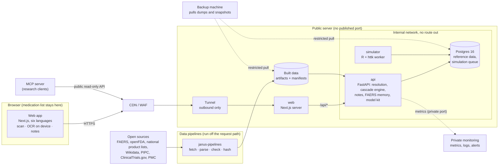

# Architecture

One page on how Janus fits together. Details: [deploy/README.md](../deploy/README.md) (deployment),
[security.md](security.md), [operations.md](operations.md), [metrics.md](metrics.md), decisions in [adr/](adr/README.md).

## Parts

| Part           | Code                            | What it does                                                                                                                                                                                                          |
| -------------- | ------------------------------- | --------------------------------------------------------------------------------------------------------------------------------------------------------------------------------------------------------------------- |
| Web app        | `apps/web`                      | The patient and researcher interfaces. Medication lists, scans (barcode, label OCR on the device) and notes stay in the browser; only codes and names go to the API. Six languages.                                   |
| API            | `apps/api`                      | Name and product resolution, the cascade engine (65 PIPC rules), doctor notes, FAERS reporting ratios, safety and recall checks, the model kit, open data routes. Stateless per request.                              |
| Simulator      | `apps/api/simulator.Dockerfile` | Runs queued in-silico model jobs (R, httk) from a Postgres queue; no network.                                                                                                                                         |
| Database       | Postgres 16                     | Reference data loaded from the built artifacts, the anonymous simulation queue. No personal data.                                                                                                                     |
| Pipelines      | `pipelines/`                    | Fetch open sources, parse, validate against schemas, write versioned artifacts with manifests (source URL, licence, snapshot date, content hash). `pipelines/sources.toml` lists every source and generates `NOTICE`. |
| MCP server     | `apps/mcp`                      | Read-only research tools over the public API for MCP clients.                                                                                                                                                         |
| Research tools | `pipelines/tools/`              | Validation studies and their reproduction (`docs/research/`).                                                                                                                                                         |

## Flows

- **Check a list**: names or codes → `/resolve/*` (ingredients, ATC codes) → `/cascades/evaluate` with the
  ingredient keys and start months → findings with the rule's source and the evidence, shown as questions for a
  doctor; optionally a note PDF built in the browser.
- **Data update**: a pipeline run writes a new artifact; promotion switches its `current` link; the loaders put
  it into Postgres; the API reports the dataset versions it serves.
- **Release**: build images on the server, migrate, swap, run the isolation probe and the smoke test, roll back on
  failure (`deploy/deploy.sh`); every release is a git tag ([releasing.md](releasing.md)).
