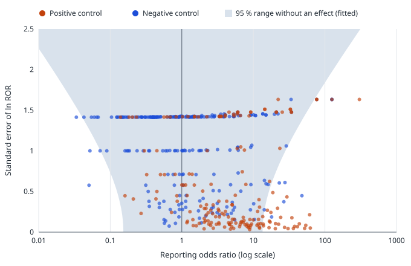

# FAERS signal calibration: results

Protocol: [`faers-calibration-protocol.md`](faers-calibration-protocol.md), registered in commit
`d505bd2` (2026-11-13) before any count for the reference pairs was computed. Script:
`pipelines/tools/faers_calibration.py`. Outputs: `data/validation/faers/results/` (`metrics.json`,
`pairs.csv` with every 2×2 table, `calibration.svg`). Running the script twice gives identical output.

Inputs: FAERS artifact `20261108T004801Z-b4dfb36a-b253` (2025Q4–2026Q3), counts build
`20261108T130944Z-7445632a-7db3a513-7f67` (the one the site serves); OMOP 2013 and EU-ADR reference sets.

## Summary

- The reporting odds ratio separates known causal drug–event pairs from known non-causal ones better
  than chance, but far from perfectly: **AUC 0.74 (95 % CI 0.69–0.78)**. The pre-registered hypothesis
  (lower bound above 0.5) is met.
- Its nominal 95 % intervals are much too narrow for this use: for **26 % (21–32 %) of the negative
  controls** the interval excludes 1, where 5 % would be expected. After empirical calibration this
  falls to **5.3 % (3.1–8.8 %)**.
- The Evans criteria that Janus uses to call a pair "disproportionate" flag **55 % (48–62 %)** of the
  positive controls and stay silent for **88 % (83–91 %)** of the negative controls.

These numbers are why Janus shows a reporting ratio as a reason to look closer, never as evidence that a
medicine causes an event.

## Pairs

| | Pairs | Positive | Negative |
| --- | --- | --- | --- |
| OMOP 2013 + EU-ADR, after removing duplicates | 485 | 201 | 284 |
| Conflicting labels (dropped) | 0 | | |
| Estimable (drug resolves and has at least one report) | 427 | 180 | 247 |
| Not estimable: name not mapped to an ingredient | 31 | | |
| Not estimable: no FAERS report for the drug in the year | 27 | | |

Names Janus did not map: amylases, endopeptidases, epoetin alfa, factor VIIa, isosorbide, lipase,
mefenamate, niacin, regular insulin (human), simethicone, thyroxine, alatrofloxacin, estropipate,
metaxalone. Several are real gaps of the name resolution (thyroxine, niacin, epoetin alfa); they were not
fixed for this analysis.

## Primary outcome

| Measure | Estimate | 95 % CI | n (positive / negative) |
| --- | --- | --- | --- |
| AUC of ln ROR, estimable pairs | 0.737 | 0.690–0.785 (DeLong) | 180 / 247 |

## Secondary outcomes

| Measure | Estimate | 95 % CI |
| --- | --- | --- |
| AUC including non-estimable pairs at the lowest score | 0.698 | 0.649–0.747 |
| AUC, OMOP 2013 pairs | 0.702 | 0.646–0.757 (145 / 202) |
| AUC, EU-ADR pairs | 0.871 | 0.795–0.946 (42 / 45) |

The per-set counts add up to more than the pooled ones because 7 estimable positive pairs (and some negative pairs)
appear in both sets; they count once in the pooled analysis (145 + 42 − 7 = 180).
| Evans decision: sensitivity | 0.550 (99/180) | 0.477–0.621 |
| Evans decision: specificity | 0.879 (217/247) | 0.832–0.914 |
| Negative controls whose nominal interval excludes 1 | 0.259 (64/247) | 0.208–0.317 |
| Negative controls with calibrated p < 0.05 (leave-one-out) | 0.053 (13/247) | 0.031–0.088 |
| Positive controls with nominal p < 0.05 | 0.672 (121/180) | 0.601–0.737 |
| Positive controls with calibrated p < 0.05 | 0.161 (29/180) | 0.115–0.222 |

Fitted systematic-error distribution of ln ROR for pairs without an effect: mean 0.36, standard
deviation 1.14 (247 negative controls). On the ratio scale, a pair with no effect has a typical
reporting odds ratio of about 1.4, and ratios between about 0.15 and 13 are within the 95 % range of
systematic error alone.

AUC by outcome (descriptive; small groups):

| Outcome | AUC | Positive / negative |
| --- | --- | --- |
| Acute liver injury | 0.74 | 76 / 38 |
| Acute kidney injury | 0.84 | 24 / 60 |
| Acute myocardial infarction | 0.58 | 33 / 60 |
| Upper gastrointestinal bleeding | 0.81 | 23 / 62 |
| Anaphylaxis | 1.00 | 5 / 4 |
| Aplastic anaemia | 0.92 | 5 / 5 |
| Cardiac valve fibrosis | — | 0 / 5 |
| Leukopenia, neutropenia, agranulocytosis | 0.80 | 5 / 3 |
| Rhabdomyolysis | 1.00 | 4 / 5 |
| Stevens–Johnson syndrome | 0.80 | 5 / 5 |

## Deviations and notes

- No deviation from the protocol.
- Two pre-specified preferred terms do not occur in FAERS for this year ("Renal failure acute",
  "Cardiac valve fibrosis"; both are no longer current MedDRA preferred terms). The outcome definitions
  were not changed; the other terms of those outcomes were used.
- Pairs with no report of the event among the drug's reports (a = 0) have no estimate on the site.
  Their score in the AUC is ln ROR with 0.5 added to every cell, the zero-cell rule Janus applies
  elsewhere. This is an analysis detail the protocol did not spell out.

## Limits

FAERS counts reports, not patients; it has no denominator and is shaped by publicity and stimulated
reporting. One year of reports; rare drugs have few. The reference sets were built for health-care
databases. The outcome definitions are lists of preferred terms chosen in advance, not validated case
definitions. Expert review has not yet been done.
