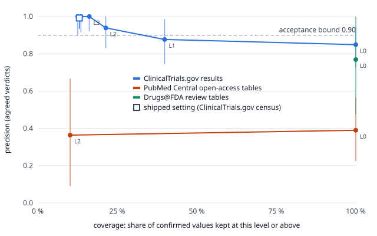

# Model kit precision: method and results (round B3a)

**Status:** research log of the Janus project (open-source research prototype, not a medical device), November 2026.
Research use only. Not for clinical decisions. **Expert review has not yet been done.** Every reading, check and review
pass below is automated; the review passes are an evaluation instrument and never part of the product.

Pre-registered protocol: [`modelkit-precision-protocol.md`](modelkit-precision-protocol.md), registered in commit `7a65950`, pushed before any new sample
was drawn. The numbers are in [`data/validation/modelkit/precision.json`](../../data/validation/modelkit/precision.json).
They are computed by `pipelines/tools/modelkit_precision_report.py` from two files:
[`items.csv`](../../data/validation/modelkit/items.csv), with one row per reviewed value (study, stratum, level and the two
automated verdicts), and [`frames.json`](../../data/validation/modelkit/frames.json), with frame sizes, stratum weights and
coverage.

**Recall is not yet measured.** Counting how many values in a document the readers miss needs experts to annotate whole
documents (phase B3b). Precision here is measured against two automated review passes, not against experts.

## 1. Method in brief

- **Unit.** One confirmed value: two independent rule-based readers agree on the drug, parameter, value, unit, analyte and
  dose.
- **Truth (tier 1).** Two independent automated review passes per value. Each pass sees only the claim and the source
  excerpt; it does not see the stratum, the level, any confidence, or the other pass. A pass gives one of three verdicts:
  correct; incorrect, with an error type; or cannot judge.
- **Precision.** Values both passes call correct, divided by values on which both passes give the same verdict (correct or
  incorrect). *Conservative* precision is both-correct divided by all items. Cohen's kappa is computed over the three
  verdicts.
- **Strata and levels.** The strict publication checks put each value on a level (0 = no strict rule passed; higher = more
  rules passed). Samples are drawn per band of levels, with at most 3 values per study. Band precisions are combined with
  the frame counts as weights.
- **Intervals.** Three intervals are reported for every precision:
  - **Wilson**, which assumes the values are independent.
  - **Study-level cluster bootstrap**: whole studies are resampled within each band, 4,000 resamples, seed 20261113,
    percentile interval.
  - **Wilson with n / design effect.** The design effect is the bootstrap variance divided by the variance under
    independence. When no error was found, the variance cannot be estimated; the design effect is then set to the mean
    number of values per study (intra-cluster correlation 1, the conservative bound).
- **Cluster-aware lower bound.** The smaller of the bootstrap lower bound and the adjusted-Wilson lower bound.
- **Acceptance rule** (pre-registered, unchanged): a source ships only if its cluster-aware lower bound is **≥ 0.90**.
- **Freshness.** A value, or for the new frames a whole document, enters a measurement only if no earlier sample touched
  it. Values reviewed earlier are never reported as a new precision measurement. The ClinicalTrials.gov figures below are
  re-analyses of samples drawn and judged on 2026-11-12, and are labelled as such.

## 2. ClinicalTrials.gov: risk–coverage curve (re-analysis)

The registry is exhausted for fresh measurement: earlier samples touched 333 of the 360 studies that ever had a confirmed
value. The curve below re-analyses the earlier fresh sample A, frame F: studies in which no earlier sample had found an
error, 1,010 values in 177 studies. It uses iteration 1 of the strict record check.
- Coverage is the share of all 2,565 confirmed ClinicalTrials.gov values that sit at the level or above.
- Levels 0 to 2 are stratified estimates over the bands, weighted by frame F's band counts.
- Levels 3 to 5 are measured directly, within one band.

| Level | Coverage | Agreed values (studies) | Precision | Wilson 95 % | Cluster bootstrap 95 % | Design effect | Cluster-aware lower | Rule (≥ 0.90) |
|---|---|---|---|---|---|---|---|---|
| ≥ 0 (no strict rule) | 100 % | 144 (84) | 0.849 | 0.742–0.917 | 0.732–0.944 | 1.25 | 0.727 | no |
| ≥ 1 | 40 % | 121 (66) | 0.877 | 0.784–0.934 | 0.760–0.986 | 1.78 | 0.745 | no |
| ≥ 2 | 21 % | 101 (50) | 0.939 | 0.867–0.973 | 0.837–1.000 | 1.84 | 0.831 | no |
| ≥ 3 | 16 % | 87 (44) | 1.000 | 0.958–1.000 | 1.000–1.000 | 1.98 * | 0.920 | yes |
| ≥ 4 | 14 % | 82 (41) | 1.000 | 0.955–1.000 | 1.000–1.000 | 2.00 * | 0.914 | yes |
| ≥ 5 | 13 % | 71 (34) | 1.000 | 0.949–1.000 | 1.000–1.000 | 2.09 * | 0.898 | no |

\* No error was found, so the bootstrap interval is degenerate (1.000–1.000). The design effect is then the conservative
bound, the mean number of values per study. This is why the cluster-aware lower bound, not the bootstrap, decides.

**The shipped figure, re-computed.** Census C covers iteration 2 at level 3, the setting the product uses: all 126 values
of that set not reviewed before, from 14 studies, one of which has 36 values. Coverage is 336 of 2,565 (13 %).

| | Agreed | Correct | Studies | Precision | Wilson 95 % | Cluster bootstrap 95 % | Design effect | Wilson, n / deff | Cluster-aware lower | kappa |
|---|---|---|---|---|---|---|---|---|---|---|
| Census C (shipped) | 126 | 125 | 14 | 0.992 | 0.956–0.999 | 0.966–1.000 | 1.80 | 0.934–0.999 | **0.934** | 1.00 |
| Frame X, level ≥ 3 (studies with an earlier error; secondary) | 22 | 14 | 8 | 0.636 | 0.430–0.803 | 0.292–0.920 | 2.51 | — | 0.292 | — |

What this shows:
- **Clustering widens the interval.** The shipped 0.99 keeps its point estimate, but its lower bound falls from 0.956
  (Wilson) to 0.934 once studies are treated as clusters. It still meets the ≥ 0.90 rule. The design effect of 1.8 rests on
  a single error, so it is itself uncertain.
- **The curve is the result, not one point.**
  - With no strict rule, about 85 % of agreed values are correct.
  - Precision reaches the 0.90 bound only from level 3 up, where coverage is 16 % or less.
  - Level 5 keeps fewer studies (34), so its conservative lower bound drops to 0.898.
- **Frame X is the warning.** In studies where an earlier sample had found an error, level 3 kept only 0.64. Errors cluster
  by study, and the frame-F figures are an upper estimate for the registry as a whole.
- **Agreement.** Kappa between the two passes was low at the levels of frame F (−0.04 to 0.34). The disagreements are on
  values that one pass called wrong for special-population or modified-release arms. Conservative precision, which counts
  every disagreement against the reader, is 0.87 at level 3 (sample A, frame F).

## 3. New sources (fresh frames)

### 3.1 PubMed Central open-access tables, frame P2
- **Articles.** The same Europe PMC search as before (title names the drug and a PK word; open access; CC BY or CC0), taking
  for each non-development drug up to 10 articles beyond the 10 per drug read earlier: 534 articles, of which 527 passed
  the three licence checks. None had been fetched before.
- **Readers.** Readers and confirmation are unchanged. The strict table check runs iteration 2 with the analyte and
  combination-product reference tables switched on, and searches the whole table, not only the value's own row and column.
- **Frame.** 412 confirmed parent values in 38 articles (30 drugs). By level: **0 at level 3**, 42 at level 2 (9 articles),
  370 at levels 0–1 (33 articles).
- **Sample.** 23 values at level 2 (all 9 articles, at most 3 each) and 30 at levels 0–1 (29 other articles): 53 values from
  38 articles.

Level 3 is empty in the new articles. Every value that passes the other rules fails a methods-level rule: another pool drug
named in the methods, a population or release word, or a model-based study. The pre-registered rule is therefore tested at
level 2.

**Results (fresh measurement, two automated passes, kappa 0.88 over all 53 items; 3 disagreements):**

| Level | Coverage of the frame | Agreed values (articles) | Precision | Conservative | Wilson 95 % | Cluster bootstrap 95 % | Design effect | Wilson, n / deff | Cluster-aware lower | Rule (≥ 0.90) |
|---|---|---|---|---|---|---|---|---|---|---|
| ≥ 2 | 10 % (42 of 412) | 22 (9) | 0.364 | 0.348 | 0.197–0.570 | 0.091–0.667 | 2.09 | 0.149–0.651 | 0.091 | **no** |
| ≥ 0 (weighted) | 100 % | 50 (36) | 0.390 | 0.358 | 0.246–0.556 | 0.225–0.564 | 1.10 | 0.240–0.564 | 0.225 | no |

Agreed errors (31): 11 wrong value (a p value, a coefficient of variation or a test statistic read as the parameter;
creatinine clearance from a demographics table read as drug clearance; model outputs), 10 analyte (metabolites such as
SN-38 glucuronide, 7-hydroxy-cannabidiol and the ticagrelor metabolite; a partner drug's value in an interaction study;
tenofovir after its prodrug), 10 context (single-patient values, a rat study, a co-infused or co-administered drug). By
parameter, volume at steady state was right 5 of 5 times; clearance (0 of 7) and Cmax (1 of 5) were the worst.
**PMC tables stay held back.**

### 3.2 Drugs@FDA clinical pharmacology reviews, frame D2
- **Documents.** Priority-1 and priority-2 review PDFs of original applications not fetched before (up to 5 more per
  non-development drug): 261 PDFs, of which 144 are born-digital and 116 scanned. Scanned PDFs are not read.
- **Extension.** Fewer than 40 documents had a confirmed value, so the pre-registered extension added supplement reviews:
  92 PDFs, only 9 of them born-digital.
- **Frame.** 45 confirmed values in **11 documents** (10 drugs).
- **Sample.** 26 values (at most 3 per document).

With 11 documents the cluster-aware lower bound cannot reach 0.90, whatever the verdicts. This was stated before the draw.

**Results (fresh measurement, kappa 1.00 over 26 items):**

| | Agreed values (documents) | Precision | Wilson 95 % | Cluster bootstrap 95 % | Design effect | Wilson, n / deff | Cluster-aware lower | Rule (≥ 0.90) |
|---|---|---|---|---|---|---|---|---|
| Confirmed values (one band) | 26 (11) | 0.769 | 0.579–0.890 | 0.500–1.000 | 2.34 | 0.475–0.925 | 0.475 | **no** |

Agreed errors (6), in 3 of the 11 documents: a test/reference ratio (%) read as AUC and Cmax, a coefficient of
variation read as a half-life, and in a combination-product review a table of the partner drug (salmeterol) and a
paediatric subgroup read as fluticasone propionate. **Drugs@FDA review tables stay held back.**

### 3.3 Sources checked and not measured
| Source | Re-use | Structured PK values | Decision |
|---|---|---|---|
| EMA EPARs | Allowed for commercial and non-commercial use with acknowledgement of EMA ([legal notice](https://www.ema.europa.eu/en/about-us/legal-notice)); the report PDFs state "Reproduction is authorised provided the source is acknowledged"; third-party content excluded | Born-digital PDFs; PK in the clinical pharmacology section, **mostly running text** with some tables; a JSON list of EPAR documents exists | Registered as a cited source (`sources.toml`, `ema_epar`, `cited_only`). Not ingested: the table readers do not read prose. A prose reader would need its own pre-registered measurement. |
| EU Clinical Trials Register (EudraCT) | EMA terms; attribution and access date required | Structured results per arm exist (e.g. Cmax, AUC, t½). But phase 1 trials in adults only, outside a paediatric plan, are **not public**, and those are most dedicated PK studies. No official API. Industry trials overlap heavily with ClinicalTrials.gov. | Not added: little new, independent PK data. |
| CTIS (EU CTR 536/2014) | EMA terms | Results are uploaded summary documents, not structured fields | Not added: would need a PDF reader of sponsor summaries. |
| ISRCTN | CC BY 4.0 (records), CC0 (metadata) | No structured results; links to publications or an uploaded basic-results document | Not added. |
| ANZCTR | Terms forbid automated mining | Results are attachments or citations; no numeric result fields | Not added. |

## 4. What failed, and why

| Source | Fresh precision (cluster-aware lower bound) | Pre-registered expectation | Ships |
|---|---|---|---|
| ClinicalTrials.gov, shipped level 3 (re-analysis) | 0.992 (0.934) | — | yes (unchanged) |
| PubMed Central tables, level 2 | 0.364 (0.091) | not met | no |
| Drugs@FDA reviews | 0.769 (0.475) | not met | no |

1. **Both new sources fail the rule**, as expected before the draw. The way out of the exhausted registry did not open in
   this round: the fresh pools exist, but the document readers are not precise enough on them.
2. **PMC: the reference tables did not fix the source.** On the development items, iteration 2 looked like a fix (15 of 16
   at level 3). On new articles it kept **no** value at level 3, and its level 2 was no better than no rule at all (0.36 vs
   0.39). The development figure did not generalise, the same pattern as the earlier rounds. The errors are not mainly
   metabolites any more: statistic columns (p values, CV, test statistics), creatinine clearance in demographic tables,
   single-patient rows, model outputs and animal studies make up more than half (18 of 31). Several of these are words the check already
   looks for, but in places it does not search (the stub of a single-patient table, the methods of a rat study, a model
   section); they are rules for a next round, and they would have to be measured on another fresh pool.
3. **FDA: too few readable documents.** Of 352 new review PDFs downloaded, 199 are scanned and are not read; 11 documents gave a
   confirmed value. Precision 0.77 is better than the earlier 0.48, but its errors sit in three documents, and 11 documents
   cannot give a lower bound near 0.90.
4. **Target sample size not reached:** 79 fresh values from 49 studies (target ≥ 120 from ≥ 40). The frames were taken at
   capacity under the 3-per-study cap.
5. **ClinicalTrials.gov:** the shipped figure survives the cluster correction (lower bound 0.934), but it rests on 14
   studies and one error; in error-prone studies the same level kept 0.64. A fresh ClinicalTrials.gov measurement is not
   possible with the current intake.

Not measured in this round: recall (phase B3b, expert annotation) and expert precision (tier 2). The negative results are
also listed in [`negative-results.md`](negative-results.md).

## 5. Reproduce
`uv run --project pipelines python pipelines/tools/modelkit_precision_report.py --date 2026-11-13` rewrites
`precision.json` and the SVG from `items.csv` and `frames.json`. The source excerpts shown to the review passes are not
committed. They are quotations of the sources, rebuilt from the article XML and the review PDFs named by the identifiers in
`items.csv`.
